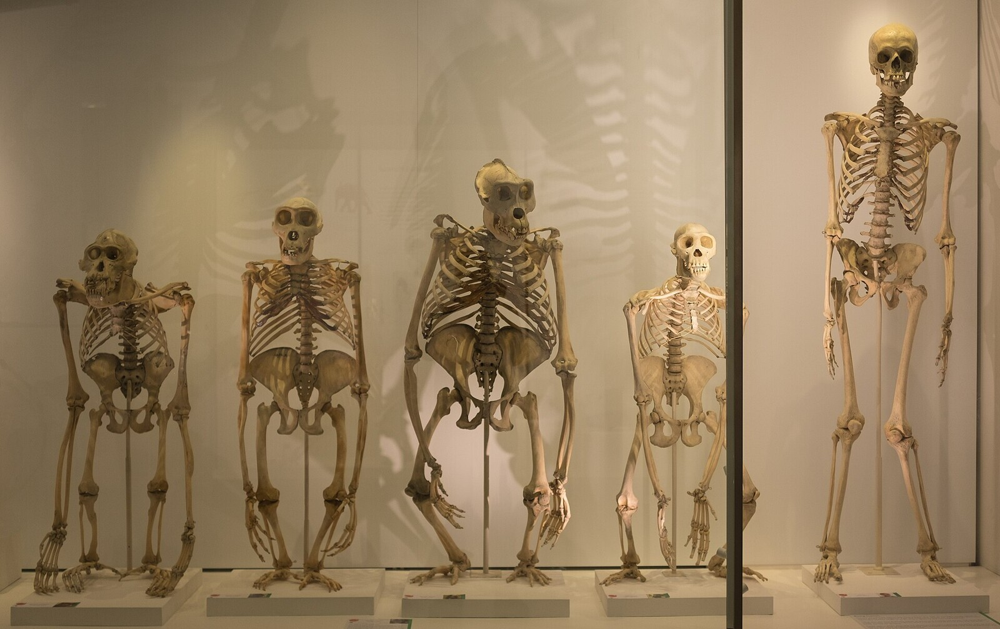
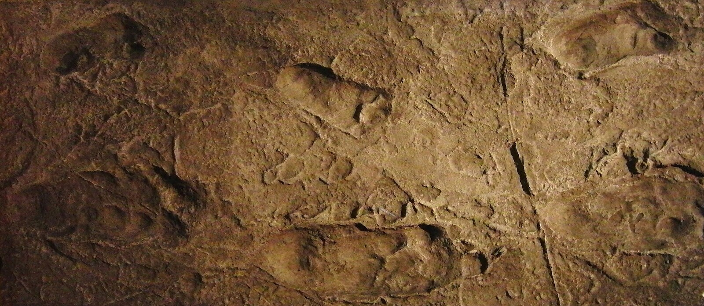
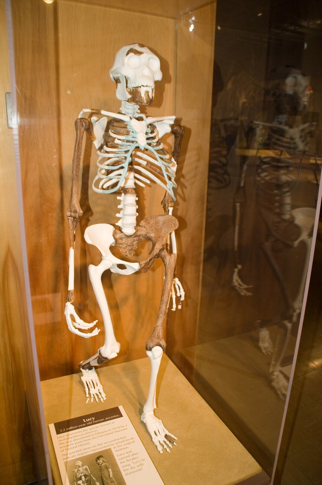
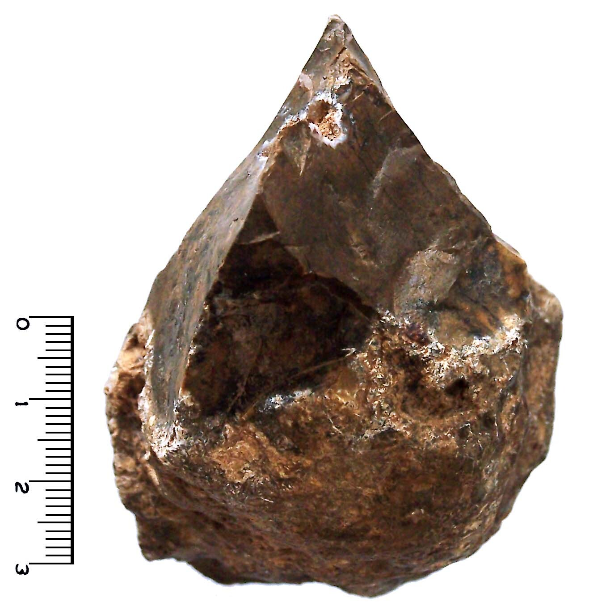
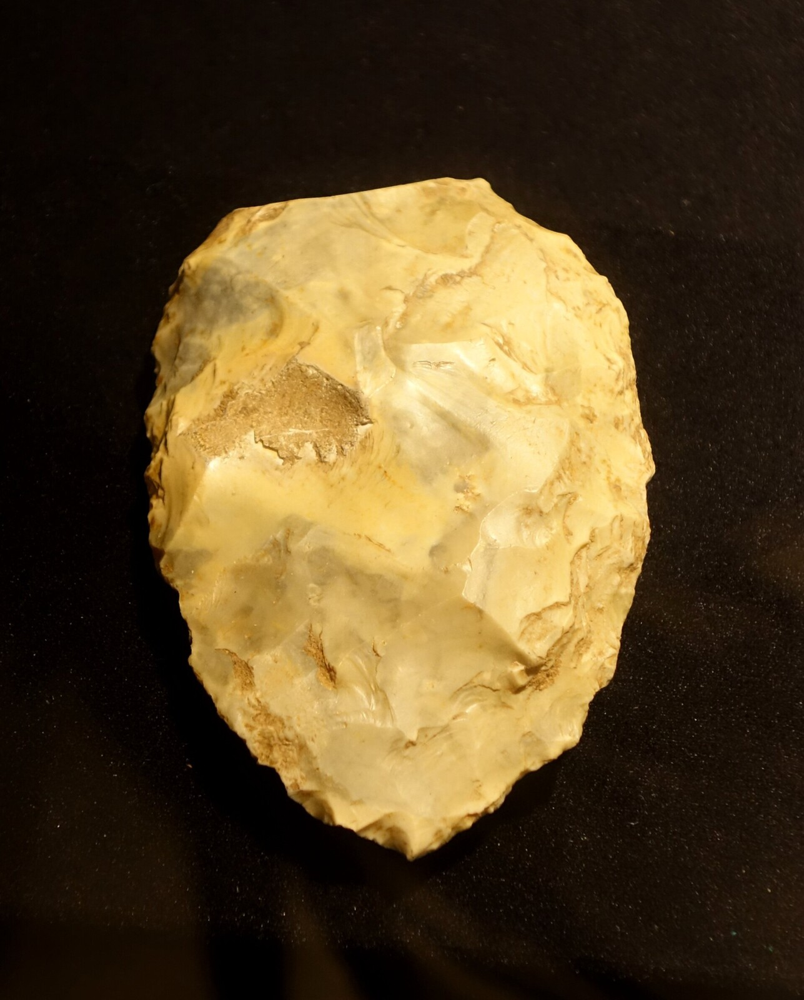
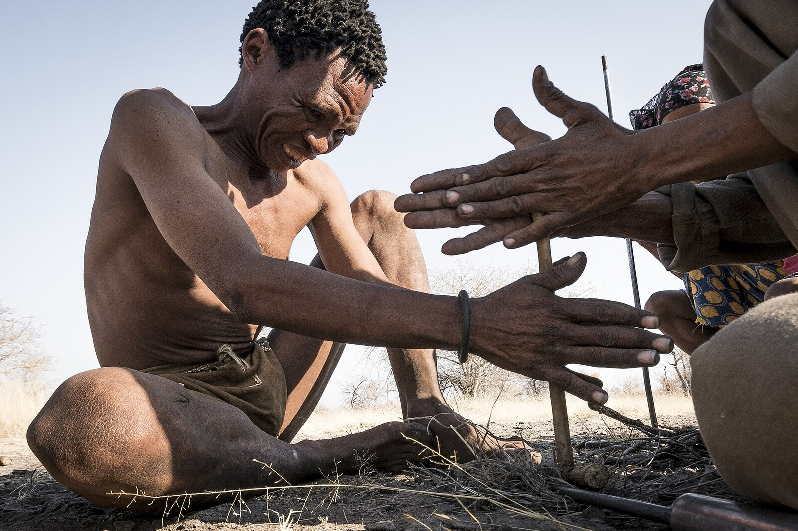
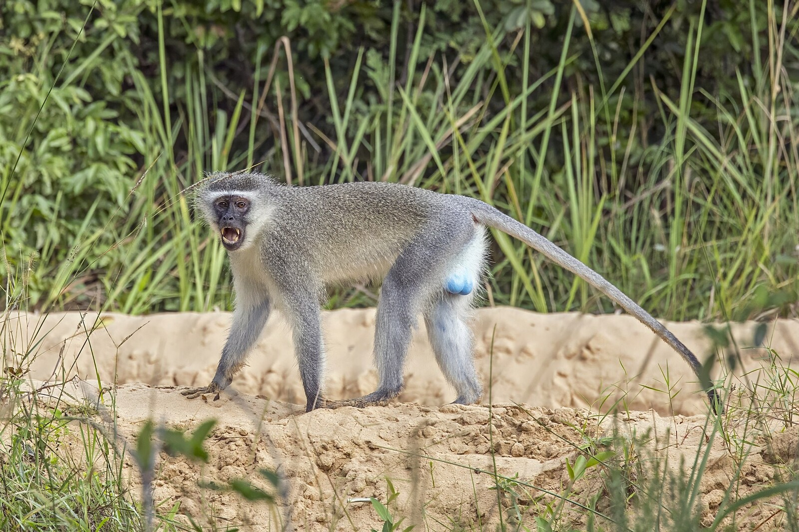
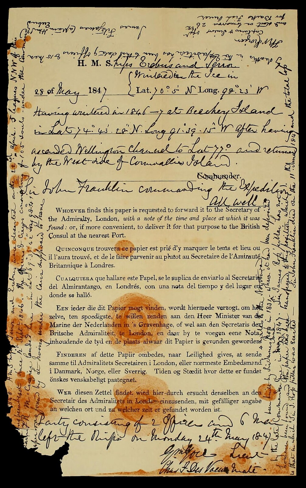
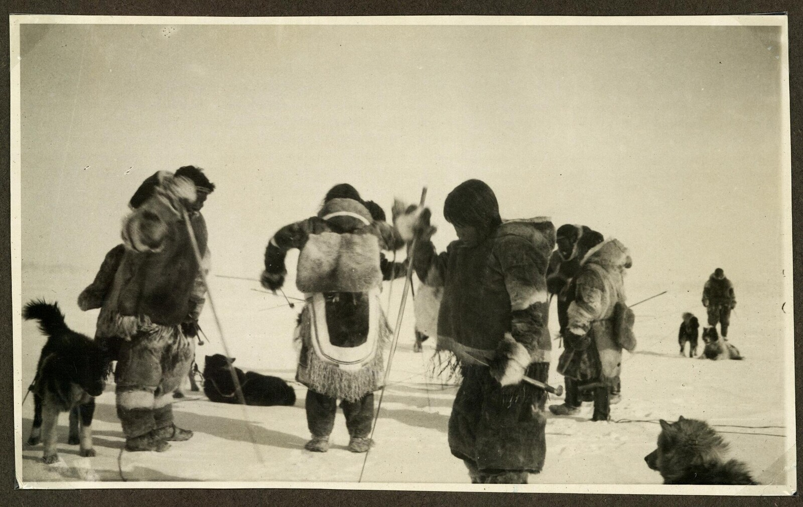

# 1. What is a human?

*Africa, from about seven million years ago to about 50,000 years ago*

A human is an ape.

That is not an insult, and it is not a figure of speech. It is our address on the family tree. Our closest living relatives are the chimpanzees and their cousins the bonobos. Some seven million years ago, in Africa, there lived an ape that was the ancestor of both of us. We have the same bones in the same order as a chimpanzee, the same kind of blood, and almost exactly the same DNA.

Yet we are a very odd ape. Stand a human next to a chimpanzee and the human loses on nearly every count. We are weaker. We are slower through the trees and not much faster on the ground. We have small teeth, no claws, thin skin and hardly any fur. Our babies are feebler too. A newborn human cannot hold up its own head, and will need to be fed by someone else for more than ten years.

*Ape skeletons in a row. The chimpanzee is fourth from the left and the human is on the right. Photo: DeFacto, CC BY-SA 4.0.*

Put a city-dweller alone in a forest, with no tools, no clothes and no one to ask, and he will be lucky to last a month. A chimpanzee in the same forest will be fine.

Fortunately, a human almost never has to survive alone. Think about what is keeping you alive today. You did not grow your breakfast. You did not invent cooking, or shoes, or the knife, or the roof. You did not even invent the words you are thinking in. Every one of those was worked out by somebody else, usually somebody long dead, and handed on.

Chimpanzees learn from each other too. One troop cracks nuts with stones while the troop next door has never tried it. Even so, their tricks mostly stay at about the level a clever animal could invent for itself. By contrast, a human knows what thousands of generations worked out, because each generation taught the next and added a little.

In other words, a human is an ape that lives by other humans: by what they share, what they teach and what they remember. Take away the group and its knowledge, and what is left is a slow, soft, hungry animal that would not last a winter. Leave them in place, and that same animal ends up living on every continent and walking on the Moon.

The body alone does not explain this. A big brain and clever hands are part of it, but a big brain with nothing handed down to it is only a hungry organ. What counts is a way of living that took millions of years to put together, a piece at a time. It began when an ape stood up.

## Two legs

About 3.7 million years ago, in what is now Tanzania, a volcano dusted the ground with ash. Rain turned the ash into something like wet cement. A few small figures walked across it, and then more ash fell and buried their tracks. The footprints are still there.

*A replica of the footprints at Laetoli, Tanzania, made about 3.7 million years ago. Photo: Momotarou2012, CC BY-SA 3.0.*

They were made by something that walked the way you do, heel down first and then a push off the big toe, with no hands on the ground. But the walkers were not people. They stood a little over a metre tall, about the height of a seven-year-old, and their brains were the size of a chimpanzee's. The most famous skeleton of their kind, found in Ethiopia and nicknamed Lucy, has hips and knees built for walking upright and a skull you could cup in two hands.

*A museum reconstruction of Lucy. The brown pieces are casts of the bones that were found. Photo: Andrew from Cleveland, CC BY-SA 2.0.*

It is natural to assume that the big brain came first, and that a clever ape then stood up and looked around. In fact, it happened the other way round. Our ancestors walked on two legs for at least two million years before their heads began to grow.

Nobody is sure why they stood up. Africa was drying out, and solid forest was breaking into patches of woodland and grass. Walking on two legs is a cheap way to cover the ground between one patch of food and the next, and that may be all there was to it. Whatever the reason, what followed is clearer.

First, hands were free. An ape that does not need its hands for walking can carry food back to someone else. It can carry a child, a stick or a stone. In time it could throw, and no other animal throws both hard and straight.

Second, the body was rebuilt for distance. Legs grew long and feet grew springy. Later our ancestors lost most of their fur and gained skin that sweats all over.

Sweating matters more than it sounds, because it lets an animal cool down while it is still moving. An antelope cools down by panting, and it cannot pant properly while it gallops. By contrast, a human can jog through the midday heat, dripping, for hours. Hunters in the Kalahari have been filmed running down an antelope this way, following it at a trot until it overheats and stands still. We are slow, but we are very hard to shake off.

Then, around two million years ago, the head began to grow. Over the next two million years the brain roughly tripled, from the size of a chimpanzee's to the size of ours.

A brain is an expensive thing to own. Yours is about a fiftieth of your weight and burns about a fifth of your energy, even when you are lying on the sofa. For an animal that was often hungry, that is an extravagant organ, and it could only grow if it was paying its way by finding more food than it cost.

It also created a problem that no amount of cleverness could think its way around. Walking upright had reshaped the hips into a tight ring of bone. The head was getting bigger. And every one of those big heads had to be born.

## The unfinished child

The way out was to give birth early, long before the baby was ready for the world.

A foal stands up within an hour of being born and can run with the herd by the end of the day. A baby chimpanzee is soon clinging to its mother's fur while she climbs. By comparison, a newborn human can do nothing at all. It cannot hold on, cannot crawl and cannot lift its own head.

Human babies are born unfinished. A baby's brain is barely a quarter of the size it will reach, and it does most of its growing outside the womb. If we were born as ready for the world as a chimpanzee is, pregnancy would have to last far longer, and neither the mother's hips nor the energy her body can spare would allow it. Even as things are, birth is harder and more dangerous for humans than for any other ape. As a result, while a chimpanzee mother goes off alone to give birth, a human mother almost always has help.

The helplessness does not end with infancy. A young chimpanzee is finding most of its own food by the time it stops nursing, at four or five. By contrast, among people who live by hunting and gathering, children go on eating more than they bring in until they are well into their teens. That is fifteen years or more of being fed by somebody else.

On top of that, human mothers do not wait for one child to grow up before having the next. A chimpanzee has a baby about every five or six years. A woman in a foraging band has one every three or four. As a result, she is soon responsible for a baby, a toddler and an older child who are all hungry and none of whom can feed themselves.

No mother can do that alone. A chimpanzee mother raises her young by herself and rarely lets anyone else even hold the baby. Instead, a human mother hands hers around. Fathers bring food. Older brothers and sisters carry the baby. Aunts and neighbours watch the toddler.

Then there are grandmothers. Almost every other female mammal goes on having young until she dies. Women stop in middle age and then live for decades more. That looks like a waste, until one sees what the extra years are used for. Among the Hadza, who still forage in Tanzania, grandmothers dig roots as hard as anyone in the camp, and a child with a hard-working grandmother grows faster.

So a human child is raised by a crowd, and from its first weeks it has to win that crowd over. Human babies watch faces, follow eyes and smile at whoever is holding them. They are learning to read other people before they can sit up.

Other apes live in groups, but each mother feeds her own young. Humans lean on each other far more heavily, and it starts in the cradle. An animal whose young cannot survive without a ring of helpers has no choice but to live in a group and get along with it.

## A stone and a fire

A group that raises its children together can also teach them. The oldest skill we have any trace of is in stone.

Hit one cobble with another at the right angle and a flake snaps off. Its edge is sharper than a kitchen knife.

*One of the oldest kinds of stone tool: a cobble with flakes knocked off it. Photo: José-Manuel Benito Álvarez, CC BY-SA 2.5.*

Somebody in East Africa worked this out about three million years ago, long before the brain began to grow. It does not look like much. However, an ape holding a sharp flake has something that evolution never gave it. It can slice through the hide of a dead zebra, which its teeth cannot. It can cut meat off the bone and smash the bone for the marrow. It has borrowed the teeth of a lion and the jaws of a hyena, and it can put them down when it has finished.

Other animals use tools. Chimpanzees crack nuts with stones and fish for termites with stalks of grass. A stone flake is different, though, because it is a tool made with another tool. Anyone can smash two rocks together. Getting a good edge every time is a skill, with right and wrong places to strike, and the quick way to learn it is to watch someone who already can.

For a very long time the teaching did little more than keep the skill alive. The teardrop-shaped hand axe, the Swiss army knife of the Stone Age, was made in much the same way for more than a million years. Knowledge was being handed down, but hardly anything was being added.

*A hand axe, the all-purpose tool made for more than a million years. Photo: Daderot, public domain.*

Eventually, fire changed more than stone ever did.

Wild fire was always there, set by lightning and creeping through dry grass. At some point our ancestors stopped running from it and started carrying it home. There are traces of campfires in a South African cave a million years old, and by 400,000 years ago hearths turn up again and again at the places where people camped.

*San people in Namibia making fire by spinning a stick against a wooden base. Photo: Amhogas, CC BY-SA 4.0.*

A fire keeps the cold off, and that made it far easier for a tropical ape to live in places with winters. It keeps lions and hyenas back at night. It gives light, so the day no longer ends at sunset.

Above all, it cooks. Cooking is a way of digesting food before it is eaten. Heat softens meat and bursts open the starch in roots, so the gut takes far more energy from the same mouthful and spends far less effort getting it. A chimpanzee chews for about six hours a day. A human chews for less than one.

The saving shows in our bodies. Our teeth, jaws and guts have all shrunk to fit a cooked diet. That is why people who try to live on raw food alone usually lose weight. Some scientists think it was cooking that paid for the growing brain.

Fire was also the first fuel that any animal put to work. Every engine and power station that burns something has done the same thing with more of it.

Finally, fire made a place. After dark there was nowhere safe to be except beside the fire, and nothing to do there but sit together. The Ju/'hoansi of the Kalahari, one of the peoples usually called San, lived by foraging into recent times. Among them, talk in the daytime is mostly practical: who owes what, where the food is, who is annoying whom. At night around the fire it turns to stories.

## Talk

Stories need words, and nothing else in nature is quite like human words. The closest that other animals come is a handful of calls.

Vervet monkeys in East Africa, for example, have three alarm calls. One means leopard, and the troop runs up a tree. One means eagle, and they dive into the bushes. One means snake, and they stand up and stare at the ground. They are something like words. Still, no vervet has ever said that there was a leopard by the river yesterday, or that there might be one tomorrow.

*A vervet monkey. Photo: Charles J. Sharp, CC BY-SA 4.0.*

Human speech works differently. We take a few dozen sounds that mean nothing on their own and combine them into tens of thousands of words, and then combine the words into sentences that nobody has ever said before. You have probably never read the sentence "the leopard was wearing my uncle's hat," and you understood it at once.

Nobody knows when this began. Words leave no fossils. It may have built up slowly over a million years or arrived late and fast, and the experts argue about it without much evidence to settle the matter. What it made possible is far easier to see.

First, it made teaching cheap. Showing someone how to strike a flake takes patience. Telling them "hit it nearer the edge" takes a second.

Second, it let people share what only one of them had seen. A man could come back to camp and say that the waterhole to the north was dry, or that there were strangers two days' walk away. The whole band then knew what one pair of eyes had learned.

Third, it let people talk about each other, and this may matter most of all. Listen in on any conversation, in a café or a village or a hunters' camp, and most of it is about other people: who did what, who said what, who can be relied on and who cannot.

We call it gossip and pretend to look down on it. Yet in a group whose members depend on each other for food, knowing who shares and who cheats is a matter of life and death. Gossip is how a band keeps track of everyone's character, and how it punishes a cheat without ever raising a hand. It only needs everybody to know.

Finally, it let people talk about things that are not there. A plan is a description of something that has not happened yet. A promise is a claim about what you will do next month.

Once words could do that, they could go further still. People could speak of the dead, of the ancestors who made the world, of spirits in the river and of rules that everyone must follow. None of these can be pointed at. Nevertheless, all of them can be shared, and a group of people who believe the same story will act together in a way that no other animal can.

A chimpanzee troop holds together because its members know each other personally. A human group can hold together because its members believe the same things.

## Borrowed knowledge

Free hands, shared children, fire and words had each arrived separately. Together, they let knowledge begin to pile up.

By about seventy thousand years ago, as a result, people in Africa were making things no single person could have dreamed up. Take a spear with a stone point. The shaft is a straight sapling, scraped smooth. The point is a flake, shaped to be thin at the base. It is fixed on with glue, cooked from plant gum and mixed with powdered red earth so that it does not crack, and then bound tight.

That is four or five separate discoveries in one weapon, and none of them is obvious. No one person thought of them all. Each was hit upon by someone, copied, and passed down until it was simply the way a spear was made.

The same was true of everything else a band knew: which roots are food and which are poison, how to find water in a dry season, how to read a track, how to keep a fire going in the rain. A person born into the band received all of it as a gift. A person without it, however clever, was in serious trouble.

We cannot watch a Stone Age band to check this. Much more recently, though, people with no local knowledge have gone into country where hunters lived, and what happened to them is on record.

In 1845 two ships of the British navy sailed into the Arctic to find a sea route across the top of North America. It was one of the best-equipped expeditions ever sent. It had 129 men, steam engines, and enough tinned food for three years. Off a place called King William Island the ice closed around the ships and did not let go. After a year and a half the survivors left them and set out on foot, dragging boats loaded with silver cutlery. Every one of them died.

*The only detailed written record the expedition left behind, found in a pile of stones on King William Island. It says the ships were abandoned in April 1848. Public domain.*

They died in the homeland of the Netsilik, an Inuit people who had lived on that coast for centuries and raised their children there. There were seals under the ice. Yet the sailors did not know how to find a seal's breathing hole, or how to wait beside it, or how to make the harpoon that holds a seal once it is struck. They did not know how to build a house out of snow, or how to sew skins so tightly that water cannot get in.

*Netsilik hunters on the sea ice in 1921. Photo: National Museum of Denmark, CC BY-SA 2.0.*

Sixty years later a Norwegian named Roald Amundsen sailed a small fishing boat to the same island with six men. He spent two winters next to a Netsilik camp and used the time to learn how they dressed, how they drove dogs and how they built with snow. Nobody starved and nobody froze. A few years after that, Amundsen used what the Netsilik had taught him to become the first man to reach the South Pole.

The officers of the British navy were not stupid. Rather, they died in a place where children were growing up healthy, because the knowledge needed to live there could not be worked out in a season or two. It had taken hundreds of generations to build up.

Every band of early humans stood where the Netsilik stood. What kept them alive was not in any one head. It was in the group, and it was far older than anyone in it.

This is the real difference between us and the other apes. Give a two-and-a-half-year-old child and an adult chimpanzee the same puzzles about space, numbers and cause, and they score about the same. Then test how well they learn by watching someone else, and the child leaves the chimpanzee far behind.

In fact, children copy almost too well. Shown a way of opening a see-through box that includes a pointless extra step, a chimpanzee skips the step and goes for the reward. A child, on the other hand, copies everything, pointless step included.

That looks foolish. Yet when nobody can say why the red earth goes in the glue, only that the spear point falls off without it, the child who copies exactly is the one who eats.

No human has ever lived by his own wits alone. Instead, we are clever together, and over time. Each generation receives what the last one knew, loses a little and adds a little.

The size of the group matters as well, and for a simple reason. The more people who are in touch with each other, the more ideas there are to copy, and the less likely it is that a skill dies with the one person who had it. A larger web of people knows more than a smaller one.

## A day in the band

What was it like to live inside one of those small webs of people? No one wrote it down. Even so, bones, campsites and tools tell part of it, and people who still lived by hunting and gathering in recent times tell more. They are not Stone Age survivors, and their lives are their own. Still, they faced the same problems with much the same means, and they are a guide where the bones and tools fall silent.

Picture a camp somewhere in Africa, a hundred thousand years ago. There are about thirty people in it: a few couples, their children, some grandparents, a brother-in-law, a friend who joined last season. The faces change a little from season to season, as one family goes off to stay with relatives in another band and another family arrives.

Beyond the camp there are other bands who speak the same language, several hundred people in all, and a person will know most of them by sight or by name before he dies. That is the whole human world.

They own almost nothing, because everything has to be carried. In a few weeks, when the food nearby thins out, they will walk to another camp.

The day starts at the fire. Then the women go out with digging sticks, babies on their hips and older children trailing behind, to collect roots, nuts, fruit and anything small enough to catch. In warm country like this they bring home most of what the camp eats, and they bring it home every day.

The men, meanwhile, go looking for meat, and most days they come back with nothing. A large animal is killed perhaps once in several weeks.

So when a hunter does kill, the meat is not his. It is cut up and handed round the whole camp, to his in-laws, to the family of the man who failed today, to the old woman who cannot walk far. He gains nothing by keeping it. It would rot in days, and next month he will be the one with empty hands. In a camp that cannot keep meat, a full belly in your neighbour is the only larder there is.

Sharing like this does not come free of friction. People watch who gives and who holds back, and they talk about it. Among the Ju/'hoansi, a man who brings in a big kill is expected to say it is nothing much, and the others agree loudly that it is a bag of bones and hardly worth the walk. They are not being ungrateful. Instead, they are making sure he does not start to think he is better than them.

There is no chief. Older and wiser people are listened to, but nobody can give an order and expect it to be obeyed. A man who tries to push others around is laughed at. If he keeps it up, people pack and leave him. If he is dangerous, the others may quietly agree that he has to be killed.

Getting food takes only part of the day. The rest goes to mending, cooking, minding children, sleeping in the shade, and talk, a great deal of talk.

It can sound like an easy life, and on a good day it was. Now follow the camp through a year.

The dry season comes. The roots are woody, the animals have moved away, and everyone is hungry for weeks. Little has been put by. A band that moves every few weeks cannot carry a store of food on its back. Therefore, when food does appear, people eat as much as they can hold, since there is no telling when the next will come.

A boy cuts his foot on a thorn. The wound goes bad, and in ten days he is dead. A woman dies giving birth. A man is bitten by a snake. A leopard takes a child from the edge of the camp at dusk, which is why nobody likes to be far from the fire after dark.

Children die most often. Nearly half of those born never grow up, most of them carried off by fevers and stomach sickness in their first few years. Every adult in the camp has buried a child, a brother or a sister. Those who do get through childhood, on the other hand, have a fair chance of reaching sixty or seventy.

Meanwhile, people fall out. Two men want the same woman. Someone is accused of being lazy, or stingy, or of sleeping with another man's wife. With no police and no judge, a quarrel is settled by talk, by the mockery of the others, or by one side walking off to join another band. Sometimes it is settled with a spear.

So the dangers came from three directions. There was hunger, which arrived without warning. There was the wild, with its teeth, its thorns and its diseases. And there were other people, who were at once the only protection against the first two and a danger in themselves.

For anyone living like this, the worst thing that could happen was not a bad hunt or a hard season. The worst thing was to lose the others. A person who was disliked, distrusted or driven out had no one to share meat with him, no one to nurse him when he was sick, and no one to sit beside at night. He would not live long.

## What it left behind

People lived like that for a very long time. Squeeze the whole history of our species into a single day. People live in small wandering bands from midnight, through the morning, the afternoon and the evening. The first farmers plant their fields a little after eleven at night. The first cities appear at about twenty-five to midnight. Factories, engines and electric light arrive in the last minute and a quarter.

Bodies and instincts change far more slowly than ways of living. As a result, the ones we have were built for the long day in the band and not for its last hour. A good deal of what puzzles us about ourselves makes more sense in that light.

Take food. In the band, sugar meant ripe fruit or a raided beehive, and fat meant a lucky kill. Both were rare, and the sensible thing to do was to eat all of it at once. We still feel exactly that way. Today, sugar and fat are on sale on every corner, and the urge that kept our ancestors alive through the dry season fills hospitals.

Take fear. Far more people today are killed by cars than by snakes. Yet hardly anyone is terrified of cars, while fear of snakes, heights and the dark is common everywhere, including in cities where no one has seen a wild snake. We fear what killed our ancestors.

Take the opinion of others. Standing up to speak in front of a room of strangers is one of the things people dread most, though nothing in the room can hurt them. Being left out of a group, even a group we do not much like, hurts in a way that feels close to physical pain. We blush, we lie awake over a clumsy remark, and we are hungry for praise.

None of that is hard to explain. In the band, a person's standing with the people around him decided whether he ate and whether he lived. The feelings that guarded it are still switched on, and now they have millions of strangers to worry about.

Take fairness. Offer someone a share of a sum of money, on the condition that if they refuse, neither of you gets anything. If the share is insultingly small, people all over the world turn it down. They would sooner lose money than let a cheat get away with it. Turning down free money makes no sense for a single deal. It makes excellent sense, though, for an animal that spent its whole life sharing meat with the same few people.

Take us and them. Divide a room of strangers into two teams by the toss of a coin, and within minutes they are favouring their own side. It takes no history and no reason. The readiness is simply there, waiting for a line to be drawn. In a world of small bands, knowing at once who was yours was worth a great deal.

And take status. We watch closely who is rising and who is falling. We want to be looked up to, and we enjoy seeing the mighty brought low. Both halves come from the camp, where it paid to be respected and where everyone joined in cutting a boaster down to size.

None of this is fate. Explaining modern behaviour by ancient life is easy to overdo, and plenty of confident claims of this kind are little more than guesses. After all, people learn. Customs differ enormously from one society to the next, and one generation can change its habits in ways that would take evolution a hundred thousand years. The instincts are a starting point and not a script.

Nevertheless, they are the starting point for everybody, and they do not go away. Almost everything that came later, from kingdoms and religions to money, armies and advertising, had to find a way of working with an animal that craves sweetness, fears being cast out, is loyal to its own and suspicious of strangers, and was built for a world of a few hundred familiar faces.
