# 2. How did humans end up everywhere?

*The whole world, from about 70,000 years ago to about 700 years ago*

They walked.

It sounds too simple, but for most of the journey nothing more was needed. Nobody set out to cross a continent. A band moved its camp when the food thinned out, as bands always had, and now and then it moved into a valley where no one was living. Its children grew up there and thought of it as home. In time, some of them moved one valley further on.

If each generation settles just twenty kilometres beyond where its parents lived, its descendants will cross the whole of Asia in about ten thousand years. That is a very long time for a person. However, it is a short time for a species, and our ancestors had far more than that. Seventy thousand years ago, nearly all of our kind lived in Africa. By twelve thousand years ago there were people in Siberia, in Australia and near the southern tip of South America.

Walking, however, only gets you there. Staying alive on arrival is another matter.

Most large animals are fitted to one kind of country. A polar bear has white fur, a thick layer of fat and paws like snowshoes. A camel has a hump of stored fat, feet that spread on sand and a body that can go a week without water. Put the bear in the Sahara or the camel on the ice, and either will be dead within days. When animals do spread into a very different climate, they usually do it by changing their bodies. That usually takes a very long time, and what comes out at the end is often a different animal.

Humans, by contrast, did it with the body they left Africa in. It is a tall, sweating, nearly hairless body, built for hot grassland. That same body now lives on the Arctic ice, in the Sahara, in the Amazon forest and on mountain plateaus where the air is thin.

What differs is what the people know. An Arctic hunter knows how to sew a sealskin coat that keeps out water, and how to build a house from snow. A hunter in the Kalahari knows which buried root holds a litre of drinkable water. Neither would last long in the other's country, yet the two of them are the same animal, and a baby swapped between them at birth would grow up perfectly at home.

In other words, humans did not adapt to the world in the way other animals do. Their bodies stayed much the same. Their knowledge changed instead, a little in each generation and in each new valley, and knowledge changes thousands of times faster than bone.

The other animals that have spread nearly as far as we have are mostly the ones that travelled with us: dogs, rats and lice.

## The people already there

The world our ancestors walked into was not empty, however. Other humans had got there first.

Upright apes had been wandering out of Africa for nearly two million years, long before our own species existed. They had no plan either. They simply followed the game, one valley at a time, and over that immense stretch of time their descendants settled across Europe and Asia. Deserts, mountains and seas then cut the groups off from one another, and each went its own way. As a result, seventy thousand years ago there were at least five kinds of human alive at once.

In Europe and western Asia lived the Neanderthals. They were shorter and broader than us and a great deal stronger, with heavy brows and brains at least as large as ours. They kept fires, made fine stone tools, hunted big animals at close quarters and looked after their injured. At least sometimes, they buried their dead.

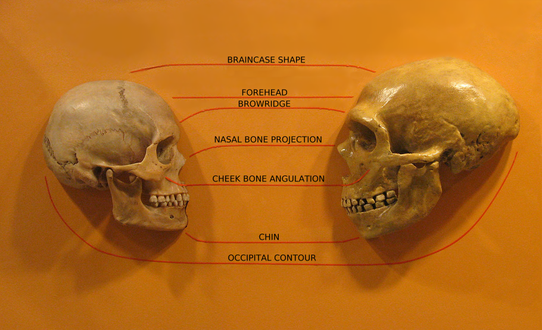
*A modern human skull (left) beside a Neanderthal skull (right). Photo: hairymuseummatt and KaterBegemot, CC BY-SA 2.0.*

Further east lived a people we know almost entirely from their DNA. A finger bone and a few teeth were found in a cave in Siberia, and the genes inside them belonged to no human anyone had heard of. They are called the Denisovans, after the cave. For years nobody knew what they looked like. Then a massive skull dug up in China in the 1930s was tied to them by its proteins and its DNA, and it gave them a face, with a heavy brow and a large brain.

Meanwhile, on the island of Flores in Indonesia, there were people about a metre tall, with brains the size of a chimpanzee's, who made stone tools and hunted dwarf elephants. Another small people lived in the Philippines.

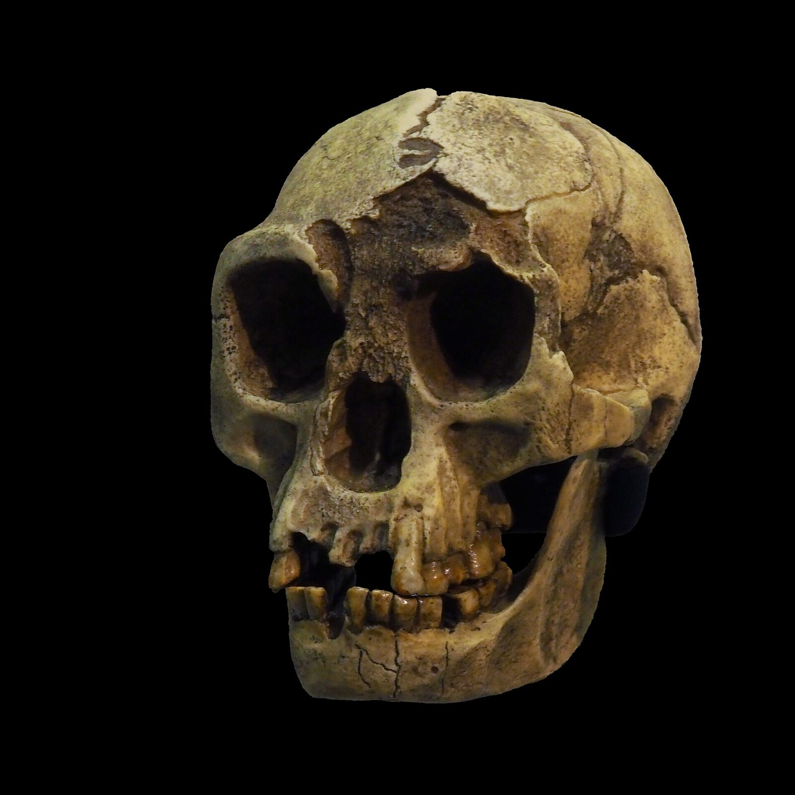
*The skull of one of the small people of Flores. Photo: Rama, CC BY-SA 3.0 fr.*

All of them were human. They walked upright, used their hands and lived in groups, and several of them had fire. For most of the past two million years, a visitor to Earth would have found several sorts of human and seen no reason to bet on ours.

These older peoples had been in their own regions so long that their bodies had been reshaped to fit. The Neanderthals were stocky and short-limbed, which holds heat well in a cold climate. The people of Flores were tiny, as large animals often become when they are marooned on an island with little to eat. They had tools and fire as well, but none of these peoples spread across the whole world.

The newcomers from Africa were different. They leaned far more heavily on what they knew, and they did not stop at the edge of anybody's country.

## The crossing

They were not even the first of our own kind to try. Skulls like ours, a hundred thousand years old, have been found in caves in Israel. Those early wanderers left Africa, lived for a while at its doorstep and then died out or went back. Almost nothing of them survives in people living today.

The attempt that succeeded came later, between seventy and fifty thousand years ago. It began in the north-east corner of Africa, and there were two ways out. One led north along the Nile and across the Sinai desert. The other led across the mouth of the Red Sea into Arabia.

The world was in the grip of an ice age at the time, and that helped. So much water was frozen into sheets of ice over the northern continents that the sea stood far lower than it does now, by the height of a forty-storey building at its lowest. Coastlines ran many kilometres further out. The strait at the mouth of the Red Sea, thirty kilometres wide today, was a narrow channel that could be crossed on a raft with the far shore in sight the whole way.

The people who left were few. We know this because their descendants carry the evidence in every cell. Each time a small group breaks away from a larger one, it takes only a sample of the larger group's genes with it, in the same way that a handful of sweets grabbed from a mixed jar will be missing some of the flavours.

The peoples of Europe, Asia, Australia and the Americas all show the mark of that small handful. That is why there is more genetic variety among the people of Africa than among everyone in the rest of the world put together.

So every person alive whose ancestors lived outside Africa descends from one small population that walked out of it. It was probably small enough to fit inside a football stadium.

Nobody among them knew they were leaving a continent. They had no maps and no word for Africa. They were following a coast, as their parents had, towards the next good beach.

## To the ends of the Earth

The beaches led a long way. A shoreline is an easy road for people who know how to live on shellfish, fish and seabirds, because the food is much the same on the next bay as on the last one. Following the coast, the descendants of those first bands passed around Arabia, India and south-east Asia within a few thousand years.

There the land ran out. With the sea so low, the islands of Indonesia as far as Bali were joined to Asia, and Australia was joined to New Guinea. However, between the two lay a chain of deep straits that never dried, the widest of them dozens of kilometres across. From one shore, the other cannot be seen.

Nevertheless, people were in Australia at least fifty thousand years ago. Nobody swims that far, and no family settles a continent by clinging to a drifting log. They built boats or rafts, loaded them with men, women and children, and steered for land they could not see, perhaps following the smoke of distant bushfires or the flight of birds. It was the first great sea voyage of our kind, and it was made tens of thousands of years before anyone planted a field or built a house of stone.

Meanwhile, other bands had turned north and west. They were in Europe by about forty-five thousand years ago, and deep in Siberia not long after. There they met real winters, and a tropical body has no answer to a winter. The answer had to be made, and the most important part of it was very small.

It was the needle. A sliver of bone with a hole drilled through one end lets a person sew skins into trousers, sleeves, hoods and boots that fit closely and keep out the wind.

The difference is larger than it sounds. A skin simply draped over the shoulders will see you through a cool night. Fitted clothing, by contrast, will see you through a Siberian winter.

With needles and fire, people were living north of the Arctic Circle more than thirty thousand years ago. Later, on the frozen plains of Ukraine and Russia, they built whole houses from the bones and hides of mammoths.

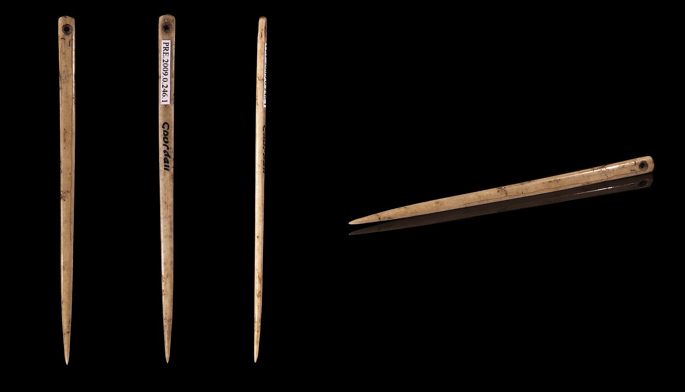
*Bone needles made by ice-age hunters. Photo: Didier Descouens, CC BY-SA 4.0.*

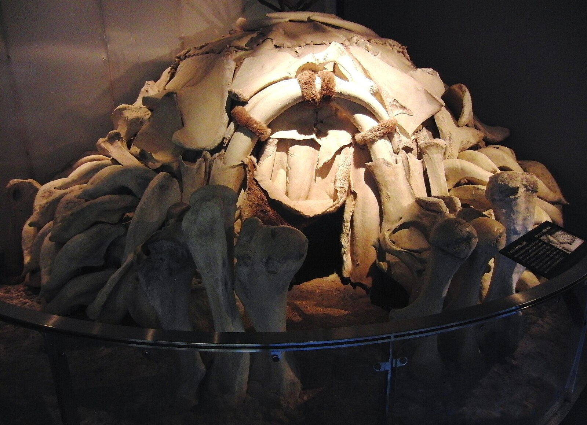
*A museum reconstruction of a house built from mammoth bones. Photo: Momotarou2012, CC BY-SA 3.0.*

From the north-east corner of Siberia it was possible, in those days, to walk to Alaska. The low sea had exposed a plain more than a thousand kilometres wide where the Bering Strait is now. Hunters followed herds across it without knowing that they were entering a new world.

The Americas were the last great lands to be reached, and people spread through them quickly. On the bed of a dried-up lake in New Mexico there are human footprints more than twenty thousand years old, many of them made by children and teenagers. By fourteen thousand years ago there were people living in the cool, wet south of Chile.

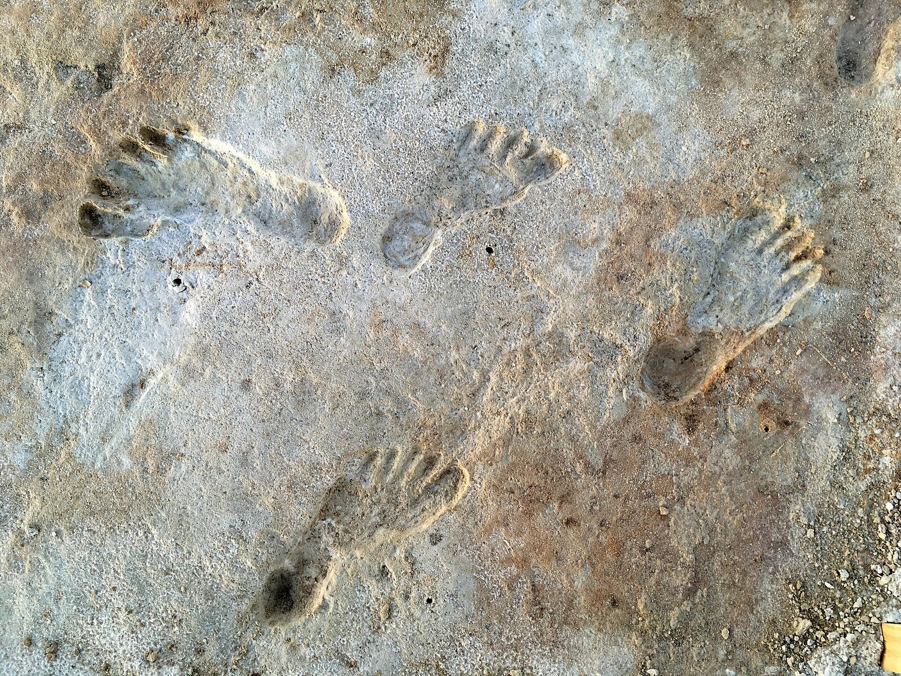
*Human footprints more than twenty thousand years old at White Sands, New Mexico. Photo: US Geological Survey, public domain.*

A few tens of thousands of years after leaving Africa, then, the same animal was hunting seals on the Arctic ice, kangaroos in the Australian desert and wild llamas in the Andes. It had crossed every climate on Earth, and it had done so with nothing more than fire, a sharp stone, a needle, a boat and what its grandparents had taught it.

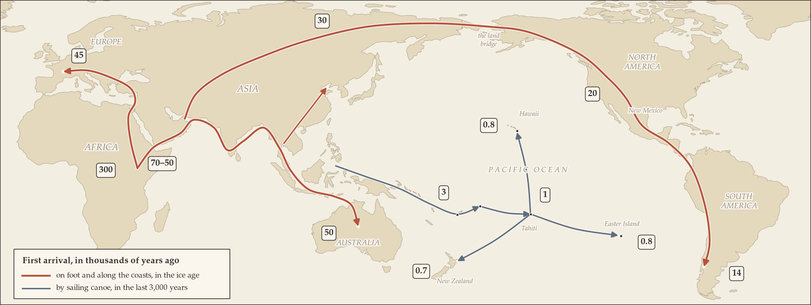
*The spread of our species across the world, with the dates of first arrival in thousands of years ago. Map: drawn for this book; coastlines from Natural Earth, public domain.*

## The wolf at the fire

They had not made the journey alone. Somewhere in the cold north of Europe or Asia, more than fifteen thousand years ago and probably a good deal earlier, a wild animal had moved into the human camp and stayed. It was the grey wolf.

It is unlikely that anyone set out to tame a wolf. More probably, the wolves started it, and it is easy to see how. A camp of hunters is a rich place for a scavenger, with bones, scraps and offal thrown just beyond the firelight. The boldest wolves crept in to eat. Those that snarled or bit were driven off or killed, while those that kept calm around people were left alone and ate well.

Over many generations, the wolves that hung about the camps grew tamer, and the people grew used to them. At some point children began to pick up the pups.

Both sides did well out of it. A wolf hears and smells what a human cannot, and it barks when a stranger or a bear comes near in the night. It can follow a wounded deer through forest and hold it at bay until the hunters arrive. In the far north, dogs pulled sleds, and that turned a week's walk into a day's ride. In return, the dog got food, a place by the fire and the protection of the most dangerous animal on Earth.

The change went deep. Dogs became smaller than wolves, with shorter faces and floppier ears, and they kept the playfulness of puppies all their lives.

They also learned to read us, and at this they are better than any ape. Point at a hidden treat and a dog will go straight to it. A chimpanzee, which is far cleverer in most other ways, usually ignores the pointing hand. Dogs watch our faces, follow our eyes and know when we are pleased with them. They had picked up, in fact, the same skills that a human baby uses to win over the people around it.

People cared for them in return. In a grave in Germany, fourteen thousand years old, a man and a woman were buried with a young dog. The dog had been seriously ill for weeks before it died, and it could only have lived that long if somebody had nursed it.

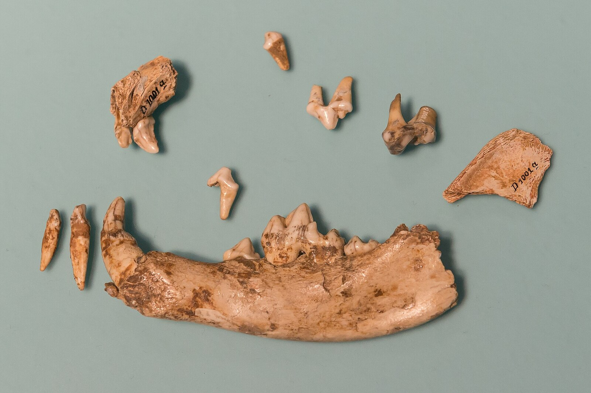
*The remains of the dog buried with two people at Oberkassel in Germany about fourteen thousand years ago. Photo: Thilo Parg, CC BY-SA 4.0.*

The dog was the first living thing that humans reshaped to suit themselves. For thousands of years it was also the only one. However, the idea that an animal or a plant could be changed by living alongside people would turn out to matter a great deal.

## Meeting the others

Wolves were not the only strangers our ancestors met on the way. In Europe and Asia they walked into country that other humans had held for hundreds of thousands of years.

We know for certain that they met, because they had children together. In 2010, scientists managed to read the DNA from Neanderthal bones forty thousand years old, and compared it with the DNA of living people. Everyone whose ancestors lived outside Africa turned out to be carrying a little of it. If your family comes from Europe or Asia, about one fiftieth of your DNA is Neanderthal. People in New Guinea and Australia carry Denisovan DNA as well.

Some of that inheritance is still at work. Tibetans can live and bear children on a plateau four kilometres above the sea, where the thin air makes lowlanders ill, and a gene that helps them do it came from the Denisovans. Other borrowed genes affect skin, hair and the body's defences against infection. One stretch of Neanderthal DNA, carried by many people in Europe and South Asia, made its owners more likely to fall seriously ill with COVID-19.

The most striking evidence is a splinter of bone from the cave in Siberia where the Denisovans were discovered. It belonged to a girl of at least thirteen who died ninety thousand years ago. Her mother was a Neanderthal, and her father was a Denisovan. Two kinds of human had met, and here was their daughter.

Nevertheless, the others are gone. The Neanderthals had lived through ice ages in Europe for some four hundred thousand years. Our kind arrived about forty-five thousand years ago, and within a few thousand years there were no Neanderthals left. The little people of Flores disappear from their island at about the time our ancestors passed through. The Denisovans fade out as well.

It is tempting to imagine a war of extermination. However, the bones do not show one. No battlefield has been found, and no heap of butchered Neanderthals.

Numbers explain it better, and the numbers were against the Neanderthals from the start. There were never many of them. They lived in small bands, thinly scattered from Spain to Siberia, and their DNA shows that parents were often close relatives, which is what happens when there are few partners to choose from.

The newcomers, by contrast, lived in larger groups that kept in touch across long distances, passing shells, good stone and news from band to band. A larger web of people knows more and loses less. As a result, the newcomers had better clothing, weapons that killed from further off, and more ways of getting through a bad year.

They also hunted the same deer and wanted the same caves. In each valley the newcomers raised a few more children than the people who were there before, and that is all it takes. A small edge, repeated every generation for three thousand years, ends with one people where there had been two. Some of the last Neanderthals were simply taken into the newcomers' bands, and their children's children were us.

In other words, the Neanderthals did not altogether die out. They were outnumbered and absorbed, and a little of them is still walking around.

## The quiet continents

The other humans were not the only ones to disappear when our ancestors arrived.

When the first boats landed in Australia, the continent was full of giants. There was a wombat the size of a small car, and a kangaroo that stood taller than a man. There was a flightless bird twice the weight of an ostrich, and a lizard as long as a crocodile that hunted on land. Some thousands of years after those landings, every one of them was gone.

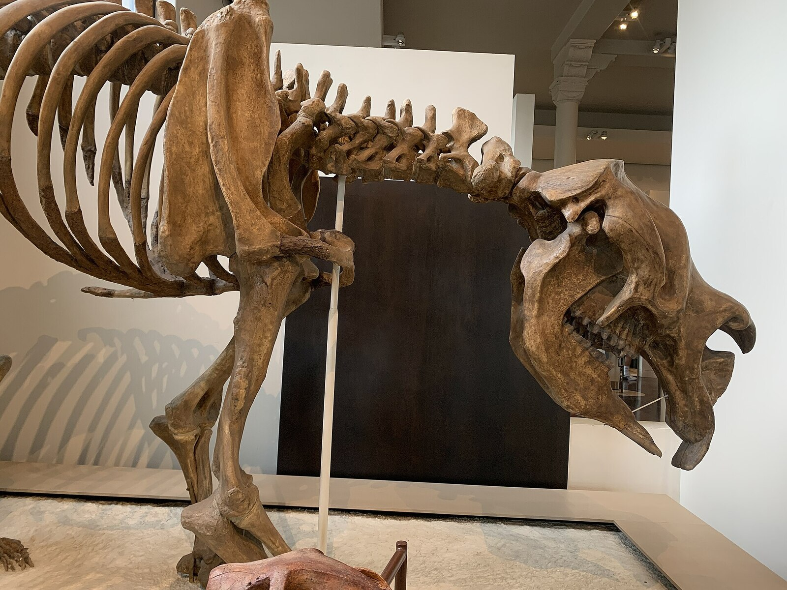
*The skeleton of Australia's giant wombat relative. Photo: Bloopityboop, CC BY-SA 4.0.*

The same thing happened in the Americas. The first hunters to come down from Alaska found mammoths, ground sloths as big as elephants, armadillos the size of a car, sabre-toothed cats and beavers as large as bears. There were also wild camels and wild horses, both of which had first evolved in North America. By about eleven thousand years ago, about three quarters of North America's kinds of large animal had vanished, the horses among them.

That loss had a long reach. Because of it, the peoples of the Americas would build their civilisations with no animal to ride and none to pull a plough. Horses did not return until Spanish ships carried them back across the Atlantic.

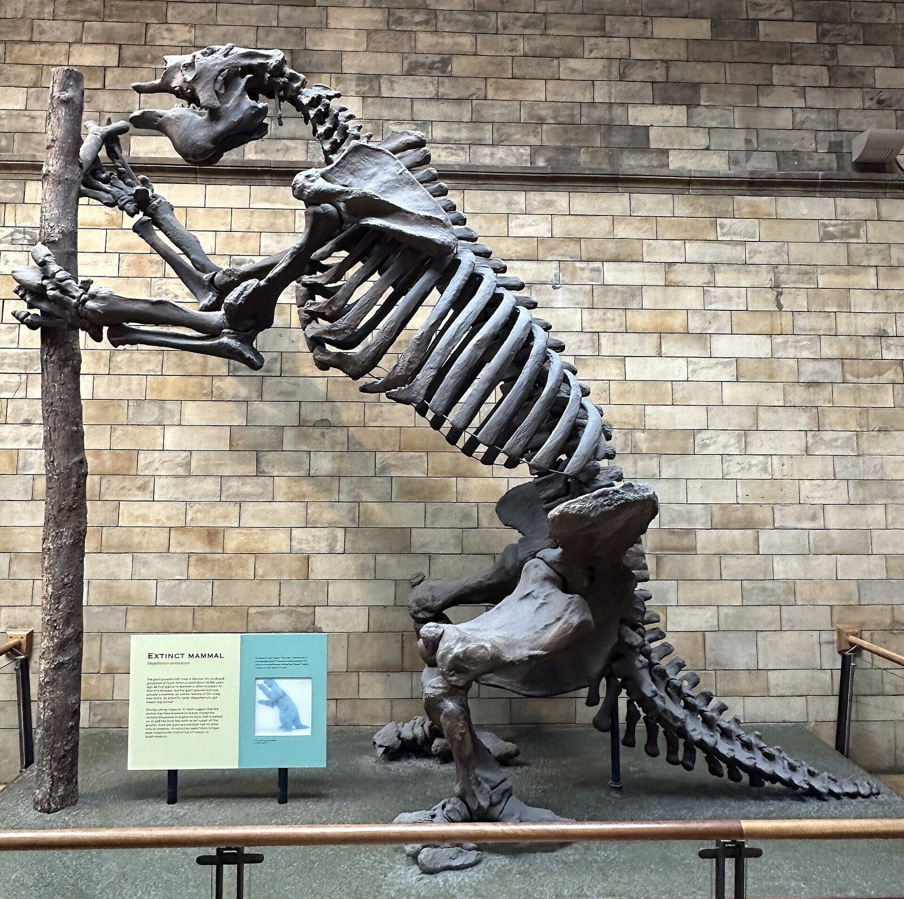
*The skeleton of a giant ground sloth from South America. Photo: APK, CC BY 4.0.*

Africa, by contrast, kept its elephants, rhinos, hippos and giraffes. The difference is experience. African animals had lived beside humans for millions of years, from the days when we were small and harmless, and they had learned over all that time to run from an upright figure. The animals of Australia and the Americas had never seen one. A full-grown giant sloth had very little to fear, and it did not know that it should be afraid of a small ape with a stick.

It is hard to believe that small bands with spears could empty a continent. However, it did not take a slaughter. The reason is that big animals breed slowly. A mammoth carries a single calf for nearly two years and does not breed until her teens. If hunters kill only a few more animals each year than are born, the herd shrinks, and no one alive notices the difference, because each generation takes the thin herds of its own childhood as normal. In a thousand years, however, there is nothing left.

Fire added to the damage. People burned grassland and forest to drive game and to bring on fresh growth, and the burning changed what could live there.

In the Americas, the ice age was also ending at about this time, and for many years the warming climate was blamed instead. However, these animals had already lived through a dozen such warmings. What was new the last time was us.

Islands give the clearest evidence, because people reached them late, when the climate was steady. On an island off Siberia that no hunters reached, mammoths were still alive four thousand years ago, after the pyramids of Egypt had been built.

New Zealand is the clearest case of all. It had no people at all until about seven hundred years ago. What it did have was the moa, a wingless bird that could reach higher than an elephant's back. Canoes arrived from Polynesia, and within about a century every moa was dead. Their bones lie in heaps beside the ovens of the first villages.

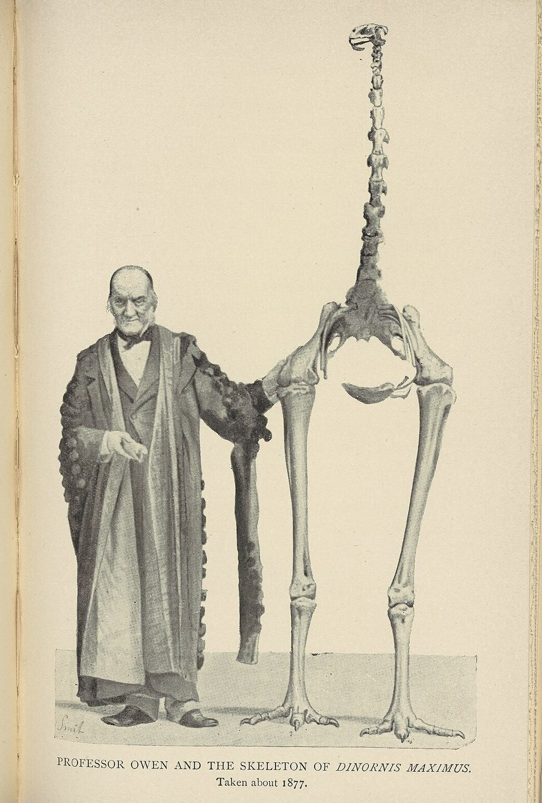
*The scientist Richard Owen beside the skeleton of a moa, photographed in the 1870s. Public domain.*

So the pattern holds on continents and islands alike. Where people arrived, the big animals died soon after. Where people had not arrived, the animals lived on.

None of those people meant to wipe anything out. They were feeding their children, as every animal does. But they were the first creature that could move into a new land and be its most dangerous hunter from the day it arrived, and the world has been quieter ever since.

## The last places

By ten thousand years ago there were people on every continent except Antarctica. The largest blank left on the map was water.

The Pacific Ocean covers a third of the planet, and its far islands are specks in it, thousands of kilometres from one another and from anywhere else. No land bridge ever reached them and nobody settles such places by drifting to them on a raft. So they stayed empty long after the rest of the world had filled.

The people who finally settled them came out of the islands of south-east Asia. About three thousand years ago they reached Fiji, Tonga and Samoa. Then, roughly a thousand years ago, their descendants pushed on into the open ocean. They sailed double canoes, two long hulls lashed together with a deck between, large enough to carry several families along with pigs, dogs, chickens and the seedlings of the plants they meant to grow. These were not explorers hoping to get home. They were settlers bringing a whole way of life with them.

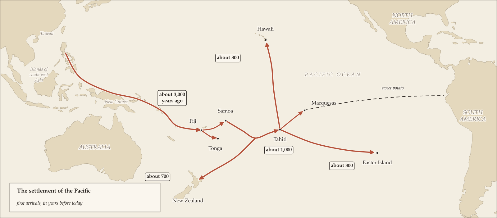
*The settlement of the Pacific. The dates are years before today. The dashed line marks contact with South America. Map: drawn for this book; coastlines from Natural Earth, public domain.*

They had no compass and no chart. Instead, their navigators learned the points on the horizon where each star rises and sets, and steered by a sequence of them through the night. By day they read the direction of the ocean swell, which a trained man could feel through the hull while lying down.

Near land they watched for birds that fish at sea and fly home at dusk, and for clouds that pile up over an island before the island itself comes into view. Like everything else that mattered, this knowledge lived in people's heads and took half a lifetime to learn.

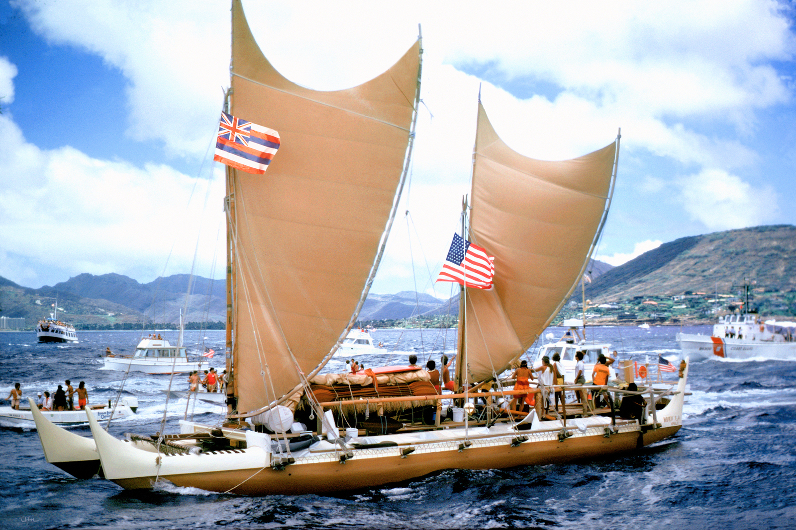
*Hōkūle'a, a modern copy of a Polynesian voyaging canoe, in 1976. Its crew steered it from Hawaii to Tahiti without instruments. Photo: Phil Uhl, CC BY-SA 3.0.*

It worked. Hawaii lies nearly four thousand kilometres from the nearest islands that had people, and canoes found it. They found Easter Island, one of the loneliest inhabited places on Earth.

They even made contact with South America. The sweet potato, an American plant, was growing in Polynesian gardens centuries before any European ship arrived, and islanders still carry a trace of Native American ancestry. Last of all, about seven hundred years ago, canoes reached New Zealand.

By then the cathedral of Notre-Dame was already standing in Paris. The journey that began with a walk out of Africa ended within recorded history, in a canoe.

## One species, scattered

Two results of that long journey shaped everything that came after.

The first is that we are all very close relatives. Every person alive descends from the same population in Africa, and everyone outside Africa from one small band of emigrants. The whole spread took less than three thousand generations. As a result, a single troop of chimpanzees in West Africa holds more variety in some of its genes than the whole human species.

The differences we notice most are the newest and the shallowest. Skin colour is the body's adjustment to sunlight. Dark skin protects against the fierce sun of the tropics. In the weak light of the far north, however, dark skin makes too little vitamin D, and paler skin spread among people who lived there.

It also happened recently. A man who died in the south of England ten thousand years ago, and whose DNA has been read, had dark skin and blue eyes. The pale-skinned European is a newer arrival than the bow and arrow.

The second result is that the family lost touch with itself. When the ice age ended, the great ice sheets melted and the sea rose by the height of a tall office block. The plain between Siberia and Alaska went under the waves. So did the land that joined Australia to New Guinea, and the land that joined Britain to the rest of Europe.

The people of the Americas were now almost entirely on their own, and they would remain so for more than ten thousand years. So were the people of Australia. Each branch went on inventing and built its own world, and the civilisations that later arose on either side of the oceans knew nothing of each other. When they finally met again, they met as strangers, and the meeting did not go gently.

By the time the ice age ended, about twelve thousand years ago, the Earth had become a different place. A few million people lived on it, in every kind of country from the ice to the rainforest. The giant animals that had fed the first arrivals were gone or going, and there was no empty continent left to walk into.

In a few warm river valleys, people were spending more of their days gathering the seeds of wild grasses, and had started to notice where those grasses grew best.
