# 3. What did early humans believe?

*Africa, Europe and Asia, from about 100,000 years ago to about 11,000 years ago*

They believed in things they could not see.

We know this even though they left no words, because they left something almost as good. About thirty-four thousand years ago, at a place called Sungir on a frozen plain in what is now Russia, a band of mammoth hunters buried a man and two children. They laid the bodies in the ground and covered them with red powder. Around them they placed spears carved from mammoth tusk, bracelets, and hundreds of fox teeth.

Then there were the beads. Sewn onto the clothing of those three people were about thirteen thousand beads of mammoth ivory, each one cut, drilled and polished by hand.

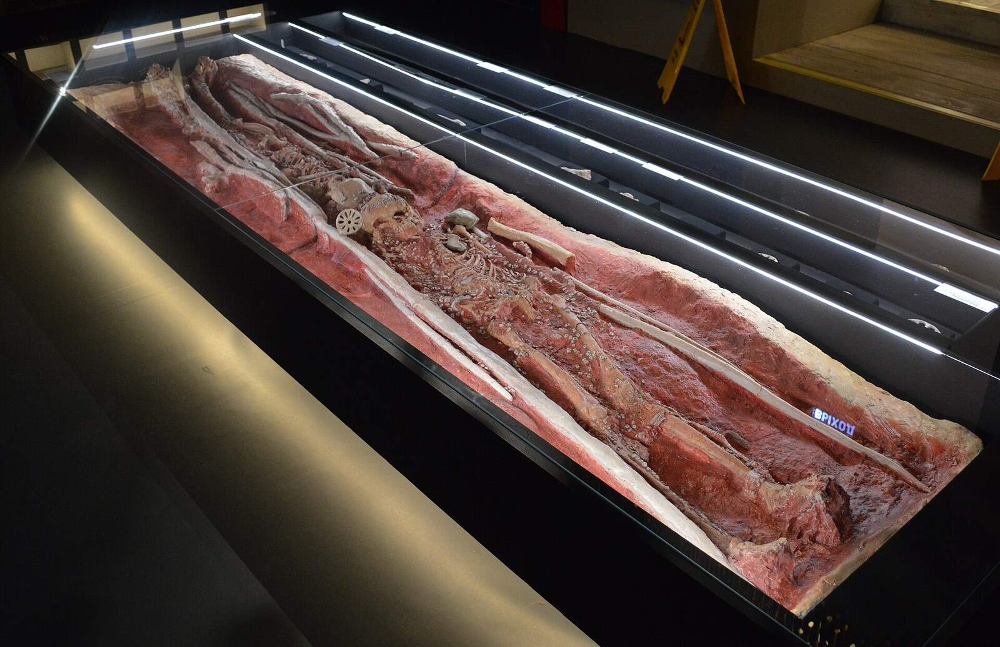
*A museum model of the two children's grave at Sungir, with its beads and ivory spears. Photo: Лапоть, CC0.*

A single bead took most of an hour to make. Thirteen thousand of them is about five years of one person's working life, and all of it went into a hole in the ground with the dead.

These were not rich people with time to waste. They lived by hunting through winters colder than any in Europe today, and every hour spent drilling ivory was an hour not spent finding food. Nevertheless, they did it. Nobody works that hard for a corpse. They did it for the people those corpses had been, who in some way still mattered and still needed things, and who had gone somewhere that fine clothes and spears would be useful.

The people at that graveside, then, shared a picture of the world that included more than they could see or touch. Nothing in it can be dug up. However, the things it made them do can, and they are scattered across three continents.

## The dead

Among the oldest of those traces are graves.

Most animals leave their dead where they fall. Elephants will stand over a body, and a chimpanzee mother may carry a dead infant for days, so grief is clearly not ours alone. However, no other animal digs a hole, lays the body in it with care and puts gifts beside it.

People were doing so a hundred thousand years ago. In a cave in Israel, a boy of about thirteen was laid on his back with his hands beside his neck, and in them somebody placed the antlers of a red deer. In that cave and another nearby there are lumps of red ochre, a soft red stone that can be ground into powder, and seashells with holes in them for stringing.

Red ochre turns up in early graves again and again, from Africa to Australia. It is the colour of blood, and it is not hard to guess why people might scatter it over someone whose own blood had stopped.

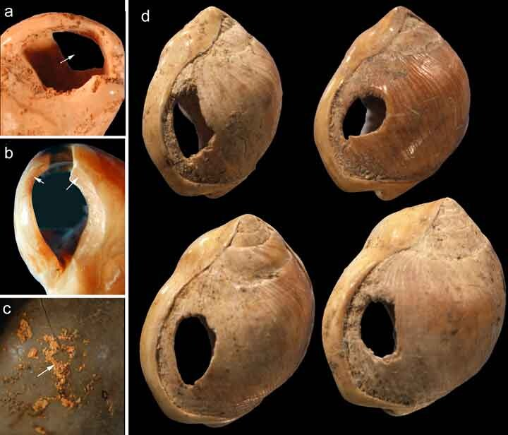
*Shell beads about seventy-five thousand years old from Blombos Cave in South Africa. Photo: C. Henshilwood and F. d'Errico, CC BY 2.5.*

Our kind were not the only ones. Neanderthals also buried their dead, at least sometimes. In a cave in France, an old Neanderthal man, who had lost most of his teeth and was crippled with arthritis, was laid in a pit that had been dug for him. His hips and back were so bad that he could hardly have got about without help. Somebody had looked after him, and when he died, somebody made sure the hyenas did not get him.

First, a grave says that a body is not rubbish, even when the person has gone out of it. Second, it says that the person has gone somewhere, since nobody packs a spear for a man who has simply stopped. Third, it says that the living still owe the dead something. All three are beliefs about things no one has ever seen.

It is easy to understand where they came from. Humans know that they will die. We are probably the only animal that does, and it is the price of a brain that can imagine next month. A mind that can plan a hunt for tomorrow can also picture a tomorrow in which it is not there, and can ask where a dead child has gone. Once the question had been asked, it needed an answer.

## Paintings in the dark

In December 1994, three friends exploring a cliff in the south of France felt a draught coming out of the rock. They cleared the stones away, squeezed through, and climbed down into a cave that nobody had entered for more than twenty thousand years.

On the walls were lions. There was a whole pride of them, drawn in charcoal, stalking a herd of bison with their heads low and their eyes fixed. There were woolly rhinos locking horns, and four horses' heads one above another, each with a different expression. The artists had scraped the wall clean before drawing, used its bulges to round out a shoulder or a belly, and smudged the charcoal with their fingers for shading. The oldest of the pictures are about thirty-six thousand years old, and they are as good as anything drawn since.

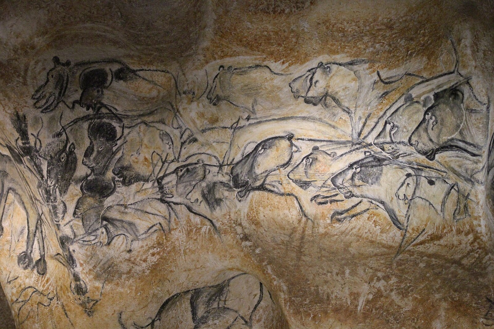
*The lions of Chauvet. This is the exact copy built for visitors; the real cave is sealed to protect it. Photo: Claude Valette, CC BY-SA 4.0.*

The cave is called Chauvet, and it is not unique. More than three hundred painted caves are known in France and Spain alone. On the other side of the world, in Indonesia, a painting of a wild pig with three small human figures is older still, at more than fifty thousand years.

The paintings are strange in ways that rule out the easy explanations.

First, they are in the wrong place. People lived in cave mouths, where there was daylight and fresh air. The paintings, by contrast, are often deep inside, far from the entrance, in chambers reached through passages where people had to crawl. The painters worked by torches and by small stone lamps burning animal fat, which give about as much light as a candle. Nobody ever saw these walls by daylight.

Second, they are of the wrong animals. The people who painted the cave of Lascaux lived mainly on reindeer, as the bones in their rubbish show. However, among the hundreds of animals on its walls there is at most one reindeer. They painted horses, wild bulls and stags instead. So the paintings are not a menu, and they are not a record of a good day's hunting.

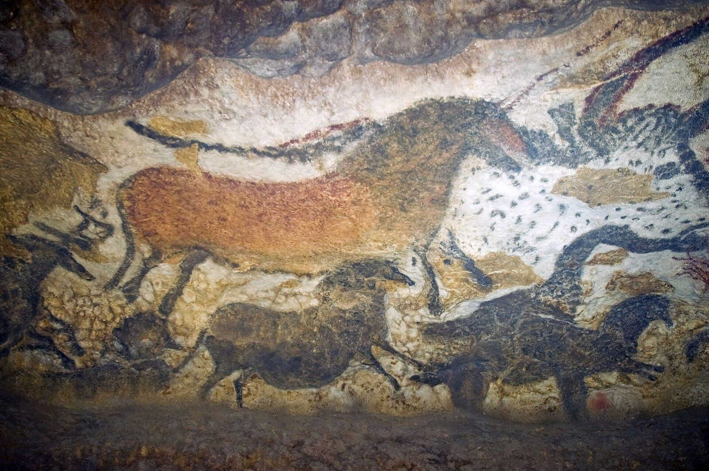
*Horses and bulls at Lascaux, photographed in the copy of the cave built for visitors. Photo: Jack Versloot, CC BY 2.0.*

Third, there are almost no people in them. Animals are drawn with loving accuracy, down to the winter coat of a horse. Humans, when they appear at all, are stick figures.

What the painters did leave of themselves was their hands. All over the world, from France to Indonesia to Argentina, people pressed a hand against the rock and blew paint around it from the mouth, leaving its outline behind. Some of the hands belong to children who must have been lifted up to reach.

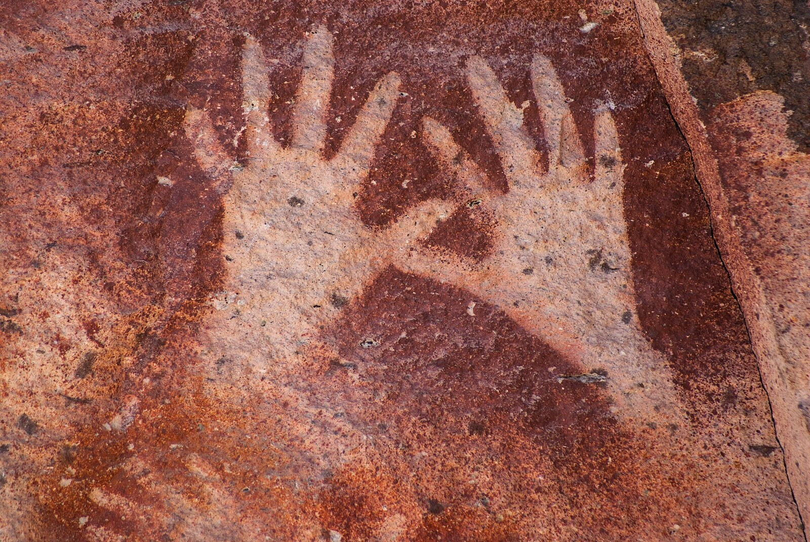
*Hand stencils at Cueva de las Manos in Argentina. Photo: LuigiStudio, public domain.*

The painters were not alone in making things that fed nobody. In caves in southern Germany, about forty thousand years ago, people made flutes from the wing bones of vultures, with a row of finger holes cut along them. So there was music, and no doubt there was singing and dancing long before anyone thought to carve a flute.

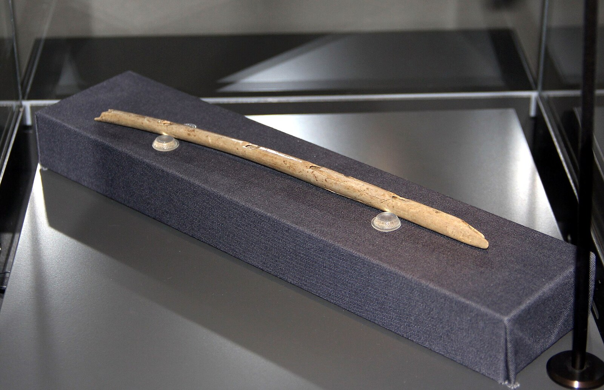
*A flute made from a vulture's wing bone, found at Hohle Fels in Germany. Photo: Tomatenpflanze, CC BY-SA 4.0.*

In one of those German caves, somebody also took a mammoth tusk and carved from it a figure thirty centimetres tall. It stands upright on two legs, with a human body and arms. Its head is the head of a lion. Carving it with stone tools took more than three hundred and fifty hours.

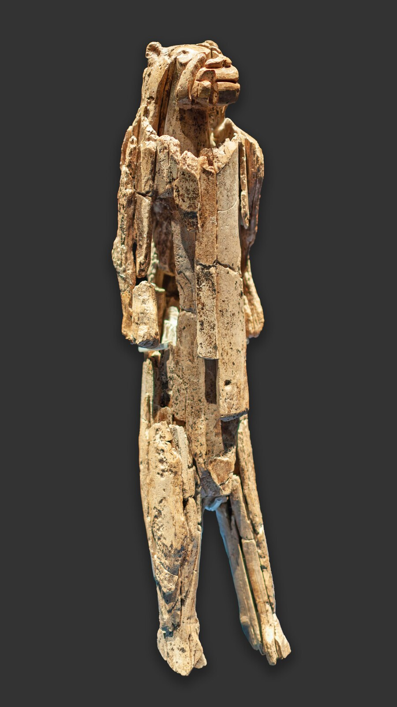
*The lion-man, carved from mammoth ivory about forty thousand years ago. Photo: Dagmar Hollmann, CC BY-SA 4.0.*

No such creature has ever existed. Somebody imagined it, and then cared enough about it to spend two months making it real, and others cared enough to keep it and carry it deep into a cave. Language had given people the power to talk about things that are not there. The lion-man is one of those things, and after forty thousand years we can still hold it.

## A world full of persons

What did it all mean? The paintings cannot tell us. The beliefs of recent hunting peoples offer a clue.

In recent centuries, travellers and scholars wrote down what people who still lived by hunting and gathering believed. They did so in the Arctic, in the Kalahari, in the Amazon, in Australia and in Siberia, among peoples on opposite sides of the world. The details differ everywhere. The outline, however, is so alike from one continent to the next that it is almost certainly very old.

The heart of it is that the world is full of persons, and only some of them are human. A bear is a person. So is a seal, a river, a storm, a mountain and the moon. Each has a will of its own and has to be dealt with as you would deal with a powerful neighbour, with respect, with gifts, and with care not to give offence.

This matters most in hunting. To a hunter, killing an animal is not like picking fruit. The animal is a someone, and it has relatives. Therefore, hunters all over the world apologise to the animal they have killed, or thank it, or tell it that it gave itself willingly.

Among the Inuit, a hunter who killed a seal would pour fresh water into its mouth, because seals live in salt water and are always thirsty, and a seal treated kindly would tell the others and come back in a new body to be caught again.

It is an uneasy way to live. An Inuit hunter explained to a Danish visitor a century ago that the great danger of life is that human food consists entirely of souls.

The dead are part of this world too. They do not go far. They linger near the camp, or travel to a land much like this one, and they can help or harm the living. Dreams are visits. A sickness may be the work of an offended spirit or an angry ancestor.

Because of this, almost every such people has someone whose job is to deal with the unseen. Among the San of the Kalahari, the healers dance around the fire for hours while the women clap and sing, until they fall into a trance. In that state, they say, they leave their bodies, travel to the world of the spirits, and argue with the dead for the life of a sick child. Then they come back, shaking and sweating, and lay their hands on everyone in the camp.

Something like this is found among foragers on every continent. One influential reading of the painted caves is that this is what they were for. The dark chambers were where a healer went to meet the spirits, and the animals on the walls are the spirits he met.

What is missing is as interesting as what is there. There are no priests who do nothing else, since the healer hunts and gathers like everyone. A wandering band has no temple.

Above all, there is almost never a great god in the sky who made the rules and watches to see whether you keep them. The spirits of a forager's world are touchy and powerful, but they are not much concerned with whether you are kind to your neighbour. The watching, judging god becomes common much later, together with kings and cities and neighbours too numerous to know.

## What belief is for

All of this cost a great deal: years of bead-making, months of carving, nights of dancing, and good meat and tools left in graves. Hungry people do not keep up anything so expensive for tens of thousands of years unless it gives something back.

To begin with, it gave answers. A mind that asks why the rain failed or why a child died is not at peace until it has a reason, and a reason that involves an offended spirit comes with something to do about it. That is a great comfort. A person who believes that the dance can bring the sick child back will hope, and will keep going.

However, the larger payment went to the group.

People who sing and move together come to trust one another. This can be measured. Set strangers to walk in step or sing in time for a few minutes, then give them a game in which each can either share or cheat, and they share more than strangers who merely walked and sang at their own pace.

Armies know this, which is why soldiers drill. A band that danced around the fire through the night was doing the same thing, and at dawn its members were more firmly a band.

Belief also makes rules stick. In a camp with no chief and no police, a rule lasts only as long as people agree to keep it. But a rule that comes from the ancestors, or that the spirits will punish, enforces itself. Nobody has to stand guard over a waterhole that everyone believes is protected by a snake spirit.

Finally, belief tests loyalty. Many foraging peoples put their young through painful and frightening ceremonies before they count as adults. From outside, it looks like cruelty. From inside, it is proof. A young man who has gone through it has shown, at real cost, that he belongs to these people and will stand with them.

The same logic can be seen in a more recent case. In the United States in the nineteenth century, hundreds of small communities were founded by people who wanted to live together and share everything. Some were religious and some were not. The religious ones lasted far longer, and the religious ones that demanded the most of their members, in fasting, plain dress and giving up property, lasted longest of all.

In other words, a band that believed together shared more, quarrelled less and held together better in a bad year than a band that did not. Over thousands of generations, the believing bands were the ones that survived.

## Friends you have never met

Shared belief also reached beyond the band, and that may have been the most important thing it did.

A band of thirty or forty people is too small to survive alone for long. Sooner or later the rain fails in its territory, or the game moves away, or there is nobody for a daughter to marry who is not her cousin. Therefore, every band needed friends elsewhere.

The Ju/'hoansi, one of the San peoples, show how it works. Every adult keeps a chain of gift partners, some of them in camps two hundred kilometres away. A man gives a partner a string of ostrich-shell beads or a good arrow. Months later, something comes back. The gifts are not payments, and nobody keeps exact accounts. They are a way of saying that the friendship is alive.

Its value shows in a bad year. When the waterholes dry up at home, a family can walk to a partner's camp and be taken in. The beads are insurance, paid in advance.

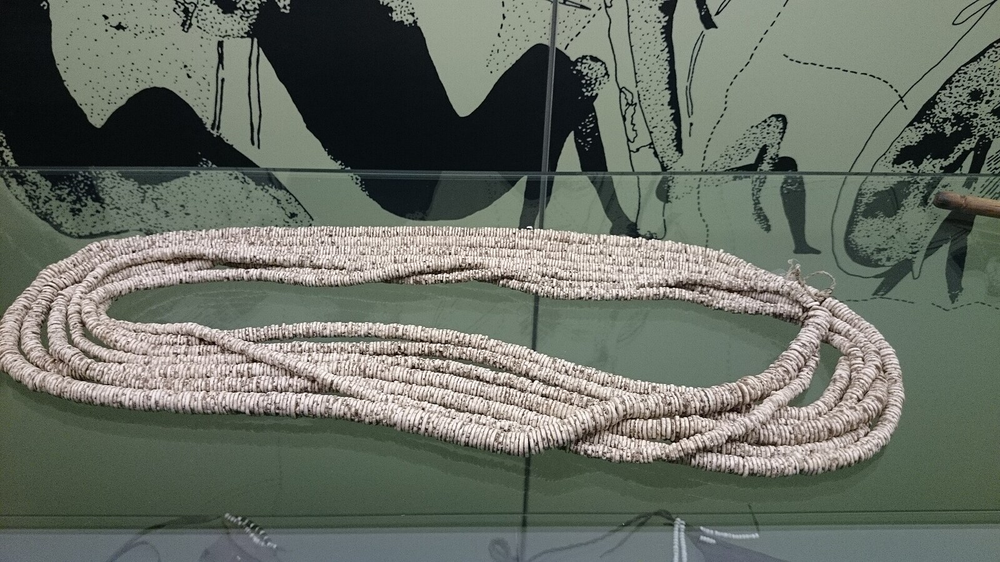
*A San necklace of ostrich-eggshell beads. Photo: Nkansah Rexford, CC BY 3.0.*

The same thing was happening tens of thousands of years ago, and it shows in the ground. Seashells from the Mediterranean are found in ice-age camps hundreds of kilometres inland. Good stone for tools was carried even further from where it was quarried. The shells moved from hand to hand along chains of friends, as beads still move among the Ju/'hoansi.

Meanwhile, in the good season, many bands came together in one place. Where a great herd crossed a river or the salmon ran, hundreds of people could eat for weeks. They used the time to trade, to find husbands and wives, to settle quarrels, to pass on news and to dance. For most of the year a person lived among a few dozen familiar faces. For those few weeks they belonged to something far larger.

Beliefs and symbols were what held that larger thing together. Across ice-age Europe, people carved small figures of women, most of them with heavy breasts and hips and with no feet and no faces. More than two hundred have been found, from south-western France to Lake Baikal in Siberia, seven thousand kilometres apart. Those who carved them never met and could not have understood one another's speech. Nevertheless, they shared an idea of what such a figure should look like, and so they must have shared something of what it meant.

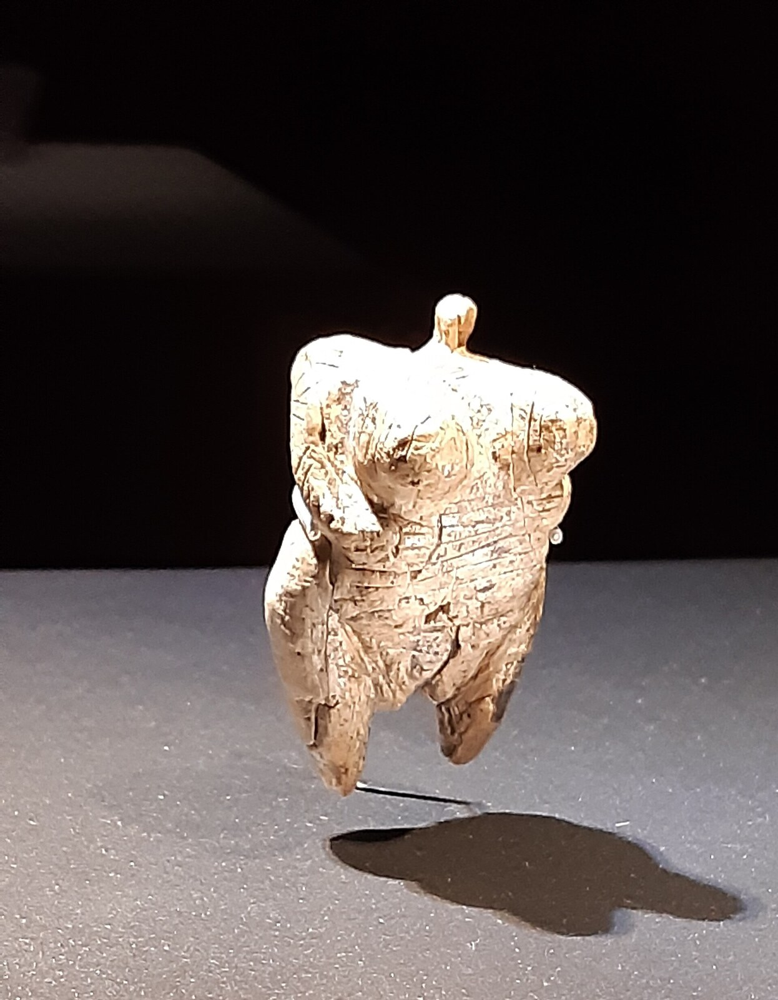
*A figure of a woman carved from mammoth ivory, found at Hohle Fels in Germany. Photo: Catatine, CC BY-SA 4.0.*

This solved a problem that defeats the chimpanzee. A male chimpanzee that meets a strange male from another troop will flee or attack, because it has no way of knowing whether the stranger is safe. A human who met a stranger wearing the right kind of beads, singing a familiar song and honouring the same ancestors had good reason to think that this was one of us. The stranger could be trusted, at least a little, without ever having been met before.

It is hard to overstate what followed from that. Markets, armies, churches and nations all depend on people cooperating with others they do not know. Here, among beads and songs around an ice-age fire, is where it began.

## The hill of stones

By the end of the ice age, shared belief could do astonishing things.

In the south-east of Turkey, on top of a limestone ridge with a view across the plain towards Syria, there is a mound called Göbekli Tepe, which means "potbelly hill". Farmers had ploughed around it for generations. In 1994 a German archaeologist walked over it, noticed how much worked flint lay on the surface, and the next year began to dig.

Under the soil were rings of standing stones. Each ring is a wall with huge pillars set into it, and in the middle stand two more, taller than the rest. The pillars are shaped like a capital T. The largest are five and a half metres high and weigh about ten tons, as much as two elephants.

Carved on their sides are foxes, wild boars, snakes, scorpions, cranes and vultures. Some pillars have long arms carved down their flanks, with hands that meet over a belt, so that the stones themselves are giant figures standing in a circle.

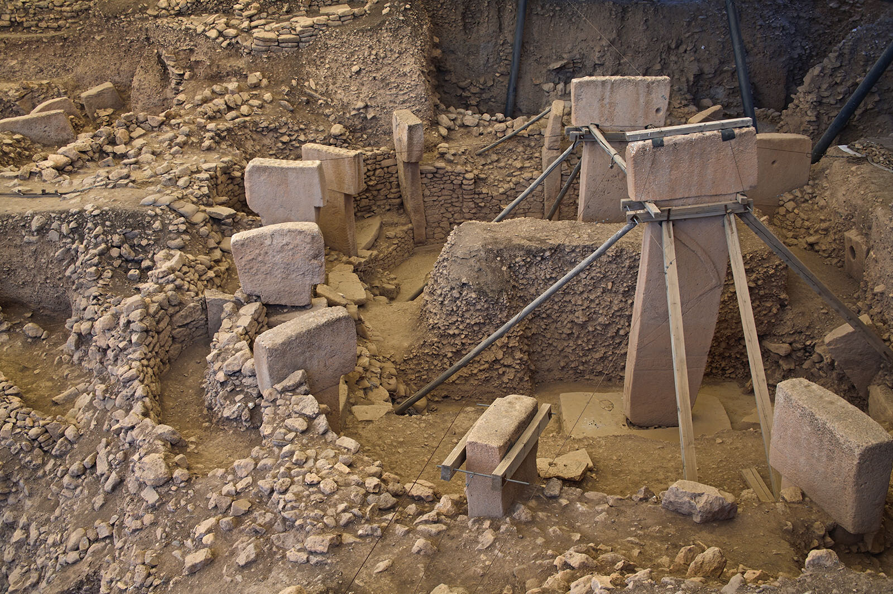
*One of the stone rings at Göbekli Tepe. The two tallest pillars stand in the middle. Photo: Dosseman, CC BY-SA 4.0.*

They were raised about eleven thousand six hundred years ago. That makes them more than twice as old as Stonehenge, and older than the pyramids of Egypt by seven thousand years.

The people who built them were hunters. They had no farms. They gathered wild wheat and barley, and ground it on stone slabs that have been found on the site in their thousands. The animal bones on the site, and there are tens of thousands of them, all come from wild animals, mostly gazelle and wild cattle.

Nor did they have much to work with. They had no pottery and no metal. They had no oxen to drag the stones and no wheels to put under them. Every pillar was cut out of the bedrock with tools of flint, levered loose, and hauled a hundred metres or more by ropes and muscle.

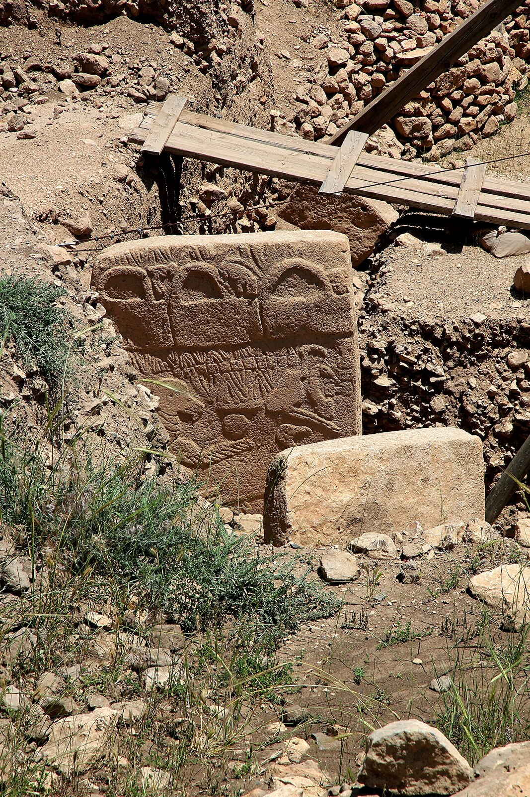
*A pillar at Göbekli Tepe carved with vultures and a scorpion. Photo: Klaus-Peter Simon, CC BY-SA 3.0.*

That takes a great many hands, far more than one band could supply. People had to come together from across a wide country. They had to be fed while they worked, which meant great hunts and great feasts, and the site is full of the remains of both.

Moreover, they had to agree. There was no king to order them and no pay to tempt them. They quarried, dragged and carved because they believed in the same thing strongly enough to give months of their lives to it.

What they built, at such cost, was not a storehouse or a fort. It was a place for whatever the foxes, the vultures and the stone giants meant.

For a long time, scholars assumed that things happened in a certain order. First people learned to farm. Farming let them settle in villages. Villages grew rich enough to afford priests and temples. Göbekli Tepe turns that order upside down. Here the great shrine came before the farms, raised by people who still hunted for a living.

And it stands in a telling place. Less than a hundred kilometres away is a range of hills where wild wheat still grows. When scientists compared the DNA of einkorn, one of the first wheats ever farmed, with wild einkorn from across the Middle East, the closest match was in those hills.

A crowd of builders has to eat, and wild grain was already part of how this one was fed. The more people who gathered on the ridge, the more it mattered where the wild wheat grew thickest, and whether it could be made to grow thicker still.
