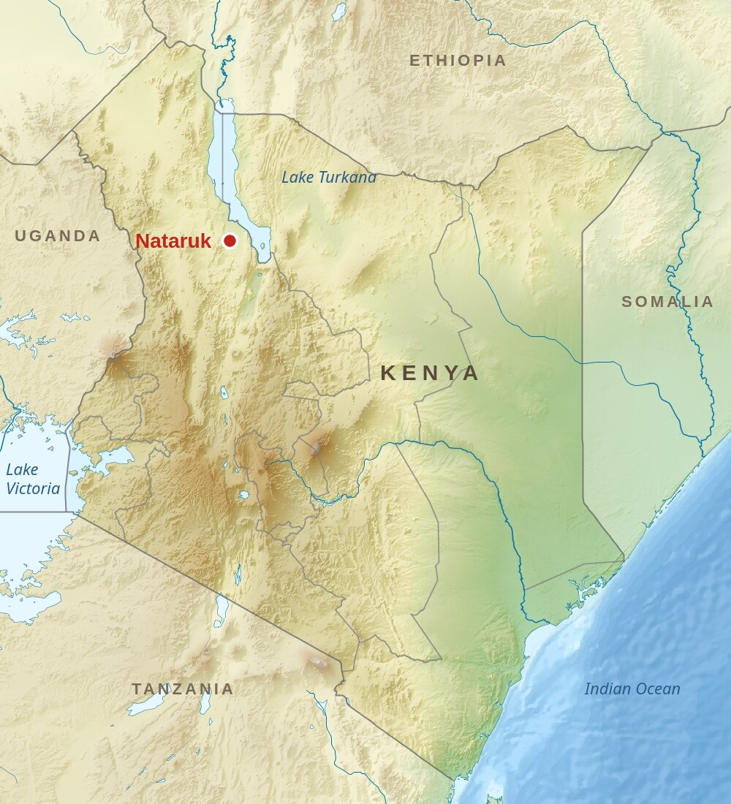
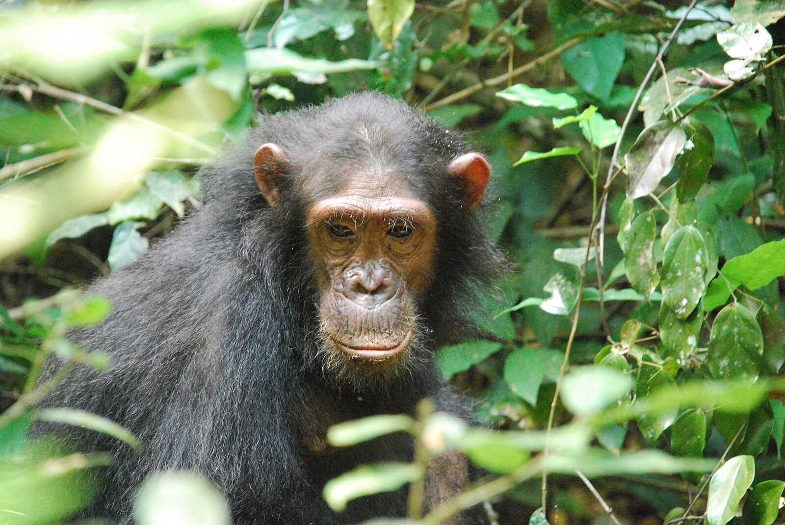
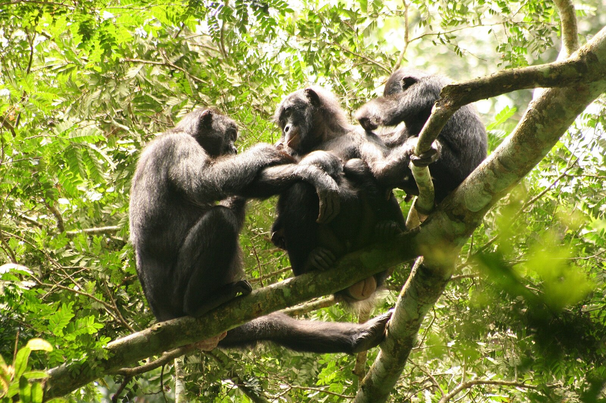
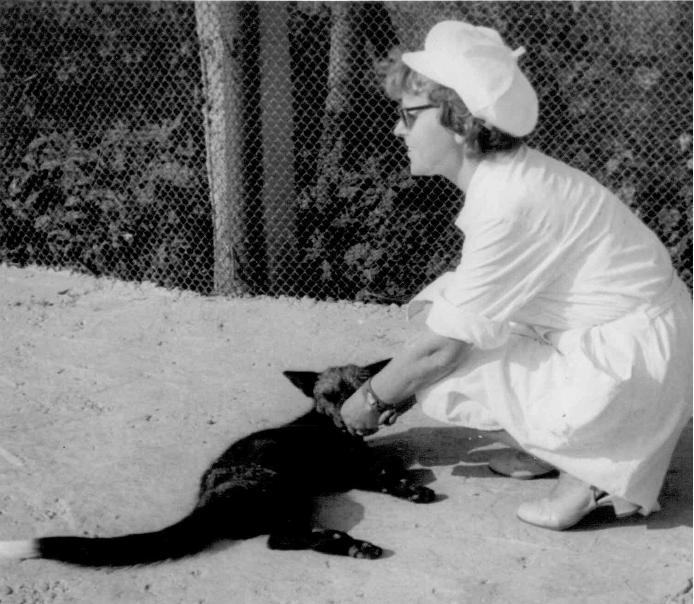
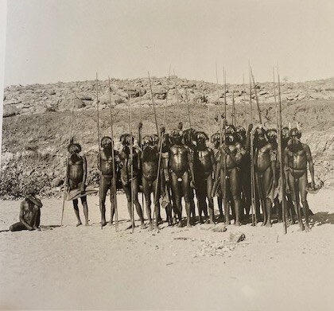
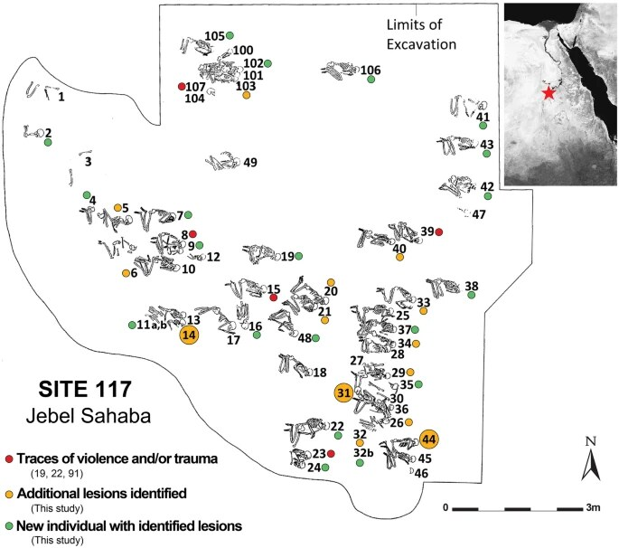
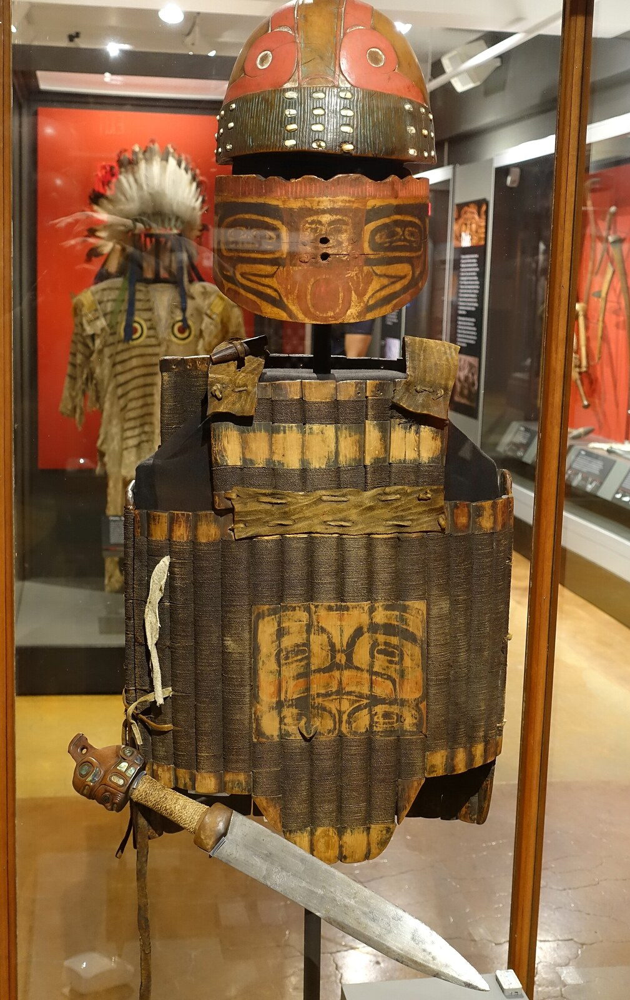

# 4. Have humans always fought wars?

*Africa, Australia and the Nile, from before our species to about 10,000 years ago*

Yes, as far back as we can see. However, for most of our history a war was a night raid by a handful of men, not a battle between armies.

One of the oldest wars that we can look at closely took place about ten thousand years ago. A band of people was camped beside a lagoon on the western shore of Lake Turkana, in what is now Kenya. It was good country then, green and full of game, with fish in the shallows. Among the people in the camp were men, women and children. One of the women was in the last months of pregnancy.

Another group of people came to the lagoon and slaughtered them. The remains of at least twenty-seven have been found.

*Nataruk, in the north of Kenya. Today it lies about thirty kilometres from Lake Turkana. Ten thousand years ago the lake was larger, and the site was a lagoon on its shore. Map: Uwe Dedering, CC BY-SA 3.0, labels added.*

We know how they died, because the bodies were never buried. They fell into the water or at its edge, and the mud closed over them and kept them as they lay. One man has the tip of a stone blade still stuck in his skull. Others have skulls caved in by clubs, and broken hands, knees and ribs. The pregnant woman was found with her wrists crossed, as if they had been tied.

We can also say something about who did it. The blade in the man's skull is made of obsidian, a black volcanic glass that is rare on that shore. So the killers probably did not live nearby. They had walked in from somewhere else, carrying clubs and arrows, and they killed women and children as well as men.

That is not a quarrel that got out of hand. A quarrel does not bring its weapons from a distance, and it does not finish off the children. This was a small war. And it was fought by people who had never seen a farm, a town or a king.

## Older than us

A discovery like that bears on an old argument, and it helps to know what the argument was. For a long time, there were two pictures of life before history, and people chose between them according to taste.

In the first picture, early humans were brutes. In 1651 an English philosopher wrote that without a government to keep order the life of man was "solitary, poor, nasty, brutish, and short", a war of every man against every man. In the second picture, early humans were innocents. A French philosopher answered a century later that man in a state of nature was gentle, and that war arrived only with property and rulers.

Neither man had spent a day among hunters. Nevertheless, the argument between them has gone on ever since, and most people still carry one picture or the other in their heads.

Both pictures are wrong. The lagoon in Kenya shows that the gentle picture cannot be right. To see what is wrong with the brutal one, and to find out how deep the roots of war really go, we have to look further back than any human camp.

In 1960 a young Englishwoman named Jane Goodall went to live among the wild chimpanzees of Gombe, a strip of forest on the shore of Lake Tanganyika. For fourteen years she watched one community of them. She saw them make tools, embrace, tickle their children and grieve for their dead. She came to think that they were, by and large, rather nicer than we are.

Then the community split. A handful of males and a few females drifted to the southern end of the range and stopped coming back. Before long the two groups were strangers to each other, and in 1974 the killing started.

It followed a pattern. Half a dozen males from the northern group would gather and walk south. Ordinarily chimpanzees are noisy animals. On these walks, by contrast, they were silent. They stopped to listen, and they sniffed the ground.

When they found a southern male feeding on his own, they rushed him. Some held him down while the others bit, beat and stamped on him for ten or twenty minutes, and then they left him to die of his wounds. The attackers were hardly ever hurt themselves. The reason is that they attacked only when they had their victim badly outnumbered.

They kept at it. Within four years, every male in the southern group was dead or had vanished. Afterwards the northerners took over the southern forest and its fruit trees.

*A wild chimpanzee at Gombe. Photo: Roland, CC BY-SA 2.0.*

At first it was possible to hope that Gombe was a freak. It was not. Almost everywhere that chimpanzees have been watched for long enough, they have been seen to kill their neighbours.

One case shows what they gain by it. In a forest in Uganda, the males of one very large community killed at least eighteen of their neighbours over ten years. They then moved into the dead animals' land, which made their own territory a fifth larger. More land meant more fruit. In the years that followed, the females there had more than twice as many babies as before, and far fewer of the babies died.

In other words, for a chimpanzee, killing the neighbours pays, so long as it can be done cheaply. An animal that does it leaves more descendants than one that does not.

This matters to us because of who the chimpanzees are. They are one of our two closest living relatives, and the raid is as natural to them as cracking nuts. So organised killing between groups was not invented by kings or farmers. It does not need a government, or a field, or even a human being.

On the other hand, it is not a law of nature either, and the proof is our other closest relative. This is the bonobo, an ape that looks so like a chimpanzee that for years nobody noticed it was a separate animal. Bonobo groups that meet at a border may scream at each other. However, they also sit down together, groom and mate. Killing is almost unknown among them.

So here are two apes, equally close to us, that live in very different ways. Which of them are we like?

*Wild bonobos grooming in the Congo forest. Photo: DBeaune, CC BY-SA 4.0.*

## The tamed ape

In one respect, we are far gentler than either ape.

Try a simple test. Put three hundred chimpanzees who do not know one another into a metal tube, strap them into narrow seats, and leave them there for eight hours. Few would get out unhurt. Humans, by contrast, do this every day on aeroplanes, and the worst that usually happens is a dispute about an armrest.

The difference can be counted. Chimpanzees living in the wild slap, bite, chase and batter the members of their own group constantly. Males fight their way up a ladder of rank, and males routinely beat females. People who live by hunting and gathering do argue, of course, and they sometimes come to blows. However, set the two side by side, and a chimpanzee is in a fight hundreds of times more often than a human is.

That is a puzzle, since our nearest relatives are nothing like it. How did an ape become so calm? It had help from two inventions.

The first was the weapon. Among chimpanzees, a powerful male can terrorise the others, because none of them can stand up to him alone. A spear changes that. With a spear, the smallest man in the band can kill the largest, especially while the large man is asleep. Strength stopped being enough to make a tyrant safe.

The second invention was language. Chimpanzees do sometimes gang up on a leader, but they cannot talk it over first. People can. They can sit by the fire when he is away and agree on what has to be done, who will do it, and when.

Put the two together, and a bully is in serious danger. Hunting bands used that power. They had no chief, and they meant to keep it that way. A man who tried to make himself one was first mocked, and then shunned. If he was violent and would not stop, he was killed.

This is not guesswork. It happened among the Ju/'hoansi of the Kalahari within living memory. A man in one group had killed three people, and nobody could stop him. So the others ambushed him in broad daylight and shot him with poisoned arrows.

As he lay dying, all the men fired more arrows into him until, in the words of one of them, he looked like a porcupine. Then, when he was dead, the women came up as well, and everybody stabbed the body with spears. No single person had killed him. The whole camp had.

Now imagine that going on in every band for hundreds of thousands of years. In each generation, the most hot-tempered and domineering men were the ones most likely to end up dead before they had many children. Their calmer neighbours had the children instead. Slowly, many scientists now think, the temper itself was bred out.

That may sound too slow and too gentle a process to change a species. Yet the same thing happened to wolves at the edge of the camp, where the bold and calm ones were fed and the savage ones were driven off. And there is an experiment that shows how fast it can go.

In the 1950s a Russian scientist began breeding silver foxes on a fur farm in Siberia. He chose them by a single test. He put his hand into the cage, and he bred only from the foxes that did not snap or cower. Within six generations he had foxes that wagged their tails, whined for attention and licked the hands of their keepers.

*One of the Siberian foxes with a researcher in 1974, fifteen years into the experiment. Photo: Svetlana Argutinskaya, CC BY-SA 4.0.*

Taming leaves marks on the body as well as on the temper. A dog has a shorter face, smaller teeth and a lighter skull than a wolf. Our own skulls have changed in the same direction. Compared with the earliest people of our kind, we have shorter faces and lighter brows.

These are the marks of a domesticated animal. Nobody tamed us, though. We did it to ourselves, one dead bully at a time.

Yet the Kalahari killing shows something less flattering as well. Look again at how the man died. It was not a brawl. It was discussed in advance, agreed on by everyone, carried out by many against one, and done when he could not fight back. That is much the way the chimpanzees of Gombe killed.

So there are two kinds of violence, and they are not much alike. One is hot: the flash of rage, the blow struck before thinking. The other is cold: the plan made calmly and carried out together.

Our ancestors lost most of the first kind. They did not lose the second. On the contrary, they became better at it than any animal that has ever lived, because nobody else can plan so well or trust their companions so far.

We are therefore like both apes at once. Inside the group, we are milder than a bonobo. Between groups, we can be worse than a chimpanzee.

## While the camp slept

What did war actually look like among people who lived by hunting? In one place, somebody kept count.

In the late 1920s an American scholar spent three years in Arnhem Land, on the tropical north coast of Australia, among people who had never farmed. He learned the language, and then he did something simple. He asked the older men to list every fight they could remember over the past twenty years, with who was in it and who died.

The total was a shock. They remembered about a hundred men killed, and he reckoned that the true number was twice that. This was among a people who numbered only about three thousand. Measured against their numbers, that is twice the yearly rate at which war killed in Germany or Russia during the century of the two world wars.

*A party of men in central Australia in 1901, back from a raid to avenge a death. Photo: Baldwin Spencer, public domain.*

The list also shows how the men died. One might expect that most fell in battle. The people of Arnhem Land did have battles. Two groups would agree on a time and a place, line up within spear range in daylight, shout insults and throw.

Most of these battles looked dramatic and were almost harmless. The reason is that a man who is watching can dodge a spear. When somebody was badly hurt, the two sides usually called it off. Only twice in twenty years did such a meeting turn into an all-out fight that left many dead.

The killing was done in another way. About three in five of the dead were killed in raids. A party of men would travel to the enemy's country, wait in the bush through the night, and surround a camp while it slept. They speared the men as they woke, or before they woke, and were gone by sunrise. Others were killed singly, by a small party that crept up on a man asleep.

Anyone who remembers Gombe will recognise the rule. It is the chimpanzees' rule: strike only when you cannot lose. Nobody in such a war tries to fight fairly, since a fair fight is one that you have an even chance of losing. So the typical act of war, for most of human history, was not a battle. It was a murder committed by a committee.

Why did they do it? It was not for gain. Nobody was after land, and there was no treasure to carry home. The men themselves gave one reason far more often than any other, which was revenge. A killing had to be answered by the dead man's brothers. Their answer then had to be answered in turn, and in this way a feud could run for a generation.

That explains why feuds continued. It does not explain how they began, and what started a feud was usually one of two things. The first was a woman, who was stolen, or ran off with a lover, or was promised to one man and given to another.

The second was sorcery. People who believe that the world is full of wills seldom believe in accidents. When a healthy man sickened and died, they did not think of it as bad luck. Somebody had made it happen, and the usual suspect was an enemy in another group who had worked magic against him. Therefore, even a death from fever could send a raiding party out.

Arnhem Land was bloodier than most places, and it would be wrong to take it as the average. Nevertheless, from the Arctic to the Amazon, people who lived by hunting remembered killings of the same kinds: the grudge, the stolen wife, the ambush, the revenge.

Even the gentlest of them were not gentle by our standards. The Ju/'hoansi were once the subject of a famous book called *The Harmless People*, and they did not make war at all in the years they were studied. Yet when a scholar counted the killings that they remembered, he found that they had murdered one another more often than people do in the United States.

## Room to walk away

All of this makes the hunting life sound like one long bloodbath, and it was not. Something held the violence within limits. A band of hunters might lose a man now and then. However, it was seldom wiped out, and what happened at the lagoon in Kenya was rare. Four things kept war small.

To begin with, there was little to steal. A raiding party that overran a hunters' camp won a few spears, some skins and whatever meat was on the fire. Nobody owned a herd or a storehouse. Killing was dangerous work even when it was done at dawn, and it brought the winners almost nothing they could eat. So there was seldom much reason to try.

Second, there was room. People were few and the land was wide. A band that felt threatened could pack up in a morning and move, and its enemies had little reason to follow. Among hunters, moving away is the usual answer to every kind of trouble. It works as well against a hostile neighbour as against a dry waterhole.

Third, nobody could be made to fight. Without a chief, a raid was made up of whoever agreed to go. A man who thought the quarrel foolish stayed at home, and nobody could order him out. Every one of the raiders was also a hunter whose family needed him alive. As a result, wars were hard to start and easy to abandon.

Finally, and most important, the enemy was seldom a stranger. Bands took husbands and wives from one another, and kept gift partners in distant camps. The men across the valley were therefore not a faceless foe. They included a wife's brothers, a sister's husband and the friend who had taken the family in during the last drought.

Here humans differ sharply from their cousins. Chimpanzees have nothing like this. A male chimpanzee has no friends outside his own group, and so every strange male is an enemy. Humans, by contrast, had found a way to have relatives on the other side. It is hard to raise a war party against a camp where half the raiders have a sister.

For the same reason, people could do something that no chimpanzee has ever done. They could make peace between one group and another.

In Arnhem Land there was a ceremony for it. When a feud had gone on long enough, the two sides agreed to meet. The men who had done the killing stood out in the open, and the dead man's kin threw spears at them, one after another, while the killers dodged.

That let the anger out. When it had been thrown off, the man most to blame stood still and let himself be speared through the thigh. Blood had now been paid for blood. Both sides accepted the debt as settled, and the feud was over.

It did not always hold. Even so, the ceremony existed, everyone knew its steps, and it was used. People who could plan a raid could also plan an end to raiding.

## Nowhere to go

There is a weakness in those four limits, however. All of them depend on one condition. They work for people who are few, who move, and who own little. Take that condition away, and the limits go with it.

We can see what happens then at a low hill called Jebel Sahaba, on the east bank of the Nile in the far north of Sudan. In the 1960s, shortly before a great dam flooded the valley, archaeologists dug there and found a cemetery more than thirteen thousand years old. It held at least sixty-four people.

About two thirds of those studied had been wounded. Sharp flakes of stone, the tips and barbs of arrows and light spears, lay among the bones, and in some cases were stuck in them. The wounded include men, women and children alike.

One detail shows that this was not a single massacre like the one at the lagoon. Many of the dead carry old wounds that had healed and fresh ones that had not. So these people were not killed in one terrible day. They were attacked, recovered, and were attacked again. They lived with war for years on end.

*The cemetery at Jebel Sahaba. Each coloured dot marks a skeleton with wounds. Plan: Crevecoeur and others, 2021, CC BY 4.0.*

Why there, of all places? The answer is in the land. The Nile at that time ran through a desert, as it does today, and all the food was in a ribbon of green along its banks. Meanwhile, the ice age was ending, and the weather had gone wild. In some years the river flooded violently, and in others it shrank. Each time, the good ground narrowed, and the people living along it were squeezed against their neighbours.

Now think of the four limits again. A band in open country that is attacked can leave. The people of Jebel Sahaba, by contrast, had the desert on either side of them and other bands upstream and down. The river was the only place where anyone could live. So they stayed, and fought for it, and buried their dead on the hill.

The same pattern appears wherever hunters stopped moving, even where food was plentiful. On the Pacific coast of North America, from Oregon to Alaska, the rivers fill each year with salmon. The people there lived by fishing and had no need of fields. They caught salmon in great numbers, dried them, and stored them for the winter in large wooden houses.

That was a comfortable life, and it had a cost. Since they had storehouses and fishing grounds, they had something worth taking. Since they could not carry either away, they had to stay and defend them.

When Europeans arrived, they found villages behind wooden stockades, warriors in armour made of wooden slats, and canoes that carried raiders hundreds of kilometres along the coast. The raiders came for the fishing grounds. They also came for people, whom they carried home as slaves.

*Wooden armour and helmet made by the Tlingit of Alaska. Photo: Daderot, public domain.*

Neither of these peoples lived by farming, and neither had a king. So war on that scale does not come from farming, or kings, or some poison in the blood. It comes from a pile of food that cannot be moved, and a crowd of neighbours who know where it is.

For three hundred thousand years, most humans could answer a threat by walking away from it. That freedom was about to end. In the hills of the Middle East, people had already begun to plant the wild grain they had once only gathered. A field cannot be carried on the back, and neither can a year's harvest. Whoever planted one had a reason to stay beside it, and to fight for it.
