# 5. Why did people start farming?

*The Middle East, and seven other places, from about 23,000 years ago to about 4,000 years ago*

They did not mean to.

Nobody ever stood at the edge of a forest and chose between the life of a hunter and the life of a farmer. Instead, farming crept up on people over a hundred generations, one sensible step at a time. When their descendants finally noticed what had happened, it was far too late to go back.

The natural guess is that it began with a discovery, on the day somebody first noticed that a seed grows into a plant. It did not, and a camp on the shore of a lake shows why.

In 1989, after years of drought, the Sea of Galilee in Israel shrank, and on the newly dry shore archaeologists found the remains of a camp. Six huts of brushwood had stood there twenty-three thousand years ago, in the depths of the ice age. Then the huts had burned, the lake had risen over them, and the mud had sealed in everything on their floors.

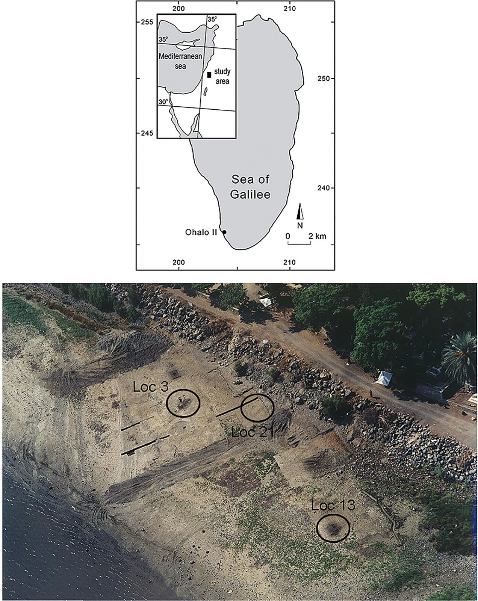
*The camp on the shore of the Sea of Galilee, seen from the air during the dig. Image: I. Groman-Yaroslavski, E. Weiss and D. Nadel, CC BY 4.0.*

Among the things on those floors were about a hundred and fifty thousand seeds and scraps of plants. The people of the camp had gathered more than a hundred and forty kinds, and among them were wild wheat and wild barley. In one hut lay a flat stone, and stuck in its surface were grains of barley starch. Somebody had ground grain into flour there.

Consider what that means. People were harvesting grain and grinding it twelve thousand years before anyone lived by farming. They knew what wheat was and when it ripened. They certainly knew that a seed dropped on wet ground comes up as a plant. So knowledge was never the missing piece. People knew how to farm for a very long time, and chose not to.

## Why bother?

That choice looks strange only if we underrate the people who made it. People who live by gathering know plants better than any modern gardener does. They can name hundreds of them and say where each grows, when it fruits, what it cures and which part is poisonous.

Many of them also tend wild plants. They burn off old grass so that new shoots will come, and they put the tops of the roots they dig back into the ground. None of this was beyond an ice-age band. The step from tending a wild plant to sowing a field is a short one.

They did not take it, and the reason is simple. Farming is a bad deal.

Compare a day's work on each side. A gatherer walks to where the food already is and picks it. A farmer, by contrast, has to clear the ground, break the soil, sow, weed and chase off the birds. Then she has to wait for months, during which a single hailstorm or a herd of gazelle can take the lot.

Even then she is not finished. After the harvest come the threshing and the grinding. At the end of all that work, the farmer has a heap of one kind of seed. The gatherer, meanwhile, has eaten forty different things and spent the afternoon in the shade.

People who still lived by gathering in modern times saw this perfectly clearly. In the 1960s a scholar living among the Ju/'hoansi of the Kalahari asked a man why his people did not plant crops, as their neighbours did. The man's reply has been quoted ever since. "Why should we plant," he asked, "when there are so many mongongo nuts in the world?"

It is a good question, and for most of the human past it had no answer. For people to take up the harder life, something had to change. The first thing that changed had nothing to do with sowing.

## Staying put

It had to do with the weather. About fourteen and a half thousand years ago, the ice age began to loosen its grip, and the hills at the eastern end of the Mediterranean turned warm and wet. Oak and pistachio woods spread across them. Between the trees, wild wheat and barley grew in stands so thick that they looked like fields that nobody had planted.

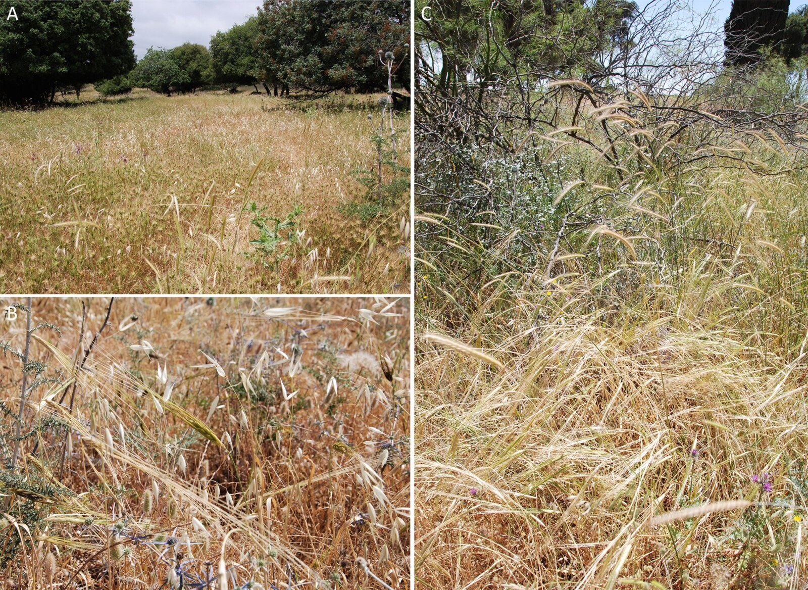
*Wild cereals growing thickly in northern Israel today. Photos: A. Weide, S. Riehl, M. Zeidi and N. Conard, CC BY 4.0.*

A family could do very well out of those stands, and we know roughly how well. In the 1960s an American scientist went to a hillside in Turkey where wild wheat still grows. He took with him a sickle made of flint, of the kind used in the Stone Age, and set to work. He found that in three weeks, which is the length of time the grain stays ripe, a family could cut more than it could eat in a year.

That sounds like a gift, and it was. It came with a catch, however. A year's supply of grain is far more than a family can carry. People who wanted to live on it could not go on wandering. They had to stop moving and live beside it.

So they did. In what are now Israel, Jordan and Syria, people built round houses on stone foundations, sunk a little into the ground. They cut grain with flint sickles, whose edges still carry the polish that grass stems leave behind. They pounded it in mortars hollowed out of the bedrock.

They even baked. In one of their fireplaces, in the north-east of Jordan, archaeologists found burnt crumbs of flat bread. Those crumbs are four thousand years older than farming.

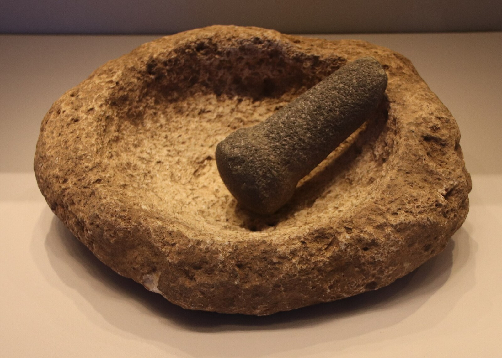
*A stone mortar and pestle made by the first villagers, now in the Israel Museum. Photo: Gary Todd, CC0.*

How can anyone tell that these people really stayed all year, and did not simply come back each summer? There is a small witness. Mixed in with the rubbish of their houses are the teeth of a new animal, the house mouse. House mice crowd out wild mice only where people stay in one place for a long time and keep food there. They appeared in these villages about fifteen thousand years ago, and they have lived with us ever since.

These villagers were still hunters and gatherers. They ate wild grain, wild gazelle and wild nuts, and they planted nothing. Nevertheless, they had houses, stores and graveyards, and they had neighbours on the next hill who had the same.

Settling down then had a result that nobody intended, and it concerned babies. A woman in a band that moves camp every few weeks has to carry her baby, and she cannot carry two. She therefore nurses each child for three or four years, which holds off the next pregnancy. As a result, her children are born about four years apart.

A woman in a village is in a different position. She does not have to carry anyone anywhere. She also has something that a woman on the move does not, which is soft porridge of boiled grain that a baby can eat. Her children could therefore come closer together, and she bore about two more of them in her lifetime.

The graveyards show it. Wherever people settled down, the share of children among the dead rises sharply. That sounds like bad news, but it is simply what happens when far more children are being born.

Many of those children died. Even so, the villages grew, and when a village grew too large it split and founded another. Within a couple of thousand years, the good country was full of settled people who depended on wild grain. There were far more of them than the land had ever held before.

## A steady sky

Those people were now exposed in a way that their wandering ancestors had never been, and before long the weather turned on them. About twelve thousand nine hundred years ago the cold came back, almost overnight, and stayed for twelve centuries. The woods shrank back, and the wild plants that the villagers lived on shrank with them.

A wandering band would have met this as hunters always met trouble, by moving away. For the villagers it was much harder. There were more of them than roaming could easily feed. Besides, the country around them was full of other villages in the same trouble. Many gave up their houses and took to the road again. Others hung on beside whatever grain was left.

About eleven thousand seven hundred years ago, the long cold ended, and it ended fast. In Greenland, the temperature rose by about ten degrees in sixty years. Then the climate did something it had not done for a hundred thousand years. It held steady.

We take a steady climate for granted, because it is the only kind that our written history has known. However, the ice age was not just cold. It was wild. The record frozen into the ice of Greenland shows the temperature lurching up and down by many degrees within a few decades, again and again.

That matters enormously to anyone who wants to plant a field. A farmer buries good food in the ground and trusts that the rain which came last spring will come next spring too. For most of the time that our species has existed, nobody could count on that. Now, for the first time, they could.

So all the pieces were finally in place. There were villages of settled people. There were too many of them to live easily on the wild harvest. And the weather could at last be trusted. Once it settled, the villages of the Middle East filled again, and this time their people did the obvious thing. They took some of the seed they had gathered, carried it to a patch of damp ground near the houses, and put it in. Nothing now stood in the way of doing the same the next year, and the year after.

The Middle East was the first place where this happened. It was not the only one.

In northern China, people started growing millet, and along the Yangtze they started growing rice. In the highlands of New Guinea, they planted taro and bananas at the edge of a swamp. In southern Mexico they began to tend a scrubby grass that would one day be maize, and in the Andes they planted potatoes. Farming also began on its own in Africa south of the Sahara and in the woods of eastern North America.

That makes eight places at least, the earliest eleven thousand years ago and the latest about four thousand. Most of these peoples had never met. They did not know that the others existed, and they were working with entirely different plants.

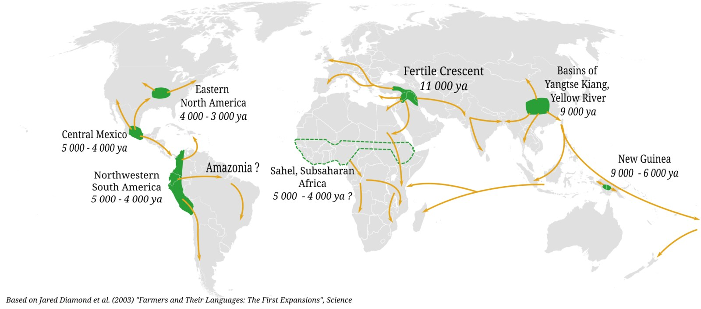
*The places where farming began independently. Map: Ian Alexander, CC BY-SA 4.0.*

When the same thing is invented eight times by strangers, it is not a stroke of genius. It is what humans do when they are settled, crowded and blessed with steady weather.

## The plant that cannot let go

Putting seed in the ground was only the beginning, because the first farmers did not have crops. They had wild plants, and wild plants are not made for our convenience. Over the following centuries the plants changed, and nobody intended that either.

Take wheat. A wild wheat plant has one task, which is to scatter its seed. When the ear is ripe, therefore, it shatters. The stalk that holds the grains turns brittle, and at a touch or a gust of wind they fall to the ground and are lost among the stones. That is good for the wheat and bad for the gatherer. Anyone gathering wild wheat has to get to it in the few days before that happens, and even then loses much of it.

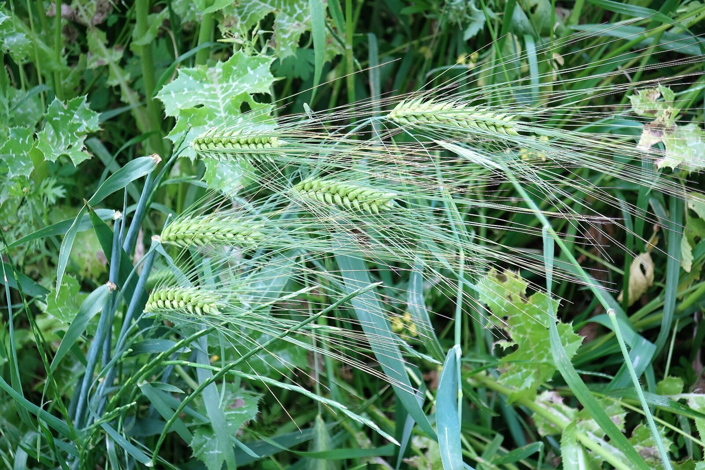
*Wild wheat in Israel. When these ears ripen they break apart and drop their grain. Photo: Davidbena, CC BY-SA 4.0.*

However, in any stand of wild wheat there are a few freak plants whose ears do not shatter. The stalk stays tough, and the grains stay on. In the wild this is a crippling fault, since a plant that cannot drop its seed leaves few offspring. Left alone, such plants stay rare.

Now watch what a harvester with a sickle does. She cuts the stalks and carries the sheaves home. The grains that fell before she came, or fell as she cut, are left behind on the ground. The grains that held on go home with her. A plant with a tough stalk is therefore far more likely to end up in her basket.

Next spring, some of what is in the basket is sown. So the field she plants holds a slightly larger share of tough-stalked plants than the wild stand did. The next harvest repeats the trick, and so does the one after.

Nobody had to understand any of this. Year after year, the harvest caught a slightly larger share of the plants that held their seed, and the sowing passed them on. The same blind sieve favoured plants with bigger grains, and plants whose seeds all sprouted at once.

It was very slow. In the soil of ancient villages, archaeologists can count the stalks of each kind, and the tough ones take two or three thousand years to go from rare to nearly all. At the end of that time, however, there was a new plant on Earth. Its ears stayed whole until somebody threshed them. It could hardly sow itself at all, and without a farmer it would soon be lost among the weeds.

The most extreme case is in Mexico. The wild ancestor of maize is a grass called teosinte. Its ear is shorter than a finger, and it holds about ten seeds, each one locked in a case as hard as a nutshell. Nine thousand years of choosing the best ears to plant turned it into something that its ancestor would not recognise. A modern cob has hundreds of soft kernels, wrapped so tightly in husks that not one of them can reach the ground unless a person strips it.

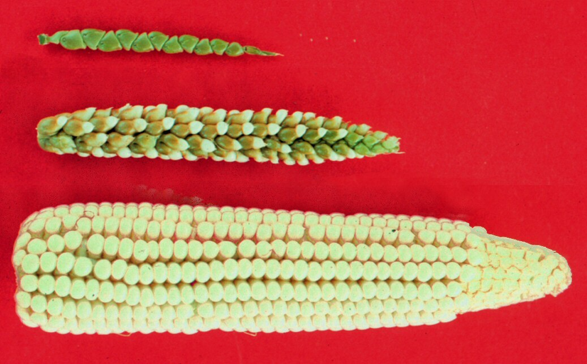
*Teosinte at the top, modern maize at the bottom, and a cross between them in the middle. Photo: John Doebley, CC BY 3.0.*

So the bargain ran both ways. People had made plants that could not live without them. Meanwhile, as the villages kept growing, the people could no longer live without the plants.

## Fourteen animals

What happened to plants happened to animals too, and in the same villages.

A hunter who has killed a wild goat has meat for a week. One who catches the kids and keeps them in a pen has something better. He has a supply of meat that feeds itself on grass and thorn, which people cannot eat, and that can be killed whenever it is needed. In the mountains where Turkey, Iraq and Iran now meet, people were keeping goats and sheep about ten and a half thousand years ago. Pigs followed.

Cattle were a braver undertaking. Their wild ancestor was the aurochs, a black bull that stood as tall as a man at the shoulder, with horns as long as a man's arm and a foul temper. Nevertheless, somebody managed it. The DNA of modern cattle shows that all the humpless cattle in the world descend, on the mother's side, from about eighty wild cows that were tamed in the Middle East.

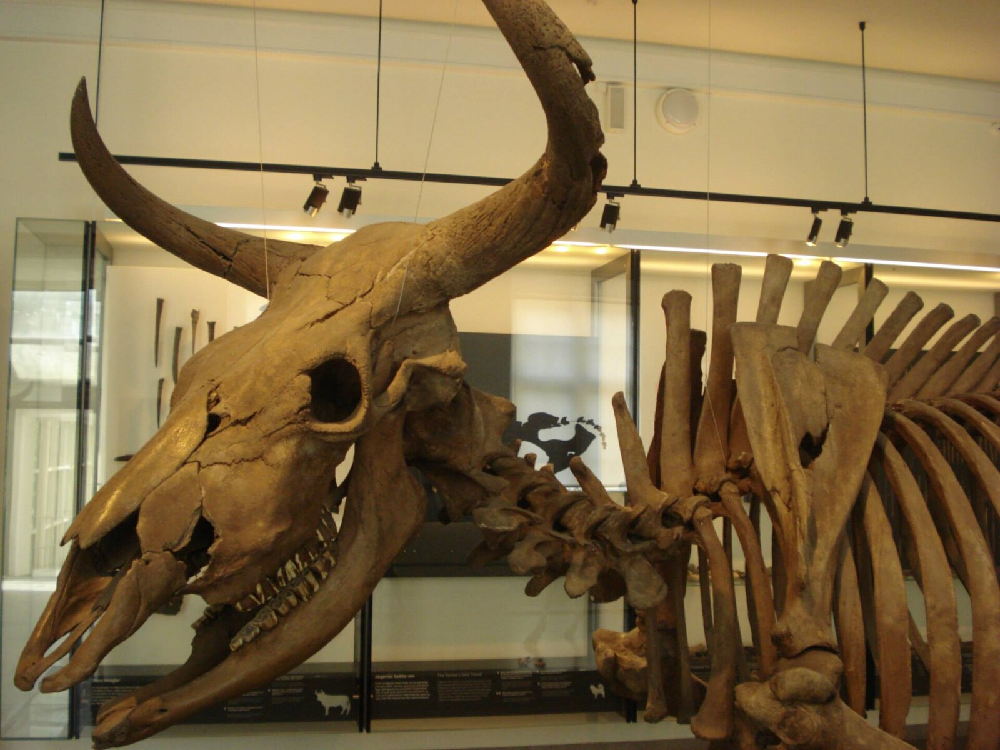
*The skeleton of an aurochs in the National Museum of Denmark. Photo: Eldrichr, CC BY-SA 3.0.*

As with wheat, the animals changed once people controlled which ones bred. The herders killed the ones that were hard to handle and bred from the ones that were calm. Within a few hundred generations they had animals that were smaller, tamer and duller than their wild cousins. In return, the herders got meat and hides, and in time milk, wool and muscle to pull a load.

What is striking is how short the list of such animals is. There are about a hundred and fifty kinds of large plant-eating mammal in the world. People have turned fourteen of them into farm animals.

The reason is that a farm animal has to pass several tests at once. It must eat cheap food and grow fast. It must breed in a pen, and it must not panic and break its neck when shut in. Above all, it should be a herd animal that is used to following a leader, so that it will accept a human in the leader's place.

An animal that fails even one test will not do. That is why nobody keeps zebras for riding, which bite and do not let go. It is also why nobody farms elephants, which can be tamed one at a time but will hardly breed in a pen.

Moreover, the fourteen were not shared out fairly around the world. Thirteen of them, including the sheep, the goat, the pig, the cow and the horse, lived in Europe, Asia and the north of Africa. South America had one, the llama and its small cousin the alpaca, which are counted together. North America and Australia had none.

In part, this was the hunters' own doing. The Americas had once had wild horses and camels, and Australia had its giant grazers. All of them died out after people arrived. The price was paid much later. The later peoples of the Americas had fields of maize and potatoes. In the Andes they had the llama to carry a pack. Nowhere did they have an animal to pull a plough or ride into battle.

## The bill

So people now had fields, flocks and full storerooms. Was the new life better? The skeletons of the people who lived it say that it was not.

The clearest evidence comes from a single village. On the bank of the Euphrates in Syria there was a settlement that lasted long enough to cover both lives. Its first people were gatherers and gazelle hunters. Their descendants, on the same spot, were farmers. The two can therefore be compared directly.

When a scientist examined the bones of the farming women, she found the same damage again and again. Their big toes were bent and worn at the joint. Their knees were damaged, and the lowest bones of their spines were crushed.

She worked out what had done it. To make flour, a woman knelt on the ground with her toes curled under her, and pushed a stone back and forth across a slab, throwing her whole weight forward and dragging it back. Feeding a family took hours of this every day, from adolescence. The price of bread was paid in toes, knees and backs.

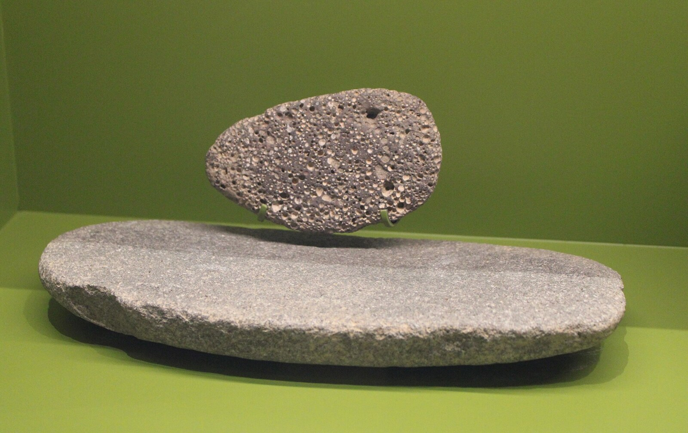
*A grinding slab and rubbing stone from the village on the Euphrates, now in the Ashmolean Museum. Photo: Zunkir, CC BY-SA 4.0.*

The damage was not confined to that one village, or to women. In Europe, where the most skeletons have been measured, the first farmers were several centimetres shorter than the hunters before them, and their descendants did not get that height back for thousands of years. Their teeth, which in most hunters are sound, filled with cavities from a diet of starch. Their bones show more infection and more childhood hunger.

Hunger may seem a surprising thing to find among people with storerooms. The trouble was that a hunter ate from a wide table and a farmer from a narrow one. If the nuts failed, a hunting band ate roots, and if the roots failed, it moved.

A farming village, by contrast, lived on two or three crops. When drought or blight took them, there was little else, and nowhere to go. Hunters went hungry at times. However, famine has struck farming peoples more often than hunting ones.

Sickness came with the new life too, and for a similar reason. A band of thirty that moves every few weeks leaves its rubbish and its dung behind. A village of three hundred lives on top of its own, beside its animals, and drinks from the stream it washes in. Many of the diseases that would later kill people by the million came to us from animals. Measles descends from a plague of cattle, and influenza came to us from birds.

Add all of this up. Farmers worked harder than hunters, ate worse, grew shorter and fell sick more often. If that were the whole story, farming would have died out. Yet in one respect, farming beat hunting so thoroughly that nothing else counted.

That respect was numbers. A band of hunters needs a great deal of land, something like ten square kilometres for each person. The same land under wheat can feed fifty or a hundred times as many. And farming women, as the first villagers had found, bore more children.

The result follows directly. A farming people could be sicker, shorter and hungrier than the hunters next door and still outnumber them ten to one within a few centuries.

When farming began, there were about five million people in the world. By the time of the Roman Empire, there were about two hundred million. Farming was not a way of making life good. It was a way of making more life.

## No way back

If farming was such a poor bargain for the people doing it, why did nobody give it up?

Some did, here and there, where the land was poor and the wild was close. For most, however, the door had shut behind them. The arithmetic is brutal. Suppose that a valley which once fed a hundred hunters now feeds two thousand farmers. If those farmers lay down their sickles and go back to the woods, the woods will feed a hundred of them. No village ever voted for that.

Besides, nobody remembered the other life. The change had taken a hundred generations, and each one grew up in a world only slightly different from its parents'. A child born in a farming village knew that people had always ground grain, just as children today know that people have always had shoes.

So farming stayed. Then it began to move, and the way it moved was very simple. A village that grew too big sent its young families a day's walk up the valley, where they cleared a patch of ground and sowed. Their own grandchildren did the same.

Repeated for long enough, that carries a people across a continent. From Turkey, farmers crossed into Greece about eight and a half thousand years ago. They advanced through Europe at about a kilometre a year, and reached Britain two and a half thousand years later.

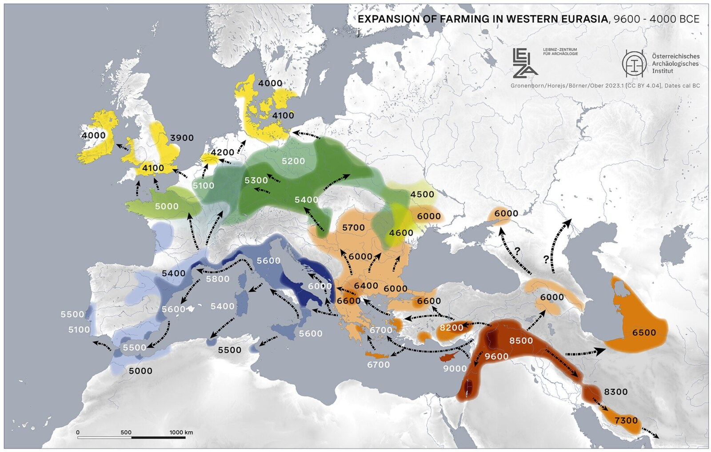
*The spread of farming from the Middle East across Europe, with dates BC. Map: D. Gronenborn, B. Horejs, M. Börner and M. Ober, CC BY-SA 4.0.*

For a long time, scholars argued about what exactly had spread. One possibility was that the idea had travelled: the hunters of Europe had seen their neighbours' fields and copied them. The other was that the people had travelled: the farmers themselves had come and taken the land.

DNA from ancient skeletons has now settled the matter, and it was mostly the second. The first farmers of Germany, France and Britain were the descendants of people from Turkey. They brought their own wheat, their own sheep and their own pots. The hunters who had lived there since the ice age were pushed to the edges or absorbed. In Britain, little of the old hunters' ancestry survived the farmers' arrival.

It would be easy to imagine a war of conquest behind that, and there was surely fighting. Most of the work, however, was done as it had been when our own kind displaced the Neanderthals, by numbers. Where a forest had held fifty hunters, there were soon five hundred farmers, and then five thousand. The hunters were not defeated. They were swamped.

The same thing happened when farmers spread through Africa south of the equator, and it went on happening until quite recently. That is why, when scholars wanted to learn about the hunting life, they mostly had to go to the Kalahari, the Arctic and the Australian desert. Those were places where crops grow badly or not at all, and so they were the last places that farmers wanted.

## The town without streets

Meanwhile, back where farming had started, the new life was producing something that the world had not seen before. By nine thousand years ago, some villages had grown into towns.

The best known stands on a plain in the middle of Turkey. There is a mound there twenty metres high, made entirely of the ruins of houses built one on top of another. It is called Çatalhöyük. For more than a thousand years it was a town, home to many hundreds of people at the least.

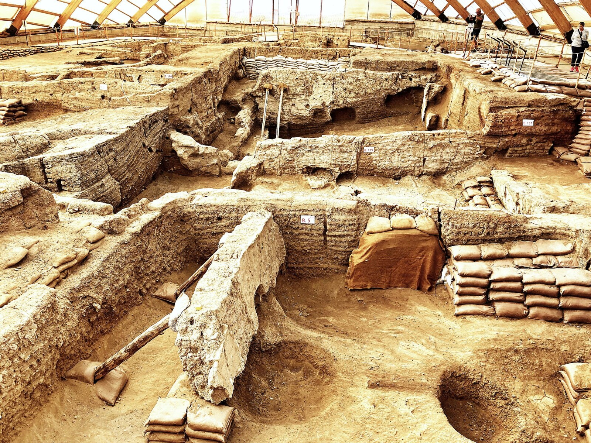
*The excavated houses of Çatalhöyük, built wall against wall. Photo: Volker Höhfeld, CC BY-SA 4.0.*

It was a strange place by any later standard. The houses were boxes of mud brick, and they were built wall against wall, with no gaps between them. There were no streets. People therefore walked across the roofs, and went down into their homes by a ladder through a hole in the ceiling, which was also where the smoke came out.

Inside, one house was much like the next. Each had an oven, a storeroom with bins for grain, and raised platforms for sleeping. Under those platforms, the family buried its dead. In other words, people slept each night just above their dead.

On the walls they painted hunting scenes, and they set the horned skulls of wild bulls into the plaster. They farmed, but they had not forgotten what they once were.

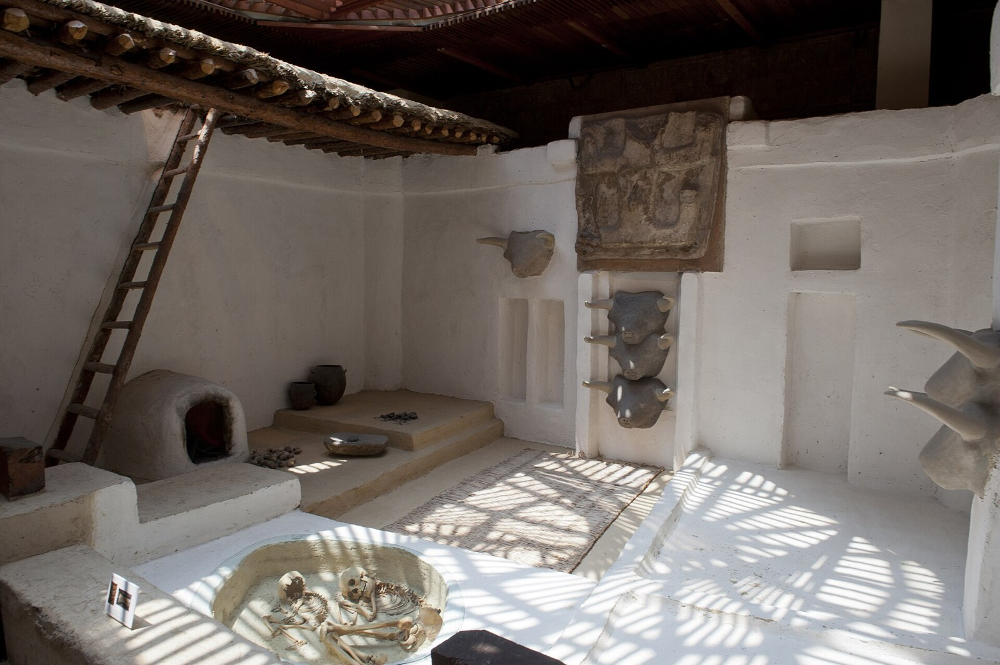
*A museum reconstruction of a room at Çatalhöyük, with its ladder to the roof. Photo: Dosseman, CC BY-SA 4.0.*

What the town did not have is as telling as what it had. Nobody has found a palace there, or a temple, or a house that belonged to a ruler. The houses differ a little in size and decoration, but none towers over the rest.

That is remarkable. Hundreds of families were living side by side with no king and no priesthood. They were held together, as far as anyone can tell, by kinship, custom and the dead beneath the floor.

It was a way of life that did not last, and the reason was standing in the corner of every house. It was the storeroom.

Think of the difference it makes. A wandering hunter's wealth was in his head, his hands and his friends, and little of it could be taken from him. A farmer's wealth, by contrast, was in a bin. A storeroom holds a year of a family's work in one place, dry, still and easy to measure. It can be guarded. It can also be counted, and whatever can be counted can be shared out, lent, owed, taxed and taken.

Farming had filled the world with something worth ruling. Sooner or later, somebody was going to rule it.
