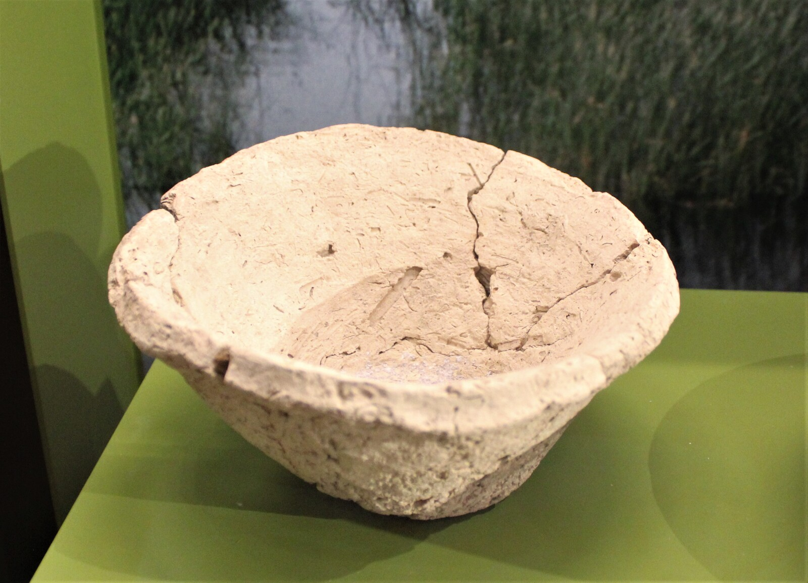
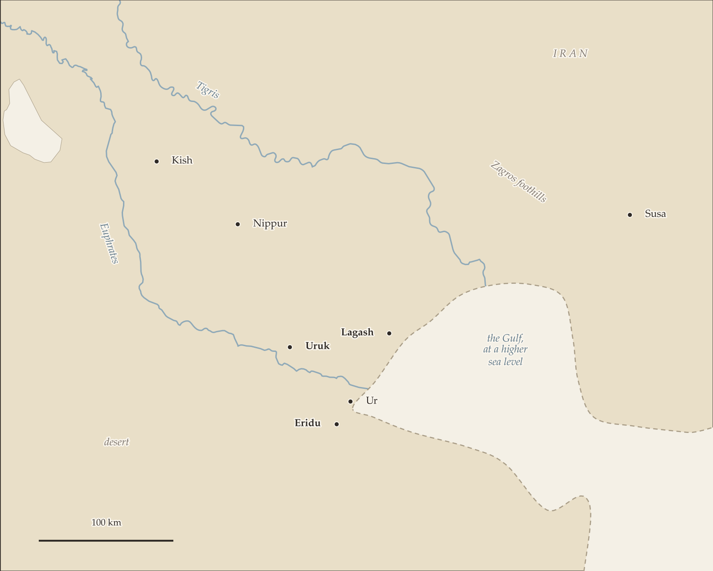
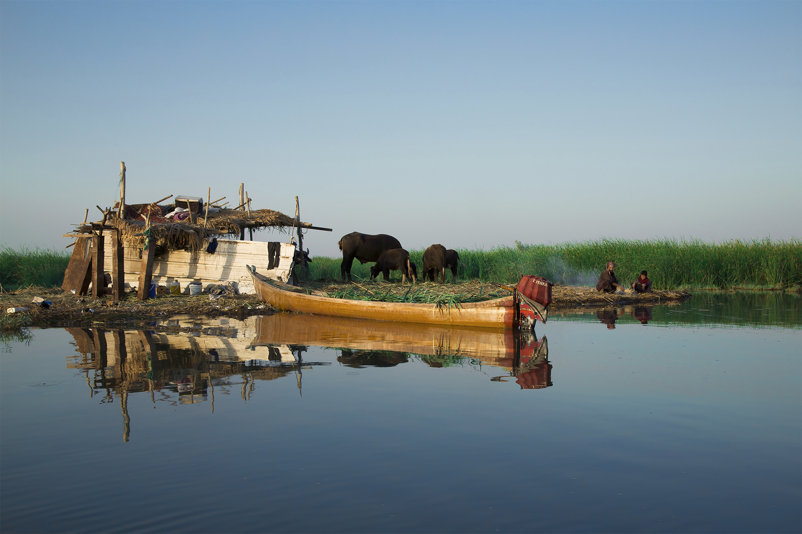
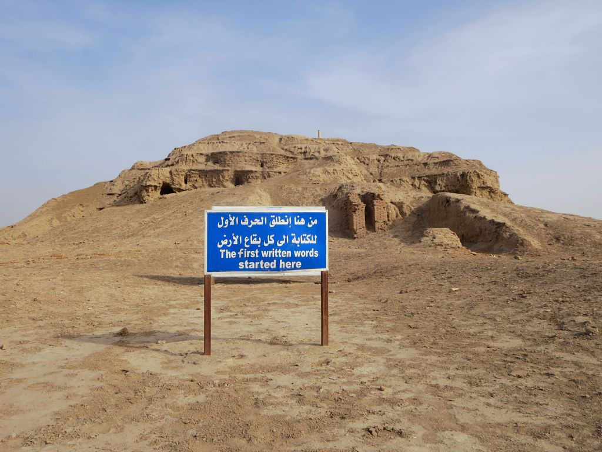
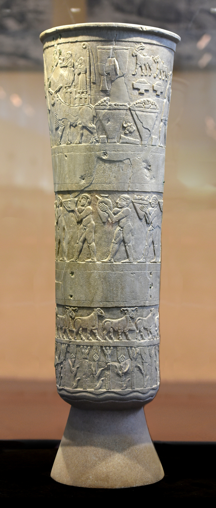
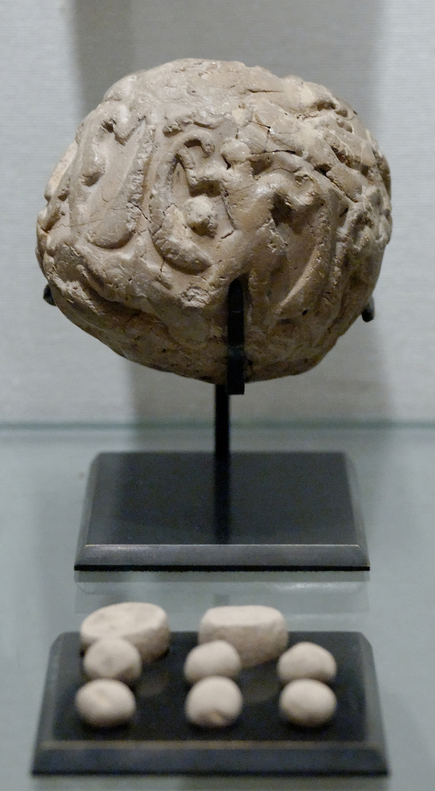
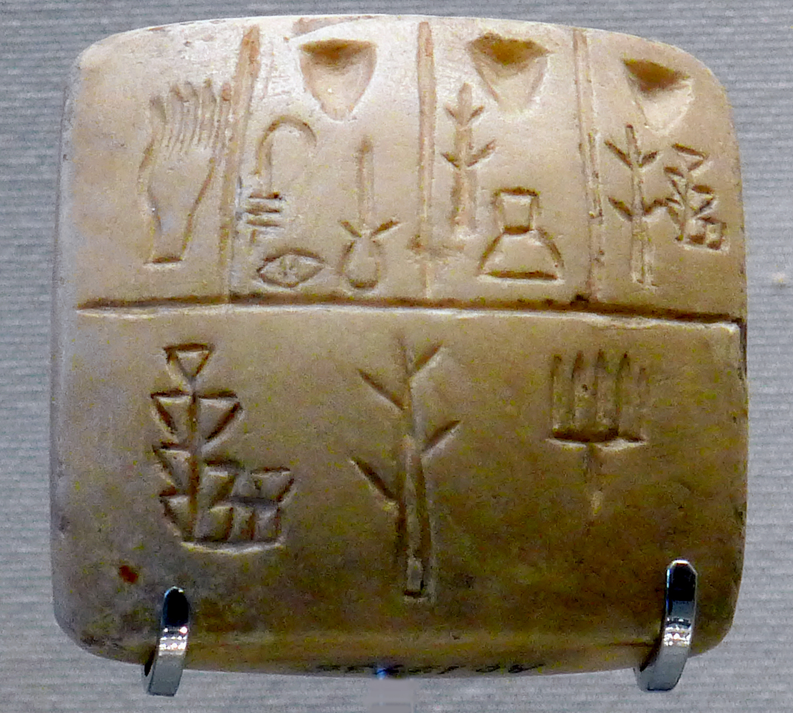
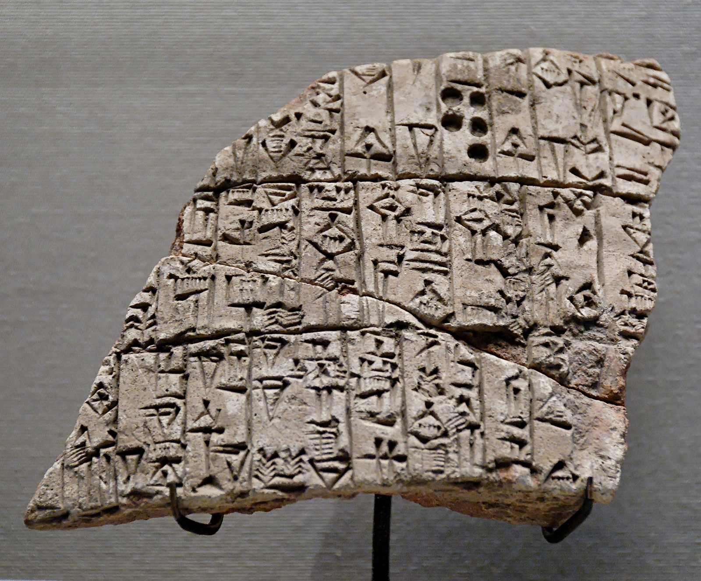

# 6. Why do we pay taxes?

*Southern Iraq, from about 7,400 years ago to about 4,300 years ago*

Because grain is hard to hide, and because the people who grew it could not easily walk away from their fields.

The story of how that came about starts with a bowl. It is the commonest thing that comes out of the ground in the oldest cities of the Middle East, and it is an ugly one. It is about the size of a cereal bowl, with thick walls and a lopsided rim, and it is made of coarse clay mixed with straw.

What makes it odd is that the potters of the time could do far better. They had the wheel, and they made thin, even jars on it. This bowl, by contrast, was pressed into a mould in a few moments, baked, used and thrown away. It was made badly on purpose, because nobody was meant to keep it.

It was thrown away in astonishing numbers. At some sites, three out of every four pieces of broken pottery come from bowls of this one kind. They turn up by the thousand, from Iran to Syria, and the oldest are nearly six thousand years old.

*One of the bowls, from the city of Kish, about five thousand years old and sixteen centimetres across. Photo: Zunkir, CC BY-SA 4.0.*

So what was it for? Each one probably held a worker's ration of food. The best clue comes from the people who used them. When they began to write, their sign for a ration looked just like this bowl. Their sign for eating was the same sign, set against a human head.

Ration bowls by the thousand mean that somebody was feeding people in great numbers, day after day. It also means that, on the days they ate from those bowls, those people were not living on food of their own. Somebody else had grown it. Farmers had worked the fields, brought in the harvest, and then handed part of it over.

That is a much stranger thing than it sounds. Hunters had always shared meat, but they shared it with people they knew, who would share with them in turn. This was something else. People were now working to feed strangers, by way of a storehouse that they did not control. Today we would call what they handed over a tax.

## Four thousand years without a collector

It would be natural to suppose that taxes arrived with farming. After all, a farmer has a store of grain, and a store of grain is a tempting thing. Yet that is not what happened. People were growing wheat and barley in the Middle East for more than four thousand years before anybody collected a share of it.

Those were not empty years. Villages grew into small towns, and some families grew richer than others. Nevertheless, as far as anyone can tell, a farmer's harvest went into his own storeroom, or his village's, and stayed there. Nobody came to the door with a measuring jar.

To see why it took so long, imagine being the first man who tries it. You walk into a village and announce that from now on, one basket in every five is yours. The villagers have several good replies. They can laugh. They can hit you with a hoe. Above all, they can do what hunters had always done about a bully, which is to pack up and move a day's walk away from him.

In other words, wanting a share of the harvest is easy, and getting it is hard. A collector needs two things before he can collect. First, he needs a harvest that he can find, measure and carry off. Second, he needs farmers who cannot leave when he turns up. For four thousand years, hardly anyone had both.

## The crop that cannot hide

Take the harvest first. Not every crop suits a collector, and the difference is easiest to see by comparing two farmers.

The first grows barley. Her crop stands above the ground, where anyone walking past can judge how much there will be. It also ripens all together, in the same few weeks of the year. As a result, everybody in the country knows when the harvest is in, including the man who wants a share of it.

Then consider what she has once the barley is cut and beaten from the straw. She has a heap of small, dry seeds. A heap like that can be measured out by the jarful, so a fifth of it is easy to take. It keeps for years, so it can be stored. It is also light for its value, so a donkey can carry enough of it to be worth the journey. From a collector's point of view, barley might have been designed for him.

The second farmer grows a root, such as the cassava of South America. Her crop is underground, where nobody can count it. Nor does she have a harvest day. She simply digs up what she needs for dinner, and the rest keeps perfectly well in the ground for a year or two.

Now picture the collector arriving at her field. There is no heap for him to measure. If he wants a share, he will have to dig it up himself, plant by plant. When he has finished, he will own a cartload of heavy, wet roots that will rot within days. He would do better to stay at home.

So the root farmer is hard to tax, and the grain farmer is easy. This is not only a matter of theory, because the world has run the experiment. Almost every one of the early states lived on a grain: wheat and barley in the Middle East, rice and millet in China, maize in Central America.

The people of highland New Guinea, meanwhile, were growing taro and other roots seven thousand years ago. They farmed for all that time. Even so, until foreign patrols walked into their valleys in the 1930s, they had no kings and no tax collectors.

Grain, then, made taxes possible. It did not make them happen. The farmers of the Middle East had grown grain for four thousand years and kept it, because they could still walk away.

## The land between the rivers

The place where farmers lost that freedom was the south of what is now Iraq. Two rivers, the Tigris and the Euphrates, come down from the mountains of Turkey and cross a wide, flat plain on their way to the sea. The Greeks later called this country Mesopotamia, which means "the land between the rivers".

*The plain between the two rivers, with its old cities. The sea is drawn where a higher sea level would put it, and Eridu, Ur and Lagash lie close to its edge. The rivers are shown in their modern courses. Map: drawn for this book; coastlines and rivers from Natural Earth, public domain.*

On the face of it, the southern end of that plain is a dreadful place to live. It has almost no rain, and the summer heat passes forty-five degrees Celsius. There is no stone to build with and no timber worth the name. The whole plain is made of mud, which the rivers have carried down and spread out.

Yet that mud is some of the richest soil on Earth, and all it lacks is water. The rivers are right there. A family that cut a ditch from the river to a field could therefore harvest several times what the same ground gave in the rainy hills to the north. Beside the fields lay marshes full of fish. People moved onto the plain about eight thousand years ago, dug their ditches, and prospered.

*The marshes of southern Iraq today, with a house built of reeds. Photo: Taisir Mahdi, CC BY-SA 4.0.*

It was a good bargain, and it had a catch that nobody noticed at the time. A field on that plain is not like a field in the hills. In the hills, rain falls on any patch of ground that a family cares to clear. On the plain, by contrast, a field exists only because a canal reaches it. And the canal exists only because many families dug it together, and clear the silt out of it every year.

Consider, then, what leaving meant. A hill farmer who quarrelled with his neighbours could walk over the ridge and start again. A farmer on the plain could not. Beyond the last ditch lay marsh and desert. A family that walked away from its village could fish, or herd a few sheep along the dry edge, and some did. However, it could not take its barley field with it.

So the two things that a collector needs had finally come together in one place. These farmers had a crop that could be counted, and a home that was very hard to leave. All that was missing was the collector himself. When he arrived, he was not a king. He was a god.

## The god's household

How a god came to collect barley can be followed at a town called Eridu, which stood near the old shore of the sea. About seven thousand four hundred years ago, its people built a shrine there. It was a modest thing: a single room of mud brick, about the size of a garden shed, with a small table for offerings.

Mud brick does not last, and in time the shrine wore out. So the people of Eridu levelled it and built a new one on top, slightly bigger. Later they did the same again, and then again. Archaeologists digging down through the mound found eighteen layers of building, stacked one upon another over more than two thousand years. The earliest was the shed. The later ones were large temples, standing on a platform above the plain. Among them lay heaps of fish bones, left from offerings.

Nobody planned that growth, any more than anybody had planned farming. Each generation simply gave its god a slightly better house than the last. Step by step, however, a better house turned into something much larger.

A god with a house needs somebody to look after it. The keepers must eat, and they are too busy to farm, so the god needs a share of the harvest. The share must be kept somewhere, so the god needs a storehouse. A storehouse that depends on gifts is empty in a bad year, so before long the god has fields of his own, and people to work them. By the end, the shed has become a great landowner.

Why did the farmers go along with it? Partly because they had little choice. Yet they also believed in it, and their belief survives in a story that the people of the plain wrote down in later centuries.

In the beginning, the story says, there were no human beings, and the lesser gods had to dig the rivers and canals themselves. The work was so hard that at last they burned their tools and went on strike. The great gods needed the digging done by somebody. So they made human beings out of clay, mixed with the blood of a god, to do it in their place.

Notice what that story says about us. We were created as the gods' labourers, and for no other reason. Seen that way, a farmer who carried his barley to the temple was not being robbed. He was doing what people were for.

The biggest of the gods' households was at Uruk, a few days' walk from Eridu. By five thousand years ago, Uruk was the largest town there had ever been, with tens of thousands of people. Soon afterwards it had a wall nine kilometres round. At its centre stood the temples of the goddess Inanna.

*What is left of one of the temple mounds of Uruk. Photo: David Stanley, CC BY 2.0.*

From her temple comes a stone vase, a metre tall, which shows the whole arrangement in pictures. It is carved in bands, one above another, and it is meant to be read from the bottom up.

At the bottom is a wavy line of water, since everything on the plain begins with water. Above the water grows a row of plants, with ears of barley among them. Above the plants walks a line of sheep. Above the sheep walks a line of naked men, each carrying a basket or a jar. At the top, the baskets and jars arrive at the goddess's door, where a woman receives them.

It is a picture of the world as the temple saw it. Water feeds the crop, the crop feeds the flock, the worker carries the produce, and all of it moves upward to the god.

*The vase from Uruk, now in the Iraq Museum in Baghdad. Photo: Osama Shukir Muhammed Amin, CC BY-SA 4.0.*

By the time that vase was carved, the household was vast. It owned fields, flocks and workshops, and it took in barley, wool and fish. It also took labour. Farmers owed days of work each year, which they spent on the canals and in the god's own fields. In return, the household handed out rations of barley, oil and beer. Those rations are what filled the ugly bowls.

Not everyone who worked for the goddess had even that much choice in the matter. The oldest accounts list slaves, and they list them beside the herds. There is a grim clue in the writing itself. The oldest way of writing "slave woman" joins two signs: the sign for a woman, and the sign for the mountains. Such women came from the hills, where they had been captured.

## The bandit who stayed

Was the god's household a service to the farmers, or a racket run at their expense?

There is a real case that it was a service. A single family's storeroom is no help when that family's own field floods. A storehouse that takes in grain from ten thousand families is different, because it can feed the ones whose crop failed from the surplus of the ones whose crop did not. It can also pay for a wall. And a wall mattered, because a land full of granaries is a land worth raiding.

The case on the other side is best put as a story about a bandit. A bandit who raids a village once takes everything, since he does not expect to be back. Suppose, however, that the same bandit settles down beside the village. His interests change at once. He now wants the village to have a good harvest next year too, because next year's harvest is also his.

Therefore, he takes only a part and leaves the farmers enough to live on. He drives off other bandits, who would spoil his supply. He may even mend the canal. At that point he has become a ruler. The villagers are better off under him than under a string of raiders, and that is as much as can be said for him.

Which of the two was the temple? One argument for the kinder view used to be that the rivers themselves demanded a ruler, since somebody had to plan the canals and order the digging. That argument does not hold. The early canals were small, and villages dug and shared them without any help, as villages in many countries still do. The great canals were built later, after the cities had risen.

Meanwhile, some of the people gave an answer of their own, and they gave it with their feet. The records of the centuries that followed are full of workers who ran away, and of the men sent to bring them back. A city wall kept raiders out. It also helped to keep the taxpayers in.

The storehouse, then, was both things at once. It could feed people in a bad year. It also took from them in every year, good or bad, and few of them could refuse. And it lasted, in the end, for the reason that it had begun: on that plain, leaving meant giving up the field.

## Memory made of mud

A storehouse on that scale soon ran into a problem that no village had ever faced. The problem was remembering.

A village runs on memory, and memory is enough. Everybody knows who lent a goat to whom, and who has not done his share of work on the ditch. A household that deals with tens of thousands of strangers cannot work that way. Nobody can remember ten thousand deliveries of barley. Even if somebody could, nobody would trust him, since he would be the only one who knew.

What the storehouse needed, then, was a memory that sat outside anybody's head, where two people could look at it and agree. The beginnings of one already existed. For thousands of years, the farmers of the Middle East had kept count with small clay tokens. A cone stood for a small measure of grain, and a ball stood for a large one. Five cones meant five measures. It was a way of keeping a number without having to remember it.

The keepers of the storehouse put these tokens to a new use. Suppose that a shepherd is sent to the temple with seven sheep. How is the temple to know that seven set out? An official takes seven tokens and seals them inside a hollow ball of clay, like coins in a clay purse. The shepherd carries the ball along with the flock. At the other end, the ball is broken open and the tokens are counted against the sheep. Nobody can change the count on the way without breaking the clay.

That worked, but it had an annoying flaw. Nobody could check the count without breaking the clay either. So the officials began to press each token into the outside of the soft ball before sealing it in. Each one left a dent of its own shape. Now anyone could read the contents from the surface without opening the ball at all.

Then somebody noticed something that seems obvious afterwards. If the marks on the outside said everything, the tokens inside were no longer needed. And if there was nothing inside, there was no need for a hollow ball. A flat pad of clay with marks pressed into it would do just as well.

*A clay ball from Susa, in Iran, with the tokens that were sealed inside it. It is about five thousand four hundred years old. Photo: Marie-Lan Nguyen, public domain.*

That flat pad is the clay tablet. The oldest carried only marks for numbers. By about five thousand three hundred years ago, at Uruk, their makers had added small drawings beside the numbers, scratched with a reed, to say what was being counted: an ear of barley, a jar, a sheep, a ration bowl.

*A tablet of about five thousand years ago, now in the Louvre. Each box holds a few picture signs. Photo: Mbzt, CC BY 3.0.*

This was the beginning of writing, and what the first writers chose to say is revealing. Thousands of these early tablets have been dug up at Uruk, and more than eight in ten are accounts: so much barley received, so many sheep delivered, so many jars of beer issued.

Most of the rest are lists of words, which apprentice clerks copied out in order to learn the signs. One of the most copied is a list of job titles, set out in order of rank from the top official down. Among the first things that human beings chose to write, in other words, was a staff directory.

What is missing is just as striking. There are no stories on these tablets. There are no prayers, no letters, no laws and no histories. All of those came centuries later. Writing was not invented to record what people thought or felt. It was invented to keep accounts.

One tablet shows this better than any other. It accounts for enough barley to fill four road tankers, and it carries the mark of the official in charge. The mark reads Kushim. It is probably the oldest personal name that we can read. It does not belong to a king, a hero or a prophet. It belongs to somebody who looked after barley for a brewery.

Names like that one turned out to matter a great deal, because names were what pushed writing forward. An account is of little use unless it says who paid. Yet names are exactly what pictures cannot manage. A picture can show a sheep, but it cannot show a man called Kushim.

In time, the clerks solved this with a trick that children still use in puzzles. In their language, the word for "arrow" and the word for "life" sounded almost the same. So to write a name that had "life" in it, they drew an arrow, and trusted the reader to say it aloud and hear the other word.

That small trick changed what writing was. Until then, a sign had stood for a thing. Now a sign could stand for a sound. Once it could, any name could be spelled, and in time so could any word. Because an account needs names, writing learned to record speech.

The clerks left us one more thing, and most of us use it many times a day. They did not always count in tens, as we do. For many of their goods, they counted in sixties.

Sixty looks like an awkward number to count by, until you try to share something out, which was the storehouse's daily business. Ten can be split evenly only into halves and fifths. Sixty, by contrast, can be split into halves, thirds, quarters, fifths and sixths, and into tenths and twelfths as well. A clerk who had to divide sixty jars among three gangs of workers, or four, or five, never had to break a jar.

The habit outlived the storehouses. Long afterwards, the scholars of Babylon, on the same plain, were still reckoning in sixties when they began to track the sun, the moon and the planets. They divided the circle of the sky into three hundred and sixty degrees. Greek astronomers then borrowed their methods. They cut each degree into sixty small parts, and each of those into sixty again.

In Latin, those two cuts were called the "first small part" and the "second small part", and that is where the words minute and second come from. Much later, the same two cuts were applied to the hour. So anybody who glances at a clock is using the arithmetic of a barley clerk.

Very few people, however, could read any of what the clerks wrote. The system had many hundreds of signs and took years to learn, so it belonged to a small trained group, and that group was in the service of the storehouse.

Consider what that meant for the farmer on the other side of the counter. Suppose that he believed he had delivered ten jars, and the tablet said eight. He could not read the tablet. The men who could read it worked for the storehouse. In a quarrel between a farmer's memory and the clay, therefore, the clay had the advantage.

## Return to mother

The tablets had one more consequence, and it was the hardest on the farmers. Whatever can be counted can also be owed.

Bad years came to every farmer sooner or later. When a crop failed, he could borrow seed and food from the temple, or from a rich neighbour, and the loan was written down. It was not free. Records from centuries later show the usual price, which for barley was a third. A man who borrowed three sacks in spring therefore owed four at harvest. If that harvest failed too, the debt grew again.

What could happen next was set down on the tablets as well. A man who could not pay might pledge his field. After that he might send his children to work in the lender's house, and finally go himself. In this way, a farmer could lose his land and his family without ever meeting a soldier. The counting did it.

We know how this felt, because one ruler had it written down. About four thousand four hundred years ago, the city of Lagash, some way east of Uruk, got a new ruler. He had an account of the state of the city set out on clay, and it is one of the oldest complaints about taxes that survive.

It reads like a list of grievances from any age. The inspector of boats, it says, had seized the boats, and the inspector of cattle had seized the cattle. Even the dead were not left alone. When a dead man was carried to the graveyard, officials were waiting to take seven jars of beer and four hundred and twenty loaves of bread. From one end of the land to the other, it says, there was the tax collector.

The new ruler announced that he had put a stop to it. He had cut the fees, dismissed the inspectors and cancelled the debts. People held for what they owed, he said, were sent home. The word that his clerks used for this, *amargi*, is the oldest word for freedom that we know. Literally, it means "return to mother".

*Part of a clay cone inscribed for the reforming ruler of Lagash, now in the Louvre. Public domain.*

His reforms did not have long to work. He ruled for about ten years. Then the army of a neighbouring city marched in, and plundered and burned his temples.

That army is a sign of how far things had moved. By that time, more than a dozen cities stood on the plain, each with its god, its wall and its storehouse. They quarrelled over fields and over water, and their quarrels were now fought by armies. The reason is simple. A storehouse that could feed weavers and brickmakers could just as easily feed spearmen, for as long as a campaign lasted.

The gods' households had learned how to gather the work of ten thousand families into one place and write it down. Now the barley that fed the spearmen was measured out by the same clerks, in the same columns, as the barley that fed the weavers.
