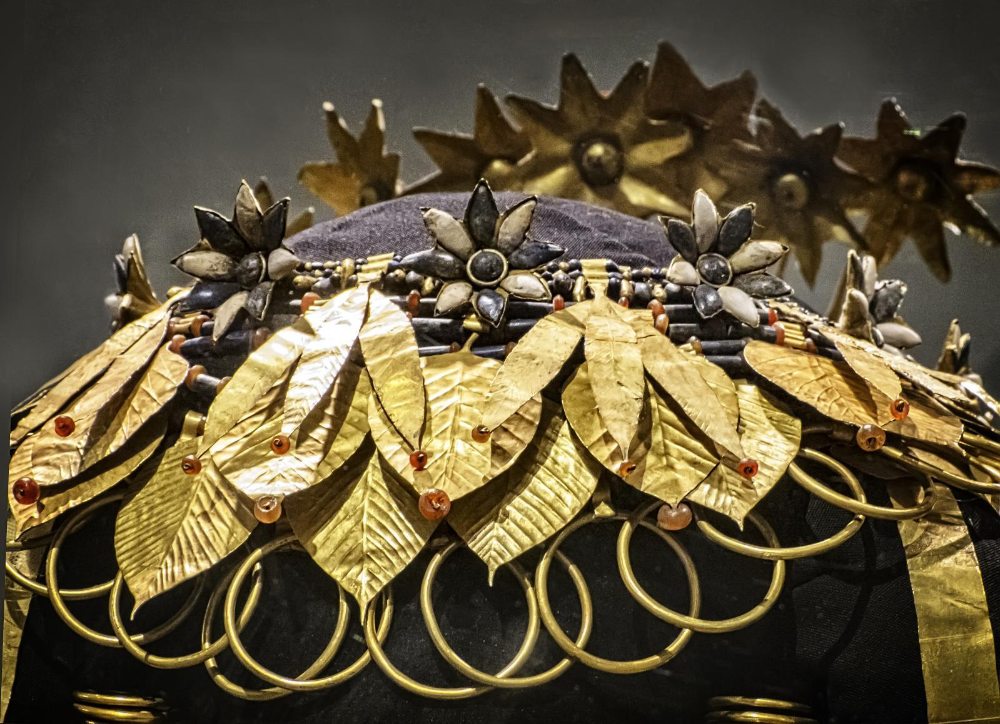
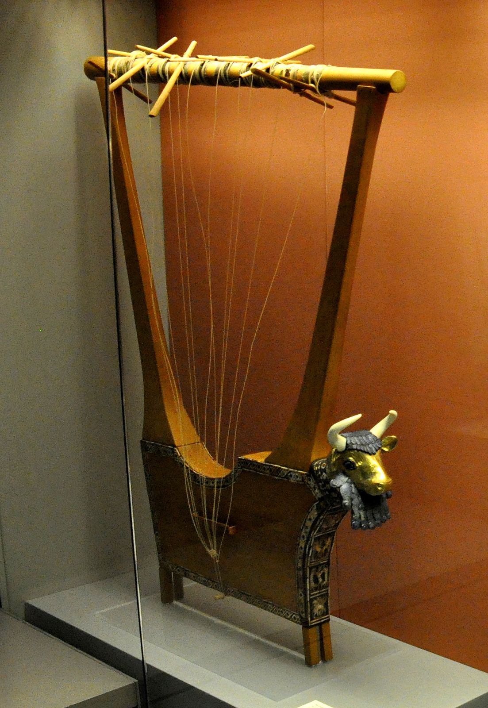
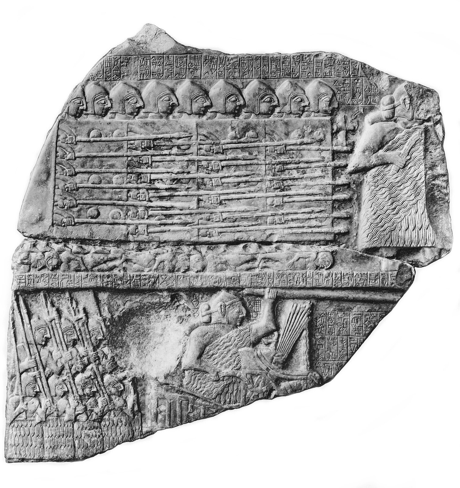
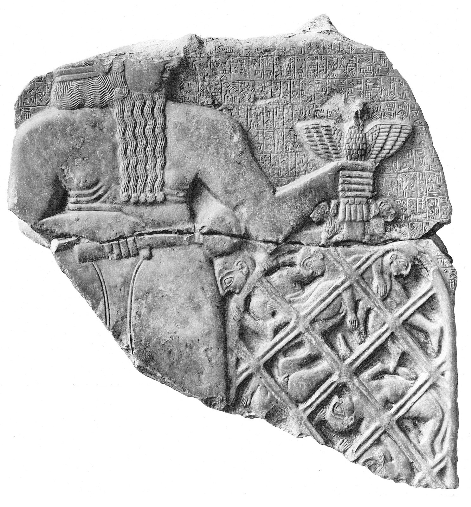
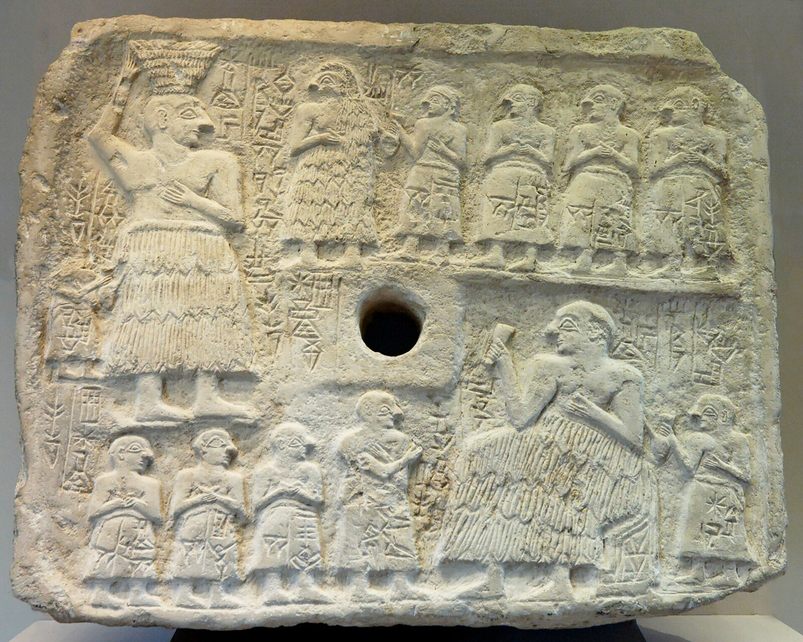
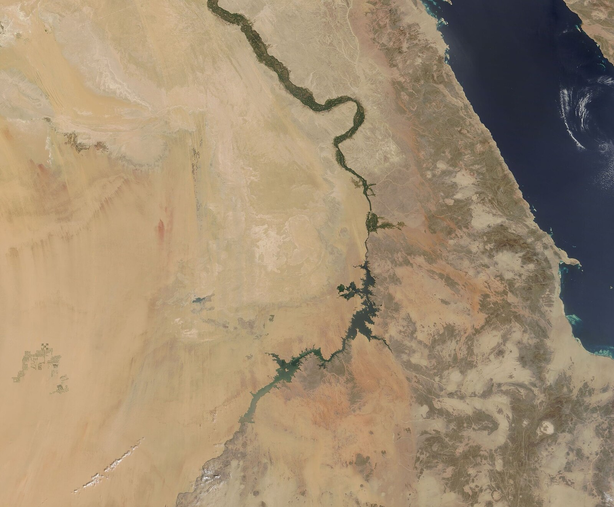
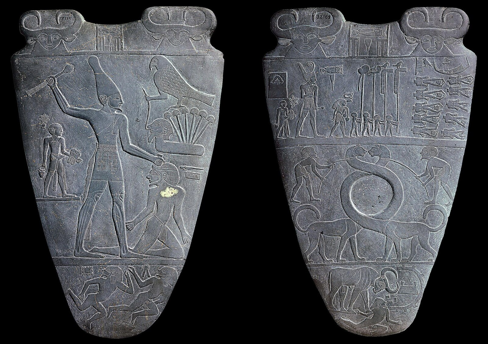
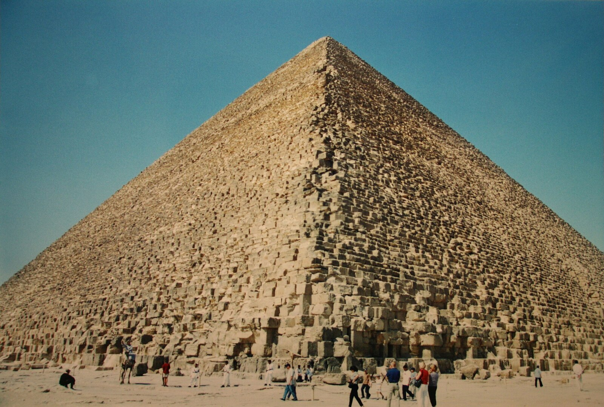
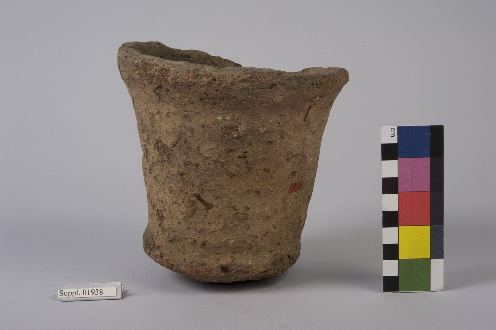
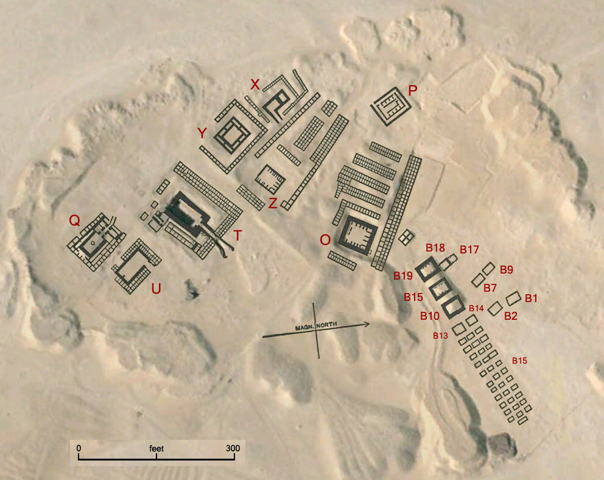

# 7. Why did people obey kings?

*Iraq and Egypt, from about 5,100 years ago to about 4,300 years ago*

Because the king fed the soldiers, and because almost everyone believed that the gods had put him there.

How far that obedience could go was discovered in the 1920s, in the south of Iraq. A British archaeologist was digging in the ruins of Ur, one of the old cities of the plain, when his workmen came down upon a graveyard. Among its two thousand graves were sixteen that were unlike the rest. They belonged to rulers, and they were about four and a half thousand years old.

One of them he named the Great Death Pit. On its floor, laid out in neat rows, were seventy-four bodies. Six were men, who lay near the entrance with weapons beside them. The other sixty-eight were women. They wore headdresses of gold leaf and necklaces of blue stone, and beside some of them lay lyres, the small harps of the time.

*A headdress of gold leaves from the royal graves at Ur. This one belonged to a queen buried near the Great Death Pit. Photo: Mary Harrsch, CC BY 2.0.*

These people had not died of age or sickness, and they had not died in a battle. They had gone into the ground on the same day, dressed in their best, to keep a dead ruler company.

*A lyre from the royal graves at Ur, rebuilt around its original gold and shell, now in the British Museum. Photo: Osama Shukir Muhammed Amin, CC BY-SA 4.0.*

The archaeologist believed that they had gone willingly. He pictured them walking down into the pit, taking their places and drinking poison from the cups that lay beside them. It is a peaceful picture. However, when two of the skulls from these tombs were put through a hospital scanner in recent years, both turned out to have holes punched in them by a sharp weapon. At least some of the attendants had been killed with a blow to the head.

Either way, the pit says something startling about how far the world had moved. In a wandering band of hunters, a man who tried to give orders was laughed at, and a man who would not stop was killed. Even in the first farming towns, no house stood above the others. Now there was a kind of person so far above everyone else that scores of people could be sent into the grave with him. Somewhere in between, human beings had acquired kings.

## The big man

They did not acquire them all at once, and the cities of the plain have left traces of how it happened.

Those cities, as far back as we can see, were run from their temples. Each had its god, its storehouse and its clerks. The day-to-day decisions seem to have been made by the heads of the temple household, and by a council of the city's older men. In that arrangement, as far as we can tell, nobody was a king. For most purposes, nobody needed to be.

War was the exception. By about five thousand years ago there were a dozen or more walled cities on the plain, and they were packed close together. Some neighbours lay so near that their fields met. They shared the same two rivers, and the water that one city led off into its canals did not reach the city downstream. So they quarrelled, and their quarrels turned into fighting.

A council of old men is a good way to decide whose turn it is to clear a ditch. It is a poor way to fight a battle. A battle needs one person who can give an order and have it obeyed at once. So when war threatened, a city chose a commander.

The word that the people of the plain used for such a man tells the story by itself. They called him the *lugal*. It is made of two words, and it means, quite simply, "big man". Much later, it was their word for king.

Their own stories remembered how it had once worked. In one old poem, the city of Uruk is threatened by its neighbour Kish, which demands that Uruk submit. The king of Uruk does not simply decide. First he goes to the council of elders and asks what the city should do, and the elders advise him to give in. That is not the answer he wants. So he goes to the young men of the city, the ones who will do the fighting, and asks them the same question. They vote for war, and Uruk fights.

That is a strange sort of king by later standards. He has to ask, and he has to shop around for agreement. The poem was written down long after the events it describes, but it preserves a time when a big man led because the city had agreed to follow him.

Why did such leaders not simply stand down when the fighting was over? Nobody had to be especially wicked for them to stay.

For one thing, the fighting was never over. With a dozen rival cities crowded onto one plain, one war was hardly finished before the next was brewing. A commander who is needed every other summer soon becomes a commander who is needed all the time.

The second reason is the storehouse. Fighting men have to be fed, and in war the commander was the one who fed them. He therefore had his hands on the grain. He also had a band of armed followers who ate at his table and owed everything to him. When peace came, he still had both. It would have taken a remarkable man to give them back.

So the big man stayed. In time he built himself a house beside the temple, and the people of the plain named it as plainly as they had named him. They called it the "big house". We call it a palace.

## The first army

What the big man did with his grain and his followers can be seen on a carved stone from the city of Lagash. It is about four thousand four hundred and fifty years old, and it was set up by a king of Lagash to celebrate a victory over the city next door. The two had been fighting, on and off, for generations over a strip of well-watered farmland that lay between them.

Only broken pieces of the stone survive. One fragment carries one of the oldest surviving pictures of an army. It shows a block of soldiers. They are packed shoulder to shoulder and several rows deep. Each man wears a helmet. In front of them is a solid wall of large shields, and between the shields a row of long spears points forward. The whole block is advancing over the bodies of the enemy. The king walks in front.

*The soldiers of Lagash on the carved stone, with their king in front, photographed in the 1880s. Public domain.*

Compare this with how hunters fought. A raiding party in the bush was a handful of men who had each chosen to come. They crept up at dawn, struck, and ran. Each man looked after himself, and any of them could decide at the last moment that the thing was foolish and go home.

The block of spearmen is a different kind of thing altogether. It works only if every man keeps his place. If a few of them run, a gap opens in the wall of shields and the rest are killed. Standing firm in that wall, with enemy spears a few paces away, goes against every instinct a person has. Men have to be trained to do it, over and over, until they trust the men on either side.

That asks a great deal. The men must be taken from their fields for weeks to train, and somebody must feed them while they do. They need helmets and spearheads of copper, which has to be brought from far away and worked by smiths, who must be fed as well. All of that food comes from the storehouse. A hunting band could never have fielded such a force, and neither could a village. It takes a city, and it takes somebody in command of the city's grain.

Something else had changed too. Among hunters, nobody could be made to fight. That had been one of the things that kept their wars small. In the cities, by contrast, a farmer already owed the storehouse days of work each year, on the canals and in the fields. It was a short step to make some of those days into days of fighting. The men in the block had not volunteered.

The other side of the same stone shows why they marched, at least as the king wished it to be understood. There is a giant figure on it, far bigger than any of the soldiers. He is the god of Lagash. In one hand he holds a great net, and the net is full of naked enemy soldiers, heaped up like fish. With the other hand he is clubbing one of them on the head.

*The god of Lagash with his net of enemies, on the other side of the same stone. Public domain.*

The message is hard to miss. The king had fought the battle, but the god had won it. The king was only doing the god's work.

## Why not kill the bully?

For hundreds of thousands of years, people had possessed a cure for a man who wanted to rule them. They talked it over quietly, agreed, and killed him. Why did the cure stop working?

Part of the answer is simply size. In a camp of thirty, everybody knows everybody, and it takes only a few conversations to learn that the whole camp has had enough of one man. In a city of thirty thousand strangers, that is impossible. Nobody can tell what the rest are thinking. A man who whispers against the king has no idea whether his neighbour will join him or report him.

Another part of the answer is the guard. The bully of a hunting camp had to sleep sometime, and when he slept he was as easy to kill as anyone else. A king slept behind a wall, surrounded by armed men whose bread came from his storehouse. The weapon had once made every man the equal of the strongest. Now the king had most of the weapons, and the men to carry them.

Yet force by itself has never been enough to rule for long. Guards can be bribed, and a king who is merely feared will sooner or later be murdered by somebody close to him. A king needed people to believe that he ought to be king. So the kings of the plain told a story about themselves, and in time the whole country came to tell it too.

The story was that kingship was not a human invention at all. A later list of the kings of the plain opens with the words that kingship "descended from heaven". On this view, the gods had created the office and handed it down, and they chose who should hold it. A king was the steward of his city's god. He looked after the god's people as a shepherd looks after another man's flock.

This fitted neatly with what people already believed. They had long held that human beings were made to do the gods' work. If so, somebody had to organise the work, and that somebody was the king.

The kings took care to look the part. One early king of Lagash had himself carved on a stone plaque. In its upper scene he is not fighting or giving orders. He is shown with a basket of bricks balanced on his head, like a common labourer, carrying the first load for a new temple. The point was that even the king was a servant, and that what he served was the god.

*The king of Lagash, top left, carrying a basket of bricks on his head. The plaque is in the Louvre. Photo: Marie-Lan Nguyen, public domain.*

A king had to do more than look humble, however. The story committed him to certain duties, and people expected him to carry them out. He was to defend the city. He was to keep the temples in repair and the canals flowing. He was also to give justice. When the reforming king of Lagash set out his achievements, he boasted that he would not hand over the widow and the orphan to the powerful.

That boast shows what a king was now for in the eyes of his people. He was the one person strong enough to stop the other strong men. A farmer who was cheated by a rich neighbour had nobody else to appeal to.

So obedience rested on three things together. The king had the soldiers. He did provide something, in the form of defence and a rough kind of justice. And he was believed to hold his place from the gods. A king who had all three was very hard to remove.

## One river

In the cities of the plain, kingship grew slowly and never became absolute. A king there ruled one city and the land around it, and there were a dozen others just like his. To see how far the same three things could be taken, we have to go to Egypt, where everything about the land favoured a single ruler.

Egypt is the Nile. The river runs north for a thousand kilometres through one of the driest deserts on Earth, and the country is the strip of green along its banks, in most places only a few kilometres wide. Every summer the river floods, spreads a layer of fresh black mud over the fields, and withdraws. Wheat and barley sown in that mud need no rain at all.

*Egypt from space. The green strip is the Nile valley, and the fan at the top is where the river meets the sea. Image: NASA, public domain.*

For a farmer this was a gift. It was also a cage of the most complete kind. On the plain of Iraq a discontented family could at least slip away into the marshes. In Egypt there was the river, and on either side of it, within sight, the sand. There was almost nowhere to go.

The river had a second peculiarity, and a ruler could hardly have designed a better one. Its current flows north, towards the sea. The wind, however, blows the other way, from the north, on most days of the year. A boat can therefore drift downstream with the current, and then put up a sail and be blown back upstream. In Egyptian picture-writing, the sign for travelling north was a boat with no sail, and the sign for travelling south was a boat under sail.

Think what that means for anyone who wants to rule the whole valley. Every village in the country lies within a short walk of the same road, and the road moves in both directions without any effort. Grain can be floated to the king's storehouses from the far end of the land. Soldiers can be sent to any village that refuses.

As a result, Egypt did not become a dozen quarrelling cities. About five thousand one hundred years ago, a king from the south conquered the north, and the whole valley was one kingdom. It stayed one, with interruptions, for most of the next three thousand years.

That conquest, or the memory of it, was carved on a slab of dark stone, about two thirds of a metre tall, which was found in a temple in the south of Egypt. On one side stands the king. He is drawn several times the size of anyone else. With one hand he grips a kneeling enemy by the hair. With the other he raises a stone-headed club, about to bring it down.

On the other side of the slab the king appears again, wearing a different crown, the crown of the north that he has just taken. He is inspecting the results of his victory. In front of him lie two rows of bodies with their arms tied. Each has had its head cut off and placed between its legs.

*The two sides of the slab. On the left, the king raises his club. On the right, at the top, he inspects the rows of headless bodies. Public domain.*

The picture of the king with his club raised was copied for thirty centuries. Almost every later king of Egypt had himself shown in exactly that pose, on temple walls as high as houses. It was the Egyptian way of drawing what a king is.

Egypt also took the story about kings a step further than the plain had. A king in Iraq was the servant of a god. The king of Egypt was a god. He was held to be the living form of the sky god, born of a human mother, and when he died he went up to join the other gods among the stars.

What a god-king did for his people was of a different order from giving justice or mending canals, though he did those too. He kept the world working. The Egyptians believed that the regular order of things, the flood that came each summer, the sun that rose each morning, the fair dealing between one person and another, was a single thing, and that it was fragile. It was the king's task to hold it together, by his rituals and by his rule.

Seen from inside that belief, paying the king his share was not submission to a man with soldiers. It was a contribution towards keeping the river rising.

## A hill of stone

What a god-king could ask of his people was shown about four thousand five hundred and fifty years ago, on a rocky plateau at the edge of the desert, near where Cairo is now. A king had decided on his tomb.

The tomb is still there. It is a pyramid of about two million three hundred thousand blocks of stone, most of them weighing more than a family car. When it was finished it stood a hundred and forty-six metres high. Nothing taller was built by human hands, anywhere on Earth, for the next three thousand eight hundred years.

*The Great Pyramid. The figures at its foot give the scale. Photo: Gary Todd, CC0.*

It was built in about twenty years, within the king's own reign. The arithmetic of that is hard to believe. To set two million three hundred thousand blocks in about twenty years, working through every hour of daylight, the builders had to cut, haul and place a block every few minutes, and go on doing so without a break for two decades.

For a long time, everybody assumed that this was done by slaves under the whip. A Greek traveller who visited Egypt two thousand years afterwards was told that the king had forced the whole country to labour for him, and films have added the whip ever since. However, from 1988 onwards archaeologists dug up the place where pyramid builders had actually lived, and it changed the picture.

South of the pyramids lay a town, which housed the men who built the two later pyramids that stand beside the first. It had streets, long dormitories, and bakeries with rows of bell-shaped pots in which bread was baked by the thousand loaves. There were breweries beside them. The rubbish heaps were full of the bones of cattle, sheep and goats, enough to show that the workers ate meat regularly.

*A clay bread mould of the kind used in the bakeries, now in the Egyptian Museum in Turin. CC0.*

Beside the town were the builders' own graves. They are small tombs of mud brick, built within sight of the kings' own, and that is an honour that would not have been given to slaves. The skeletons in them tell both sides of the story. Their spines and knees are worn down by years of carrying heavy loads. On the other hand, some have broken arms and legs that were set straight and healed cleanly. Somebody had been looking after them.

The workers also left their names, though not their own. They were organised into gangs, and each gang scrawled its name in red paint on the blocks it had hauled, where it was hidden once the stone was in place. One gang at this pyramid called itself the Friends of the king. A gang that worked for his grandson called itself the Drunkards of the king. These are the names that a team gives itself. They are not the marks of beaten men.

One of the builders has even left us his working diary. In 2013, at an ancient harbour on the Red Sea, archaeologists found a bundle of papyrus sheets, the oldest written papyrus that has ever been found. It is the logbook of a foreman who was in charge of about forty boatmen. Day by day, in the last years of the king's reign, it records the same journey. His crew rows to the quarries on the east bank, loads blocks of fine white limestone, and takes them across the river to the pyramid, which he calls the Horizon of the king. Then they go back for more. They made the round trip two or three times every ten days.

So who were these people? Most of them were farmers. A core of skilled masons worked at the site all year round. The heavy hauling, however, was done by gangs of ordinary men who were called up from villages all over Egypt, served for a few months, and went home when the next gang arrived. It was the same labour duty that farmers owed on the plain of Iraq, organised on a scale that nobody had attempted before.

Why did they go? They had little choice, since the duty was owed and the king's officers knew where every village was. Yet that is not the whole of it. They were fed well. They were part of the greatest undertaking that anyone had heard of. And they believed in what they were building. The king was the god who kept the river rising, and his tomb was the machine that would carry him safely to the sky. A man who hauled stone for it was helping to keep the world in order.

From the outside, of course, it looks like something else. For twenty years, a large share of the spare food and spare labour of an entire country went into piling up a hill of stone over the body of one man. The finished tomb fed no one and defended no one. The storerooms that farming had filled could have been spent in a thousand ways. This was the way that was chosen.

It did have one lasting result, though probably not one that anybody planned. To build the pyramid, the king's officials had to find out how many people lived in every village along a thousand kilometres of river. They had to collect grain from all of them, move it to one place and hand it out fairly to thousands of workers. They had to bring copper for the tools from mines across the desert in Sinai. After twenty years of that, Egypt had more clerks, tax records, quarries and boats than ever before, and a habit of obedience that reached the furthest village. The kingdom built the pyramid, and in the building, the pyramid finished making the kingdom.

## The price

None of this should hide what kingship cost when it was new. The Great Death Pit at Ur was not a freak of one strange city.

The first kings of Egypt, more than four centuries before the pyramid, were buried in the desert in the south of the country. Around the tomb of each one lie rows of small graves, built at the same time as the king's own. One of those kings has more than three hundred of them around his tomb, and hundreds more around the enclosure built for his funeral. In them lay his servants, his craftsmen and his guards, who were buried when he was. On the other side of Asia, about seventeen hundred years later, the Shang kings of China did the same.

*The tombs of the first kings of Egypt from the air. The rows of small squares around each tomb are the graves of the people buried with the king. CC0.*

It appears in one place after another where kings were new. A ruler who can do this is showing, in the most direct way possible, that the old limits no longer apply to him. The band had held that no man was worth more than another. Here was a man worth five hundred.

Then, in both Egypt and Iraq, the practice stopped. It lasted only a few generations. Later kings of Egypt went to their graves with painted pictures of their servants on the walls, and with little carved figures to do their work in the next world.

Nobody recorded why. The likeliest reason is that it was no longer needed. A king whose grandfather and great-grandfather had ruled before him did not have to prove what he was. By then everybody had been born under a king, as their parents had been. Obeying one had come to seem as natural as the river rising.

## More than one city

Back on the plain of Iraq, meanwhile, kingship had run into a limit of its own.

Every city now had its king, and every king had his god, his guard and his block of spearmen. They fought one another constantly. Now and then one of them won a great victory, and for a few years his neighbours sent him gifts and called him their lord. That was all it came to. He could beat another city, but he could seldom keep it for long.

The beaten city still had its own god, its own storehouse and its own leading families. Its people had no reason to think that a foreign king had any right to rule them, since his god was not theirs. As soon as his army marched home, they chose a new king of their own and shut the gates.

Egypt had escaped that problem through an accident of its river. On the plain, nobody had yet solved it. To rule the whole plain, a king would need something that nobody there had yet built: a way of being obeyed in places where he was not standing.
