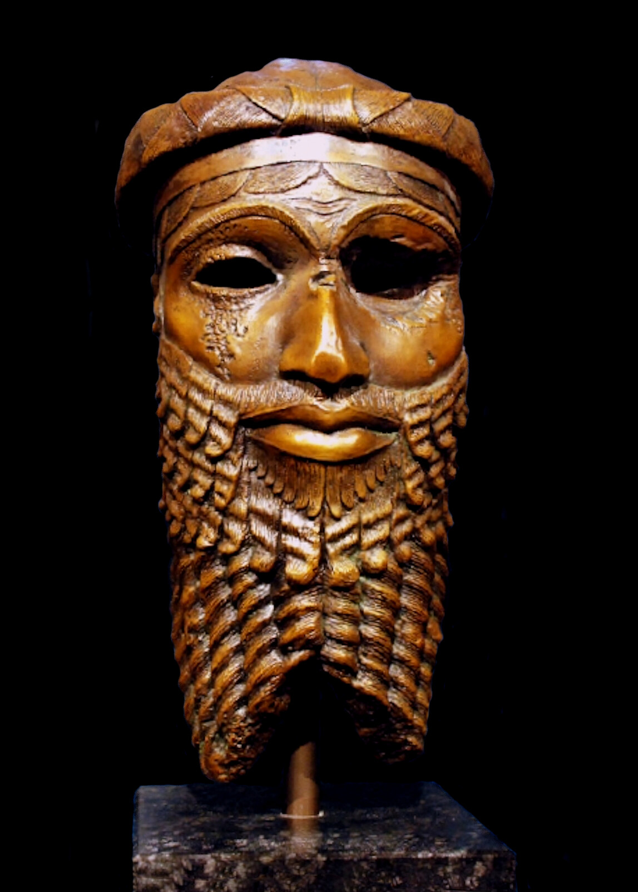
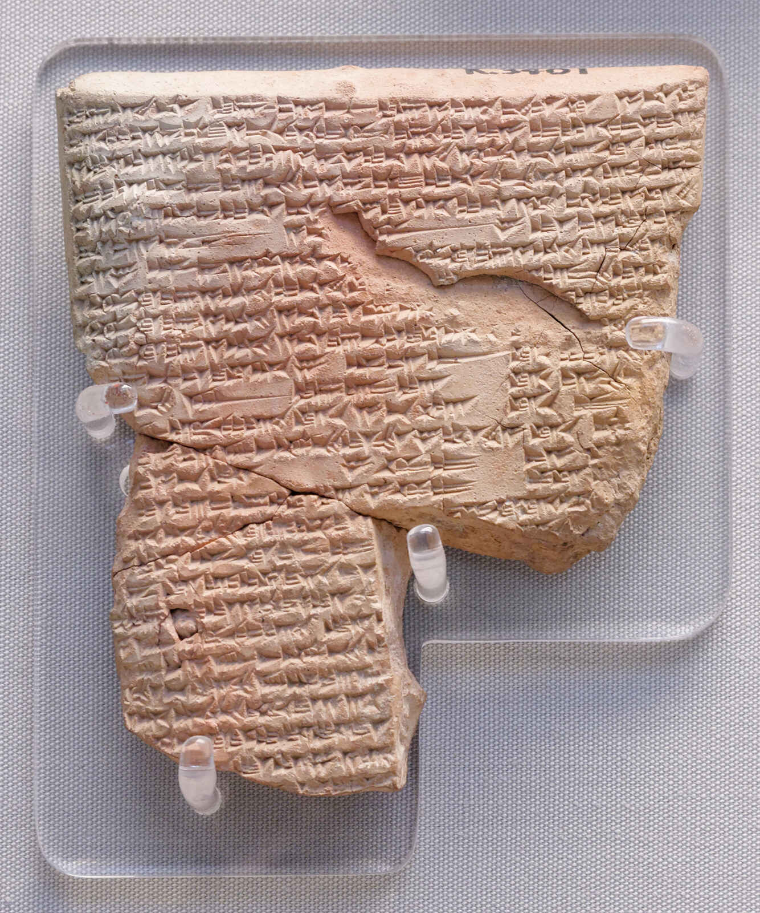
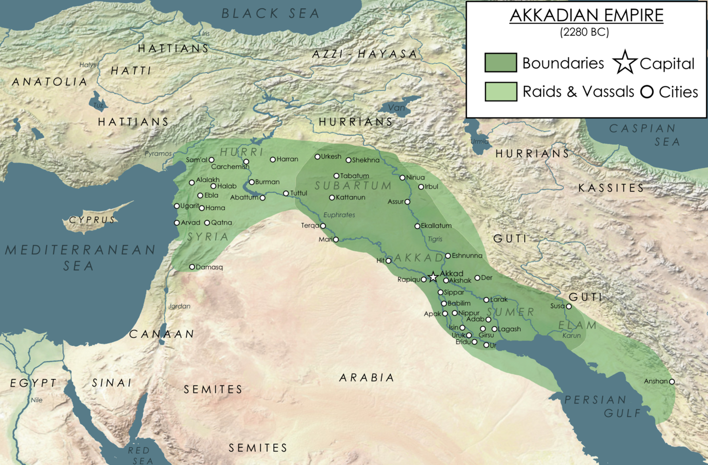
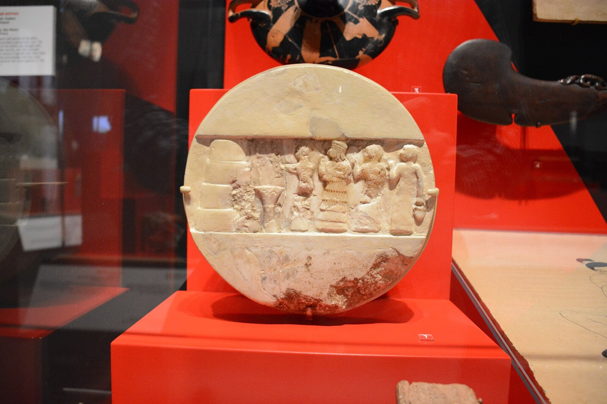
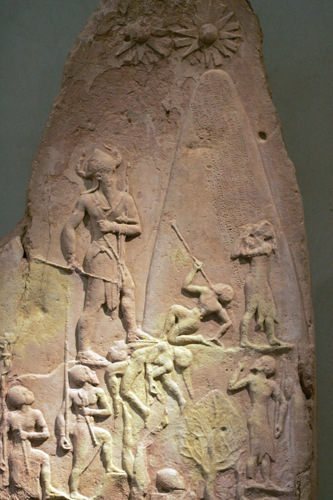
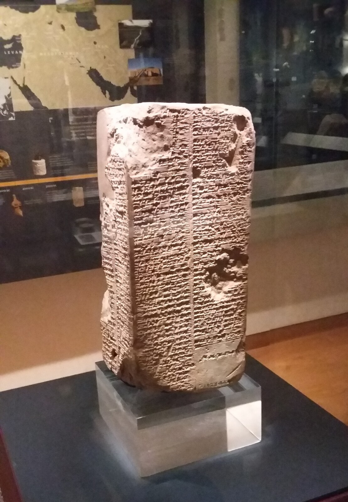
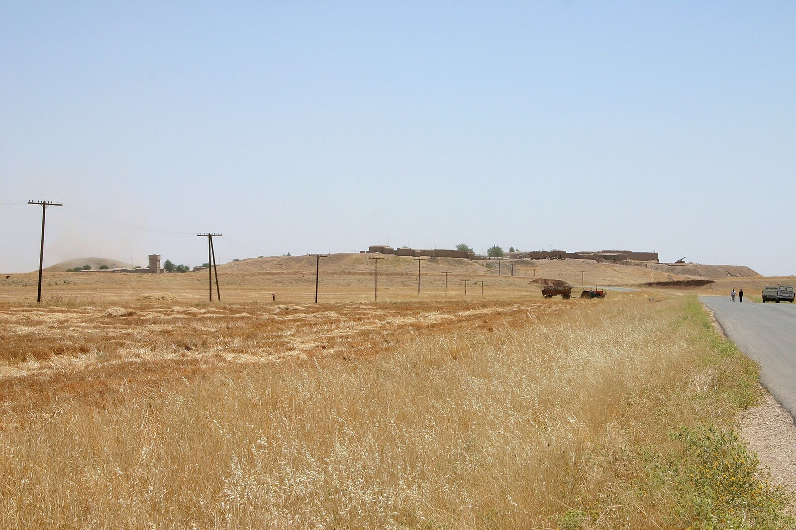

# 8. What was the first empire?

*Iraq and Syria, from about 4,350 years ago to about 4,150 years ago*

It was a kingdom called Akkad, on the plain of Iraq, and it was built by a man who began as a servant.

We do not know that man's real name. We know only the name that he took when he seized power, which was Sargon. In his own language it means "the king is the true one", or more simply, True King.

*A bronze head of a king of Akkad, found at Nineveh and now in the Iraq Museum. It shows either Sargon or his grandson. Photo: Hans Ollermann, CC BY-SA 2.0.*

That choice tells us a good deal about him. A man who is born the son of a king has no need to announce that he is the real thing. Everybody already knows it. The only person who needs to call himself True King is one who is not, and who knows that people are saying so.

He had every reason to be anxious about it. He was not the son of a king, or of anyone important. Yet by the time he died, he ruled more land and more people than any human being had ruled before, and he had done something that the kings of the plain had been failing to do for generations. He had beaten many cities and kept them.

That is what makes Akkad the first empire, and the word has an exact meaning. A kingdom is one people under one king. Egypt was a kingdom, however large. An empire is something else. It is one ruler holding many peoples at once, each with its own city, its own gods and its own memories, and each of which would sooner be ruling itself.

## The cupbearer

Very little about Sargon's early life is certain, and the reason is itself revealing. He became so famous that people went on telling stories about him for two thousand years, and the stories grew.

The best known was written down long after his death, and it is told in his own voice. His mother, it says, was a priestess who was forbidden to have a child. She bore him in secret, laid him in a basket of reeds, sealed the lid with tar, and set the basket adrift on the Euphrates. The river carried him downstream to a man who was drawing water. The man lifted him out, raised him as his own son, and taught him to be a gardener.

*The story of the baby in the basket, on a tablet copied about sixteen hundred years after Sargon lived. It is in the British Museum. Photo: Marie-Lan Nguyen, CC BY 2.5.*

It is a good story, and it was to be told again about other founders. Whether any of it is true, nobody can say. What it does show is how people thought about him afterwards. They remembered him as a man who had come from nowhere.

The firmer tradition picks him up as a grown man in the city of Kish, in the north of the plain. There he held the post of cupbearer to the king. That sounds like a waiter. In fact it was a position of great trust, since the man who hands a king his cup is the man best placed to poison him. A cupbearer stood at the king's elbow, heard everything, and knew everyone at court.

How he went from the king's elbow to the king's seat is not recorded. One way or another, he took power in Kish, and gave himself his new name. He then chose a small town a little way off to rule from, and built it into a capital. Its name was Akkad.

The moment he chose was a good one, because somebody else had just done half his work for him. For generations the cities of the plain had fought one another without any of them coming out on top. Shortly before Sargon's rise, however, one king finally had. He was the king whose army had burned the temples of Lagash and put an end to its reforming ruler. From his capital at Uruk, he had gone on to defeat every other city in the south, one after another, and he boasted that he ruled from the sea in the south to the sea in the west.

So when Sargon marched south, his first task was not to conquer a dozen cities separately. It was to beat one man who had already conquered them.

He did. His own inscriptions say that he fought the king of Uruk, captured him, and tore down the walls of his city. Then he made an example of him. He locked the defeated king's neck in a wooden yoke of the kind used on prisoners, and led him on foot to the temple of the chief god of the plain, at the holy city of Nippur. There the man who had ruled all the cities was put on show at the god's gate.

It was a carefully chosen gesture. Every city on the plain honoured that temple. By displaying his rival there, Sargon was telling all of them at once that the god had changed his mind about who should rule.

The other cities fell after that, one campaign at a time. Sargon claimed to have won thirty-four battles. When he reached the shore of the Gulf, he says, he washed his weapons in the sea. There was nothing further south to fight.

*The empire of Akkad at its greatest extent. The star is the mapmaker's guess at where the capital stood, since the city has never been found. Map: Ennomus, CC BY-SA 4.0.*

## Keeping it

Up to this point, Sargon had done nothing new. The king he defeated had beaten all the same cities a few years earlier. Kings before that one had won great victories too. Each time, the winnings had slipped away within a few years.

The reason is simple, and it had defeated every king who tried. A beaten city does not stop being a city. Once the victor's army has marched home, it still has its walls, its god, its storehouse and its leading families. It also still has its own king, or soon finds a new one. The conqueror has won a battle and some loot. He has not gained a single thing that will make the city obey him next year.

Sargon's importance is that he worked out what to do about each of those things in turn. None of his answers is complicated. Together, they are a set of tools that nearly every later empire picked up and used.

The first problem was the city's own ruler. Sargon removed him. In place of the local king he put a governor, and his inscriptions are careful to say where the governors came from. They were "sons of Akkad", which is to say the king's own men. A local king's first loyalty is to his city. A governor, by contrast, owed his post to Sargon alone, and could be removed at any moment.

The second problem was the walls. A city behind its walls can refuse to pay and wait for the king to go away. So Sargon pulled the walls down. A city without walls cannot shut its gates.

The third problem was the army, and here Sargon made what may have been his most important change. Until then, an army was a body of farmers called up for a campaign. It existed for a few weeks between one season's field work and the next, and then it went home. That is good enough for winning a battle. It is useless for holding a conquest, because the rebellion comes as soon as the soldiers have left.

Sargon kept soldiers who did not go home. One of his inscriptions says, with evident pride, that five thousand four hundred men ate bread before him every day. These were men who did nothing but serve the king. They were fed from his stores all year round, and they could be sent anywhere at any season. It is the earliest standing army on record.

Think what that cost. Five thousand four hundred men who grow nothing must be fed by the farmers of the conquered cities. The army held the cities down, and the cities paid for the army. That circle is the engine of every empire. It works well for as long as there is enough coming in.

The remaining tools were quieter, and they were aimed at making many cities work as one. Each city had its own measures for grain and its own way of naming the years, which made it very hard for one office to keep accounts for all of them. Under the kings of Akkad, and above all under Sargon's grandson, a single set of measures was used across the empire, and years were named in a single way. The clerks also began keeping records in Akkadian, the language of the conquerors, alongside the older language of the southern cities.

Finally, Sargon made sure that the wealth flowed to one place. He boasts that ships from three distant lands tied up at the quay of Akkad. Those lands lay down the Gulf and beyond it, and the furthest was the valley of the Indus, in what is now Pakistan. Goods that had once been shared among a dozen cities now came to the king's own harbour.

## The priestess

All of those tools are forms of force, or of bookkeeping. Sargon understood that they were not enough, and his answer to that was the cleverest thing he did.

The difficulty was one of belief. The cities of the south spoke a different language from Sargon's people and worshipped their gods under different names. Each city believed that it belonged to its own god, and that its ruler held power from that god. A northerner who had arrived with an army had no place in that scheme. He could be obeyed out of fear. He could not be thought to have any right.

So Sargon set out to give himself a place in it. One of the greatest cities of the south was Ur, the city of the moon god. The highest religious office there was that of the god's priestess, who was regarded as the god's wife on Earth. Sargon appointed his own daughter to it.

Her name was Enheduanna, and she is one of the most remarkable people of the ancient world. She held the office for decades, from her father's reign into her nephew's. From that position she did something that no governor could have done. She wrote hymns.

*A stone disc found at Ur, carved with Enheduanna, third from the right, at a ceremony. Her name is written on the back. It is in the Penn Museum. Photo: Mefman00, CC0.*

The hymns are addressed to the gods of the southern cities, and above all to the great goddess of love and war. Throughout them, Enheduanna treats that southern goddess and the chief goddess of her own northern people as one and the same. The effect is to say that the conquerors and the conquered had been worshipping the same powers all along. If that was so, then a king from the north who was favoured by his goddess was favoured by theirs.

Her hymns were good enough to outlast the empire by many centuries. Clerks in the schools of the plain were still copying them out five hundred years later. They also carry something that no earlier piece of writing has. In them, the writer speaks in her own person and gives her name. Enheduanna is the first author in the history of the world whom we can name.

She tells us, too, how fragile her position was. In one hymn she describes a rebellion at Ur. The rebel leader, she says, drove her out of her temple and stripped her of her office, and she was left to wander in the wilderness. She prays to the goddess to take her side. The rebellion was put down, and she was restored. Even so, her account shows that what the family had built at Ur could be swept away in a season.

## Everyone rebels

That brings us to the great weakness of what Sargon had made, and it showed itself the moment he died.

He ruled for about fifty-five years. There were risings even in his old age, and when he died at last, the cities of the south rose in revolt, nearly all of them together. They had not come to love Akkad. They had been waiting.

Why at that moment? Because what held the empire together, above all, was fear of one man. The cities had sworn nothing to Akkad as such. They had been beaten by Sargon, and they feared Sargon. A new and untried king was another matter. From the point of view of a city, the death of the old king was the best chance it would ever get.

Sargon's son put the revolt down, and he did so with a savagery that is startling even in his own boastful account. His inscriptions count the dead and the captives city by city, and the totals run into the tens of thousands. Even allowing for a conqueror's boasting, that was a slaughter.

It bought him nine years. Then, according to later tradition, he was murdered by his own courtiers. His brother, who followed him, is said to have met the same end.

The pattern reached its height under Sargon's grandson, who was called Naram-Sin. Some way into his reign, almost the entire empire rebelled at once. Cities in the north chose one rebel king, and cities in the south chose another, and both marched against Akkad. By any reasonable reckoning that should have been the end.

Instead, Naram-Sin won. His inscriptions claim that he fought nine battles in a single year and was victorious in all of them, and that he captured the rebel kings. It was the greatest military feat that the plain had seen.

What followed was just as striking. The people of the city of Akkad, he tells us, asked the gods to make him the god of their city, and built a temple to him. From that time on, his name was written with the sign that the clerks placed before the names of gods. Until then, the kings of the plain had been servants of the gods. Naram-Sin was the first of them to become one in his own lifetime.

It is easy to see the reasoning. An empire that rebelled at every opportunity needed a firmer claim on people than the favour of a goddess. A king who was himself a god could not be disobeyed without sacrilege.

There is a carved stone that shows him as he wished to be seen. It is taller than a man, and it shows a mountain. Naram-Sin strides up the slope at the top, far larger than anyone else, with his weapons in his hands. On his head is a helmet with horns, and on the plain, horns were worn only by gods. His soldiers climb in ranks behind him. In front of him, the enemy fall, plead and tumble down the mountainside, and he has one foot planted on their bodies.

*Naram-Sin on his mountain, wearing the horned helmet of a god. The stone is in the Louvre. Photo: Rama, CC BY-SA 3.0 fr.*

By then the empire reached from the Gulf to the mountains of Turkey and the edge of the Mediterranean. Naram-Sin called himself King of the Four Quarters, which meant king of the whole world. Nobody before him had used the title, and at that moment it must have seemed no more than the truth.

## Who was king? Who was not king?

The empire did not outlast his son.

The clearest witness to its end is a list of kings that the clerks of the plain compiled in later years. It records each king of Akkad and the length of his reign in an orderly fashion. Then, after Naram-Sin's son, the orderly list breaks off, and in its place the clerk has written a question. "Who was king? Who was not king?" Four men, he explains, claimed the throne within three years.

*A copy of the list of kings, written on a clay block about four hundred years after the fall of Akkad. It is in the Ashmolean Museum. Photo: M.atkinsonross, CC BY-SA 4.0.*

Several things had gone wrong together.

The first was the old problem of revolt. The cities had never accepted Akkad, and three generations of bloodshed had not changed their minds. Every one of them was still waiting.

The second was pressure from outside. In the mountains to the east lived a people whom the plain-dwellers called the Gutians. They had long raided the lowlands when they could. As the empire weakened, their raids turned into invasion, and in the end Gutian chiefs were ruling parts of the plain themselves.

The third was the weather, and it may have been the heaviest blow. The northern part of the empire, in what is now Syria, was different from the south. Its fields were watered by rain, not by canals. It was the empire's second granary, and Akkad had built large fortified towns there to collect its harvests. About four thousand two hundred years ago, the largest of those towns was abandoned, and others shrank. In the soil above its last floors, archaeologists found a thick layer of windblown dust with hardly a trace of life in it. Mud from the bed of the sea off Arabia shows a great surge of dust at the same date, blown from a land that had dried out.

*The mound that covers one of Akkad's northern towns, in Syria. Photo: Zoeperkoe, CC BY-SA 3.0.*

Scholars disagree about how much weight to put on that drought. Some hold that it broke the empire. Others point out that the revolts and the invaders would have been dangerous enough without it. The fairest reading is that it was all three together. An empire held together by force can survive one such blow at a time. It could not survive a rebellion, an invasion and a famine in the same generation.

The people of the plain had their own explanation, and it is recorded in a poem written in the centuries that followed. According to the poem, the fault was Naram-Sin's. He had fallen out with the chief god of the plain and had plundered the god's great temple at Nippur, the same temple where his grandfather had once displayed a captive king. In return, the gods cursed Akkad. The poem then describes what the curse looked like: fields that bore no grain, waters that gave no fish, clouds that gathered and gave no rain, and mountain raiders loose in the land.

The poem's account of Naram-Sin is almost certainly unfair to him. Yet it is interesting to set its explanation beside the modern one. The ancient writer looked at the fall of an empire and saw an idea at the bottom of it: a king had offended a god. The modern scientist looks at the same fall and sees the rain. Both of them are describing the same empty fields.

Underneath all three causes lay a weakness in the thing itself, and it is easy to state. An empire of that kind costs a great deal to hold. The governors, the garrisons and the men who ate before the king each day all had to be paid for by the conquered. While the empire was growing, new conquests brought in new loot to pay them. Once it stopped growing, the cost remained and the loot did not. Then any shock at all, whether a weak king or a dry decade, left the centre unable to pay the men who held it together.

So Akkad lasted a little under two centuries from Sargon's rise, and for much of that time it was fighting its own subjects.

## The name that lasted

The city of Akkad itself has never been found. Nobody knows exactly where it stood. The capital of the first empire, the harbour where ships from the Indus tied up, is somewhere under the mud of central Iraq, and archaeologists are still looking for it.

What Sargon left was of a different kind, and it proved far harder to destroy than his city. He had shown that it could be done. Before him, a king might beat all his neighbours and boast of it, and lose the lot within a few years. After him, every ambitious ruler on the plain knew that one man had once held everything from sea to sea, and wanted to be the next.

The tools stayed in use as well. Governors sent out from the centre, soldiers who served all year, one set of measures, a royal daughter at the head of a temple: the kings who came after Akkad took up each of them. Even the office that Enheduanna had held at Ur went on being given to the daughters of kings for the next five hundred years.

The stories about Sargon, meanwhile, went on being copied. More than fifteen hundred years after his death, a man who was not next in line took the throne of a later and far larger empire on the same river. When he had to choose a name to rule under, he called himself Sargon.

Even the carved stone of Naram-Sin on his mountain had a second life. A thousand years after it was made, a king from the east raided the plain, took the stone, and carried it home across the mountains as a trophy. He had his own name carved on it beside the god-king's. He did not smash it. He wanted to own it.

That is what the first empire left behind. The kingdom itself was gone in a few generations. The wish to rule the four quarters of the world was not, and it has not gone away since.
