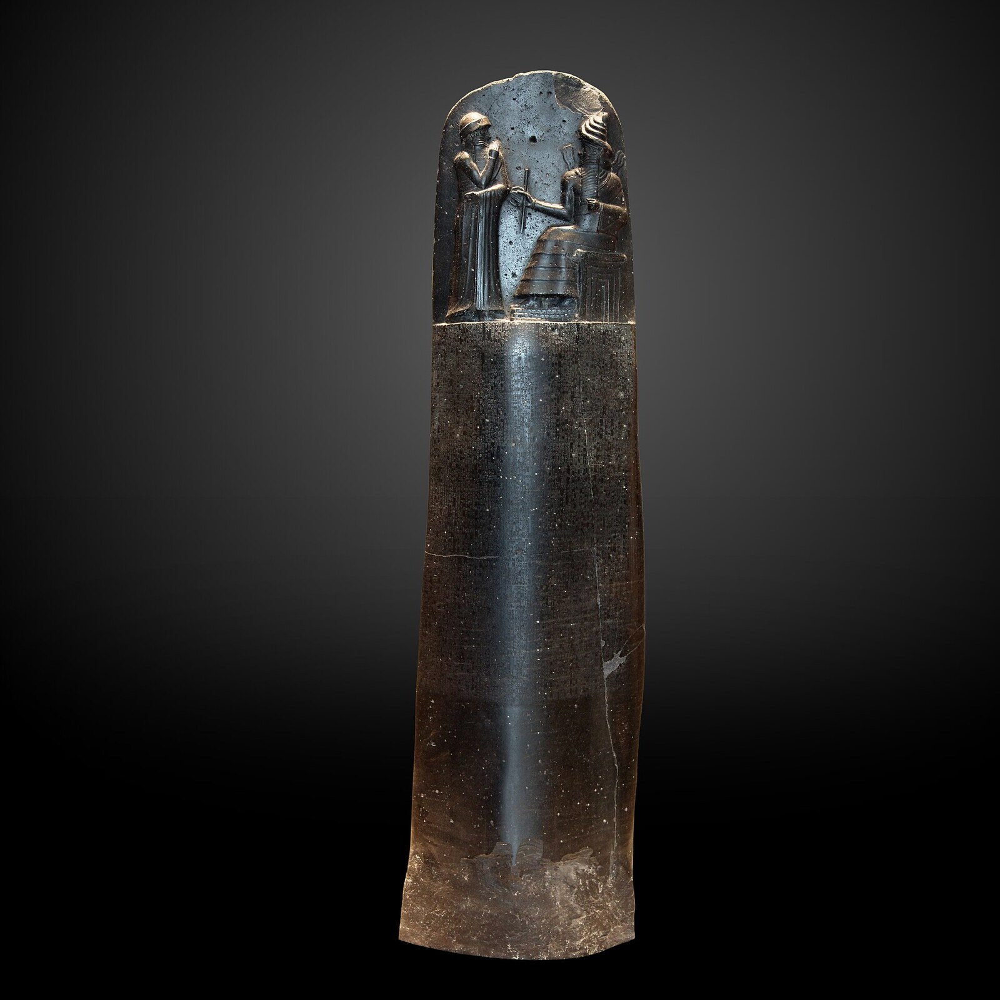
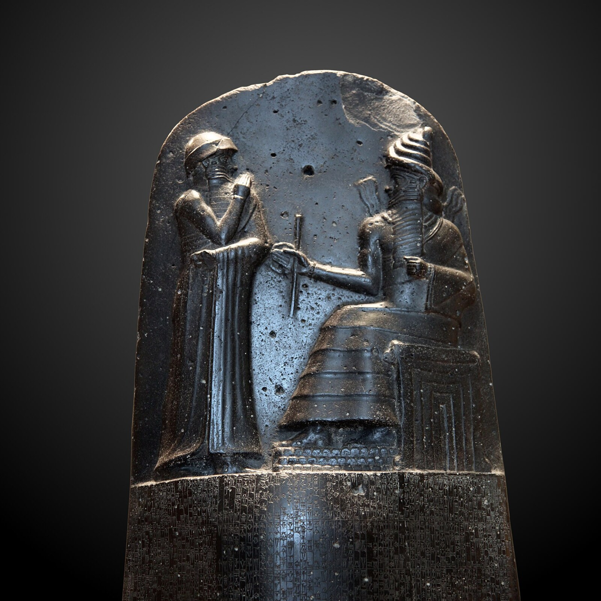
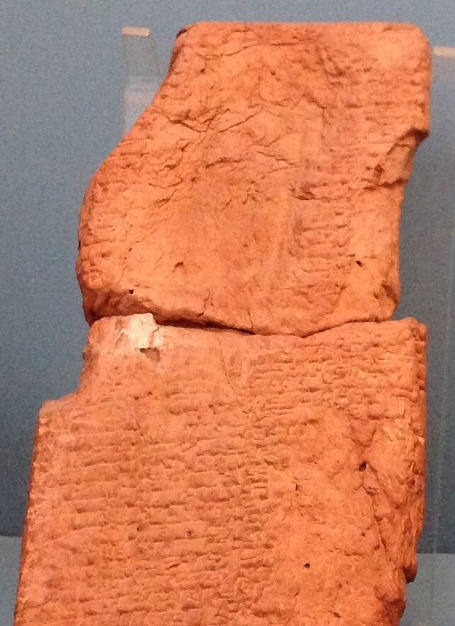
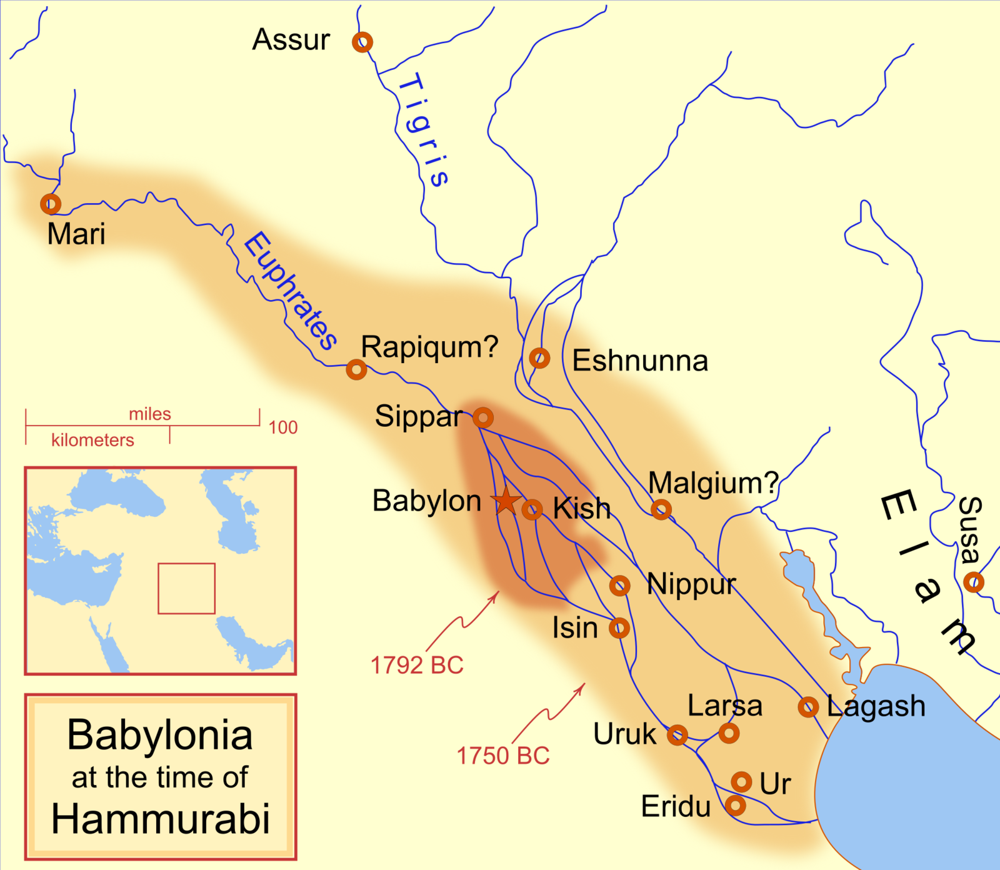
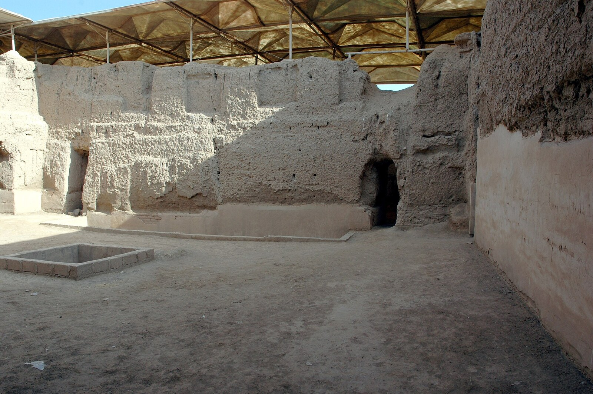
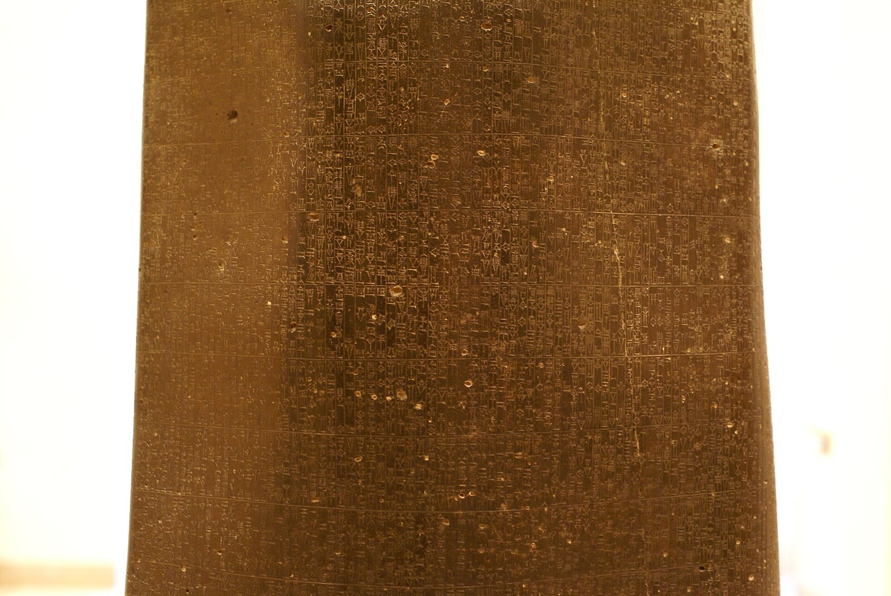
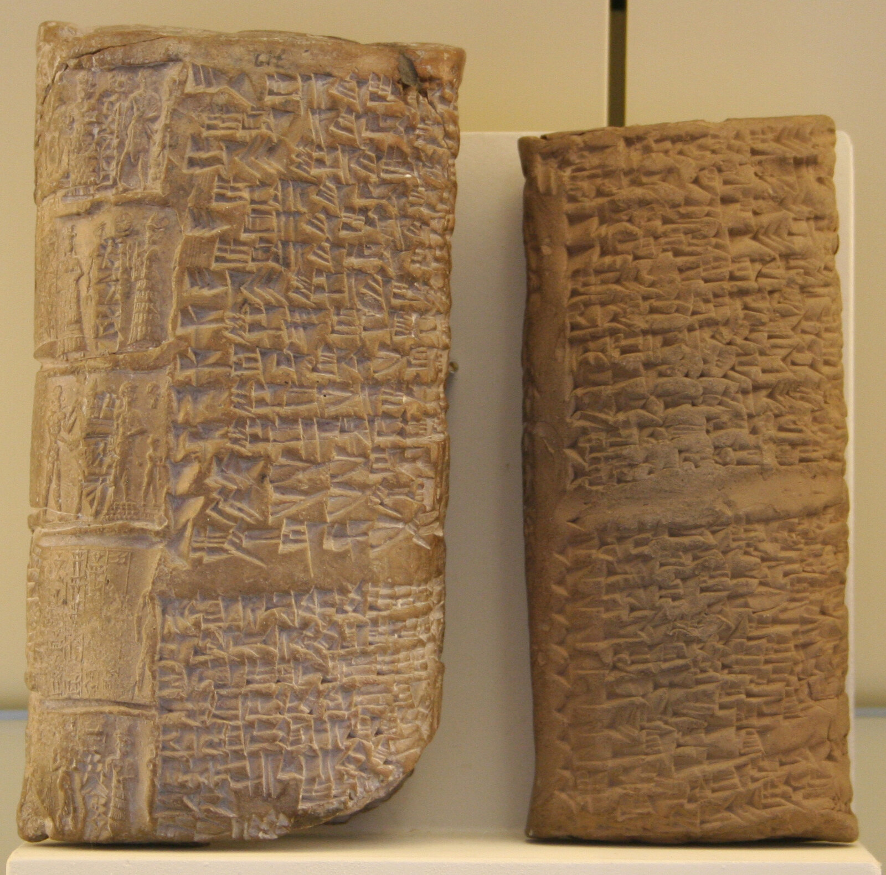
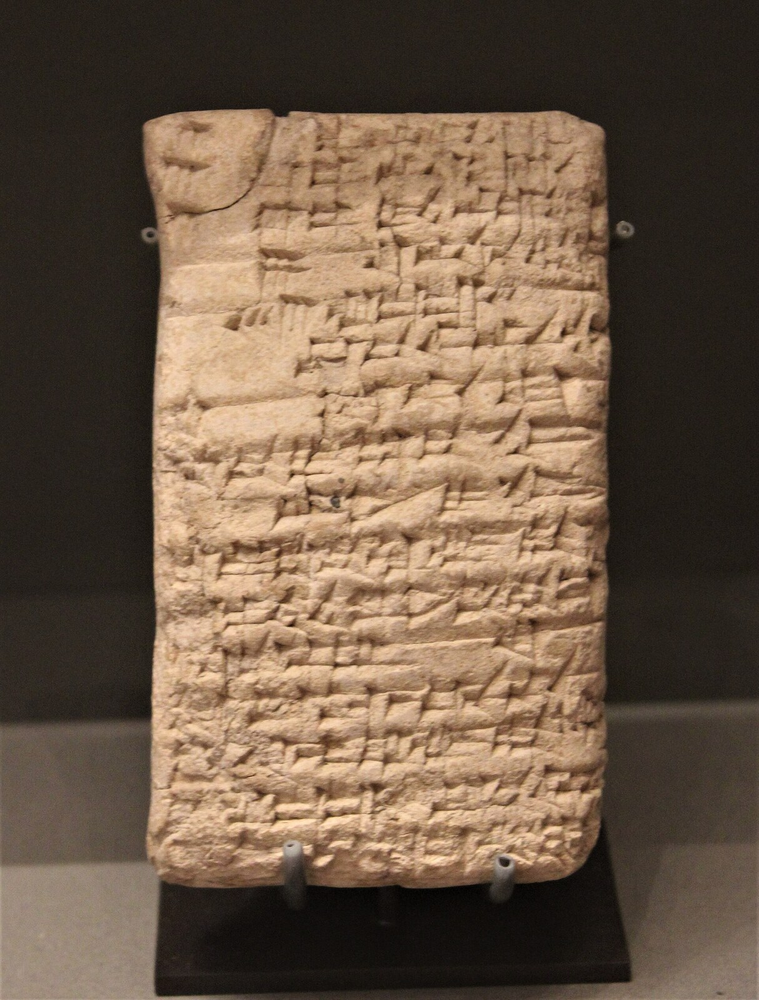
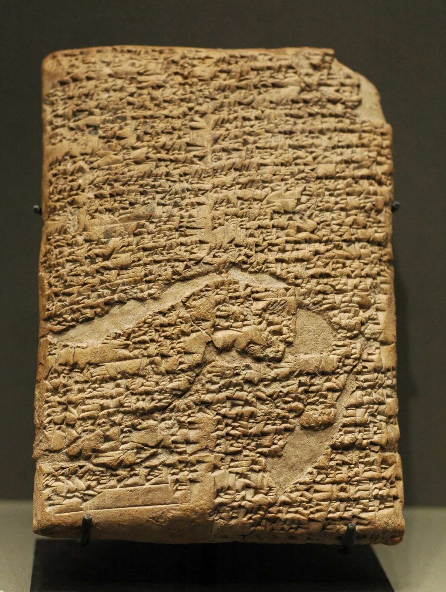
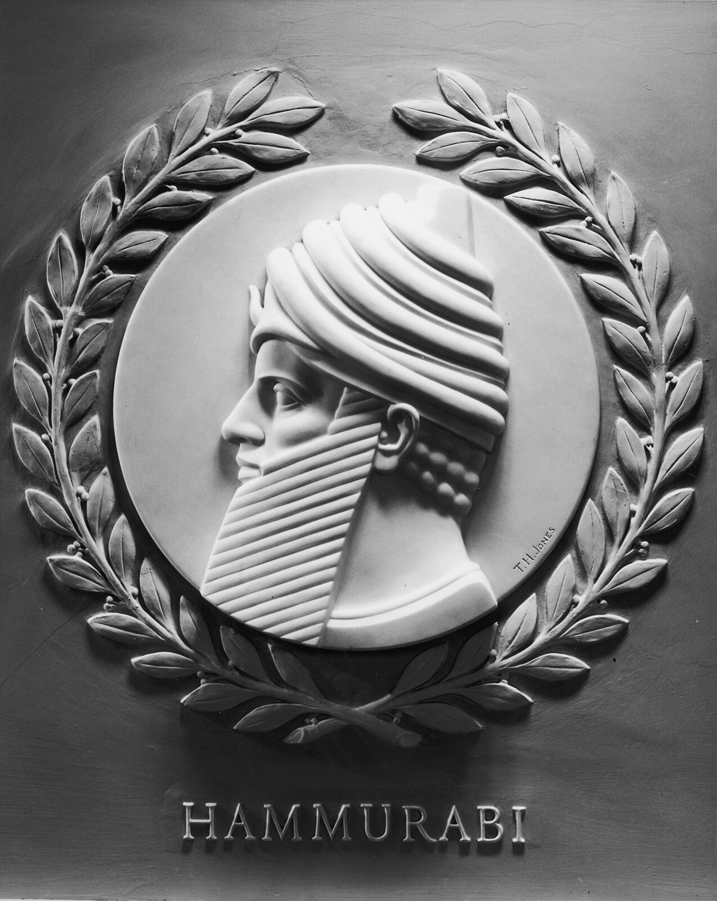

# 9. Who wrote the first laws?

*Iraq, from about 4,100 years ago to about 3,750 years ago*

Kings did, on the plain of Iraq, and they wrote them down mainly to show the world that they were just.

In the winter of 1901 to 1902, a French team was digging in the ruins of Susa, an ancient city in the south-west of Iran. Over a few weeks the workmen pulled three large pieces of black stone out of the ground. When the pieces were fitted together, they made a pillar a little taller than a tall man, shaped like a huge finger pointing upwards.

*The stone of Hammurabi, now in the Louvre in Paris. It stands two and a quarter metres tall. Photo: Rama, CC BY-SA 3.0 FR.*

At the top of the pillar is a carved picture. A king stands with one hand raised to his mouth, in the gesture of a man who is praying. Facing him, on a throne, sits a god with flames rising from his shoulders. He is the sun god, who sees everything that happens on earth, and who was for that reason the god of justice.

*The king stands before the sun god, who holds out a rod and a ring, the signs of rule. Photo: Rama, CC BY-SA 3.0 FR.*

Below the picture, the whole stone is covered in writing, front and back, in neat columns of tiny wedge-shaped signs. It took scholars less than a year to read it. The writing is a list of rules, about two hundred and eighty of them, and almost every one starts with the same word: if.

The king's name was Hammurabi, and he ruled the city of Babylon about 3,750 years ago. His stone is the most famous legal text of the ancient world. It is not the oldest, and the judges who worked in its shadow almost never cited it. Kings had been in the business of justice long before Hammurabi, and the business itself was older than kings.

## Before the king's court

Picture a farming village with no ruler, and suppose that one man in it kills another in a fight.

There are no police to arrest him and no judge to try him. What there is, instead, is the dead man's family. His brothers and cousins are now owed a life, and everybody in the village knows it. They may take that life, from the killer or from one of his kin. Or the two families may sit down, with the old men of the village between them, and agree on a price. So many sheep, or so much silver, and the matter is closed.

That system is far older than cities, and it works better than it sounds. People think twice before they hurt somebody who has six brothers. It has two weaknesses, however, and both grow worse as a settlement grows.

The first is that revenge does not know where to stop. The killer's family may feel that the price was too high, or that the wrong man was killed in return. They strike back. A single death can turn into a feud that runs for generations.

The second is that the system protects only people who have kin. A widow, an orphan or a stranger passing through may have no brothers to stand behind them. Such people can be cheated, and nothing will follow.

In a village these weaknesses can be lived with, because everybody knows everybody. In a city of thirty thousand strangers they cannot. Somebody has to stand above the families, with the power to end a quarrel and make the ending stick.

On the plain of Iraq, the people who took that job were the kings. It suited them very well. A war leader is needed when there is fighting to be done. A judge, by contrast, is needed every week, by the very people who have nobody else to turn to. For centuries before Hammurabi, the kings of the plain had boasted of the same thing: that they had protected the widow and the orphan, and had not handed the poor man over to the rich.

A king who judges also gains something harder to see. Every time two families bring their quarrel to him, and do not settle it with knives, they are admitting that the right to punish belongs to him and not to them.

## Two shekels for a tooth

The oldest collection of laws that survives comes from the city of Ur, in the far south of the plain, about 4,100 years ago. That is more than three centuries before Hammurabi. Akkad had fallen by then, and a king of Ur had brought the cities under one rule again. The laws were set down in his name.

*A tablet of the laws of Ur, about 4,100 years old, in the Istanbul Archaeology Museums. Photo: Wikimedia Commons, CC0.*

Only part of the text has been recovered, on broken clay tablets, and about thirty rules can be read. On the matter of injuries, they are milder than might be expected.

A murderer was put to death, and so was a robber. For an injury to the body, however, the penalty was a payment in silver. A man who cut off another man's foot paid ten shekels. A man who knocked out a tooth paid two. There was a fixed price for a broken bone and another for a cut nose. A shekel was a small weight of silver, about as much as a modern coin, and at the time it was roughly a month's pay for a hired worker.

This is the old village bargain, tidied up. The families used to haggle over the price of an injury. Now the price was fixed in advance, and the king's name stood behind it.

A list like that does several things. It takes away the haggling, and with it the main cause of feuds. It also tells everybody, in advance, what a wrong will cost. Above all, it treats an injury as a debt. The man who hurt you owes you silver, and once he has paid, you and he are even.

The laws of Hammurabi, three hundred years later, took a harsher view.

## One king among fifteen

When Hammurabi came to the throne, Babylon was not a great city. It was a middling town on the Euphrates, in the centre of the plain, and its kings ruled only a few towns round about.

*Babylon's territory when Hammurabi became king, in the darker shade, and when he died, in the lighter. Map: MapMaster, CC BY-SA 4.0.*

The plain at that time had no master. Half a dozen kingdoms of about the same strength watched each other, made alliances, broke them, and fought short wars over canals and border towns. A letter written by an official of the time describes the position exactly. No king is strong on his own, he says. Ten or fifteen kings follow Hammurabi of Babylon, as many follow each of three other kings, and twenty follow a fifth.

For thirty years Hammurabi played this game carefully. He dug canals, built temples and walls, and lent his soldiers to stronger neighbours when they asked. He fought small wars with his neighbours, as all of them did, and he looked more like a useful ally than a danger.

Then, in about five years, he took the lot. Elam, a great kingdom in the hills to the east, attacked and was beaten. He turned south and besieged Larsa, the richest city on the plain, for six months, until it fell. He turned north-west, up the Euphrates, and took the trading city of Mari, whose king had been his ally for years. Two years later he sent his men back to Mari to pull down its walls and burn its palace.

*What is left of the palace at Mari, which Hammurabi's men burned. The fire baked its archive of letters and preserved them. Photo: Gianfranco Gazzetti, CC BY-SA 4.0.*

By the end, Hammurabi held the whole plain, from the Gulf to the edge of Syria. No one had done that for a long time. He had been king for more than thirty years by then, and he had fewer than ten left.

A conqueror in that position has a problem that is easy to state. He has made himself king over cities that had their own kings a few years earlier, each with its own customs and its own way of settling a dispute. He needs their people to believe that being ruled from Babylon is better than what they had before. It was in those last years that he had the black stones carved, and set them up in temples.

## If a man

Each rule on the stone has the same shape. It describes a case, and then it says what is to be done. If a man has done this, then that shall happen to him.

*The rules, in bands of small wedge-shaped signs. Photo: Enlil2, CC BY 3.0.*

Some of them sound remarkably modern. Take the rule about builders. If a builder builds a house for a man and does not make it sound, and the house falls down and kills its owner, the builder shall be put to death. That is a building code, and its meaning is plain: the man who does the work answers for the work.

Others deal with bad luck. If a man owes a debt, and a storm floods his field or a drought kills his crop, he does not have to pay his creditor any grain that year, and no interest is added. Moreover, if a man was robbed and the robber was never caught, the city in which it happened had to make good what he had lost. The idea behind that rule is that keeping order is the government's job, and that a government which fails at it owes something to the victim.

Then there are the rules for which the stone is famous. If a man puts out the eye of another man, his own eye shall be put out. If he breaks another man's bone, his bone shall be broken. If he knocks out the tooth of a man of his own rank, his own tooth shall be knocked out.

This is the principle of an eye for an eye, and it was new. Under the older laws of Ur, an eye or a tooth had a price in silver. Hammurabi's stone demands the same injury in return.

To a modern reader that looks like a step backwards, from fines to mutilation. It can also be read the other way. A fine is a light matter to a rich man. He can afford to knock out the tooth of a poorer neighbour of his own rank, or a dozen of them. If the price of a tooth is his own tooth, his silver cannot help him.

That protection, however, reached only so far, and the next lines of the stone show exactly how far. People in Hammurabi's kingdom came in three kinds. At the top were free men of full standing. Below them was a class of free people of lower rank, the commoners. At the bottom were slaves.

An eye for an eye applied between equals at the top. If a man of standing put out the eye of a commoner, he did not lose his own eye. He paid sixty shekels of silver, which was about five years' wages for a hired worker. If he put out the eye of another man's slave, he paid the owner half of what the slave was worth, as though he had damaged a cart.

The same ladder runs through the whole text. A surgeon who saved the life of a man of standing with his bronze knife was paid ten shekels. For a commoner he was paid five, and for a slave two. If the man of standing died under the knife, the surgeon's hands were cut off.

Some of the rules follow their own logic to a place that is hard to read today. If the house that fell down killed not the owner but the owner's son, it was the builder's son who was put to death. The stone treats a son here as something that belongs to his father, so that the loss of one man's son is paid for with another's.

Women appear on the stone mostly as daughters and wives, and their position was better than might be guessed. A wife brought property with her when she married, and it stayed hers. If her husband divorced her, he had to give it back. If he neglected and belittled her, and she had been a good wife, she could take her property and go home to her father's house.

Where the facts of a case could not be known at all, the stone handed the question to the gods. A man accused of sorcery was sent to the river and made to jump in. If he drowned, he was guilty, and his accuser took his house. If the river let him go, the accuser was put to death, and the man who had jumped took the accuser's house.

The very first rule on the stone sets the tone for all the rest. If a man accuses another of murder and cannot prove it, the accuser shall be put to death. The burden lies on the one who brings the charge, and the charge is dangerous to bring.

## Did anyone use it?

Babylon under Hammurabi and his heirs has left an enormous pile of everyday legal paperwork, all of it on clay. There are many thousands of tablets: sales of land, loans, marriage contracts, adoptions, wills, and the records of actual trials.

From them, the working of a court can be followed step by step. A case was heard by a group of judges, who were usually leading men of the town. Both sides spoke. Witnesses were called, and written contracts were brought out and read. A contract of the time was often sealed inside a thin clay envelope with the same words written on the outside, so that nobody could change the text without breaking the cover.

*A contract from the time of Hammurabi's dynasty, on the right, and the clay envelope it was sealed inside, on the left. The witnesses rolled their seals across the envelope. Photo: Einsamer Schuetze, CC BY-SA 3.0.*

If the truth still could not be found, one side was told to swear an oath in the temple, in front of the god's own emblem. People believed that a god would destroy anyone who swore falsely in his presence. The records show that this worked on them. Again and again, a man who had argued his case with confidence in court went to the temple door and then refused to swear. He gave up his claim instead.

In all those thousands of records, however, the judges almost never mention the king's stone. They do not quote it. They do not say "as it is written". Sometimes their verdicts match its rules, and sometimes they do not. Very often the penalty they hand down is a payment in silver.

So what was the stone for?

Its form is one clue. A list of cases, each starting with "if", was how the scholars of the plain wrote down much of what they knew. Their medical texts have the same shape: if a man's skin is yellow and his eyes are yellow, he has such an illness. So do their handbooks of omens. The stone is a work of the same kind. It is a collection of sound judgements, some of them perhaps from real cases that the king had decided, set out to show how a wise ruler thinks. A judge might learn from it. He was not bound by it.

The rest of the answer is on the stone itself. The rules take up the middle. Before them and after them, Hammurabi speaks in his own voice, and he says plainly what he is doing.

The gods, he says, called him by name to make justice appear in the land, to destroy the wicked, and to see that the strong did not oppress the weak. He lists the cities he has taken, one by one, and for each he names the good he has done its temple. Then, at the end, he speaks to his subjects. Let any man who has been wronged come and stand before this stone, and have it read out to him. Let him hear what it says, and let it make his case clear to him, and let him be calm.

He also speaks to the kings who will come after him. If they keep to his judgements, the sun god will lengthen their reigns. If one of them should change his words, or rub out his name and write another, there follows a curse that fills several columns.

In other words, the stone is a monument. It was set up in a temple, under the eye of the god of justice, to tell the gods, the conquered cities and the future that this king was just. A king who had burned the palace of his old ally had good reason to want that said.

It would be wrong, even so, to call it empty. Hammurabi's letters survive as well, about two hundred of them, sent to his governors in the cities he had taken. They show a man who really did sit in judgement. He orders a field given back to a soldier who had been pushed off it. He hears that officials have taken a bribe and sends for the men, the witnesses and the silver. He tells a governor to look up the records and settle who owns a piece of land. The king on the stone and the king in the letters are the same person.

*One of Hammurabi's letters to his governor in the conquered city of Larsa. Photo: Zunkir, CC BY-SA 4.0.*

## Written where all can see

A rule that is carved on a stone in a public place is a different thing from a rule that lives in a judge's head, and the difference matters even when most people cannot read.

First, a written rule is the same tomorrow as it is today. A judge who is asked to decide between a rich man and a poor one can bend an unwritten custom towards the man who can do him a favour. It is much harder to bend a rule that anybody can have read out to them. Hammurabi understood this very well. He told the wronged man to have the words read out to him, because the words would say what he was owed.

Second, a written rule can be known before anybody breaks it. The builder knows what happens if his wall falls. The lender knows what he may not take from a debtor after a flood. People can plan around a rule they can see.

Third, a rule that is written down in the king's name can be held up against the king's own men. If the stone says that an officer who seizes a soldier's goods shall be put to death, and an officer seizes them all the same, the soldier has something to point to. It is a small step from there to holding the rule up against the king himself. Hammurabi's subjects had no court in which they could do that, and it was a very long time before any people did. Nevertheless, the stone had put the rule outside the ruler, where it could be seen by other people, and that is where the idea starts.

Finally, the stone shows how completely the king had taken over the old business of the families. Almost every wrong it lists had once been a private matter between two groups of kin. Now each one had a fixed answer that came from the palace. The families still did much of the work, since there were no police, and a man who had been robbed still had to find the thief himself and bring him in. The last word on what happened next, however, now lay with the king's judges.

What the stone did not do is just as plain. It did not make people equal. It wrote their inequality down in careful detail, with a price for each rank. Its justice meant that each person got what was due to somebody of that station. The notion that the law should be the same for a landowner and his slave appears nowhere on it, and would have struck Hammurabi as an absurd idea.

## Carried off

Hammurabi's kingdom did not last much better than Sargon's had. His son faced a revolt of the southern cities within a few years of taking the throne. The kingdom shrank, reign by reign, back towards Babylon itself. About a hundred and fifty years after Hammurabi died, an army from the mountains of Turkey marched down the Euphrates, sacked the city, and went home again.

The stone outlived all of it. It stood in its temple for some six hundred years. Then a king from the east raided the plain and loaded his carts with the finest monuments he could find. He was the same king who carried off the carved stone of Naram-Sin of Akkad climbing his mountain. He took Hammurabi's pillar to Susa, his own capital, and that is why the French found it there three thousand years later.

At Susa, somebody chiselled away several columns of the rules near the bottom, leaving a smooth blank patch. The space was almost certainly meant for an inscription of the new owner, like the one he added to Naram-Sin's stone. It was never carved, and so about thirty-five of Hammurabi's rules are missing from the stone. Most of them have since been filled in from other copies.

There were many other copies. The text had become a classic. In the schools of the plain, boys who were learning to write copied out the laws of Hammurabi on clay, as an exercise in good style. They went on doing it for more than a thousand years, long after his kingdom was gone and its courts were forgotten. Pieces of those school copies turn up all over Iraq.

*A copy on clay of the opening of Hammurabi's text, in which he lists his cities and his good deeds. Photo: Marie-Lan Nguyen, public domain.*

His way of writing a rule travelled further still. One of the rules on the stone, which was old even in Hammurabi's day, deals with an ox. If an ox gores a man to death while walking down the street, nobody is to blame. However, if the ox was known to gore, and its owner had been warned and had not tied it up or padded its horns, then the owner has to pay. A thousand years later, and a thousand kilometres to the west, the laws in the Hebrew Bible take up the same case. There, too, the ox that gores for the first time is one thing, and the ox whose owner had been warned is another.

Hammurabi asked that his name be remembered for ever, and he got something close to it. His carved portrait hangs today in the chamber of the United States House of Representatives, among the lawgivers of history. What put it there was a stone that his own judges almost never quoted.

*Hammurabi in the chamber of the United States House of Representatives, carved in 1950. Photo: Architect of the Capitol, public domain.*