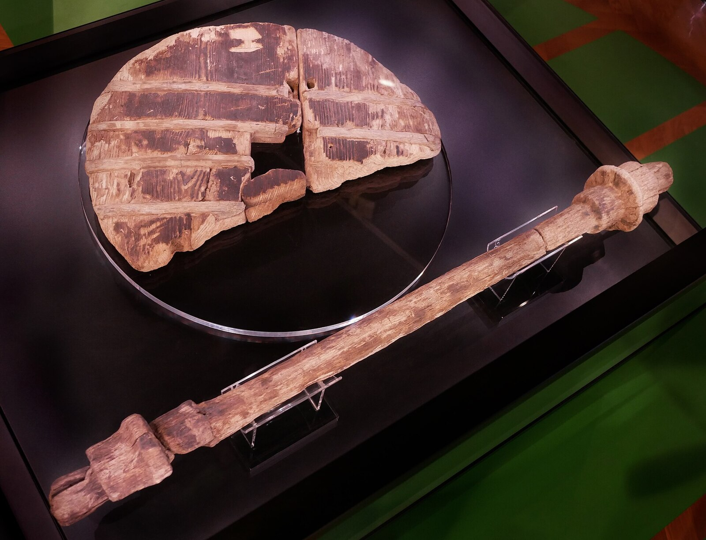
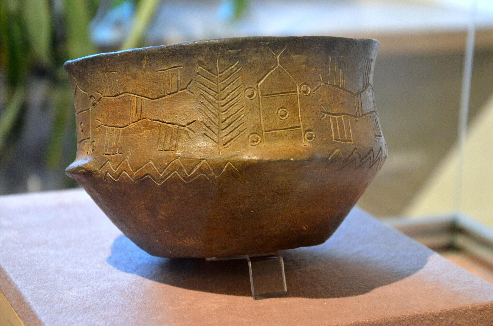
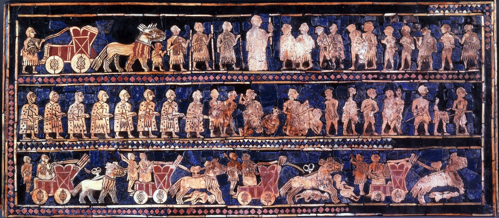
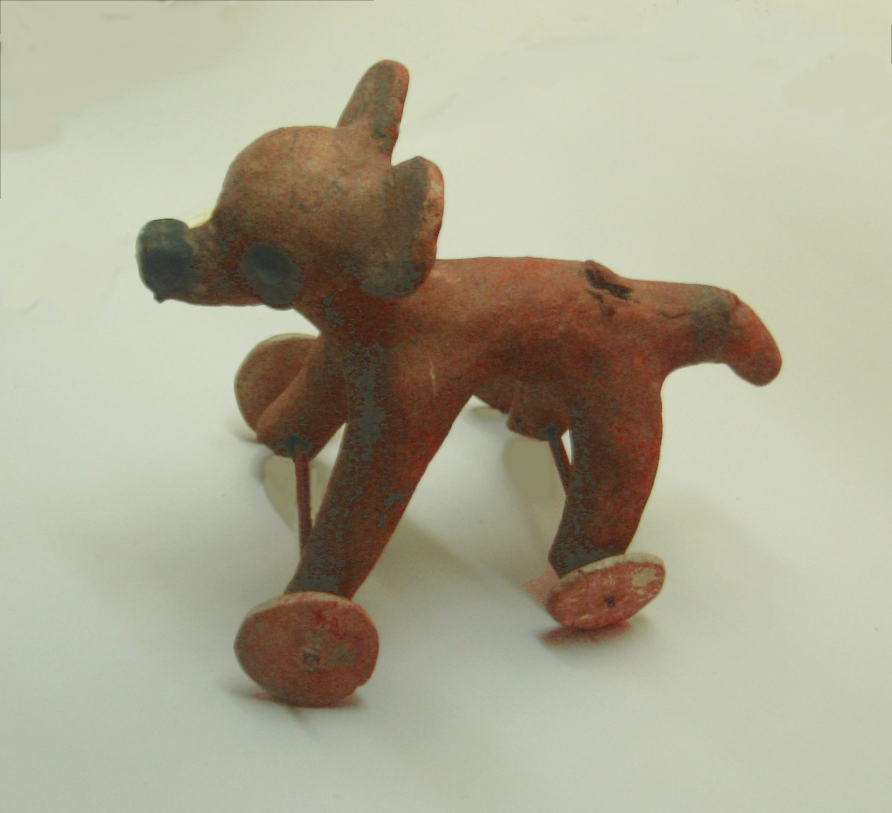
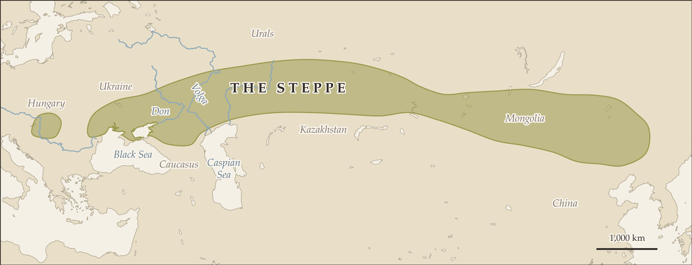
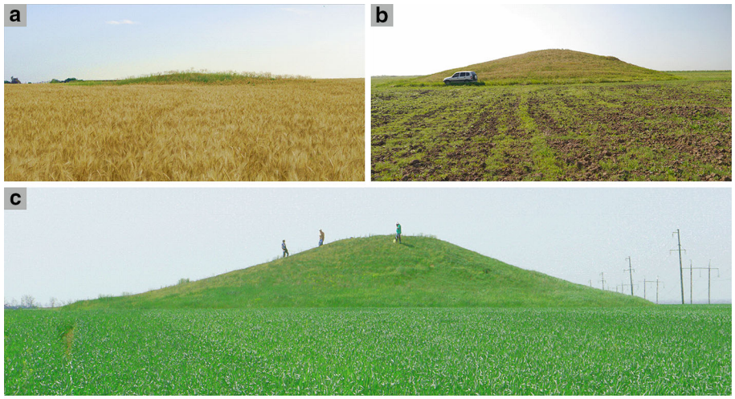
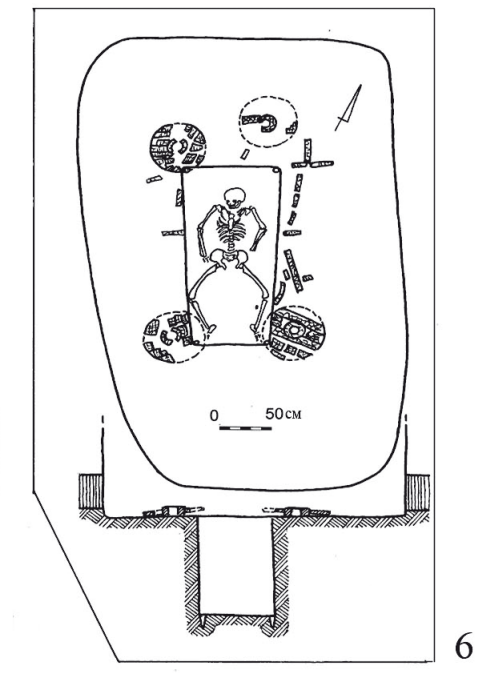
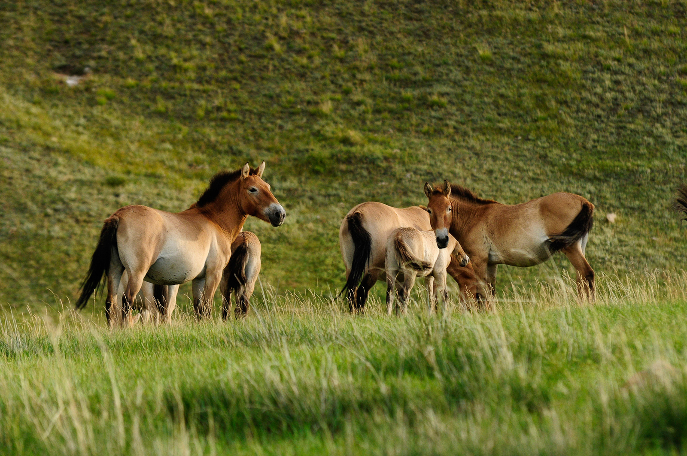
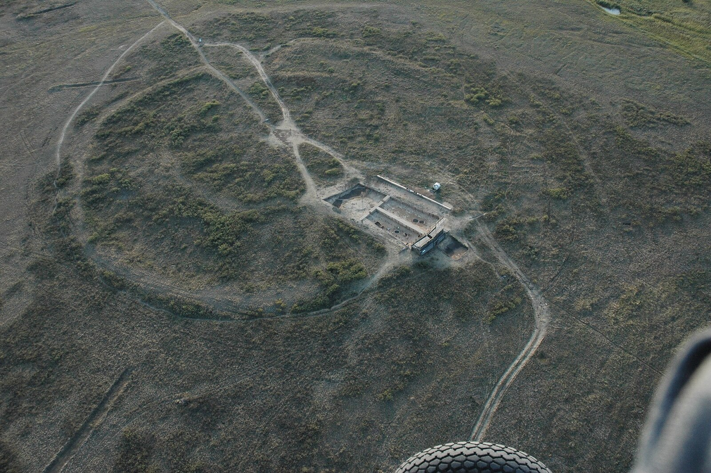
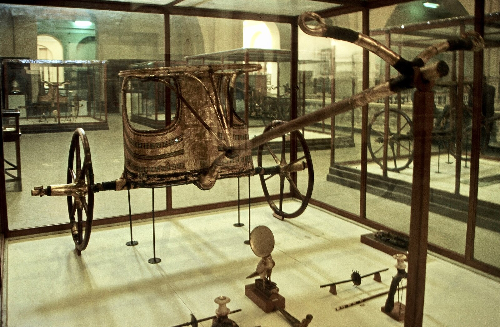

# 10. Why did it take so long to invent the wheel?

*Europe, the Middle East and the grasslands of Asia, from about 5,500 years ago to about 3,600 years ago*

A wheel is no use on its own. It needs an axle that fits it exactly, carpentry fine enough to make that fit, and, for any load worth moving, a strong animal to pull it.

In 2002, archaeologists working in a marsh south of Ljubljana, in Slovenia, lifted a wooden wheel out of the wet ground. It is about 5,150 years old, which makes it the oldest wooden wheel that survives anywhere in the world.

It does not look like much. It is a thick disc about seventy centimetres across, the size of a small café table. It is not cut from a single piece of wood. It is made of two planks of ash, laid side by side and held together by four strips of oak that slide into grooves cut across both of them. The hole in the middle is square.

Lying beside it was its axle, a rod of oak a little over a metre long. The ends of the axle are squared off to fit the hole, so that the wheel and the axle were locked together and turned as one piece.

*The wheel from the marsh near Ljubljana, with its axle. About half of the wheel survives. Photo: Petar Milošević, CC BY-SA 4.0.*

Every part of that description records a problem that somebody had to solve. People had been building houses, weaving cloth and smelting copper for thousands of years before anybody made one of these. By the time this wheel was made, the first cities on the plain of Iraq were already centuries old. The wheel feels to us like the most obvious invention there is. It was nothing of the kind.

## The axle is the hard part

Start with what is easy. Anybody who has moved a heavy stone knows that it goes more smoothly over a few logs laid crosswise. People knew that long before the wheel. Rollers, however, are not wheels. They are left behind as the load moves forward, and somebody has to keep carrying them round to the front.

A wheel stays with the load, and that is the whole point of it. To stay with the load it has to be joined to it, and the joint is where the trouble starts.

There are two ways to make that joint. In the first, the wheel is fixed to the axle, as on the cart from the Slovenian marsh, and the whole axle turns in a pair of brackets under the cart. In the second, the axle is fixed to the cart, and each wheel spins freely on its end. Either way, one piece of wood has to turn inside another, under a heavy load, for hours.

That turning joint has to be made with real care. If it is too tight, the wood binds and the cart will not move. If it is too loose, the wheel wobbles and chews the joint to pieces within a kilometre. The surfaces that rub have to be round and smooth. The axle has to be thick enough to carry the load without snapping, and yet thin enough where it turns to keep the rubbing small.

The wheel itself is no easier. The obvious way to make one is to saw a slice off the end of a log, like a slice of sausage. It does not work. Wood is weak across its grain, and a slice of log cracks from the centre outwards as it dries. So the wheel has to be cut from planks that run along the length of the tree. Few trees are wide enough to give a whole wheel in one plank, and so two or three are usually shaped into parts of a circle and pinned together so firmly that they behave as one piece. Then the hole has to be cut in the exact centre. A wheel whose hole is a finger's width off centre will shake a cart apart.

Round holes, tight grooves, planks trimmed to a curve: this is fine carpentry. It can be done with tools of stone and bone, and skilled woodworkers had been cutting neat joints with them for a long time, but it is slow. A chisel and a gouge of metal make the work far quicker and cleaner, and by five and a half thousand years ago copper tools of that kind were in the hands of woodworkers in several parts of Europe and the Middle East.

The potters, it is true, already had a turning table. That is a different machine. A potter's table spins on a single pivot and stays where it is. A cart wheel has to carry a weight across rough ground. The potters may have supplied the idea of turning, but not the solution.

Even a perfect wheel is not yet worth having. A cart with solid wooden wheels is heavy before anything has been put into it. No person wants to drag one. It earns its keep when there is a large, strong, patient animal to put in front of it, and that animal was the ox. Farmers had kept cattle for thousands of years by then, and they had already learned to harness oxen to drag a plough.

So the wheel waited on fine carpentry, the trained ox, and people with enough grain, timber or manure to move that a cart was worth the trouble of building. All three came together a little more than five and a half thousand years ago. When they did, the wheel appeared almost at once.

## Everywhere at the same time

The oldest evidence for wheeled carts does not come from one place. It comes from several, thousands of kilometres apart, and all of it dates from the same few centuries.

In southern Poland, a farmer's pot was found with a pattern scratched round it before it was fired. The pattern shows a little four-wheeled wagon seen from above, repeated five times, with a pole at the front for the oxen. The pot is about 5,500 years old.

*The pot from Bronocice in southern Poland. The rectangle with a circle at each corner is a wagon seen from above. Photo: Silar, CC BY-SA 3.0.*

In northern Germany, archaeologists took apart an ancient burial mound and found a pair of ruts running underneath it. They are the tracks of a cart that crossed the ground before that part of the mound was built, and they are close to the same age.

On the plain of Iraq, meanwhile, the clerks of Uruk were pressing their first signs into clay. One of those signs is a drawing of a sledge, the vehicle on runners that people there used for hauling. Another shows the same sledge with two small circles under it.

Nobody can say for certain which of these places had the wheel first. The dates are too close together to separate. What they show clearly is something else. The wheel does not turn up here and there over thousands of years, as it would if many peoples had each thought of it for themselves. It looks like one invention, or very nearly one, which then spread from farm to farm with remarkable speed. Within three or four centuries it was in use from the North Sea to the Persian Gulf.

That speed is the best evidence of how badly it was wanted. Consider a farming family before the cart. Almost everything that a household moved around its own land went on somebody's back or on a sledge: the harvest from the field, firewood from the forest, dung from the cattle pen out to the land. Carrying set a limit on how far a field could lie from the house, and so on how much land one family could work. With a cart and a pair of oxen, one person could move in a morning what had taken a household several days. A family could farm land further off, and could live on its own, away from the village, and still manage.

Those first wagons were slow. An ox walks at about three kilometres an hour, which is slower than a person. The wheels were solid and the axles groaned. Nobody rode in one for pleasure. They were machines for moving heavy things a short distance, and that was plenty.

*Wagons on a box from the royal graves at Ur, about 4,500 years old. Each wheel is solid and made of two pieces. In the bottom row the wagons roll over fallen enemies.*

## Toys in Mexico

On the other side of the world, the wheel had a different history, and it shows how much the invention depended on its surroundings.

In the east of Mexico, archaeologists have found about a hundred small clay animals, mostly dogs and jaguars, made between about 1,700 and 800 years ago. Each one stands on four clay discs. Thin rods once ran through the feet, from one side to the other, and the discs turned on the ends of them. They are toys or offerings on wheels, complete with axles.

*A clay animal on wheels from Veracruz in Mexico. Photo: Madman, CC BY 2.5.*

So the peoples of ancient Mexico had the idea. They understood it well enough to build working models. They were also fine engineers, who raised pyramids and laid out straight stone roads through the forest. Yet they never built a cart. Everything that moved overland in their world moved on human backs.

The reason is that they had nothing to pull one. The wild horses of the Americas had died out soon after people arrived, and none of the large animals that survived, such as the bison, could be tamed to pull a load. The one large beast of burden left in the whole hemisphere was the llama, far to the south in the Andes. A llama can carry a load about as heavy as a ten-year-old child, on mountain paths too steep for any wheel.

Without an ox, a cart is a heavy box that a man must drag himself. The clay dogs show that the people of Mexico knew what a wheel was. They also show that knowing is not enough.

Even where there were oxen, the idea did not go everywhere at once. The wheelbarrow needs no animal at all. It is a box with a single wheel, pushed by one person, and it roughly doubles what that person can move. Nevertheless, it does not appear until some three and a half thousand years after the cart. For all that time, as far as the evidence shows, people who saw wheels every day did not put one under a hand-barrow.

## The sea of grass

The wheel made a large difference to farmers. On the grasslands it did far more, because it let people live out on them, far from the rivers.

Across the middle of Europe and Asia runs a belt of open grassland called the steppe. It begins on the plains of Hungary and goes on eastward, past the Black Sea and the Caspian, across Kazakhstan and Mongolia, to the north-east of China. From end to end it is about eight thousand kilometres long. It is flat or gently rolling, almost treeless, hot in summer and savagely cold in winter.

*The steppe, from Hungary to the north-east of China. Map: drawn for this book; coastlines and rivers from Natural Earth, public domain.*

For farmers, the steppe was bad land. There is too little rain for wheat on most of it. For hunters it was hard as well, since the game is fast and there is nowhere to hide. Before the wheel, people lived along the rivers that cross the grassland, where there were trees, fish and shelter. The great spaces between the rivers were left almost empty.

Yet the steppe is rich in one thing, which is grass. People cannot eat grass. Sheep, cattle and horses can, and people can live on their milk and meat. The difficulty lies in how fast a herd eats. A large flock strips the grazing around a camp within weeks and has to move on. To live on the open steppe, a family has to move with its animals, again and again, all year round. That means carrying a shelter, bedding, tools, food, and above all water, across country where there may be none for days.

On foot, that can hardly be done. With a wagon, it can.

About 5,300 years ago, the herders who lived along the rivers north of the Black Sea got hold of the wagon. They roofed it over with a hoop of bent poles covered in reed mats. In effect they had built a house on wheels, something like a caravan drawn by oxen. They loaded it with their belongings and their water, and they drove out into the grass behind their herds. They moved from one river, spring or well to the next, and the wagon carried enough water to get the people across the dry stretches between.

They are known mainly from their graves. When an important person died, these herders dug a pit, laid the body in it, roofed the pit with timber, and heaped a mound of earth over the top. Thousands of those mounds still stand on the steppe, and some are as high as a house. In a few hundred of them, the dead person was buried with a wagon, taken to pieces, with the solid wheels laid at the corners of the pit.

*Burial mounds on the steppe of southern Ukraine. Photos: Iwona Dembicz and colleagues, CC BY 4.0.*

Their remains show how they lived. The hardened deposit on their teeth still holds traces of what they ate, and it is full of the proteins of milk. They lived on dairy and meat, and they ate very little grain.

*The plan of a wagon herder's grave. The skeleton lies in the pit, with the wagon's four solid wheels set at its corners. Drawing: Svitlana Ivanova, CC BY 4.0.*

Within a few centuries, the wagon herders had spread across an immense stretch of country. Graves of the same kind, with the same pits, the same mounds and the same red ochre sprinkled on the dead, are found from the plains of Hungary to the mountains on the edge of Mongolia. Those two ends are about five thousand kilometres apart.

## The horse

Wild horses lived on the grassland in large numbers, and the herders were the people best placed to tame them. For a very long time people simply hunted them, as they hunted deer. About 5,500 years ago, in the north of Kazakhstan, one group began to do more than hunt. Their villages are full of horse bones, and chemists have found what look like traces of mare's milk in their cooking pots. Nobody can milk a wild horse. If the chemists are right, these people were keeping horses in some fashion.

That first attempt, however, went nowhere. Their horses were not the ancestors of the horses in a stable today. Instead, the breed they kept survives in the small, stocky horse that runs free on the plains of Mongolia.

*The free-running horses of Mongolia, at Hustai National Park. They descend from the first horses that people kept. Photo: Zazaa Mongolia, CC BY-SA 4.0.*

The horse that we know came from somewhere else. Geneticists have read the DNA in the bones of hundreds of ancient horses from all over Europe and Asia, and the result is clear. Every domestic horse alive today descends from a population that lived on the steppe near the lower reaches of the Volga and the Don, north of the Caucasus mountains. About 4,200 years ago, those horses began to spread. Within a few centuries they had replaced almost every other kind of horse from Spain to Mongolia.

Something about them was plainly better, and the DNA gives two strong hints as to what. The new horses carried one changed gene that is linked to a calmer temper, and another that is linked to a stronger back. These were horses that would put up with people, and that could carry weight.

A herder on a horse is a different thing from a herder on foot. One person walking, with a good dog, can manage about two hundred sheep. On horseback, the same person can manage five hundred, and can scout the grazing a day's journey ahead. A rider can also cover in a day a distance that takes an ox wagon three or four. For the first time, a human being could travel faster than a human being can run.

## The language in the cart

The wagon herders left no writing. Even so, a good deal is known about the language they spoke, because so many living languages descend from it.

In the eighteenth century, scholars noticed that languages spoken very far apart resembled each other in ways that chance could not explain. Sanskrit, the old sacred language of India, shared hundreds of words and whole patterns of grammar with Greek and Latin, and also with the old languages of the Germans, the Celts and the Slavs. The only good explanation was that all of them had grown from a single older language, which was spoken somewhere, at some time, by people who then spread out. The whole family is called Indo-European, after the two ends of its range.

The words themselves say when. Take the English word wheel. In ancient Greek the word was *kyklos*, which gives English "cycle". In Sanskrit it was *chakra*. These are the same word, worn into different shapes by thousands of years of use. The same holds for axle, for the yoke that joins two oxen, and for a verb meaning to carry in a vehicle, which survives in English as both "wagon" and "way".

Words are handed down in this way only from a time when the thing itself was known. So the speakers of that parent language had wheels, axles and yokes, and they were still speaking one tongue, or dialects close enough to share new words, after the wagon was invented. That puts them less than 5,500 years ago. Their shared words also speak of sheep, cattle, horses, wool and milk, and of very few crops.

For two centuries it was a puzzle with no proof. Then, beginning in 2015, geneticists read the DNA of the people in the steppe grave mounds, and of the people who lived in Europe before and after them. Europe by then had been farming country for thousands of years, peopled by the descendants of farmers from Turkey. About 4,800 years ago, its ancestry changed sharply for a second time. A new style of grave appears across Germany and its neighbours, and the people buried in those graves drew about three quarters of their ancestry from the steppe herders. In Britain, a few centuries later, newcomers who carried that ancestry replaced about nine tenths of the island's earlier population.

A similar movement went east and south over the following thousand years, through Central Asia and into Iran and the north of India. The languages went with the people.

Today, almost half of the human race speaks a language descended from the speech of those herders. English, Spanish, Russian, Persian and Hindi are among them. They are spoken on every continent. Their common ancestor was the language of a small people who lived in wagons on the grass north of the Black Sea.

## Spokes

A solid wooden wheel is strong and very heavy. A pair of them, with their axle, can weigh more than the driver. An ox does not mind. A horse does. Horses are fast and nervous, and they tire quickly when they have to drag a heavy load. So for more than a thousand years, the fastest animal that people kept and the wheel had little to do with each other.

The people who brought them together lived about four thousand years ago, on the steppe just east of the Ural mountains. They were descendants of the wagon herders, and they lived in a way that was new on the grassland. They built round, walled settlements, with the houses packed together inside a bank and a ditch. In almost every house there was a furnace for smelting copper.

*One of the round walled settlements east of the Urals, seen from the air. The rings are the remains of its bank, ditch and houses. Photo: Rafikova m, CC BY-SA 4.0.*

In their graves, archaeologists found something that nobody had expected. On the floor of the burial pit there are two narrow slots, cut side by side. In the earth at the sides of each slot are the faint prints of thin wooden rods, running outwards from a centre like the lines on a clock face. They are the marks of spoked wheels, set upright in the grave. They are the oldest spoked wheels known.

A spoked wheel is a remarkable piece of work. The rim is made of wood that has been soaked or steamed and bent into a circle. A hub sits at the centre. It is a short block of wood with a hole through it for the axle. Between hub and rim run ten or a dozen slender spokes, each cut to exactly the same length and fitted into a socket at both ends. The whole thing weighs a fraction of what a solid wheel weighs, and it is strong enough, because every spoke shares the load.

Two such wheels, a light axle, a small platform to stand on, and a pole: that is a chariot. One man can pick it up. Hitch two of the new horses to it, and it can carry two people across open ground at more than thirty kilometres an hour.

*A chariot from the tomb of an Egyptian king, about 3,300 years old and some seven centuries later than the first ones. The slender spoked wheels are of the same kind. Photo: Rüdiger Stehn, CC BY-SA 2.0.*

The graves show how much these vehicles meant to their owners. The chariot went into the ground with its wheels in their slots. The two horses were killed and laid beside it. With them went the bone cheek-pieces from their bridles, the dead man's spear, and his arrows.

For hunting, or for racing a rival, a chariot must have been a thrilling machine. It was also a weapon. One man drives. The other stands beside him with javelins or a bow, and strikes as they pass. On open ground, men on foot cannot catch a chariot and cannot get away from one.

The idea travelled south quickly, along the roads that already carried metal. Within two or three centuries of those graves, chariots were being used in Turkey and Syria. By about 3,600 years ago they were in Egypt. In time they reached India, and at last China.

The old kingdoms of the plains and river valleys had been built by men on foot, behind walls of shields. Their kings now learned that an enemy with a few hundred light carts and trained horses could ride round their armies and shoot them down. One after another, the kings drew the same conclusion, which was that they had to have chariots of their own, whatever they cost. They cost a great deal.
