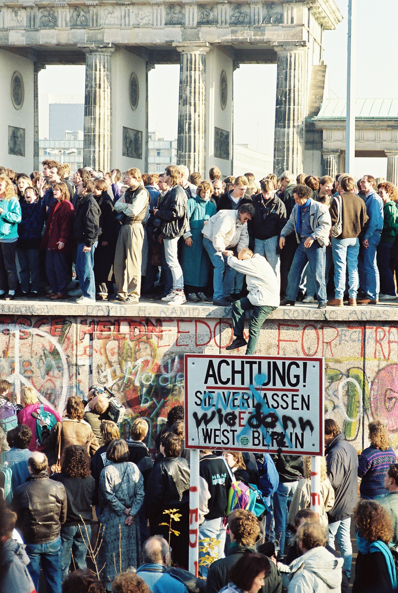
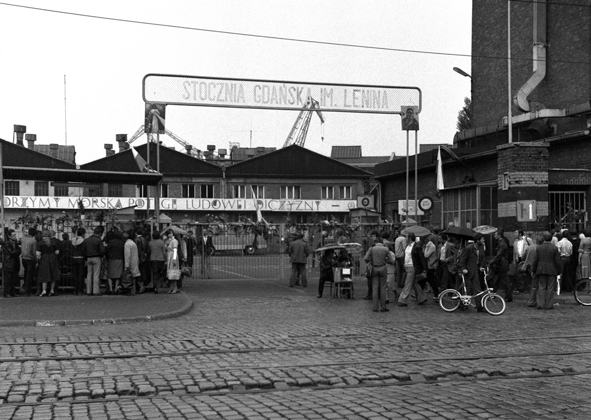
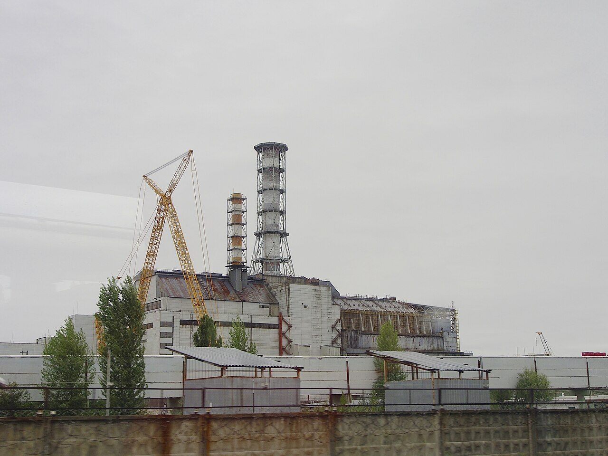
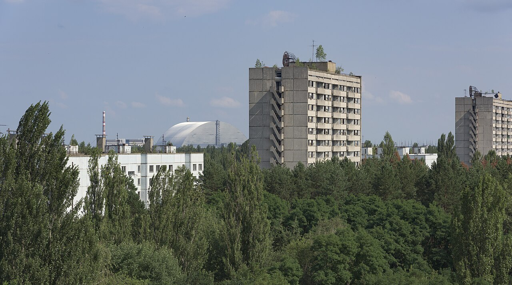
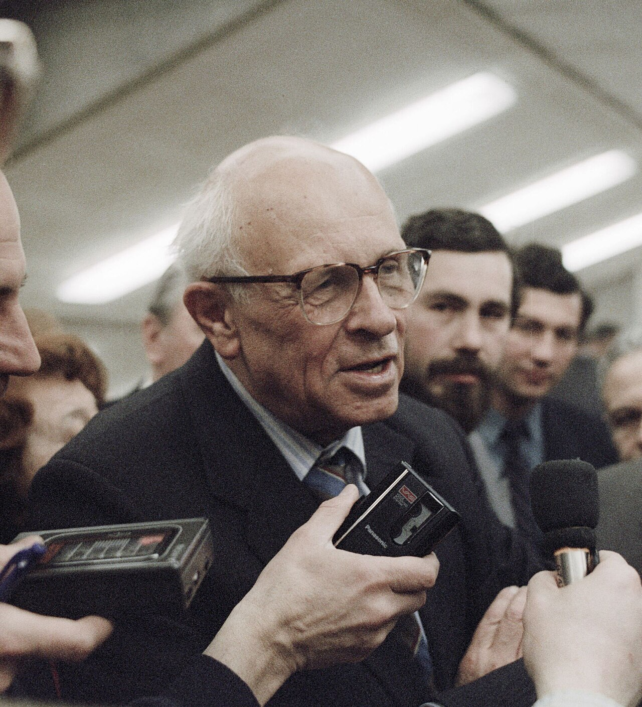
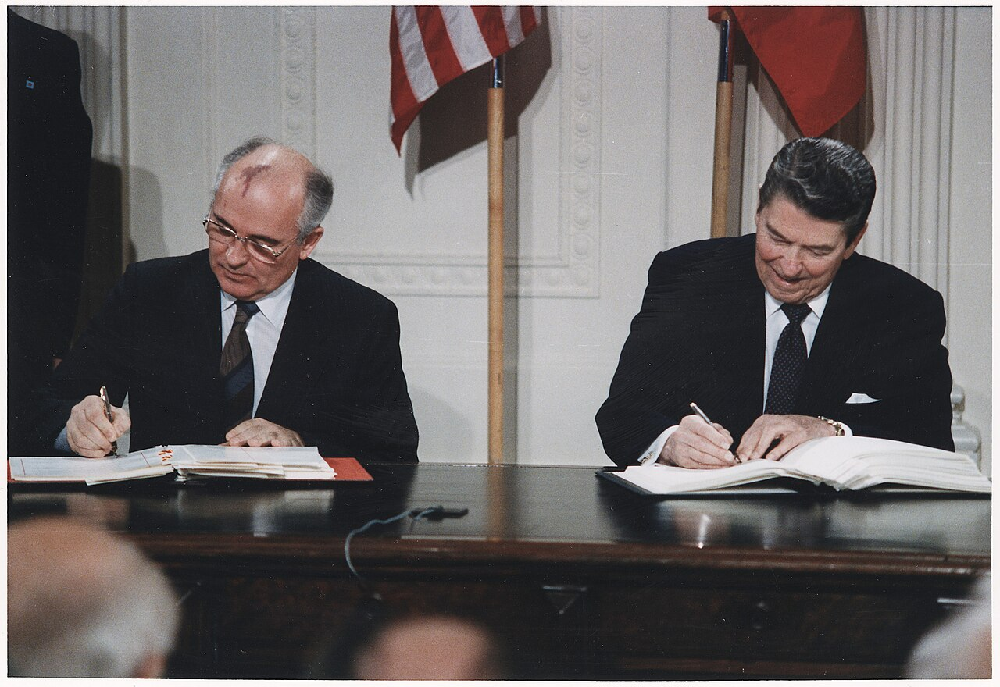
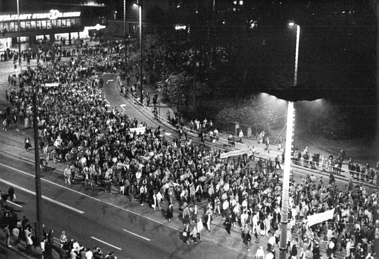
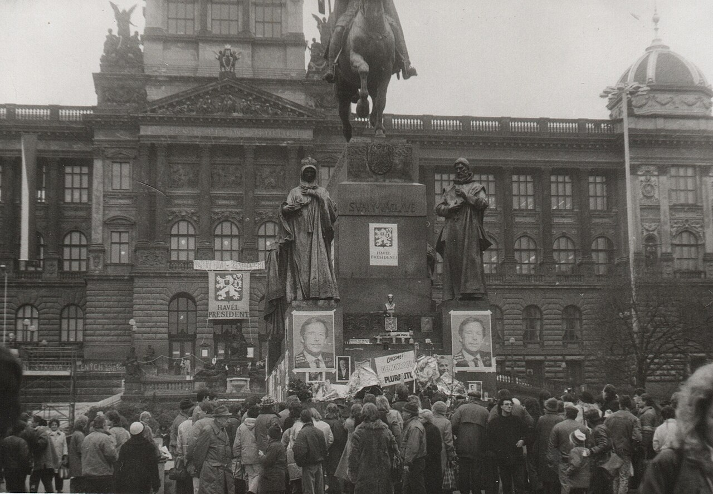
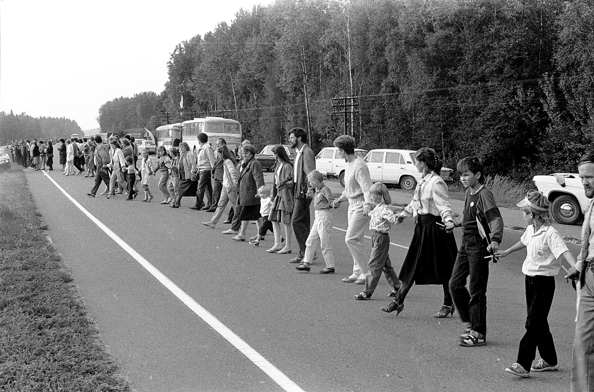
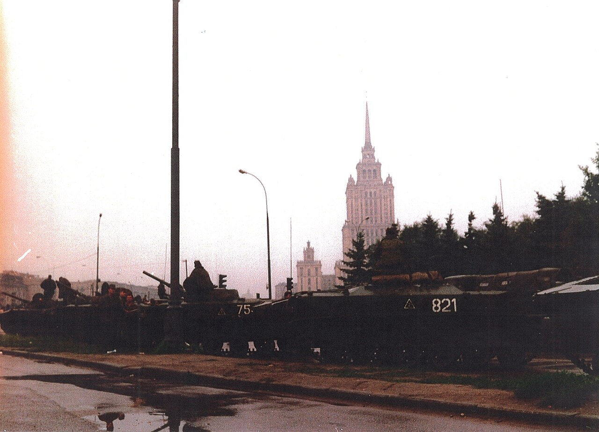

# 100. Why did the Soviet Union collapse?

*The Soviet Union and eastern Europe, from 1979 to 1999*

The Soviet Union collapsed because its planned economy could no longer feed its people decently or keep pace with its rival, and because the man who set out to repair it took away the two things that had held it together, which were fear and silence. Once people were allowed to speak, the nations inside the empire asked to leave, and he would not fight a war to make them stay.

At six o'clock on the evening of 9 November 1989, a tired official of the East German government sat down in front of the world's press in East Berlin for a routine briefing. The country was in turmoil. Tens of thousands of its citizens had fled to the West through Hungary that autumn, and hundreds of thousands were marching in its cities every week. That afternoon the leadership had drafted a new rule, meant to let off pressure, under which people could apply for permits to travel abroad. The idea was to open a valve slowly, under control.

Nobody had explained it to the spokesman, and that small failure set the night in motion. Near the end of a dull hour, he pulled a sheet of paper from his pile and read it out, frowning. East Germans, it said, could leave through any border crossing. A journalist called out to ask when this came into force. He shuffled his notes, found nothing, and shrugged. As far as I know, he said, immediately, without delay.

The briefing was being shown live, so East Germans heard the words at the same moment as the journalists. Within an hour, people were gathering at the crossing points in the Berlin Wall, holding up their identity cards. The guards had no orders. They telephoned their superiors, who could reach nobody. Meanwhile the crowds kept growing. By half past eleven the crowd at one gate had grown to twenty thousand, chanting, and the officer in charge, fearing that people would be crushed, opened the barrier on his own decision.

By midnight every crossing was open. Berliners from both sides climbed onto the wall with hammers and bottles of sparkling wine. It had stood for twenty-eight years, and people had been shot at its foot that same February.

*Berliners on top of the Wall at the Brandenburg Gate, November 1989. The sign below them reads: Attention! You are now leaving West Berlin. Photo: Sue Ream, CC BY 3.0.*

## Chandeliers by the ton

The system that was coming apart that night had been failing quietly for twenty years.

In the Soviet Union and its satellites, the communist states of eastern Europe that took their orders from Moscow, the market had been all but abolished. In its place stood the plan. A planning office in Moscow decided each year what every factory in the country would produce, from whom it would receive its materials, and what the price would be. That method had been good at building steel mills and tanks, which are few and simple to count. It was hopeless, however, at supplying the millions of different things that people actually want.

The trouble lay in how success was measured. A factory was judged by whether it met its target, and the target had to be expressed in something a planner could measure. Managers therefore made whatever hit the number, whether or not anybody could use it. The joke was that if nails were counted by weight, a factory made a few enormous ones, and if by number, it made tiny ones. Real cases were nearly as absurd. Khrushchev himself complained in public about chandeliers so heavy that they pulled down ceilings, because the lighting industry's plan was set in tons.

In such a system nobody was rewarded for making what a customer wanted, or punished for making rubbish, and the results were easy to see. Shoes piled up in warehouses in sizes that nobody could wear, while people queued for hours for sausages. Workers drew their own conclusion, and the saying among them was: they pretend to pay us, and we pretend to work.

Through the 1970s growth slowed to a crawl. The country that had sent the first man into space could not make a decent refrigerator, and was falling hopelessly behind the West in the new technology of computers. Worse, it had to buy grain from America to feed itself. It paid for the grain with oil and gas from Siberia, and for a decade high oil prices hid the rot. As long as the oil sold well, the bills could be met. Then, in 1986, the price fell by more than half.

Other burdens sat on top of this one. The army and its weapons took about a sixth of everything that the country produced, and from 1979 there was a hopeless war in Afghanistan. Vodka did the rest. The average Soviet man could expect to die at sixty-two, younger than his father had.

At the top, meanwhile, nothing moved. The leaders were the men who had risen under Stalin, and they would not go. The party chief died in 1982, visibly senile, at seventy-five. His successor lasted fifteen months, most of them on a kidney machine, and the next thirteen months, most of them unable to breathe. Soviet citizens joked about buying a season ticket to state funerals.

## Be not afraid

The crack that did not close opened in Poland, the largest of the satellites and the most restive.

In October 1978 the cardinals of the Catholic Church, to general astonishment, elected a Polish pope. The following June he came home on a visit. A third of the nation saw him in person over nine days, at open-air masses of a million people and more. He did not attack the government. Instead, he told the crowds not to be afraid. The real effect of the visit lay in the crowds themselves. For the first time since the war, Poles stood together in vast numbers, policed themselves, and saw how many they were.

The test came fourteen months later, when the government raised the price of meat, and strikes broke out across the country. In August the management of the great shipyard at Gdańsk, on the Baltic, sacked a crane driver who had been organising the workers, and the whole yard laid down its tools.

An unemployed electrician with a large moustache, Lech Wałęsa, climbed over the wall to join them and became their leader. They did not march out, since they remembered what the police had done to marchers ten years before. Instead, they locked themselves in and demanded the right to form a trade union that the party did not control. The government, astonishingly, agreed.

*The gate of the Lenin Shipyard in Gdańsk during the strike of August 1980, with people gathered outside. Photo: Jacek Awakumowski, CC BY-SA 3.0 pl.*

Within a year the union, which called itself Solidarity, had ten million members, more than a quarter of the whole population of the country. That made it an embarrassment as well as a threat. A state that claimed to rule in the name of the workers was being defied by the workers. In December 1981 the Polish army declared martial law, arrested the leaders, and drove the movement underground. It did not die.

## A man you can do business with

Meanwhile, in Moscow, the funerals had gone on. In March 1985 the old men there, having buried three of their number in twenty-eight months, chose the youngest among them. Mikhail Gorbachev was fifty-four. He came from a peasant family in the south. Both his grandfathers had been arrested under Stalin, and he had worked on a combine harvester as a boy before winning a place to study law in Moscow. He was quick, talkative and confident, and the British prime minister, who met him before his promotion, said that he was a man she could do business with.

He was a convinced communist. He meant to save the system, and he never intended what happened. He believed that socialism had been deformed by bureaucrats and lies, and that if people were given the truth and a say, they would work with a will. He had two words for his programme. One meant restructuring, and the other meant openness. Restructuring was to make the economy work, and openness was to let people say what was wrong with it.

His first reform showed how hard it was to change a country by order. To raise the productivity of labour he cut the production of vodka and tore up vineyards. People distilled their own, sugar vanished from the shops, and the state lost a tenth of its revenue.

## Reactor four

A little after one in the morning on 26 April 1986, during a badly run safety test, the fourth reactor of the nuclear power station at Chernobyl, in Ukraine, exploded. Its design had a flaw that its operators had never been told about. The blast blew the thousand-ton lid off the core and threw burning graphite onto the roofs. Firemen who went up to put it out, without protection, were dead within weeks. Meanwhile a cloud of radioactive dust rose a kilometre into the air and drifted north-west across Europe.

*The ruined fourth reactor at Chernobyl in the Ukraine, enclosed in its concrete shelter, in 2013. Photo: Clay Gilliland, CC BY-SA 2.0.*

The government's first response was the old one: it said nothing. The first that the world knew of it was two days later, when alarms went off at a nuclear plant in Sweden, eleven hundred kilometres away, and the Swedes traced the fallout back on the wind. Inside the country, the silence put people in danger. The town beside the reactor, with fifty thousand people, was not evacuated for thirty-six hours. In Kyiv, a hundred kilometres to the south, the May Day parade went ahead five days after the explosion, and children marched through the streets carrying flowers while the party leaders' own families were sent out of the city.

Gorbachev finally spoke on television after eighteen days. For him and for millions of his people, the accident was the proof of everything that was wrong. A system in which nobody dared report bad news had nearly poisoned half a continent. He wrote years later that Chernobyl, even more than his own reforms, was perhaps the real cause of the collapse.

*Apartment blocks in Pripyat, the town beside the reactor, empty since 1986 and now overgrown, with the arch built over the ruined reactor behind them. Photo: Hnapel, CC0.*

## Speaking

After Chernobyl, openness became real. Censorship was relaxed and then abandoned. As a result, newspapers and magazines printed the truth about Stalin's terror, the famine, the camps and the secret deal with Hitler, and their circulation rose into the tens of millions. Books that people had been jailed for owning were published.

The thaw reached even the regime's critics. The country's most famous dissident, the physicist who had designed its hydrogen bomb and then turned against the regime, had been banished to a closed city under police guard. In December 1986 a telephone was installed in his flat, and the next day it rang. It was Gorbachev, inviting him to come back to Moscow and resume his patriotic work. A man under police guard was being asked to help.

Next came the vote. In March 1989 the Soviet Union held an election in which, for the first time since 1917, voters choosing a national assembly had in many districts a choice of candidates. Party bosses who ran unopposed were defeated by voters crossing out their names. The new assembly was shown live on television, and for two weeks factories stood idle while the whole country watched deputies say things that had been unsayable for seventy years.

*Andrei Sakharov, the physicist and dissident, answering reporters at a conference of the Soviet Academy of Sciences, March 1989. Photo: Vladimir Fedorenko, RIA Novosti, CC BY-SA 3.0.*

Gorbachev had counted on gratitude. He had not reckoned with what people would say when they could. They did not ask for a better socialism. They asked why they were poor, who had lied to them, and by what right the party ruled at all.

## My way

Abroad he was ending the Cold War almost single-handed. Here too money mattered. He needed to cut the cost of the arms race, and in the American president, an old enemy of communism who had a horror of nuclear weapons, he found a partner. At a meeting in Iceland in 1986 the two came within a sentence of agreeing to scrap all their nuclear arms. They did not get there, but the following year they signed a treaty that destroyed a whole class of missiles. He also pulled the army out of Afghanistan.

*Mikhail Gorbachev and President Reagan signing the treaty that banned medium-range missiles, in the East Room of the White House, 8 December 1987. Photo: US National Archives, public domain.*

Closer to home, he let it be known that the Soviet Union would no longer send tanks to keep the governments of eastern Europe in power, as it had done in 1956 and again in 1968. His spokesman, asked on American television what had replaced the old policy, said that it was the Frank Sinatra doctrine, after the singer's song "My Way". Each country could do it its way.

Those governments had never had anything else to stand on, and once the tanks were off the table they began to give way. In Poland the generals sat down with Solidarity and agreed to a partly free election. It was held on 4 June 1989, and Solidarity won ninety-nine of the hundred seats in the new upper house.

Hungary, meanwhile, cut a hole in the fence between East and West. In May the Hungarian government had begun to take down the barbed wire on its border with Austria, and in September it opened the frontier to the East Germans who had gathered there on holiday. That was the route by which so many fled that autumn.

Inside East Germany, meanwhile, the protests were swelling. On 9 October seventy thousand people marched in the East German city of Leipzig, carrying candles and chanting: we are the people. The hospitals had been told to prepare for gunshot wounds. Eight thousand armed police and soldiers were waiting, and the order to fire did not come. Without it, the government had no answer to the crowds. A month later the wall was open.

*The Monday demonstration in Leipzig on 23 October 1989, two weeks after the march of 9 October. Photo: Friedrich Gahlbeck, German Federal Archive, CC BY-SA 3.0 de.*

After that the fall spread south. In Prague, students were beaten by police on 17 November, and within ten days hundreds of thousands of people were jingling their keys in the main square to tell the government that it was time to go home. On 29 December a playwright who had been in prison in the spring was president of Czechoslovakia. Only in Romania was there serious bloodshed. Its dictator was booed at his own rally on live television, fled by helicopter from the roof, and was caught, and he was shot with his wife on Christmas Day.

*Wenceslas Square in Prague in 1989, with portraits of Václav Havel and banners calling for him to be president. Photo: Pavel L., CC BY-SA 4.0.*

Six governments had fallen in six months. Within a year East Germany had ceased to exist, absorbed into the West, and Soviet troops were packing to go home.

## A chain of hands

The satellites had been the outer ring. Inside lay a second ring, because the Soviet Union was itself an empire, the old Russian empire under another name. Russians were half its population. The rest belonged to more than a hundred peoples, organised in fifteen republics, each with its own language and its own memory of how it had been brought in.

![Two maps. Above, eastern Europe and the western Soviet Union: the six satellite states, East Germany, Poland, Czechoslovakia, Hungary, Romania and Bulgaria, shaded blue and each marked 1989; the Soviet republics shaded red and marked with the year each declared independence, Lithuania 1990, in a darker red, and Estonia, Latvia, Belarus, Ukraine, Moldova, Georgia, Armenia, Azerbaijan and Russia 1991. Berlin, Leipzig, Gdańsk, Prague, Moscow, Kyiv, Chernobyl and Vilnius are marked, with the Crimea and Chechnya, and a triangle on the Polish border marks the forest lodge where the Union was dissolved in December 1991. Below, Central Asia: Kazakhstan, Uzbekistan, Turkmenistan, Kyrgyzstan and Tajikistan, each marked 1991, with Russia running on east to the Pacific](images/map_breakup.png)
*The six satellite states, marked with the year in which communist rule ended, and the fifteen Soviet republics, with the year in which each declared itself independent; below, the republics of Central Asia. Map: drawn for this book; coastlines and rivers from Natural Earth, public domain.*

The three small Baltic nations had been independent between the wars and were seized by Stalin in 1940 under his pact with Hitler. On the fiftieth anniversary of that pact, in August 1989, two million of their people joined hands in a human chain six hundred and seventy-five kilometres long, across all three countries. The next spring Lithuania declared itself independent.

Elsewhere, old quarrels and new protests turned to bloodshed. In the Caucasus, Armenians and Azerbaijanis began fighting over a disputed mountain district. In Georgia, soldiers killed twenty demonstrators with shovels and gas.

*People holding hands on the road between Vilnius and Ukmergė during the Baltic Way, 23 August 1989. Photo: Saulius Gruodis, Lithuanian State Central Archives, CC BY 4.0.*

Gorbachev was caught between two fires. In January 1991 Soviet troops stormed the television tower in the Lithuanian capital and killed fourteen unarmed people, and he neither admitted giving the order nor punished those who had. He had lost the reformers, and the hardliners despised him.

Meanwhile the economy was in free fall. His half-measures had broken the old system of commands without putting a market in its place. Factory managers had been given the freedom to decide what to make and what to pay, while prices were still fixed by the state. As a result, they made what suited them and raised wages that there was nothing to spend on. Factories stopped delivering to one another. By the winter of 1990 the shops of Moscow were bare, and sugar, soap and matches were rationed.

A rival had risen in Russia itself, which was the largest of the fifteen republics and had its own parliament in Moscow, a few streets from the Kremlin. Boris Yeltsin was a burly, hard-drinking former party boss whom Gorbachev had sacked for demanding faster change. In June 1991 the people of the Russian republic elected him their president. He was the first leader of Russia to be chosen by its voters, and Gorbachev had never faced the voters at all. Yeltsin could claim to speak for the people, and Gorbachev could not.

## Swan Lake

On 19 August 1991 Russians turned on their televisions and found every channel showing the ballet *Swan Lake*. It was what the stations had broadcast when the old leaders died, so viewers took it as a sign that something had happened at the top.

Gorbachev was on holiday in the Crimea. The evening before, the head of the secret police, the minister of defence and the vice-president had cut his telephones and put him under guard. He had been due to sign, two days later, a treaty that would hand most of the central government's powers to the republics, and the plotters meant to stop it. They announced that he was ill and that a committee had taken power to save the country. Columns of tanks rolled into Moscow.

The plotters, however, had left Yeltsin free, and it was a fatal mistake. He drove to the white marble building that housed the Russian parliament, walked out to one of the tanks that had been sent to surround it, climbed onto it, and read a statement calling the takeover a crime. The tank crew did not stop him. Tens of thousands of Muscovites came to ring the building with barricades of trolleybuses and scrap iron, and stood there through two nights in the rain.

*Armoured vehicles at the Russian parliament building in Moscow, 20 August 1991, the second day of the coup. Photo: Ole Husby, CC BY-SA 2.0.*

The plotters, meanwhile, were losing their nerve. The committee held a press conference at which the hands of its chairman shook so badly that the whole country could see that he was drunk or terrified. Its commanders were ordered to storm the parliament and declined. Three young men died in a clash with armoured cars in an underpass. On the third day the tanks drove out of the city.

Gorbachev flew home to find that power had moved, from the Kremlin to the man who had stood on the tank. Yeltsin suspended the Communist Party on Russian soil with a stroke of the pen, live on television, while Gorbachev stood beside him protesting. In the square outside the headquarters of the secret police, a crane lifted the statue of its founder off its pedestal.

## A lodge in the forest

With the centre discredited, one republic after another now declared its independence. The decisive vote came on 1 December in Ukraine, the second largest, with fifty million people. Nine in ten voted to leave, and so did a majority in every one of its regions, including the Crimea and the Russian-speaking east.

A week later Yeltsin met the leaders of Ukraine and Belarus at a hunting lodge in a forest near the Polish border. They signed a short agreement stating that the Soviet Union, as a subject of international law and a geopolitical reality, had ceased to exist. Yeltsin telephoned the American president with the news before anyone told Gorbachev.

On the evening of 25 December 1991 Gorbachev read a short statement to the camera and resigned from an office that no longer had a country. He signed away control of twenty-seven thousand nuclear weapons. At 7.32 the red flag with the hammer and sickle was lowered from its pole above the Kremlin for the last time, and the white, blue and red flag of Russia went up. Few people were in the square to watch.

Fifteen new countries appeared on the map. Twenty-five million Russians woke up as foreigners in other people's states. An empire of nearly three hundred million people, with the largest army on Earth, had been wound up at its centre without a shot. Empires had seldom gone so quietly.

## The nineties

For most Russians the decade that followed was worse than anything they had known since the war.

Yeltsin's young ministers believed that the only cure was to create a market at once, not in the half-measures that had failed under Gorbachev. On 2 January 1992 prices were set free. They rose twenty-five-fold in a year. For ordinary savers that meant ruin: the savings of a lifetime would no longer buy a pair of boots. Professors drove taxis. Pensioners stood in the street selling their medals and their kitchenware. The country's output fell by two fifths, further than America's had in the Depression. The strain showed in people's bodies. By 1994 the life expectancy of a Russian man had fallen to fifty-seven.

The factories, mines and oilfields that had belonged to the state were sold. In principle everyone was to share in them. Every citizen was given a voucher for a share, and most sold theirs for the price of a few bottles of vodka. In 1995 the government, desperate for cash, handed the richest oil and metal companies to a handful of bankers in rigged auctions, for a fraction of their worth. A country in which nobody had been allowed to own a business ten years before now had some of the richest men in the world.

Democracy fared little better. Yeltsin himself turned tanks on his own parliament in 1993, when it defied him, and fought a savage and unsuccessful war to stop the small Muslim region of Chechnya from leaving Russia. To many Russians the words democracy and market came to mean theft and humiliation.

Abroad, the humiliation had another face. The alliance that had been formed against the Soviet Union took in Poland, Hungary and the Czechs.

On the last day of 1999 Yeltsin, ill and exhausted, resigned and handed the presidency to his prime minister, a former officer of the secret police who had been stationed in East Germany on the night the wall opened. Vladimir Putin later called the collapse of the Soviet Union the greatest geopolitical catastrophe of the century.

Gorbachev lived on in Moscow for thirty more years, admired almost everywhere except at home. When he stood for president of Russia in 1996, he received half of one per cent of the vote.

On that Christmas night in 1991, when he sat down to sign the decree giving up his office, his own pen would not write. The head of an American television network, whose crew was filming the scene, leaned over and offered his. The last decree of the last Soviet leader was signed with it.
