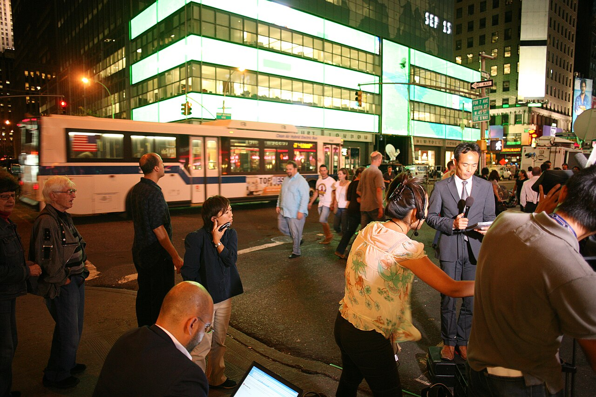
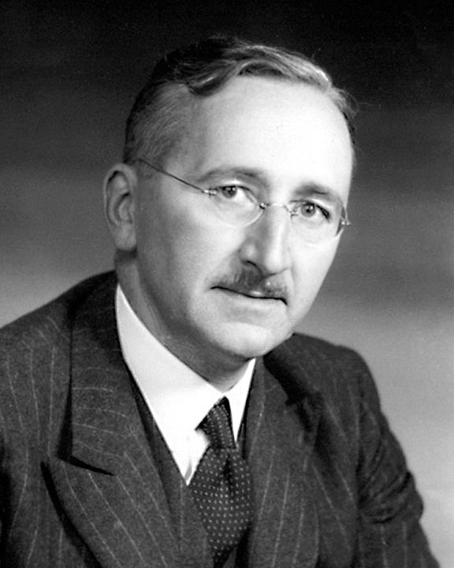
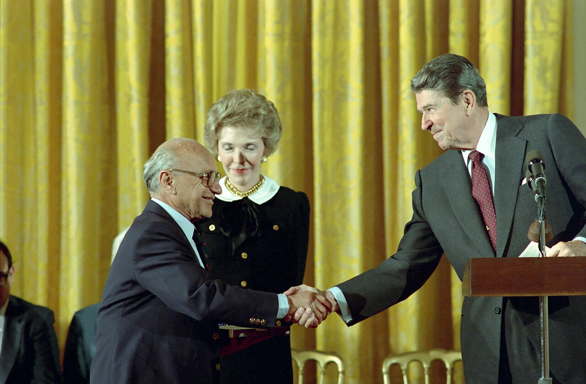
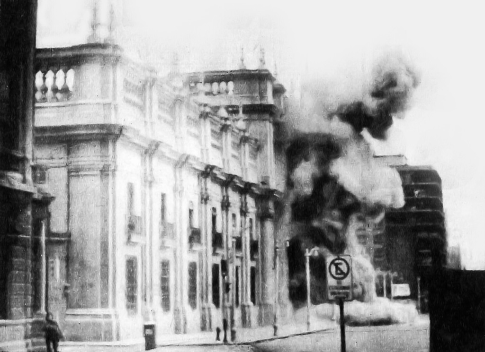
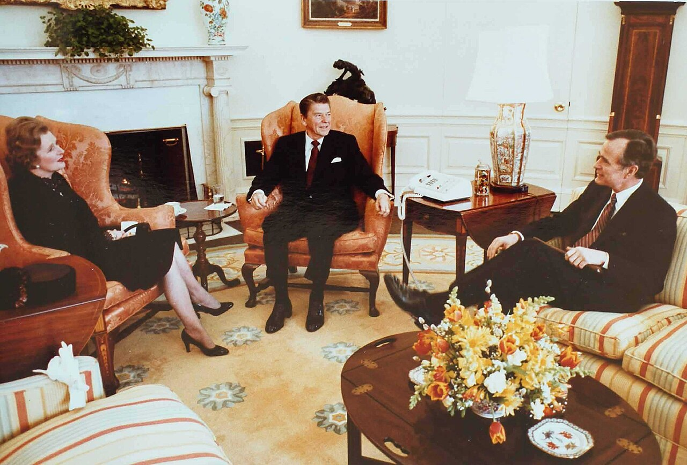
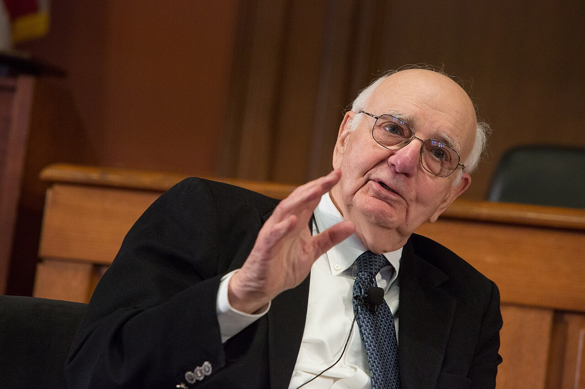
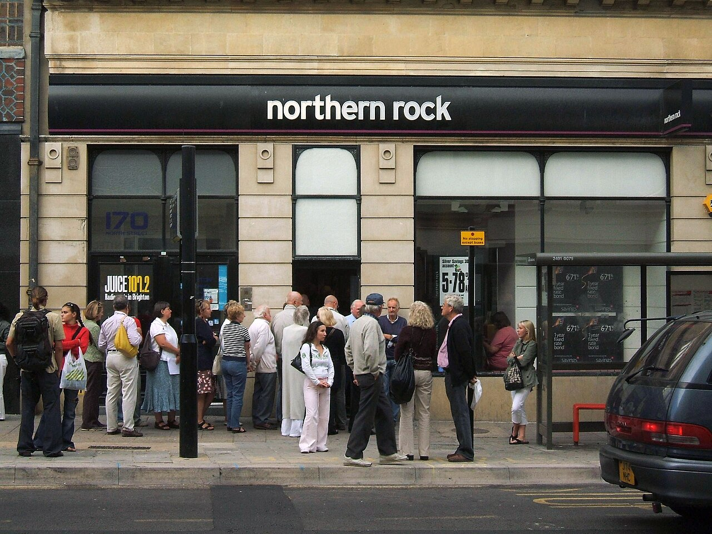
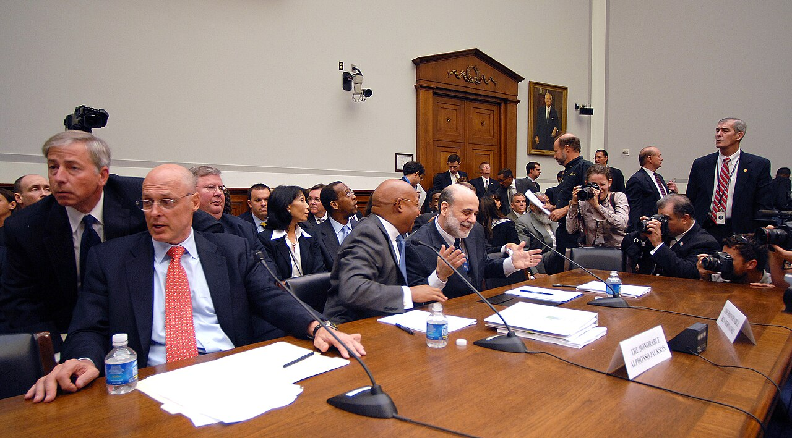
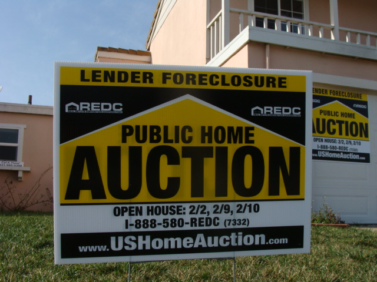
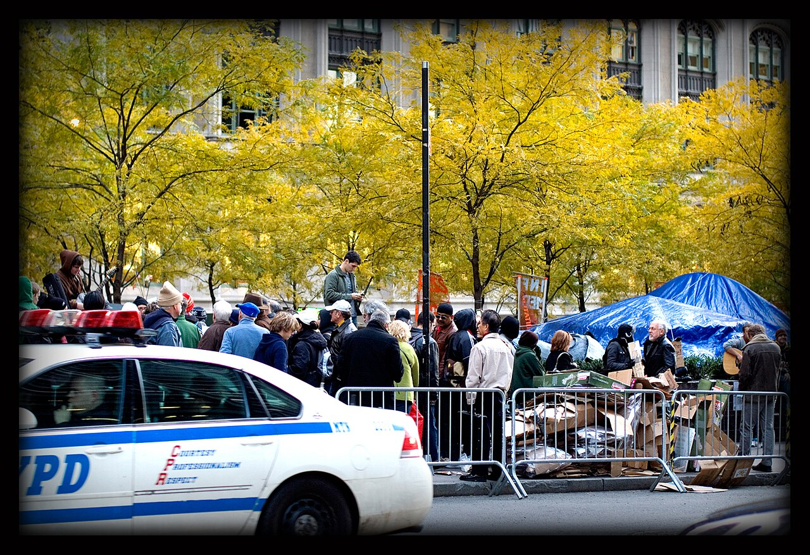

# 102. What caused the financial crisis of 2008?

*The United States, Britain and the world, from 1973 to 2012*

The crisis was caused by banks that lent enormous sums to people who could not repay them, sold those loans on to investors all over the world as if they were safe, and borrowed thirty times their own capital in order to do it. They were able to because, over the previous thirty years, governments had come to believe that markets could be trusted to look after themselves, and had taken away many of the rules.

On the morning of Monday, 15 September 2008, the staff of an investment bank called Lehman Brothers arrived at its glass tower in the middle of New York and were told to clear their desks. They came out through the revolving doors past the television cameras, carrying cardboard boxes with their family photographs and pot plants. The firm was a hundred and fifty-eight years old. It had survived the American civil war and the Depression. Now it owed more than six hundred billion dollars, and it was the largest bankruptcy in history.

*The Lehman Brothers building in Times Square, New York, on the night of 15 September 2008, the day the bank failed, with television crews working on the pavement. Photo: Robert Scoble, CC BY 2.0.*

The American government had spent the weekend looking for another bank to buy it, had found none, and had let it fail. Within hours it was plain that this had been a mistake.

Lehman had dealings with a great many other firms. No bank could be sure which others were owed money by Lehman, or which were in the same condition. A bank that cannot tell whether its neighbour will survive the week does the safe thing and keeps its cash, and so banks all but stopped lending to one another.

The panic then spread outwards from the banks. The next day the largest insurance company in the world had to be taken over by the state. An ordinary savings fund, of the kind that Americans treated as equivalent to cash, announced that it could not pay its investors in full, and people began pulling their money out of all such funds. Before long, companies with perfectly sound businesses found that they could not borrow to pay that week's wages.

On the Thursday evening the head of the American central bank, Ben Bernanke, and the treasury secretary went to see the leaders of Congress. They asked for hundreds of billions of dollars to rescue the banks. One of the politicians asked what would happen if they refused. If we don't do this, Bernanke said, we may not have an economy on Monday.

## The winter of discontent

For thirty years after the war the rich democracies were run on the lessons of the Depression. The chief lesson was that markets left alone could collapse, and that the state had to stand ready to hold them up.

That idea shaped almost everything. Governments spent in bad times to keep people in work. Trade unions were strong. Taxes on high incomes were very heavy, as much as ninety per cent at the top. Banks were tightly regulated, and money could not be moved freely from one country to another. Many states owned the railways, the mines, the power stations and the telephone system. These were the years of the fastest and most widely shared growth that those countries have known.

In the 1970s it stopped working. Prices had been creeping up since the late 1960s. Then the price of oil quadrupled, and prices of everything else began to climb faster. Unions demanded pay rises to keep up, and those rises pushed prices higher still, so that each turn of the wheel fed the next. In Britain inflation reached nearly twenty-five per cent a year.

At the same time, and far more puzzling to the experts, unemployment rose. According to the accepted theory this could not happen. Inflation was supposed to be the price of full employment, and a little unemployment the cure for inflation, so the two were meant to move in opposite directions. Now both were bad at once, and the usual remedies made things worse. Governments tried spending more, and prices rose faster. They tried controlling wages by law, and the unions struck.

Britain, which had invented the industrial economy, became the example that everyone pointed to. In 1976 it had to ask for an emergency loan from the International Monetary Fund, like any bankrupt. Three years later the disorder reached the streets. In the first weeks of 1979 the lorry drivers, the hospital porters and the dustmen all went on strike. Rubbish was piled high in the squares of central London, and in one northern city the gravediggers refused to bury the dead.

## Two professors

A different explanation had been waiting for thirty years.

In 1944 an Austrian economist living in London, Friedrich Hayek, published a short book arguing that the planned economy, however well meant, led by stages to tyranny. His deeper point was about knowledge.

Picture an economy as millions of people, each of whom knows something that nobody else does: what he wants, what he can make, what he would give up for it. No office of planners can gather all of that. Prices, however, can. When the price of tin rises, everyone who uses tin economises on it, without needing to know why. The price carries the message for them. Interfere with prices, Hayek said, and you blind the whole system.

*The economist Friedrich Hayek, in a portrait released by the Mises Institute. Photo: Mises Institute, CC BY-SA 3.0.*

His American ally was Milton Friedman, a small, combative professor at Chicago and a gifted debater. Where Hayek wrote about knowledge, Friedman went straight at the problem of rising prices. He argued that inflation had one cause, which was governments creating too much money. Attempts to buy lower unemployment with a little inflation would work only for as long as people were fooled. Once they learned to expect rising prices, the trick would need a larger dose. The remedy was to control the supply of money, cut taxes and regulations, sell what the state owned, and leave the rest to free choice.

For decades the two men were treated as cranks. Then the 1970s made their warnings look like forecasts, and in that decade each was given the Nobel prize.

*Milton Friedman shaking hands with President Ronald Reagan, with Nancy Reagan beside them, at the White House on 17 October 1988, when Friedman received the Presidential Medal of Freedom. Photo: White House Photographic Office, public domain.*

Their ideas were first tried in an unhappy place. On 11 September 1973 the armed forces of Chile, with the encouragement of the United States, overthrew an elected socialist president, who died in the palace as it was bombed. The general who took power had about three thousand of his opponents killed.

Having seized the state, he needed someone to run its economy. He handed it to a group of Chilean economists who had studied under Friedman at Chicago. They cut tariffs, sold off state firms and privatised the pension system. The experiment showed that free markets did not need free politics, which troubled some of the school's followers more than others.

*La Moneda, the presidential palace in Santiago, with smoke rising from it during the bombardment of 11 September 1973. Photo: Biblioteca del Congreso Nacional de Chile, CC BY 3.0 CL.*

## There is no alternative

The ideas reached the rich democracies by the ballot box rather than by a coup. In May 1979 the British elected a grocer's daughter named Margaret Thatcher. At a meeting of her party's researchers she had once pulled a book by Hayek from her bag, banged it on the table and said: this is what we believe.

Her first target was inflation, and she set out to break it by making money scarce. Interest rates were pushed to seventeen per cent. Borrowing became very expensive, and many firms could not survive it. As a result, British manufacturing shrank by a seventh in two years, and unemployment passed three million, the highest since the 1930s. She did not change course. There is no alternative, she said, so often that it became her nickname.

Then she turned on the unions. In 1984 the coal miners, the strongest of them, struck against the closure of pits. She had stockpiled coal for the purpose, so that the country could keep its lights on without them. After a year of pitched battles between pickets and police, the miners went back with nothing.

Alongside the fight with the unions, she set about shrinking the state itself. She sold the state telephone company, the gas, electricity and water industries, the airline and the steelworks to the public as shares, and a million and a half council houses to their tenants. Meanwhile the top rate of income tax fell from eighty-three per cent to forty. In 1986 the rules that had governed the financial district of London for a century were swept away in a day.

*Prime Minister Margaret Thatcher with President Ronald Reagan and Vice-President George Bush at the White House on 26 February 1981. Photo: White House Photographic Office, public domain.*

Across the Atlantic the same programme arrived at almost the same moment. In the United States, Ronald Reagan, a former film actor, took office in 1981 with the words that government was not the solution to the problem. Government was the problem.

He showed early on what that meant for organised labour. When the country's air traffic controllers went on strike, he dismissed eleven thousand of them and barred them from being rehired. He also cut the top rate of tax from seventy per cent to twenty-eight. The head of the central bank, Paul Volcker, had meanwhile raised interest rates to twenty per cent, and unemployment rose to one worker in ten.

*Paul Volcker, who ran the American central bank from 1979 to 1987, speaking in 2012. Photo: Edmond J. Safra Center for Ethics, CC BY 2.0.*

It worked, on its own terms. Inflation fell from thirteen per cent to four and stayed down. Growth returned.

The cost, however, did not fall evenly. The price was paid by the industrial towns, and by a change in who received the rewards. In 1980 the richest hundredth of Americans took a tenth of the national income. By 2007 they took more than a fifth, which was the same share as in 1928, on the eve of the last great crash.

*The share of all income taken by the richest one per cent of American families, 1913 to 2017: income before tax, as reported on tax returns, including capital gains. Chart: drawn for this book; data from Thomas Piketty and Emmanuel Saez, updated by Saez to 2018, table A3.*

## Adjustment

The poorer countries received the new doctrine as a condition.

Their troubles began with a flood of easy money. During the 1970s the banks of New York and London, flush with the deposits of the oil states, had lent hundreds of billions to the governments of Latin America and Africa at interest rates that moved with the market. When American rates went to twenty per cent, the cost of those loans rose with them, and the debts became unpayable. In August 1982 Mexico announced that it could not meet its payments, and within a year forty countries were in the same position.

The international fund lent them the money to keep paying the banks, but on terms. They were to cut public spending, end subsidies on food and fuel, sell state companies, and open their markets to foreign goods and capital. The cuts to subsidies hit the poor first, because they raised the price of bread. Bread riots followed in a dozen capitals.

The results were bleak. In Latin America the 1980s are called the lost decade, and the average person there was poorer at its end than at its beginning. In much of Africa governments began charging fees for schools and clinics that had been free.

Elsewhere the same policies were adopted from choice, and with better results. In 1991 India, which had kept its economy behind high walls and a maze of permits since independence, ran out of foreign currency and had to fly its gold reserves to London as security for a loan. Its finance minister used the crisis to abolish most of the permits and open the country to trade, and India grew faster over the next thirty years than it ever had.

By the 1990s the argument seemed to be over. With the collapse of the Soviet Union, there was no rival model left. An American scholar had already suggested that mankind had reached the end of history. Even parties of the left adopted the new consensus as their own. The era of big government, an American president of the centre-left announced in 1996, is over.

## The elephant

Taken across the whole world, the thirty years after 1980 were the best that the poor had known. Between 1981 and 2015 the share of humanity living in extreme poverty fell from more than two in five to one in ten. Most of that happened in China and India, where hundreds of millions of people moved from the fields to factories and offices that sold to the world.

The picture changes, however, when the gains are set side by side.

If the gains of the twenty years to 2008 are plotted for every level of income on Earth, from the poorest to the richest, the line has the shape of an elephant. It rises over a great back, where the new middle classes of Asia nearly doubled their incomes. It drops into a trough, where the working people of the old industrial countries are found, and where incomes barely moved. At the far end, it shoots up the raised trunk, where the incomes of the very richest rose by nearly two thirds.

Factory workers in the old industrial countries were told that the system was working. For them it was not, and they had been getting by on borrowed money.

## Setting finance free

No industry gained more from the new freedom than banking.

After the crash of 1929, the United States had passed a law separating two kinds of bank. Ordinary banks, which took deposits from the public and were insured by the government, were forbidden to gamble on the markets. Investment banks could take risks, with their own partners' money. The point was to keep a family's savings away from a trader's bets.

In 1999 that barrier was removed. The following year Congress passed another law exempting from regulation a new and fast-growing class of financial contracts, which were in effect bets on whether a borrower would repay. The head of the central bank through those years, Alan Greenspan, a disciple of the free-market school, held that banks could be trusted to manage their own risks, since no bank would wish to destroy itself.

The key to a banker's profit is borrowed money. A bank that buys a hundred dollars of assets with ten dollars of its own and ninety borrowed makes ten times the return on its own money if the assets rise. The same multiplier, however, works just as hard on the way down.

By 2007 the great investment banks were borrowing more than thirty dollars for each dollar of their own. At that ratio, a fall of three per cent in the value of what they held would wipe them out.

Those who ran them had little reason to care. They were paid bonuses each year on that year's profits, in tens of millions of dollars. If the bets later went wrong, the losses would fall on the shareholders, or on someone else.

## How a mortgage became a bond

The bets were on American houses.

In the old way of things, a bank that lent a family the money to buy a house kept the loan for thirty years. If the family failed to pay, the bank lost the money, and so it took care to lend only to people who would pay it back.

By 2000 this had changed. The bank, or more often a broker working on commission, made the loan and at once sold it to an investment bank in New York. The broker was paid for each loan signed, and had no further interest in what happened to it. The broker who judged whether a family could afford a house lost nothing if it could not.

The investment bank gathered several thousand such loans into a pool, and sold investors the right to the monthly payments flowing out of it. It also kept a good many of those rights itself, bought with money borrowed for a day or a week at a time.

The selling was done in layers, which is where the cleverness lay. The top layer had the first claim on the money, and would lose nothing unless a very large share of the borrowers stopped paying. The bottom layer took the first losses and paid a higher return. Picture a stack of bowls under a tap, each spilling over into the one below: the top bowl fills first, and when the flow weakens, the bottom one is the first to go dry.

The layers then had to be graded. Rating agencies, whose job was to judge the safety of investments, and who were paid by the banks whose products they judged, stamped the top layers with their highest grade, the grade given to the debt of the American government. In 2008 a dozen companies in the whole world held that grade. Tens of thousands of these mortgage bonds did.

The reasoning was that house prices had never fallen across the whole of the United States at once. If prices dipped in one city, they would hold up in another. Thousands of borrowers in different cities would not all default together.

Once the bonds carried the top grade, buyers came from everywhere. Pension funds in Norway, banks in Germany and town councils in Australia bought the bonds. Demand was so great that the machine ran short of mortgages.

The brokers then lent to anyone. Loans were made without any check on the borrower's income, with payments set low for the first two years and then rising steeply. In California a strawberry picker who earned fourteen thousand dollars a year and spoke no English was lent more than seven hundred thousand to buy a house. Loans to people with poor records of repaying were called subprime, and by 2006 they were a fifth of all new American mortgages. House prices had doubled in nine years, which seemed to prove that nobody could lose.

The last step was insurance. For a fee, the largest insurance company in the world guaranteed these bonds against loss, to the value of several hundred billion dollars. It put aside nothing to cover the guarantees, since its models said that they would never be called on.

The fine print made that gamble far more dangerous than it looked. The contracts required it to hand over cash as soon as the bonds lost value, long before any final loss. A fall in prices alone, before a single house was sold at a loss, could drain it.

![Diagram in five numbered steps of how house loans became bonds. Left, rows of small houses stand for several thousand loans made by brokers who are paid for each loan signed. Arrows lead into a tank marked the pool, gathered by an investment bank. A green arrow of monthly payments runs from the pool to a stack of three layers: a tall top layer, paid first, which loses nothing unless very many families stop paying, stamped highest grade; middle layers; and a thin bottom layer, which takes the first losses and pays more. Beside the stack, the money is paid out from the top down and losses strike from the bottom up. Arrows lead from the stack to pension funds in Norway, banks in Germany, town councils in Australia and the investment bank itself, using money borrowed for a day or a week. A box notes that an insurance company guarantees the bonds and sets nothing aside](images/diagram_mortgage_bond.png)
*How a pile of house loans became a top-rated bond: the payments of several thousand borrowers were pooled and sold in layers, the top layer paid first and given the same grade as the American government's debt, the bottom layer taking the first losses. Not to scale. Diagram: drawn for this book.*

## The year it stopped

The whole structure rested on the assumption that house prices would not fall everywhere at once. House prices stopped rising in 2006. In 2007 they began to fall, across the whole country.

The families at the bottom felt it first. The low opening payments ran out, and the bills rose steeply. Borrowers who had counted on selling at a profit could not sell at all, and they stopped paying.

Now the cleverness of the system turned against it. The bad loans had been chopped up and repackaged so many times that nobody could say where the losses lay. As a result, any bank might be hiding them. A bank could not know whether the bank across the street was sound, and would no longer lend it the overnight money on which they all depended.

The failures came one after another over the following year. In August 2007 a French bank froze three of its funds because it could not put a value on them. In September depositors queued round the block outside a British mortgage lender to take out their savings, in the first run on a British bank for a hundred and forty years. In March 2008 one of the five great American investment banks collapsed in a week and was sold to a rival for a tenth of its value. In September it was Lehman's turn.

*Savers queueing outside a branch of Northern Rock in Brighton on 14 September 2007. Photo: Dominic Alves, CC BY 2.0.*

## Not 1931

What happened next was different from the first years of the Depression, and the reason was that the men in charge had studied them. Bernanke had made his name as a historian of the Depression, and he knew what it had cost to let the banks go down.

*Treasury Secretary Henry Paulson (left) and Federal Reserve chairman Ben Bernanke (centre) at a House hearing on the mortgage crisis, 20 September 2007. Photo: David Valdez, U.S. Department of Housing and Urban Development, public domain.*

This time the governments did the opposite of what had been done in 1930 and 1931. Then, the banks had been left to fail and governments had tried to balance their books. Now they put public money into the banks, on a scale without precedent, and guaranteed their debts. Central banks cut interest rates to nothing and then created money by the trillion to buy bonds. Governments borrowed and spent. China, whose exports had fallen off a cliff, launched a vast programme of building.

It worked, in the sense that mattered most. There was no second Great Depression. There was, however, the worst slump since the first one. World trade fell by an eighth in a year. In the United States nearly nine million jobs disappeared, and several million families lost their homes.

*A foreclosure auction sign outside a house in Salinas, California, in February 2008. Photo: Brendel, CC BY-SA 3.0.*

The rescue left a taste that has not gone away. The banks had been saved with the money of taxpayers who were themselves losing their jobs and houses. Meanwhile the bankers kept the fortunes that they had made in the good years, and the firms that had been bailed out paid billions in bonuses for 2008 itself. In the United States no head of a large Wall Street bank was prosecuted.

To many people it seemed that the free market had been allowed to keep its profits, while its losses had been handed to the public.

## The ninety-nine per cent

The crisis did not end with the banks. Next it moved on to governments. At the end of 2009 it emerged that Greece had been borrowing far more than it had admitted.

The other European states lent it the money to pay its creditors, most of them French and German banks. In effect, the loan passed through Greece on its way to the banks. In return Greece had to cut wages, pensions and public services by amounts that no rich country had attempted in peacetime. A quarter of Greek workers, and half of the young people looking for work, were left without jobs.

In the United States the anger took a different form. In September 2011 a few hundred people pitched tents in a small park near the New York stock exchange. Their slogan was that they were the ninety-nine per cent, and the one per cent they had in mind were the richest hundredth of Americans. The camp was cleared after two months.

The feeling behind it, however, outlasted the tents. It spread to left and right alike, and within five years voters in Britain and America, in the towns that had lost their factories, had turned against the parties, the experts and the open borders of the previous thirty years.

*The Occupy Wall Street camp in Zuccotti Park, New York, on 11 November 2011. Photo: Debra M. Gaines, CC BY 3.0.*

The experts themselves had been caught out as badly as anyone. In November 2008 Queen Elizabeth went to open a new building at the London School of Economics. A professor showed her a set of charts explaining the collapse. She listened, and asked a question that the professors found hard to answer. If these things were so large, she said, how come everyone missed them?

A group of Britain's leading economists met to consider it, and the following summer they sent her a letter of three pages. Everyone had seemed to be doing their own job properly, they wrote. The failure to foresee the crisis was principally a failure of the collective imagination of many bright people, to understand the risks to the system as a whole.
