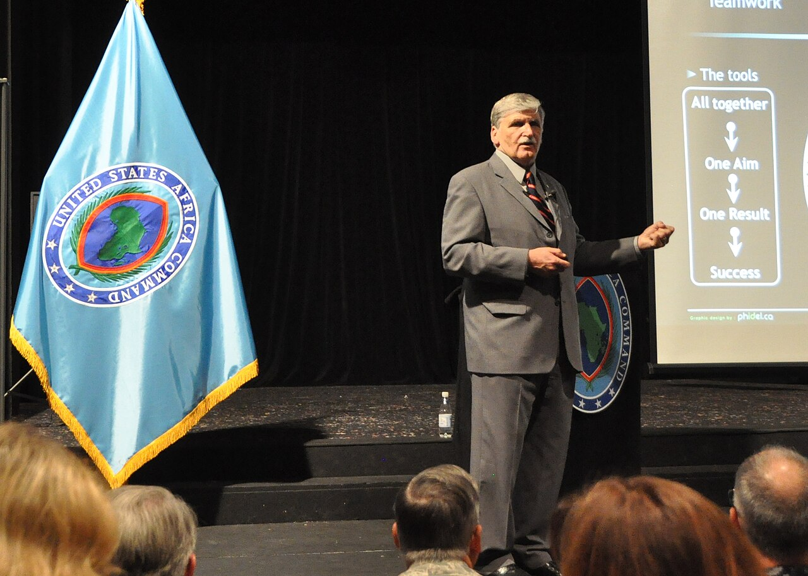
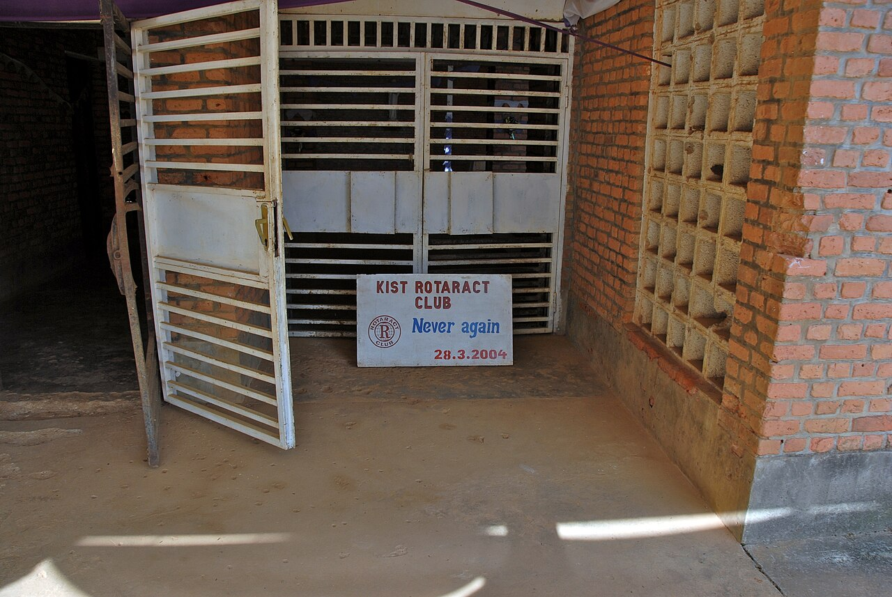
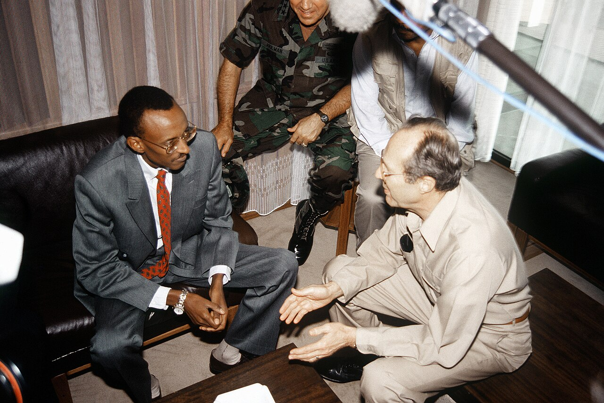
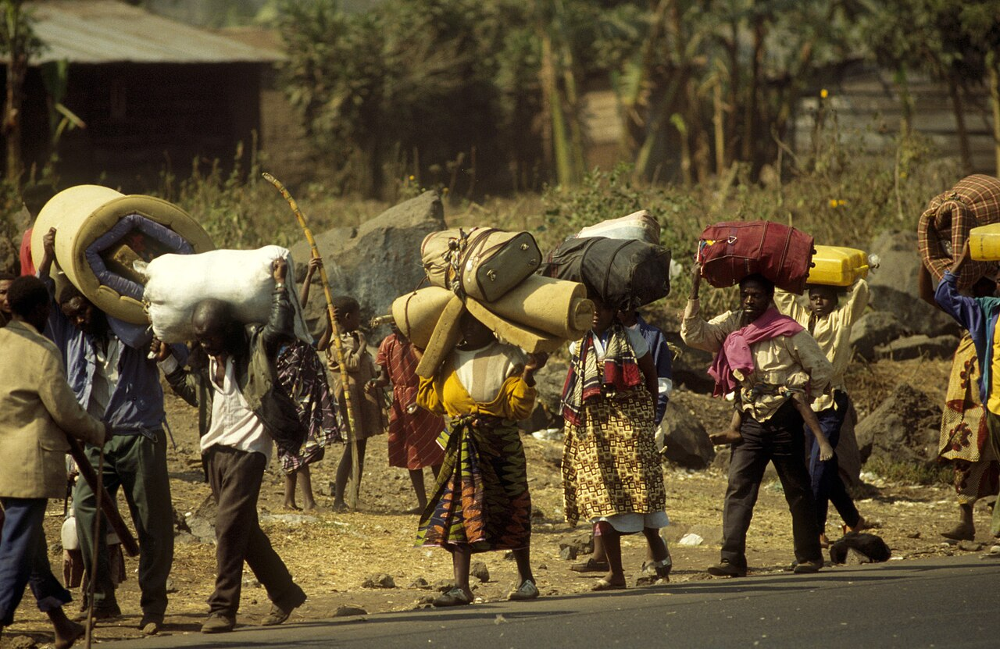
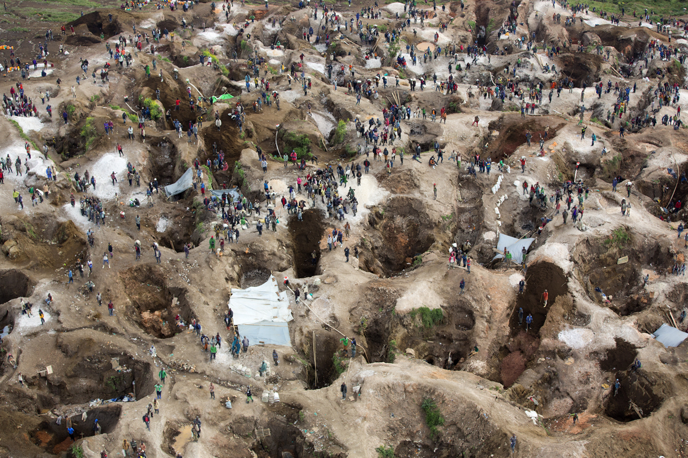
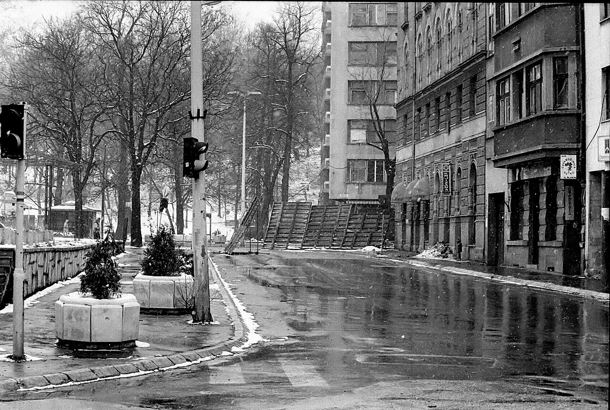
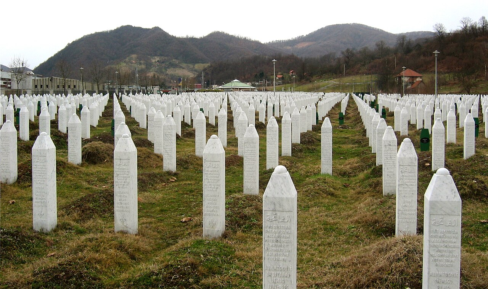
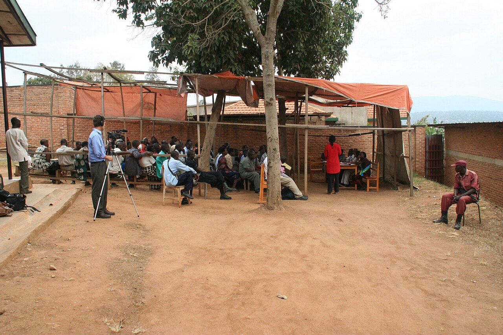
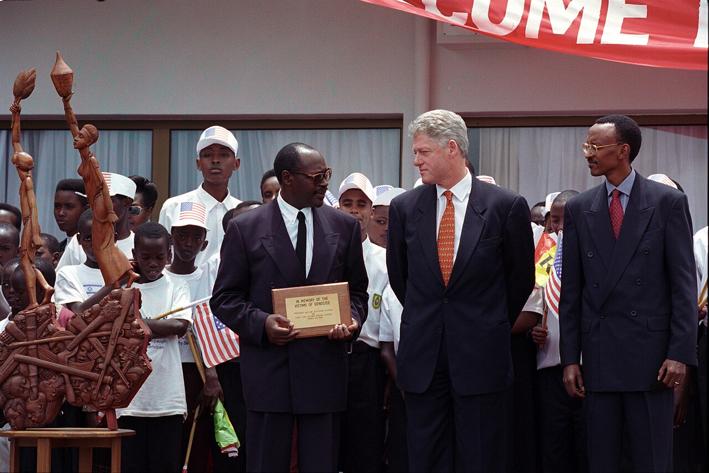

# 103. Why did nobody stop the genocide in Rwanda?

*Rwanda, Bosnia and the Congo, from 1990 to 2003*

Nobody stopped it because the countries that could have done so either had no interest in Rwanda or were friends of its government, and the strongest of them had just lost soldiers in another African war. A United Nations force was in the country when the killing began. Its commander had warned his superiors three months before, and was forbidden to act, and within two weeks most of his soldiers had been taken away from him.

At twenty past eight on the evening of 6 April 1994, an aircraft carrying the president of Rwanda was coming in to land at Kigali, the capital, when two missiles fired from a hillside struck it. It crashed in the garden of his own palace. Everyone on board was killed.

Who fired the missiles has never been established. What happened next had plainly been arranged in advance. Within an hour soldiers of the presidential guard and gangs of young men with machetes had set up roadblocks across the city. They carried lists.

The most popular radio station in the country was a private one that played Congolese dance music and had cheerful, joking presenters. That night it told its listeners that the president had been murdered by the Tutsi, and that the time had come to cut down the tall trees. Over the following weeks it read out names, addresses and car number plates. It called the people to be killed cockroaches. The graves are not yet full, one announcer said. Who will help us to fill them?

In the next hundred days about eight hundred thousand people were murdered. Three out of every four Tutsi in Rwanda died. Most were killed with farm tools, by people who knew them.

## A card

Rwanda is a small, green, crowded country of steep hills in the middle of Africa. Its people are divided into two main groups, the Hutu, who were about eighty-five per cent of the population, and the Tutsi, about fourteen. Outsiders have often called these tribes, which is misleading. Hutu and Tutsi speak the same language, follow the same religion, live on the same hills, and have married one another for centuries.

Before the Europeans came, the difference was closer to one of rank. Rwanda was a kingdom. Its king and its aristocracy of cattle owners were Tutsi, and most of the farmers who tilled the soil were Hutu. The line could be crossed. A Hutu who grew rich in cattle might come to be counted as Tutsi, and a poor Tutsi might sink the other way.

Belgium, which took the country over during the First World War, turned this into something rigid. The Belgians had brought with them the race theories of their day. They decided that the Tutsi, who were said to be taller and to have narrower noses, were a superior people who had come from somewhere to the north and were natural rulers. Officials went round with callipers measuring skulls. In 1933 every Rwandan was issued with an identity card that stated which group he belonged to, and it passed from father to child from then on. The Belgians governed through Tutsi chiefs and reserved the schools and the offices for them.

As independence approached, the Belgians changed sides. The Tutsi elite was asking them to leave, and the Hutu were the majority. In 1959 Hutu rose against their chiefs, with Belgian approval, and several thousand Tutsi were killed. The country became independent in 1962 under a government that defined itself as the rule of the Hutu people. There were further massacres whenever that government felt threatened, and by the 1980s more than half a million Tutsi were living as refugees in the neighbouring countries. The identity cards were kept.

## Those who attack together

In 1990 an army formed by the sons of those refugees invaded from Uganda. Its commander, from the first weeks, was a thin, austere officer in his thirties named Paul Kagame. After three years of civil war the president, under pressure from foreign donors, signed a peace agreement that would bring the rebels into the government and the army.

A circle of powerful men around the president and his wife saw in that agreement the end of their own position. They had been preparing a different solution since the war began. They put it about that the Tutsi inside the country were all agents of the invaders, who planned to make the Hutu their serfs once more. A newspaper had published ten commandments for Hutu, which declared that any Hutu who married a Tutsi woman or did business with a Tutsi was a traitor. The ruling party's youth wing was turned into a militia called "those who attack together", thirty thousand strong, trained by the army.

In the fifteen months before the killing, Rwanda imported nearly six hundred tons of machetes from China, enough for one in every three Hutu men. The same circle founded the radio station, and radios were handed out free in the villages.

## A fax

The peace agreement was to be supervised by the United Nations, which sent two and a half thousand soldiers under a Canadian general, Roméo Dallaire. They were lightly armed, short of vehicles and ammunition, and forbidden to use force except in self-defence.

*Roméo Dallaire, the Canadian general who commanded the United Nations force in Rwanda, speaking to American military staff in Stuttgart on 4 September 2012. Photo: U.S. Africa Command, public domain.*

In January 1994 a senior trainer of the militia came to Dallaire in secret. He said that his men had been ordered to register every Tutsi in the capital, and that he believed it was for their extermination. His units could kill a thousand people in twenty minutes. He knew where the weapons were hidden, and offered to show them in return for protection for his family.

On 11 January Dallaire sent a coded fax to the peacekeeping department at United Nations headquarters in New York, saying that he intended to raid the arms dumps within thirty-six hours. The reply came back the same day. He was to do no such thing. A raid went beyond the terms on which the force had been sent. He should tell the president what he had learned, which meant telling the people who had issued the weapons.

## Ten soldiers

The planners had studied the outside world carefully. In October 1993 American troops serving with a United Nations mission in Somalia had been caught in a street battle. Eighteen were killed, and the body of one was dragged through the streets in front of television cameras. Within days the American president announced that his forces would leave. The informant had told Dallaire what lesson the plotters drew from that. If some Belgian soldiers were killed, he said, Belgium would withdraw, and the mission would collapse.

On the morning after the plane was shot down, soldiers went to the house of the prime minister, a Hutu woman who supported the peace agreement, and murdered her. The ten Belgian peacekeepers who had been guarding her were disarmed, taken to an army camp, and tortured and killed.

It worked exactly as intended. Belgium announced within a week that it was pulling out its whole contingent, and urged other countries to do the same. French, Belgian and Italian paratroopers flew in, well armed, and for a few days there were more than enough good soldiers in Kigali to have stopped the killing in the capital. They had come to collect their own citizens. They drove to the airport past the roadblocks, with the expatriates and in some cases their dogs, and flew out again.

At a technical school in Kigali, two thousand Tutsi had taken refuge under the guard of ninety Belgian soldiers. On 11 April the soldiers were ordered to the airport. People lay down in the road in front of their trucks. The Belgians fired over their heads and left, and the militia, which had been waiting outside the gate drinking beer, came in. On 21 April the Security Council voted to cut Dallaire's force to two hundred and seventy men.

## Work

The first to die were those on the lists: politicians, lawyers, journalists and priests, including Hutu who opposed the plan. Then it spread to the hills, and the whole population was called on to take part.

It was organised through the ordinary machinery of a tightly governed country. Mayors and village heads called the men together, as they did for communal road-mending, and told them that there was work to do. Those who hung back were fined, beaten or killed. At the roadblocks, people were asked for their identity cards. Farmers killed the families on the next plot, with whom they had shared beer. Teachers killed their pupils, and doctors their patients. Husbands were forced to kill their Tutsi wives. In all, some two hundred thousand people took part in the killing.

In earlier massacres Tutsi had been safe in churches, and so in 1994 they crowded into them, and were trapped. At one church south of the capital, about five thousand people were killed in a day with grenades, machetes and clubs. At another the militia knocked holes in the brick walls to throw the grenades in. Priests and nuns in several places handed over those who had come to them.

*The entrance of the church at Nyamata, south of Kigali, kept as a memorial. The sign on the floor, dated 28 March 2004, reads "Never again". Photographed in 2007. Photo: Dave Proffer, CC BY 2.0.*

Something like a quarter of a million women were raped. The dead were being added to at a rate of eight thousand a day.

## Acts of genocide

None of this was hidden. Dallaire reported daily. The Red Cross gave figures. By the end of April journalists were filming bodies floating down the rivers into Lake Victoria by the thousand.

In 1948 the world's governments had signed a convention that named the crime of genocide and bound them to prevent and punish it. The governments that mattered therefore took care not to use the word. American diplomats were instructed to speak only of "acts of genocide". At a briefing in June a reporter asked the foreign ministry's spokeswoman how many acts of genocide it took to make a genocide. That, she replied, was not a question that she was in a position to answer.

The United States had no intention of sending soldiers so soon after Somalia, and it argued against anyone else's being sent, since it would be asked to pay. France had armed and trained the Rwandan army for years and regarded the rebels as tools of its English-speaking rivals. Britain was not interested. The African states that offered troops had no aircraft to carry them and no armoured vehicles, and the vehicles that the Americans agreed to lease them were still being haggled over when the killing ended.

Dallaire said then, and military experts have since agreed, that five thousand well-equipped soldiers with orders to use force could have stopped most of it. The army and the police led the killing, but most of the killers were gangs with knives, and where anyone stood up to them they often ran.

## A captain with a car

Some people did stand up. Dallaire refused the order to withdraw completely, and with a few hundred Ghanaian and Tunisian soldiers, who stayed as volunteers, he protected about thirty thousand people in a football stadium, a hotel and a hospital for three months.

One of his unarmed observers was a tall, cheerful captain from Senegal named Mbaye Diagne. On the first morning he found the murdered prime minister's five children hiding in a house and smuggled them out under blankets in the back of his car. After that he went out every day, alone, against orders. He would load a few people into the car and talk his way through the roadblocks, twenty or more of them on a single journey, with jokes, cigarettes and money from his own pocket. He is thought to have saved several hundred lives. On 31 May a mortar shell landed beside his car and killed him. The force had no body bag in which to send him home.

## Two million

The genocide was ended by the rebel army. Kagame's troops advanced steadily from the north, took the capital on 4 July, and two weeks later held everything except a zone in the south-west, where French troops had landed in June and behind whose lines many of the killers got away. They killed as they came, in reprisal, some tens of thousands of Hutu civilians.

*Paul Kagame (left) talking with the American defense secretary, William Perry, on 31 July 1994, a few weeks after his army took Kigali. Photo: Marvin Krause, U.S. Department of Defense, public domain.*

Ahead of them went one of the fastest mass flights ever seen. The defeated government ordered the population to leave, and two million Hutu walked out of the country, nearly a million of them, in a few days, across the border into Zaire, the huge country to the west, carrying their mattresses and cooking pots. Among them, and in command of them, were the army, the militia and the officials who had organised the slaughter.

![Two maps. Above, Rwanda and the east of Zaire, with Uganda to the north and Burundi and Tanzania to the south. A red arrow runs from the Ugandan border to Kigali, for Kagame's army from 1990 to 1994. The churches at Ntarama and Nyamata are marked south of Kigali. A hatched area in the south-west of Rwanda is the French zone of June to August 1994. Green dashed arrows carry the refugees of 1994 across the border to Goma and Bukavu in Zaire, beside Lake Kivu, and east to Ngara in Tanzania. The Kagera river runs down to Lake Victoria. A dark dashed arrow runs west across Zaire, for Rwanda's army and its allies in 1996, on to Kinshasa in 1997. Below, Bosnia in 1995, divided by a dashed line into the land of the Bosnian Serbs, shaded red, in the north and east, and the land of the Muslims and Croats, shaded green, in the centre and west, with Croatia, Serbia and Montenegro around it. Squares mark the safe areas of the United Nations: Bihać, Tuzla, Srebrenica, Žepa, Goražde and Sarajevo](images/map_rwanda_bosnia.png)
*Above, Rwanda and eastern Zaire, 1990 to 1997: the advance of Kagame's army, the French zone of 1994, the flight of the refugees, and the march of 1996 and 1997 towards Kinshasa. Below, Bosnia in 1995, with the six safe areas and the line that divided it between the Bosnian Serbs and the Muslims and Croats. Drawn roughly; borders from Natural Earth, the division of Bosnia after geoBoundaries. Map: drawn for this book; coastlines and rivers from Natural Earth, public domain.*

They settled on a field of black volcanic rock beside a lake, where no latrine could be dug, and cholera broke out. Fifty thousand died in a month. Now the world acted. Television showed the dying, aid poured in, and American soldiers arrived to purify water. The camps that the aid sustained were run by the killers, who taxed the food and used it to rebuild their army.

*Rwandan refugees walking into Goma, in Zaire, carrying their belongings, on 3 August 1994. Photo: U.S. Department of Defense, public domain.*

## Africa's world war

From those camps the militia raided back into Rwanda. In 1996 Kagame's government sent its army across the border to break them up. It did, and it hunted the refugees who fled westwards through the forest, killing a great many. Then it kept going. With allies from Uganda and Angola, it marched across a country the size of western Europe and overthrew Mobutu, the old dictator who had ruled Zaire for thirty-two years. A veteran rebel named Kabila was installed in his place, and the country was renamed the Democratic Republic of the Congo.

Kabila soon quarrelled with his sponsors, and in 1998 a second war began. Nine African countries sent armies. They stayed to help themselves to the gold, the diamonds and a dull metallic ore, used in every mobile telephone, that could be dug out of hillsides by hand. Dozens of local militias fought over the mines.

*Diggers at the Luwowo coltan mine near Rubaya, in North Kivu in the east of the Congo, seen from the air on 18 March 2014. The file is 1250 pixels wide. Photo: MONUSCO, CC BY-SA 2.0.*

Few people outside Africa could have said who was fighting whom. Most of the dying was not done in battle. Villagers driven into the forest again and again died of malaria, diarrhoea and hunger, far from any clinic. An aid agency estimated that between 1998 and 2007 more than five million people died who would otherwise have lived. Other researchers think that figure far too high. On any count it was one of the deadliest wars since 1945, and it has never fully stopped.

## A safe area

Rwanda was not the only place where the world watched, and the other was an hour by air from Vienna.

Yugoslavia was a federation of six republics in the Balkans, held together for thirty-five years by a communist leader who had kept its Serbs, Croats, Muslims and others in careful balance. He died in 1980. When communism collapsed across eastern Europe, politicians in each republic found a new source of power in the grievances of their own nation. The most skilful was the leader of the Serbs, the largest group, who told them that they must all live in one state, whatever borders stood in the way.

In 1992 the republic of Bosnia, where Muslims, Serbs and Croats lived mixed together in the same towns and often the same families, voted for independence. Serb forces, armed by the Yugoslav army, set about carving out a territory of their own and removing everyone else from it. Their phrase for this entered every language: ethnic cleansing. Villages were shelled and burned, men were held in camps where they were starved and beaten to death, and women were raped systematically, as a method. The capital, Sarajevo, which had hosted the winter Olympics eight years before, was besieged for nearly four years, while gunners in the hills shot at people queuing for water.

*A street in Sarajevo in the winter of 1992 to 1993, with steel screens put up across an intersection to shield people from snipers. Photo: Christian Maréchal, CC BY 3.0.*

The United Nations sent peacekeepers, lightly armed as in Rwanda. It declared six towns to be safe areas under its protection. One was Srebrenica, a small mining town in a valley in the east, crammed with forty thousand Muslim refugees and guarded by four hundred Dutch soldiers.

On 11 July 1995 the Bosnian Serb army walked in. Its general had himself filmed handing out sweets to the children and telling the crowd that nobody would be harmed. The Dutch asked for air strikes, which came too late and were called off. Their commander was filmed drinking a toast with the general. The Dutch then helped to separate the men from the women, on the general's orders, and watched as the men were driven away in buses.

Over the next five days about eight thousand men and boys were shot in fields, warehouses and a school gymnasium, and bulldozed into pits. It was the worst massacre in Europe since the Second World War, and international courts have ruled that it was genocide.

*The memorial cemetery at Potočari, near Srebrenica, in March 2009. Photo: Michael Büker, CC BY-SA 3.0.*

Srebrenica finally shamed the Western governments. When a Serb shell killed forty-three people in a Sarajevo market seven weeks later, the alliance of the Cold War, NATO, which had never fought a campaign, bombed the Bosnian Serb army for three weeks, and within three months the war was over. A hundred thousand people had died in it.

## Courts

The governments that had not sent soldiers sent lawyers. Two international tribunals were set up, the first since the trials of the Nazi leaders. The one for Rwanda convicted a small-town mayor in 1998, in the first verdict of genocide ever handed down by an international court, and it later convicted the founders of the radio station. The one for Yugoslavia tried the Serbian president, who died in his cell before the verdict, and sentenced the general of Srebrenica to prison for life. A permanent court was founded in 2002. The United States, Russia and China have not joined it.

Rwanda itself had more than a hundred thousand suspects in its jails and hardly a judge left alive. It turned to an old custom. In every village the accused were brought before their neighbours, sitting on the grass, and those who confessed fully and asked forgiveness received lighter sentences. Twelve thousand such courts heard more than a million cases in ten years. The new government removed the ethnic label from the identity cards and made it an offence to stir up division between Hutu and Tutsi. It has given the country order and one of the fastest-growing economies in Africa, and Kagame, who still rules it, does not tolerate opposition.

*A gacaca hearing in a village in Rwanda, held in the open air under a tarpaulin, in July 2006. Photo: Scott Chacon, CC BY 2.0.*

In March 1998 the American president stopped at Kigali airport. He told an audience of survivors that the world had not acted quickly enough, and had not called the crimes by their rightful name. He stayed three and a half hours, and the engines of his aircraft were kept running.

*President Bill Clinton at a ceremony in Kigali on 25 March 1998 honouring the survivors of the genocide. The plaque reads "In memory of the victims of genocide". Photo: Ralph Alswang, White House Photograph Office, public domain.*

Dallaire went home to Canada. He could not stop seeing what he had seen. In 2000 he was found unconscious under a park bench, after trying to kill himself with drink and pills.

In the villages of Rwanda today, the people who survived live beside the people who killed their families, who have served their sentences and come home. Land is too scarce for either to move. They farm neighbouring plots, and they draw water at the same pump.
