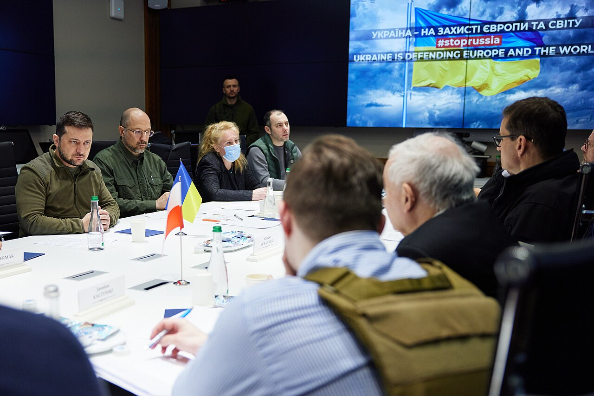
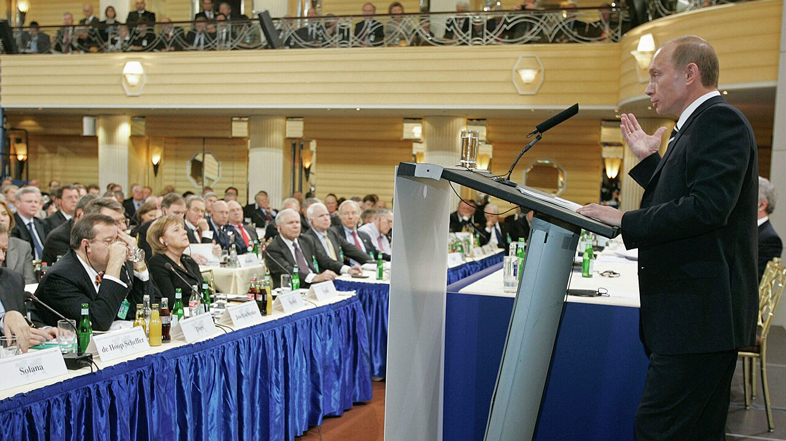
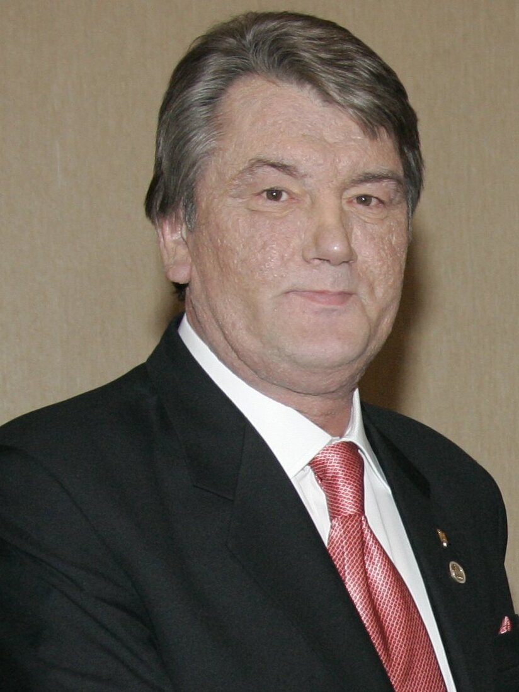
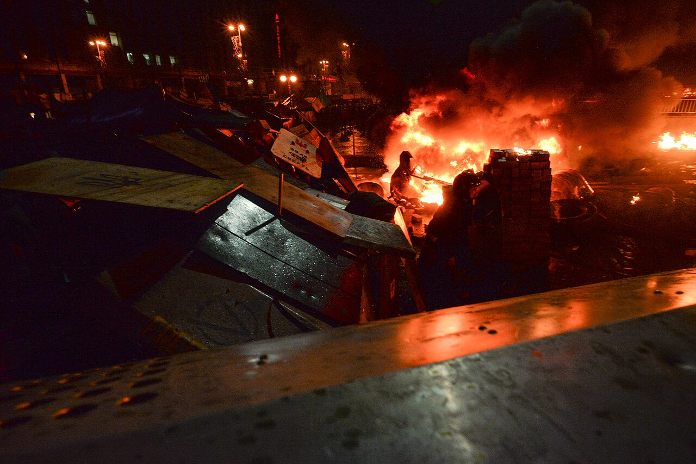
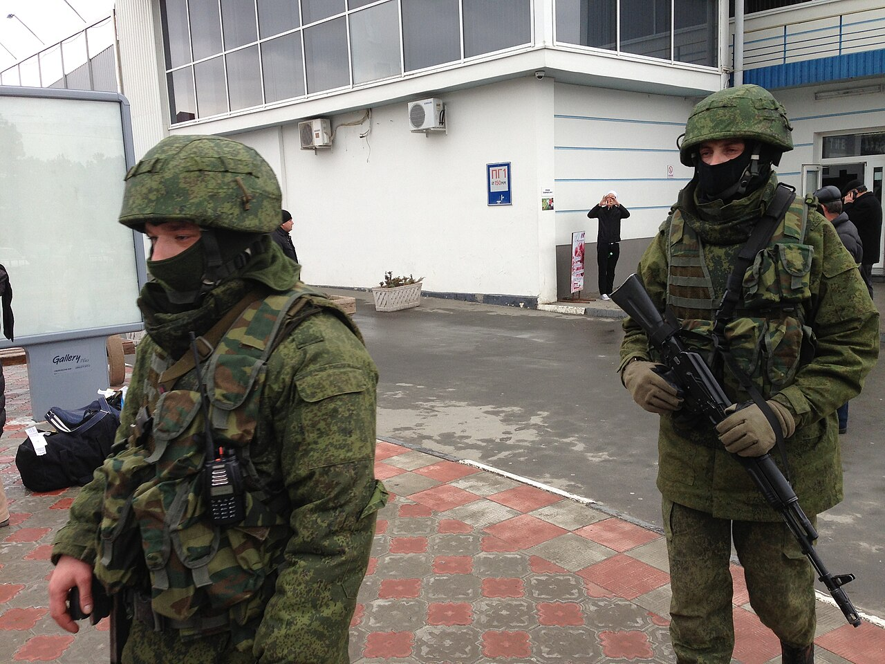
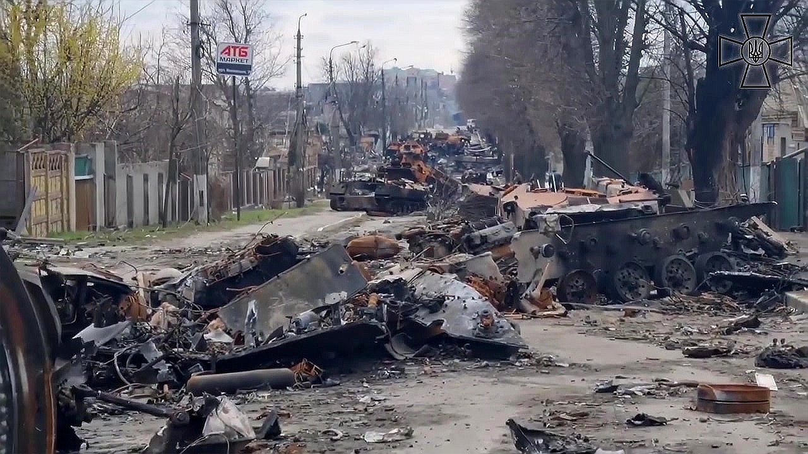
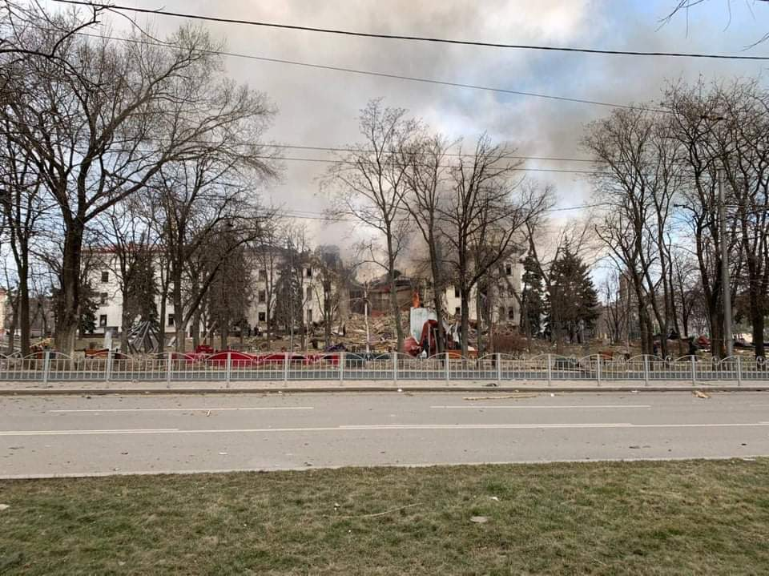
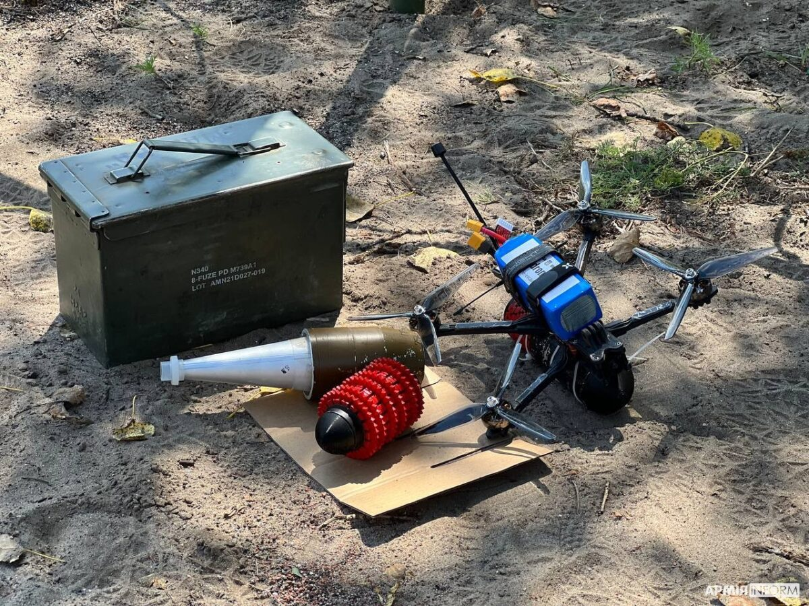
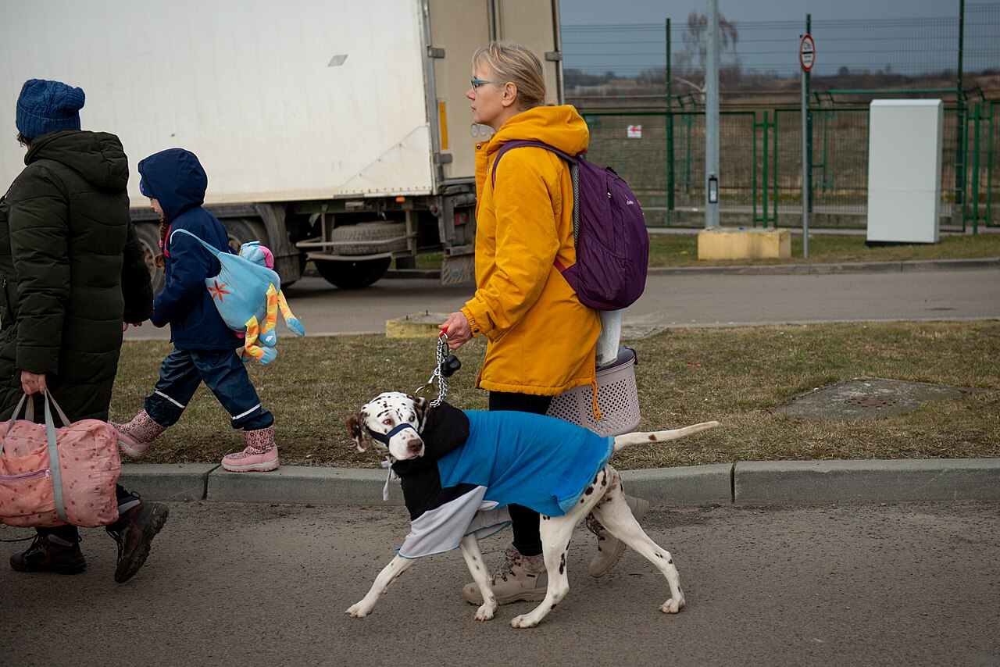

# 104. Why did Russia invade Ukraine?

*Ukraine and Russia, from 1991 to 2025*

Russia invaded because its ruler does not accept that Ukraine is a nation separate from Russia, and because he feared that he was about to lose it for good to the democracies of the West. He expected its government to fall within days. It did not, and the war that followed is the largest fought in Europe since 1945.

A little before five o'clock on the morning of 24 February 2022, Russian state television broadcast a speech by President Vladimir Putin. He announced what he called a special military operation. Its purpose, he said, was to disarm Ukraine and to remove the Nazis who governed it. Within minutes missiles were falling on Kyiv and a dozen other cities. Columns of tanks crossed the border from the north, the east and the south, and helicopters carrying paratroopers flew low up the river towards an airfield on the edge of the capital.

Nearly every government in the world expected Ukraine to be beaten in a week. The Americans had moved their embassy out and had offered to fly the Ukrainian president to safety. Russian officers were found afterwards to have packed their parade uniforms.

On the second night a short video appeared on the internet. It had been filmed on a telephone, in the dark, in the street outside the presidential offices in the middle of Kyiv. Five unshaven men in olive-green fleeces stood facing the camera. The one in front was Volodymyr Zelensky, the president. He pointed to each of the others in turn: the leader of his party in parliament, the head of his office, the prime minister, an adviser. We are all here, he said. Our soldiers are here. The citizens are here. We are defending our independence.

*President Volodymyr Zelensky (left) at a meeting in Kyiv on 15 March 2022 with the prime ministers of Poland, the Czech Republic and Slovenia, who had travelled to the city while it was under attack. Photo: Cabinet of Ministers of Ukraine, CC BY 4.0.*

## The same cradle

Russians and Ukrainians trace their beginnings to the same place. In the ninth century Viking traders founded a state on the river Dnieper with its capital at Kyiv, and its princes later took their Christianity from Constantinople. It broke into rival principalities, and the Mongols destroyed what was left. After that its peoples lived under different rulers for four hundred years. The north-east grew into the state of Moscow, under its tsars. The lands around Kyiv passed to Lithuania and Poland, which looked west, and on the open steppe to the south there grew up communities of free horsemen, the Cossacks, who elected their own leaders. A separate language formed there, as close to Russian as Dutch is to German.

The Russian empire absorbed most of Ukraine in the seventeenth and eighteenth centuries, and treated its people as a provincial variety of Russians. Their speech was called Little Russian. In 1876 the tsar banned the printing of almost all books in it.

The twentieth century was harder. Ukraine declared independence in the chaos that followed 1917 and was conquered by the Red Army. In 1932 and 1933 Stalin's seizure of its grain starved some four million of its people. In the war against Hitler, the whole of Ukraine was occupied and fought over twice, and one in six of its inhabitants died. In 1954 the Soviet leadership moved the Crimean peninsula, on the Black Sea, from the Russian republic to the Ukrainian one, which at the time seemed a matter of paperwork, since both were part of the same state.

When that state fell apart in 1991, Ukrainians were asked whether they wanted a country of their own. More than nine in ten said yes. So did a majority in every region, including the Crimea and the coal-mining east, where most people spoke Russian at home.

## Paper

The new Ukraine found itself the owner of the third largest nuclear arsenal in the world, about nineteen hundred long-range warheads that had been stationed on its soil. It could not have fired them, since the codes were in Moscow, and the United States pressed it hard to give them up.

During 1994 Ukraine agreed to send them to Russia. In return, at a ceremony in Budapest that December, Russia, the United States and Britain signed a memorandum. They undertook to respect Ukraine's independence and its existing borders, and never to use or threaten force against it. The last warhead left for Russia in 1996.

## Not one inch

Russia's own account of the war begins with a different promise.

In February 1990, when the Soviet army still stood in East Germany, the American secretary of state was trying to persuade the Soviet leader to accept a united Germany inside NATO, the Western alliance whose members are pledged to defend one another. He said that the alliance's jurisdiction would not then move one inch to the east. Nothing was written into a treaty, and the Americans say that he was speaking only of German soil. Russians remember it as a pledge.

The alliance moved a long way east. Poland, Hungary and the Czech Republic joined in 1999, and seven more countries in 2004, among them the three Baltic states, which had been part of the Soviet Union and border Russia. Each of these countries had asked to join. They had been occupied from Moscow within living memory, and they did not believe that it would never happen again.

To Russia it looked as if a hostile military bloc was advancing to its doorstep while it was too weak to object. In 2007 Putin told a conference in Germany that the expansion was a serious provocation. The following spring, at a summit in Bucharest, the alliance did the worst of both things. The American president wanted to set Ukraine and Georgia on the path to membership. Germany and France refused. The compromise was a sentence stating that the two countries will become members, with no date and no plan. It gave them no protection and gave Russia a grievance. Four months later Russia fought a five-day war with Georgia.

*Vladimir Putin speaking at the Munich Security Conference on 10 February 2007, where he called the expansion of the Western alliance a serious provocation. Photo: kremlin.ru, CC BY 4.0.*

Some respected Western scholars hold that this was the root of everything that followed, and that a great power will not tolerate a rival alliance on its border any more than the United States tolerated Soviet missiles in Cuba. Between 2008 and 2022, however, Ukraine came no nearer to joining. The larger members would not hear of it, and there was no prospect of its being let in while part of its territory was occupied.

## The colonel

The other account begins with the man.

Putin was born in Leningrad in 1952, in a communal flat, and joined the secret police on leaving university. In 1989 he was a middle-ranking officer in the East German city of Dresden. When the crowds stormed the local headquarters of the East German secret police, he telephoned the Soviet army base for help and was told that nothing could be done without orders from Moscow, and that Moscow was silent. He burned his files and went home to a country that was falling apart. He took from it a horror of crowds in the street and of the weakness of the state.

He became president on the last day of 1999 and has ruled Russia, under one title or another, ever since. In his first eight years the price of oil rose fivefold, wages were paid on time, and Russians, exhausted by the 1990s, were grateful. He used the time to gather every source of power into his own hands. The richest man in the country, who had financed opposition parties, was jailed for ten years, and the other tycoons took the point. Television was brought under control. Regional governors were appointed, not elected. Journalists who investigated and politicians who opposed were shot in their doorways and on bridges. The most popular of his opponents was poisoned with a nerve agent in 2020, survived, returned to Russia, and died in an Arctic prison camp in 2024.

A ruler of that kind has one thing to fear above all, which is that his own people might see a neighbouring country, with the same history and much the same language, throw out a corrupt government and prosper.

## The square

Ukraine twice threw out such a government.

In 2004 the candidate favoured by Moscow was declared the winner of a presidential election that had been openly rigged. His opponent had been poisoned during the campaign with a dose of dioxin that left his face pitted and grey. Hundreds of thousands of people camped for weeks in the snow in the main square of Kyiv, wearing orange, until the courts ordered the vote to be held again, and the poisoned man won.

*Viktor Yushchenko in January 2006, his face still marked by the poisoning of 2004. The file is 824 pixels wide. Photo: Press Service of the President of Russia, CC BY 4.0.*

The loser of that contest, Viktor Yanukovych, was elected fairly six years later. In November 2013 he was about to sign a trade and political agreement with the European Union, for which the western half of the country and most of the young had been waiting for years. A week before the ceremony, under heavy pressure from Moscow and with the offer of a Russian loan, he announced that he would not.

Students came out into the same square that night. When riot police beat them, the students' parents came. The protest lasted three months, through a bitter winter, behind barricades of ice and tyres. In the third week of February 2014 the police opened fire, and on one morning their marksmen shot dead nearly fifty people. About a hundred protesters died that winter. The next day the president fled, and he soon turned up in Russia. Crowds wandered through his country estate and found a private zoo, a floating restaurant and a collection of vintage cars.

*Barricades burning on Independence Square in Kyiv on the night of 18 February 2014, during the clashes between protesters and police. Photo: Mstyslav Chernov, CC BY-SA 3.0.*

There are two accounts of that winter, and the war is in large part a fight between them. Ukrainians call it the Revolution of Dignity, a popular rising against a thief. The Russian government calls it a coup, organised by the Americans, that put fascists in power. American officials did openly back the protesters. There were nationalists of the far right on the barricades. But the crowds numbered in the hundreds of thousands, and when Ukraine chose a president that year, the candidates of the far right took about two per cent between them.

## Little green men

Putin acted within days. At the end of February 2014 soldiers in green uniforms without badges seized the parliament building and the airports of Crimea, where Russia had kept its Black Sea fleet under a lease. Moscow said that they were local volunteers who had bought their kit in shops. Less than three weeks later, under their guns, a referendum was held, and Russia annexed the peninsula. It was the first time since 1945 that a European state had annexed a neighbour's territory by force.

*Armed men in uniforms without badges outside Simferopol airport in the Crimea on 28 February 2014. Photo: Elizabeth Arrott, Voice of America, public domain.*

In April armed men led by Russian officers took over town halls in the industrial east, the Donbas, and proclaimed two "people's republics". When the Ukrainian army began to win the region back, regular Russian units crossed the border to stop it. In July a Russian anti-aircraft missile, fired from territory held by the separatists, brought down a Malaysian airliner on its way from Amsterdam and killed all two hundred and ninety-eight people on board.

A ceasefire in 2015 froze the front. For the next seven years a line of trenches ran through the Donbas, and shells went over it most days. By the end of 2021 the fighting there had killed fourteen thousand people. The Western countries imposed modest sanctions, and Germany went on building a new pipeline to buy more Russian gas. Putin drew the conclusion that Europe would grumble and accept.

## One people

In July 2021 the Kremlin published a long essay under Putin's own name, entitled "On the Historical Unity of Russians and Ukrainians". Its argument was that the two are one people. Modern Ukraine, he wrote, was an artificial creation of the Soviet period, built on historically Russian lands, and its turn towards the West was a project of foreign powers to make it into an anti-Russia. True sovereignty for Ukraine, he concluded, was possible only in partnership with Russia. Copies were distributed to the army.

That autumn Russian troops began to assemble on three sides of Ukraine, and by February there were a hundred and ninety thousand of them. In December Moscow presented the Americans with draft treaties demanding that the alliance withdraw its forces from every country that had joined since 1997. The United States took the unusual step of publishing its secret intelligence that an invasion was planned. Most European governments, and the Ukrainian government itself, did not believe that he would do it.

On 21 February Putin spoke on television for an hour. Ukraine, he said, had been wholly created by Lenin, and had never had a tradition of real statehood. Three days later the missiles were launched.

The man who was to be removed as a Nazi was a forty-four-year-old former comedian, a native speaker of Russian, and a Jew, whose grandfather had fought in the Red Army and lost his brothers in the Holocaust. Zelensky had become famous playing a schoolteacher who is accidentally elected president in a television comedy. In 2019 he stood for the real office, and won nearly three quarters of the vote.

## Forty miles of trucks

The Russian plan depended on speed. Paratroopers would seize the airfield outside Kyiv, transport planes would land an assault force, and the government would be captured or put to flight while armoured columns drove down from Belarus to occupy a leaderless capital.

It failed on the first day. Ukrainian troops shelled the runway so that nothing could land. The columns coming from the north were confined to a few roads through forest and marsh, where infantry with shoulder-fired missiles destroyed the leading and the last vehicles and then the rest. One convoy sat stalled for a week in a line sixty kilometres long, out of fuel and food. The Russian soldiers had been told that they would be greeted with flowers. At the end of March they were withdrawn.

*Vokzalna Street in Bucha, near Kyiv, where a Russian column was destroyed on 27 February 2022, filmed on 6 April 2022 after the Russian troops had left. Still from a video by Ukrinform TV and the Ukrainian Armed Forces, CC BY 3.0.*

In the towns that they left, bodies lay in the streets. In Bucha, a commuter suburb, more than four hundred civilians were found dead, many shot with their hands tied behind them. In the southern port of Mariupol, which was surrounded and shelled for nearly three months, families sheltered in the cellars of the city's theatre. They had painted the Russian word for children on the ground outside, in letters large enough to read from the air. On 16 March a Russian aircraft dropped two bombs on it.

*The drama theatre in Mariupol after it was bombed on 16 March 2022. The file is 960 pixels wide. Photo: Donetsk Regional Military Administration, CC BY 4.0.*

Ukraine had held, to the surprise of its enemies and its friends. The people in the east and south, who spoke Russian and whom Putin had claimed to be rescuing, fought him as hard as anyone.

## The kill zone

In the autumn of 2022 Ukrainian offensives recovered large areas in the north-east and the south. Russia answered by calling up three hundred thousand men, which sent as many again fleeing abroad, and by declaring four Ukrainian regions to be part of Russia, though it did not fully control any of them. After that the front, a thousand kilometres long, barely moved. Towns in the Donbas were fought over for months, street by street, until nothing stood. Both armies dug in behind minefields. It looked, from above, like the Western Front in 1916.

Armies had used pilotless aircraft before, large and costly ones. In Ukraine both sides turned to small racing drones of the kind sold to hobbyists, steered through goggles that show the view from a camera in the nose, with a grenade or an anti-tank charge strapped underneath. Such a machine costs about five hundred dollars. It can fly into the open hatch of a tank that cost several million. By 2024 Ukraine alone was building more than a million a year, and drones were causing most of the casualties on both sides.

*A hobbyist-style first-person-view drone beside the warhead that is fitted to it, in Ukraine in September 2023. The file is 1200 pixels wide. Photo: Armyinform, CC BY 4.0.*

Other drones watch. Between them and the commercial satellites that photograph the front every day, there is very little left to hide behind. A vehicle that moves within fifteen kilometres of the line is likely to be seen within minutes and struck. Soldiers call that belt the kill zone. Tanks, which had dominated land warfare for a century, were kept hidden and used sparingly. Supplies go forward at night on foot, or on small robot carts, and the wounded lie for days because nobody can reach them. When each side learned to jam the other's radio signals, drones were flown on reels of hair-thin glass fibre, kilometres long, and whole fields near the front are now covered with shining thread.

Ukraine, which had almost no navy, used explosive motor boats steered by satellite link to drive the Russian fleet out of the western Black Sea.

## What it has done

By the end of 2025 well over a million soldiers on the two sides had been killed or wounded. The United Nations had confirmed the deaths of more than fourteen thousand Ukrainian civilians and said that the real number was much higher. About six million Ukrainians were refugees abroad, mostly women and children, and millions more had been driven from their homes inside the country. Russia held about a fifth of Ukraine's territory.

![Two maps. Above, Ukraine in its internationally recognised borders, with Belarus to the north, Russia to the east, Poland, Moldova and Romania to the west and the Black Sea to the south. The Crimea and the eastern part of the Donbas, round Donetsk, are hatched as held by Russia and its proxies from 2014, the Donbas part bounded by the line of contact of 2015 to 2022. A blue dashed line marks the furthest Russian advance in March 2022: down from Belarus to Bucha just west of Kyiv, across the north-east past Kharkiv, and in the south across the Dnieper beyond Kherson. A dark red line marks the front at the end of 2025, from the Russian border near Kupiansk south through the Donbas and then along the Dnieper to the sea; the land east and south of it, held by Russia, is shaded, and includes Mariupol. A cross near Donetsk marks where the airliner was shot down in 2014. All the lines are approximate. Below, a map of Europe shading the members of the Atlantic alliance in 1990 in dark blue, those that joined in 1999 and 2004 (Poland, the Baltic states, Romania and others) in lighter blue, and those that joined from 2009 to 2024 (Finland, Sweden and four Balkan states) hatched, with Ukraine outside it](images/map_ukraine.png)
*Ukraine in its internationally recognised borders: the land held by Russia and its proxies from 2014, the line of contact of 2015 to 2022, the furthest Russian advance in March 2022, and the front and the land held by Russia at the end of 2025, all approximate. Below, the members of the Atlantic alliance in Europe in 1990, and those that joined by 2004 and by 2024. Map: drawn for this book; coastlines and rivers from Natural Earth, public domain.*

Ukrainian children from the occupied areas, some twenty thousand by Kyiv's count, were taken to Russia and placed with Russian families or in camps. Russia does not belong to the international criminal court, but Ukraine has accepted its authority over crimes committed on Ukrainian soil. In March 2023 the court issued a warrant for Putin's arrest on that charge.

*Ukrainian refugees walking from the border crossing at Medyka, Poland, on 2 March 2022. Photo: Bartosz Siedlik, European Commission, CC BY 4.0.*

The countries of the West sent Ukraine weapons and money worth several hundred billion dollars, and froze a similar sum of Russia's reserves. They did not send soldiers, since Russia has the largest nuclear arsenal in the world and its ruler reminded them of it regularly. Most of Asia, Africa and Latin America condemned the invasion at the United Nations and declined to join the sanctions, and India and China bought the oil that Europe would no longer take.

The war also produced the reverse of what its author said he wanted. Finland, which had stayed neutral through the whole of the Cold War and has a border with Russia thirteen hundred kilometres long, joined the Western alliance in 2023, and Sweden followed. In Ukraine itself, people who had spoken Russian all their lives began, as a matter of principle, to speak Ukrainian.

In 2025 a new American president pressed both sides to settle, and there were meetings. At the end of that year the guns were still firing.

Eighty years earlier the grandfathers of the men on both sides had served in one army. They had fought the Germans together across the same fields, along the same rivers, and through the same towns, whose names their grandsons now read in the casualty lists.
