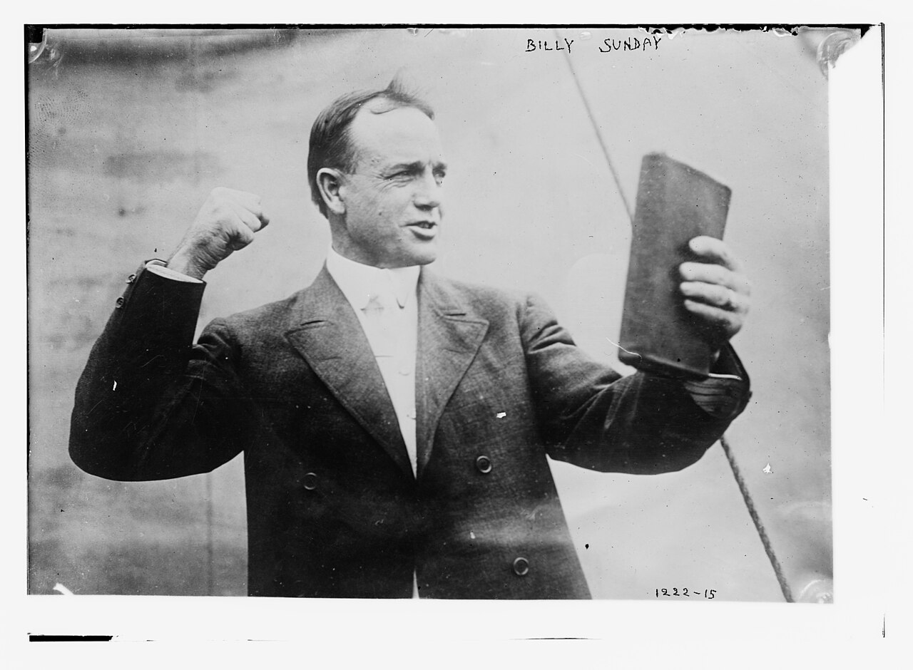
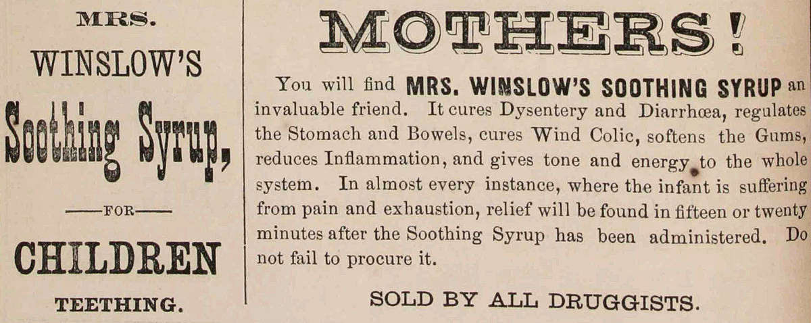
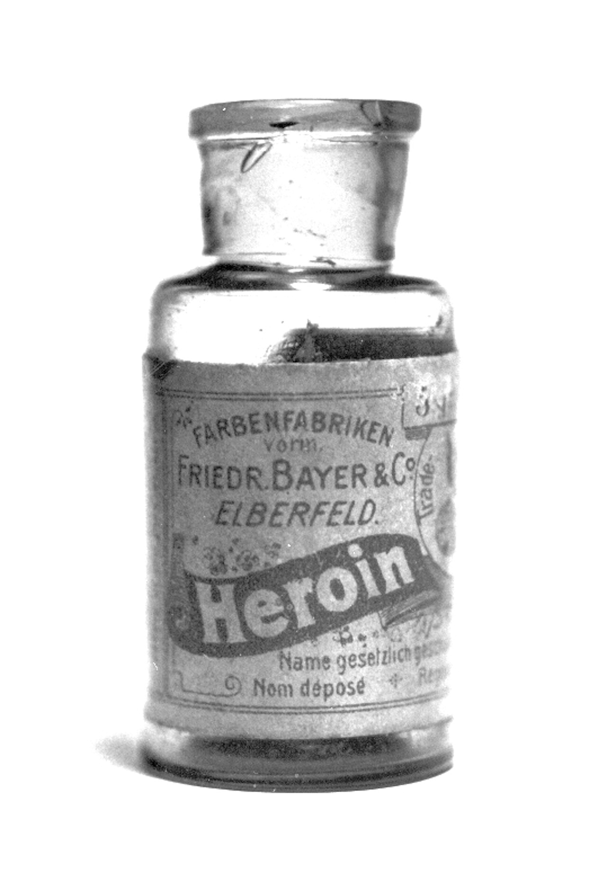
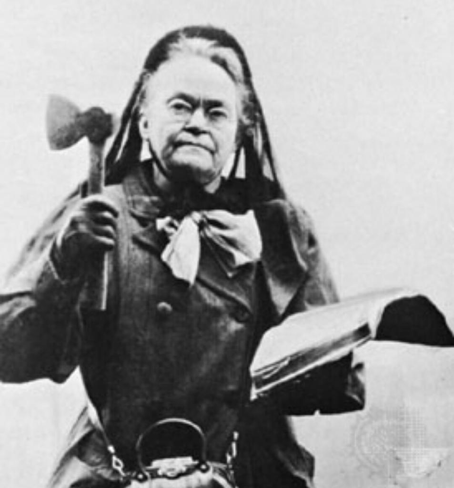
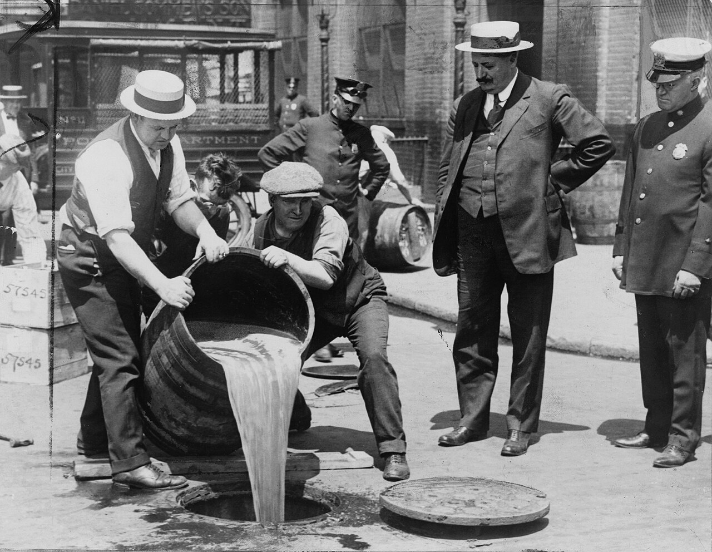
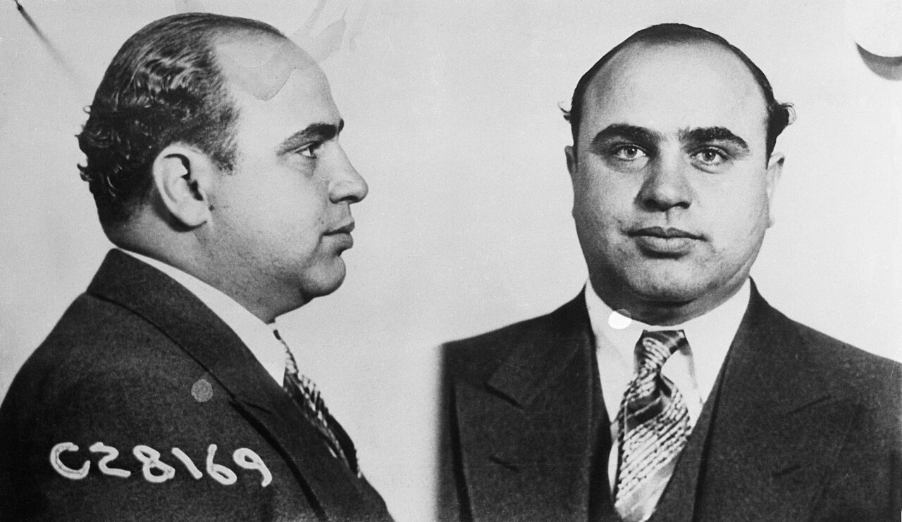
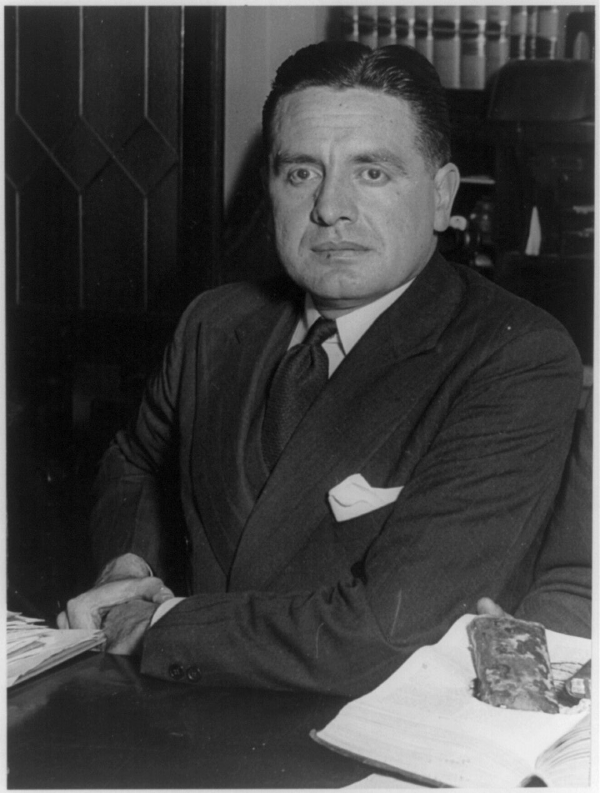
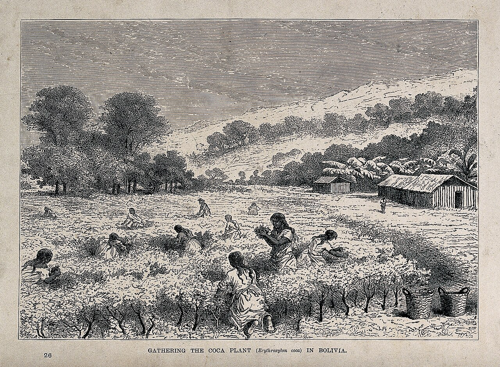
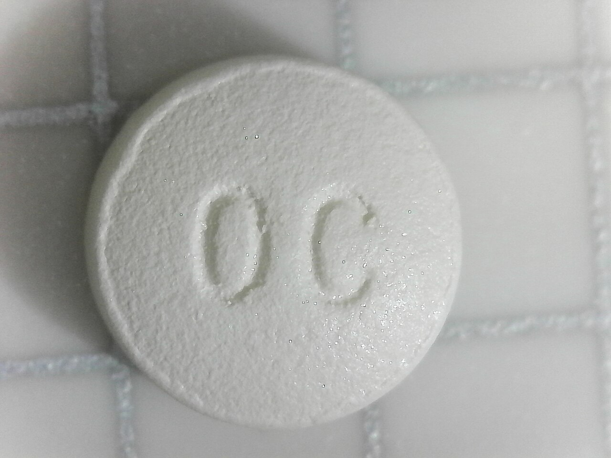
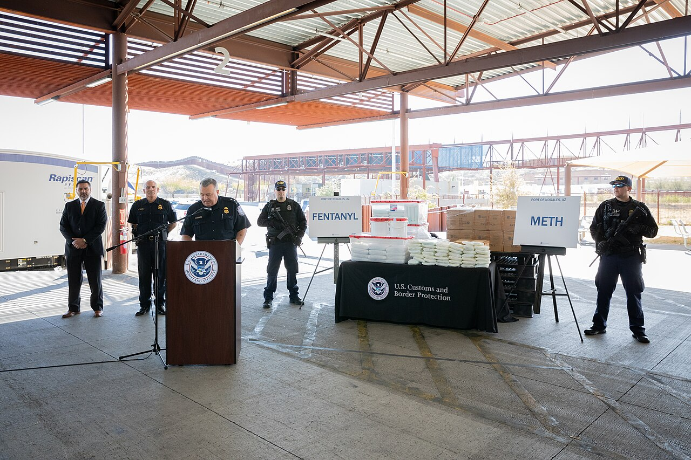

# 106. Why are some drugs illegal?

*The United States and the world, from 1874 to 2025*

Which drugs are legal has depended far more on who used them, who sold them, and when the law happened to be written, than on how much harm they do. Alcohol and tobacco, which kill the most people, are sold in shops. Opium, cocaine and cannabis were banned a century ago, in a campaign led by the United States, and the ban has filled prisons and enriched criminals without making the drugs disappear.

On the afternoon of 16 January 1920, ten thousand people crowded into a wooden hall in the port of Norfolk, in Virginia, for a funeral. A team of horses drew up outside pulling a coffin six metres long. In it lay an effigy of John Barleycorn, the spirit of strong drink. A man dressed as the devil walked behind, pretending to weep.

The service was conducted by Billy Sunday, a former baseball player who had become the most famous preacher in America. At midnight the manufacture, sale and transport of intoxicating liquor would become illegal everywhere in the United States, by an amendment to the constitution. Goodbye, John, the preacher shouted at the coffin. You were God's worst enemy. You were hell's best friend. He told the crowd what was coming. The reign of tears is over, he said. The slums will soon be only a memory. We will turn our prisons into factories and our jails into storehouses.

*Billy Sunday, the preacher who led John Barleycorn's funeral, in a posed photograph taken before 1920 by the Bain News Service. Photo: Bain News Service, Library of Congress, public domain.*

That night, across the country, people who could afford it filled their cellars.

## The lever

People have looked for ways to change how they feel in every society that has left a record. The first cities paid their workers partly in beer. Wine, the coca leaf of the Andes, tobacco, opium, tea and coffee have each, at some time, been something that a government taxed or fought over.

So many peoples, in so many places, reaching for the same kind of thing suggests that the wanting is built into us.

The reason lies in a small circuit deep in the brain that rewards us for doing what keeps us alive. When a hungry animal eats, or a thirsty one drinks, that circuit releases a chemical signal which says, in effect: that was good, do it again. The signal is how the brain teaches itself what is worth repeating.

Every drug that people find hard to give up works on this signal, by one route or another. Each of them, in effect, delivers the message without the meal. Opium imitates the brain's own painkillers. Cocaine stops the signal from being switched off. Alcohol and nicotine nudge it more gently.

What happens when the message can be had without limit has been tested on animals. In experiments that have been repeated many times, a rat given a lever that delivers cocaine without limit will go on pressing it and neglect its food. The circuit that was meant to keep it alive is now working against it.

Most people who try these substances do not end up like the rat. How many do depends on the drug. About one in six of those who drink become dependent on alcohol at some point, about one in ten of those who use cannabis, and about one in four of those who try heroin. For those people, the brain adjusts. The same dose does less, and more is needed. When the drug is withdrawn, they feel wretched until they take it again, and they go on taking it long after it has begun to wreck their lives. Among the common drugs, the one that hooks the largest share of the people who try it is tobacco. Yet it is sold openly in shops.

## Soothing syrup

In the Europe and America of the nineteenth century, hardly any of this was illegal. Drugs that would later fill prisons were sold over the counter, by respectable people, as medicine.

Opium dissolved in alcohol was sold by every grocer and chemist in Britain and America, and was the standard remedy for pain, coughs, diarrhoea and sleeplessness. Mothers quietened teething babies with a popular syrup whose active ingredient was morphine.

Morphine was then still a fairly new substance. In 1804 a German pharmacist's apprentice had extracted it from opium, ten times as strong. Then, in the 1850s, the hollow needle made it possible to put it straight into the blood. Doctors injected it freely. As a result, many soldiers wounded in the American Civil War came home unable to do without it.

*An advertisement of 1876 for Mrs. Winslow's Soothing Syrup, which contained morphine. It tells mothers that the syrup relieves a teething infant in fifteen or twenty minutes and is sold by all druggists. Image: Jeremiah Curtis & Sons, public domain.*

Cocaine had an equally respectable start. It was isolated from the coca leaf in 1860. Doctors prescribed it for tiredness and low spirits, and it went into tonics, lozenges and a new soft drink launched in the American South in 1886, which kept a trace of it until 1903.

Heroin, too, was first put on the market by a reputable firm. In 1898 a German drug company put on sale a cough medicine made by a small chemical change to morphine. Its testers had said that it made them feel heroic, and the company named it accordingly. Heroin was advertised as safe for children and free of any risk of habit.

*A bottle of Bayer's heroin, from the German company that put the drug on sale in 1898. This one probably dates from the 1920s. Photo: Mpv_51, public domain.*

By 1900 there were perhaps a quarter of a million people in the United States dependent on opium or morphine. The typical one was a middle-aged, middle-class white woman who had been given it by her doctor. She was pitied, and nobody proposed sending her to prison. Her habit was treated as a misfortune, and her drug as a medicine.

## The hatchet

The drug that America turned against first was the one that it used most. That drug was alcohol.

Americans of the early republic drank on a scale that is hard to credit. In 1830 the average adult got through about three times as much alcohol as today, most of it as whiskey, beginning at breakfast. Drink, in other words, was part of the working day and not only of the evening.

The damage fell hardest on women. They could not vote, could not easily leave a marriage, and had no claim on a husband's wages if he chose to drink them on the way home.

The campaign against the saloon was therefore largely a movement of American women, the largest that they had yet organised. In 1874 they founded a temperance union, an association sworn to fight drink, that soon had branches in every town. Its members knelt in prayer on the sawdust floors of bars until the owners closed. One of them, a tall woman from Kansas whose first husband had died of drink, went further. She would walk into a saloon with a hatchet and smash the mirrors, the bottles and the barrels. She was arrested thirty times and sold little souvenir hatchets to pay her fines.

*Carrie Nation with her hatchet and her Bible, about 1900. Photo: unknown photographer, public domain.*

The men who finished the job founded a league that cared about nothing else. Its method was narrow and patient. It did not run candidates. Instead, it worked out which politicians in each district could be swung by a block of church votes, and delivered those votes to whoever promised to vote dry, whatever he did in private.

Then events came to its aid. The big brewers were nearly all of German origin, and when the United States went to war with Germany in 1917 the league made the most of it. A glass of beer could now be painted as the enemy's drink.

One more obstacle had been removed four years before. A third of the federal government's income had come from the tax on liquor. So long as that was so, banning drink meant giving up a third of the government's money. In 1913 the country adopted an income tax, and no longer needed the drinker's money.

## Thirteen years

Prohibition worked better than its reputation suggests. By the measure that its supporters cared about most, it did cut drinking. Americans drank perhaps a third less than before, deaths from diseased livers fell, and so did arrests for drunkenness.

It also showed what happens when a government bans something that millions of people still want. The demand was supplied by whoever was willing to break the law. Ships anchored just outside the coastal limit and sold whisky by the case to speedboats. The boats then ran the cases ashore. Others did the work closer to home. Thirty thousand illegal bars opened in New York alone. Doctors wrote prescriptions for medicinal whiskey by the million.

*Prohibition agents pouring liquor into a drain in the street after a raid in New York City, between 1920 and 1933. Photo: unknown photographer, Library of Congress, public domain.*

The business was worth billions. Because it was illegal, however, it could not use the courts to settle its disputes. A supplier who was cheated could not sue, so disputes were settled in other ways. Being outside the law, it also had every reason to buy policemen, judges and mayors.

In Chicago the son of an Italian barber, Al Capone, took over the supply of beer and spirits to the city and was said to be making sixty million dollars a year. His city also saw the decade's most notorious killing. In February 1929 seven members of a rival gang were lined up against the wall of a garage by men dressed as policemen and cut down with machine guns. The murder rate in American cities climbed through the decade and reached its peak in the last year of the ban.

*Al Capone in the police photographs taken when he was sent to prison, 17 June 1931. Photo: United States Bureau of Prisons, public domain.*

The government's own conduct was among the worst of it. Bootleggers were stealing the alcohol made for industry and redistilling it for drinking. The government's answer was to make the stolen alcohol more dangerous to drink. Federal chemists were ordered to add stronger poisons, including wood alcohol, which blinds and kills. They knew what would follow. By the end, several thousand people had died of it.

What finished the experiment was the Depression. Hard times turned the old argument about money around. The government was desperate for revenue and for jobs, and here was an industry begging to be taxed. The drinker's money, which the country had decided it could do without, was suddenly wanted again. In December 1933 the amendment was repealed, the only one in the constitution's history to be struck out. Capone was by then in prison, for failing to pay tax on his income.

## Fiends

The other drugs took a different road, and race had a great deal to do with it. Alcohol was banned and then restored. Opium, cocaine and cannabis were banned, and across most of the world they still are. In each case the people blamed for the drug mattered as much as the drug.

The first American law against opium was passed in San Francisco in 1875. It closed the rooms where Chinese labourers, brought over to build the railways, smoked opium. White Americans went on swallowing their opium in bottles from the chemist. What was being banned, in other words, was less the drug than the people who used it in a particular way.

The same pattern returned when Congress regulated opium and cocaine across the whole country in 1914. A leading newspaper ran the headline "Negro cocaine fiends are a new Southern menace", over an article which claimed that the drug made Black men mad, immune to bullets, and dangerous to white women. Southern senators who disliked federal power voted for the law. Their fear of the drug, and of the people said to use it, outweighed their dislike.

Cannabis had been in the medicine cabinet for decades under that name. In the 1920s Mexican labourers crossing the border brought the habit of smoking it, and its opponents began to use the Spanish word, marijuana, so that it would sound foreign. A familiar medicine was being renamed as a foreign threat.

The man who made it a national cause had a practical motive. Harry Anslinger had been a senior agent in the enforcement of Prohibition, and in 1930 he was put in charge of a new federal bureau of narcotics. The timing was awkward for him. The alcohol ban was collapsing just then, and with it went much of the work. Meanwhile heroin and cocaine users were too few to justify his budget. His bureau needed a bigger enemy.

He had earlier dismissed cannabis as a minor matter. Now, however, he discovered that it caused insanity and murder, and supplied the newspapers with stories of murders committed under its influence, a large share of them by Mexicans and Black men. The campaign worked. A federal law against it passed in 1937, after a debate in the House that lasted a few minutes. Anslinger ran the bureau for thirty-two years.

*Harry Anslinger at his desk in 1930, the year he became head of the Federal Bureau of Narcotics. Photo: unknown photographer, Library of Congress, public domain.*

Meanwhile the United States carried its campaign abroad. It had first taken up the cause after acquiring a colony full of opium smokers in the Philippines, and it pressed the same policy on everyone else. In 1961 a United Nations convention, a treaty which nearly every government on Earth has since signed, required them to treat the production and sale of opium, coca and cannabis as crimes, except for medicine and research. A policy born in America became, in effect, the law of almost the whole world.

## Public enemy number one

In the 1960s a generation of young Americans took up cannabis and other drugs as a badge of rebellion, and soldiers came back from Vietnam having used cheap heroin there. In June 1971 President Richard Nixon told a press conference that drug abuse was public enemy number one, and called for a new, all-out offensive. The phrase that stuck was the war on drugs, and the policy came to be run like one.

It was fought hardest in the 1980s. That was when a cheap, smokable form of cocaine called crack appeared in the poor Black districts of the cities, along with gangs who shot one another for the street corners. Congress passed a law in 1986 that set fixed minimum prison terms. In most cases a judge could no longer give less than the minimum. Selling five grams of crack, the weight of two sugar lumps, or holding it for sale, brought five years. To get the same sentence for cocaine powder, which was the same drug and was what richer and whiter people used, a person needed five hundred grams. The law, in other words, came down far harder on the poor man's form of the drug than on the rich man's.

The number of people in American prisons and jails rose from half a million in 1980 to more than two million. For thirty years no large country locked up a larger share of its people.

The burden did not fall evenly. Black and white Americans use drugs at about the same rate. Black Americans, however, were sent to prison for it many times as often. A million and a half people were arrested each year for a drug offence, most for having some on them.

Forty years of this cost about a trillion dollars, and it is fair to ask what the money bought.

One test of whether a campaign against a product is working is its price, which should rise as it gets scarcer. If the police seize enough of a drug, less of it reaches the street. With less to go round, sellers can charge more for what is left. By that test, the war failed. Between 1990 and 2007 the street prices of heroin and cocaine in the United States, allowing for inflation and purity, fell by more than four fifths.

A study of the returning soldiers pointed at something else. Nearly one in five had been addicted to heroin in Vietnam. Back at home, away from the war and the boredom and the cheap supply, more than nine in ten of them were free of it within a year. For most of them, the habit had belonged to the place and the life they were living, more than to the drug itself.

## The balloon

Demand in the rich countries met its supply in poor ones, and there the war was a real one.

Coca is a shrub of the eastern slopes of the Andes, whose leaves the people of Peru and Bolivia have chewed for thousands of years to dull hunger and tiredness. A farmer there can earn several times as much from it as from any other crop. For a poor family on a hillside, that is a hard offer to refuse.

In the 1980s a group of traffickers based in the Colombian city of Medellín organised the refining and smuggling of cocaine on an industrial scale, with their own fleet of aircraft, and came to supply most of the world. Their leader, Pablo Escobar, offered every official he met a choice between silver and lead, a bribe or a bullet. His quarrel with the Colombian state became a war of its own. To stop the government from sending him to the United States for trial, he had the leading candidate for the presidency shot dead at a rally and a passenger aircraft blown up in the air with a hundred and seven people on board. He was shot dead on a rooftop in 1993.

*Women gathering coca leaves in Bolivia, in a wood engraving of about 1867. Image: Wellcome Collection, CC BY 4.0.*

Escobar's death changed little. The flow of cocaine was not interrupted for a week. Other groups took over, and when they were broken, others again.

People who study the trade call this the balloon effect. Squeeze it in one place and it bulges in another. The trade survives each blow because the demand that pulls it is still there. After twenty-five years and ten billion dollars of American aid to Colombia, more coca is growing there than ever before.

The trade's centre moved north to Mexico, through which the drugs had to pass. In December 2006 a new Mexican president sent the army into the streets against the cartels. Breaking up the cartels, however, did not end them. The large organisations splintered into dozens of smaller ones, which fought the state and each other for territory with weapons bought over the counter in the United States. Since then more than four hundred thousand Mexicans have been murdered, and more than a hundred thousand have vanished.

## Less than one per cent

The worst drug epidemic in American history was started by a legal medicine, prescribed by doctors, and made by a company owned by one of the country's great philanthropic families, the Sacklers.

In 1996 their company, Purdue, brought out a pill called OxyContin, containing a large dose of a synthetic relative of morphine, designed to release it slowly over twelve hours. Strong opiates had until then been kept for cancer and for the dying, because doctors feared addiction. The company set out to change their minds. It hired hundreds of salesmen and paid them bonuses by the volume prescribed, so that more prescriptions meant more money for the salesman. It sent them to tell family doctors that the drug was suitable for backache and arthritis, and that fewer than one patient in a hundred would become addicted.

*A 10-milligram tablet of OxyContin, about three quarters of a centimetre across, marked OC. Photo: Psiĥedelisto, 2018, CC0.*

The quantity of opiate painkillers sold in the United States quadrupled in ten years. In some mining and mill towns there were more prescriptions written each year than there were inhabitants. People found that the pills could be crushed and sniffed for the whole dose at once. The slow release, which was the whole point of the design, could be undone in a moment.

When the supply of pills was finally tightened, those who were dependent turned to heroin, which was cheaper. Their need had not gone away just because the pills had. After 2013 dealers began to mix the heroin with fentanyl, and then to sell fentanyl in its place. It is made in laboratories, it is fifty times stronger, and a few grains of it can kill. A dealer's mixture can therefore kill a user who has no way of knowing what is in it.

*The seizure of nearly 650 pounds of fentanyl and methamphetamine at Nogales, Arizona, shown at a press conference on 31 January 2019. It was the largest amount of fentanyl that the border agency had ever seized. Photo: U.S. Customs and Border Protection, public domain.*

In 1999 about seventeen thousand Americans died of a drug overdose. In 2022 it was a hundred and eight thousand, more than die from guns and cars together, and three quarters of those deaths involved an opiate. Over a million Americans have died of overdoses since the pill was launched. The life expectancy of Americans fell.

![Line chart of deaths from drug overdose in the United States each year from 1980 to 2024. The total rises slowly from about 6,100 in 1980 to 16,800 in 1999, faster after OxyContin goes on sale in 1996, then steeply after 2014 to a peak of 107,900 in 2022, before falling to 79,400 in 2024. Three lines for 1999 to 2023 show the waves: deaths involving prescription painkillers rise from 3,400 to about 17,000 by 2016; deaths involving heroin rise after 2010 to about 15,500 in 2016 and 2017 and then fall; deaths involving fentanyl and other synthetic opioids climb from 2014 to about 74,000 in 2022](images/chart_overdoses.png)
*Deaths from drug overdose in the United States each year, 1980 to 2024, and, from 1999 to 2023, the deaths involving prescription painkillers, heroin, and fentanyl and other synthetic opioids. A death involving more than one drug is counted on each of those lines; the way deaths were classified changed in 1999. Chart: drawn for this book; data from the National Center for Health Statistics, as published by the National Institute on Drug Abuse (1980 to 2023) and in NCHS Data Brief 549 (2024).*

The law caught up with the company slowly. It twice pleaded guilty to criminal charges, of misleading doctors about the risk and of paying them to prescribe. The family that owned it had by then taken out more than ten billion dollars, and it agreed in 2025 to pay about seven billion to settle the claims against it. None of its members went to prison.

Most of the dead in the first wave were white, and many were rural. The country spoke of them as patients and victims, which was not how it had spoken of the users of crack. Once again, the way the law and the public saw a drug followed the face of the people using it.

## Dissuasion

A few countries have tried something else. Instead of asking how to punish drug use more effectively, they have asked whether punishing it helps at all.

In the 1990s Portugal had one of the worst heroin problems in Europe. About one person in a hundred was using it, and the prisons were full. In 2001 it stopped treating the user as a criminal. Selling drugs remained a crime.

In practice, a person caught with up to ten days' supply of any drug, including heroin, is sent to a panel of a social worker, a lawyer and a doctor, which may recommend treatment or impose a small fine, and most often does nothing. The money saved on police and prisons was spent on treatment, above all on a daily dose of a substitute drug that holds off withdrawal and lets a person keep a job.

Critics predicted that Lisbon would become a paradise for addicts. The surge did not come. The number of heroin users fell by more than half, new infections with HIV among them fell by nine tenths, and deaths from overdose have stayed among the lowest in Europe.

Switzerland began in 1994 to give heroin itself, free and under supervision, to those who had failed every other treatment, and found that they committed far fewer crimes. Uruguay went further, to the supply itself. In 2013 it became the first country to make the growing and sale of cannabis legal, and Canada and about half the American states have followed.

None of this has been simple. The American state of Oregon voted in 2020 to remove the criminal penalties for possessing small amounts of any drug. The treatment that was meant to go with the change was years late in arriving. The state saw people using in the streets and deaths rise, and restored the penalties in 2024.

Making a drug legal brings problems of its own. Legal cannabis is stronger than it has ever been and is sold by companies that would like people to use more of it. Meanwhile, through all these experiments, the two most lethal drugs remain the legal ones. Alcohol kills two and a half million people in the world each year, and tobacco eight million.

In 2009 the British government's chief adviser on drugs, a professor of pharmacology, said in public that alcohol and tobacco did more harm than cannabis or ecstasy. He was dismissed. The following year he published a ranking of twenty substances by the harm that they do to the user and to others. Alcohol came top, above heroin and crack. By that ranking, the most harmful drug of all was one that is sold on every high street.

The salesmen who told American doctors that their painkiller was safe had a scientific reference. It came from the most respected medical journal in the country, in 1980. It was a letter to the editor from a doctor and his assistant at a Boston hospital, reporting that among several thousand patients given opiates on their wards, they had found only four cases of addiction. The letter was five sentences long. It said nothing about patients taking the drugs at home, for months, for backache. It was cited more than six hundred times over the next thirty-seven years, in most cases as proof that such drugs were rarely addictive. In 2017 the journal attached a note to it, warning readers that it had been heavily and uncritically cited.
