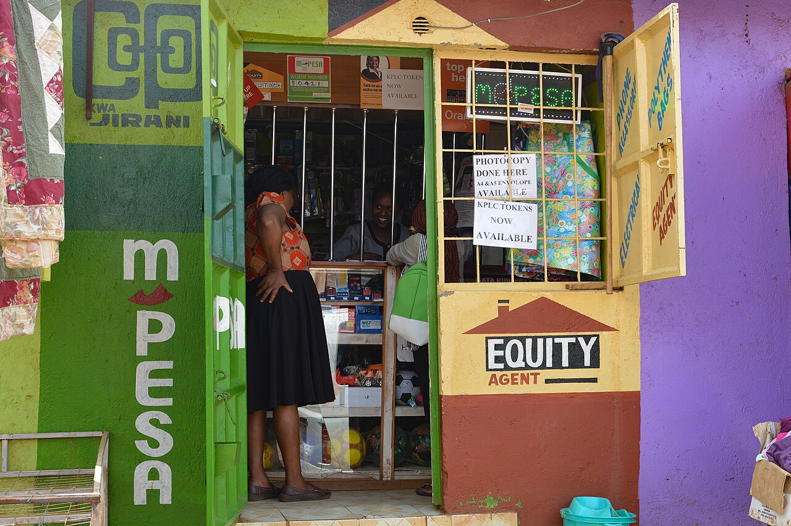
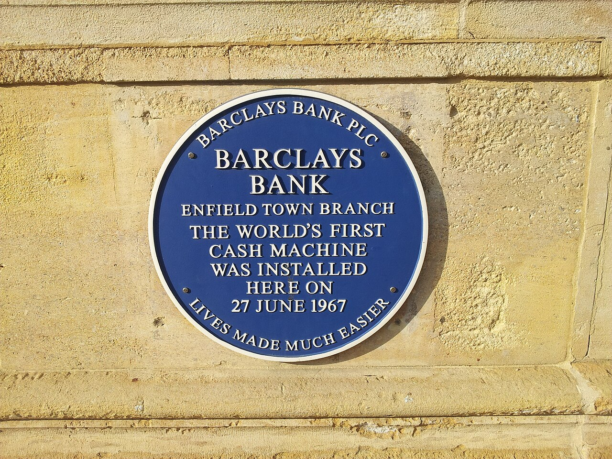
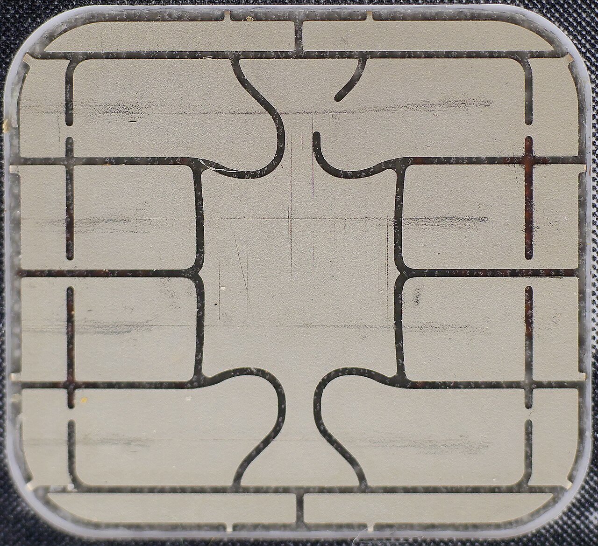
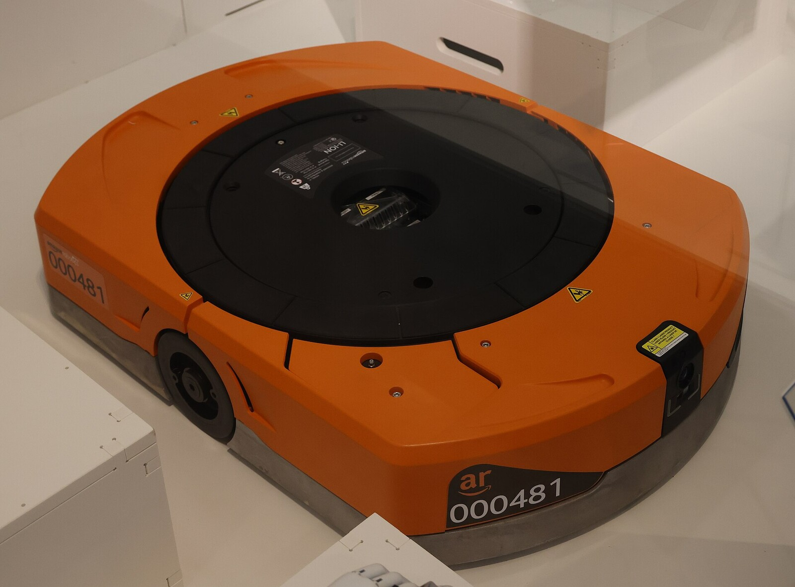
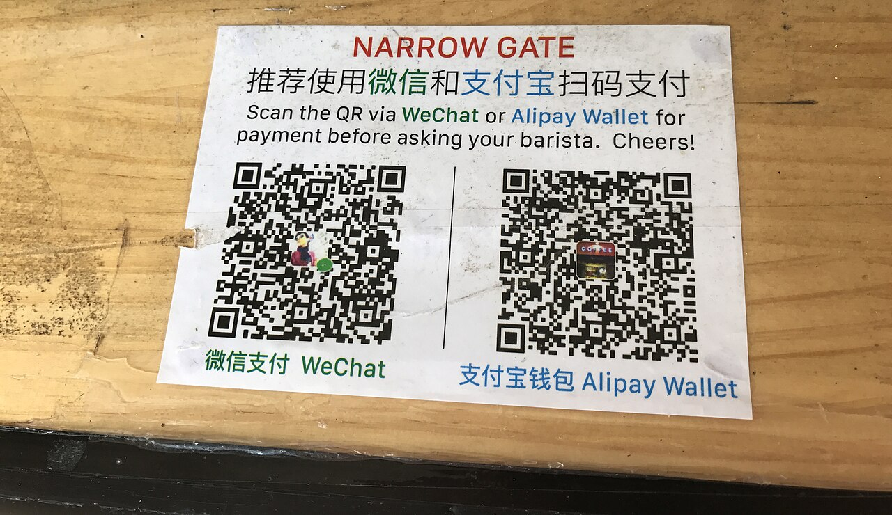
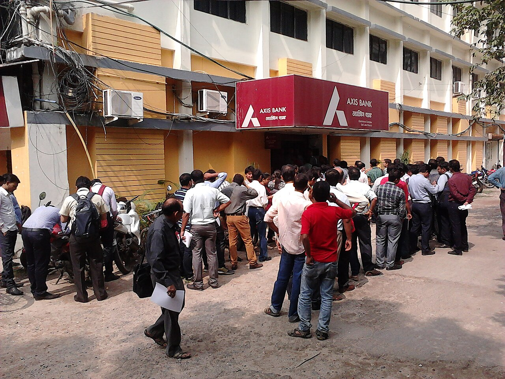
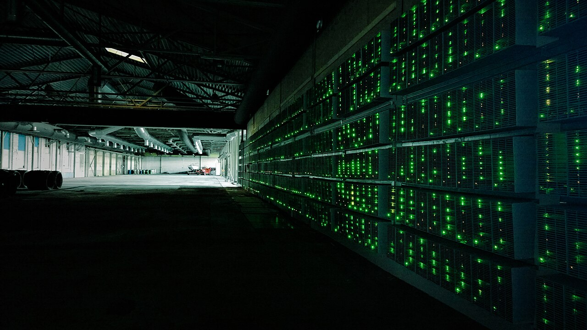
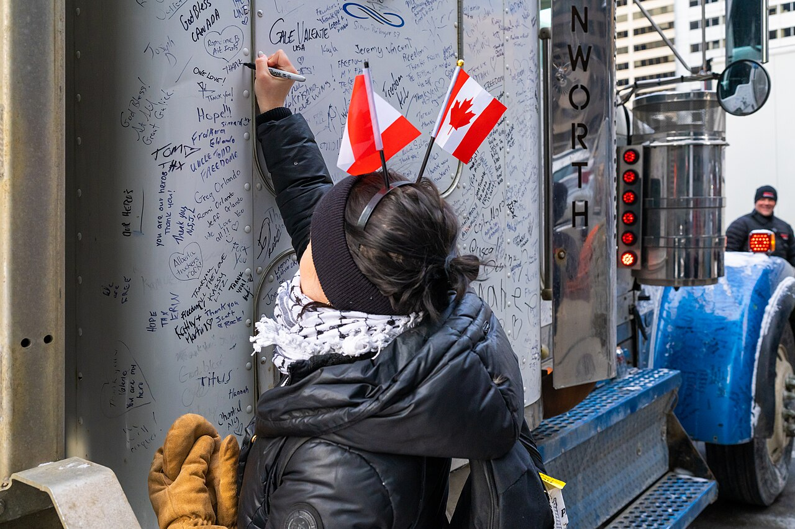

# 108. Where does the money go when you tap a card?

*Kenya, the United States, China, India and Sweden, from 1950 to 2025*

No coin or note goes anywhere. When a card is tapped, a message is sent, and soon afterwards numbers are changed in the books of two banks. Most money had been an entry in a bank's books for a long time already. What is new is that nearly every purchase has become a record too, kept by a company or a government.

At a vegetable stall in one of the markets of Nairobi, the capital of Kenya, a woman buys tomatoes and onions. She takes out a plain mobile telephone with buttons, the kind that cost twenty dollars, and types in a short number painted on a board above the stall, then the price, then a four-figure code. The stallholder's own telephone buzzes in her apron pocket. She glances at the message, nods, and hands over the bag.

No coin or note has changed hands, and neither woman has a bank account or a card. The buyer has just sent the seller two hundred Kenyan shillings by text message.

## Send money home

Until 2007 a Kenyan who worked in the city and wanted to send part of his wages to his family in a village had few choices. Banks were for the well-off and had no branches in the countryside. He could travel home himself, losing days of work. More often he sealed the notes in an envelope and gave it to a bus driver, or to a friend who was going that way, and hoped. If the envelope never arrived, there was little he could do.

In March 2007 the country's largest mobile telephone company launched a service called M-Pesa. The M stood for mobile, and *pesa* is the word for money in Swahili. Kenyans were already in the habit of sending one another prepaid telephone minutes as a kind of currency. The company made it official.

The service works in three steps. First, a customer hands cash to one of its agents, who are mostly the keepers of the small kiosks that sell telephone credit and soap in every village, and the agent credits the same sum to the customer's telephone number. The cash itself is kept in ordinary banks, in a trust that the telephone company cannot spend, so that the money on the telephones is always backed by money in the bank. Second, the customer can send any part of it to any other telephone in the country. Finally, the person who receives it can walk to the nearest kiosk and turn it back into cash.

*An M-Pesa agent in Nairobi, Kenya, in 2016. A kiosk like this takes a customer's cash and credits the same sum to the customer's telephone number. Photo: Fiona Graham, CC BY-SA 2.0.*

The man in the city could now send his wages home in a minute, and his family could collect them at the kiosk down the road.

Within three years nine million Kenyans had signed up. Today nearly every adult uses it, and the payments made through it in a year add up to more than twice the country's annual income.

The benefits went beyond convenience. Economists who followed several thousand households over six years found that the service had lifted about one Kenyan family in fifty out of extreme poverty. The effect was strongest in households headed by women, many of whom used their new means of saving and receiving money to give up farming for small trade.

## Numbers in a book

What the Kenyan telephone company had built was a bank ledger, held in a computer and operated from a keypad. That is what most money already was. The telephone company had not invented a new kind of money so much as found a new way to reach the old kind.

A coin has value in itself, or once did. A banknote is a piece of paper that a government declares to be money. Coins and notes are what most people picture when they think of money. Both together make up a small part of the money in a modern country, less than a tenth. The rest exists only as figures in the accounts of banks.

When an employer pays a salary, no notes are moved from one vault to another. Instead, the bank lowers the number beside the employer's name and raises the number beside the worker's. The money has moved, but nothing has travelled. This had been true since the nineteenth century, when the figures were written by clerks in bound books.

For ordinary shopping, however, people went on using cash, because a shopkeeper could not see into a customer's bank account. A stranger's notes could be counted on the spot. A stranger's promise could not.

The cheque was one way round the problem, though not a good one. A cheque was a written instruction to the bank to change the numbers, and the shopkeeper had to trust that the money was there. If it was not, he found out days later, when the goods were long gone. The story of the last seventy years is the story of how that trust was automated.

## Sixty thousand envelopes

In 1950 a New York businessman, who liked to say that the idea had come to him when he found himself in a restaurant without his wallet, offered two hundred acquaintances a small cardboard card, which twenty-seven restaurants in Manhattan had agreed to accept in place of money. The diner signed the bill. The card company paid the restaurant, less seven per cent for its trouble, and sent the diner one account at the end of the month. The card, in other words, was a promise that a third party would pay, and the restaurant trusted the company instead of the stranger.

That was a convenience for salesmen with expense accounts. The card as most people know it was born eight years later, in a farming town in California. In September 1958 the largest bank in the state posted sixty thousand plastic cards to its customers in Fresno, none of whom had asked for one. Each card came with a limit of a few hundred dollars. The holder could use it in any shop in town that had signed up and, unlike the diner, need not pay in full at the end of the month. He could carry the debt forward, at interest of eighteen per cent a year. That difference mattered more than anything else about the card. A card that let people borrow was a card that could earn the bank interest.

The bank had chosen to post cards unasked because of a puzzle. No shop would accept a card that few customers carried, and no customer wanted a card that few shops accepted. Each side was waiting for the other to move first. Blanketing a whole town solved both at a stroke, because every shop in Fresno now faced a town full of cardholders.

It was nearly a catastrophe. Cards were stolen from letter boxes, a fifth of the holders did not pay, and the bank lost millions of dollars. Nevertheless, it persisted, and within a few years the card was making money. In 1966 it began licensing the scheme to banks in other states and countries, and ten years after that the network was given a name chosen because it sounds the same in every language: Visa.

Meanwhile, two inventions let machines take over some of the clerks' work. In the 1960s an engineer at a computer company was trying to attach a strip of magnetic tape, which could hold an account number, to a plastic card, and every glue he tried warped the tape. His wife, who was ironing, suggested that he melt it on with the iron. It worked, and cards gained a stripe that a machine could read.

The other invention dispensed cash itself. In June 1967 a branch of a British bank in a London suburb unveiled a machine in its outside wall that gave out ten-pound notes at any hour. Its inventor said that the idea had come to him in the bath, from thinking about chocolate vending machines.

*The plaque on the Enfield branch of Barclays Bank in north London, recording that the world's first cash machine was installed there on 27 June 1967. Photo: LondonHistoryatHome, CC BY-SA 4.0.*

## One second

Decades of such inventions lie behind a moment that now passes unnoticed. Tap a card on a shop's terminal today, and about a second passes before it beeps. In that second a message makes a round trip from the shop, through three other organisations, and back.

First, the terminal reads the account number from the chip in the card and sends it, with the amount, to the shop's own bank. That bank passes it to the card network, which is a switchboard connecting thousands of banks. The network looks at the first digits of the number, works out which bank issued the card, and forwards the question: will you pay this?

The cardholder's bank checks that the account exists and has the money or the credit. Its computer also gives the purchase a score for the likelihood of fraud, by comparing it with everything the cardholder has bought before. The question is whether this purchase looks like the person who owns the card. A coffee in the usual street passes. A television bought at three in the morning in another country may not. The answer travels back along the same chain, and the terminal beeps.

*The contact plate of the chip on a Mastercard credit card. A terminal reads the chip through these contacts when the card is pushed into it; a tapped card talks to the terminal by radio, through an aerial hidden in the plastic. Photo: Bautsch, CC0.*

No money has moved yet. All that has passed is a question and an answer. At the end of the day the network adds up what every bank owes every other and tells each one a single net figure, and the banks adjust their accounts with one another. A whole day's purchases are thus settled with a few changes to a few numbers. The shop is paid a day or two later.

It is not paid in full, because everybody in the chain takes a share. Out of every hundred dollars spent by card in the United States, the shop receives about ninety-eight. Most of the difference goes to the bank that issued the card, a little to the network and a little to the shop's bank. In Europe the law caps the largest of those fees at a fraction of the American level. American shops hand over nearly two hundred billion dollars a year this way, and they recover it by charging higher prices to everybody.

That produces an odd transfer, from those who pay in cash to those who pay by card. The issuing banks use much of their share to pay for the air miles and cash rewards that persuade people to use their cards, and the most generous rewards go to the customers who spend the most. The poorest customers, who pay in cash, pay the same higher prices and get nothing back. In effect, part of the poor shopper's money helps to pay for the rich shopper's holiday flights.

For the banks that issue cards, however, the fees are not the main business. The larger profit is in the debt. Americans owe well over a trillion dollars on their cards, at an average interest rate above twenty per cent.

## A compact disc

Paying a stranger in a shop is one thing. Paying a stranger over a telephone wire, on a network where any message can be read by any machine that it passes through, is another. In the early 1990s most people who understood the internet thought that nobody would ever type a card number into it. Anyone along the way could copy the number and use it.

The solution had been worked out in the 1970s, and the version still in use was published in 1977 by three mathematicians. Ordinary codes use one key, which both sender and receiver must know, and which must therefore somehow be passed between them in secret. That is no help to a shop that wants millions of strangers to send it secrets, since it cannot meet each of them first. Instead, the three devised a lock with two keys. One of them closes it and the other opens it, and knowing the first tells you nothing useful about the second. Picture a padlock that anyone can snap shut but only its owner can open. A shop can publish its closing key to the whole world. Anyone can use it to scramble a card number, and only the shop, which keeps the opening key to itself, can unscramble it.

On 11 August 1994 a man in Philadelphia used a program built on that idea to buy a compact disc by an English singer, for twelve dollars and forty-eight cents plus postage, from a website run by a group of recent graduates in New Hampshire. It is the first purchase known to have been made securely over the internet. The purchase was small, but it showed that strangers could pay one another safely across the network. The following July a former Wall Street analyst began selling books online from a garage near Seattle.

## The parcel

The bookshop grew into something much larger. An order placed with that bookseller today sets off a chain that reaches round the world. The message goes to a warehouse the size of twenty football fields, where a human "picker" stands at a station while squat orange robots bring the shelves to her, and a screen tells her which item to take and how many seconds she has taken over the last one. Instead of the worker walking to the shelves, the shelves come to the worker, and her pace is timed.

The company employs a million and a half people and a million robots. The goods very probably came in a steel box from a factory in China. The parcel is brought to the door by a driver who is, in many cases, not an employee of anyone, and who is routed and timed by an application on his telephone.

*An Amazon warehouse robot, photographed in 2023. The company says it uses a million of them. Photo: Geni, CC BY-SA 4.0.*

The customer gets almost anything, cheaply, the next day. The cost fell on the shops, which could not match those prices or that speed. Booksellers went first, then sellers of records, toys, clothes and electrical goods. In many towns the main shopping street, which for a century and a half had been where people met one another, is now a row of empty windows.

## Red envelopes

China largely skipped the card. In the early 2000s few Chinese used one to shop, and small shops did not have the terminals. When the country's largest online marketplace needed a way for strangers to pay one another, it set up its own, in 2004, which held the buyer's money until the goods arrived. Neither stranger had to trust the other, because the marketplace stood between them. Nine years later the company behind the most popular messaging application added payments to it.

Both worked through the mobile telephone, using a square pattern of black and white dots that a telephone's camera can read. The pattern carries the seller's account details, and the buyer's telephone does the rest. A seller therefore needs no equipment at all. He prints his pattern on a sheet of paper and tapes it to his cart. At the lunar new year of 2014, when Chinese families give children money in red envelopes, the messaging company invited its users to send digital ones, and several million people linked their bank accounts to it in a week. Within a few years cash had almost vanished from Chinese cities. Street musicians and beggars put out the square pattern in place of a hat.

*A sign in China in 2017 with two square patterns, one for WeChat and one for Alipay, so that customers can pay by telephone. Photo: Harald Groven, CC BY-SA 2.0.*

The convenience had a price that was easy to overlook. Two companies had come to handle nearly all the everyday payments of a billion people, and with them a record of where each person had been and what each had bought. In November 2020 the Chinese government stopped the larger of the two from selling shares to the public, two days before what would have been the biggest such sale in history, and brought both under the supervision of the central bank. The state now has access to the record. A system built by private companies for shopping had become, in the end, an instrument of the state as well.

## A public road

India took a third course. Instead of leaving payments to banks and card networks, as in America, or to two giant companies, as in China, it built a shared system that anyone could use. In 2016 a body set up by the central bank and owned by the country's banks switched on a payments system, known by its initials as UPI, that worked like a public road. Any bank, and any telephone application that meets its rules and works through a member bank, may connect to it. A person chooses a short address, like an email address, and money sent to it moves from one bank account to another in a few seconds, at any hour, for nothing. Neither the payer nor the shopkeeper pays a fee.

It rested on two earlier programmes, each of which helped it reach people. First, the government had issued more than a billion Indians with an identity number tied to their fingerprints and the pattern of their eyes, so that a bank could know who a customer was. Second, it was opening basic bank accounts by the hundred million for people who had never had one.

On the evening of 8 November 2016 the prime minister announced on television that, as of midnight, the two largest banknotes, which made up eighty-six per cent of all the cash in the country, would no longer be legal tender. The aim was to flush out untaxed wealth. People holding piles of hidden notes would have to bring them to a bank, and explain where they had come from. It caused months of chaos, with queues at every bank and labourers going unpaid, and it did little to hurt the tax evaders. It did, however, push tens of millions of people into paying by telephone, and within a few years most of them were doing so over UPI. Indians now make about twenty billion payments a month on it, nearly half of all the instant digital payments in the world, down to a few rupees for a cup of tea at a roadside stall.

*People queueing outside a bank in Kolkata, India, on 10 November 2016, two days after the announcement, to deposit and exchange the old banknotes. Photo: Biswarup Ganguly, CC BY 3.0.*

## Ten thousand for two pizzas

Every one of these systems depends on somebody in the middle who keeps the ledger and must be trusted: a bank, a network, a telephone company, a state. On 31 October 2008, six weeks after the collapse of Lehman Brothers, a nine-page paper was posted to an email list for cryptographers under the name Satoshi Nakamoto. It described a form of electronic cash that needed nobody in the middle. The timing gave the idea its appeal, because the middlemen had just shown that they could fail.

The idea was to give the ledger to everyone. If every participant held a copy of the books, nobody would need to trust a single bookkeeper.

Each owner of coins holds a secret key, of the two-key kind, with which to sign a payment, and anyone can check the signature without learning the key. Every payment ever made is recorded in a single list, and thousands of computers around the world each hold a complete copy.

New payments are gathered into a block every ten minutes or so and added to the end. The danger in a shared list is that somebody might rewrite it. To stop anyone from rewriting the list in his own favour, adding a block is made deliberately hard. Computers compete to solve an arithmetical puzzle that can be cracked only by trillions of guesses, and the winner is rewarded with newly created coins. Since each block is mathematically chained to the one before it, to alter an old entry a cheat would have to redo all the work that has been done since, faster than the rest of the world combined.

The rules fix the total number of coins that will ever exist at twenty-one million.

The first block was created on 3 January 2009. Buried in it was the headline of that morning's London *Times*: "Chancellor on brink of second bailout for banks". The inventor called the currency Bitcoin, handed the project to others two years later, and vanished. Nobody has established who he, she or they were, and nearly all of the million or so coins that he is thought to have created in the first months have never been touched.

On 18 May 2010 a programmer in Florida offered ten thousand bitcoins to anyone who would have two pizzas delivered to his house. Someone took the offer. At the prices of late 2024 those coins would have been worth a billion dollars. In hindsight, they were very expensive pizzas.

That is the difficulty. A currency whose value can double or halve in a few months is of little use for buying pizza. A buyer is reluctant to spend a coin that may be worth twice as much next spring, and a seller to accept one that may be worth half. The system is also slow. It can handle only about seven payments a second, where the card networks handle tens of thousands. The puzzle-solving uses as much electricity as a middle-sized country.

As a result, Bitcoin and its thousands of imitators have served chiefly as something to bet on, and as the favoured currency of people who lock up a hospital's computers and demand a ransom. They have also been a refuge for savers in countries whose own money is melting away.

The promise of doing without middlemen also proved hard to keep. In 2022 one of the largest exchanges on which such coins were traded collapsed, and its founder went to prison for twenty-five years for stealing his customers' deposits. Trust, it turned out, had only been moved to a new set of middlemen.

*A Bitcoin mining farm in 2014: a hall of computers that do nothing but solve the puzzles. Photo: Marko Ahtisaari, CC BY 2.0.*

## Switched off

A system that records every payment gives great power to whoever holds the records. That power is seldom noticed until it is used.

In February 2022 lorry drivers protesting against vaccination rules blocked the centre of the Canadian capital for three weeks. The government invoked an emergency law and ordered the banks to freeze the accounts of people connected with the protest, without going to a court. About two hundred and eighty accounts and cards were frozen, and their holders could not touch their own money.

A few weeks later the Western powers began to cut the largest Russian banks off from the messaging system through which the world's banks send one another payment instructions. One was done to protesters in a democracy and the other to a state that had invaded its neighbour, and both were done by an order to the people who keep the records.

*A protester writing on a lorry in Ottawa on 12 February 2022, during the blockade of the city centre. Photo: Maksim Sokolov, CC BY-SA 4.0.*

Cash leaves no record. A payment in notes cannot be profiled or sold to advertisers, and money in a drawer cannot be frozen from a distance the way a bank account can.

Cash also serves people whom the new systems do not reach. As it disappears, those who cannot or will not use the alternatives are shut out. About one and a third billion adults in the world still have no account of any kind. In the rich countries it is the old, the homeless and the recently arrived who find that the bus, the car park and the public lavatory no longer take coins.

Sweden has gone further than most countries towards doing without cash. Fewer than one purchase in ten there is made in cash, many shops and most bank branches refuse to handle it, and Swedes pay one another by telephone as a matter of course. In 2024 the Swedish government posted a booklet to every household in the country, explaining how to prepare for a war or a breakdown of the electronic networks. It listed the things that every home should keep in reserve: water, tinned food, a radio with batteries. On the list, in one of the countries that use cash least, was a supply of banknotes and coins sufficient for a week.
