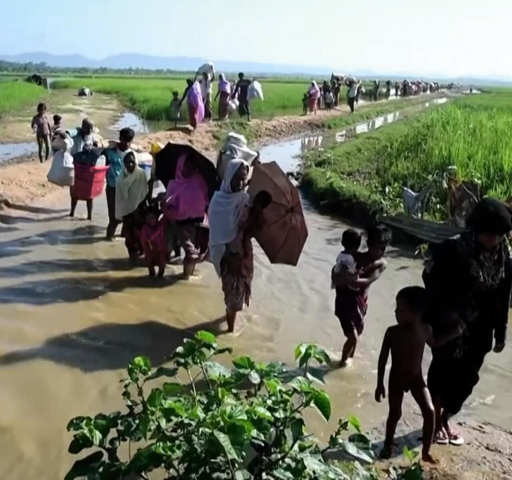
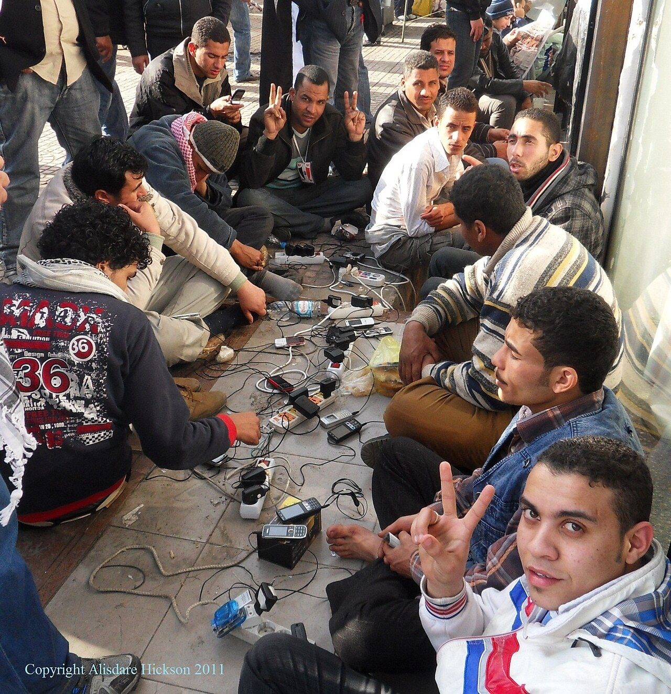
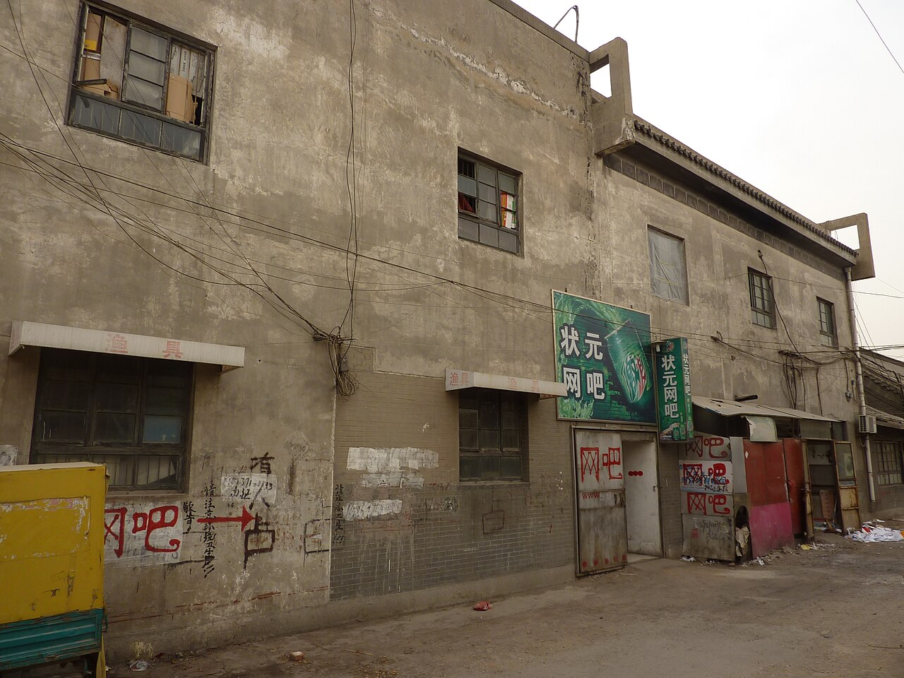
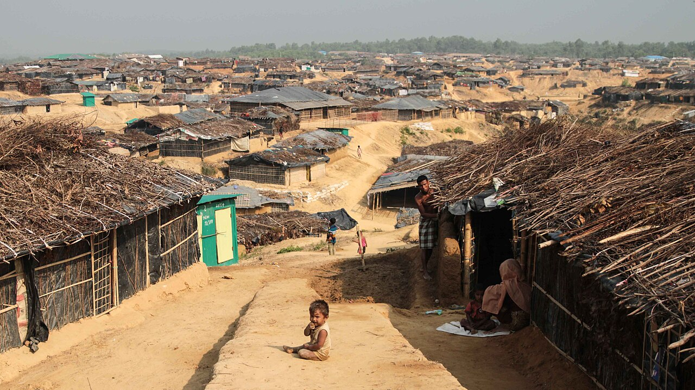

# 109. Who decides what you see online?

*Myanmar, the United States and China, from 2004 to 2025*

For most of what people see on a social network or a video site, a piece of software decides, and it belongs to one of a handful of companies. Out of everything that could be shown to each person, it picks the items most likely to keep that person looking, because the person's attention is what the company sells. Lies and rumours are as old as speech. What is new is that they can reach everyone at once, at no cost, sorted by rules that are a trade secret.

In 2011 a SIM card, the chip that connects a mobile telephone to a network, cost more than two hundred dollars in Myanmar, the country once called Burma. It had been ruled by generals for fifty years, and they did not want their people to talk to one another. Only two or three people in a hundred had a mobile telephone.

Then the generals began to loosen their grip, and foreign telephone companies were let in. By 2014 a SIM card cost a dollar and a half. Cheap Chinese smartphones flooded the markets, and the stallholders who sold them set them up for their customers before handing them over. They installed one application, the social network Facebook, which under a deal with the telephone companies could be used without paying for data. For most Burmese, who had never used a computer or seen a web page, that blue icon was the internet. The country went from about two million users to eighteen million in four years.

Myanmar is mostly Buddhist. In its western coastal state lived about a million Muslims, the Rohingya, whom the government had stripped of citizenship in 1982 and described as illegal immigrants. Through the new medium there now poured a stream of posts describing them as dogs, maggots and rapists who were breeding to take over the country. Some came from nationalist monks. Many, it emerged later, came from a secret operation of several hundred army personnel, who ran fake pages devoted to pop stars and beauty tips, built up large followings, and then used them to spread invented stories of Muslim atrocities.

In 2014, when a false report of a rape set off riots in the country's second city, the company had one reviewer who could read Burmese. He worked in Ireland. The next year it had four.

On 25 August 2017, after attacks on police posts by a small Rohingya armed group, the army moved into the Rohingya villages. Soldiers and local mobs burned more than three hundred of them, shot those who fled, and raped the women. A medical charity, from surveys in the refugee camps, estimated at least six thousand seven hundred killed in the first month. Seven hundred thousand people walked and waded across the border into Bangladesh, where they still live in the largest refugee camp on Earth.

*Rohingya refugees walking into Bangladesh in 2017, after being driven out of Myanmar. Photo: Zlatica Hoke, Voice of America, public domain.*

## Old lies

None of the hatred was new, and neither was the use of a new medium to spread it. The printing press, within decades of its invention, was turning out pamphlets accusing Jews of murdering children. The most successful forgery of modern times, the supposed minutes of a Jewish plot to rule the world, was proved a fake in 1921 and went on being printed by the million. In Rwanda in 1994 a popular radio station read out the names of people to be killed.

*The cover of the first British edition of the Protocols, published in London in 1920. The text was a forgery, proved so in 1921. Photo: public domain.*

For most of the twentieth century, however, reaching a large audience was expensive. It took a printing plant, or a broadcasting licence, of which there were few. Those who owned them were a small group who could be identified, sued, regulated and shamed, and between a rumour and the public stood editors whose job was to ask whether it was true. They were often wrong, biased or bought. They were also a filter.

## A dormitory

The internet removed the cost. In 2004 a nineteen-year-old student at an American university wrote, in his dormitory room, a website on which his fellow students could post a photograph and a few facts about themselves and link to their friends. He called it Facebook. Within a year the same idea had been applied to videos, by YouTube, and the year after that to short messages, by Twitter. In 2007 came the telephone with a screen, which meant that people carried all of it with them.

The student's site had a billion users by 2012 and three billion by 2023. People who use the internet now spend, on average, nearly two and a half hours a day on such services. Any of them can publish a sentence, a picture or a film that can be seen an hour later by a farmer in Brazil or a minister in Delhi, and no editor has to approve it first.

## The product

These services are free to the people who use them. Their income comes from advertisers, and what they sell is the attention of their users, together with a detailed knowledge of who each user is. A company that knows a person's age, town, friends, the pages she lingers on and the things she has searched for can show an advertisement for pushchairs only to women who are probably pregnant. No newspaper could ever do that. The two largest, the owners of Google and of Facebook, took in more than four hundred billion dollars from advertising in 2024.

*A data centre of Google outside Pryor, Oklahoma, in 2019. Photo: Xpda, CC BY-SA 4.0.*

That money used to go elsewhere. In 2005 American newspapers earned forty-nine billion dollars a year from advertising, which paid for most of their reporters. Twenty years later they earned less than a fifth of that. More than a third of the country's newspapers have closed, most of them small local ones, and the number of journalists employed by those that remain has fallen by more than half. In a great many towns nobody is now paid to sit through the meetings of the council.

## The feed

A person with three hundred friends, who also follows a few dozen pages and groups, could be shown several thousand new items every day. Nobody can read that many. In 2006 the largest network began to assemble them into a single list for each user, and before long it was arranging that list in an order of its own choosing. It is called the feed.

The ordering is done by a ranking system, and it works roughly as follows. For each item that might be shown to a particular person, the system calculates a score, which is its estimate of how likely that person is to react: to click on it, to watch it to the end, to press the button that signals approval, to write a comment, to pass it on. It makes those estimates from the record of how that person, and millions of people like her, have reacted to similar things in the past. The items are sorted by score, and the top few are shown. Her reactions to those are recorded and fed back, and the next estimate is a little better. The system is told what to aim for by the company's engineers. It has usually been told to aim for more reactions and more time spent, since those are what bring in the advertisers.

![Diagram of how a feed is ranked. On the left, a grid of several thousand items that might be shown to one person. The ranking system gives each a score, drawn as a bar, for how likely she is to click, watch to the end, approve, comment or pass it on. The items are sorted by score; the top few are shown in her feed on a telephone and the rest are not. Her reactions go back into a record of how she and millions like her have reacted, which feeds the next scores. A box at the top left says that the company's engineers set the aim: more reactions, more time spent](images/diagram_feed.png)
*How a feed is ranked: every item that might be shown is given a score for how likely the person is to react, the top few are shown, and the reactions are fed back to make the next estimate. Not to scale. Diagram: drawn for this book.*

Nobody decided that the feed should favour anger. It emerged from the arithmetic. People react most to what stirs them, and what stirs them most reliably is something that makes them indignant, frightened or disgusted, especially about a group that they already dislike. A system that is rewarded for reactions learns to show them such things. In 2016 the company added a row of little faces with which users could respond to a post, and for some time its system counted an angry face as worth five times an ordinary sign of approval. Its own researchers warned that this was pushing outrage and falsehood to the top. A former employee carried tens of thousands of pages of such internal reports out of the building in 2021 and gave them to the American Congress.

Three researchers at an American university studied a hundred and twenty-six thousand news stories that had spread on Twitter over eleven years and had been checked by independent fact-checkers. They found that a false story reached its first fifteen hundred readers about six times as fast as a true one, and was passed on far more often. The explanation was not automated accounts. It was human beings, who found the false stories more surprising, and shared them.

The design of the screen does the rest. The feed has no bottom. The engineer who invented the page that keeps loading as the reader scrolls has said that he regrets it, and compares it to a glass that refills itself from below.

## Seventy per cent

The same principle chooses the next film. On the largest video service, five hundred hours of new material are uploaded every minute, and the company has said that seven tenths of what people watch there is chosen for them by its recommendation system. A newer service, owned by a Chinese company, shows films a few seconds long, one after another, and learns chiefly from how long the viewer lingers on each. Within two hours it has worked out a new user's tastes.

## Squares

At first all this looked like a gift to freedom. In 2010 an Egyptian who worked for an American internet company set up an anonymous page in memory of a young man who had been beaten to death by the police in Alexandria. Hundreds of thousands joined it. In January 2011 the page named a date and a square, and the protest that it called brought down a president who had ruled for thirty years.

*Protesters charging their mobile telephones from a shared bundle of cables in Tahrir Square, Cairo, on 10 February 2011. Photo: Alisdare Hickson, CC BY-SA 2.0.*

Governments were watching, and they learned quickly. The same networks that let protesters find one another let the police find the protesters. Within a few years the security services of the region were using them to identify dissidents, to flood discussions with their own supporters, and to spread stories that set their opponents against each other.

## A building in St Petersburg

In 2016 it was the turn of the country where the networks had been invented. During that year's presidential election, several hundred employees of a private company in the Russian city of St Petersburg, working shifts in an office block, posed online as American activists of every kind: Black campaigners against police violence, Texas separatists, evangelical Christians, Muslim community groups. They organised real rallies by remote control and spent about a hundred thousand dollars on advertisements. The largest network later told Congress that their posts had reached a hundred and twenty-six million Americans.

*The building at 55 Savushkina Street in St Petersburg that housed the Internet Research Agency, photographed in 2018. Photo: Charles Maynes, public domain.*

Two years later it came out that a political consultancy had obtained the personal details of eighty-seven million users of that network, through a personality quiz, in order to target voters. Facebook paid a penalty of five billion dollars for its carelessness with its users' data.

What effect any of this had is much less certain than the alarm suggested. The Russian posts were a tiny fraction of what Americans saw that year. A study of those on Twitter found that most of them reached people who were already strongly partisan, and found no sign that they changed anyone's vote. Americans have grown more hostile to those on the other political side, and the change has been greatest among the old, who use social media least. In 2020 the largest company allowed outside scientists to alter the feeds of tens of thousands of volunteers for three months. Removing the ranking system changed what they saw. It did not measurably change what they believed.

Other harms are better established. In India in 2017 and 2018, rumours about gangs of child kidnappers, passed from group to group on a messaging application, led village mobs to beat more than two dozen strangers to death. The company's own research on its photograph-sharing service, which it did not publish, found that about one teenage girl in three who already felt bad about her body said that it made her feel worse. Rates of depression and self-harm among girls in several rich countries began to rise around 2012, when most of them acquired a smartphone, and psychologists are still arguing over how much of that is cause and how much coincidence.

## Fifteen thousand

The companies do remove things, and the way it is done is among the least known parts of the system.

Most of the work is performed by software trained to recognise nudity, gore and banned words. What the software cannot judge is passed to people. The largest company employs about fifteen thousand of them, through contractors, in cities such as Manila, Hyderabad and Nairobi, where some have been paid less than two dollars an hour. They sit at screens for eight hours and are shown, one after another, the things that other users have reported: beheadings, the rape of children, animals being tortured, suicides broadcast live. They have a few seconds to decide on each. Many have been left with the symptoms of soldiers who have seen combat. In 2020 the company paid fifty-two million dollars to settle a claim by its American reviewers.

What the companies choose to leave up or take down is largely their own affair. A sentence of twenty-six words in an American law of 1996 provides that a service which carries what other people post is not to be treated as its publisher. In America a newspaper can be made to pay for printing a libel. A social network cannot be made to pay for spreading one that a user has posted.

That leaves decisions affecting billions in very few hands. In January 2021, after a crowd of his supporters stormed the American Congress, the outgoing president was removed from the main networks within a week, on the judgement of a few executives. The following year the richest man in the world bought one of those networks for forty-four billion dollars, dismissed most of the staff who dealt with abuse, and restored the accounts. In 2025 the largest company announced that it would stop employing fact-checkers in the United States.

*A crowd outside the United States Capitol on 6 January 2021. Photo: TapTheForwardAssist, CC BY-SA 4.0.*

## The other internet

One large country chose a different road from the beginning. China sealed its internet off from the world's. The largest foreign search engine and social networks are blocked, and their Chinese equivalents, which are as large and as inventive, are required by law to police what their users say.

*The back entrance to an internet cafe on the second floor of a building in Qufu, China, in 2011. Internet cafes were long the way many Chinese went online. Photo: Vmenkov, CC BY-SA 3.0.*

They do it thoroughly. Posts containing banned terms disappear within minutes, and the list changes daily. It has included the date of the killings in Beijing in 1989, the candle symbol, and for a time the name of a honey-loving cartoon bear, to whom the country's leader had been compared. State media have put the number of people employed to watch online opinion at two million.

The method is subtler than silence. Three American scholars obtained a leaked archive from one district's propaganda office and estimated that government employees across China were fabricating about four hundred and fifty million social media comments a year. Hardly any of these argued with critics. Nearly all were cheerful posts about national holidays, local achievements and the heroes of the revolution, released in bursts at moments when an awkward subject was beginning to attract attention. The purpose was to change the subject.

Other governments have tried other means. India has cut off the internet in one district or another several hundred times. The European Union has passed laws that require the largest services to explain how their ranking systems work and to assess the harm that they may do. Australia has required the main social networks to keep out children under sixteen.

## A voice that never spoke

Until recently one kind of evidence could still be trusted. A photograph might be staged, but to forge a convincing film of a real person saying something that he had not said was beyond anyone except a film studio.

Since 2022 software that anyone can use has been able to produce a picture of anything from a typed description, and to imitate a particular person's voice from a recording a few seconds long. Two days before a national election in Slovakia in 2023, a recording circulated in which one of the party leaders appeared to be discussing how to rig the vote. It was a fabrication. It was denounced as a fake at once, but in the two days before the vote Slovak law forbade campaigning, and he lost.

The deeper effect may be the reverse of the obvious one. When any recording can be faked, a politician caught on a real one has only to say that it is false.

## An admission

In 2018 a United Nations mission that had investigated the killings in Myanmar said that Facebook had played a determining role in spreading the hatred that led to them. In November of that year the company published the findings of an inquiry that it had commissioned itself. We weren't doing enough, it said, to help prevent our platform from being used to foment division and incite offline violence. We agree that we can and should do more.

*Kutupalong refugee camp in Bangladesh, photographed in March 2017, before the arrivals of that August made it the largest in the world. Photo: John Owens, Voice of America, public domain.*

That summer it had removed the pages of the army's commanders, and it was hiring a hundred reviewers who could read Burmese. By then most of the Rohingya were in Bangladesh. In 2021 a group of the refugees sued the company in a Californian court for a hundred and fifty billion dollars. In 2024 the court dismissed the case. It had been brought too late.
