# 11. Why did the Bronze Age end?

*The eastern Mediterranean, from about 3,900 years ago to about 3,100 years ago*

Because its kingdoms had come to depend on each other for almost everything that made them strong, and when trouble struck several of them at once, they went down together.

In the summer of 1982, a young man diving for sponges off the south coast of Turkey came up and told his captain that he had seen something odd on the seabed. There were metal objects lying in rows, he said, and they looked like biscuits with ears.

Archaeologists knew at once what he meant. In the age of bronze, copper was shipped as flat slabs, each about as heavy as a full suitcase, with four corners drawn out into handles so that two men could carry it. They went down to look. On a steep slope, some fifty metres under the surface, lay the cargo of a ship that had sunk about 3,300 years ago.

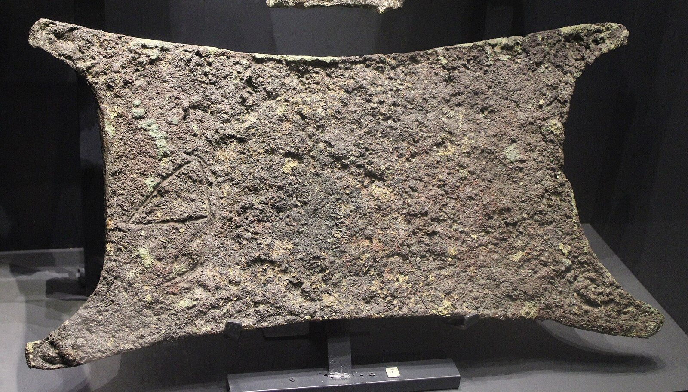
*One of the copper slabs from the wreck. Photo: Zunkir, CC BY-SA 4.0.*

It took eleven summers and more than twenty thousand dives to bring it up. The ship had been about fifteen metres long, built of cedar. She was carrying ten tonnes of copper, in about three hundred and fifty slabs and smaller ingots. Beside the copper lay one tonne of tin.

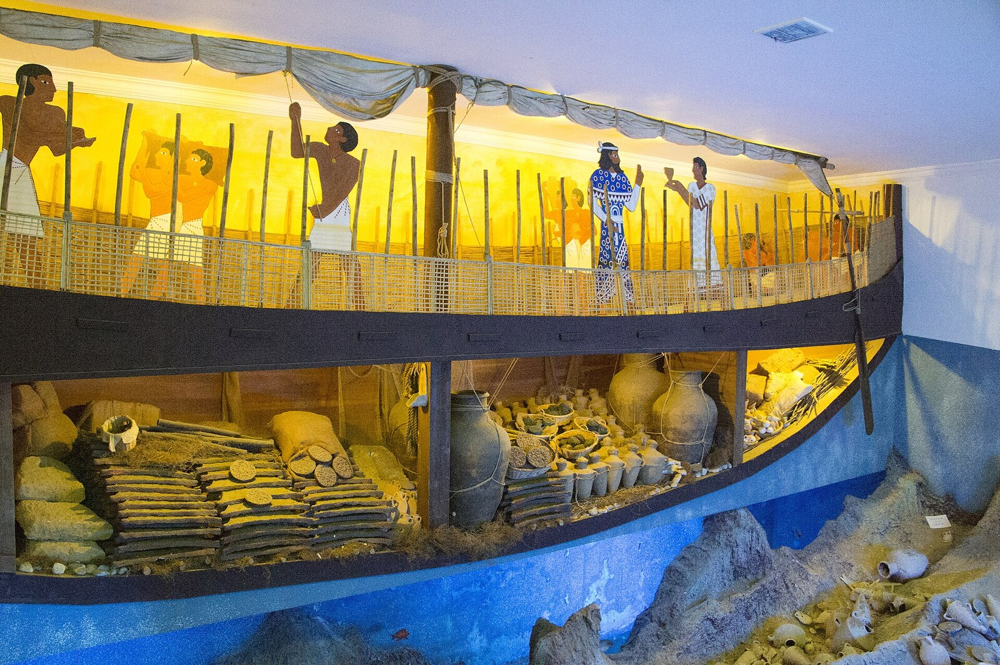
*A full-size model of the ship and her cargo, in the museum at Bodrum in Turkey. The copper slabs are stacked in rows along the bottom. Photo: Dosseman, CC BY-SA 4.0.*

There was a great deal more. There were thick cakes of coloured glass, most of them deep blue, for melting down and working. There were logs of black hardwood from tropical Africa, a length of elephant tusk, and more than a dozen hippopotamus teeth. The hold contained ostrich eggshells, tortoise shells, and a hundred and fifty tall jars, most of them full of a tree resin that was burned as incense. Among the smaller finds were beads of amber from the Baltic Sea, swords of two different countries, and a gold charm in the shape of a beetle, bearing the name of an Egyptian queen.

When the finds were sorted, they turned out to come from about a dozen different peoples, in lands that lie between the Baltic Sea and tropical Africa. All of it was in one ship of modest size. That cargo is the best single picture there is of a world that had become very rich, and very fragile, in the same way.

## Nine parts copper, one part tin

The two metals at the bottom of that ship were meant for each other, and the amounts were not an accident.

Copper was the first metal that people learned to smelt from its ore and cast. It is handsome and easy to work, but it has a serious fault, which is that it is soft. A copper knife loses its edge quickly, and a copper sword bends.

At some point, smiths found that adding a small amount of a second metal changed everything. Melt nine parts of copper with one part of tin, and the result is bronze. Bronze is much harder than copper. It takes a sharp edge and keeps it. It also melts at a lower heat and flows more freely into a mould, so that a smith can cast a complicated shape, such as an axe head with a socket for its handle, in one pour.

For about two thousand years, bronze was the best material that people had for anything that needed to be hard: axes, chisels, saws, razors, swords, spear points, armour and the fittings of a chariot. The ship off the Turkish coast was carrying its two ingredients in very nearly that proportion, ten of copper to one of tin. Melted together, her cargo would have made eleven tonnes of bronze, which is enough to arm several thousand soldiers.

The trouble with bronze lies in the second ingredient. Copper ore is found in many places. The island of Cyprus had so much of it that the metal's name, in most European languages, comes from the island's. Tin is another matter. It is one of the scarcer metals in the earth's crust, and there was almost none of it in the lands where the first cities grew. There was none in Egypt, almost none in Iraq, and none in Greece.

Some was mined in the mountains of southern Turkey. The other sources lay very far away: in the mountains of Central Asia to the east, or at the Atlantic end of Europe to the west. Chemists have tested the tin from the wreck to find where it was mined. One team traced about a third of it to mines in Central Asia, in what are now Uzbekistan and Tajikistan, more than three thousand kilometres from the place where the ship went down.

In other words, the kingdoms that used the most bronze had little or no tin of their own. Every bronze blade in Egypt or Greece contained metal that had crossed mountains and deserts, and had passed through the hands of many strangers on the way.

## The donkeys of Ashur

We know in some detail how that journey worked, because one group of the people who made their living from it kept their letters.

About 3,900 years ago, there was a small city called Ashur on the river Tigris, in the north of Iraq. It had little farmland and no mines. What it had was a position. Tin came to it from the east, carried by other traders. Fine woollen cloth came up from Babylonia in the south. A thousand kilometres to the north-west, across the mountains, lay the highlands of Turkey, which were rich in silver and gold, were busy making bronze, and had no tin of their own.

The merchants of Ashur put the two together. They loaded tin and cloth onto donkeys, about seventy kilos to an animal, and walked them over the mountains in caravans. The trip took six weeks. At the far end, in a town in the middle of Turkey, they kept a permanent settlement of their own, with houses, warehouses and an office that settled disputes.

In the ruins of those houses, archaeologists have found more than twenty thousand clay tablets. They are the merchants' private papers: letters, loans, receipts and lawsuits.

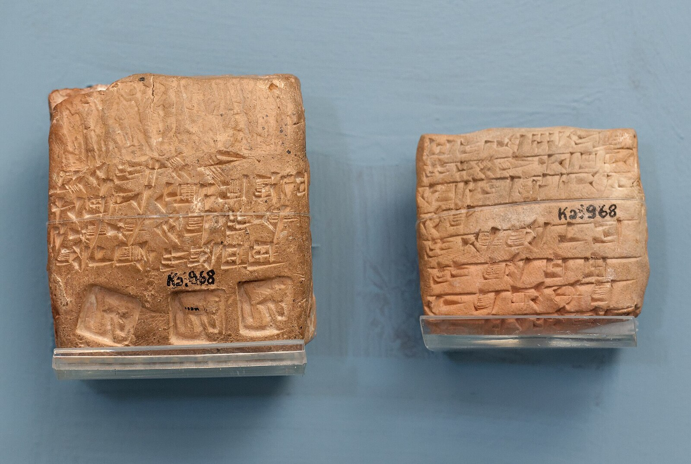
*A merchant's tablet from the settlement in Turkey, on the right, and the sealed clay envelope it travelled in. Photo: Marie-Lan Nguyen, public domain.*

The business they describe is strikingly familiar. It was run by family firms. The father stayed in Ashur and raised the money from investors, who put in gold for a term of years and took a share of the profit. The sons lived at the Turkish end and did the selling. Tin bought in Ashur sold in Turkey for about twice what it had cost. Out of that came the taxes owed to every local ruler along the road, the donkey drivers' wages, and losses to weather and thieves.

The wives ran the households in Ashur and wove much of the cloth that went on the donkeys, and they wrote to their husbands in a tone that needs no translation. One asks who the man is that lives in her husband's house and finds fault with her cloth every time it arrives, when she has done her best to make it and send it. Another tells her husband that he emptied the house when he left, and has not left her a single shekel of silver.

Now follow a single lump of tin along the whole of its road. It is dug by miners in Central Asia and carried west by traders whose names are lost. It is bought in Ashur, taxed, packed on a donkey, walked for six weeks, taxed several times more, and sold to a palace in Turkey. A smith there melts it with copper, which came down from mines in the Turkish hills. He pours a sword.

Behind that one sword stand the miners of two countries, three or four sets of merchants, a hundred donkeys, a dozen rulers who each took their cut, and a woman in Ashur who wove the cloth that paid for part of it. None of these people knew most of the others. If any link in that chain broke, the smith had no tin, and without tin he had only copper.

## Brothers

By about 3,400 years ago, the trade had grown from donkey caravans into something much larger, and the people who ran it were kings.

The lands around the eastern end of the Mediterranean were by then divided among a handful of great kingdoms. Egypt held the Nile and the coast of what is now Israel and Lebanon. A kingdom called Hatti ruled the middle of Turkey, and in time much of Syria, from a fortress city in the central highlands. Babylon held the south of Iraq, and Assyria, grown from that small trading city of Ashur, held the north. On the mainland of Greece and the island of Crete stood a number of palaces, each ruling its own district. Cyprus sat in the middle of the sea with its copper.

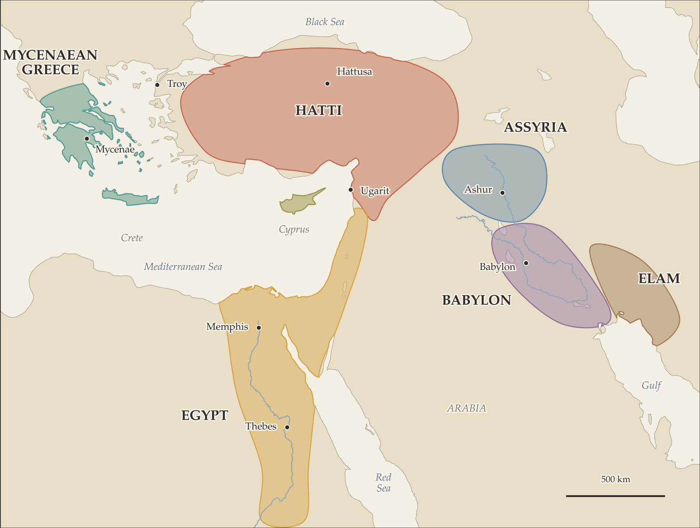
*The great kingdoms about 3,300 years ago. The coloured areas show roughly how far each one's power reached. Map: drawn for this book; coastlines and rivers from Natural Earth, public domain.*

No one of these powers was strong enough to conquer the others. Instead, they did business.

In 1887, villagers digging in the ruins of an Egyptian city found a hoard of clay tablets. There are about three hundred and fifty of them, and they are the foreign letters of the Egyptian court. Most were sent by the small princes who answered to Egypt. About fifty were written by one great king to another.

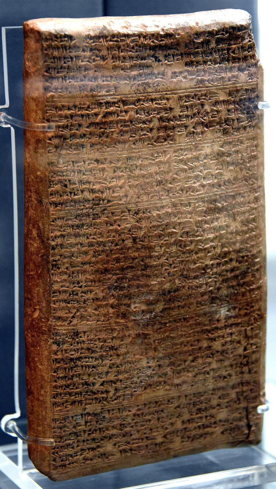
*One of the letters found in Egypt, from the king of a land in northern Syria to the king of Egypt. Photo: Osama Shukir Muhammed Amin, CC BY-SA 4.0.*

The great kings call each other "brother". They ask after each other's health, wives, horses and chariots. Then, almost always, they turn to presents. One king sends horses and blue stone, and asks for gold. He adds that in his brother's country, as everybody knows, gold is as plentiful as dust. The king of Babylon complains that the last gold sent to him lost three quarters of its weight when it was melted. The king of Cyprus sends a load of copper with an apology for sending so little. A plague, he explains, has killed his copper workers.

These presents were trade in the dress of friendship. Kings exchanged the things that only kings could command, and each expected a gift of equal value in return. They sealed the arrangements with marriages. A foreign princess would travel to the Egyptian court, in a country whose language she did not speak, with a train of servants and a dowry that took a long tablet to list. Egypt, for its part, took the daughters of other kings and refused to send any of its own.

Strangely, hardly any of these letters is written in Egyptian. The king of Egypt and the king of Hatti wrote to each other in Akkadian, the language of Babylon, in wedge-shaped signs on clay. It was nobody's mother tongue in either court. It was the language that every educated clerk had learned at school, by copying out old Babylonian texts, and so it served the whole region much as Latin later served Europe.

Kings had sent envoys and made alliances before. This was something larger, reaching from Greece to Iran: a club of great states that recognised each other, with shared rules, a shared language for business, and a constant flow of goods between them. The ship off the Turkish coast, with her ten countries in one hold, belonged to that world.

## What a chariot costs

The kings wanted metal and horses for a particular reason. The weapon that mattered in their wars was the chariot, and nothing that a kingdom owned was more expensive.

Start with the horses. Each chariot needed a pair, and a spare pair behind them. Horses will not stay fit for war on grass alone. They have to be fed grain, which could otherwise feed people. They also had to be trained for months to run in harness, turn together and stand firm in the noise of a battle. A training manual survives from the court of Hatti, written by a master horseman hired from abroad. It lays out a programme of feeding, watering and running that lasts for seven months, set down day by day.

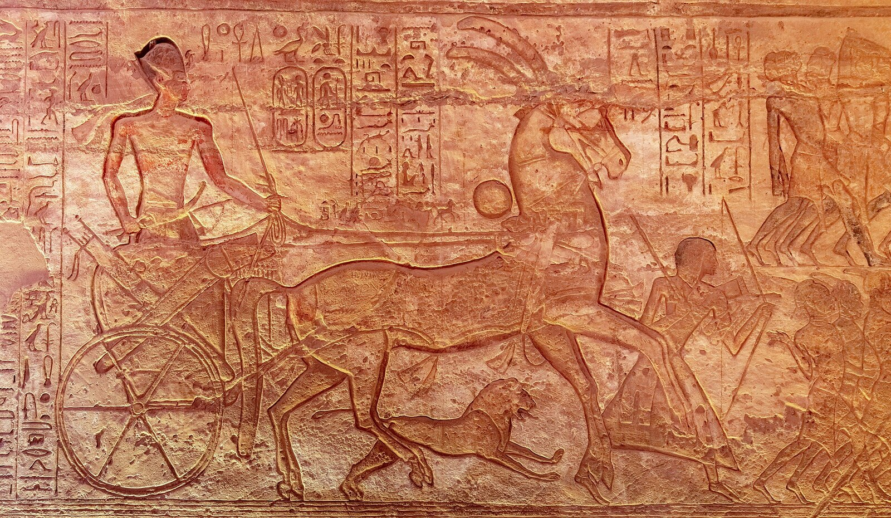
*The king of Egypt in his chariot at the great battle in Syria, carved on the wall of his temple at Abu Simbel. Photo: Diego Delso, CC BY-SA 4.0.*

Then there was the vehicle. The spoked wheels were the work of specialists, made of several kinds of wood, each chosen for its part. The crew needed bows built up in layers of wood, horn and sinew, which took a year or more to make and cure. They wore coats made of hundreds of small bronze scales, sewn on in overlapping rows.

Finally there were the men. A chariot warrior had to spend his life at it, and so he had to be kept by the palace, with land or rations, along with his driver, his groom and the craftsmen who kept his chariot running.

A king with a thousand chariots was therefore paying for four thousand war horses, thousands of specialists, a mountain of grain and tonnes of bronze. Only a palace could gather all that, and it took a great many clerks to keep track of it. In Greece, the records of the palaces survive on clay tablets, baked hard when the palaces burned. Tablet after tablet lists chariot wheels by the pair, with a note on each as to whether it is fit for use. Others record the weight of bronze handed out to each smith, smith by smith.

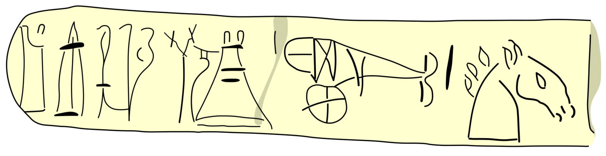
*A drawing of a palace record from Crete. The pictures of a chariot and a horse's head show what the clerk was counting. Drawing: Petr Tarasev, public domain.*

The largest chariot battle that we know of was fought about 3,300 years ago in Syria, between Egypt and Hatti. According to the Egyptian account, the king of Hatti brought two and a half thousand chariots to the field. Neither side won. Some years later, the two kingdoms signed a treaty of peace and friendship, the oldest of which both sides' copies survive. They promised not to attack each other, to send help if the other was attacked, and to hand back each other's runaways.

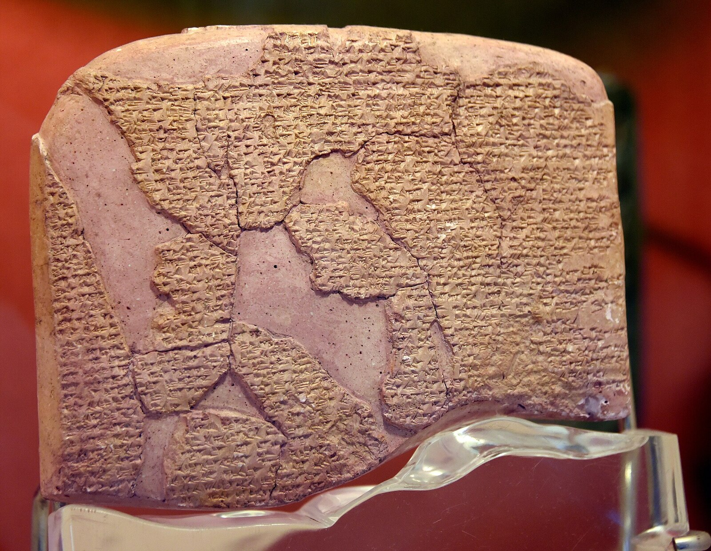
*The Hittite copy of the peace treaty with Egypt, in the Istanbul Archaeology Museums. Photo: Osama Shukir Muhammed Amin, CC BY-SA 4.0.*

So the system fed itself. Kings needed bronze and horses to field chariots. They needed trade, and peace with their neighbours, to get bronze and horses. To pay for it, each palace drew more and more of its country's grain, wool, oil and labour into its own storerooms, and handed them out again by the tablet. The palaces grew magnificent, and the kingdoms came to rest on fewer and fewer supports. Each one needed its harvests to come in, its tin ships to arrive and its fellow kings to keep their bargains.

## The enemy's ships have come

It came apart within about fifty years, a little over 3,200 years ago.

The clearest view is from a port called Ugarit, on the coast of Syria. Ugarit was a merchant city, subject to the king of Hatti, with a harbour full of ships and a population that wrote in at least four languages. Its last letters were still in the houses when the city fell.

The king of Hatti writes to demand a shipload of grain, and says that it is a matter of life and death. There is famine in his country. The king of Ugarit writes to the king of Cyprus that enemy ships have come and burned his towns. He cannot defend himself, he says, because his soldiers and chariots are away in Hatti, and his ships are away on the coast of Turkey.

Soon afterwards, Ugarit was burned. Arrowheads lie in its streets. People had buried their valuables under the floors of their houses, and nobody came back to dig them up. The city was never rebuilt.

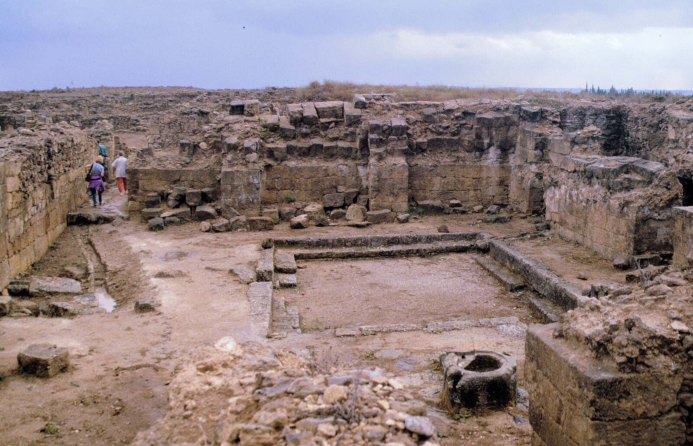
*The ruins of the palace at Ugarit. Photo: Gerhard Haubold, CC BY-SA 4.0.*

About the same time, the capital of Hatti was emptied and burned. The kingdom that had fought Egypt to a draw simply stops. Its archives end, and its language was never written again. Cousins of its kings held on in a few cities far to the south-east, as rulers of small states.

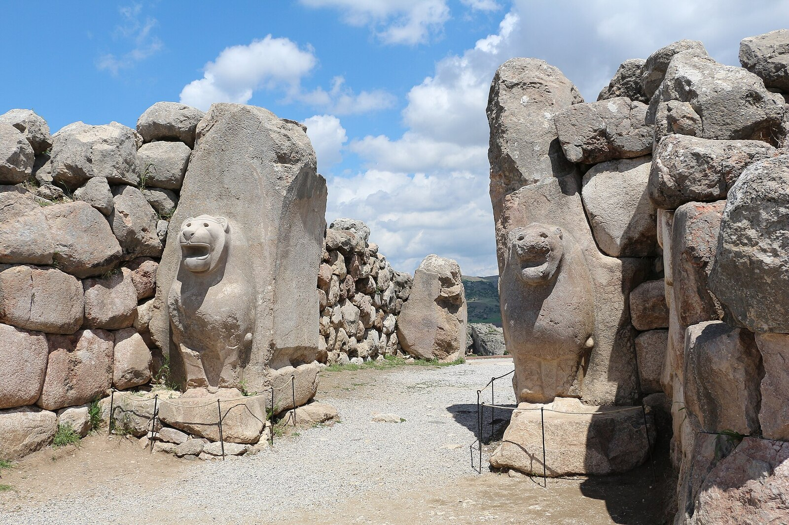
*A gate of the capital of Hatti, guarded by two stone lions. Photo: Bernard Gagnon, CC BY-SA 3.0.*

In Greece, the palaces went one after another, most of them in flames. The last tablets from one of them, on the south-west coast, record men being sent to watch the shore. With the palaces went the only people in Greece who knew how to write, since writing had been used for nothing but palace accounts. For the next four hundred years, the Greeks were without it. Most of the villages in the south of Greece were abandoned.

Egypt came through, and left the one account by a ruler who lived to tell of it. On the wall of his temple, the king of that time, who ruled a century after the great chariot battle, describes a league of peoples from the islands and coasts to the north, who came against Egypt by land and by sea. No country had been able to stand before them, he says. He names Hatti, Cyprus and several others, and says that they were all cut off at once. The carvings beside the words show a battle among ships in the mouth of the Nile. They also show the invaders on land, and among the fighting men there are ox carts full of women and children. These were whole peoples on the move.

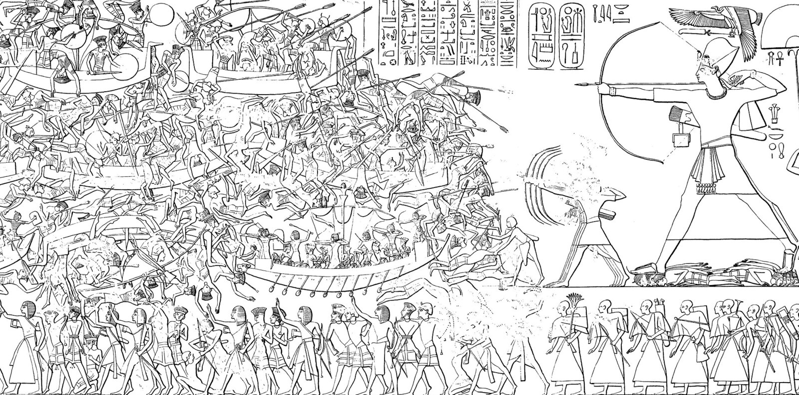
*The battle in the mouth of the Nile, drawn from the wall of the king's temple. The king, far larger than anyone else, shoots from the shore.*

Egypt won the battles and still lost. Within about a century it had given up everything that it held outside the Nile valley. The king's own tomb builders stopped work and sat down in protest, because their grain rations had not been paid. It is the first strike in recorded history.

## One at a time, or all at once

For a long time, the invaders in those carvings took the whole blame. Historians named them the Sea Peoples and imagined a wave of pirates that swept the coast and brought civilisation down.

The evidence gathered since then tells a longer story, in which the raiders were as much a result of the disaster as a cause.

First, the weather changed. Grains of ancient pollen, taken from the mud of an old lake in Cyprus and from the coast of Syria, show the countryside growing drier around this time, and it stayed dry for some three centuries. The growth rings of old trees in Turkey record one run of three years, shortly before the capital of Hatti was abandoned, of severe drought.

Drought meant famine, and the letters say so. The demand for grain as a matter of life and death is one of several. The king of Egypt, a few years earlier, had boasted of sending shiploads of grain to keep Hatti alive.

Hungry people move, and hungry people also raid. The peoples whom the Egyptians fought were not a single nation of pirates. They were a mixture of the displaced: farmers whose crops had failed, soldiers whose palaces could no longer pay them, sailors who had turned to plunder. They brought their families with them, which raiders who mean to go home seldom do.

In several of the ruined cities there are signs of other troubles as well. Some show walls thrown down by earthquakes, and that region lies on a restless seam in the earth's crust. In several places it was the palace alone that burned, while the houses of the town were left standing, and some historians see in that the hand of the palace's own subjects.

Each of these things had happened before. There had been droughts, earthquakes, raids and revolts in every century, and the kingdoms had recovered. A palace that lost a harvest could buy grain from a neighbour. One that lost a battle could call on an ally. This time, the neighbour was starving too, and the ally was fighting for his own life.

Here the tightness of the system turned against it. A kingdom that needs tin from a thousand kilometres away is in trouble as soon as the roads become unsafe. Without tin there is no new bronze, only old bronze melted down. Without bronze and grain, the chariot force cannot be kept up. Without the chariots, the king cannot protect the roads. Each failure caused the next.

Moreover, the palaces had gathered a great deal into their own hands. When a palace burned, the district lost its army, its storehouse, its workshops, its records and the few people who could read them, all in one afternoon.

Historians still argue over which blow came first and which did the most harm, and the argument may never be settled. Whatever the order, one palace's trouble became its neighbours' trouble, because they had come to depend on each other.

## Who came through

The collapse was not the end of the world, and it did not fall evenly.

The great palaces fared worst. Hatti was gone. The Greek palaces were gone. Egypt and Assyria survived as shrunken kingdoms, each pulled back inside its old heartland.

By contrast, some of the smaller places did well. On the coast of Lebanon stood a row of port cities that had spent centuries paying tribute to one great king or another. Now there was nobody to pay. Their ships went on sailing. Over the next few centuries, with no overlord to answer to, they sailed the whole length of the Mediterranean. Cyprus recovered quickly, too.

These were small cities that lived by trade. Their kings were merchants as much as anything else, and they had no chariot army and no vast palace to feed. Their traders also had little patience for a writing system of several hundred signs that took years of schooling to learn. Along that coast, people were already using a far simpler script, of fewer than thirty letters, each standing for a single sound.

The largest change was in metal. In the centuries after the palaces fell, smiths in Cyprus and along the same coast worked more and more in a metal that had long been known as a rare curiosity. A dagger made of it had been buried with a king of Egypt as a treasure. It was harder to work than bronze. It could not be melted and poured in the furnaces of the time, and had to be hammered into shape while red hot. Its one great advantage had not mattered in the age of the tin ships. Its ore lies in the ground almost everywhere, and it needs nothing added to it.

That metal was iron. A kingdom that armed its men with iron did not have to wait for a ship from the far end of the world. It could dig what it needed out of its own hills, and it could arm as many men as it had.
