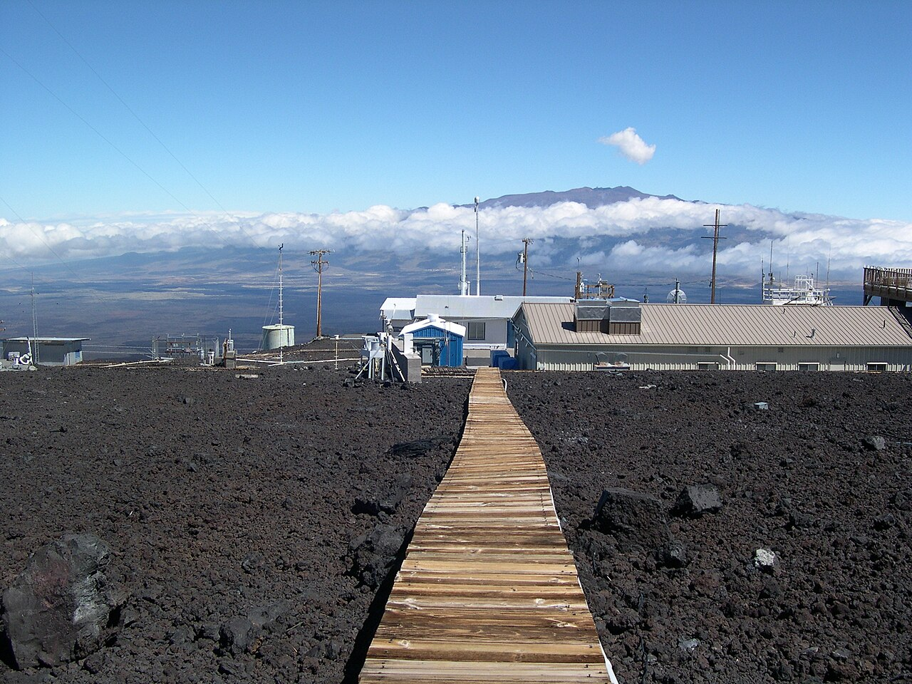
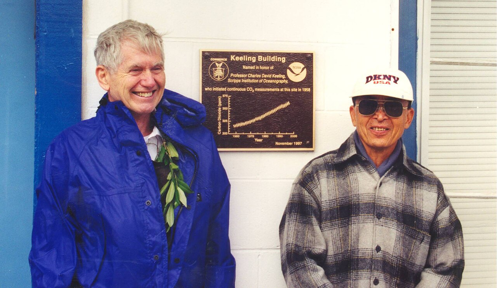
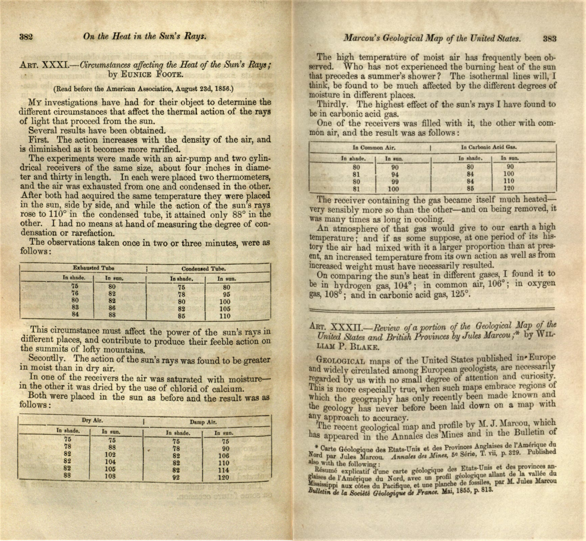
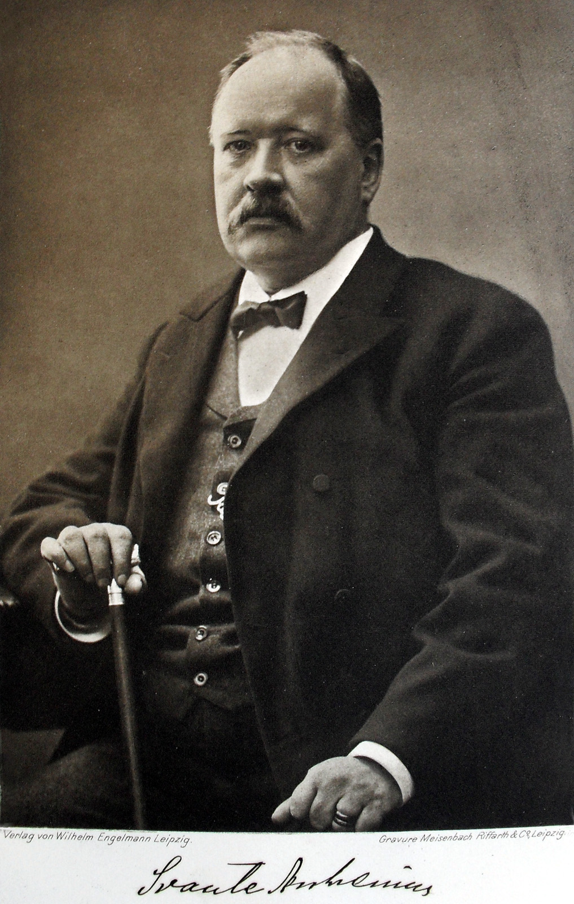
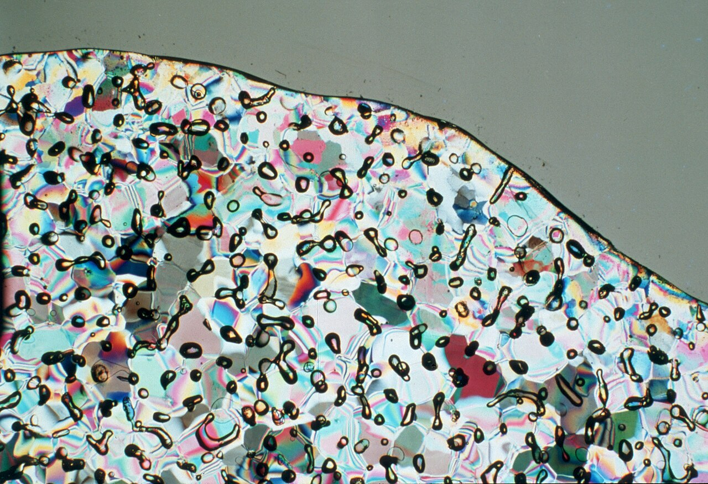
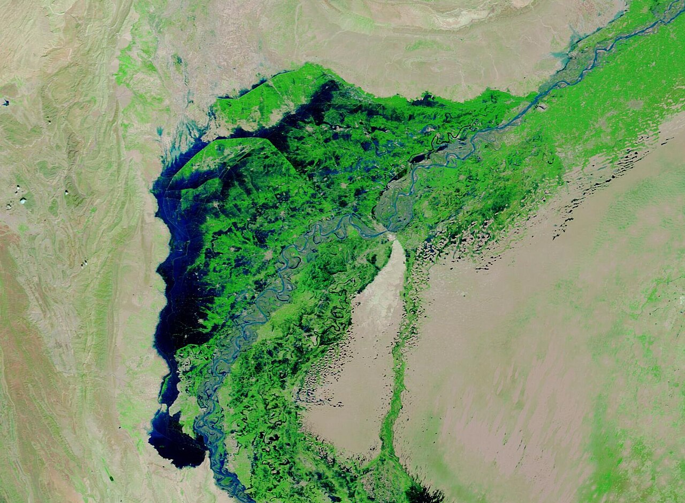
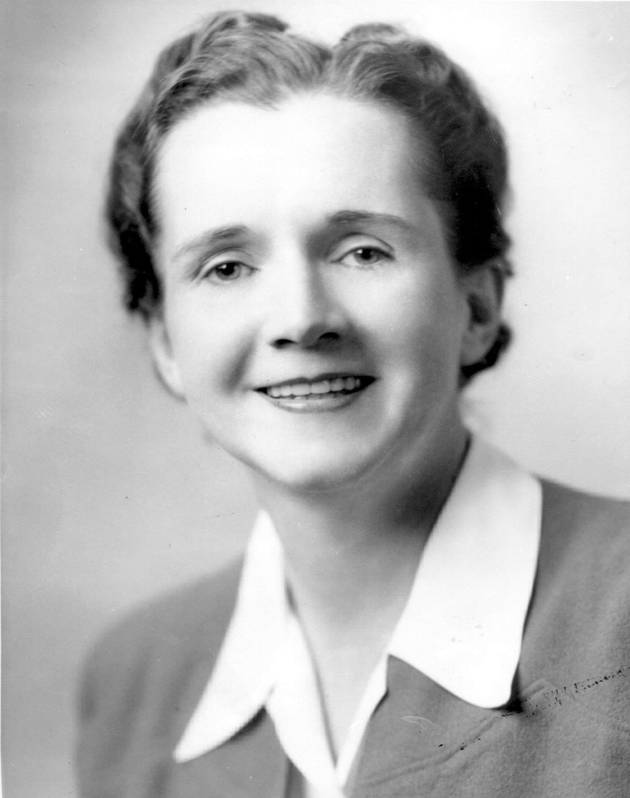
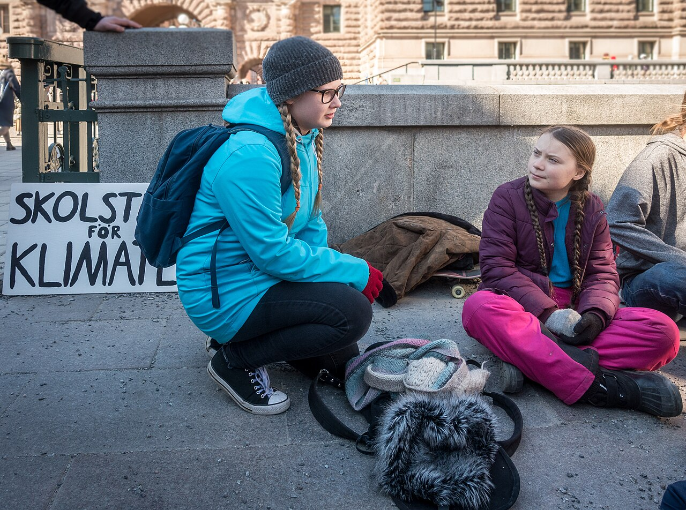
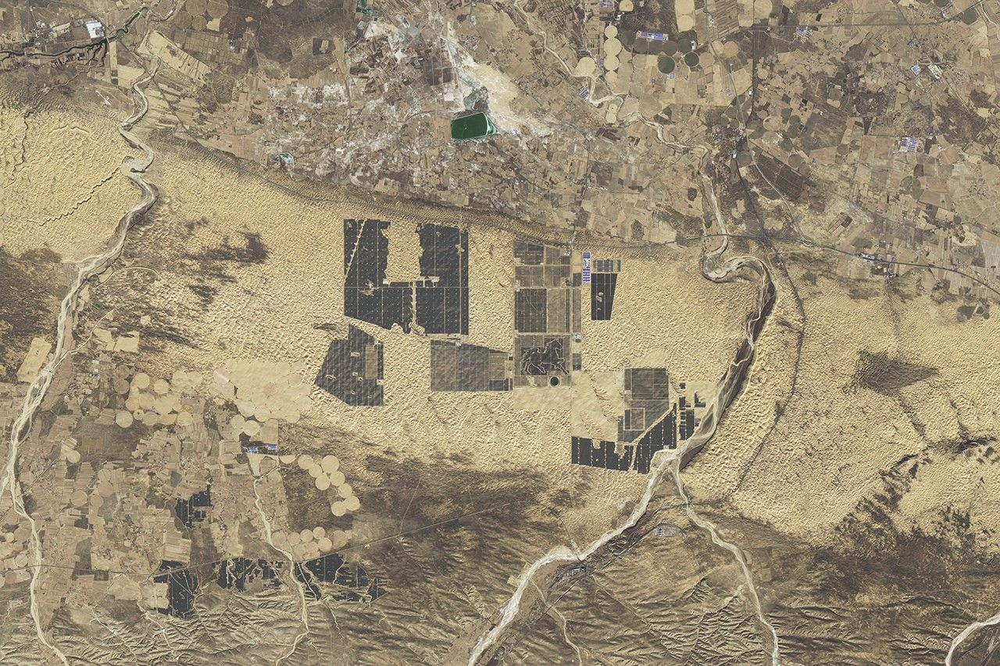

# 111. How do we know the climate is changing?

*The world, from 1856 to 2025*

We know because the physics was worked out more than a century and a half ago, because the gas in question has been measured continually since 1958 and has risen every year, because its chemistry shows that most of the extra comes from burning coal, oil and gas, and because the warming that the physics predicted has arrived.

In March 1958 a chemist of twenty-nine named Charles David Keeling set up an instrument in a small concrete hut near the top of Mauna Loa, a volcano in Hawaii. He had chosen the place with care. It stands in the middle of the Pacific, nearly three and a half thousand metres up, as far as possible from any factory, city or forest. As a result, the air that blows across it has been thoroughly mixed by thousands of kilometres of ocean. A reading taken beside a chimney or in a wood says mostly something about the chimney or the wood. On Mauna Loa, by contrast, the instrument could sample the well-mixed air of the open ocean. It measured, several times an hour, how much of that air was carbon dioxide.

*The Mauna Loa Observatory in Hawaii in 2004, on bare lava high above the clouds. The carbon dioxide measurements began here in 1958. Photo: Forrest M. Mims III, NOAA, public domain.*

The first reading was three hundred and thirteen parts in a million. Over the following months the figure rose a little, and then fell, and Keeling worried that the machine was faulty. It was not. He was watching the planet breathe.

Most of the world's land, and so most of its trees, lies in the northern half. Each spring their new leaves draw carbon dioxide out of the air, and each autumn, when the leaves fall and rot, it goes back.

After two years he had something else, and it mattered far more than the seasons. The zigzag was climbing. Every year's peak was a little higher than the last.

He went on measuring for the rest of his life, through cuts in his funding and officials who told him that the work was routine. He died in 2005, and his son took it over. No year's average has ever been lower than the year before. In 2025 the reading passed four hundred and thirty, well over a third higher than his first.

*Charles David Keeling (left) and John Chin, who took the measurements on Mauna Loa from 1964 to 2000, outside the building named for Keeling, in 1997. The plaque shows the rising curve. Photo: John Miller, NOAA, public domain.*

## A blanket

Keeling knew what he was looking for, because the reason to look had been understood for a hundred years.

One early clue came from a simple experiment. In 1856 an American woman named Eunice Foote, who had studied science and had no post at any university, filled glass cylinders with different gases. She put a thermometer in each, and stood them in the sun. The one that held carbon dioxide grew much hotter than the others and took far longer to cool.

Foote drew the larger conclusion herself. An atmosphere of that gas, she wrote, would give our Earth a high temperature. Her paper was read out to a scientific meeting by a man, and was forgotten.

*Eunice Foote's paper of 1856 as printed in the American Journal of Science. The table on the right shows the receiver with carbonic acid gas, as carbon dioxide was then called, reaching 125 degrees in the sun, against 106 for common air. Image: Eunice Foote, public domain.*

What her cylinders could not show was the reason. Three years later an Irish physicist in London, John Tyndall, showed why. He measured how different gases absorb the invisible rays of heat, the kind that a warm stove gives off even when it does not glow. The main gases of the air, nitrogen and oxygen, let heat pass straight through them. Carbon dioxide and water vapour, by contrast, absorb it strongly, although they make up a tiny part of the air. A trace of the right gas, in other words, can matter more than all the rest.

That is the whole mechanism. Sunlight passes through the atmosphere and warms the ground. The warm ground then gives off heat, as invisible rays, back towards space. On the way out, molecules of carbon dioxide catch some of those rays and send them out again in all directions, including downwards. Part of the heat therefore comes back to the ground instead of escaping.

The gas works like a blanket, which does not make heat and only slows its escape. The effect is large. Without it the Earth's surface would average eighteen degrees below freezing. Add to the blanket and the surface must grow warmer.

The next step was to ask how much warmer. In 1896 a Swedish chemist, Svante Arrhenius, spent a year doing the arithmetic by hand, in tens of thousands of calculations, to distract himself from a divorce. He concluded that if the carbon dioxide in the air were doubled, the Earth would warm by five or six degrees. Modern estimates, made with the largest computers in the world, put it at about three. A man with a pencil, in other words, had come within a factor of two.

He also noticed that industry was burning coal fast enough to matter. However, he thought that the doubling would take three thousand years, and that for Sweden it would be rather pleasant.

*Svante Arrhenius, in a portrait printed in 1909, thirteen years after his calculations on carbon dioxide. Image: Meisenbach Riffarth & Co., public domain.*

## Buried sunlight

The coal that Arrhenius counted holds the key to where the extra gas comes from. Coal, oil and gas are the remains of living things. Plants take carbon dioxide from the air and, using the energy of sunlight, build it into their bodies. When a plant dies and rots, that carbon returns to the air.

Over hundreds of millions of years, however, a small fraction of the forests and sea creatures that died were buried before they could rot. Underground, they were pressed and cooked into fuel. A lump of coal is ancient sunlight, and the carbon in it is carbon that was once taken out of the sky.

Burning it reverses the process. The carbon joins with oxygen and goes back into the air as carbon dioxide, and the stored energy comes out as heat. That is what made the industrial world.

It is being done on a scale that is hard to picture. Humanity now burns, in each single year, fuel that took many thousands of years to accumulate. The carbon dioxide released comes to about thirty-eight billion tons annually, which is more than four tons for every person alive. Most of this is recent. More than half of all the carbon dioxide released from fossil fuel since the Industrial Revolution began has been released since 1990.

## Fingerprints

It might be thought that the extra carbon dioxide in Keeling's flasks could have come from somewhere else, from volcanoes, say, or the sea. However, the gas carries a kind of fingerprint that shows otherwise.

The fingerprint lies in the carbon itself. A small fraction of the carbon in every living thing is a radioactive form, made high in the atmosphere by rays from space. It decays away over tens of thousands of years. As a result, carbon that has been underground for a hundred million years has none left. As fossil fuel is burned, the carbon dioxide in the air is being diluted with carbon of that dead kind.

The oxygen in the air is also falling, by the amount that the burning uses up. Meanwhile the sea, far from giving off the gas, is absorbing a quarter of what is emitted. If the sea were the source, it would be giving off more of the gas than it takes in, not less.

*A sliver of Antarctic ice photographed in polarised light, which gives the colours. Each dark spot is a bubble of air that was sealed in when the snow fell. Photo: CSIRO Atmospheric Research, CC BY 3.0.*

Knowing where the gas comes from still leaves open how unusual the present level is. That can be read from a record kept in ice. In the middle of Antarctica the snow never melts. Instead, each year's fall presses down on the last until it becomes ice, sealing in tiny bubbles of the air of its day. Each bubble is, in effect, a sample of the old sky.

Scientists have drilled out cylinders of that ice more than three kilometres long. The deepest bubbles are eight hundred thousand years old. Through all that time, across eight ice ages and the warm spells between them, the carbon dioxide in the air moved up and down between about a hundred and eighty and three hundred parts in a million, and the temperature moved with it.

The industrial age broke out of that range. It was two hundred and eighty when James Watt improved the steam engine. It has not been as high as it is now for at least three million years, since before there were human beings.

*Carbon dioxide in the air, in parts per million: from bubbles in the Antarctic ice for the years 1000 to 1957, and measured on Mauna Loa from 1958 to 2025. The enlargement shows the Mauna Loa record rising and falling with the seasons. Chart: drawn for this book; data from the Law Dome ice cores (CSIRO, via NOAA) and from the Scripps Institution of Oceanography and NOAA (Mauna Loa).*

## The company's own graph

The people who sold the fuel worked this out early.

In 1977 a senior scientist at Exxon, the largest oil company in the world, told its management committee that there was general scientific agreement that mankind was influencing the global climate through the release of carbon dioxide from the burning of fossil fuels. The company took the warning seriously. It put its own researchers onto the question and fitted out a supertanker with instruments.

In 1982 they produced an internal report, marked not for outside distribution. It contained a graph of how the carbon dioxide in the air and the temperature of the Earth would rise over the following century. That graph can now be checked against the real world. Forty years later, academics laid the company's projections over what had actually happened. The match was as close as that of the best government and university scientists of the period. The company, in other words, knew as much as anyone.

The company did not publish the graph. Instead, from the late 1980s it and others in the industry spent heavily on the opposite message. They financed institutes and advertisements that stressed how uncertain the science was. A plan drawn up by the oil industry's trade association in 1998 stated its aim in a sentence. Victory will be achieved, it said, when average citizens understand uncertainties in climate science.

The public had by then been told plainly. On 23 June 1988, during a heatwave, the head of the American space agency's climate institute told a committee of the Senate that he was ninety-nine per cent certain that the warming of the past decades was no accident of the weather. The greenhouse effect had been detected, he said, and it was changing our climate now.

The heat in the room was no accident either. The senator who had arranged the hearing later admitted that his staff had picked what was usually the hottest week of the year, and had gone in the night before to open the windows, so that the air conditioning would not cope.

That same year the world's governments set up a panel of scientists to report on the question at intervals. Its language hardened over the decades. Its first report, in 1990, was cautious. Its sixth, in 2021, said that it was unequivocal that human influence had warmed the atmosphere, the ocean and the land.

## On schedule

The Earth's surface is now about one and a third degrees warmer than it was in the second half of the nineteenth century. That sounds small. For a whole planet, however, it is not. The difference between today's climate and the depths of the last ice age, when ice covered Chicago and Stockholm, was about six degrees.

The warmth is also recent. The eleven hottest years in the record are the last eleven. Among them, 2024, an unusually hot year even by the new standard, was the first in which the average passed one and a half degrees above the old level.

*The world's average surface temperature each year, 1850 to 2025, in degrees above or below its average for 1850 to 1900. The shading shows the uncertainty in each year's figure. Chart: drawn for this book; data from HadCRUT5 (Met Office Hadley Centre and University of East Anglia), version 5.2.*

The rest follows from the heat. Warm water expands and ice on land melts, and so the sea has risen by about twenty centimetres since 1900. It is now rising at more than four millimetres a year.

The ice is retreating as well. The floating ice that covers the Arctic Ocean at the end of each summer has shrunk by two fifths since satellites began to photograph it in 1979. Mountain glaciers have retreated on every continent.

The weather has changed with the heat. Warm air draws more water out of the soil and holds more of it. As a result, droughts are drier, and when the water held in the air finally falls, downpours are heavier.

The toll is already plain to see. In 2022 a summer of heat killed more than sixty thousand people in Europe. In the same year a monsoon of unheard-of violence flooded the homes and fields of thirty-three million Pakistanis. In 2023 forests burned in Canada over an area larger than England. Between 2023 and 2025 more than four fifths of the world's coral reefs were struck by heat severe enough to turn them white.

*A satellite image of the Indus plain in Sindh, Pakistan, on 22 September 2022, in false colour: the flood water is dark blue and the living plants are green. Image: NASA MODIS, public domain.*

Weather has always had its extremes. For that reason, no single storm or fire can be blamed on the warming with certainty. What can now be calculated is how much more likely the warming has made it, and for the worst of them the answer is often many times.

## Whose carbon

The gas mixes evenly through the whole atmosphere within a year or so. As a result, it makes no difference to the climate where it was emitted: a ton released in any country has the same effect on the climate of the whole planet. It makes a great deal of difference, however, to the question of who is responsible.

Carbon dioxide stays in the air for centuries, and so what counts is the total that each country has emitted over time. Coal burned a century ago is still warming the world today. On that measure the United States comes first, with about a quarter of all the carbon dioxide from fossil fuel since 1850. The countries of Europe together account for somewhat less.

China shows how different the two measures can look. It has been the largest emitter in any single year since 2006, and now produces nearly a third of the annual total. Because it started late, however, it has reached about a seventh of the historical one. At the other end, the whole of Africa, with a sixth of the world's people, has contributed about three per cent.

The gap between individuals is wider still. The average American is responsible for about fourteen tons of carbon dioxide a year, and the average Indian for two. The average American, in other words, emits as much as seven average Indians. Across the world, the richest tenth of humanity, which includes most people in the rich countries, produces about half of all emissions. The poorest half produces about a tenth.

The damage runs the other way. It falls first on those who live on river deltas, on the edges of deserts and on small islands. It falls on those who farm without irrigation, and who have no savings and no insurance.

Tuvalu shows what that means at its starkest. The Pacific nation of Tuvalu consists of nine coral islands whose highest point is under five metres above the sea. In 2023 it signed a treaty with Australia under which its eleven thousand citizens may, a few hundred a year, move there for good. A whole nation has arranged a way out.

## A book about birds

Long before carbon became a political question, people had learned to worry about pollution of a more visible kind. The idea that industrial civilisation might be damaging the world that it depends on became a popular cause in 1962, with a book by an American marine biologist.

Rachel Carson described what the new chemical insecticides were doing as they passed from sprayed fields into worms, from worms into birds, and from fish into the people who ate them. The poison, in other words, did not stay where it was sprayed. She called it *Silent Spring*, after a town where no birds sang.

The response was ferocious. The chemical industry spent a quarter of a million dollars attacking her as a hysterical woman. She was dying of cancer as she defended the book. Her side won in the end. The most notorious of the chemicals, DDT, which had also saved millions from malaria, was banned from American farms ten years later.

*Rachel Carson in an official photograph taken about 1940, when she worked for the United States Fish and Wildlife Service. Photo: U.S. Fish and Wildlife Service, public domain.*

The cause soon became a mass movement. On 22 April 1970 twenty million Americans, one in ten, took part in demonstrations, clean-ups and teach-ins on the first Earth Day. The laws followed fast. Within three years the United States had passed laws on clean air, clean water and endangered species, and created an agency to enforce them. Most other rich countries did the same.

The results can still be seen. Their rivers and their city air are far cleaner now than they were then. That was the easy part, since much of the pollution and its victims were in the same country. A town that cleaned its river was the town that got to fish in it.

## Paris

The carbon problem is harder than any of those. The benefit of burning goes to whoever burns. The cost, by contrast, is shared by everyone on Earth, including people not yet born. Every country is therefore tempted to let the others make the sacrifice.

In 1992, at a meeting in Rio de Janeiro, nearly every government signed a convention promising to prevent dangerous interference with the climate. It laid down a principle that has shaped every negotiation since: all countries share the responsibility, but not equally, and the rich, who caused most of the problem, should act first.

Turning that principle into action proved hard. In 1997, at Kyoto, the rich countries accepted fixed targets for cutting their emissions. The United States Senate, however, had already voted ninety-five to nothing against any treaty that did not bind China and India as well, and America never joined. A later attempt went worse. In 2009 a conference in Copenhagen that was meant to produce a successor broke up in recriminations.

The agreement that was reached in Paris on 12 December 2015 took a different approach. A hundred and ninety-five countries adopted it. It set a common aim, to hold the warming well below two degrees and to try for one and a half.

Unlike Kyoto, it allotted no targets. Instead, each country was bound to announce its own plan, report honestly on its progress, and come back every five years with a better one. Its force lay in embarrassment: a country that fell short would have to say so in front of all the others. The United States has since left it, rejoined, and in 2025 given notice that it is leaving again.

Pressure also came from outside the conference halls. In August 2018 a fifteen-year-old Swedish girl stopped going to school and sat instead on the pavement outside her country's parliament, alone, with a hand-painted sign that read "School strike for climate". A year later, on a single day, between four and six million people in a hundred and fifty countries walked out of schools and workplaces to join her. A protest of one had become a protest of millions.

*Greta Thunberg (right) with the sign "Skolstrejk för klimatet", School strike for climate, outside the Swedish parliament in Stockholm in April 2019, eight months after she began. Photo: Frankie Fouganthin, CC BY-SA 4.0.*

## The price of sunlight

Measured by the thing that matters, the diplomacy has failed. Emissions have risen in almost every year since the first conference, and in 2024 they were the highest ever recorded. The world still gets four fifths of its energy from fossil fuel.

Measured against what would have happened, however, there has been a real change. Before the Paris meeting, the policies then in force pointed to a warming of about three and a half degrees by the end of this century, which would mean a different planet. Present policies point to something under three. That is still far beyond what any human society has lived through, and it is a degree better.

The larger cause of the change is that the alternatives became cheap. The cost of electricity from solar panels fell by nine tenths between 2010 and 2023. It fell because governments, first in Germany and then in China, paid for them to be made in ever greater numbers, and each doubling of production brought the price down by a fifth.

Wind turbines and batteries fell in price in the same way. That has turned the old economics of power upside down. In most of the world a new solar farm now produces power more cheaply than a new coal station.

The building has followed the price. In 2023 China installed more solar panels in a single year than the United States had in its whole history. More than one new car in five sold in the world is electric. Twice as much money is now invested each year in clean energy as in oil, gas and coal.

*Solar farms, the dark rectangles, spread across the dunes of the Kubuqi Desert in Inner Mongolia, China, seen from space on 8 December 2024. Image: NASA Earth Observatory, using Landsat data, public domain.*

Cheap panels slow the growth of the problem, but the air keeps its own account. The carbon dioxide already in the air will stay there for hundreds of years. For that reason, the warming will not stop until no more is being added than is taken out. Whether that comes soon enough to avoid the worst is the question on which the rest of the century turns.

A strange year showed how much is still being added. In 2020, when a pandemic emptied the world's roads and grounded its aircraft, emissions fell by a twentieth, the largest drop ever recorded. On the mountain in Hawaii it made no visible difference. The reason is simple arithmetic: nineteen twentieths of the usual amount was still being added. The instrument that Keeling had installed recorded a higher figure that May than in any May before, and a higher one again the year after. Nobody now alive was born in a year whose average was as high as this year's.
