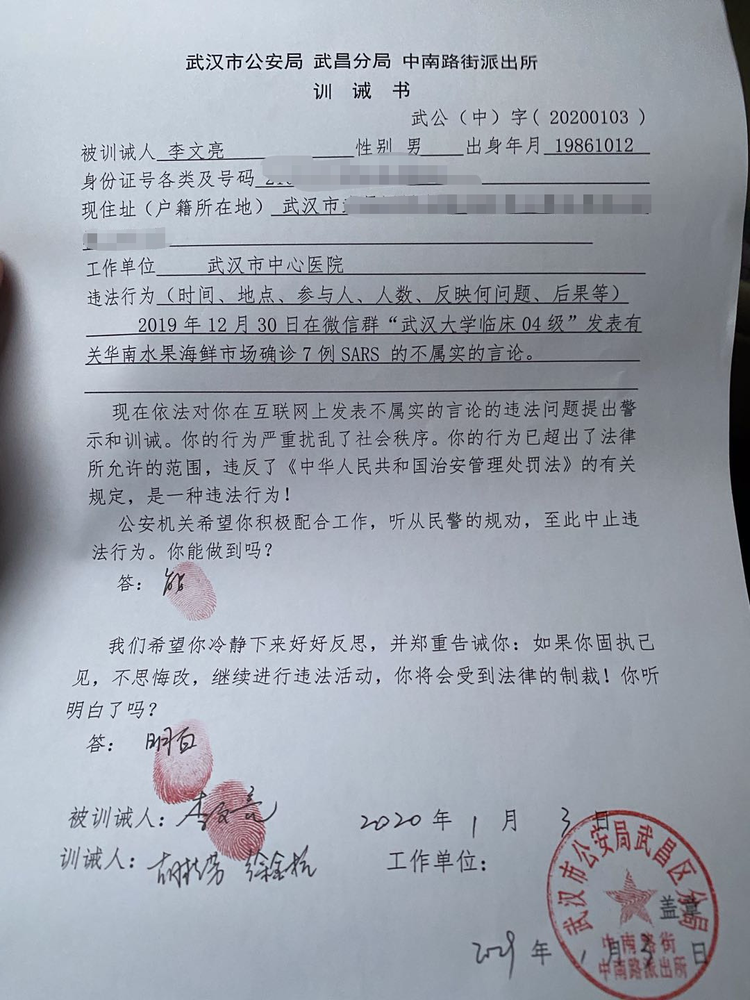
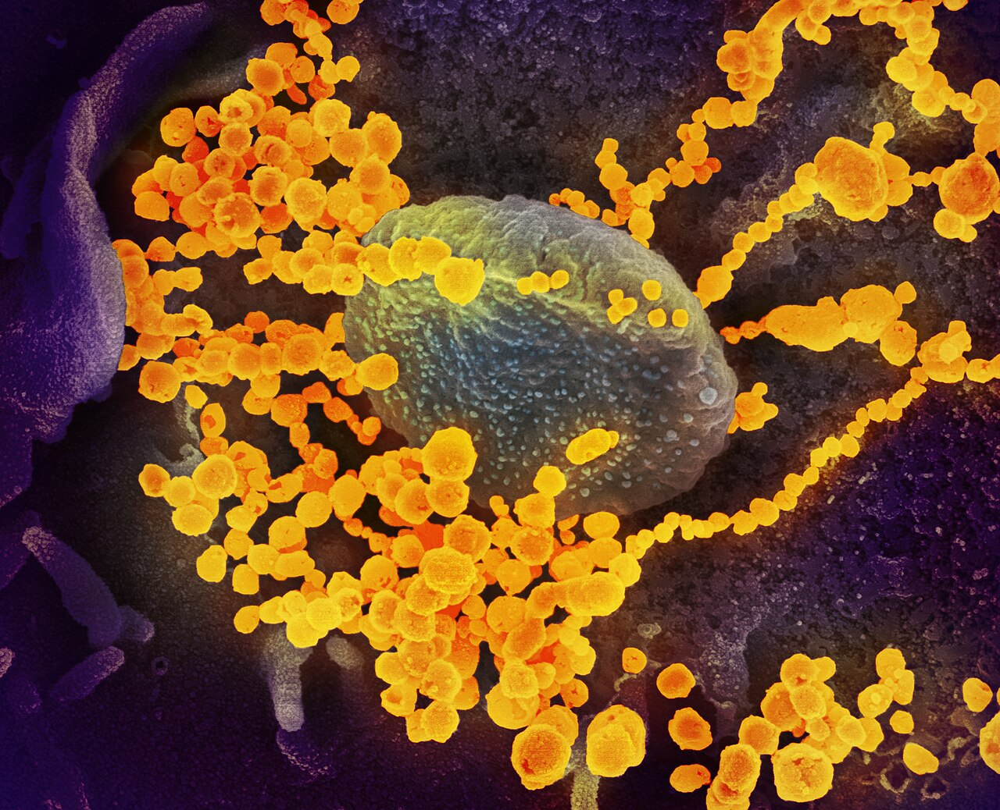
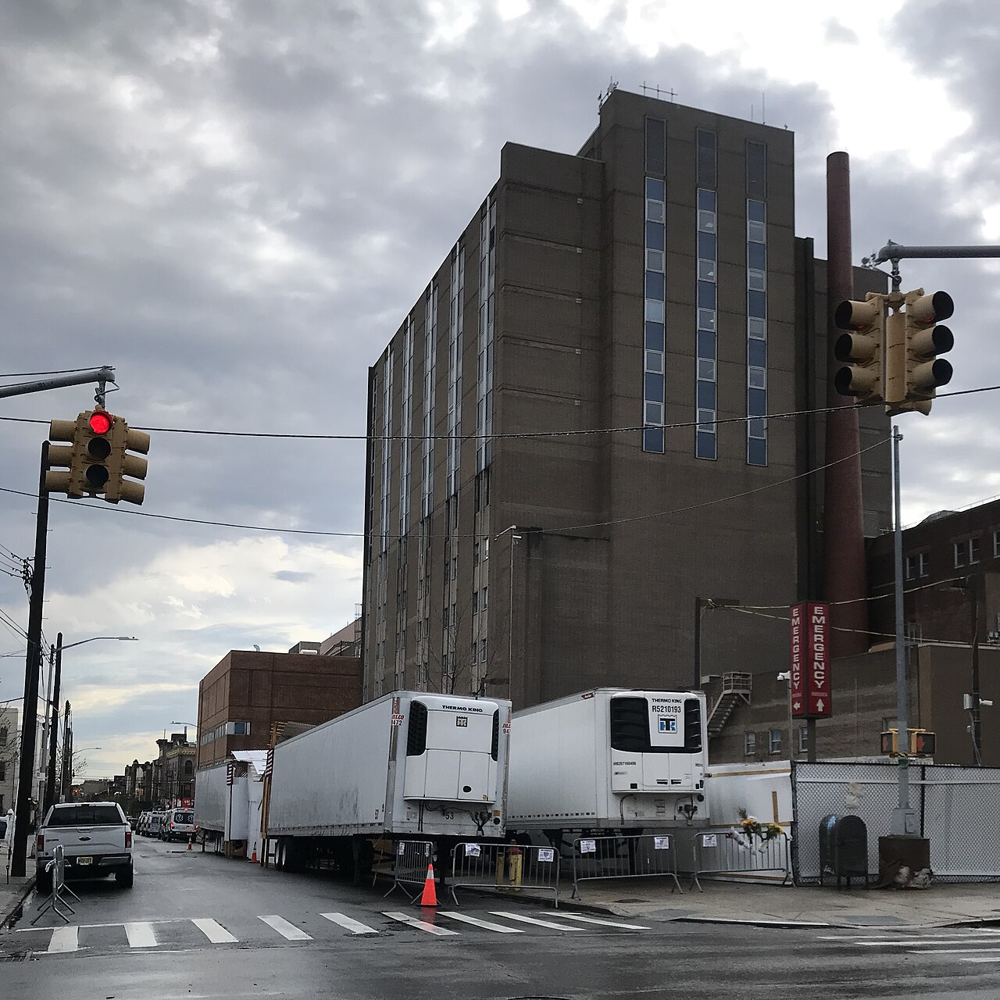
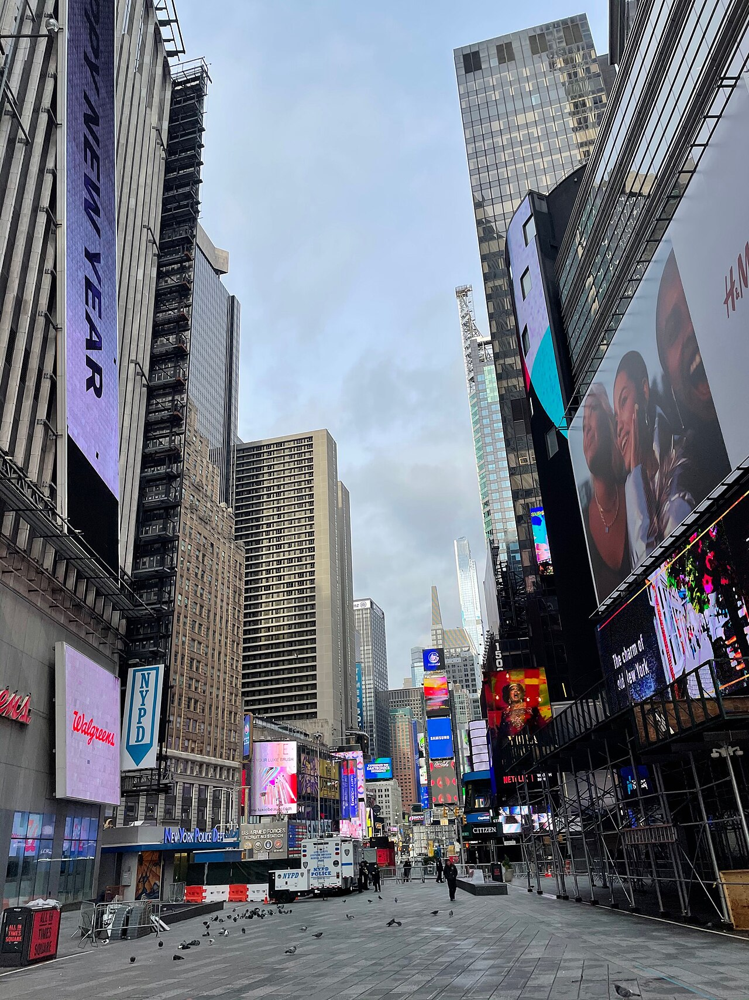
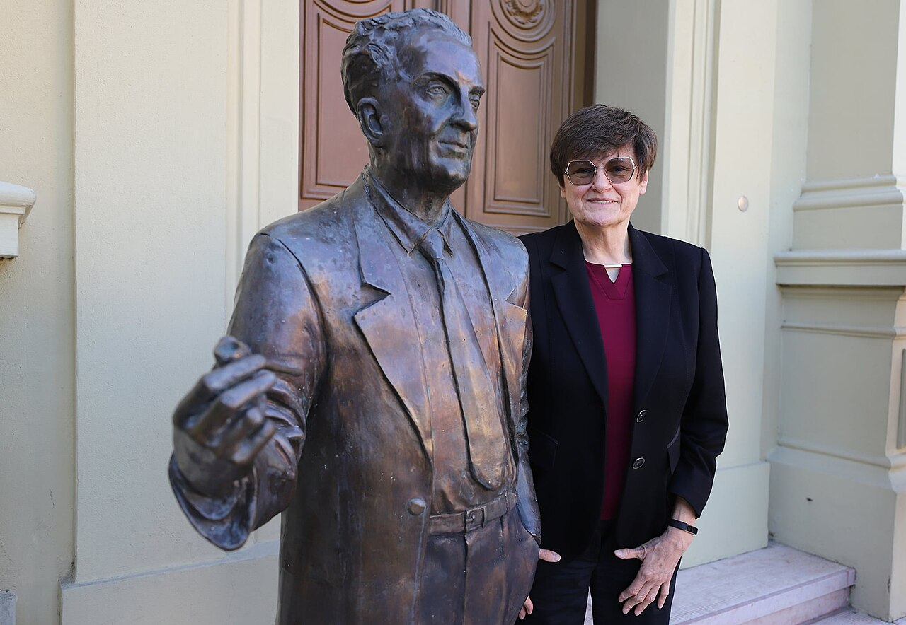
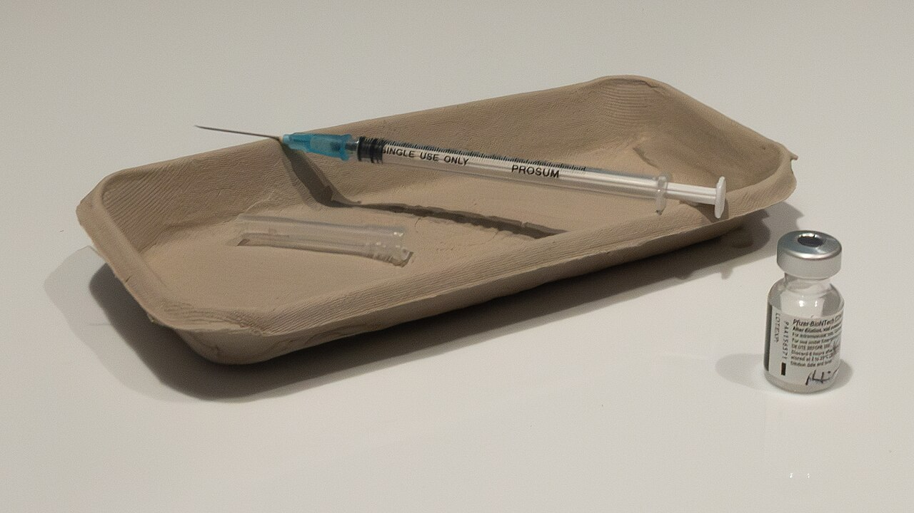
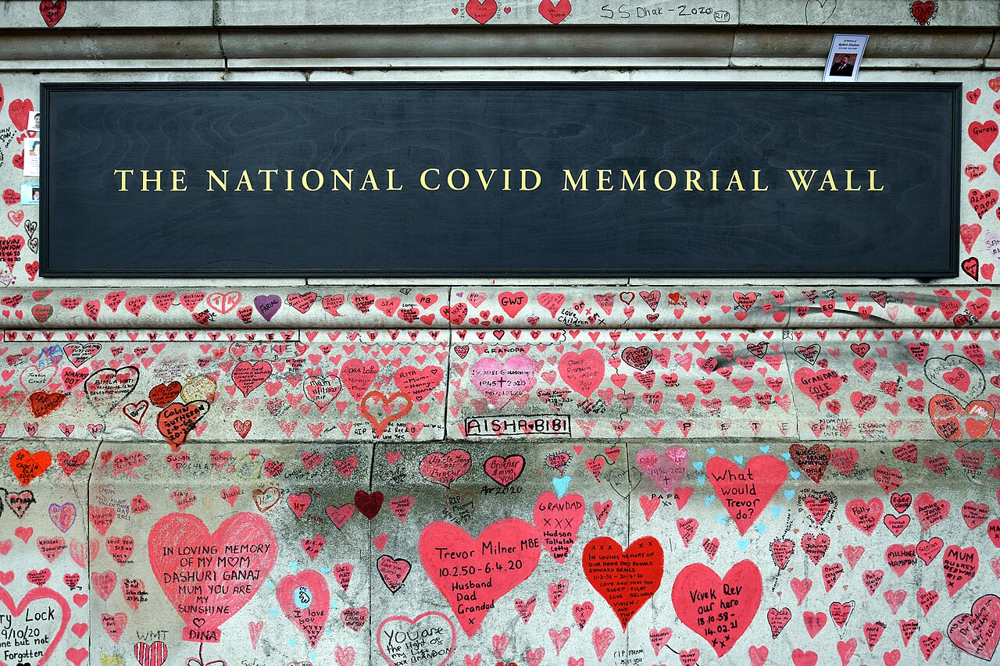

# 112. What did the pandemic show us?

*The world, from 2019 to 2023*

It showed how tightly the world is now joined, and whom each society protects. A virus that appeared in one Chinese city reached every inhabited continent in weeks, carried by air travellers. The same connections allowed scientists who had never met to design a vaccine within days, and to test it and manufacture it within a year, which had never been done for a new disease. Before the pandemic was over, some twenty million people had died.

On the morning of Saturday, 11 January 2020, a virologist in Shanghai named Zhang Yongzhen was sitting in an aircraft waiting to take off for Beijing when his telephone rang. The caller was a colleague in Australia. Six days earlier Zhang's laboratory had worked out the complete genetic code of a new virus, taken from a patient with pneumonia in the city of Wuhan. He had reported it to the authorities, who had issued an order forbidding laboratories to publish anything about the outbreak. His colleague was begging him to release it anyway.

Zhang asked for a minute to think. Then, as the aircraft doors were closing, he said yes. Within the hour the code, a string of about thirty thousand letters, was posted on a website used by virologists, free for anyone to download. From that moment, laboratories around the world could start work on the virus. The next day his laboratory was closed by official order, for "rectification".

That weekend, in an office near Boston, scientists at a small American drug company, Moderna, fed the code into their computers and designed a vaccine against the virus. They had it finished by the Monday. Two weeks later the husband and wife who ran a German company, BioNTech, in the city of Mainz did the same over a weekend at home. Nobody at either firm had a sample of the virus, or needed one. The string of letters was enough.

The virus, meanwhile, had a head start. By then a man in Wuhan had died of the disease, and a woman carrying it had landed in Thailand.

## A doctor's message

Wuhan is a city of eleven million people on the middle reaches of the Yangtze, a hub of railways and factories. In December 2019 its hospitals began to see patients with a severe pneumonia that did not respond to treatment. At first nobody knew what was causing it. Many of them worked at, or had visited, a large covered market that sold seafood and live wild animals.

On 30 December an eye doctor at one of the hospitals, Li Wenliang, saw a laboratory report on one of the patients. He sent a message to a private chat group of his old classmates from medical school. He warned them that seven people from the market had an illness resembling a dangerous lung disease that had come out of China in 2003, and told them to protect their families. The warning was meant for a handful of friends. Someone took a picture of the message, however, and within hours it was all over the Chinese internet.

The authorities, however, treated the warning itself as a danger. Four days later Li was summoned to a police station and made to sign a statement admitting that he had spread false rumours and disturbed public order. State television reported that eight rumour-mongers in Wuhan had been dealt with.

Meanwhile, for the next two weeks, the city's officials said that there was no clear evidence that the disease passed from one person to another. They even went ahead with a banquet for forty thousand families.

*The letter of admonition that Li Wenliang signed at a police station in Wuhan on 3 January 2020. It says that he made untrue statements on the internet about seven cases at the market. Photo: Li Wenliang, public domain.*

Li had been right. He went back to work, caught the virus from a patient, and died on 7 February. He was thirty-three. From his hospital bed he had told a reporter that a healthy society should not have only one voice.

Before Li died, Beijing had already swung from silence to the opposite extreme. On 23 January the government in Beijing did something on a scale never attempted in the history of medicine. It sealed Wuhan. Trains, flights and buses stopped, the roads out were blocked, and eleven million people were ordered to stay in their homes.

The timing worked against it. It was two days before the lunar new year, when the whole of China travels, and five million people had already left the city.

## Doubling

The new virus belonged to a family, the coronaviruses, named for the crown of spikes on its surface. The disease that it causes was given the name Covid-19. The virus lodges in the nose, throat and lungs. From there it passes from one person to another on the breath, in tiny droplets that hang in the air of a closed room.

*The virus, seen through an electron microscope in February 2020: the round gold particles are new virus leaving the surface of a cell grown in a laboratory. The colours were added. Image: NIAID, CC BY 2.0.*

Two things about it made it far harder to stop than its cousin of 2003. The first was timing. The earlier disease had made people obviously ill before they became infectious, so that the sick could be found and isolated. This one was passed on by people who did not yet feel ill, and by some who never did. Isolating the sick, therefore, was no longer enough, because many of those spreading it did not know that they were sick.

The second was speed. In a population that had never met it, each infected person gave it to two or three others. As a result, the number of cases doubled every three days or so.

That kind of growth is easy to state and hard to grasp. One case becomes two, then four, then eight, and for a few weeks nothing much seems to be happening. Then the numbers run away. After ten doublings, a month, there are a thousand. After twenty, two months, there are a million. For that reason, delay is the costliest mistake. A government that waits until its hospitals look busy has waited a month too long.

For most of the people who caught it, the illness was a few unpleasant days. It killed something under one in a hundred. Whom it killed, however, depended overwhelmingly on age. A person over eighty was hundreds of times more likely to die than one of twenty-five. The risk was also higher for men, for the very fat, and for people with diabetes or bad hearts.

## Trucks

By March, the same rapid growth had reached Europe. The first place outside China to be overwhelmed was the rich north of Italy. In the town of Bergamo, in March, the hospitals ran out of beds, then of ventilators. Doctors then had to choose which patients would be given a machine to breathe for them and which would not.

Soon the dead outran the town's ability to bury them. The local newspaper's page of death notices grew to ten pages. The crematorium could not keep up, and on the night of 18 March a column of army trucks drove through the empty streets, carrying coffins to other cities.

*Refrigerated trailers used as mortuaries beside a hospital in New York City in April 2020. Photo: Archer West, CC BY 4.0.*

On 11 March the World Health Organization declared a pandemic, a disease spreading across the whole world. Governments that had watched Wuhan and thought it could not happen to them now copied it. By the first week of April some four billion people, half of the human race, had been told to stay at home.

For a few weeks, much of the world stood still. Borders closed. Air travel fell by more than nine tenths. The centres of London, Paris, Delhi and New York stood empty in the middle of the day. With the traffic gone, people in cities that had been smoggy for decades saw mountains on the horizon. The dying, however, went on. In the state of New York eight hundred people were dying daily, and refrigerated lorries were parked outside the hospitals to hold the bodies.

*Times Square in New York on the afternoon of 31 December 2020, almost empty, with pigeons on the paving, during the restrictions of the pandemic. Photo: NatalieWynnePace, CC BY 4.0.*

## Old tools

There was no medicine and no vaccine. What governments had instead was a set of methods that were centuries old. The word quarantine comes from the forty days for which Venice kept ships at anchor during the plague.

Keep the sick apart from the well. Find out who has been near the sick, and keep them apart too. Stop people from gathering.

One tool was new. A laboratory test could detect the genetic material of the virus in a swab from the nose, by copying it over and over until there was enough to see. That mattered for a disease spread by people who felt well. Countries that could run such tests in great numbers could find the infected before they knew it themselves.

The tools were old, but using them well needed tests, records and speed. A few governments did this extremely well. South Korea had been badly frightened by an outbreak of a related virus five years before, and it had learned from the fright. This time it set up test stations that people could drive through, and traced contacts using the records of mobile telephones and bank cards. It never ordered its people to stay at home. Taiwan and New Zealand, by contrast, closed their borders early and quarantined everyone who arrived.

The results showed in the death counts. In 2020 South Korea, with fifty-two million people, recorded about nine hundred deaths. The United States, with six times the population, recorded three hundred and fifty thousand. Person for person, the American toll was dozens of times worse.

That contrast upset a good many assumptions. A few months before the pandemic, a panel of experts had ranked the countries of the world by how well prepared they were for one. The United States came first and Britain second. Yet both suffered among the highest death rates in the rich world. Their governments had been slow, had sent contradictory messages, and presided over populations that were bitterly divided about whether to believe them.

In 2022 researchers compared a hundred and seventy-seven countries to see what explained the difference in how many of their people had been infected. The number of hospital beds did not, and neither did the experts' ranking or whether the country was a democracy. What went with fewer infections was how much people trusted their government, and how much they trusted one another.

## Essential

Shutting a society down to slow a virus had a cost of its own. The world's economy shrank by three per cent in 2020, the sharpest fall since the 1930s. In the United States twenty-two million jobs vanished in two months.

The burden was shared out in a revealing way. People whose work was done at a desk went home with a laptop and kept their salaries. Meetings moved to video calls. One company that provided them went from ten million people joining its meetings each day to three hundred million in four months.

People whose work required their bodies had no such choice. Nurses, care assistants, bus drivers, delivery riders, supermarket staff and workers in meat-packing plants were declared essential and kept at it. They were for the most part poorly paid. They also had to work in person among other people, and they caught the virus and died at far higher rates than those at home.

Governments still had to keep people fed while they stayed at home. To do it, they did something that would have been unthinkable a few years earlier. They paid people to stay in. Britain covered four fifths of the wages of nearly twelve million workers whose employers had shut. The United States posted cheques to almost every household. Across the world, states committed about sixteen trillion dollars in spending, tax relief and loans, and central banks created money on a scale never seen.

The money did its first job. It prevented mass destitution in the rich countries. It also carried a delayed cost. When the shops reopened, it helped to set off the steepest rise in prices for forty years.

Meanwhile the chain of supply that joined Chinese factories to Western shops seized up. With ports closed and crews quarantined, the cost of sending a steel box from Shanghai to Los Angeles rose tenfold. A tiny missing part could stop a huge factory. Car plants stood idle for want of a computer chip worth a dollar.

Children paid a price that will be counted for decades. At the peak, schools and colleges were closed to one and a half billion pupils, nine tenths of all those enrolled in the world. What they lost depended on where they lived. In rich countries lessons moved online for those with a computer and a quiet room. In Uganda the schools stayed shut for nearly two years, and many of the girls never returned. Beyond the schools, about seventy million people were pushed back into extreme poverty.

## A demoted biochemist

The vaccine that the two companies designed in a weekend rested on an idea that had struggled for thirty years to be taken seriously.

A vaccine works by showing the body's defences a harmless piece of a germ, so that they will recognise the real thing. The usual way to make one is to grow the virus itself in eggs or vats of cells and then kill or weaken it. Developing and testing a new one in that way takes years.

The new idea was to skip that step. Every cell in the body makes its proteins by following instructions written on short-lived molecules called messenger RNA. Each one is like a working copy of a recipe, used for a while and then thrown away. Inject the instruction for one of the virus's proteins, and a person's own cells will manufacture it for a few days. The defences then meet the protein and learn it. In effect, the body makes the harmless piece of the germ itself.

The difficulty was that the body treats foreign RNA as an invader and destroys it, with a violent inflammation. An injection meant to teach the defences would instead set off every alarm.

A Hungarian biochemist named Katalin Karikó, who had left communist Hungary in 1985 with her savings sewn into her daughter's teddy bear, spent the 1990s at an American university trying to solve this. Her applications for funds were turned down year after year, and in 1995 the university demoted her.

In 2005 she and a colleague found that changing one of the four chemical letters of the RNA to a slightly different form let it slip past the body's alarms. Hardly anyone noticed the paper.

*Katalin Karikó at the University of Szeged, in Hungary, in 2021. Photo: University of Szeged, CC BY-SA 4.0.*

Fifteen years later it was the basis of both vaccines. The German one, made with an American partner, was tested on forty-three thousand volunteers. Half of them were given the vaccine and half salt water, without knowing which, so that the two groups could be compared fairly. If far fewer of the vaccinated half fell ill, the vaccine worked.

On 9 November 2020 the result was announced. It prevented more than nine cases in ten. On 8 December a ninety-year-old grandmother in the English city of Coventry became the first person in the world to receive it outside a trial. The fastest that a vaccine against a new disease had been developed before was four years.

*The syringe and vial used for the first vaccination with the Pfizer-BioNTech Covid vaccine outside a trial, given to Margaret Keenan, aged ninety, at a hospital in Coventry, England, on 8 December 2020. Photo: The wub, CC BY-SA 4.0.*

Governments had helped to make it happen. They had paid for much of the research and had ordered hundreds of millions of doses before anyone knew whether they would work. Over the next three years more than thirteen billion doses of the various vaccines were given. In their first year alone they are estimated to have saved between fourteen and twenty million lives. Karikó shared the Nobel prize for medicine in 2023.

## Queue

The vaccines were shared out much as wealth is. The rich countries had placed their orders first, in several cases for many times what their populations needed. As a result, an international scheme set up to buy doses for the poor found itself at the back of the queue. It had money to spend, but the first doses had already been promised to others. By the end of 2021 about three people in four in the rich countries had been vaccinated. In the poorest countries it was fewer than one in ten.

*The share of people who had received at least one dose of a Covid vaccine, and the full first course, by 31 December 2021, in countries grouped by income. Chart: drawn for this book; data from Our World in Data, with countries grouped by the World Bank's income classification.*

India was meant to be the exception. It has the largest vaccine factory in the world, which had been contracted to supply the international scheme. Its output was supposed to help fill the gap.

Then disaster came to India itself. In the spring of 2021 a new and more contagious form of the virus tore through the country. Hospitals in Delhi put up notices saying that they had no oxygen, and families drove from one to another with relatives gasping in the back seat. Cremation grounds overflowed into car parks.

Faced with that, the government banned the export of vaccines. As a result, the poor countries that had been waiting for them went without for another six months. India's official count for that wave was four thousand deaths a day at its peak. Studies of the overall rise in deaths put the true figure several times higher.

## Masts

The disease was accompanied by an epidemic of stories about it. Some were simply absurd. In the spring of 2020, in Britain, people who believed that the virus was caused or spread by a new kind of mobile telephone signal set fire to more than eighty transmitter masts. Others came from the very top. An American president suggested at a press conference that doctors might look into injecting disinfectant. Millions, meanwhile, took a drug meant for malaria and another meant for parasitic worms, neither of which did any good.

The most lethal of the rumours concerned the vaccines, which were said to alter the genes, to cause sterility, or to contain a tracking chip. In the United States the question of whether to be vaccinated, or to wear a mask, became a badge of political loyalty.

That loyalty could be counted in lives. After the vaccines arrived, death rates among Republican voters, who were less likely to be vaccinated, pulled steadily ahead of those among Democrats.

The authorities bore some of the blame for the loss of trust. Health officials told the public at first that masks were useless, in part to save the supply for hospitals. They were slow to accept that the virus hung in the air. They kept schools closed for far longer than the risk to children could justify. Each reversal was noted by those inclined to doubt them, and each made the next piece of advice a little harder to believe.

## Where it came from

Nobody knows how the virus first reached a human being.

Its nearest relatives live in bats in the caves of southern China and Laos, more than a thousand kilometres from Wuhan. The puzzle is how a virus of that kind came to Wuhan. One explanation is that it passed from bats to some other animal that was sold alive for food, and from that animal to people at the market. That is how the related disease of 2003 began. The market itself left traces. Swabs taken from the market stalls in January 2020 found the virus mixed with the genetic traces of raccoon dogs and other wild animals, in the corner where they had been caged.

The other explanation is an accident. Wuhan is also the home of China's leading laboratory for the study of bat viruses of exactly this family. Its scientists had collected hundreds of them from those caves. A researcher might have been infected at work.

Neither explanation has been proved. No infected animal has been found, and no evidence of an infection at the laboratory. The Chinese government has withheld the records that might settle it, including the earliest patient data and the laboratory's own files. The intelligence agencies of the United States examined the question and split, some leaning one way and some the other, none with high confidence.

## The count

Governments reported about seven million deaths from the disease. The true number is much larger, since many countries tested few of their dead.

The better measure is to count how many more people died, of all causes, than would have been expected in ordinary years. That method does not depend on how many of the dead were tested. It also includes those who died because the hospitals were full. On the World Health Organization's reckoning the pandemic had killed about fifteen million people by the end of 2021. Other estimates put the total at well over twenty million by the time the World Health Organization declared the emergency over, in May 2023.

![Line chart of estimated excess deaths in the world each week from 2020 to 2023, with a shaded range around the line. A small rise in spring 2020, the time of Bergamo and New York, grows to about 200,000 a week by the end of 2020, when vaccination began in Britain. The highest peak, about 350,000 a week in spring 2021, comes with the wave in India. Later peaks are lower, and by May 2023, when the emergency was declared over, the line is under 100,000 a week. About 23 million more deaths than in ordinary years by May 2023, an estimate](images/chart_excess_deaths.png)
*Excess deaths in the world each week, 2020 to 2023: how many more people died, of all causes, than in ordinary years. The line is an estimate, and the shading shows its range. Chart: drawn for this book; data from The Economist's excess-mortality estimates, via Our World in Data.*

The average length of human life, which had been rising almost without a break since 1950, fell by nearly two years.

## What it left

The great epidemics of the past changed the societies that survived them. The plague left quarantine and the first boards of health. Cholera gave the cities of the nineteenth century their sewers and clean water. Other shocks did the same. The financial panics left America its central bank and insurance for deposits, and the Depression turned scattered pensions and benefits into the welfare state. Each disaster, in other words, left an institution behind it.

What this one has left is not yet clear, although some changes can already be seen. A way of making vaccines that can be redesigned in a weekend is being tried against cancer and malaria. Work has moved too. A quarter of all paid working days in America are now spent at home, five times as many as before.

Governments have learned that they can support the incomes of a whole population in an emergency, and what it costs afterwards. They have also tried to prepare for the next one. In 2025 most of the world's states adopted an agreement to share information and vaccines more fairly next time. The United States, which had announced that it was leaving the World Health Organization, did not take part.

*The National Covid Memorial Wall, opposite the Houses of Parliament in London, where families painted a heart for each person who had died, photographed in 2021. Photo: George Rex, CC0.*

On the Chinese network where Li Wenliang kept a personal page, his last post is still there. He wrote it from the hospital on 1 February 2020, to say that his test had come back positive. In the years since, people have gone on leaving messages beneath it, more than a million of them. Few mention the virus. They tell him that the cherry trees are in blossom in Wuhan, that they failed an examination, that their mother has died, that they have had a baby. They wish him good night.
