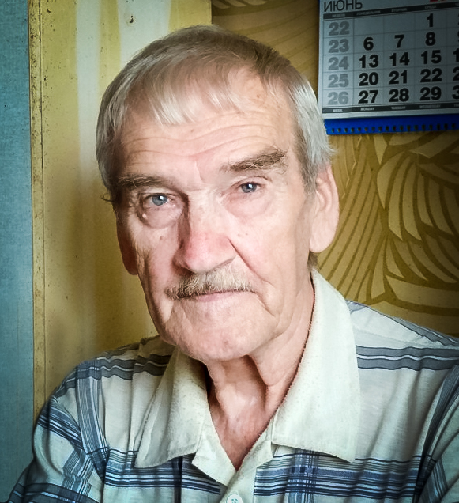
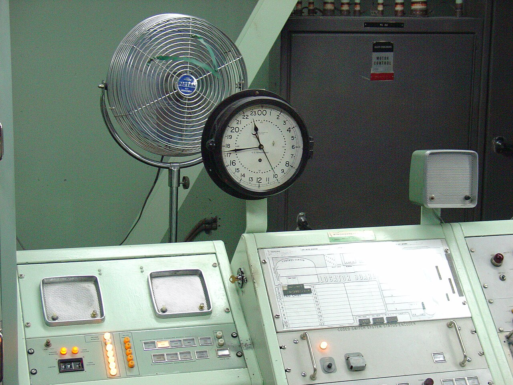
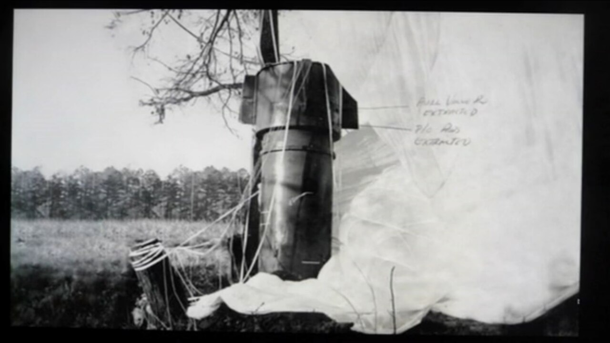
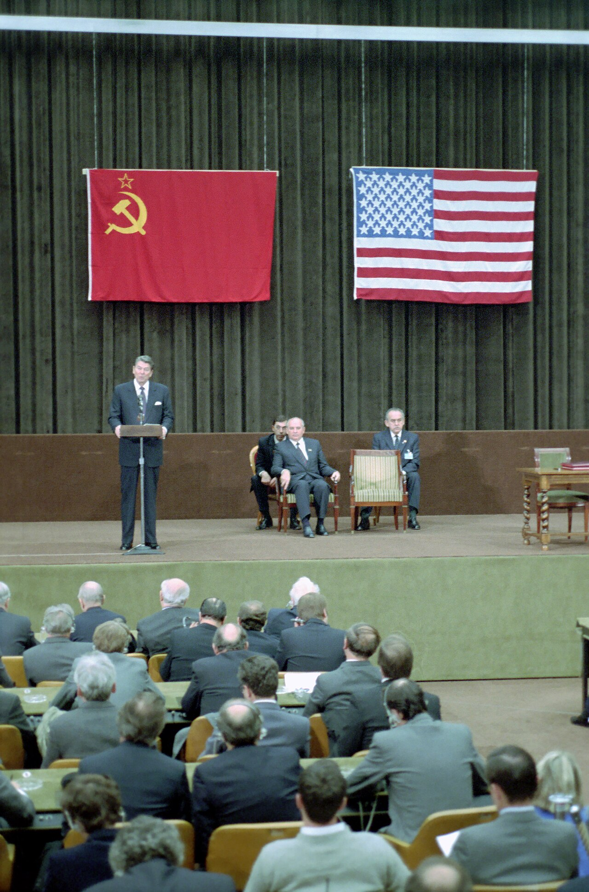
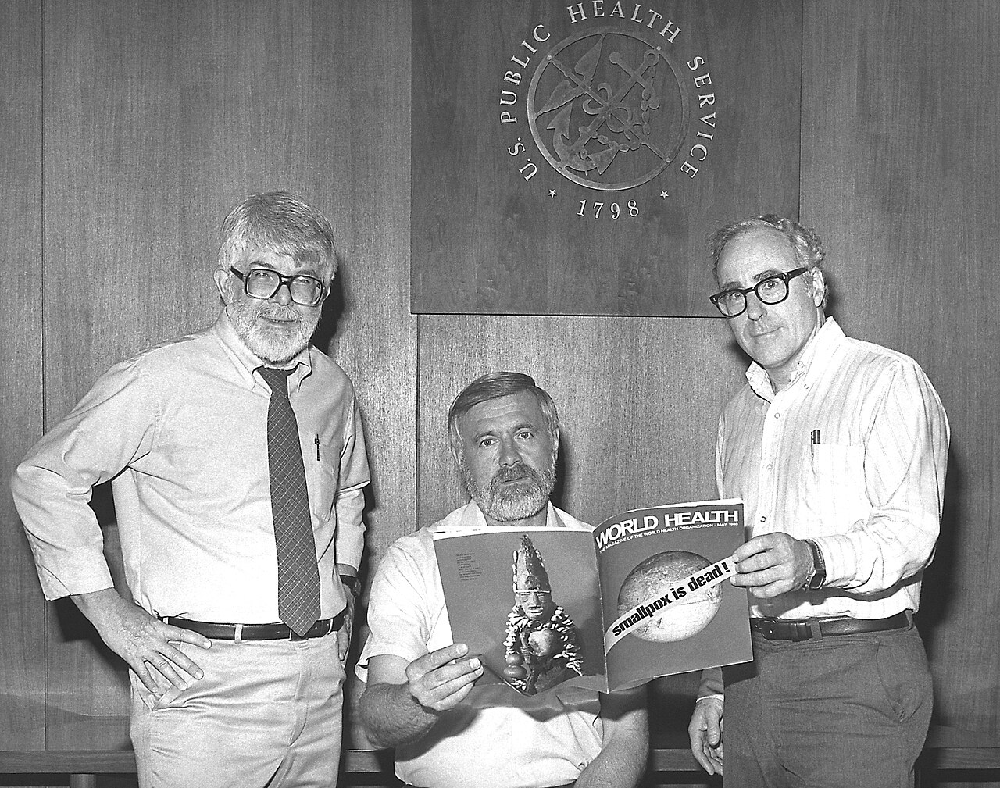
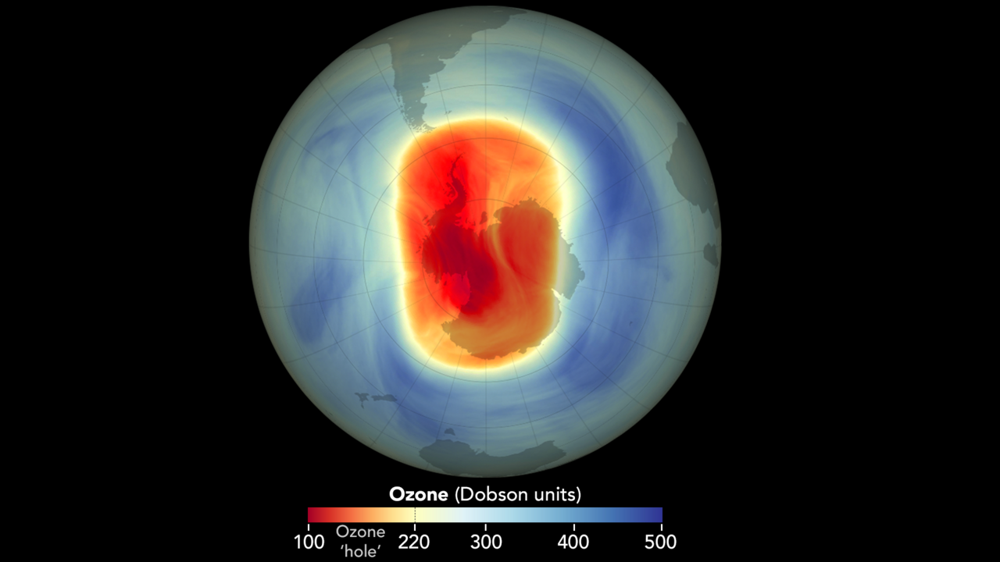

# 113. Could humanity destroy itself?

*The world, from 1958 to 2025*

It could wreck its own civilisation, and it has had the means since the 1950s. Twelve thousand nuclear weapons remain, and the science that reads and rewrites the code of life has made it possible to build a disease. Humanity has survived so far through treaties, habits of restraint and luck. Its record of acting together against a common danger is, all the same, far better than is generally believed.

A little after midnight on 26 September 1983, a siren went off in a bunker in the forest south of Moscow. The bunker was the command post for the Soviet Union's new system of satellites, which watched the American missile fields for the flare of a launch. The satellites were there so that a launch would be seen the moment it happened, long before any warhead came into view. On the wall above the operators' desks, a red panel lit up with a single word: START.

The officer in charge that night was a lieutenant colonel of forty-four named Stanislav Petrov. The computer was reporting that one missile had been fired from a base in the north-west of the United States. It rated the reliability of the report as the highest possible. In other words, the machine was not offering a guess; as far as it could tell, the launch was certain. Then, while he stared at it, the siren sounded again. A second missile. Then a third, a fourth and a fifth. The panel changed to read: MISSILE ATTACK.

*Stanislav Petrov at home in Fryazino, near Moscow, in July 2016, the year before he died. Photo: Queery-54, CC BY-SA 4.0.*

His orders were clear. He was to report the detection up the chain of command, which led within minutes to the country's leader, an old and sick man who believed that the Americans were preparing a first strike.

The moment could hardly have been worse, because each side already expected the worst of the other. Less than four weeks earlier a Soviet fighter had shot down a Korean airliner that had strayed over Soviet territory, killing two hundred and sixty-nine people. The American president, for his part, had called the Soviet Union an evil empire. In that mood, a report of incoming missiles would be easy to believe.

Time was also very short. If the missiles were real, they would land in twenty-five minutes, and the leadership would have perhaps ten in which to decide whether to fire back. Whatever Petrov said next would be the starting point for that decision.

Petrov held a telephone in one hand and an intercom in the other, and a hundred and twenty officers were looking at him. He thought that it did not make sense.

First, he had been taught that an American attack would come as an avalanche of hundreds of missiles, to destroy the Soviet forces before they could reply. An attack of five would leave almost all of those forces standing, ready to strike back. Nobody starts a war with five. Second, the system was new, and he had helped to write its manual and knew its faults. Finally, the radar stations on the ground, which would see the warheads as they came over the horizon, were reporting nothing.

He picked up the telephone and told his superiors that it was a false alarm. He did not know that it was. He was making a judgement, and the price of being wrong would have been beyond counting. He said afterwards that he had thought the odds were fifty-fifty, and that he sat for the next quarter of an hour waiting to find out.

Nothing arrived. It emerged that the satellite had been looking at the edge of the Earth over the American prairie, and had mistaken the glint of sunlight on high clouds for the exhaust of rockets.

## Minutes

The machinery that Petrov was part of is still there. It runs on the same short clock.

The nuclear arsenals have shrunk by more than four fifths since their peak in the 1980s. About twelve thousand warheads remain. Russia and the United States hold nearly nine tenths of them, and seven other countries the rest: China, France, Britain, India, Pakistan, Israel and North Korea.

Most of them are also far stronger than the first bombs. A single modern warhead is typically ten or twenty times as powerful as the bomb that destroyed Hiroshima. Of all those warheads, about two thousand, on missiles in underground silos and in submarines, are kept ready to be launched within a few minutes of an order.

*Nuclear warheads in the world, 1945 to 2025: the stockpiles of the United States, of the Soviet Union and then Russia, and of all other countries, and the world's total including retired warheads awaiting dismantling. All the figures are estimates. Chart: drawn for this book; data from the Federation of American Scientists, via Our World in Data.*

The reason for that readiness is the one that faced Petrov: there is very little time. A missile fired from a submarine off the coast can arrive in ten minutes. Missiles in silos, meanwhile, can be destroyed where they stand. For that reason each side plans to fire its own on warning, before the enemy's land. The warning, in other words, has to be judged in minutes. In the United States the decision belongs to one person, the president, who is not required to consult anyone and would have a few minutes to make it.

*A control console at the Titan Missile Museum in Arizona, a former American missile site kept as a museum. Missiles of this kind stood ready in underground silos. Photo: Jeff Keyzer, CC BY 2.0.*

For a long time it was assumed that a nuclear war would be a catastrophe for those who fought it and survivable for everyone else. The bombs, after all, would fall on the countries at war. In the 1980s, however, scientists began to study the smoke. Hundreds of burning cities would lift millions of tons of soot above the weather, where no rain could wash it out. From there it would spread around the globe and dim the Sun for years. Less sunlight means shorter growing seasons, and shorter growing seasons mean smaller harvests, far from any battlefield.

The most recent calculations, published in 2022, concluded that even a war between India and Pakistan, using a hundred or so weapons, would shorten the growing seasons enough to leave a quarter of a billion people in other countries without food. A full exchange between America and Russia would leave most of humanity without food. A war between two countries, in short, would starve people who had no part in it.

Petrov's night was not the only one. The machinery has come close to disaster in other ways too: by accident, and by misunderstanding.

In 1961 an American bomber broke up in the air over the state of North Carolina and dropped two hydrogen bombs on farmland. Each bomb carried safety devices, meant to keep it from going off unless it had been deliberately armed. On one of them, three of the four safety devices failed, and the fourth, a simple switch, was all that prevented an explosion two hundred and fifty times the size of Hiroshima.

The misunderstanding came later. In 1995 Russian radar picked up a rocket rising off the coast of Norway on the path that a missile from an American submarine might take. For the only time on record, the briefcase holding the launch codes was opened in front of a Russian president. It was a scientific rocket, sent up to study the northern lights. The Norwegians had given notice weeks before, and the notice had not been passed on.

*One of the two hydrogen bombs that fell on North Carolina in 1961, lying in a field with its parachute after the bomber that carried it broke up in the air. Photo: United States Air Force, public domain.*

## Nine, not twenty-five

That nothing worse has happened is partly luck. It is also the result of sixty years of deliberate effort. Some of that effort went into keeping the number of armed countries small, and some into shrinking the arsenals of the largest.

In 1963 an American president predicted that within a dozen years there might be fifteen, twenty or even twenty-five countries with nuclear weapons. There are nine. The main reason is a treaty of 1968, which nearly every country in the world has signed.

The treaty was built as a bargain between those who had the bomb and those who did not. Under it, states without the bomb promised not to acquire it, and accepted inspectors in their nuclear plants, so that a broken promise could be caught. In return, the five states that had it promised to share the peaceful uses of the atom, and to work in good faith towards getting rid of their weapons. They have kept the second promise poorly. The bargain has held all the same. Its success shows most clearly in the countries that started down the road and turned back. Sweden, Brazil, Argentina, South Korea and others gave up programmes that they had begun. South Africa went further still: it secretly built six bombs in the 1980s and then, uniquely, took them apart.

Meanwhile, the two great arsenals were brought down by a series of agreements. The most important of them were verified by satellites and by inspectors who counted warheads on the other side's bases, so that neither side had to take the other's word.

In November 1985 the American president and the Soviet leader met for the first time, beside a lake in Switzerland. They could agree on little else. They did, however, issue a joint statement containing one sentence that both countries have repeated ever since: a nuclear war cannot be won and must never be fought. The sentence mattered because it gave up, in public, the idea that either side could plan to come out of such a war ahead.

*Ronald Reagan speaking in Geneva on 21 November 1985, with Mikhail Gorbachev seated on the stage, when the joint statement of the two leaders was announced. Photo: White House Photographic Office, public domain.*

There is also a habit that no treaty records. In every war since 1945, including wars that nuclear powers failed to win, in Korea, Vietnam and Afghanistan, the weapons have gone unused. A nuclear power facing failure, in other words, has accepted it rather than use the bomb. Each year that passes makes it harder to be the first to break that silence.

Much of this is now fraying, and the treaties are the first to show it. The last treaty limiting American and Russian weapons was due to expire in February 2026, and Russia had already stopped admitting the inspectors. China is adding about a hundred warheads a year. And the lesson that some governments have drawn from Ukraine, which gave up its weapons and was invaded, is the opposite of the one that the treaty intends: that a country is safer with the bomb than without it.

## Reading

While the first danger receded a little, a second was taking shape in the laboratories of biologists.

Every living thing is built and run according to a set of instructions written along the length of a molecule called DNA. The instructions use an alphabet of four chemical letters. A human being's set is about three billion letters long, and a copy is folded into almost every cell of the body. The shape of the molecule, a twisted ladder whose rungs are pairs of letters, was worked out in 1953.

For decades the letters could be read only a few hundred at a time, by hand. In 1990 governments and charities began a project to read a complete human set. It took thirteen years and cost about three billion dollars. The machines improved faster than computer chips have. The same job can now be done in a day for a few hundred dollars. Some viruses, including the coronavirus, carry their instructions in RNA, a molecule related to DNA. The complete code of a new virus can be read in hours, which is how a vaccine came to be designed in a weekend in January 2020.

## Writing

Reading the code was followed by the power to change it.

Bacteria are attacked by viruses, as we are, and they have a defence. A bacterium that survives an attack keeps a short stretch of the virus's code as a kind of wanted poster. If the same virus returns, the cell makes a copy of the poster and attaches it to a protein that works like a pair of scissors. The protein drifts through the cell, checking every stretch of DNA that it meets against the poster, and where it finds a match it cuts.

In 2012 two scientists, an American and a Frenchwoman, showed that this machine could be reprogrammed. Give the scissors a poster of one's own choosing, twenty letters long, and they can cut DNA at a chosen place in the laboratory, though not every target is within reach and cuts can occur in the wrong place. The cell can then be made to repair the cut with a new sequence. It was as if a book three billion letters long could be searched for one phrase and that phrase corrected. A graduate student can learn the method in a few weeks.

*Emmanuelle Charpentier and Jennifer Doudna, who showed in 2012 that a bacterium's defence could be reprogrammed, and who were awarded the Nobel Prize in Chemistry in 2020. Photos: Bianca Fioretti and Duncan Hull / The Royal Society, CC BY-SA 4.0.*

The first medicine made in this way was approved in 2023. It treats sickle-cell disease, an inherited disease of the blood that can cause lifelong, agonising pain and early death, and which is commonest among people of African descent. Doctors remove the patient's blood-forming cells and edit them to increase production of a form of the blood's oxygen-carrying protein normally made before birth. After chemotherapy, the cells are put back. In the trial behind the approval, most patients followed long enough had gone at least a year without severe attacks of pain.

Five years before that approval, a researcher had crossed the line scientists had drawn against editing embryos to produce children. In November 2018 a researcher in the Chinese city of Shenzhen announced that he had edited the genes of two embryos, and that twin girls had been born. Changes made at that stage can be passed on to later generations. He had done it without the knowledge of his university, and the edit had not worked as he intended. He was sent to prison for three years.

## A virus by post

What can cure can be turned to harm.

In 2005 American scientists rebuilt the influenza virus that had killed fifty million people in 1918. They recovered its code from the body of a woman buried in the frozen ground of Alaska, and assembled it letter by letter. In 2012 two laboratories published different experiments showing that altered viruses derived from bird influenza could spread through the air between ferrets, animals used to study human influenza. More than half of the reported human cases of the bird influenza had been fatal, but it had not spread in sustained chains from person to person. In 2017 a Canadian team built a close relative of the smallpox virus from pieces of DNA that they had ordered by post from a commercial supplier. It cost them about a hundred thousand dollars. All three experiments were done for good reasons, to understand a threat or to make a vaccine. Each also showed that the thing could be done.

States have tried before. In 1972 the powers signed a convention banning biological weapons. The Soviet Union signed it and then built the largest programme in history, employing tens of thousands of people in a network of secret institutes, which produced anthrax and smallpox by the ton and worked on loading them into missiles. Western governments had already suspected the programme; a defector revealed its vast extent in 1989. The convention has no inspectors. The office that looks after it has a staff of four.

The fear today is less of states than of the day when the skill needed falls within reach of a small group, or a single person, who wishes to kill as many people as possible. In 1995 a Japanese religious sect with a large budget and trained chemists released nerve gas in the Tokyo underground and killed fourteen people. It had tried germs first and failed. The tools are a great deal better now.

## The last case

Against that stands the story of the worst disease that human beings have known.

Smallpox killed about three in ten of those who caught it and left many of the rest scarred or blind. It had destroyed the peoples of the Americas. Nor did its toll end once a defence was known. In the twentieth century alone, when a vaccine had existed for more than a hundred years, it killed some three hundred million people, more than all that century's wars.

In 1958, at the height of the Cold War, the Soviet delegate to the World Health Organization proposed that the disease should be wiped out entirely. It was possible in principle because smallpox lives only in human beings. There was no animal in which it could hide and later return. As a result, if every chain of infection were broken, the virus would have nowhere to go.

The campaign began in earnest in 1967, and it drew on both sides of the Cold War at once. Its director was an American, and much of the vaccine, more than a billion doses, came from the Soviet Union. The two governments, which were pointing missiles at each other, cooperated on this for thirteen years.

*Three former directors of the smallpox eradication programme at the Centers for Disease Control in 1980, with the news that the disease had been wiped out: from left, J. Donald Millar, William Foege and J. Michael Lane. Photo: Centers for Disease Control, public domain.*

The method that won was found by accident. An American doctor working in Nigeria ran short of vaccine and could not immunise everyone. Instead, he sent his teams to find each case, and vaccinated only the people living around it, in a ring, so that the virus had nowhere to spread. Rather than protecting everyone, the teams protected the people whom the virus was most likely to reach next. It worked better than mass vaccination had.

With that method in hand, teams then pursued the disease from village to village across India, Bangladesh and the Horn of Africa, through floods and civil wars, offering rewards for reports of a rash. Each report could lead them to a new case to surround.

In October 1977 a hospital cook in a port town in Somalia named Ali Maow Maalin came down with it. He had ridden for a few minutes in a car carrying two patients, to show the driver the way. Once he fell ill, the ring was drawn around him. A hundred and sixty-one people who had been near him were traced and vaccinated. Nobody caught it from him. He was the last person on Earth to be infected by smallpox in the ordinary way.

The whole campaign had cost about three hundred million dollars, which is less than the price of two modern bombers. For that sum, a disease that had killed hundreds of millions was gone. It is the only human disease that has ever been eradicated.

The same ambition has since been turned on polio. That disease, which paralysed three hundred and fifty thousand children a year in the 1980s, has been cornered. In its wild form it now paralyses a few dozen children a year, all of them in Afghanistan and Pakistan.

## A hole in the sky

A second success concerned something that almost nobody had known was in danger.

In 1928 an American chemist invented a family of gases for use in refrigerators. They seemed ideal. They did not burn, were not poisonous, and reacted with almost nothing, and they were soon used in air conditioners and spray cans all over the world.

Their very safety, however, hid the problem. Because they reacted with almost nothing, they did not break down. Instead, they drifted slowly upwards.

High above the Earth lies a thin layer of a form of oxygen called ozone, which absorbs the ultraviolet rays of the Sun that cause skin cancer and blindness and damage crops. It works, in effect, as a sunscreen for the whole planet. In 1974 two chemists in California worked out what would happen when the refrigerator gases reached it. They calculated that the gases, on reaching that height, would be split by sunlight and release chlorine. Worse, a single atom of chlorine would destroy tens of thousands of molecules of ozone, so that a little gas could do a great deal of harm.

At the time, the warning rested on calculation. The companies that made the gases, a business worth billions, said that it was a theory with no evidence.

The evidence came from an unfashionable quarter. A British research station on the coast of Antarctica had been measuring the ozone overhead every spring since 1957, with an instrument that looked like a box on a tripod. In 1985 its scientists reported that the amount had fallen by more than a third. The finding was all the more striking because others had missed it. American satellites had been recording the same thing for years, but their computers had been set to flag such low readings as probable errors. When the data were examined, they showed a hole in the ozone layer the size of the United States.

*The ozone hole over Antarctica on 21 September 2023, the day it reached its largest size that year. The red and orange show the lowest amounts of ozone. Image: NASA Earth Observatory, public domain.*

Two years later, in Montreal, governments signed an agreement to phase the gases out. Rich countries went first and paid into a fund to help poor ones change over, so that poorer countries were not asked to give up the gases without help. The largest manufacturer, which had by then developed substitutes, dropped its opposition. Every country in the world eventually ratified it, the first treaty of which that can be said.

The results can be measured. Production of the gases has fallen by ninety-nine per cent. As a result, the hole has stopped growing and is slowly closing, and the layer is expected to be back to its former state over most of the world by about 2040, and over Antarctica by the 2060s. The treaty is estimated to be preventing two million cases of skin cancer a year.

![Bar chart of the size of the ozone hole over Antarctica each spring from 1979 to 2025, in millions of square kilometres. It grows from almost nothing in 1979 to 14 in 1985, when British scientists reported it, larger than the area of the United States, and to 19 in 1987, the year of the Montreal agreement. It stays mostly between about 19 and 27 through the 1990s and 2000s, apart from a small hole in 2002, and is largest in 2006; it has been somewhat smaller since, at about 19 in 2024 and 2025. There is no figure for 1995](images/chart_ozone.png)
*The average area of the ozone hole over Antarctica from 7 September to 13 October each year, 1979 to 2025. There is no figure for 1995. Chart: drawn for this book; data from NASA Ozone Watch.*

## A few dozen factories

In each of these cases the danger was plain, and in the end not seriously disputed. There was also a remedy that could be afforded: a vaccine costing cents, a substitute gas. The rich were willing to pay for the poor to take part, so that poorer countries had little reason to refuse. Progress could be checked by counting cases or measuring the sky, so that claims of success could be tested. And under the ozone treaty, a country that stayed out stood to lose its trade in the goods concerned.

Few dangers line up so neatly, and the size of the task matters as much as anything. With the ozone layer there were a few dozen factories to change. With the climate, by contrast, there are the engines and furnaces of the whole world, and those who profit from them.

Even so, the record is better than its reputation. Nuclear weapons have gone unused for eighty years, against the expectations of nearly everyone who built them. A disease was abolished. The sky is mending. On each occasion it took scientists who raised the alarm, governments that listened in time, and adversaries who found that on this one matter they wanted the same thing.

Petrov was not rewarded. Instead, he was reprimanded for failing to keep the log up to date during the alarm, retired early, and lived on a small pension in a flat outside Moscow. Nobody outside the Soviet army knew what he had done until 1998. He died in 2017, and the news took four months to reach the world. He always said that he had only been doing his job.

Ali Maow Maalin recovered. He had avoided the vaccine, he said later, because he was afraid of the needle. He spent his last years as a volunteer in the campaign against polio, walking from house to house in Somalia, and when parents hesitated he told them who he was. He caught malaria on one of those rounds in 2013, and died of it.
