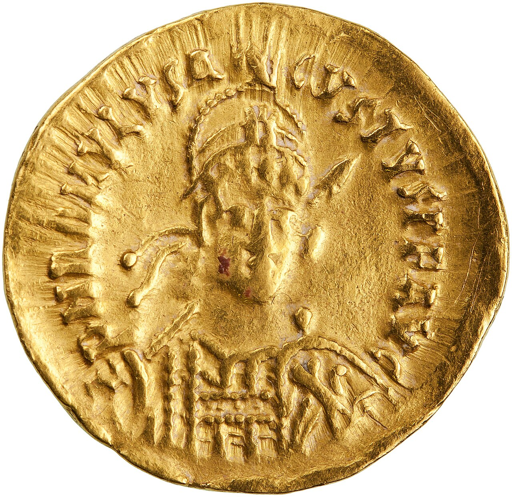
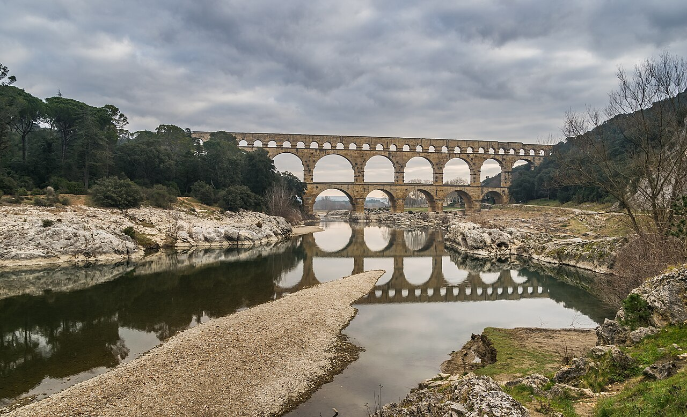
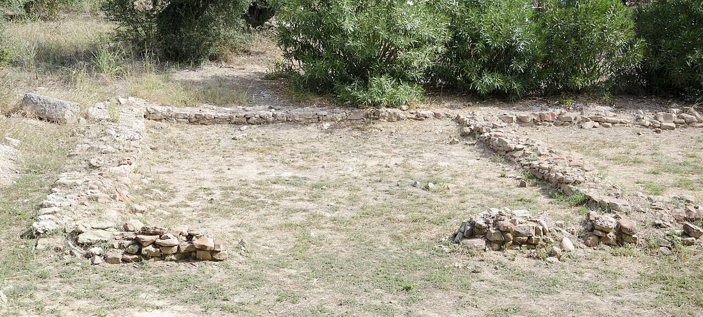
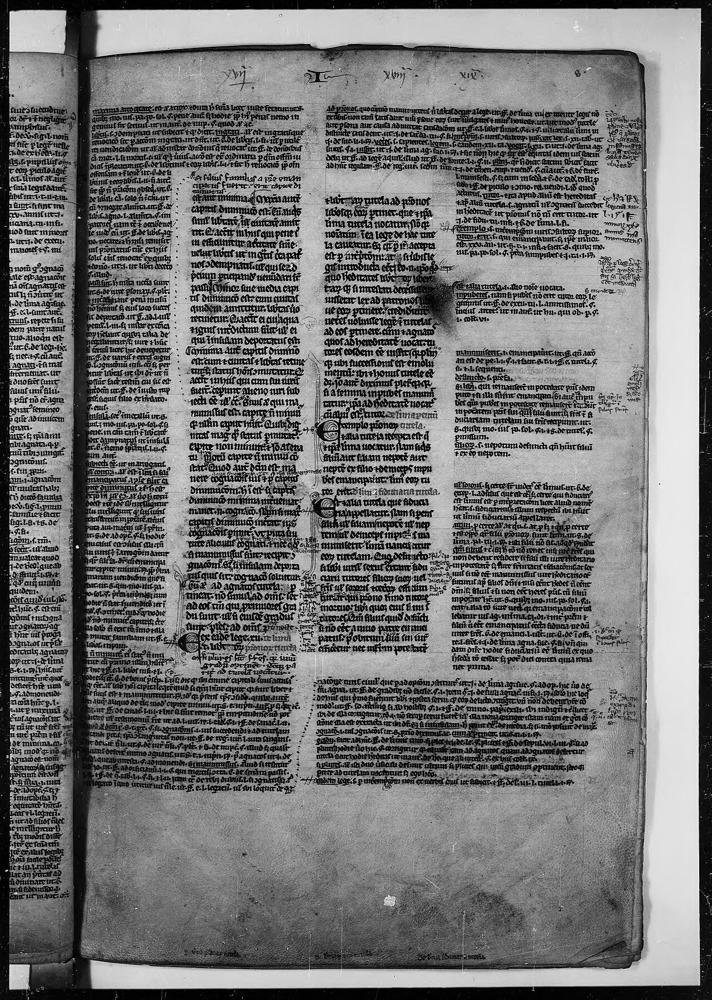
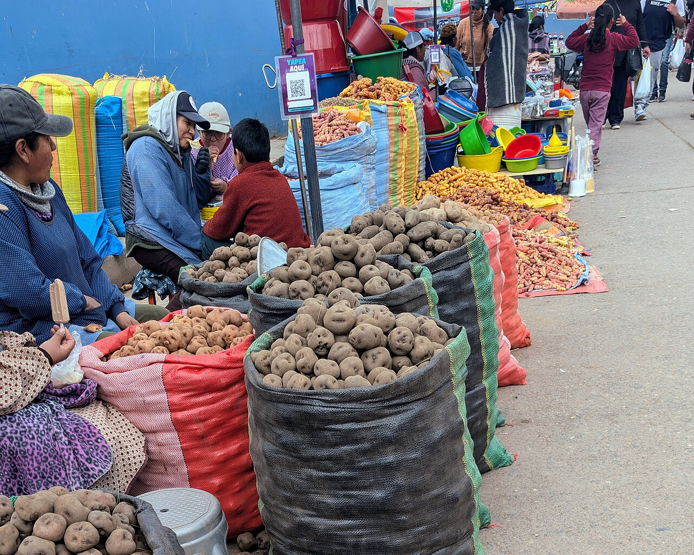
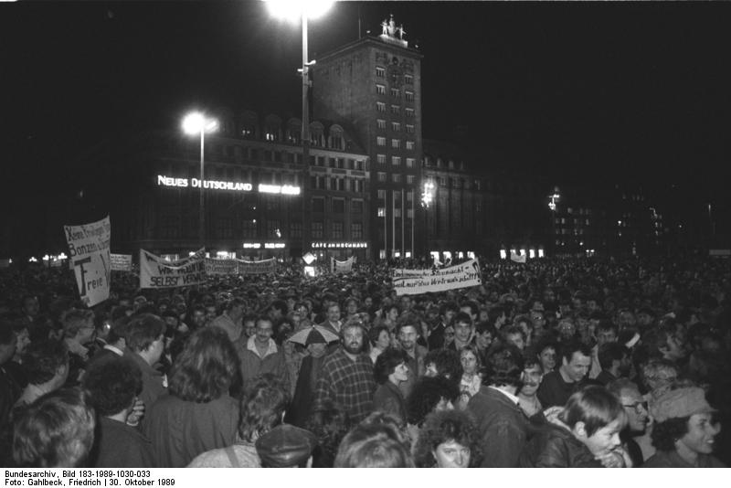
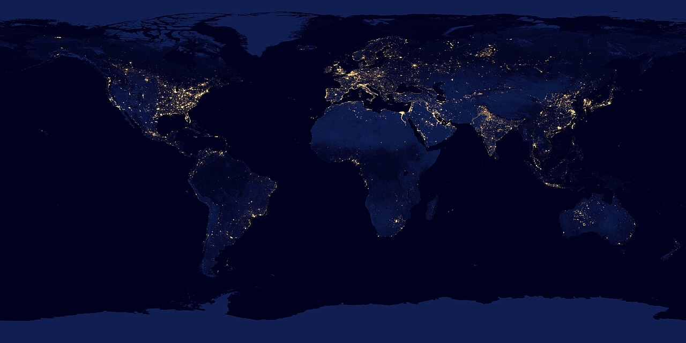
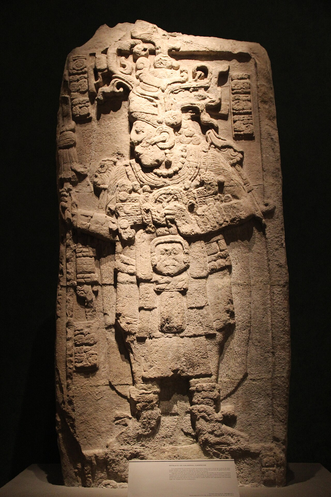
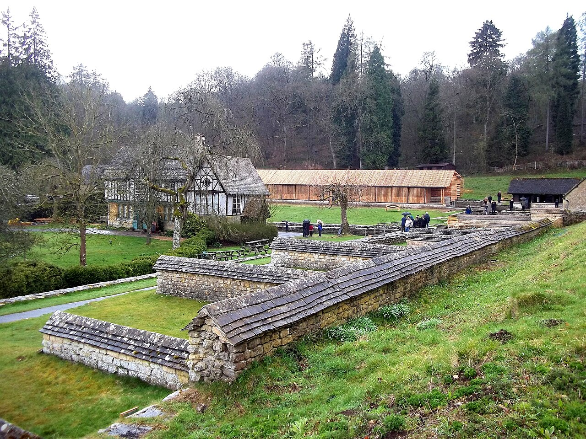

# 115. How do empires end?

*The world, from the Bronze Age to the present*

Empires end as governments. The people, the language, the fields, the roads and the skills mostly carry on, and usually a successor takes over what worked. What fails is one or more of four things: the money to pay the soldiers, the belief that the rulers have a right to rule, the land and the health that everything stands on, or the strength to survive a blow from outside.

In the year 476 the Roman emperor in the West was a boy in his early teens. He had been put on the throne by his father, a general, ten months earlier. That summer the army in Italy, which by then consisted of Germanic soldiers under Germanic officers, asked to be paid in land and was refused. It mutinied. Its commander killed the boy's father and marched on the capital, Ravenna. It was a familiar kind of crisis: an army that its rulers could not satisfy.

*A gold solidus of Romulus Augustulus, the boy who was the last emperor in the West, struck in 475 or 476. Coin: American Numismatic Society, CC0.*

He did not kill the boy. He looked at him, took pity on his youth, and sent him to live with his relatives in a villa on the Bay of Naples, with a comfortable pension. Then he packed up the imperial robes and the crown and posted them to the other emperor, in Constantinople, with a polite note to say that the West no longer needed one of its own.

That was the fall of the Roman Empire. Hardly anybody noticed. The Senate went on meeting in Rome. The law courts sat, the tax collectors made their rounds, the aqueducts ran, and people went on speaking Latin. The new master of Italy governed through the old officials and took a Roman title. A person living there could have gone to bed on the last night of the empire and got up the next morning without knowing that anything had happened. The empire had ended as a government, and almost nothing else had ended with it.

*The Pont du Gard in southern France, a stone bridge that carried a Roman aqueduct over a river, built in the first century. Photo: Krzysztof Golik, CC BY-SA 4.0.*

## Four ways to fall

The commonest way for an empire to end is that the money runs out. An empire is, among other things, an arrangement for collecting wealth in one place and paying soldiers with it. If the wealth stops arriving, the soldiers go unpaid, and the arrangement begins to come apart.

The Roman West is the plainest case. It lost its richest provinces to invaders one at a time, and with each loss it had less to pay the army that might have won them back. The losses fed on themselves.

Other empires ran short in other ways. Spain, strangely, drowned in the silver of its own colonies and went bankrupt repeatedly. The Mughal emperors of India gave away the right to collect their taxes, and found that they had given away the empire, since whoever collects the taxes can pay the soldiers. Britain came out of the war of 1939 as a victor and a debtor, and could no longer afford to hold what it had. Winning, it turned out, did not pay the bills. The Soviet Union lived for its last decade on the sale of oil, and the price fell.

The second is that people stop believing. That sounds vaguer than money, but it is just as practical. Every government rests in the end on the willingness of most people to do what they are told, and of soldiers and policemen to enforce it. When that willingness goes, there is nothing to put in its place.

The first emperor of China unified the country by terror, and his dynasty outlived him by four years, because hardly anyone outside its own army would lift a finger for it. Fear had held the country together, and fear did not outlast the man.

British rule in India shows how much a government depends on that willingness. It was carried out by a thousand officials among three hundred million people. A ratio like that depends on consent, or at least on habit. It worked for as long as most people on both sides took it for granted, and it was finished once an old man in a loincloth had taught millions to stop.

The governments of eastern Europe in 1989 still had their armies and their secret police on the day they fell. What nearly all of them had lost was anyone willing to shoot.

The third is the ground underfoot: the land, the weather and the health on which everything else stands. The palaces of the Bronze Age, three thousand years ago, depended on one another for tin and copper and grain. That made them strong in good times and fragile in bad ones. When drought, earthquakes and raiders struck several of them in the same decades, most of them went down together within a lifetime. The cities of the Maya, meanwhile, emptied, one region after another, through a century of repeated droughts.

Disease belongs here too. The peoples of the Americas were destroyed less by Spanish steel than by diseases to which they had no resistance, which travelled faster than the conquerors. Within a century nine in ten of them were gone.

*The ruins of the Bronze Age palace at Pylos in southern Greece, known as the Palace of Nestor, which was destroyed by fire about three thousand years ago. Photo: Peulle, CC BY-SA 4.0.*

The fourth is the blow from outside. Sometimes the blow was astonishingly small for the size of its target. Persia was the largest empire the world had seen, and yet a king of twenty-two from a small northern country took it apart in four years. The Mexica ruled millions and were overthrown by a few hundred Spaniards, together with tens of thousands of their neighbours and resentful subjects. The Spaniards struck the blow, but much of the force behind it was local.

Other blows landed more slowly. The Chinese empire never recovered its authority after British gunboats came up its rivers. The Ottoman empire, for its part, chose the losing side in a world war.

It is almost never one of these alone. Rome was short of money, and sick with plague, and invaded, and no longer certain what it was for. Each weakness left it less able to bear the others. A blow that an empire shrugs off in its strength will kill it in its weakness. For that reason, historians who argue about the cause of a particular fall are usually arguing about which of several was the last straw.

## What comes through

The stranger thing is how much survives. The governments are fragile, but a great deal of what they built is not.

When Alexander had finished conquering Persia, he and his successors ran it through the Persian system of provinces, each with its governor, joined by the Persian royal roads. The conqueror, in effect, took over the machine instead of building a new one.

The Germanic kings who carved up the Roman West did much the same. They kept Roman law, Roman bishops and Roman coinage, and their descendants today speak Spanish, French, Italian, Portuguese and Romanian, which are what Latin turned into. Roman law, in turn, is the root of the legal codes of most of Europe and Latin America.

China is the most striking case of all. It has been conquered from outside more than once and has changed its ruling house a dozen times, and through all of it the same written characters were used, the same classics were studied, and for thirteen hundred years officials were chosen by the same kind of examination. The conquerors became Chinese. The way of life they had defeated ended up absorbing them.

*A page of a manuscript of Justinian's Institutes, a textbook of Roman law, copied in Latin in the 1300s with notes crowded into the margins. Photo: Bibliothèque nationale de France, public domain.*

Some of what an empire leaves behind outlasts it by centuries. The Inca empire lasted barely a century. Yet the potato that its farmers had bred in the Andes now feeds more people than any crop except wheat, rice and maize. More than a million and a half people in Mexico still speak the language of the Mexica.

Institutions last as well. The British left India nearly eighty years ago, and India is governed largely in English, by a parliament, under laws argued in courts whose procedures an English barrister would recognise. The Soviet Union has been gone for a generation, and its pipelines, its railways, its rockets and its language still tie its fragments together.

*Potatoes for sale at a Sunday market in Juliaca, in the Andes of southern Peru, where the potato was first bred. Photo: H.dav.are, CC BY-SA 4.0.*

For the great majority of people who have lived through the end of an empire, it meant a change of tax collector. Picture one stretch of the Nile across a few thousand years. A family farming the mud of the Nile paid a share of its harvest to the pharaohs, and then, as the centuries went by, to Persian governors, Greek kings, Roman emperors, Arab caliphs, Turkish sultans and British consuls. The farm, the river, the crops and most of the customs were the same throughout.

Empires, seen from that farm, are thin. They are a layer of soldiers, clerks and ideas laid over the top of something much older and tougher, which is people growing food and raising children.

That thinness explains why successors keep the machinery. A new ruler needs taxes, and the fastest way to get them is to leave the old clerks at their desks. They already know who owes what, and who has paid.

## When it was the people who ended

There are exceptions, and they are the darkest part of the record.

Sometimes the end of a state was also the end of a people. The Mexica and the Inca lost their governments to conquest and most of their people to disease, war and forced labour.

Elsewhere the destruction was ordered on purpose. In the 1750s the Chinese emperor, after decades of war with a nation of nomads on his western frontier called the Zunghars, ordered that they be wiped out. About four fifths of them were killed by his soldiers or by smallpox, and the rest fled or were enslaved. Their name survives on maps of the region where they lived and almost nowhere else. In the twentieth century, states with railways and filing systems attempted the same thing with greater efficiency. The tools that made it easy to count people made it easier to kill them.

So the comforting rule, that empires fall and ordinary life goes on, holds only where the newcomers wanted subjects. Where they wanted the land empty, what came afterwards belonged to someone else.

## Iron and belief

People have argued for a very long time about what really moves history. The two main answers pull in opposite directions.

On one view the causes are material. People do what their circumstances allow. Give a region wild grasses that can be bred into wheat, animals that can be tamed, iron ore, a navigable river, coal near the surface, and certain things will follow. On this view the land sets the story, and people act it out.

On the other view, what counts is what people believe: the gods they fear, the stories they tell about who they are, the ideas for which they are willing to kill and to die. On that view, the same land can produce very different histories, depending on what its people make of it.

The evidence of ten thousand years supports both, in different roles. Each answers a different question.

Materials set the limits. Nobody built an empire without a surplus of grain to feed soldiers, and so there were no empires before farming. The horse, the chariot, bronze and then iron each redrew the map of power within a few generations of appearing.

The largest example is the meeting of two halves of the world. The peoples of Eurasia had cattle, horses, steel and a long acquaintance with crowd diseases, and the peoples of the Americas had not. As a result, when the two met, that difference decided the matter before anyone had formed a plan.

The same holds in later centuries. Britain industrialised first in large part because it had coal in the right place. In the last century the countries with oil, or with the factories to out-build their enemies, won the wars. No idea, however powerful, has ever fed an army or smelted a ton of steel.

Materials say what can be done; they do not say what will be. Within those limits, belief decides. In particular it decides the thing that actually makes and unmakes governments, which is whether people will fight, obey, or refuse.

The record is full of armies that had the better weapons and lost. The United States dropped more bombs on Vietnam than had been dropped in the whole of the Second World War, and left. The Soviet army went into Afghanistan with tanks and helicopters and came out nine years later, and the American army did the same thing a generation after that. France had nearly half a million soldiers in Algeria and was never beaten in the field.

What separated the two sides in these wars was not equipment but conviction. In each case one side was fighting for a line on a map in someone else's country, and the other believed that it was fighting for its home, and was prepared to go on for ever.

The same is true of the movements that used no weapons at all. Gandhi's marchers, the Black Americans who sat down at lunch counters, the crowds with candles in Leipzig had no weapons and little money. They won because they changed what other people believed: the rulers, the onlookers, and the men who had been ordered to club them. An empire that has lost the conviction that it is in the right does not need to be defeated. It lets go.

*A Monday demonstration in Leipzig, East Germany, on 30 October 1989. Photo: Friedrich Gahlbeck, Bundesarchiv, CC BY-SA 3.0 de.*

Belief has been as lethal as it has been liberating, and that should be said plainly. The same capacity that let strangers cooperate in millions, around a god or a nation or a theory of history, sent the crusaders to Jerusalem, built the camps in Poland, and starved thirty million Chinese in the name of a great leap. People fight for what they believe, and what they believe has very often been false.

Materials explain what was possible in a given place and time. Ideas explain which of the possible things people chose to do, and how long the result lasted. Slavery shows how the two work together. A steam engine did not abolish slavery, and neither did a sermon. Slavery was profitable to the end, and the cotton machines made it more so. Material interest pointed the wrong way. Instead, slavery was ended by men and women who decided that it was an abomination, by slaves who rose, and in the largest slave country by a war that the side with the factories won.

## No outside

The present world has no single government, and in that sense it is no empire. In another sense, however, it is something that no empire ever was: the whole species joined into a single system.

It has one economy, in which a telephone is designed on one continent with parts from a second and assembled on a third. It has one network of information, and one stock of knowledge. It has one atmosphere, which it is altering, and one supply of the few things, such as advanced chips and the grain of a handful of plains, on which everything else depends. If any one of these fails, the failure travels.

*The Earth at night, in a composite of satellite images from 2012. The lights are cities. Image: NASA Earth Observatory, public domain.*

That is new, and it changes what an ending would mean.

Every empire before this one had an outside. Somewhere beyond its borders, life went on as before. When the Roman West fell, the eastern half of the empire carried on for another thousand years, and kept the books. Persia and China barely registered the event.

The collapse of the Bronze Age had an outside too. When the palaces of the Bronze Age burned, Egypt staggered on, and in the wreckage small peoples on the fringes, who had never mattered, spread the alphabet and learned to work iron. There was always a neighbour to absorb the refugees, preserve the manuscripts, supply the next ruling house, or simply go on living, untouched, on the far side of the mountains. As a result, a fall in one place was balanced by a rise in another. The Arabs translated the Greeks. The Mongols carried gunpowder west. What one people lost, another kept and passed on.

A system that covers the whole planet has no neighbour, and so its troubles have nowhere else to go. If its climate shifts, it shifts for everyone. A new disease can spread around the world within weeks. A war between the great powers would darken the sky over countries that took no part. There are no barbarians beyond the frontier waiting to take over the estate, because there is no frontier.

## A species that can count

Against that, no earlier empire could see itself. The Maya kings had no way of knowing that a century of droughts was beginning, and went on raising temples as the reservoirs dried. Roman emperors watched their coins lose value for two centuries and blamed the greed of shopkeepers. The first Europeans in the Americas saw the people around them dying and thought that it was the will of God. They had no idea that they had brought the cause in their own breath.

*Stela 51 from Calakmul, a Maya city in southern Mexico, carved with a figure of a ruler. It is now in the National Museum of Anthropology in Mexico City. Photo: Gary Todd, CC0.*

The present world, by contrast, measures. It knows the amount of carbon dioxide in its air to one part in a million, and has known it every year since 1958. It can read the complete code of a new virus in an afternoon. It counts its own numbers, tracks its harvests from orbit, and has photographs of its ice. It also knows its history, including the histories of the societies that failed, and why. It can, in principle, see trouble coming.

It has acted on that knowledge, too, more often than its pessimists allow. It abolished the worst disease in its history by sending doctors from two hostile powers to work side by side. It noticed a hole opening in the sky and closed the factories that were making it. It has kept its most terrible weapons unused for eighty years. Since 1900 it has more than doubled the length of the average human life. It has taught most of its members to read, and has slowed the growth of its own numbers, which once seemed bound to go on until they starved.

None of that was inevitable. Each of those things was done by people who saw a danger, said so, were disbelieved, and persisted.

## What a fall would look like

How the present order might end is a matter of guesswork. There are fast ways for it to end, and they are the ones that people think of first. A nuclear war between the largest powers could do it in an afternoon. A disease made in a laboratory, with the reach of influenza and the deadliness of something far worse, could do it in a season. Either is possible. Neither is likely in any given year, and the years add up. Run every year, even a small risk mounts up.

There is also a slow way, which is how it has usually happened before. A civilisation does not have to be destroyed. It only has to lose the ability to do complicated things together. Complicated things need many people, in many places, each doing their part.

That is what the ground of western Europe shows for the centuries after that boy was sent to the Bay of Naples. Under Rome, a peasant in Britain had eaten from good pottery made in factories hundreds of miles away, lived under a tiled roof, and used small change. Each of those ordinary comforts depended on other people, many of them far away.

A generation or two after the legions left, hardly anyone in Britain could make pottery on a wheel. Houses were of wood and thatch, coins had gone out of use, and building in stone had all but ceased. Even the cattle were smaller than they had been before the Romans came.

The same shrinking reached the old capital. The city of Rome, which had held a million people, held thirty thousand, living among ruins that they could no longer have built and did not fully understand.

Nothing dramatic had happened in most of those places. Instead, the ships had stopped coming. As a result, the specialists had no customers, and their skills died with them. Each district fell back on what it could make for itself, which was much less.

*The remains of the Roman villa at Chedworth in Gloucestershire, England, a country house of the Roman period. Photo: Pasicles, CC0.*

A modern version would look like that, at a larger scale. Trade would shrink behind borders. The long chains of supply would shorten and then break. At the same time, people would stop believing what experts, governments and one another said. Regions would look to themselves. Each step would make the next one easier. Things that had been routine, a vaccine, a microchip, a forecast, would become difficult and then rare. It would not feel like the end of the world to those living through it. It would feel like things getting a little worse each year, for reasons that were always somebody else's fault.

There is a third possibility, which is that the present order ends by turning into something else, as the world of hunters turned into the world of farmers. The machines that have begun to write and reason may be the start of a change of that size. If so, the order would not so much fall as become unrecognisable. Nobody alive can say.

What can be said is that the outcome is not fixed. The four things that have ended empires are all, this time, within human power to affect. The money is a matter of how the proceeds are shared. The belief is a matter of whether people have reason to trust one another. The ground underfoot can be measured and, at a cost, repaired. And no rival waits beyond the frontier, because there is no frontier. Short of a rock from space, whatever ends this empire will have been done by its own people.

At the beginning there was an odd, weak ape with a talent for cooperating with strangers by believing the same stories. Once it had settled down and built cities, it started keeping records: a clay tablet, a count of barley, a clerk's name. It is the only animal that has ever written down what happened to it. Every empire in that record ended. This is the first one that has been able to read the whole of it.
