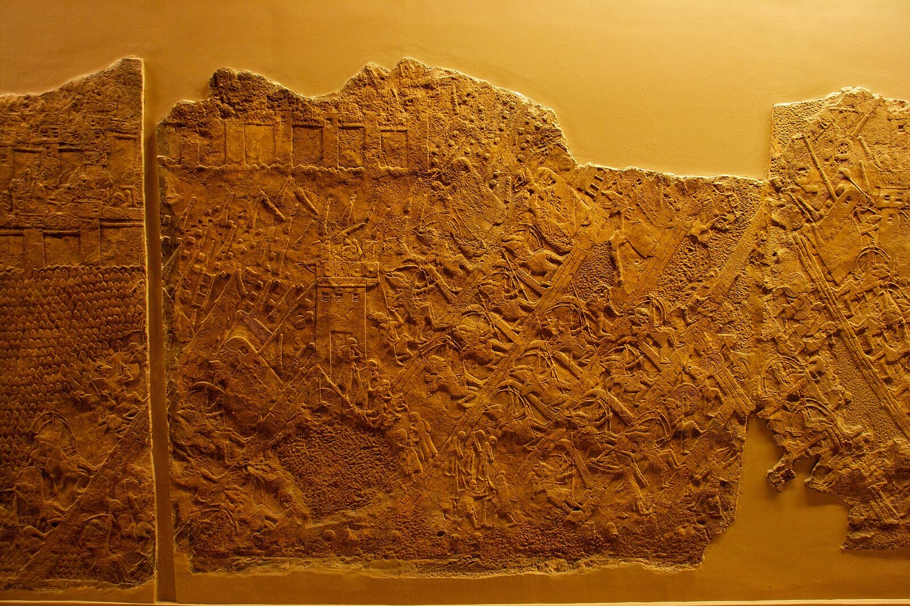
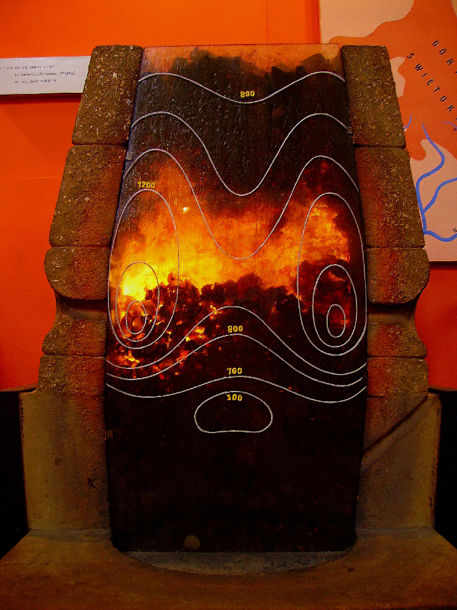
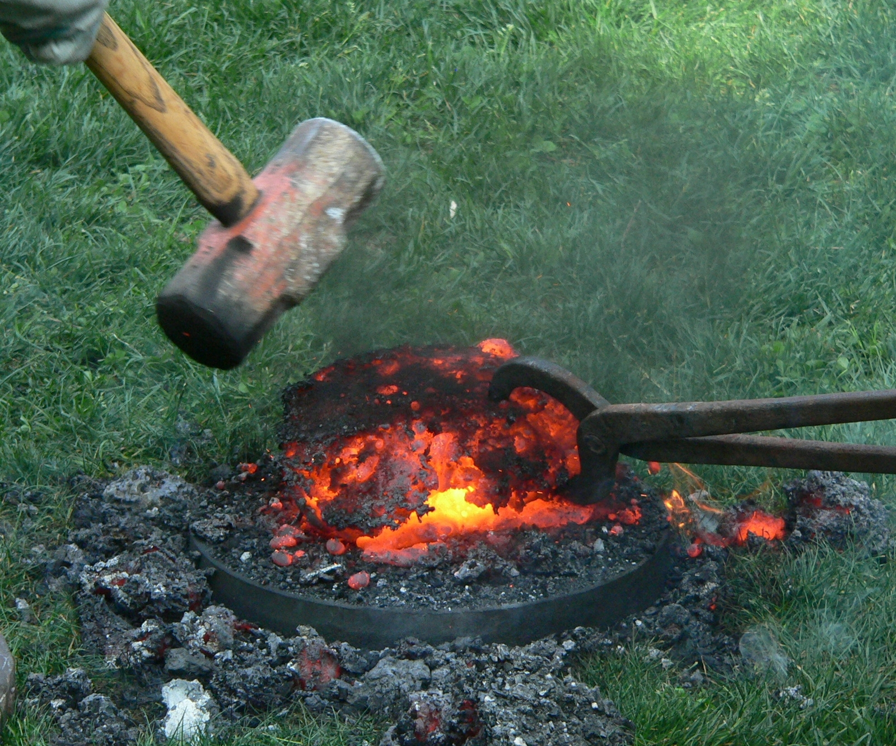
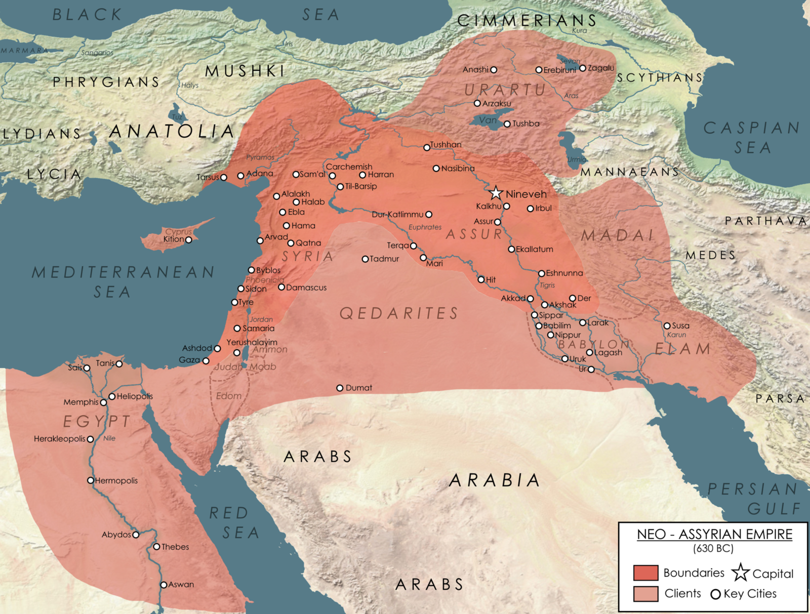
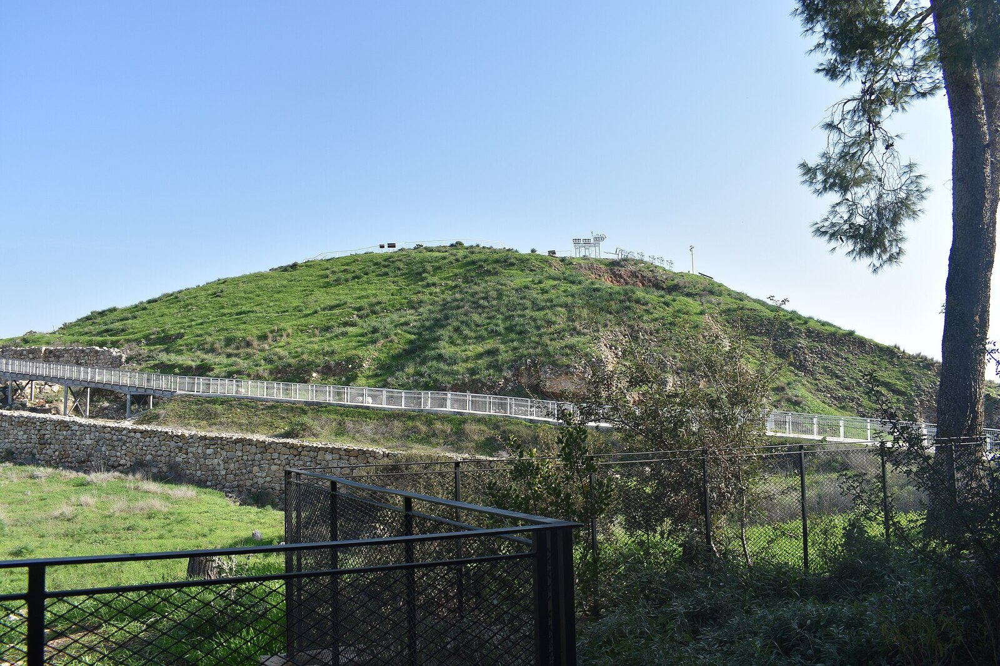
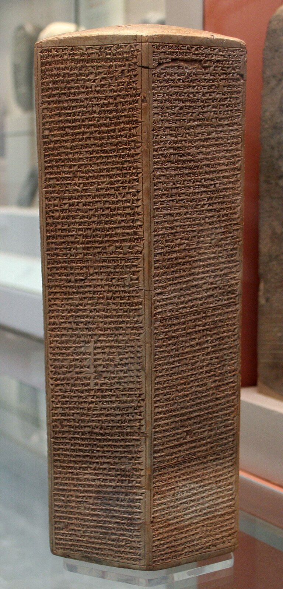
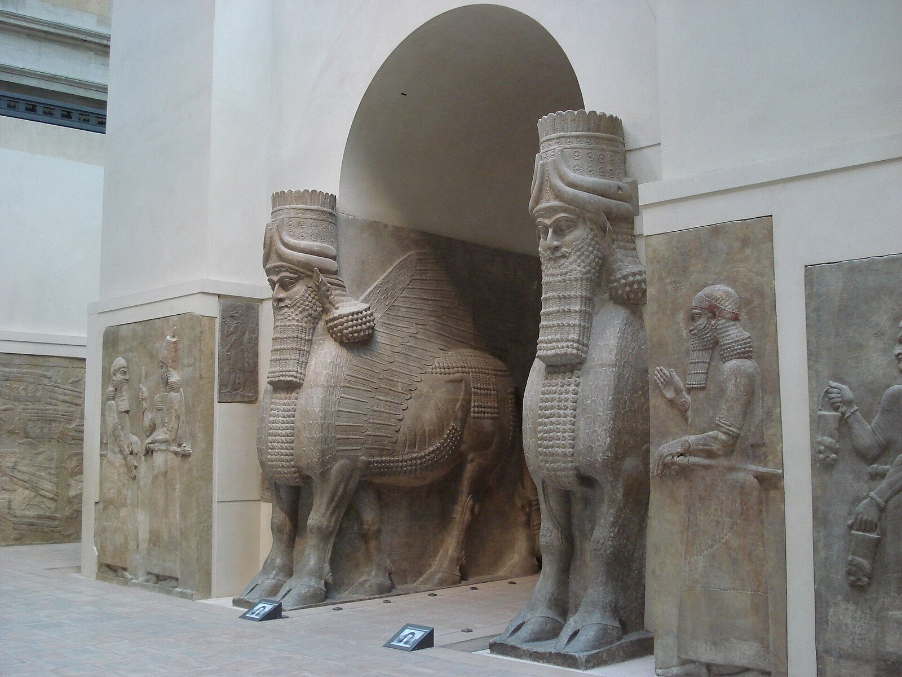
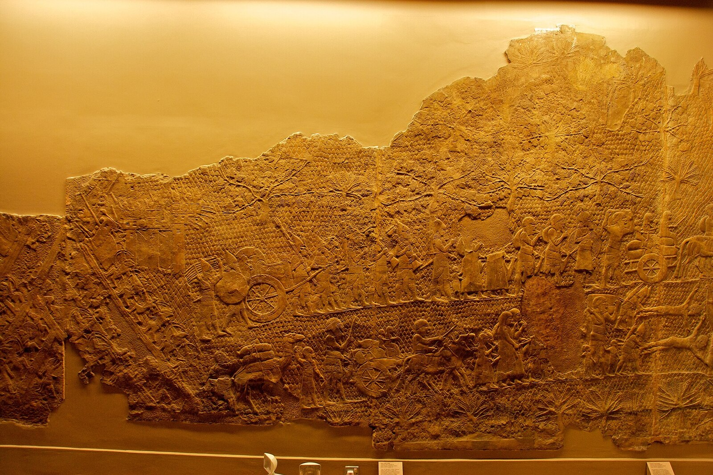
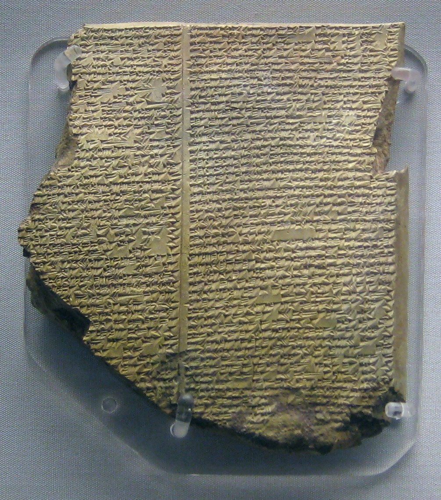
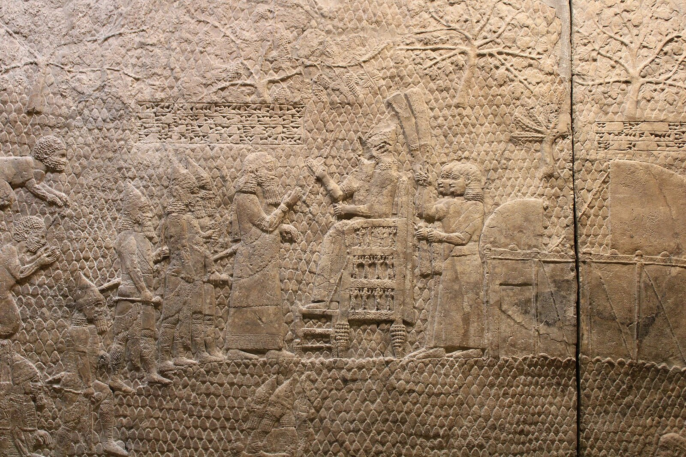

# 12. Why were the Assyrians so cruel?

*Northern Iraq and the lands around it, from about 2,900 years ago to about 2,600 years ago*

Because a city that opened its gates out of fear cost them nothing, and a city that had to be taken by force cost them a summer. The kings of Assyria punished rebels in the most public way they could devise, and then made sure that everybody heard about it.

About 2,700 years ago, a king of Assyria named Sennacherib built himself a new palace at Nineveh, on the river Tigris in the north of Iraq. He called it the Palace Without Rival. Its walls were lined with slabs of pale stone, each taller than a man and carved with pictures, and there were about three kilometres of them.

One room, near the middle of the palace, was given over to a single event. A visitor reached it through three doorways in a row, each guarded by a pair of stone bulls with wings and human heads. Inside, the carving ran around the walls, and it showed the capture of one city.

The city stands on a hill, with towers along its walls. Assyrian archers, slingers and spearmen close in on it in ranks. Ramps have been piled against the walls, and up the ramps roll armoured machines on wheels, each with a long beam sticking out of the front to break the brickwork. The defenders throw burning torches down onto the machines. On one of them, an Assyrian soldier leans out with a ladle on a long handle and pours water over the front to keep it from catching fire.

*The attack on Lachish, carved in stone for the palace at Nineveh about 2,700 years ago and now in the British Museum. The slanting bands are the ramps. Photo: Mike Peel, CC BY-SA 4.0.*

Further along the wall, the city has fallen. A line of people walks out through the gate carrying bundles. Families ride away on ox carts, the women and children sitting on top of their sacks. Beside the road, three naked men hang on tall sharpened stakes. Two more are pinned to the ground while soldiers cut the skin from their bodies.

At the end of the line sits the king, on a high throne in front of his tent, with prisoners kneeling before him. Above his head is a short caption. It gives his name and titles, and says that he sat on his throne while the plunder of the city of Lachish passed before him.

Sennacherib did not hide what his army had done to Lachish. He had it carved in stone and painted, in his own house.

## A furnace that cannot melt its metal

The army in those carvings was equipped with a metal that had hardly been used five centuries earlier. Its spear points, arrowheads, daggers, pickaxes and crowbars were made of iron.

Iron is one of the commonest substances in the ground. About one part in twenty of the rock beneath our feet is iron, and it is the reason that so much soil and stone is red or brown. Tin, which the makers of bronze had to fetch from the far ends of the known world, is thousands of times scarcer. A lump of iron ore looks like a heavy piece of rust-coloured rock, and it can be picked up in most countries on earth.

The difficulty was never finding iron. The difficulty was getting it out of the rock. In its ore, iron is locked together with oxygen, and it is in fact much the same substance as rust. To free the metal, something has to pull the oxygen away. In addition, iron melts at a far higher heat than copper does. A furnace of clay, fed with charcoal and blown with bellows, will melt copper comfortably. It will not melt iron.

The smiths who solved this found a way to make iron without melting it.

Picture a chimney of clay about as tall as a child, with walls as thick as a hand is wide. Near the bottom, a clay pipe passes through the wall, and to the pipe is fitted a pair of bellows made of animal skin. The smith lights a fire in the bottom and fills the chimney with charcoal, which is wood that has been baked black in a covered heap, so that it burns much hotter than wood does. When the whole stack is glowing, he begins to drop in ore from the top, broken into pieces the size of nuts. A layer of ore is followed by a layer of charcoal, and then by another of ore, hour after hour, while helpers work the bellows without stopping.

*A full-size museum model of an iron furnace of the old kind, as it was still built a thousand years later, cut open. The lines mark the heat inside, in degrees Celsius, and the hottest place is beside the air pipes near the bottom. Photo: Giorgiomonteforti, public domain.*

Inside, two things happen. First, the charcoal burns in a space with too little air, and so it gives off a gas that is hungry for oxygen. As that gas rises through the stack, it pulls the oxygen out of the hot ore. What is left behind is iron, in grains no bigger than sand, still solid.

Second, the ore is never pure. It comes mixed with sand and clay. In the heat, they combine with a part of the ore to make a black, glassy liquid called slag, which melts at a lower heat than iron does. The slag trickles to the bottom. The grains of iron sink down through it and stick to one another, in the way that wet snow packs into a ball.

After five or six hours, the smith breaks open the front of the furnace. At the bottom, among the slag, sits a glowing lump about the size of a loaf of bread. It is called a bloom, and it is not yet a bar of metal. It is more like a sponge, a mass of iron full of holes, with slag filling the holes.

*A bloom just out of the furnace, about to be hammered, in a modern trial of the ancient method. Photo: Morgan Riley, CC BY-SA 3.0.*

The second half of the work is done with a hammer. The smith drags the bloom out with tongs and beats it while it is still bright orange. Each blow squeezes slag out, in showers of sparks, and presses the iron closer together. He reheats it and beats it again, many times over. In the end he has a solid bar that weighs a few kilos. It has taken several times its own weight in ore and in charcoal, and a day's labour by several people.

Because iron could not be melted, it could not be poured into a mould as bronze was. Every object had to be forged. That means the smith heated the bar until it glowed, and hammered it into shape on a block, one spear point or one sickle at a time.

The metal that came out of this was, at first, no better than bronze. Plain iron is somewhat softer than good bronze, and it rusts. In time, smiths learned that iron left long enough in glowing charcoal soaks up a little of it and comes out harder. Iron with a little carbon in it is steel.

That skill spread slowly, and it mattered less than the price. Bronze needed tin, and tin had to cross half the world by ship and caravan. Iron needed ore, wood for charcoal, clay and a great deal of sweat, and most countries had all four. Over the centuries after the bronze palaces fell, iron spread from the workshops of kings to those of ordinary towns. By Sennacherib's time it was the everyday metal for tools and weapons, and a farmer could own an iron ploughshare, an iron axe and an iron sickle.

Cheap metal changed what a king could do with his subjects. A king with plenty of iron could hand a spear, a dagger and a quiver of iron-tipped arrows to every man he was able to feed. He could also give his army picks, saws and crowbars by the thousand, and with those an army could cut roads through hills and take a walled city apart.

## The yearly campaign

The kingdom that made the most of this was an old one. Ashur, the city of the tin merchants and their donkeys, had come through the fall of the bronze palaces as the centre of a small country on the upper Tigris. Its people called the country by the name of the city and of the city's god, who was also called Ashur. We call it Assyria.

Assyria was badly placed for a quiet life. It was a strip of good farmland with no sea, no desert and no mountain wall to protect it. Its kings drew the conclusion that the safe place for the border was as far away as possible, and they taught that the god Ashur had ordered them to widen his land.

As a result, from about 2,900 years ago, the Assyrian army went out almost every year, and it went to collect. A ruler who came out to meet the army with gifts, and promised to send the same every year, was left on his throne. A ruler who refused was attacked.

What the army collected, above all, was the means to make itself larger: horses, men and metal. One king recorded the tribute that he took from the city of Damascus alone. Along with the silver and gold, it included five thousand talents of iron, which is about a hundred and fifty tonnes. The ship that sank off the Turkish coast in the age of bronze had carried eleven tonnes of copper and tin together.

The numbers of soldiers rose to match. About 2,850 years ago, an Assyrian king wrote that he had crossed the river Euphrates with a hundred and twenty thousand. A century later, another king built up a core of full-time soldiers, many of them recruited from conquered peoples, with its own engineers and its own cavalry. Assyrian soldiers had been fighting from the backs of their horses for a century by then. A rider needs no vehicle and no wheelwright, and so the chariot, which had cost the bronze kings so dearly, began its slow retreat from the battlefield towards parades and royal hunts.

The same king also began to abolish the more troublesome of the tribute-paying kingdoms altogether, and to turn them into provinces under Assyrian governors. It was the answer that Sargon of Akkad had found to the same problem sixteen centuries earlier. From then on the empire had two kinds of subject: provinces ruled directly, and kings who kept their thrones for as long as they paid.

By the time Sennacherib came to the throne, Assyria ruled from the Persian Gulf to the Mediterranean and from the mountains of Turkey to the border of Egypt. It was the largest state that had yet existed. His own father, who was not the expected heir, had taken as his throne name that of the same founder of the first empire. He ruled as Sargon.

*The Assyrian empire at its largest, about 2,650 years ago, under Sennacherib's grandson. The paler areas were ruled by kings who answered to Assyria. Map: Ennomus, CC BY-SA 4.0.*

From the start, the kings described their wars with a relish for detail. Here is one of them, about 2,900 years ago, on what he did to a town that had rebelled: "I flayed as many nobles as had rebelled against me and draped their skins over the pile." He goes on to list the hands, noses and ears that he cut off, and he had it all carved in stone in a temple of his new capital.

## The mound at Lachish

In the hills between the Mediterranean and the Dead Sea lay a small kingdom called Judah. Its capital was Jerusalem. Its second city, Lachish, stood on a steep mound about forty kilometres to the south-west, and guarded a road that climbed from the coast into the hills.

Judah had paid tribute to Assyria for a generation. Then Sargon was killed in battle, far away in the north, and his body was never recovered. To the peoples of the empire it looked like a sign that the gods had abandoned Assyria. Babylon rose in revolt, and so did a string of small kingdoms near the Mediterranean. Hezekiah, the king of Judah, stopped his payments and joined them.

Sennacherib dealt with Babylon first. Then he marched west.

The mound of Lachish has been dug by several teams of archaeologists over the past ninety years, and what they found can be set beside the carvings in the palace.

At the south-west corner, where a low ridge runs up to the mound and the slope is gentlest, a great bank of rubble still leans against the hillside. It is the Assyrian ramp, and it is the oldest siege ramp yet found anywhere. It was built of rough stones, each weighing six or seven kilos, about as much as a bowling ball. One recent study worked out how many it took. The answer was about three million. Broken from the bedrock nearby and passed from hand to hand along lines of men, day and night, they could have been laid in less than a month.

*The mound of Lachish today, at the corner where the Assyrian ramp was built. Photo: DaringDonna, CC BY-SA 4.0.*

At the top of the ramp, around the place where the machines met the wall, the diggers picked up more than eight hundred arrowheads. Most are of iron, and many are bent from striking stone. Among them lay sling stones the size of tennis balls, scales from coats of armour, and a length of iron chain, which the defenders may have lowered from the wall to catch the beam of a ram and wrench it aside.

Inside the wall, directly opposite, the archaeologists found something that the carvings do not show. The people of Lachish had built a ramp of their own. As the Assyrian bank rose outside, they heaped earth and rubble against the inner face of their wall to raise it and brace it.

The Assyrians won the race. The whole city was burned, and its houses lie under a thick layer of ash and fallen brick, with the storage jars smashed on the floors.

In other words, where the ground at Lachish can be checked against the carving in the palace, the two agree. There was a ramp, there was a storm of arrows, and the city burned. The king wanted the scene believed, and the surest way to be believed was to show what had happened.

Sennacherib's written account of the campaign has also survived, on prisms of baked clay. He says that he took forty-six of Hezekiah's walled towns and counted more than two hundred thousand people as plunder, a figure that is far too large for so small a country. As for Hezekiah himself, "like a bird in a cage" the king shut him up in Jerusalem.

*One of the clay prisms on which Sennacherib set down his campaigns, among them the war against Judah. It is about as tall as a forearm is long. Photo: David Castor, public domain.*

The cage, however, was never opened. Jerusalem did not fall. Hezekiah handed over a huge payment in silver and gold, sent his daughters to Nineveh, and kept his throne. That explains the choice of subject for the room in the palace. Sennacherib decorated it with the city that he had actually taken.

## Who the pictures were for

A siege like that was a bad bargain for the attacker. An army of tens of thousands had to sit in one place for weeks, eating, while men carried three million stones under fire. An empire could not afford to do that at every town.

What it could afford was to do it at one town and make sure that the others drew the right conclusion. On that single march, Sennacherib dealt with three kinds of city in three different ways.

First came the cities that gave in. As the army came down the coast, eight kings hurried to meet it with gifts and, in Sennacherib's words, kissed his feet. All eight kept their thrones. Their submission had cost them a year's tribute and some pride.

Second came the cities that fought and lost, such as Lachish. Their leaders were killed in public and their people were marched away.

Third came a city called Ekron, where the nobles had overthrown a king loyal to Assyria and handed him to Hezekiah in chains. When Ekron fell, Sennacherib had the men who led the plot killed and their bodies hung on stakes around the town. The citizens who had gone along with it were taken as plunder. The rest, he says, he let go, and he put the old king back.

So the cruelty was aimed. The worst of it fell on men who had sworn loyalty and broken their oath, and it fell on the leaders in particular. The message to any ruler was that he could keep his city and his life for a price. The message to the nobles around him was that if he chose to fight, they would be the ones on the stakes.

The pictures in the palace carried that message to the people who most needed to hear it. Every year, the rulers of the subject countries, or their envoys, came to the capital with their tribute. They walked in between the winged bulls, passed through courts and halls lined with scenes like those of Lachish, and went home to describe them.

*Winged bulls with human heads from a doorway of the palace of Sargon, Sennacherib's father, now in the Louvre in Paris. They are about four metres tall. Photo: Vania Teofilo, CC BY-SA 3.0.*

Were the Assyrians, then, more savage than other peoples of their time? Historians used to think so, on the strength of the kings' own words. Most now doubt it. The kings of Egypt had the hands cut from dead enemies and heaped up to be counted, and carved the heaps on their temple walls. The laws of Hammurabi, a thousand years older, sentence people to be impaled, burned and drowned. What set Assyria apart was the attention its kings gave to punishment, in words and in pictures, and the care they took over who saw it. They were not unusual in what they did. They were unusual in how hard they worked to be feared for it.

## A land like your own

The Hebrew Bible tells the story of the same campaign from inside the walls of Jerusalem, and one scene in it has an Assyrian doing exactly this work.

An Assyrian officer comes up to the city wall with an escort, and calls out to the people standing along the top. He speaks in Hebrew. Hezekiah's ministers beg him to use Aramaic, the language of diplomats, which the common people do not understand. He refuses, and shouts louder. He tells the men on the wall that their king is deceiving them and that no god has yet saved a country from Assyria. If they come out, he says, each of them will eat from his own vine and his own fig tree, until the king of Assyria comes to take them away to "a land like your own land, a land of grain and wine".

Assyrian officers really did work in that way. A report survives from two of them who stood before a gate of Babylon, during a revolt, and argued their case to the citizens. The offer in the speech was real, too, and it was the centre of Assyrian policy. The people of a conquered city were not usually killed, and they were not usually sold as slaves. They were moved.

Assyria turned the old practice of carrying off captives into a system. The kings' inscriptions record about a hundred and fifty separate deportations, and where they give figures, the figures add up to well over a million people.

The officials who ran these marches were not trying to destroy the people in their charge. Deportees were valuable. They travelled as families, and the carvings show them with their animals and their baggage. In one surviving letter, an official assures the king that he is issuing a group of deportees with food, clothing, waterskins, shoes and oil for their journey.

*The people of Lachish are led away with their carts and baggage, from the carvings in the palace at Nineveh. Photo: Mike Peel, CC BY-SA 4.0.*

They were, however, sent a very long way, and that was the purpose. When Assyria took Samaria, the capital of Judah's northern neighbour Israel, the king recorded that he carried off more than twenty-seven thousand of its people. They were settled in northern Syria and in the hills of western Iran. In their place he brought in people from Babylonia and from Syria.

The exchange solved several problems at once. A rebellious people lost its leaders, its craftsmen and its soldiers. The king gained farmers for empty land, builders for his new cities and trained men for his army. Above all, the newcomers were strangers wherever they were put. Their neighbours resented them, their old gods and old kings were a thousand kilometres away, and the one protector they had was the governor who had settled them there. People in that position seldom start revolts.

The Israelites who were moved can be followed for a few generations in Assyrian records, as chariot drivers, officials and farmers with Israelite names. After that they can no longer be told apart from the peoples around them.

Deportation also changed the empire itself. With so many peoples stirred together, they needed a common language, and it was not Assyrian. It was Aramaic, the speech of Syria. Aramaic was written with ink in an alphabet of twenty-two letters, a close cousin of the simple script of the Lebanese traders, instead of being pressed into clay in hundreds of signs. In the later palace carvings, the clerks who count the plunder stand in pairs. One holds a clay tablet, and the other holds a scroll and a pen.

## The king's road

Terror and deportation could break a country. Holding a hundred countries together needed something duller, which was information. In an empire that takes a month to cross, a revolt at one end can be well under way before the king at the other end has heard of it. The Assyrians attacked that problem directly.

Between the capital and each of the provinces ran a route called the king's road. Along it, about a day's journey apart, stood stations kept by the local governor, each with fresh mules and riders waiting. A messenger carrying a letter under the royal seal rode to the first station and handed it to a new rider on a fresh pair of mules, who carried it to the next. The letter kept moving, although each man who carried it rode a single stage.

A lone messenger is as fast as one tired man. This was a relay, the oldest that we know of. A letter could cross the seven hundred kilometres from the Mediterranean coast to the capital in about five days. An army on the march needed more than a month for the same journey. In the Middle East, news did not travel faster until the telegraph wire arrived in the nineteenth century.

The service was not for the public. It carried the letters of the king and of about a hundred and fifty high officials, each of whom held a copy of the royal seal.

About three thousand of the letters have been found. Governors report on the harvest, on locusts, on a shortage of straw for the horses. Agents in the mountains to the north report on the movements of a rival king's army.

## The king who could read

The last great king of Assyria, Ashurbanipal, was a grandson of Sennacherib, and he was unusual in one respect. Kings had clerks to read to them. Ashurbanipal had been trained as a scholar, and he boasted of it in the way that his ancestors boasted of sieges. He could read texts, he wrote, in "obscure Sumerian" and in Akkadian that was hard to make sense of. Sumerian was the language of the first cities of the plain, and by his day it had not been anybody's mother tongue for well over a thousand years.

In his palaces at Nineveh he gathered every piece of written learning that his agents could find. He sent to the cities of Babylonia for copies of their old tablets, and when Babylon rebelled and was beaten, he took tablets from its scholars as plunder.

The result was the oldest library we know of that set out to hold everything. More than thirty thousand tablets and broken pieces of it are now in the British Museum. One of them tells of a man warned by a god to build a great boat and load it with animals before a flood that drowned the world.

*The tablet from the library at Nineveh that tells the story of the flood, now in the British Museum. Photo: BabelStone, CC0.*

Poetry, however, was a small corner of it. A far larger share was made up of omens. Tablet after tablet lists what it means if a sheep's liver has a mark in a certain place, if the moon is dark on a certain day, or if a lamb is born with two heads. To the Assyrians, these were the gods' messages about the future, and a king consulted them before he marched or built. The library was the reference shelf of the government. A king who could read it for himself could also check on the experts who advised him.

The same man had himself carved on his palace wall in a garden. He lies on a couch under a trellis of vines, drinking from a bowl, while the queen sits facing him and servants fan them both. Birds perch in the trees. From a branch of one tree, away to the left, hangs the severed head of a king of Elam, a country in the south-west of Iran, whom the Assyrian army had killed in battle.

## Who will grieve for her

Ashurbanipal died about 2,650 years ago. Some twenty years after his death, Nineveh was a ruin.

His successors and their generals fought one another for the throne, and the army that held the empire together was turned on itself. Babylon, which had rebelled against Assyria again and again and had been flattened for it by Sennacherib, rose once more under a new king and this time could not be put down. From the mountains of Iran came a people called the Medes, whose towns the Assyrians had raided for horses for two hundred years.

The Medes took Ashur, the old holy city where the kings were buried, and sacked it. Beside its ruins, their king and the king of Babylon made an alliance. Two years later the allies stood before Nineveh. Its walls ran for twelve kilometres and had fifteen gates. According to the Babylonian record, the city held out for three months of one summer.

Archaeologists have dug out one of those gates. The defenders had hurriedly narrowed its passage with rough blocks, from seven metres across to two. In the passage lay the skeletons of more than a dozen people, children among them, tangled together where they had fallen, with arrowheads among the bones.

The palaces were looted and set alight. The fire did one service, which was to bake the clay tablets of the library hard, and that is one reason they can still be read. Then the roofs fell in on them.

Assyria still had allies at the end. Egypt, which it had once conquered, sent an army to help, and the last Assyrian king held out in a city to the west for three more years. However, few of the empire's subjects stirred to save it, and that was the price of the method. Fear had worked for three centuries, because for three centuries the army had kept winning. It bought obedience far more readily than it bought affection. The provinces were full of people who remembered what had been done to them, or to their grandparents. A Hebrew prophet put their feeling into one question, addressed to the fallen city: "For who has ever escaped your endless cruelty?"

The tools of the empire outlived it. Babylon, and the powers that came afterwards, kept the provinces, the governors, the relay riders and the practice of moving whole peoples about.

The carvings of Lachish lay under the fallen palace until about 1850, when an English excavator dug them out and shipped them to London. The ramp, the machines, the stakes and the ox carts are all there. At the end of the wall, where the king sits on his throne in front of his tent, somebody has taken a chisel and hacked away his face. It was most likely done by a soldier of the armies that sacked the city.

*Sennacherib on his throne at Lachish, with the caption above the officers. His face has been cut away. Photo: Zunkir, CC BY-SA 4.0.*