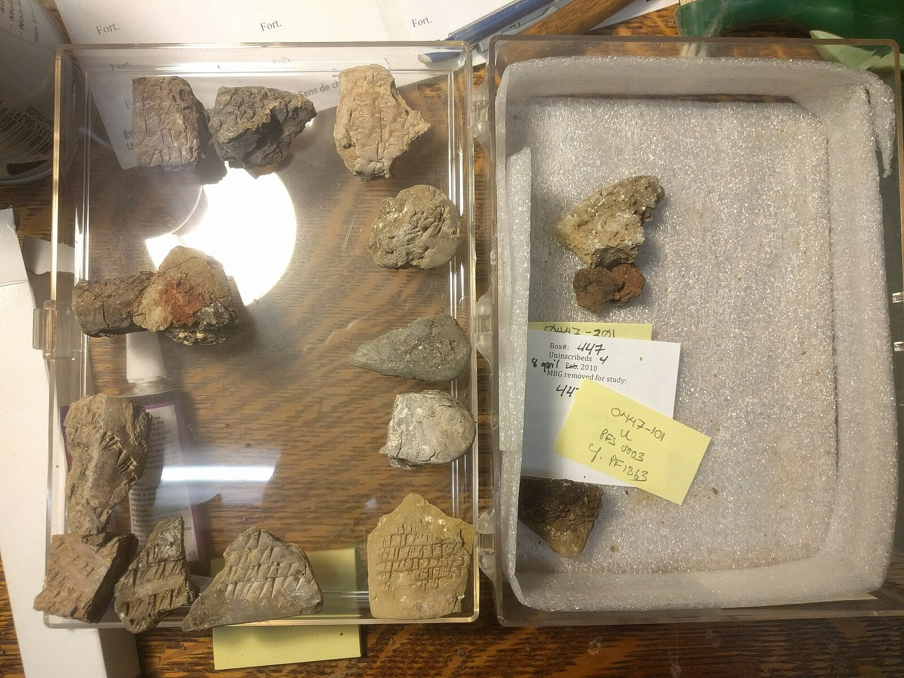
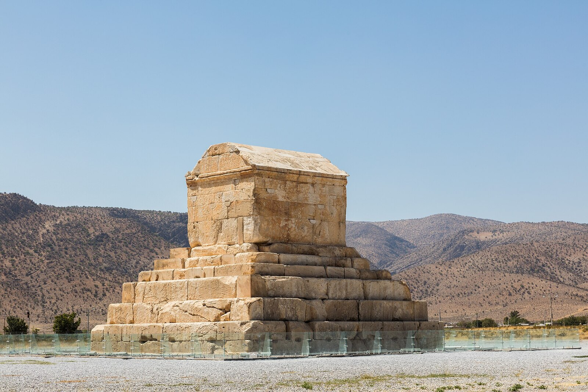
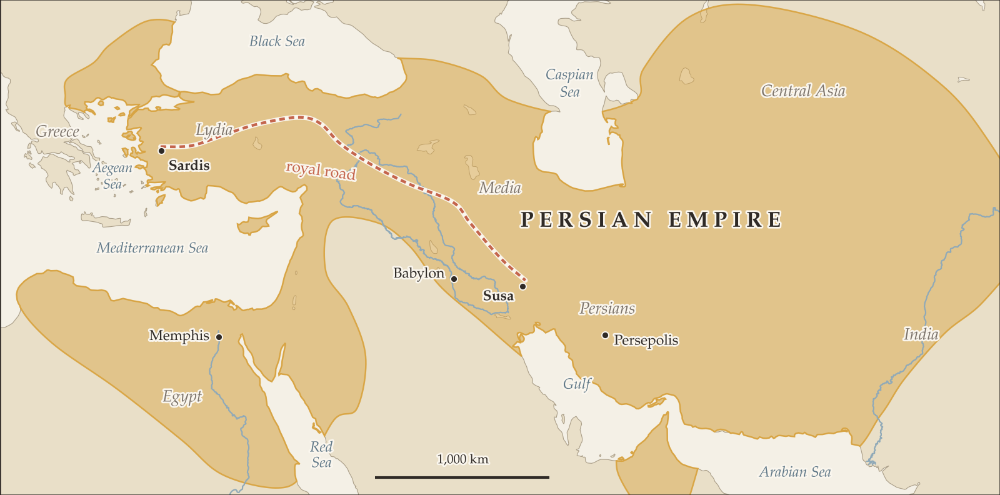
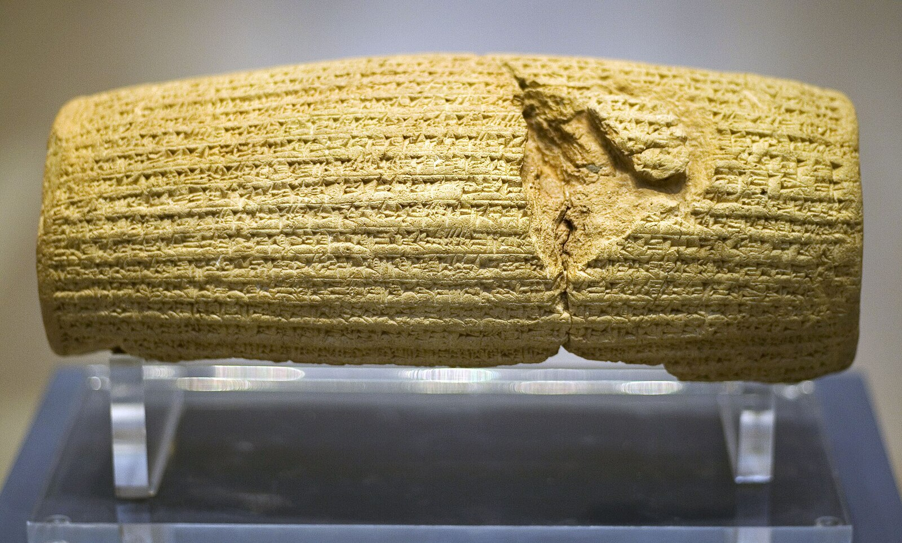
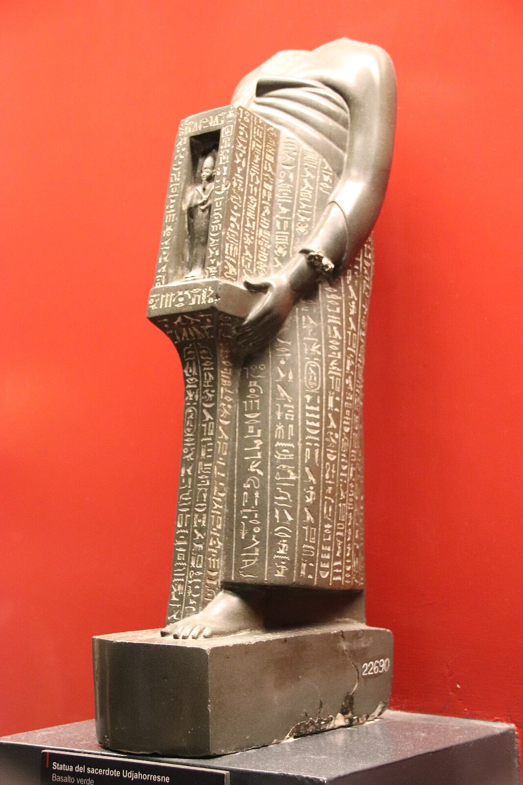
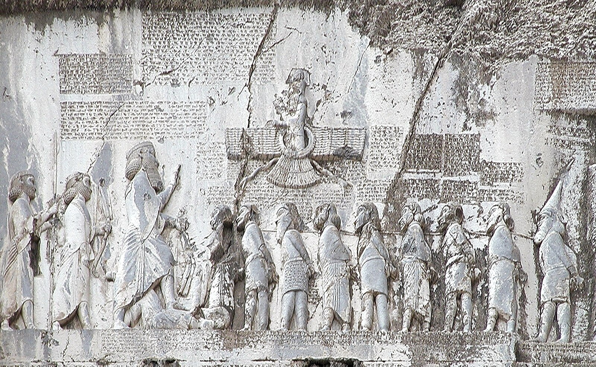
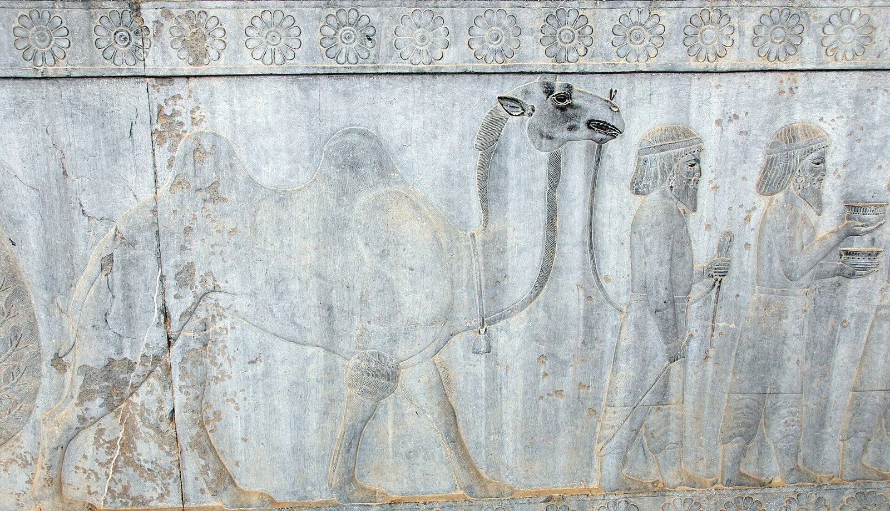
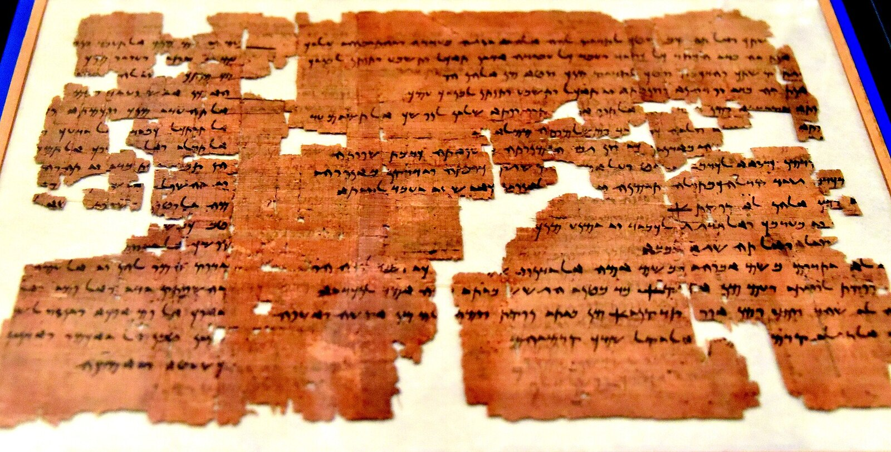
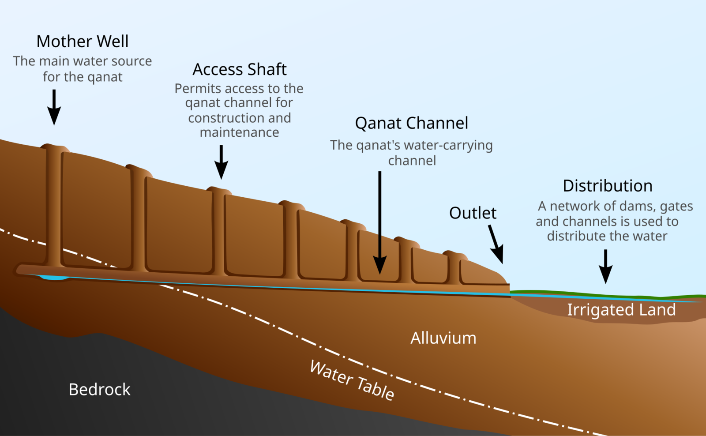
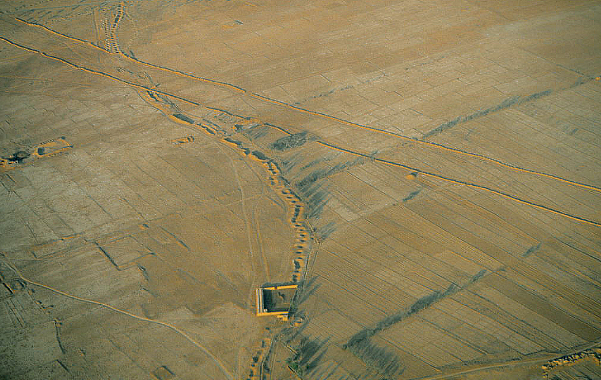

# 13. How did Persia rule so many peoples?

*Iran and the lands from Egypt to India, from about 2,575 years ago to about 2,450 years ago*

Cheaply. The Persian kings left most of their subjects under their own leaders, gods and customs, asked them for tribute and soldiers, and tied the whole together with roads, sealed letters and one language for office work.

Late in a year about 2,520 years ago, a man named Dauma stopped at a storehouse in the hills of south-western Iran. He was drawing rations for a party of thirty-five: twenty-three men and twelve servant boys. They had set out from Sardis, a city near the Aegean coast of Turkey, and they were bound for Persepolis, the new palace city of the Persian king. The whole journey was close to three thousand kilometres.

The storekeeper gave them flour: about a litre and a half for each man and a litre for each boy. A clerk recorded the issue on a lump of damp clay, small enough to close a hand around. He noted that Dauma carried a sealed document from Artaphernes, who was the king's brother and governed at Sardis. Then seals were pressed into the clay, and the party went on its way.

Dauma did not pay for the flour. Carved stone seals had stood in for their owners on the plain of Iraq for three thousand years, on storeroom doors and on contracts, and this one was doing the same work over a far greater distance. The governor whose seal Dauma carried was some two and a half thousand kilometres away. Nevertheless, the mark of it was enough to feed thirty-five people, and it would feed them again at the next storehouse down the road.

We know about Dauma's flour because the clerk's tablet was sent on to the accountants at Persepolis, and there it stayed. In 1933, archaeologists from the University of Chicago were working at the fortification wall on the edge of the palace terrace when they broke into two small rooms packed with clay tablets. There were tens of thousands of them, whole and broken. They cover sixteen years in the reign of a king named Darius, and almost every one of them is about food.

*Tablets and broken pieces from the fortification wall at Persepolis, in a storage box in Chicago. Each is small enough to hold in a closed hand. Photo: Pfa16, CC BY-SA 4.0.*

Flour, wine, beer and sheep are issued to labourers, officials, travellers and horses. The man who ran the whole system drew two sheep a day. A woman in the royal workshops drew an extra ration of wine or beer when she gave birth, and it was twice as large for a son as for a daughter.

It is dull reading, and it is the Persian empire seen from the inside. The first clerks of Uruk had counted out barley and beer to the workers of a single temple. Their successors, three thousand years later, were doing much the same thing for a state that stretched from Egypt to the borders of India.

## A king from the hills

The Persians came to power late and very fast.

A little over a century before Dauma's journey, the lands between Egypt and Iran had been ruled by the Assyrians, who governed by terror and marched whole conquered peoples off to distant provinces. Their subjects and neighbours had combined against them and destroyed them. Four kingdoms divided the region afterwards: Babylon on the plain of Iraq, Egypt on the Nile, Lydia in the west of Turkey, and the Medes, a people of horsemen in the north-west of Iran.

The Persians were at that time a small people of herders and farmers. They lived in the dry hills of south-western Iran, beyond the head of the Gulf. They were close kin to the Medes, who were their overlords.

About 2,575 years ago, a Persian king named Cyrus went to war with the Medes. The Median army mutinied and handed its own king over to him. A few years later Cyrus marched to the far west of Turkey and took Lydia, with its capital at Sardis. Then he turned on Babylon, the largest city in the world. He won one battle to the north of it, and his troops entered the city itself without a fight.

Cyrus died on campaign in Central Asia. His son Cambyses added Egypt. Within twenty-five years, a people that few had heard of had come to rule everything from the Aegean Sea and the Nile to the mountains of Afghanistan.

*The tomb of Cyrus, at his capital in south-western Iran. Photo: Diego Delso, CC BY-SA 4.0.*

No state so large had existed before. From its western edge to its eastern edge was about four thousand kilometres, roughly the distance from Lisbon to Moscow. Inside it lived dozens of peoples with their own languages, scripts and gods. Some of them, such as the Babylonians and the Egyptians, lived in cities two thousand years older than the Persian kingdom.

*The Persian empire under Darius, roughly, about 2,500 years ago. The dashed red line is the royal road from Sardis to Susa. Map: drawn for this book; coastlines and rivers from Natural Earth, public domain.*

Sargon of Akkad, long before, had replaced local kings with his own men and pulled down city walls, and his empire had rebelled every time a king died. The Persians had far more ground to hold and too few men to hold it. They could not even supply the clerks, because their own language was hardly ever written down.

## The god of Babylon chooses a Persian

In 1879, men digging in the ruins of Babylon for the British Museum found a barrel-shaped lump of baked clay, about the size of a small loaf of bread. It is covered in wedge-shaped writing. The language is Babylonian, and the voice, for most of the text, is that of Cyrus.

*The clay cylinder of Cyrus from Babylon, about 2,560 years old, now in the British Museum. Photo: Prioryman, CC BY-SA 3.0.*

The last king of Babylon, it says, had neglected Marduk, the great god of the city, and had worn out its people with forced labour. Marduk looked through all the countries of the world for a just king, and he took Cyrus by the hand and called him by name. He ordered him to march on Babylon, and walked beside him like a friend. The city received Cyrus with joy. Since then, Cyrus says, he has worshipped Marduk daily, lifted the burdens of the people, and sent back to their own temples the statues of gods that the old king had gathered into Babylon.

In the twentieth century, this object became famous as the first declaration of human rights, and a copy of it is displayed at the United Nations in New York. It mentions no rights and frees no slaves. It is a building inscription of an old Babylonian type. The kings of Iraq had been burying such texts in the foundations of their temples and walls for some two thousand years, and this one ends by describing repairs to the city wall. The scribes who composed it were Babylonians, using the phrases that their teachers had used for Babylonian kings. Hammurabi, twelve centuries earlier, had said on his black stone that the gods called him by name to bring justice to the land.

A conqueror from the hills, who spoke a foreign language and honoured foreign gods, presented himself to Babylon as a proper Babylonian king, chosen by the city's own god to rescue the city's own religion. The priests of Marduk kept their temple and their income. In return, they told the people that Marduk had picked this man.

Daily life went on almost undisturbed. Thousands of business contracts survive from Babylon in these years. A loan drawn up shortly after the conquest reads just like one drawn up shortly before it. The one change is in the date, which is now counted by the years of Cyrus, "king of Babylon, king of the lands".

Cyrus and his heirs did the same wherever they went. Peoples whom the Babylonians had carried into exile, among them the people of Judah, were allowed to go home and rebuild their temples. In Egypt, Cambyses took the titles of a pharaoh. A high Egyptian official, who had commanded the fleet under the last native kings, tells on his statue how he went over to the Persians. He became the new king's chief physician, composed an Egyptian royal name for him, and then persuaded him to clear out the foreigners who had settled in the great temple of his home town, and to restore its festivals.

*The statue of the Egyptian official who served the Persian kings, now in the Vatican Museums. The story of his career is written on his robe. Photo: Gary Todd, public domain.*

None of this was kindness. Cyrus fought and plundered wherever he was resisted. It was arithmetic. A people that keeps its priests, its judges and its noble families governs itself, at very little cost to the king. It also has a good deal less to rebel about.

## Nineteen battles

The whole thing nearly ended after one generation.

Cambyses died on his way home from Egypt, about 2,550 years ago. By then another man had already been proclaimed king in Persia, under the name of Bardiya, the younger son of Cyrus. Within months he was dead as well, killed in a fortress by seven Persian nobles. One of the seven was a distant relative of Cyrus who had served as a spear-bearer to Cambyses. His name was Darius, and he took the throne.

At that point the empire fell to pieces. Babylon rebelled under a man who claimed to be the son of its last king. The Medes rose under a man who claimed descent from their old royal house. Others followed, in Iran and beyond it, and one of them set himself up in Persia itself.

Darius and his generals beat every one of them. He claimed nineteen battles in a single year and nine kings taken prisoner. Afterwards he had the story carved where travellers would see it for ever: on a cliff called Behistun, in the west of Iran, beside the main road from Babylon up to the Median capital.

The carving is still there, far up the rock face. Darius stands with a bow in his hand and one foot on the chest of a man who lies on his back with his arms raised. In front of the king stand nine prisoners, roped together by their necks, with their hands tied behind them. Each is labelled with his name and his claim. Above them floats a figure in a winged ring. Around the picture the story is written out at length in three languages: Persian, Babylonian, and Elamite, the old language of the lowlands around Susa.

*The carving at Behistun in western Iran. Darius, on the left, faces the nine roped kings. Photo: Wikimedia Commons, public domain.*

The text shows the limit of Persian mildness. Of the Median rebel, Darius says that he cut off his nose, his ears and his tongue, put out one of his eyes, and kept him chained at the palace gate for everyone to look at. Then he had him impaled.

Darius's explanation of the revolts was a religious one. "The Lie made them rebellious," he says of the countries that rose. Darius adds advice for the kings who will come after him. They are to guard themselves against the Lie, and to punish the man who follows it.

The word had a history. Long before Cyrus, somewhere in the east of the Iranian world, there had lived a priest and poet named Zoroaster. Nobody knows exactly when. His hymns survive, because priests learned them by heart and passed them on, word for word, for more than a thousand years before they were written down.

Zoroaster taught that the world was made by one good creator, Ahuramazda, whose name means the Wise Lord. The Wise Lord stands for truth, which is also the right order of things. Against him stands a destructive spirit, and the principle that spirit works by is the Lie. The whole world is the field of a contest between the two. Every person has to choose a side, by what he thinks, what he says and what he does, and will be judged for the choice after death.

The religion of the Persian kings stood close to that teaching. Darius names Ahuramazda again and again on the cliff, and says that he is king by the Wise Lord's favour. He does not once mention Zoroaster, and historians argue over how closely the kings followed the prophet. They shared his god and his language of truth and the Lie, and they did not insist on the Wise Lord alone. The ration tablets from Persepolis show the royal storehouses handing out grain and wine for offerings to the old gods of the region too.

For a ruler, the pair of opposites was an idea of great convenience. A man who rebels against a king is usually thought of as an enemy. In Darius's telling he is something worse, which is a liar. The king who crushes him is not merely defending his throne. He is putting the truth back in its place.

The man lying under the king's foot is the one who had taken the throne as Bardiya. According to Darius, he was a priest who was only pretending to be the son of Cyrus. The real Bardiya, Darius says, had been secretly murdered years earlier, and nobody had known. Most historians today do not believe it. A secret murder that went unnoticed for years, and a double so perfect that he fooled the court, are a great deal to swallow. It is more likely that Darius and his friends killed the true Bardiya and then invented the impostor. If so, the king who carved his hatred of the Lie into a mountain began his reign with a very large one.

The carving sits too high on the cliff for anyone on the road to read a word of it. Darius therefore had the text copied and sent out to the provinces. Part of a copy has been found in Egypt, written in ink on papyrus, on an island far up the Nile.

## The shopkeeper

Having won the empire back, Darius set about making it harder to lose. The Persians had a saying about their first three kings, which the Greek historian Herodotus recorded: Cyrus was a father, Cambyses was a master, and Darius was a shopkeeper. It was not meant as a compliment, but it was exact.

The empire was divided into provinces, about twenty of them for the purpose of tribute. Over each stood a governor called a satrap, a Persian word that means protector of the realm. Cyrus had appointed such governors before him. The satraps were Persian nobles, and often the king's relatives, as Artaphernes was at Sardis. A satrap kept order, judged disputes, called up troops when the king wanted them, and collected the tribute.

What Darius added was a bill. Under Cyrus and Cambyses, subject peoples had sent the king gifts, of a size that was never quite settled. Darius replaced the gifts with a fixed sum for each province, to be paid every year. Babylonia owed a thousand talents of silver, which is about thirty tonnes, and was more silver than any other province paid. The Persians themselves were excused it.

Below the satrap, however, very little changed. Each people went on running its own affairs under its own leaders. The port cities of Lebanon kept their kings and supplied the Persian fleet. The Greek cities on the Turkish coast were ruled by Greek strongmen. This is the meaning of the title that the Persian ruler used, King of Kings. He was a king who had other kings under him, and saw no reason to get rid of them.

The stairways of the great hall at Persepolis show how the kings wished this to be seen. Twenty-three peoples are carved there in stone, each in its own dress, each led forward by a court official to present its gifts. Men from Central Asia lead a two-humped camel. An Indian carries two baskets hung from a pole across his shoulders. Men from far up the Nile bring an elephant's tusk. Nobody is roped by the neck, and nobody is being trampled. The envoys who brought their tribute to Nineveh had walked between pictures of stakes and flayed men. Those who climbed the stairs at Persepolis walked between pictures of themselves, bringing presents.

*Men from Central Asia bring bowls and a two-humped camel, on the stairway of the great hall at Persepolis. Photo: A. Davey, CC BY 2.0.*

## Ninety days on foot

A governor who sits three months' march from his king is very nearly a king himself. So the second half of the arrangement was a way of shrinking the distance.

The main road of the empire ran from Sardis to Susa, the city in the south-west of Iran where the black stone of Hammurabi had ended up. The Greeks called it the royal road, and by their account it had one hundred and eleven stations along it, and a man on foot needed ninety days to cover its length. Other roads of the same kind led on to Persepolis, to Egypt, and east to Central Asia and India. The tablets from the fortification wall record travellers on all of them.

Each station was a storehouse with a staff, stocked with flour, wine and fodder from the farms of the district. A traveller on the king's business was given a sealed document before he set out. It was issued by the king or by a satrap, and it stated how many people and animals were travelling and how much each was to receive per day.

At each station the traveller showed the document and was given one day's supply. The storekeeper could not be accused of handing out the king's flour to his friends, because a clerk wrote a receipt and both parties sealed it. In the country around Persepolis, the receipts were sent up to the palace, where accountants added them together and checked them against the stores. Dauma's tablet is one such receipt.

One of the travel documents themselves has survived. It was written almost a century after Dauma's journey, in ink on leather. A Persian prince who governed Egypt is sending his steward back there across Iraq and Syria, and the letter is addressed by name to the officials at each stop along the way. He is to be fed from the prince's own estates along the road. The steward is to have two measures of white flour a day, three of coarse flour, and two of wine or beer. His ten servants are to have one measure of flour each. The letter ends with a rule that a modern expenses office would recognise. If the party stays in one place for more than a day, it is to be given nothing for the extra days.

The road carried one thing faster than it carried travellers, and that was the king's mail. Here the Persians borrowed from the Assyrians, whose relay riders had carried sealed letters between the capital and the provinces, and they stretched the relay across an empire several times as wide. At every station, riders and fresh horses stood waiting. A rider carried a message for one stage at full speed and handed it to the next, who was already mounted, and so on, by day and by night. In that way, a letter could cross in a week or two the distance that took a walker three months.

Nothing mortal travels faster than these messengers, wrote Herodotus, and he added a sentence that is carved today across the front of the main post office in New York: "Neither snow nor rain nor heat nor gloom of night stays these couriers from the swift completion of their appointed rounds." A satrap in Sardis therefore knew that whatever he did would be known to the king within weeks, and that the king's reply would come back just as quickly.

## A letter in three languages

There remained the problem of language. A letter from the king had to be understood in Egypt, in Turkey and in Afghanistan, by officials who shared no mother tongue.

Persian itself was of little use for the purpose. A wedge-shaped script had been devised for it, and the kings used that script for their monuments, as on the cliff at Behistun. Hardly anybody kept accounts in it or wrote a letter in it. The clerks at Persepolis wrote their receipts in Elamite, as the clerks of that region had always done.

For business between the provinces, the Persians took over a language that was already to hand, which was Aramaic. The Assyrians, by stirring so many peoples together, had made this speech of Syria the everyday language of Iraq as well, so that it was by now understood across the middle of the empire.

It had a second advantage, which lay in how it was written. A clerk needed only the twenty-two letters that the Assyrian scribes with their scrolls and pens had already used, and he wrote them in ink, on leather or on papyrus, which was quick to do and light to carry.

A satrap dictated in Persian. His scribe wrote the message down in Aramaic. At the far end, another scribe read the Aramaic and spoke it aloud in Egyptian, or Greek, or whatever the man in front of him understood. A letter could therefore pass through three languages, of which just one was ever on the page.

On an island in the Nile, at the southern frontier of Egypt, soldiers in Persian pay left behind their contracts and letters in Aramaic. In the north of Afghanistan, some three and a half thousand kilometres away, the office of a Persian governor left behind letters and lists of supplies. They are in the same language and the same script as the documents from Egypt, and they use much the same official phrases.

*Aramaic written in ink on papyrus, about 2,450 years old, from the island at the southern frontier of Egypt. It is now in Berlin. Photo: Osama Shukir Muhammed Amin, CC BY-SA 4.0.*

Aramaic outlasted the empire that had spread it. It remained the common language of the Middle East for about a thousand years, and its letters lasted longer still. The square script in which Hebrew is written today is the Aramaic script of those clerks, hardly changed, and the Arabic alphabet descends from it as well.

## Water from under the hills

Tribute came, in the end, from farms, and in much of the empire farming was limited by water. Most of Iran is a high, dry plateau ringed by mountains. Rain and snow fall on the heights. The plains below get very little, and what rivers there are tend to vanish into the gravel.

The water has not gone, however. It has sunk into the ground at the foot of the hills, where it lies in the gravel, often many metres down. The people of Iran had a way of bringing it out again without lifting a single bucket. The device is called a qanat, and it is a tunnel that slopes very slightly downhill, from the buried water to the open plain.

Digging one begins with a guess. An experienced digger looks at the foot of the hills for signs of water underground, and sinks a trial well there until he strikes it. This is the mother well, and it may be as deep as a tall building is high.

Next comes the measuring. The diggers need to find the spot, out on the plain and several kilometres away, where the ground surface has fallen to just below the level of the water in the mother well. That spot will be the mouth of the tunnel. From there they dig back towards the hills. The tunnel is barely large enough for a man to crouch in. It has to climb, but very gently, often by about a metre in every kilometre. If the slope is too steep, the running water will scour the tunnel and bring it down. If it is too flat, the water will crawl and the tunnel will choke with silt.

A tunnel several kilometres long cannot be dug from one end alone, because the men would have no air and no way of getting rid of the earth. So, every thirty metres or so along the line, the diggers sink a shaft from the surface down to the tunnel's depth. The earth goes up the shaft in leather buckets on a rope. The shafts also let in air, and later they let men down to make repairs. From above, a qanat therefore looks like a row of small craters marching in a straight line across the desert, each crater ringed with the earth that came out of it.

*A qanat seen from the side. The mother well is on the left, under the higher ground, and the water comes out on the right. Diagram: Samuel Bailey, CC BY 3.0.*

When the tunnel at last reaches the wet gravel under the hills, water seeps into it and starts to flow. It comes out at the mouth, on the plain, as a steady stream, and nothing needs to be lifted or pumped. Because the water travels underground, the sun does not dry it up on the way. A well-kept qanat runs all year, and can go on running for centuries.

*A qanat in Iran seen from the air. Each pit in the chain is the mouth of a shaft. Photo: LBM1948, CC BY-SA 4.0.*

Most of the cost comes at the start. A qanat takes years of dangerous work by skilled men before it yields a single drop, and a farmer has little reason to pay for that unless he is sure of keeping the land it waters. Here the Persian kings did something clever and, once again, cheap. They did not dig the tunnels themselves. Instead, according to a later Greek historian, they made a rule: whoever brought water to land that had never been watered could farm that land for five generations.

The qanat was older than the empire. Under the Persian kings, however, it travelled. Qanats of this period have been found at an oasis in the western desert of Egypt, together with the contracts in which the farmers there dealt in shares of the water. In later centuries the technique spread east into Central Asia and west as far as Morocco and Spain. Iran today still has tens of thousands of them.

## A thousand bodyguards

Ruling through other people had a price. A satrap had a palace, a court and troops of his own. The tribute of a whole country passed through his hands. Below him stood local princes and priests, who had been left with their own followers, their own treasuries and the loyalty of their own people. Every one of them had been allowed to keep what he had, and so every one of them had the means to try for more.

The Greeks told a story about this from the first months of Darius's reign. The satrap at Sardis at that time was a Persian named Oroites, and he had used the troubles to make himself the master of western Turkey. He had murdered the satrap of the next province. When a royal messenger brought him an order that he disliked, he had the messenger killed on the road home. Oroites was guarded by a thousand Persian spearmen, and Darius had no army to spare.

So the king sent one man with a bundle of sealed letters. The man came before Oroites and his guards and handed the letters, one at a time, to the royal secretary, to be read aloud. The first few dealt with ordinary business, and he saw that the guards listened to the king's words with great respect. Then he handed over another. It said that King Darius forbade the Persians to guard Oroites. The guards laid down their spears. The last letter ordered them to kill him, and they did so on the spot.

A governor could turn into a small king within a year, and the king's seal could still reach into that governor's own hall. Everything depended on whether the men in the room believed in the seal more than they feared the man in front of them.

That did not always hold. Egypt, whose nobles and priests the Persians had so carefully kept in place, rebelled in the year that Darius died. It rebelled again a generation later. Finally, under a line of Egyptian princes from the marshes of the Nile's mouth, it broke away altogether, and stayed free for sixty years. On the Aegean coast, the Greek cities rose under the leadership of a man whom the Persians themselves had kept in power in the greatest of them.

Even so, the arrangement lasted for more than two centuries. The Persians had found that it costs less to rule through a people's own priests and nobles than against them, and that most people will put up with a distant king if he leaves their gods and their landlords alone.

Their system outlived them. When a Macedonian king named Alexander finally defeated the last King of Kings, he did not have to invent a government. He put his own soldiers into the provinces, and he kept the satraps' offices, the tribute and the royal road.
