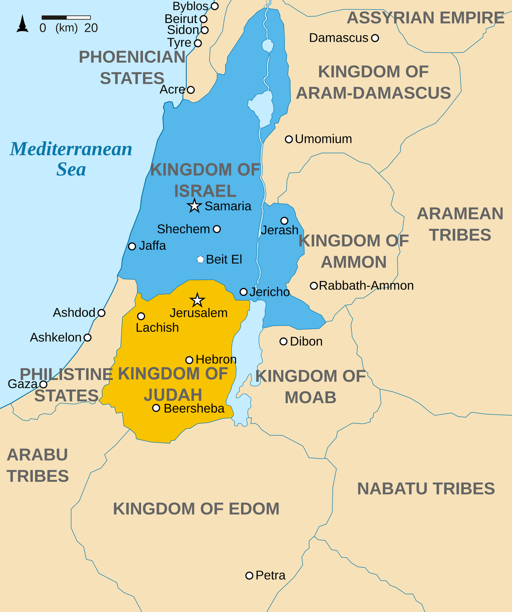
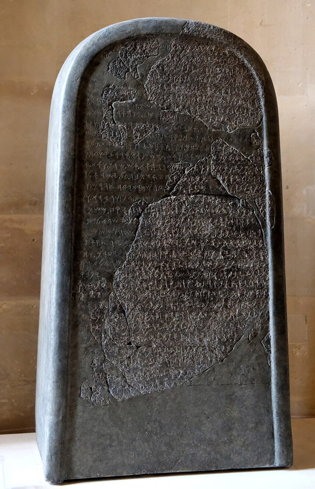
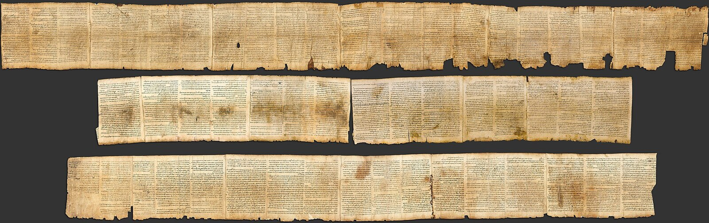
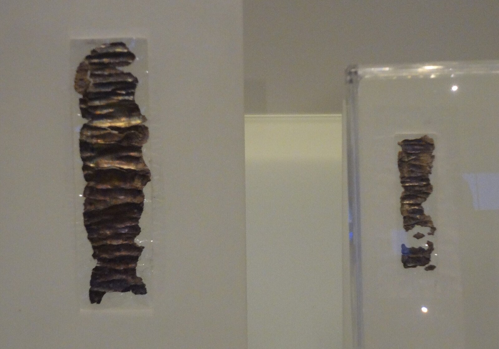
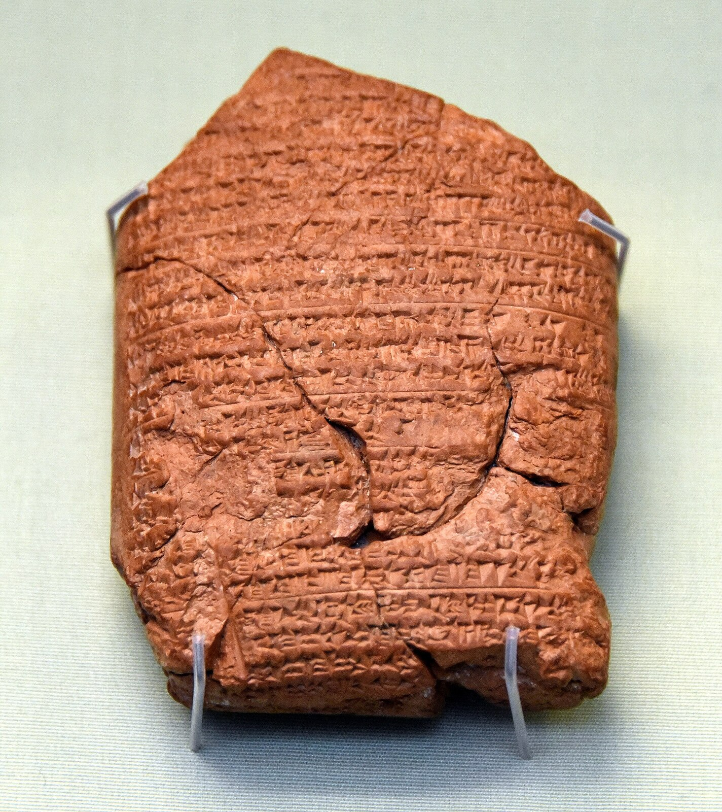
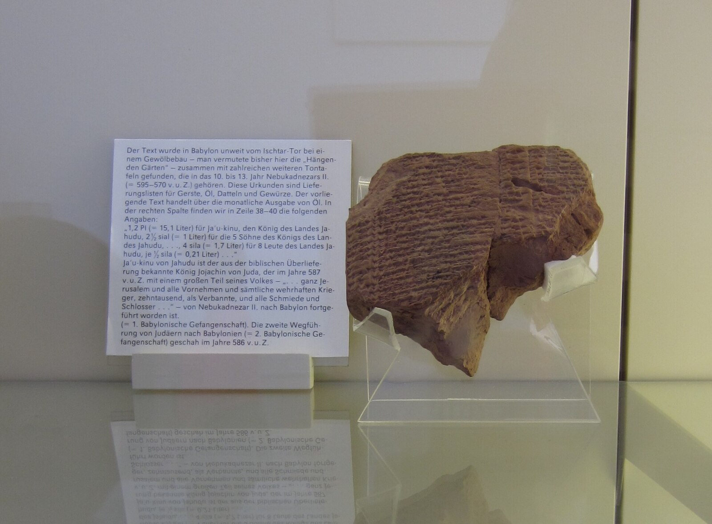
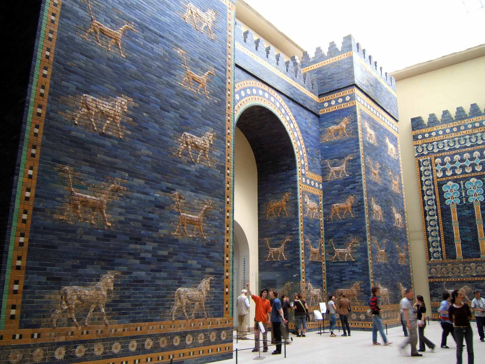
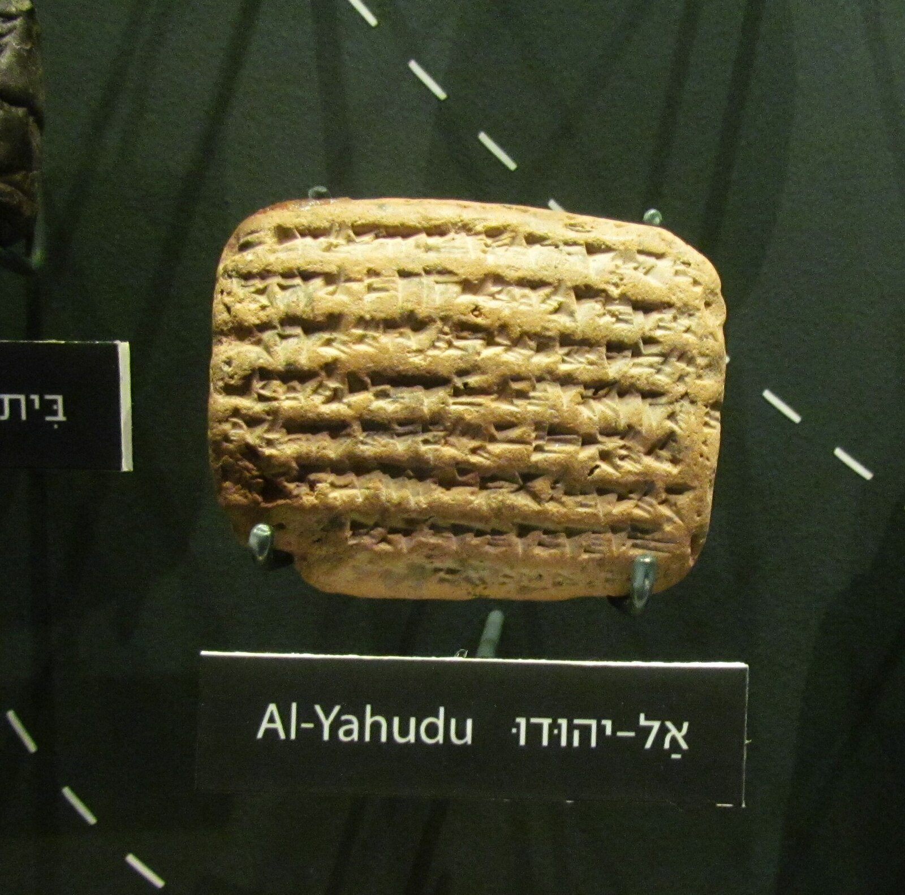
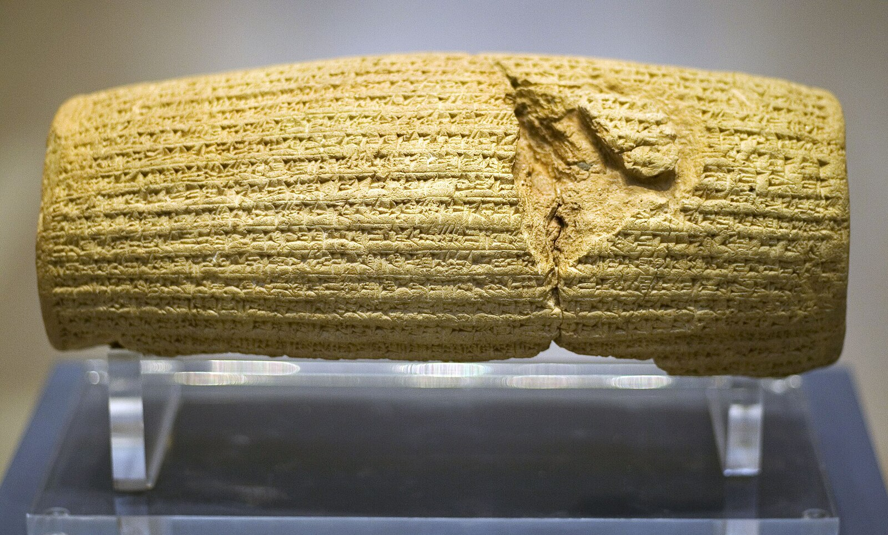
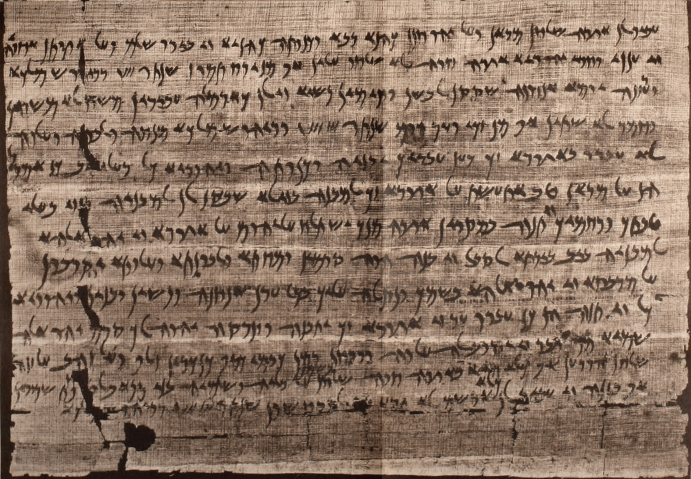

# 14. Where did the belief in one God come from?

*Judah and Babylon, from about 2,850 years ago to about 2,450 years ago*

It came from a small kingdom in the hills that lost a war. Its exiles decided that their god had not been beaten, that he had sent the defeat himself, and that a god who could do that must be the god of the whole world.

About 2,610 years ago, in the heat of summer, a Babylonian army burned Jerusalem. It was a small city, the capital of a small kingdom called Judah, in the hills between Egypt and Syria. The soldiers burned the king's palace and pulled down the city wall. They also burned the temple, which was the house of the kingdom's god, and carried its bronze and gold away to Babylon. Then they marched thousands of its people, the officials, priests, scribes and craftsmen among them, east to the plain of Iraq.

It was a familiar kind of ending. Great kingdoms had been swallowing small ones for a very long time. A god lived in his house and protected his land, and when the house was ash and the people were gone, his worship usually faded. The small peoples that the great empires conquered and carried off mostly melted into their conquerors, and little more was heard of their gods.

The god of Judah went on to become the God of more than half the people on earth.

## A god for each land

Judah was one of a cluster of small kingdoms that grew up between Egypt and Syria after the great palaces of the Bronze Age had burned. To its north lay the kingdom of Israel, which was larger and richer. Judah itself was mostly dry, stony hills, and a fit walker could cross it in two or three days. Its capital, Jerusalem, stood on a narrow ridge, with the palace and the temple at the top.

*Israel and Judah among their neighbours, about 2,850 years ago. Map: FinnWikiNo and Richardprins, CC BY-SA 3.0.*

The people of both kingdoms spoke Hebrew, and both worshipped a god whose name was written with four letters, YHWH. Scholars think it was pronounced Yahweh. Jews later stopped saying the name aloud out of reverence, and most English Bibles print "the LORD" in its place.

Every kingdom in that region had a god of this kind. The kingdom of Moab, across the Dead Sea, had Chemosh. Assyria had Ashur, and Babylon had Marduk. A god belonged to a land and a people in much the way that a king did. He lived in his temple, he was fed with sacrifices, and he fought his people's wars. People in Judah took it for granted that Chemosh was real. He was simply somebody else's god.

A king of Moab has left us his own account of how this worked. About 2,850 years ago he set up a slab of black stone, a little over a metre tall, and had his deeds cut into it. Israel, he says, had oppressed Moab for many years, because Chemosh was angry with his land. Then Chemosh relented. The king took back his towns, killed the Israelites in one of them, and dragged the sacred vessels of Yahweh before Chemosh as a trophy. With the names changed, the passage could stand in the Bible's Book of Kings.

*The stone of the king of Moab, about 2,850 years old, now in the Louvre in Paris. The smooth patches are modern repairs. Photo: Mbzt, CC BY-SA 4.0.*

Moreover, Yahweh was not worshipped alone even at home. About 2,800 years ago, people at a lonely way station in the Sinai desert wrote blessings in ink on two big storage jars. One blesses its reader "by Yahweh of Samaria and his Asherah". Asherah was the name of a goddess known all along that coast, and also of the sacred wooden pole that stood for her. Scholars argue over which of the two the writers had in mind.

The Bible does not hide any of this. The Book of Kings complains, reign after reign, that the people burned offerings to other gods on the hilltops. It says that an Asherah stood inside the temple in Jerusalem itself, until a reforming king had it dragged out and burned. On the facts, then, the Bible and the archaeologists agree. To the writers of Kings, the other gods were a betrayal of an older and purer faith. To most historians, they were the ordinary religion of the time, and the new thing was a demand that Israel worship Yahweh alone. It was pressed by some of the priests and by the prophets, who were men and women believed to speak messages from Yahweh himself.

Even that demand was a demand for loyalty. "You shall have no other gods before me," runs the commandment. It tells a people whom to worship. It does not say that the other gods are not there.

About 2,750 years ago, the larger kingdom was destroyed. The Assyrians took Israel's capital, Samaria, after a long siege, and they dealt with its people in their usual way. More than twenty-seven thousand were marched off to distant provinces, and strangers were brought in to farm their land. For about a century, Assyrian records still mention people with names built on the name of Yahweh. After that the trail goes cold, as it did for most peoples that an empire had scattered.

Judah survived for another century and more. It paid tribute, lost Lachish and most of its other towns to Sennacherib when it stopped, and then paid again. People from the fallen north came south to Jerusalem, and they brought their own stories, laws and prophecies with them.

## Twenty-two letters

In those same years, Judah became a kingdom that wrote.

The script was the alphabet of the Lebanese coast, the same set of twenty-two letters that served the clerks of the empires for Aramaic. Each letter stood for one consonant, and the reader supplied the vowels, much as an English reader can make out "bld hss nd lv n thm". The words ran from right to left.

Twenty-two letters can be learned in a few weeks, where the wedge-shaped signs of Babylon took years. As a result, in the last century of the kingdom of Judah, writing turns up in all sorts of places: names inked on wine jars, names cut into the stone seals of minor officials, soldiers' messages on broken pieces of pot.

Potsherds served for notes. For anything long, a scribe used a scroll.

A scroll began as sheets. Some were of papyrus, which was made in Egypt from a reed that grows in the Nile marshes. The soft inside of the stalk was cut into strips, and the strips were laid side by side, with a second layer laid across the first. Pressed and dried, they became a sheet rather like thick, coarse paper. Other sheets were of skin. The hide of a sheep or a goat was soaked, scraped clean of hair, and stretched until it dried thin and pale.

Next, the sheets were joined edge to edge into a long strip. Papyrus was glued, and skin was sewn. The scribe wrote on the strip with a reed pen. His ink was soot mixed with tree gum and water. He set the words out in narrow columns side by side, like the columns of a newspaper.

Finally, the strip was rolled up. A reader unrolled it with one hand and rolled it up with the other, so that a column or two lay open between them. One famous scroll, found in a cave near the Dead Sea, was written about four centuries after the exile. It is made of seventeen pieces of sheepskin sewn together. It is more than seven metres long and holds the whole Book of Isaiah, yet rolled up it can be carried in one hand.

*The Isaiah scroll from the Dead Sea, about 2,100 years old, photographed in three lengths. Photo: Ardon Bar Hama, Israel Museum, public domain.*

A scroll has one great weakness. Clay lasts, and it gets harder when a city burns. Skin and papyrus rot in damp ground and vanish in a fire. For that reason, almost nothing written on a scroll in the kingdom of Judah survives.

In 1979, archaeologists sifting the floor of a tomb outside the walls of Jerusalem found two tiny rolls of silver foil, the larger no bigger than a cigarette end. They had been worn as charms about 2,600 years ago, and they are scratched with a blessing that asks Yahweh to bless and keep the wearer, and to make his face shine upon him. Almost the same words stand in the Bible, in the Book of Numbers. They are the oldest lines of it that have ever been found.

*The two silver charms from the tomb, unrolled, in the Israel Museum in Jerusalem. Photo: Bachrach44, CC BY-SA 3.0.*

Because scrolls wear out and rot, a long text stayed alive mainly by being copied. A text that nobody troubled to copy was usually lost within a few lifetimes. A text that people cared about could outlast any stone.

The Book of Jeremiah tells of a king who tried to destroy one. Jeremiah was a prophet in Jerusalem in the kingdom's last years, and he dictated his warnings to a scribe, who wrote them on a scroll with ink. The scroll was taken to the king, who was sitting in his winter house beside a fire. As each three or four columns were read out to him, the king cut them off with a knife and dropped them into the flames, until the whole scroll was burned. Jeremiah then took another scroll and dictated all of it again, and added more.

## We cannot see Azekah

Jeremiah's warnings were about Babylon. About 2,635 years ago, Assyria collapsed, and Babylon took over most of its empire under a king named Nebuchadnezzar. Judah now lay on the road between Babylon and Egypt. Its kings twice bet on Egypt, and both times they lost.

The first time is recorded from both sides. A Babylonian clay tablet, now in the British Museum, sets down the chief events of Nebuchadnezzar's early years, one year at a time. In his seventh year, it says, the king marched west and camped against "the city of Judah". He took it on the second day of the month of Adar, captured its king, appointed a king of his own choosing, and carried a heavy tribute back to Babylon. The Book of Kings tells the same story from inside the walls. The king, Jehoiachin, was eighteen years old and had been on his throne for three months. He came out and surrendered. He was led away with his mother, his officials, his craftsmen and his smiths, and with the treasures of the temple.

*The Babylonian record of Nebuchadnezzar's early years, in the British Museum. Photo: Osama Shukir Muhammed Amin, CC BY-SA 4.0.*

In the first years of the twentieth century, German archaeologists digging in the ruins of Babylon cleared a row of vaulted cellars in a corner of the royal palace. In them lay about three hundred clay tablets. They were the accounts of the palace storekeepers, of the same plain kind that Persian clerks would keep at Persepolis a century later, and they recorded how much oil and grain had been handed out, and to whom.

When a scholar in Berlin worked through them in the 1930s, he found that many of the people being fed were foreigners. There were carpenters from the coast of Lebanon, Egyptians, Greeks, and men from Iran. Among them, on four different tablets, was the same entry. A measure of oil had been issued to a man called Ya'u-kin, king of the land of Yahudu, and a smaller measure to the five sons of the king.

*One of the storekeepers' tablets that list oil for the king of Judah and his sons, in the Pergamon Museum in Berlin. Photo: Scallaham, CC BY-SA 4.0.*

Yahudu is Judah, and Ya'u-kin is Jehoiachin. One of the tablets carries a date, about five years after his surrender. They show him alive in the capital of his conqueror, drawing his oil from the palace stores.

The man whom Nebuchadnezzar put in his place was Jehoiachin's uncle. Within ten years, he rebelled as well. This time Babylon meant to finish the matter. Its army took the fortified towns of Judah one after another.

One of those towns was Lachish, which had been rebuilt after Sennacherib's siege more than a century earlier. In its burned gatehouse, excavators found about twenty potsherds with letters written on them in ink. They were sent to the commander at Lachish by an officer at a smaller post nearby, shortly before the town fell. In one of them, he reports that his men are watching for the fire signals of Lachish, "for we cannot see Azekah". The Book of Jeremiah says that near the end, apart from Jerusalem, only two fortified towns were still holding out, and it names them as Lachish and Azekah.

Jerusalem itself was under siege for more than a year. According to Kings, the city ran out of bread, and then the wall was broken through. The king fled by night and was caught. His sons were killed in front of him. Then his eyes were put out, and he was taken to Babylon in chains.

A month later, a Babylonian commander arrived with orders. He burned the temple of Yahweh, the palace and the large houses, and his soldiers pulled down the city walls. It happened about 2,610 years ago.

The ground confirms it. On the ridge where the old city stood lies a thick layer of ash and fallen stone, with the arrowheads of both armies in it. In one burned house lay fifty-one small lumps of clay, each stamped with its owner's seal. They had once fastened rolled documents, and the fire that destroyed the documents baked the clay hard.

More of the people were then marched off to Babylonia. The Book of Jeremiah counts 4,600 deportees in all, from the families that had run the kingdom.

Judah had now lost its king, its land and its temple.

## Whose god lost?

A defeated people had two ways to explain what had happened to it.

The first was that its god had been the weaker one. The Assyrian officer who shouted up at the wall of Jerusalem had put it to the defenders in just that way: no god had yet saved a country from Assyria. The second was that the god was angry with his own people and had let them be beaten, which was the explanation that the king of Moab chose.

Either way, a god was served in his own house, on his own land, by his own priests. The gods of great cities could survive a sack, because their people stayed and rebuilt the temple. A small people that had been marched away was in a different position. Its god's house was ash, the sacrifices had stopped, and its children were growing up among the gods of another country.

The exiles from Judah had every reason to go the way of the Israelites before them. Babylon was the largest city in the world. Its gate was faced with blue glazed brick and rows of bulls and dragons, and the temple tower of Marduk rose over the roofs like a hill. Marduk had plainly won. One of the Bible's songs remembers the captives sitting down by the rivers of Babylon to weep. When their guards asked for a song, they answered: "How shall we sing the LORD's song in a strange land?"

*The gate of Babylon, rebuilt in the Pergamon Museum in Berlin. Photo: Rictor Norton, CC BY 2.0.*

People who had always served Yahweh with sacrifices in his own house could not easily see how he was to be served anywhere else.

The answer came from the prophets, and it rested on something they had said before the disaster. Jeremiah had told Jerusalem for years that Yahweh was bringing Babylon against the city, to punish it for worshipping other gods and for cheating the poor. He had even had Yahweh call Nebuchadnezzar "my servant".

Then the city fell, and Jeremiah had been right. For those who had heard him, the burning of the temple no longer showed that Yahweh was weak. He had announced it in advance, and Babylon's army had been his instrument.

This made Yahweh a much larger god than the god of one small country. If he could summon the king of Babylon, then he commanded Babylon, and Babylon had conquered every nation between Egypt and Iran.

A prophet who lived among the exiles, some fifty years after the fall, took the last step, which was to say that a god so great left no room for any other. His name is lost, and his words are preserved in the later chapters of the Book of Isaiah. "I am the first and I am the last," he has Yahweh declare; "besides me there is no god." He describes a carpenter who cuts down a tree, burns half of it to roast his dinner and warm his hands, and carves the other half into a god to pray to. The gods of the nations, he says, are blocks of wood.

One God for all the world had been proposed once before. Some eight centuries earlier, a king of Egypt had ordered his country to worship the disc of the sun alone, and his successors had undone the order within a few years of his death. This time the idea came from the losers of a war, who had no king to enforce it, and it lasted.

Scholars disagree about how quickly it took hold. Some think that a circle in Jerusalem already believed in one God before the city fell. The clearest statements, however, come from the exile, and it took several generations more to become the settled faith of the whole people.

## Judah-town

The exiles, meanwhile, were not in chains. Babylon had land along its canals that needed farmers. It settled its deportees there in groups, each family with a plot, in return for taxes and service to the king. As a result, people from the same country lived together as neighbours.

About two hundred clay tablets record the life of one such settlement. They were written by Babylonian scribes for the farmers of a village on the plain of Iraq. The village was called Al-Yahudu, which means Judah-town. The earliest tablet was written only fifteen years after Jerusalem burned.

*One of the tablets from Judah-town, in the Bible Lands Museum in Jerusalem. Photo: Amit Avidan, CC BY-SA 4.0.*

The tablets are ordinary business papers. They record a loan of barley, the lease of a grove of date palms, a tax payment, a marriage, the division of an inheritance. What makes them remarkable is the names. A great many of these farmers have names built on the name of Yahweh. The tablets follow one family through four generations, and the fathers go on giving such names to their sons.

Business tablets cannot show how these farmers worshipped. For that, there are the writings that the exiles themselves produced. No temple of Yahweh stood in Babylonia, and so no sacrifices could be offered there. Instead, the writings of those years lay new weight on the customs that need no temple: resting on every seventh day, circumcising sons, keeping the rules about food.

Their name changed in those years. In Babylonia they were the people from Judah, the Yehudim, and it is from that word that we get the word Jew.

## The making of a book

The exiles had carried their writings with them, or carried them in their heads. There were records of the kings, collections of law, the sayings of prophets, songs from the temple, and old stories of the ancestors.

In Babylonia, and for some two centuries afterwards, priests and scribes gathered these writings, joined them together, and added to them. The kingdom was gone, and the written memory of it was becoming the strongest bond that the people had. They also had a question to answer, which was why the disaster had happened.

The long history that runs through the Book of Kings is built to answer it. It judges each king of Israel and Judah by a single test, which is whether he was loyal to Yahweh alone. Most of them fail, and the destruction of Jerusalem is the verdict. The history closes with one small sign of hope. In the thirty-seventh year of his captivity, it says, King Jehoiachin was let out of prison by a new king of Babylon, and was given a seat at the royal table and a regular allowance for the rest of his life. The storekeepers' tablets are thirty years older, but the man is the same.

The editors treated their sources with respect, and so the joins still show. The story of the flood, for example, is told twice, with the two versions woven together. In one, Noah takes a single pair of every kind of animal into the ark. In the other, he takes seven pairs of the kinds that are fit for sacrifice. The flood itself was an old story on the plain where the exiles now lived, and a telling of it lay among the tablets in the library at Nineveh.

Jewish and Christian tradition long held that the first five books of the Bible were written by Moses, centuries before there was a king in Jerusalem. Most scholars now conclude that they grew over a long time, from several hands. They disagree about the dates. Some place much of the writing in the time of the kings, with the exiles as editors. Others think that most of it was composed after the exile, under Persian rule or later still.

The evidence favours a position between the two. The Hebrew of the main books is of an older style than the Hebrew of books that were certainly written after the exile. The silver charms from the tomb show that the wording of a priestly blessing was in use before Jerusalem fell. Much of the material is therefore old, and comes from the time of the kings. It was shaped into something close to the books we know during the exile and in the two centuries after it.

The result was something new. The laws of Hammurabi stood on a black stone in a temple, in the name of a king. The laws in these scrolls were given, in their own telling, by God himself, in a desert, to a people who had as yet no king, no land and no temple. A law of that kind could be obeyed by a farmer on a canal in Iraq as well as by a priest in Jerusalem. It even bound the king, who is told to write out a copy of the law for himself and read it all his life.

## The king of Persia

About 2,565 years ago, Babylon fell in its turn, when the troops of Cyrus the Persian entered the city without a fight.

The priests of Babylon explained the event in the familiar way, on the clay barrel that they composed for their new king. Marduk, it says, had grown angry with the last king of Babylon, had searched through all the lands for a just ruler, and had taken Cyrus by the hand. On the same barrel, Cyrus says that he sent the statues of the gods back to their old shrines, and gathered their peoples and returned them to their homes.

*The clay barrel of Cyrus, in the British Museum. Photo: Prioryman, CC BY-SA 3.0.*

The exiles from Judah explained the same event in almost the same way, with a different god. Their nameless prophet has Yahweh take Cyrus by the right hand, and calls the Persian king Yahweh's "anointed", the title of Judah's own kings. Two peoples watched one conqueror arrive, and each was sure that its own god had sent him. The priests of Marduk went on honouring a whole heaven of other gods. The prophet allowed for none.

The clay barrel does not mention Judah. However, the Bible's Book of Ezra reports a decree of Cyrus in the same spirit, which allowed the exiles to go home and rebuild their temple.

Some went. They found Jerusalem in ruins and Judah a small, poor province of the Persian empire, ruled by a governor. A new and modest temple was finished about 2,540 years ago. When its foundation was laid, the Book of Ezra says, the old people who remembered the first temple wept aloud, while the young shouted for joy, and nobody could tell the one sound from the other.

Many did not go. They had farms, families and businesses in Babylonia, and the tablets from Judah-town run on for sixty years after Cyrus. Others lived in Egypt. Among the soldiers in Persian pay on the island at Egypt's southern border, whose Aramaic papers have survived, was a garrison of men from Judah, and they kept a temple of Yahweh of their own. Their letters, written on papyrus about 2,430 years ago, name other gods beside him. The old ways lasted a long time.

*A letter in ink on papyrus from the garrison on the Nile, asking the governor of Judah for help in rebuilding their temple. It is about 2,430 years old. Photo published in 1907, public domain.*

From then on, there was a temple in Jerusalem again, with priests and sacrifices. Nevertheless, a great many of the people who held that temple sacred now lived far away from it, and some of them never saw it. What they had in common was the scroll.

## At the Water Gate

About 2,450 years ago, the Bible says, a priest named Ezra came to Jerusalem from Babylonia. He was a scribe, and he brought a scroll of the law with him.

On the first day of the seventh month, the people gathered in the open square in front of the Water Gate. There were men and women, and everyone old enough to understand. A wooden platform had been built for the occasion. Ezra stood on it, opened the scroll, and read aloud from first light until noon. Helpers moved through the crowd and explained what was being read, so that everyone could follow. The people, it says, wept as they listened.

Set beside the great temples of Babylon, it is a bare scene. No king is present, and nothing is sacrificed. The holiest thing in the square is a roll of skin with writing on it. Its words are read out to farmers and their wives, who are expected to understand them and to live by them. A religion of this kind does not need a particular hill. It can be practised wherever there is a copy and somebody who can read it aloud.

Nebuchadnezzar's palace is now a field of broken brick, and it is a very long time since anyone brought an offering to Marduk. The storekeeper's tablet that counts out oil for the captive king of Judah lies in a museum in Berlin.

The scrolls that his people carried out of that captivity are still copied by hand, in ink, on skin, in the same twenty-two letters, and they are read aloud every week. In time, two more religions grew from them.
