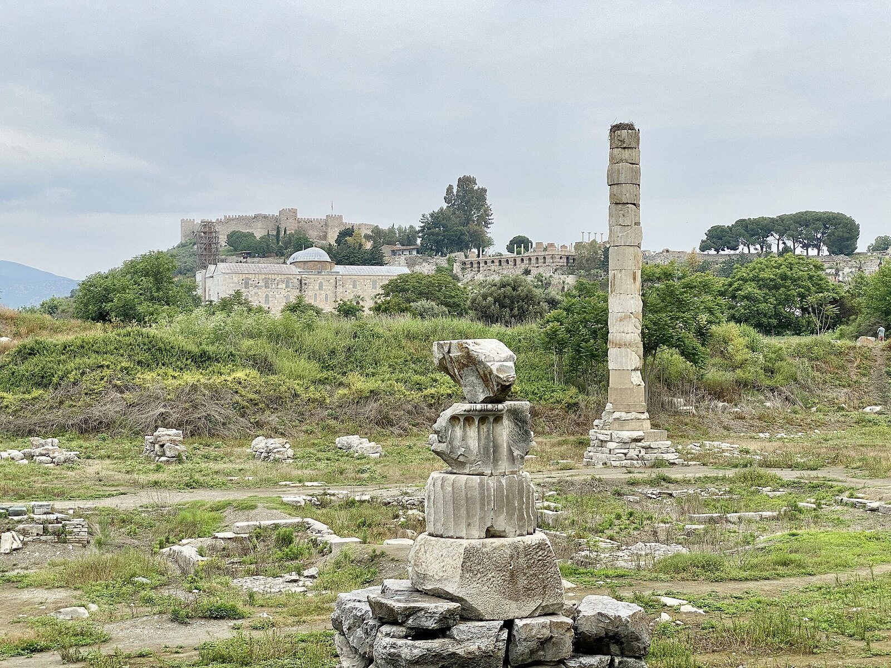
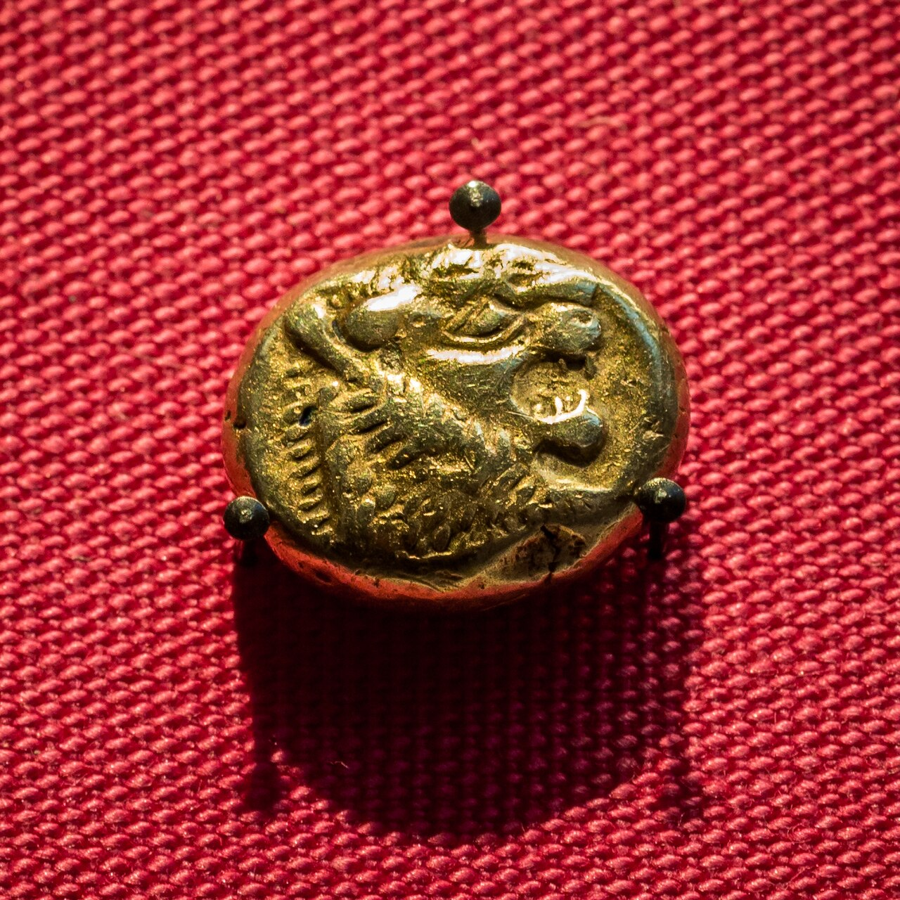
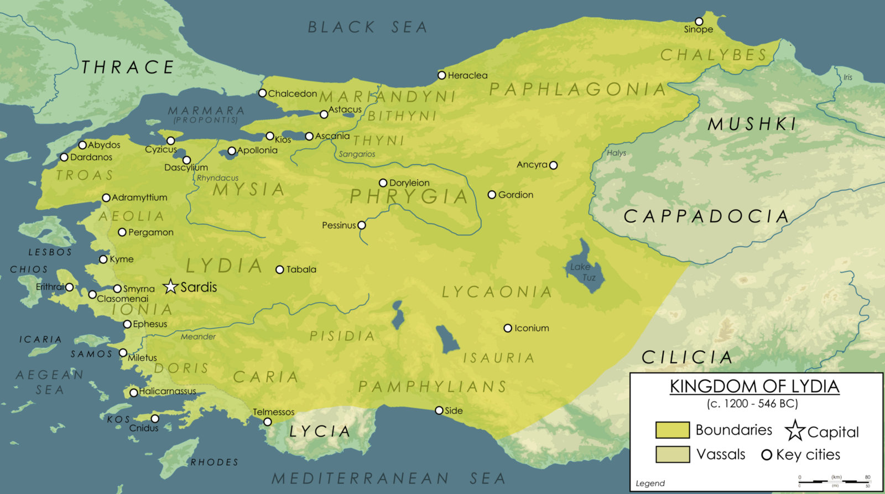
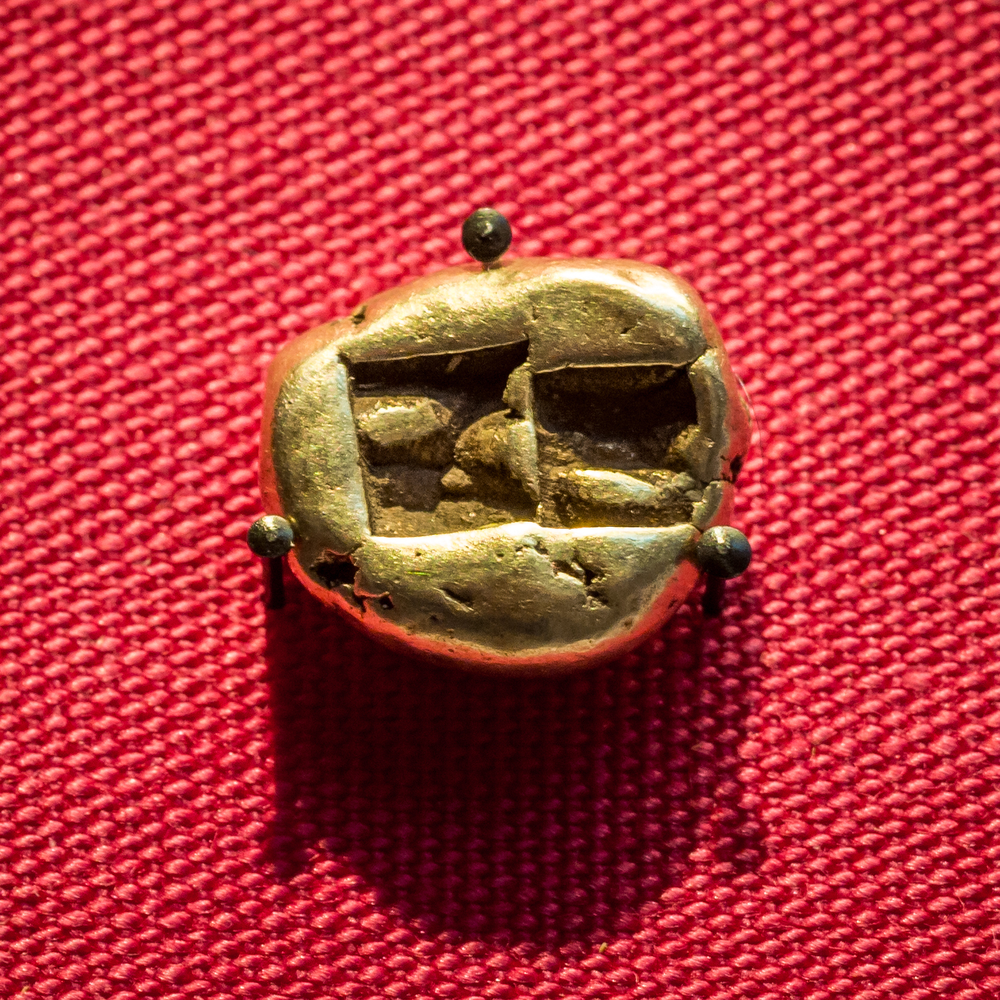
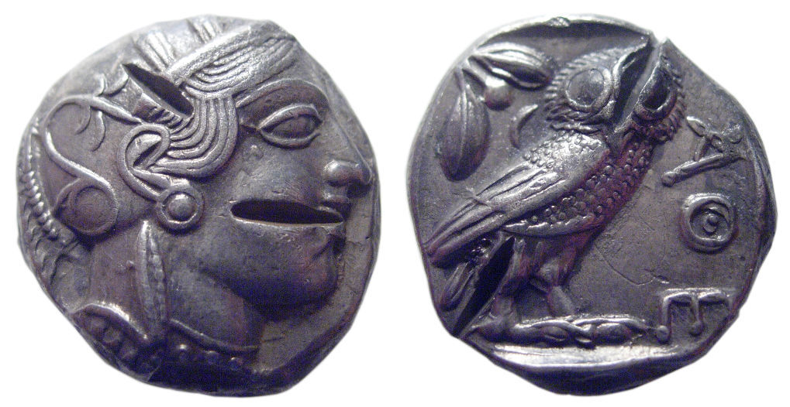
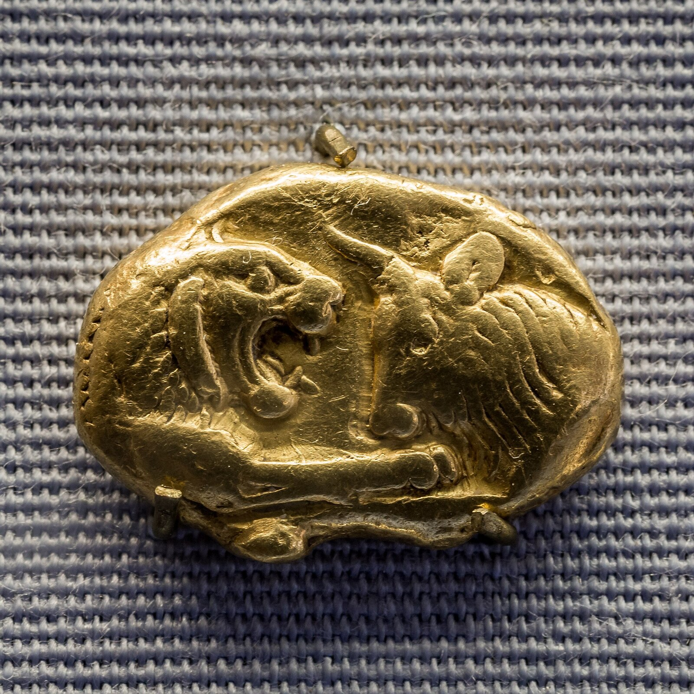
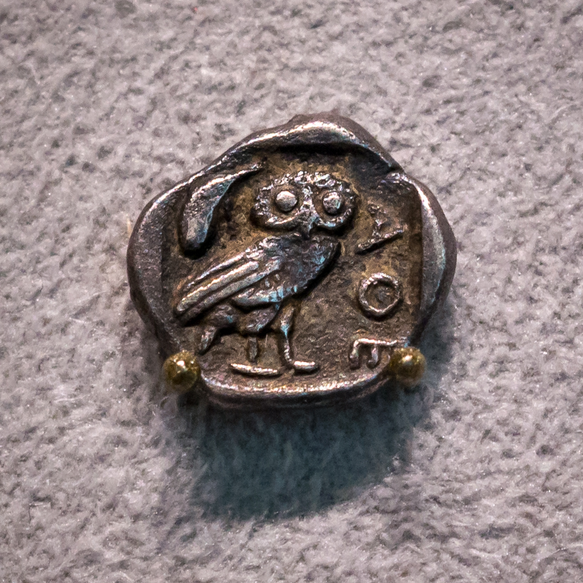
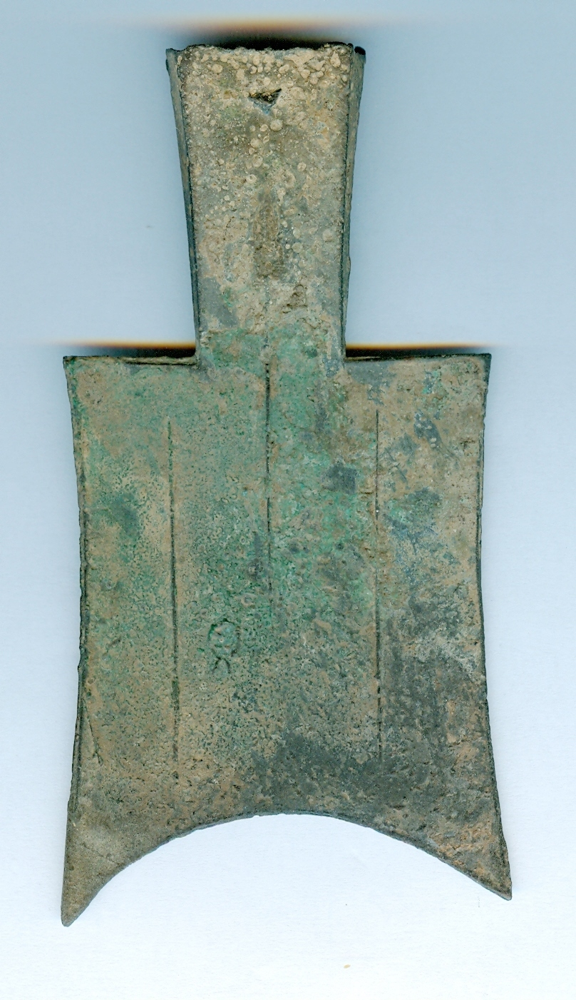
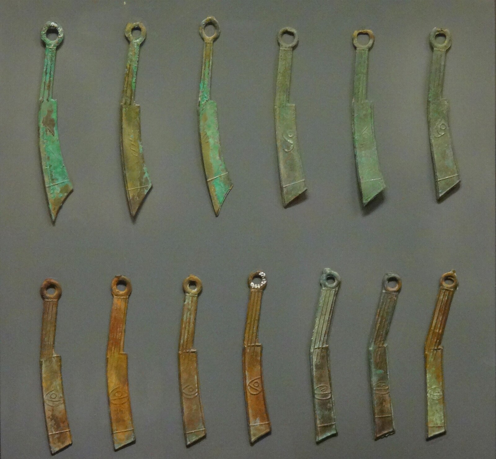
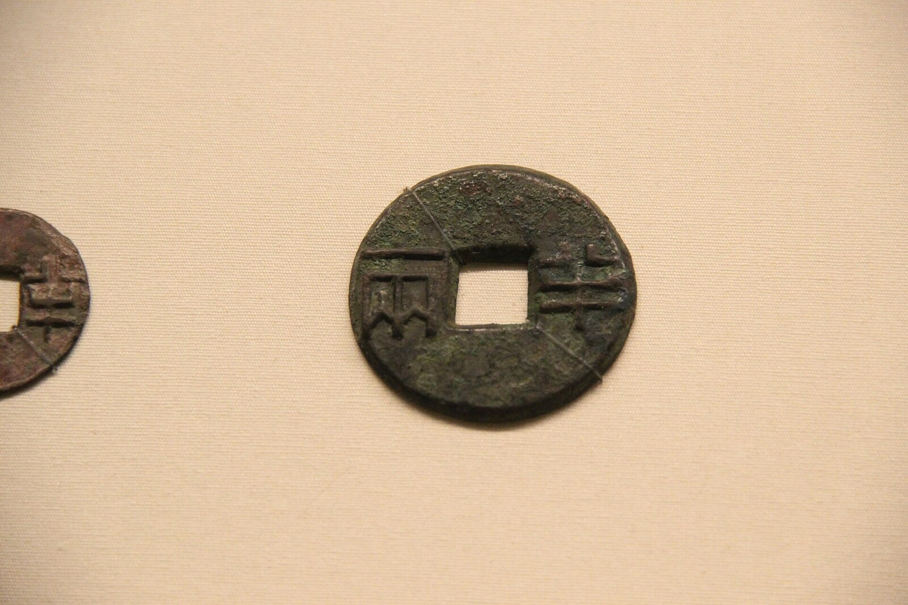

# 15. Who invented money?

*Western Turkey, Greece and northern China, about 2,600 years ago*

Nobody in particular did. Money grew slowly out of the keeping of accounts, and people were pricing things in silver and writing down who owed what for two thousand years before there were coins. The coin, however, was an invention, and it was made twice within a few lifetimes: in Lydia, a kingdom in the west of Turkey, and in northern China.

Ephesus, near the west coast of Turkey, was a Greek city, famous in ancient times for its huge marble temple of the goddess Artemis. Almost nothing of that temple is left standing. In 1904 and 1905, a team from the British Museum came to find out what lay underneath it, and the ground was so wet that a steam pump had to run all day to keep the water out of their trenches.

Under the middle of the temple floor, they found the stone base of a much older and smaller shrine. Packed into the base and scattered around it were the gifts that worshippers had left for the goddess. There were more than a thousand of them: pins and brooches of gold, small figures carved in ivory, and beads of amber and glass.

*The site of the temple of Artemis at Ephesus today. One column has been put back up from fallen pieces. Photo: Warren LeMay, CC BY-SA 2.0.*

Among these gifts were ninety-three small lumps of pale yellow metal. A few were plain. Most of them, however, had a picture stamped into one side: a goat, a cock, a stag, the head of a seal. No older coins have been found anywhere.

One kind turned up more than any other, there and in later finds across western Turkey. It is a thick, slightly lumpy pellet about the width of a shirt button, and it weighs a little less than five grams. On one side is the head of a roaring lion, with its jaws open and a knob like a small sun on its forehead. The other side has no picture at all, only two rough square dents.

*A lion's head coin of the kings of Lydia, about 2,600 years old, now in the British Museum. It is a little over a centimetre across. Photo: ArchaiOptix, CC BY-SA 4.0.*

The lion was the badge of the kings of Lydia, who ruled from Sardis, three days' walk inland from Ephesus. It was the same city that later stood at the western end of the Persian royal road.

## Money without coins

By the time that lion was stamped, the people of the plain of Iraq had been buying, selling, lending and paying taxes for a very long time, and they had done all of it without a single coin.

They had two things that did the work of money. The first was barley, which everybody grew and everybody ate. The second was silver, which was measured by weight. The standard weight was the shekel, about as much as a small coin weighs today, and the fines on the old law tablets were set in it: two shekels for a knocked-out tooth, ten for a foot.

Much of that silver never changed hands, however. For most people, most of the time, the shekel was a way of counting, in the way that a kilometre is a way of counting distance. A field, an ox, a month of work and a boat full of dates could each be given a value in shekels, and then compared with each other. The actual payment was often made in barley, or wool, or labour. Very often it was not made at once.

One of the rules on the black stone of Hammurabi shows how this worked in daily life. It concerns a woman who keeps a tavern and gives a customer a jar of beer on credit. She is to be paid back, the rule says, in grain at harvest time. A man could drink now, and the tavern keeper would remember it, or write it down, until his barley was in.

That tavern is worth setting beside a story that is often told about where money came from. In the story, people once lived by swapping goods directly. A potter who wanted a fish had to find a fisherman who happened to want a pot. This was so awkward, the story goes, that somebody eventually thought of money to make the swapping easier.

It is a neat story. Its weakness is that nobody has found the village. For more than a century, anthropologists lived among peoples who used no money and wrote down how they exchanged things. Swaps did happen, but no community was found that lived by them. One scholar who reviewed the reports concluded that "no example of a barter economy, pure and simple, has ever been described".

What they found instead was what the tavern keeper of Babylon knew already. Among people who live side by side, there is no need to swap on the spot. The fisherman gives the potter a fish today, and both of them know that a pot is owed. A village runs on a web of such debts, most of them never written down. On the plain of Iraq, where they were written down and bore interest, they grew heavy enough that kings from time to time had to wipe them out.

That web has a limit, however, and the limit is the circle of people who know one another. A debt is only as good as the chance of finding the debtor again. A neighbour will be there next month, and so will his family. A stranger who is passing through will not, and so hardly anybody gives him anything on credit. He and the people he meets are thrown back on swapping, which works only when each side happens to have what the other wants.

Weighed silver was the best answer that the old world had found to the problem of the stranger. A merchant from Ashur could sell his tin to a man he would never see again, take silver for it, and be done. Even so, silver by weight was a clumsy tool. Every payment needed a set of scales and a set of stone weights, and each side had reason to suspect the other's. Worse, silver could be melted with cheaper metal, and the eye cannot tell good silver from bad. People cut pieces open to look inside, and hoards of silver from these centuries are full of chopped rings, bent wire and broken scraps.

All this was worth the trouble for a donkey load of tin. It was far too much trouble for a fish. As a result, dealing with strangers remained largely a business for merchants, who had the scales, the contacts and the patience.

## White gold

Lydia was a rich kingdom, and the Greeks believed that they knew why. The hills behind Sardis held gold, they said, and a small river called the Pactolus, which ran through the middle of the city, washed it down in its sand.

*The kingdom of Lydia at its largest, under Croesus. Sardis is marked with a star, and Ephesus lies on the coast to the south-west. Map: Ennomus, CC BY-SA 4.0.*

Much of the metal that came out of the hills of western Turkey was not pure gold. It was a natural mixture of gold and silver, paler than gold, which the Greeks called white gold. Its modern name is electrum.

Electrum is valuable, but it has a fault that makes it very hard to pay with. The mixture is not the same from one lump to the next. One lump may be three quarters gold, and another of the same size much less. They look alike. A pair of scales will say how heavy a lump is, but not how much of it is gold. So a man who was offered a handful of electrum had no easy way of knowing what he was being given.

The Lydian answer, which appeared about 2,600 years ago, was to have the king's treasury settle the question once, for everybody. The treasury made up lumps of electrum at exact weights. The largest in common use was the piece with the lion's head, which was a third of a unit called a stater. Below it came sixths, twelfths and smaller fractions still, each one half the weight of the one above. The smallest is a ninety-sixth of a stater, a speck of metal about the size of a lentil. Each lump was then stamped with the king's lion.

Consider what the stamp did. Before it, every lump of electrum was a puzzle that had to be weighed and argued over. After it, a lump was a known thing. A man no longer weighed his money. He counted it. Two sixths made a third, and any child could check the sum.

These were not small sums. By one estimate, a piece weighing a twenty-fourth of a stater would buy a sheep, which means that the lion's head third was worth a small flock.

It is tempting to say that the stamp guaranteed what was in the metal, as a label on a jar tells you what is in the jar. The coins themselves say otherwise. When modern laboratories tested the lion's head coins, they found that every one held nearly the same mixture: a little more than half gold, and the rest almost all silver. That is too regular to be natural, and it is poorer than the electrum of the hills, which is on average about three quarters gold. The Lydian treasury had been melting extra silver into its electrum before stamping it. If it then paid the coins out at the value of the natural metal, as numismatists reckon it did, the king gained about a sixth on every payment.

So the lion was not a statement about gold. It was a promise about value. The coin was worth a third of a stater because the king said so, and because the king would take it back at that value when his subjects owed him something. Behind the piece of metal stood the treasury at Sardis.

That also explains where the lion's head coins have been found. Nearly all of them come from Lydia itself and from the lands close to it. Inside the kingdom, the king's promise was good. Beyond his reach, a merchant would have had to take the coin for the metal in it, and the metal was worth less than the stamp claimed.

## Two dies and a hammer

The idea of pressing a badge into something to show who stood behind it was already ancient. For thousands of years, officials and merchants had pressed their seals into wet clay to sign a tablet or close a jar. A coin is a seal pressed into metal. Metal is much harder than clay, however, and so the pressing needs a hammer.

The work began with the weighing, because the stamp could not add or remove any metal. A mint worker weighed out the exact amount for one coin and melted it into a small bean-shaped blob, which is called a blank. From that moment the coin's weight was fixed.

Next came the tool that mattered most, which is called a die. A die is a short block of bronze or iron with a picture cut into one end. The picture is cut hollow, like a jelly mould, and back to front, like the letters on a rubber stamp. A skilled engraver carved the lion's head into it with fine tools, working at the true size of the coin.

The die was set into an anvil or a block of wood, with its carved face upwards. A worker laid a blank on top of it, often warmed first to soften the metal. A second worker stood a punch on the blank. The punch was a short metal bar, held upright like a chisel. Then he hit the top of the punch with a hammer, hard.

Under the blow, the blank was squashed flatter and wider, and the metal on its underside was forced into the hollow of the die. When the blank was lifted off, the lion's head stood up from it, sharp and complete. On the top, the end of the punch had left its own mark. For the lion's head thirds the mint used two small punches side by side, and their rough square ends made the two dents on the back.

*The back of a lion's head coin, with the two dents left by the punches. Photo: ArchaiOptix, CC BY-SA 4.0.*

Within a few generations, somebody thought of carving a picture into the end of the punch as well. From then on, a coin was squeezed between two dies, a lower one and an upper one, and came out with a picture on each face, as struck coins still do.

The method was fast. One blank took a few seconds, and a small team could make many hundreds of coins in a day. It was also exact. Every coin from the same die carried the same image, down to the smallest slip of the engraver's tool.

Above all, a struck coin was hard to copy. The weight could be matched by anybody with scales. The image could not, because it took a trained engraver to cut a die, and the dies were kept under guard. Forgers tried all the same. Their usual trick was to wrap a thin skin of precious metal around a core of copper, and strike that. The answer of the wary was to cut a notch into a doubtful coin with a chisel and look inside, and many ancient coins carry those cuts to this day.

*A silver coin of Athens, about 2,400 years old, with chisel cuts made to see what was inside. Photo: ancientcointraders.com, CC BY-SA 4.0.*

## Croesus divides the metal

The fault in the Lydian coins was the electrum itself. So long as a coin was made of a mixture, nobody outside the kingdom could be sure of what was in it. The cure was to take the mixture apart, and the king who did so was Croesus, who came to the throne of Lydia about 2,580 years ago.

Separating gold from silver is difficult, because the two metals melt together and stay together. In 1968, however, archaeologists digging beside the Pactolus at Sardis found a workshop where the Lydians did it. There were small furnaces, hundreds of little bowl-shaped hearths, broken clay pots, and scraps of gold foil.

From those remains the method has been worked out. The workers hammered the mixed metal into thin sheets. They packed the sheets into clay pots between layers of ordinary salt, and kept the pots hot for many hours, at a heat well below the melting point of gold. At that heat, the salt slowly eats the silver out of the metal and leaves the gold alone. What came out of the pot was almost pure gold. The silver had soaked into the clay around it. To get it back, the workers smelted the clay with lead, which gathered up the silver, and then burned the lead away in the bowl-shaped hearths.

With two pure metals to work with, Croesus issued two sets of coins, one of gold and one of silver. Both carried the same picture: the front half of a lion facing the front half of a bull. A fixed number of the silver coins was worth one of the gold.

*A gold coin of Croesus, struck at Sardis about 2,570 years ago, in the state coin collection in Munich. Photo: ArchaiOptix, CC BY-SA 4.0.*

These are the first coins of pure gold and pure silver, and they could do something that the old electrum could not. Their value lay in the metal, which anybody could test. The usual way was to rub a coin on a smooth black stone and judge the colour of the streak it left, and the Greeks called such a stone a Lydian stone. Consequently, the gold coins of Croesus were accepted far beyond his borders, all around the Aegean Sea.

Croesus, whose name is still a byword for wealth, did not enjoy them for long. About 2,570 years ago Cyrus and his Persians, fresh from their victory over the Medes, marched west and captured Sardis.

The Persian kings knew a good thing when they found it. They kept the mint at Sardis working, and for some thirty years they went on striking the lion and the bull, exactly as before. After that they put their own image on the coins instead: a king, running, with a bow in his hand.

## Turtles and owls

The neighbours who took up the new invention most eagerly were the Greeks.

The Greeks of that time lived in several hundred small cities, scattered around the Aegean and beyond, and each city governed itself. Those on the coast of Turkey, such as Ephesus, had been neighbours of Lydia from the beginning, and had struck electrum coins of their own almost as early as the kings had.

About the time of Croesus, the idea crossed the sea. The island of Aegina, a small trading state within sight of Athens, began to strike thick silver coins with a sea turtle on them. Corinth followed with a winged horse, and Athens with the owl of its goddess. By 2,500 years ago, more than a hundred Greek cities were making coins, from the coast of Turkey to Sicily and the south of France. Each one chose its own badge: a crab, a bee, an ear of barley, a wine cup.

The Greeks made one change that mattered more than the pictures. Greece had little gold, but it did have silver mines, and so nearly all of its coins were silver. Silver is worth far less than gold, weight for weight. A silver coin could therefore be made for a sum so small that a gold or electrum coin of the same value would have been too tiny to pick up.

As a result, the Greek cities had real small change. In Athens the standard coin was the drachma, a piece of silver about as wide as a fingertip. Below it came the obol, which was a sixth of a drachma and smaller than a child's fingernail, and there were halves and quarters of the obol below that. Greek clothes had no pockets, and so people on their way to market carried these little coins in their mouths, tucked into the cheek. In one comic play, an old man is handed his three obols, pops them into his mouth, and finds that he has been given fish scales.

*An obol of Athens, about 2,450 years old, in the coin cabinet in Berlin. The real thing is one centimetre across. Photo: ArchaiOptix, CC BY-SA 4.0.*

With coins like these, a person could buy one fish. Herodotus, writing a century after Croesus, noted two things about the Lydians in a single breath. They were, he said, the first people known to have used coins of gold and silver, and "they were the first to sell by retail".

## Spades and knives

Seven thousand kilometres to the east, people who had never heard of Lydia arrived at the coin by a different road.

Northern China at that time was divided among a number of rival states along the Yellow River, each with its own ruler, army and walled cities. Their smiths were masters of casting bronze, which they poured into moulds of baked clay.

One of the most useful things that a Chinese farmer owned was a small bronze spade for weeding. Such tools had long been passed from hand to hand in payment, since everybody needed one. At some point the spades that were made for paying began to part company with the spades that were made for digging. They became smaller, thinner and lighter, until they were too flimsy to turn any soil at all. They kept the shape of the tool, including the hollow socket where a handle would have gone, but they were now tokens.

*A bronze spade coin from northern China, between 2,650 and 2,400 years old, with the hollow socket of the tool it copies. Photo: Davidhartill, CC BY-SA 3.0.*

The oldest workshop known to have made them was found at Guanzhuang, in the province of Henan, in the bronze foundry of an ancient city. Among the remains were spade coins and the clay moulds they were cast in. The dates show that the foundry began casting them between about 2,650 and 2,575 years ago, which is to say at much the same time as the kings of Lydia were stamping their lions.

Other Chinese states had their own shapes. In the east and north-east, where a small bronze knife was the familiar tool, the coins were knives, complete with a ring at the end of the handle. Many spades and knives carried a few written characters, often the name of the city that had issued them.

*Bronze knife coins of Yan, a state in the north-east of China, in the Capital Museum in Beijing. Photo: Baomi, CC BY-SA 4.0.*

About 2,400 years ago a simpler form appeared: a flat round disc with a hole through the middle. The hole allowed the coins to be threaded on a cord and carried by the hundred. When one of the rival states finally conquered all the others, it made its own round coin, which had a square hole, the money of the whole country. Coins of that shape were used in China for the next two thousand years.

*A round bronze coin with a square hole, of the kind that became the money of all China, in the National Museum of China. Photo: Gary Todd, CC0.*

The Chinese coins differed from the Lydian ones in almost every detail. They were cast and not struck. They were bronze and not gold or silver, so that a single coin was worth little, and from the start they suited small purchases. They bore writing and not pictures. Underneath, however, the invention was the same. A ruler made small objects of a standard size, put his mark on them, paid them out, and took them back. People counted them and did not weigh them.

## There and back

What a coin does is clearest when one is followed around its circuit. Take a silver drachma in a Greek city about 2,450 years ago.

It begins as silver in the city's treasury. The mint weighs it, strikes it, and hands it to the city's paymasters, because a city has a great many people to pay. There are the rowers of its warships, the masons working on its temples, and above all its soldiers. A soldier on campaign was paid about a drachma for each day's service.

The soldier cannot eat silver, and so he takes the coin to the market. There he buys bread, olives and a fish from a woman at a stall, and gets a few obols back in change. She accepts his coin without knowing who he is, where he comes from, or whether she will ever see him again. She does not need to know. She recognises the stamp.

The fish seller, in turn, has payments of her own to make. She owes a fee for her place in the market. The merchant who supplies her salt fish owes a duty on every cargo he brings into the harbour. A trader who is caught giving short measure owes a fine. All of these are owed to the city, and the city wants them in coin. So the drachma passes from the stall to the collector, and from the collector back to the treasury where it started.

The soldier took the coin because the fish seller would take it. The fish seller took it because the collector would. At the end of the line stood the city, which had made the coin and would accept it back. Each stranger trusted the next one. Behind them all stood two things, the silver in the coin and the city that had stamped it.

The city gained as much as anybody. Before coins, a ruler who wanted to keep an army in the field had to feed it himself. He needed granaries, carts, pack animals and a staff of clerks to move grain to wherever the soldiers were. Sargon of Akkad had boasted of the five thousand men who ate bread before him every day. A ruler with coins could hand each man a little silver and let him buy his own dinner. Where a paid army went, sellers followed with food, and a market sprang up beside the camp. The ruler had turned much of the problem of feeding ten thousand men into ten thousand small purchases, and other people did the work.

Historians have long argued over which came first, the fish stall or the soldier's pay. Some hold that coins were invented to make trade easier: merchants needed a handy means of payment, and rulers obliged them by stamping metal. That view is as old as the Greeks. Others hold that coins were invented by rulers for their own payments, to soldiers above all, and that trade came afterwards.

The evidence of the coins leans towards the rulers. The lion's head coins were the king's own, and the kings of Lydia are known to have hired foreign soldiers. The coins were worth too much for everyday shopping, and they hardly travelled beyond Lydia, which is the opposite of what a tool for foreign trade would do. Meanwhile, some of the greatest trading peoples were in no hurry to adopt them. The merchants of Babylon and the sea traders of the Lebanese coast went on weighing out silver for generations after their neighbours had coins.

Trade did not have to wait long, however. Once the Greek cities were striking small silver, their markets filled with it.

## A price on everything

With barley and credit, a household had dealt mainly with people it knew. With a few coins, anybody could walk up to any stall and buy a handful of olives. A woman could now make a living by selling such handfuls all day to people whose names she never learned. The crowded market square, with its sellers of fish, bread, charcoal and wine, became the centre of the Greek city.

Work changed as well. Hiring a man by the day was an old practice, but in the great temple households of Iraq most workers had been given rations: so much barley, so much oil, so much wool. A ration ties a worker to the storehouse that issues it. A coin does not. A free man who was paid in coin at the end of the day could spend it where he liked, work for somebody else tomorrow, or move to another city and find that silver was welcome there too. Building accounts from Athens show citizens, foreigners and slaves working side by side on the same temple at a drachma a day, although the slave's drachma went to his owner.

The last change was harder to see, and it troubled people at the time. Once most things could be bought with coins, most things could be compared. An ox, a cloak, a day of a man's labour, a place on a ship, the ransom of a prisoner and the price of a slave could all be set down as numbers in the same column. The shekel had allowed clerks to do that sum on clay. Coins put it into every hand.

The Greeks carried coins in their cheeks and loved their markets, and they also suspected that something was being lost. About 2,460 years ago, in a tragedy staged at Athens, a king speaks a line that audiences have recognised ever since: "Nothing so evil as money ever grew to be current among men." Money, he goes on, destroys cities and drives men from their homes.

The Greeks also told a story about it. Midas, the king of the country next to Lydia, was once granted a wish by a god, and he wished that everything he touched would turn to gold. It did. His bread turned to gold in his hand, and so did the wine in his cup, and he found that he was the richest man in the world and was starving to death. He begged the god to take the gift back. The god told him to go and wash in a river. That river was the Pactolus, the stream that runs through Sardis, and that, the story ends, is how the gold came to be in its sand.
