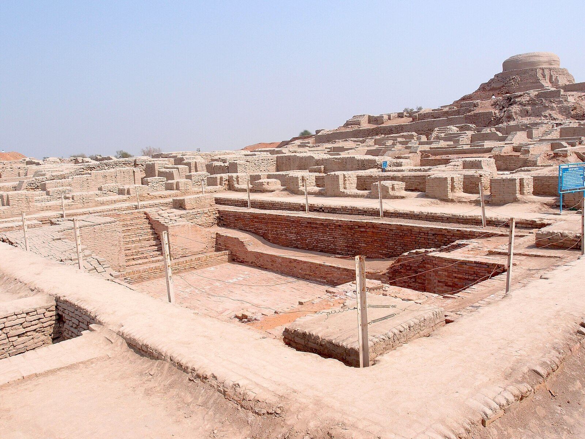
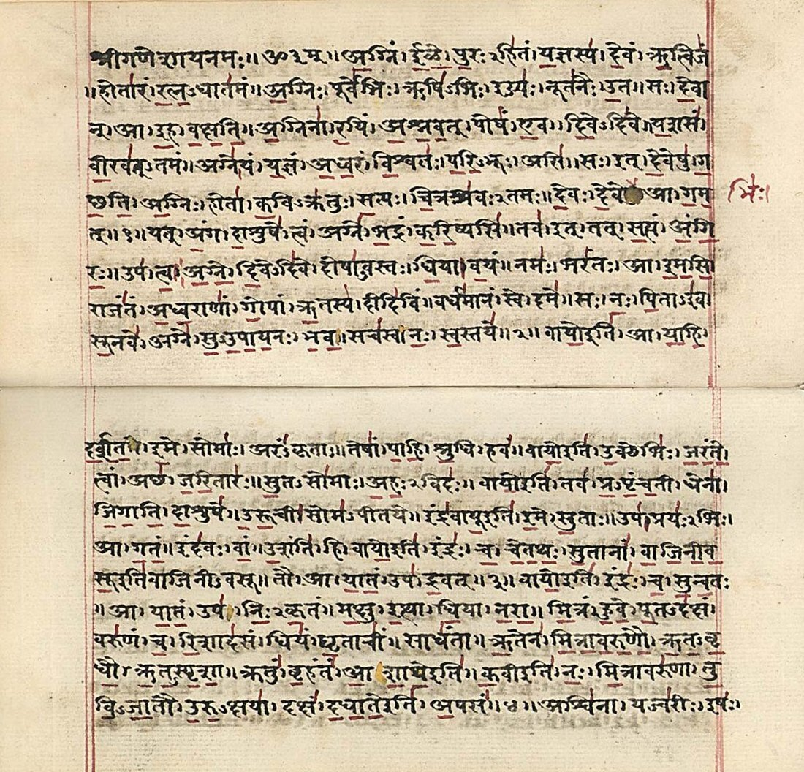
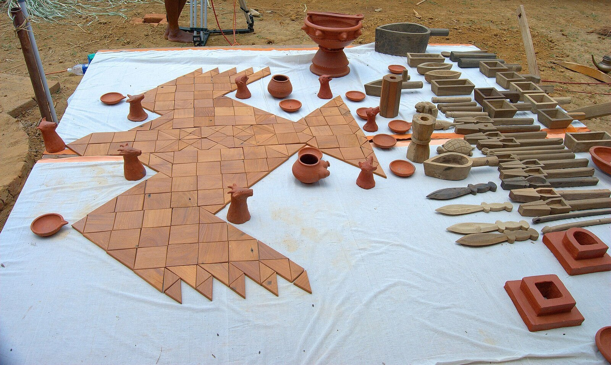
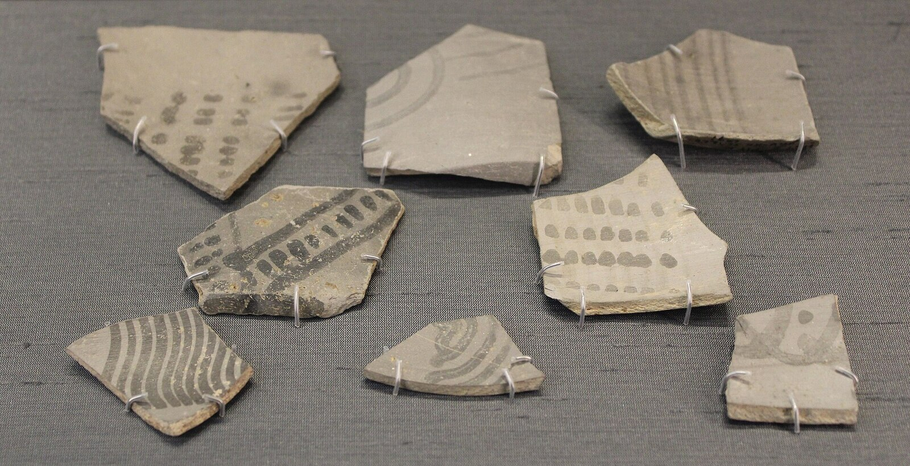
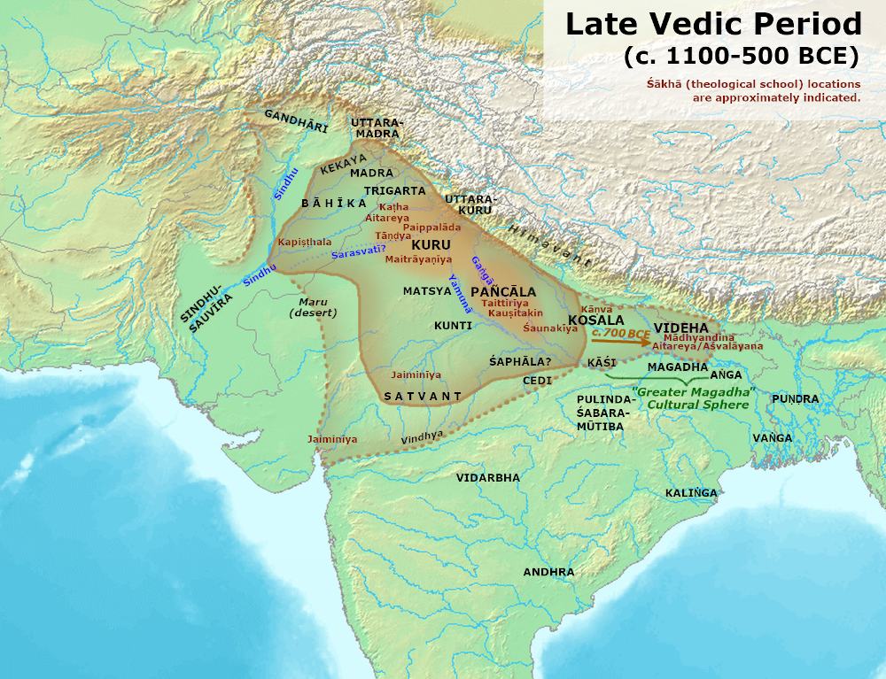
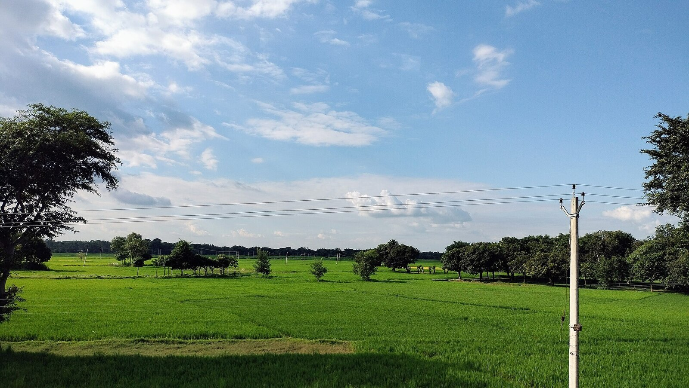
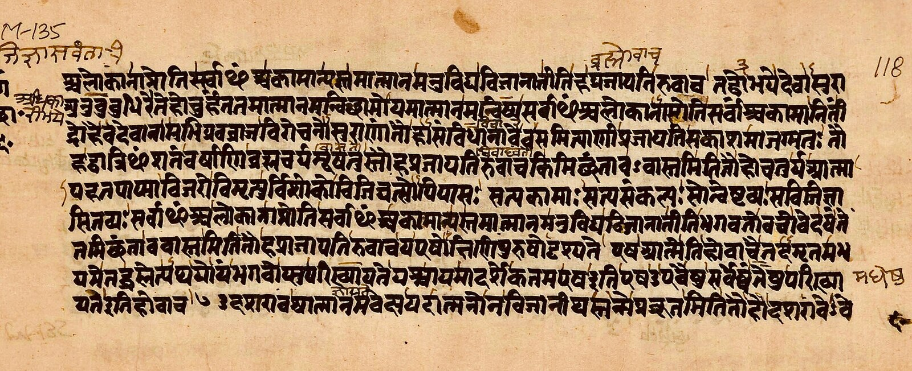
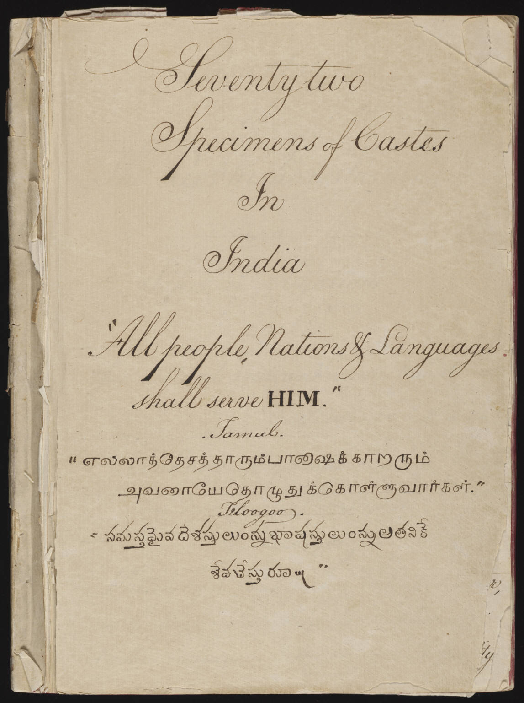

# 16. Where did the caste system come from?

*Northern India, from about 3,500 years ago to about 2,500 years ago*

It came in two steps. About three thousand years ago, priests in northern India composed a hymn that divided society into four ranked orders. The custom that made rank so hard to escape, marrying only inside one's own small birth group, spread slowly after that, and it was not general across India until about 1,900 years ago.

In a library in the Indian city of Pune there is a set of thirty old manuscripts. Some are written on paper and some on the bark of birch trees. They hold the Rigveda, a collection of just over a thousand hymns to the gods, and it is the oldest book of India. The oldest of the thirty that carries a date was copied about 560 years ago.

The hymns themselves are about six times as old. The earliest of them were composed some 3,500 years ago. Nobody carved them on stone, as the laws of Hammurabi were carved, and nobody pressed them into clay. The people who composed them could not write, and for a thousand years after them nobody in northern India could.

Even when writing did arrive, the keepers of the hymns would not use it. About a thousand years ago, a Muslim scholar who had learned Sanskrit in India reported that the priests still did not allow their sacred text to be put into writing. A hymn, they held, was a thing of sound.

So for well over two thousand years, a text as long as a thick novel lived mainly in the heads of men who had learned it by ear. One of its hymns contains the oldest description of the four ranks.

## Cattle, horses and fire

The people of the hymns were herders. They lived in the Punjab, the plain in the north-west of the Indian subcontinent where five rivers run down from the Himalayas to join the Indus. They moved with their cattle, they fought from chariots with spoked wheels, and they counted their wealth in cows. One of their words for a battle meant, literally, a wish for cattle.

Their language was an early form of Sanskrit, and it gives away where their ancestors had come from. It belongs to the great family of languages that the wagon herders carried off the grasslands north of the Black Sea. Over many generations, descendants of those steppe people had drifted south through Central Asia with their horses and herds. Between about 4,000 and 3,500 years ago they came through the mountain passes into the north-west of India. Their nearest cousins went a different way, into the lands of Iran. Zoroaster composed his hymns among them in a sister language, and his priests kept them in the same way, by heart.

They did not enter an empty country. A thousand years earlier, the Indus valley had held some of the largest cities on Earth. These were the cities whose ships had once tied up at the quay of Akkad. They were built of baked brick, with straight streets and covered drains, and their merchants stamped their goods with seals in a script that nobody has yet managed to read.

*The ruins of Mohenjo-daro, one of the Indus cities, in what is now Pakistan. The brick-lined pool in the foreground is about 4,500 years old. Photo: Saqib Qayyum, CC BY-SA 3.0.*

By the time the herders arrived, however, the great cities had shrunk or emptied. The rains had weakened and the rivers had shifted, and most of the city people had scattered into villages. The newcomers settled among their descendants and, over time, had children with them. Almost every community in India today descends from both.

The hymns ask the gods for what herders want everywhere: rain, sons, long life, victory, and more cows. Nearly a quarter of the hymns are addressed to Indra, a warrior god who drives a chariot, throws a thunderbolt and drinks heroically. The next largest share goes to Agni, who is fire itself.

Fire mattered because it was the way to reach the gods. These people built no temples and made no statues. Instead, they lit fires on a piece of open ground and poured butter into the flames, along with grain and the juice of a plant called soma, which they pressed and drank. The fire carried the gift upwards as smoke, and the gods were expected to pay it back.

The words spoken over the fire were the hymns. Families of poets composed them, and the best were remembered and passed from father to son. Those families were the beginnings of a priesthood.

## Thirteen times each

Memory is unreliable. A story told from one person to the next changes within a week. The scribes of Judah kept their texts alive by copying them out, scroll after scroll. The priests of the hymns faced the problem of passing a hundred thousand words and more through a hundred generations without changing one of them, and they solved it.

Teaching went by ear. The teacher recited a short stretch, and the boys in front of him chanted it back, twice, copying every rise and fall of his voice. A boy began at about eight years old and kept at it for hours every day. The tradition allowed twelve years to master one collection.

Repetition alone, however, does not stop errors. It can drill a mistake in as firmly as it drills in the right word. The real invention was to learn the same text in several different arrangements, so that each arrangement checked the others.

The first arrangement was the hymn as it was sung, with the words running together. In Sanskrit, the sound at the end of a word changes to fit the start of the next one. English does this now and then, as when "a" becomes "an" in front of "apple". Sanskrit does it at almost every join, so that a line of verse flows like a single long word.

The second arrangement undid all of that. The boy learned the hymn again, one word at a time, with a pause after each, and with every word in its plain form as though it stood alone. He now knew exactly where each word began and ended.

*The opening of the Rigveda in its word-by-word form, in a manuscript copied in India in the early 1800s. The upright strokes divide the words, and the red marks show the pitch of the voice. Photo: Schøyen Collection, public domain.*

After that came the patterns. The Rigveda opens with the words *agnim ile purohitam*: "Agni I praise, the priest set in front". Call those three words one, two and three. In the simplest pattern, the reciter chained the words in overlapping pairs: one-two, two-three, three-four, and on to the end of the verse.

In the next pattern, known as the braid, he went forwards, backwards and forwards again over each pair: one-two, two-one, one-two, and then two-three, three-two, two-three. In the hardest, called the dense pattern, he brought in a third word: one-two, two-one, one-two-three, three-two-one, one-two-three. Then he started again from word two.

A reciter who works through a verse in the dense pattern says every word in the middle of it thirteen times, forwards and backwards, beside each of its neighbours. Whenever the order of two words is switched, moreover, the sounds where they join have to be worked out afresh. To get them right, he has to know each word exactly.

Websites use a simple version of the same trick when they ask a customer to type a new password twice. A slip made once is unlikely to be made the same way the second time, and so the two entries expose it. The priests entered theirs in half a dozen ways. A word that had drifted in one arrangement would clash with the others, and several men chanting together would hear the clash at once.

The Rigveda has come down with almost no variant readings. Reciters in the far south of India and in the north, trained in separate lines of teachers for many centuries, chant the same words in the same order. One scholar has compared a recitation heard today to a tape recording made three thousand years ago.

The priests took such trouble because, in their view, the power of a hymn lay in its exact sound. Their own texts tell a story to make the point. A being who wanted revenge on the god Indra held a sacrifice to create a son, and prayed that the child would grow up as "the slayer of Indra". He put the stress on the wrong part of the phrase, which turned its meaning into "the one whom Indra slays". The son was duly born, grew up, and was killed by Indra.

## The human gods

A rite that fails over one slip of the tongue needs experts, and experts can name their price. Over the centuries after the first hymns, the sacrifices grew larger and more complicated, and the priests who performed them grew more important.

A chief's great sacrifice now needed three fires and as many as sixteen priests. Some chanted the hymns, some sang, and some built the altars and handled the offerings. One more sat in silence and watched for mistakes.

The grandest rites belonged to kings. In the horse sacrifice, a king who wished to announce his power set a stallion loose to wander wherever it liked for a year. Four hundred armed men followed it. Any chief whose land it crossed had to submit to the king or fight. At the end of the year the horse was led home and killed, in a ceremony that went on for three days.

Another rite called for an altar built of more than a thousand bricks in the shape of a huge bird with its wings spread. A community of priests in Kerala, in the far south of India, has gone on performing it into modern times. When they did so in 1975, with scholars filming, the ceremony took twelve days and seventeen priests.

None of this was done for nothing. The man who paid for a sacrifice owed the priests a fee, in cows, gold, horses and cloth, and the manuals that the priests composed are firm about it.

*A model of the bird altar, with copies of the wooden ladles and clay pots used in the rite, photographed in Kerala. Photo: Arayilpdas, CC BY-SA 3.0.*

The same manuals drew a bold conclusion about the priests themselves. If the gods depend on the sacrifice, and the sacrifice depends on the men who know the words, then those men stand very high. There are two kinds of gods, one of them explains: the gods in heaven, and the learned priests, who are "the human gods".

Those priests were called Brahmins. They owned no army and collected no taxes. What they owned was the hymns. A boy could receive the hymns only from his father or from a teacher who chose to take him, and the teachers chose the sons of Brahmins. The priesthood therefore passed down by birth.

## Mouth, arms, thighs, feet

The hymn that ranks society is one of the latest in the Rigveda, composed about three thousand years ago. It tells how the world was made.

In the beginning, it says, there was a giant, the first man, who had a thousand heads and a thousand eyes and was the whole of everything. The gods laid him out as the offering in the first sacrifice and divided him. The moon was born from his mind and the sun from his eye. The wind came from his breath, the sky from his head, and the earth from his feet.

People were made in the same act. The priest was his mouth. The warrior was made from his two arms. His thighs became the common people, and from his feet the servant was born.

The orders are stacked from head to foot. Each has its job, since the mouth speaks the sacred words, the arms fight, the thighs carry the weight, and the feet go where they are told. All four belong to one body, and so none can do without the others. Above all, the arrangement is as old as the sun and the moon. In such a world, a servant has no more reason to complain of his place than a foot has.

It will surprise nobody that the hymn was composed by priests.

Later texts filled in the details. The priests, the Brahmins, were to study, teach and sacrifice. The warriors, the Kshatriyas, were to rule and protect. The common people, the Vaishyas, were to herd, farm and trade. The servants, the Shudras, were to work for the other three.

Boys of the top three were put through a ceremony of initiation that counted as a second birth, and after it they could be taught the hymns. For that reason those three orders were called the twice-born. A Shudra was born once. He was not to learn the hymns, and he was not even supposed to hear them.

In time a further group was placed below all four. Its members did the work that the others held to be polluting, which meant clearing away dead animals, tanning hides, and carrying corpses to the burning ground. They were made to live outside the village. A Chinese pilgrim who walked through northern India about 1,600 years ago wrote that such people had to strike a piece of wood when they entered a town or a market, so that everyone else could avoid touching them. Their descendants in India today number about two hundred million, and many of them call themselves Dalits, a word that means broken.

## East to the rice

While the priests refined their ranks, the people of the hymns were on the move again. From the Punjab they spread east and south-east, onto the immense plain of the river Ganges.

*Pieces of painted grey pottery from villages on the upper Ganges plain, about 3,000 years old, now in the British Museum. Photo: Zunkir, CC BY-SA 4.0.*

One of the priests' manuals remembers the move as a story. A chief, it says, carried the sacred fire in his mouth. When the fire burst out, it ran eastwards along the ground, burning the country before it, and the chief and his priest followed until the fire stopped at a river. The land beyond the river had been too marshy to live on. Then the Brahmins made it sweet with sacrifices, and the chief settled there.

*Northern India between about 3,100 and 2,500 years ago. The shaded area is the country of the priests and their hymns, and the arrow shows its spread east along the Ganges. Sindhu is the Indus. Map: Avantiputra7, CC BY-SA 3.0.*

The plain of the Ganges was thick forest and swamp. It gets far more rain than the Punjab, and herders with a few fields of barley could do little with it. Three things opened it up.

The first was fire, as the story says. The second was iron. By about three thousand years ago the smiths of northern India were making iron axes and, later, iron tips for ploughs. Iron ore is common, and so an ordinary farmer could own a tool that would fell a tree.

The third was rice. Rice had long been grown along the Ganges by the people who already lived there. Planted in flooded fields, it feeds more mouths from the same ground than wheat or barley can. As the forest came down, the plain filled with rice villages, and the population grew as it had never grown in the Punjab.

*Rice fields on the Ganges plain today, near Darbhanga in the Indian state of Bihar. Photo: Suyash Dwivedi, CC BY-SA 4.0.*

More food and more people led to towns. By about 2,500 years ago the Ganges plain had the first towns in India since the Indus cities fell silent, ringed with huge banks of earth. The chiefs who had raided each other for cattle had given way to kings, who had capitals, standing armies and tax collectors.

In this crowded world a merchant could be richer than a Brahmin, and forest peoples who had never heard a hymn were being drawn in as farm labourers. The old picture of four orders, made for herders and their priests, now had to make room for all of them.

## Salt in water

In those same centuries, some people began to doubt that the sacrifices were the heart of the matter. They did not stop performing them. Instead, they asked what the rites really meant, and what a person really is. Their conversations were memorised in their turn, and are known as the Upanishads. The oldest of them are about 2,600 years old.

The best-known lesson is given by a father to his son. The boy had gone away at twelve to study the hymns and came home at twenty-four, pleased with himself. His father told him to drop a lump of salt into a bowl of water and to bring it back in the morning.

The next day the father asked for the salt. The boy felt for it in the water and could not find it. His father told him to sip from one edge of the bowl, then from the middle, then from the far edge. Each time the boy reported the same thing: salt. The father then explained that the salt was there in every drop, although it could not be seen. In the same way, he said, one fine essence runs unseen through the whole world and is the self of everything in it. He ended: "And that's how you are."

Under the body and the passing thoughts, in other words, each person has a true self, and it is the same stuff as the single reality behind the whole world.

A second idea followed from the first. If the self is not the body, it need not die with the body. One teacher compared it to a caterpillar, which reaches the tip of a blade of grass and draws itself across onto the next blade. At death, the self reaches across to a new body and is born again.

A third idea decided where it would go. The word *karma* means action, and at first it meant the acts of the sacrifice. The teachers widened it to cover everything a person does. Every act leaves a mark that comes due later, in this life or in another. A man becomes good by good action, one teacher said, and bad by bad action.

The older hymns knew nothing of this. In them, the dead simply went to join their fathers. The new prospect was not a comforting one. To be reborn is to grow old and die again, and again, without end. The highest goal was therefore to get off the wheel altogether. A person who came truly to know the self, the teachers said, would be released and would not be born again.

These ideas were not invented to justify the four orders. They fitted them, however, with remarkable ease. One of the oldest Upanishads draws the connection itself. People whose conduct has been pleasant, it says, can expect to enter a pleasant womb, that of a Brahmin, a Kshatriya or a Vaishya woman. People whose conduct has been foul will enter a foul womb, that of a dog, a pig or an outcaste woman.

*A page of the Upanishad that contains the lesson of the salt, in a copy made in 1865. Photo: Ms Sarah Welch, CC BY-SA 4.0.*

The hymn of the first man had said that the orders exist. The new teaching said why a particular person is born into one of them. Each birth is earned. The Brahmin deserves his place because of what he did in a former life, and so does the man who carries corpses.

The same teaching told each of them what to do next. Every station has its own duty, called *dharma*. A person who carries out the duty of his birth can hope for a better one next time. A much-loved poem composed a few centuries later puts the rule in one line: it is better to do one's own duty badly than to do another's well.

## A thousand years of mixing

The Brahmins plainly gained from all this. They stood at the top, and their law books excused them from taxes and from the worst punishments.

Kings gained too. A king had the power, and a Brahmin could declare at his crowning that the power was part of the order of the world. The king in return gave the priest cattle, land and protection. The priests of Marduk had done Cyrus the same service, on much the same terms.

Yet the ranks were never simply forced on everyone else from above. Membership of a birth group came with real benefits, whatever its rank. It supplied a trade that was taught from childhood, a circle of families among whom to find a husband or wife, and neighbours who were obliged to help in a bad year. For those at the bottom the cost was heavy, and it was paid in every generation.

How strictly the rules were kept is harder to know, because the rules were written by the Brahmins. One law book, more than two thousand years old, lays down that a Shudra who deliberately listens to the hymns shall have his ears filled with molten tin. Nothing shows that any court carried out such a sentence. The law books are best read as a statement of how the priests thought the world should be run.

The books themselves let slip that the world was not so tidy. They complain at length about marriages between the orders, and they list dozens of groups that are said to have sprung from such marriages. In daily life, the unit that mattered was the *jati*, the birth group: a community of some hundreds or thousands of families who shared a trade or a home district, ate together and married each other. India came to have several thousand of them. The four orders were the priests' theory, and the jatis were the practice.

The strongest evidence comes from the people themselves. In 2013, a team of geneticists compared the DNA of dozens of communities from the north and the south of India and from the top and the bottom of society. Each of them turned out to be a mixture of the same two ancestral populations, in differing shares. The team could also tell roughly when the mixing had happened, because the stretches of DNA inherited from each side of a mixed family are chopped shorter with every generation that passes. The length of the pieces works as a clock.

Between about 4,200 and 1,900 years ago, people of very different ancestry were having children together all over India, in communities that later ranked high and in those that later ranked low. Then, in one community after another, the mixing stopped, and since that time most communities have married strictly among themselves. In some the change came early: one trading community of the south has taken in almost nobody from outside for about three thousand years. In others, above all in the north, the mixing went on until about 1,900 years ago.

So the hymn of the first man was a thousand years old before its ranks had hardened into walls across the country. Nobody knows exactly what changed. The end of the mixing falls close to the time when the most famous of the law books, with its long lists of rules about marriage, was being composed.

Once the walls were up, they proved astonishingly strong. Kings upheld them, but no one king had built them, and they did not fall when a kingdom fell. There was no chief priest, no council and no single temple that could give an order to all Brahmins. The system was kept up in a million households, each time parents arranged a marriage or decided who might eat at their table. Empires rose and broke up across India for two thousand years, and it outlasted every one of them.

## Two late names

Neither of the words that outsiders use for all this is Indian. "Caste" comes from *casta*, a Portuguese word for breed or lineage, which Portuguese sailors applied to what they saw when they reached India about five hundred years ago.

"Hinduism" is younger still. The Persians called the land beyond the river Indus by a form of the river's name, and "Hindu" at first meant simply a person who lived there. The English word Hinduism is about two hundred years old. The traditions that it covers had grown for three thousand years without a founder, without a single creed and without one name.

When the British came to rule India, they set out to count the people they governed. From 1881 they held a census of the whole country every ten years, and it recorded a caste for each person. In 1901 the officials went further and tried to arrange all the castes of each province in order of rank. Many groups sent petitions arguing for a higher place.

*The title page of an album of seventy-two paintings of the castes of one south Indian city, made for American missionaries in 1837. Photo: Beinecke Library, Yale University, public domain.*

Historians disagree about how much this changed. Some hold that caste as the modern world knows it, rigid and ranked from top to bottom, is largely the product of those British lists and of British courts that applied the old Brahmin law books to Hindus of every rank. Others answer that the walls were there long before any census, and the DNA is on their side: the marrying-in is nearly two thousand years old. The British did not create the birth groups. They did fix on paper, and rank against each other, groups whose standing had been more open to argument than the law books admit.

The hymns, meanwhile, are still recited. In a few schools in India, boys still sit in front of a teacher and chant the verses back to him, forwards, backwards and forwards again. Among the verses is the hymn of the first man, with its mouth, arms, thighs and feet, and hardly a syllable of it has changed in three thousand years.

Its authority was challenged early, all the same. About 2,500 years ago, in the new towns of the Ganges plain, a few wandering teachers began to say that neither the sacrifices nor the priests, nor the rank a person was born with, had anything to do with release.
