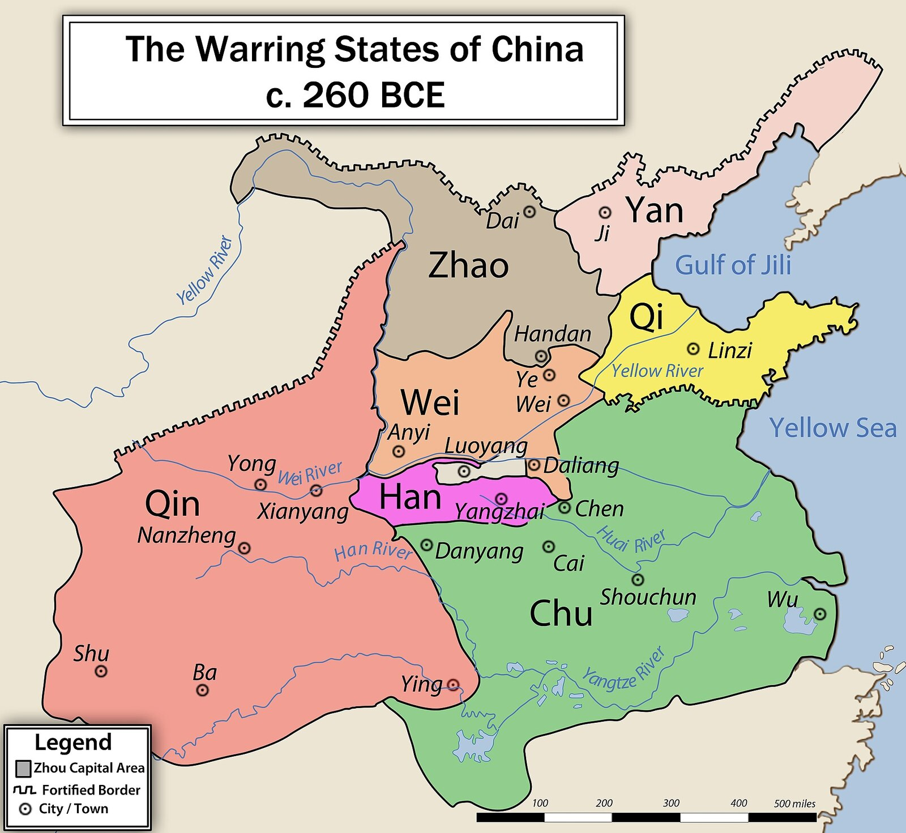
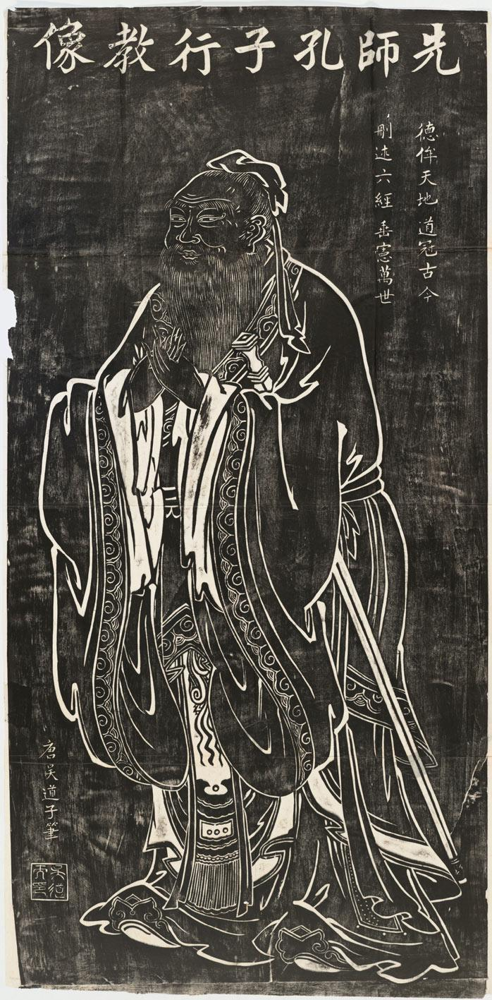
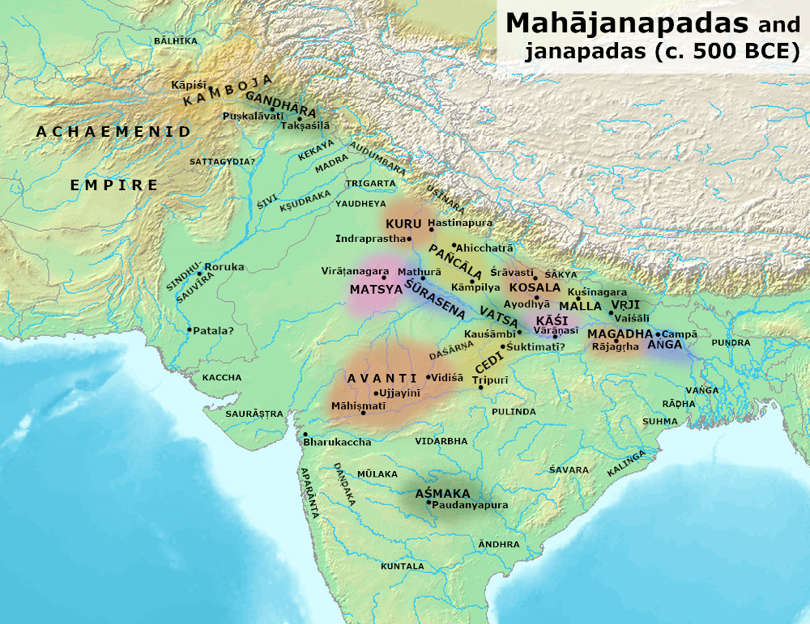
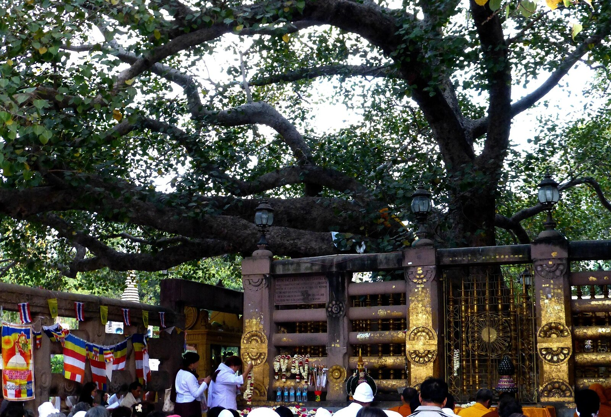
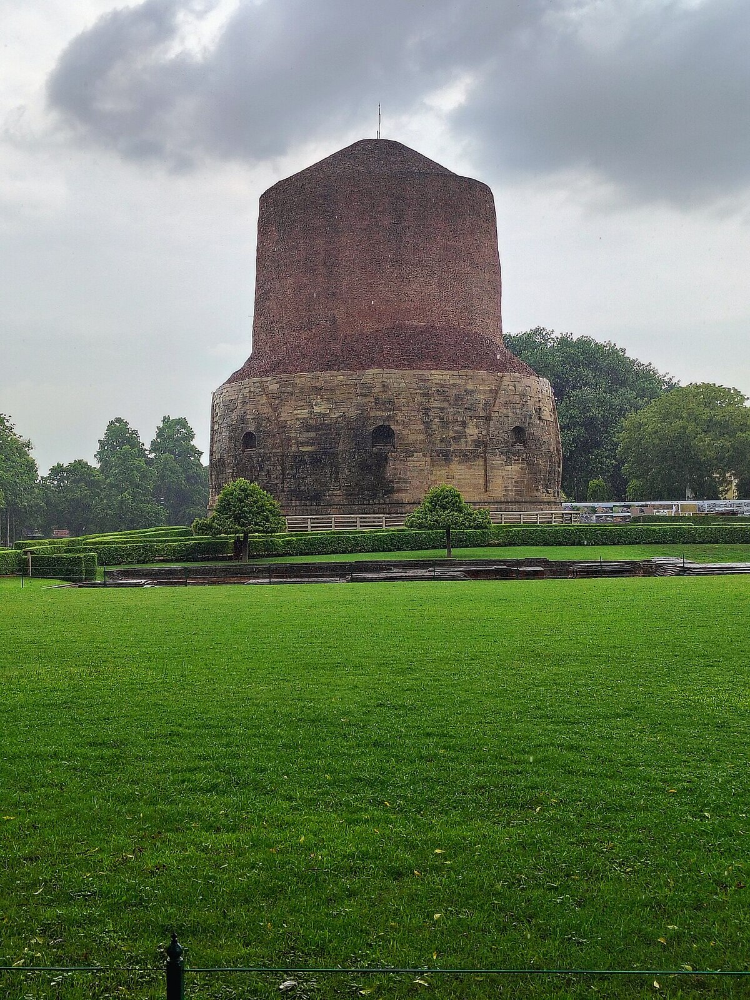
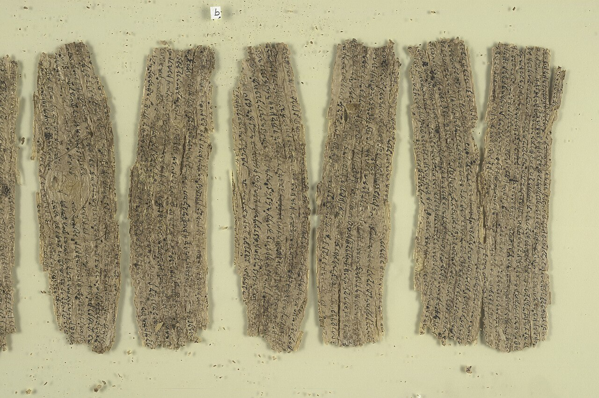
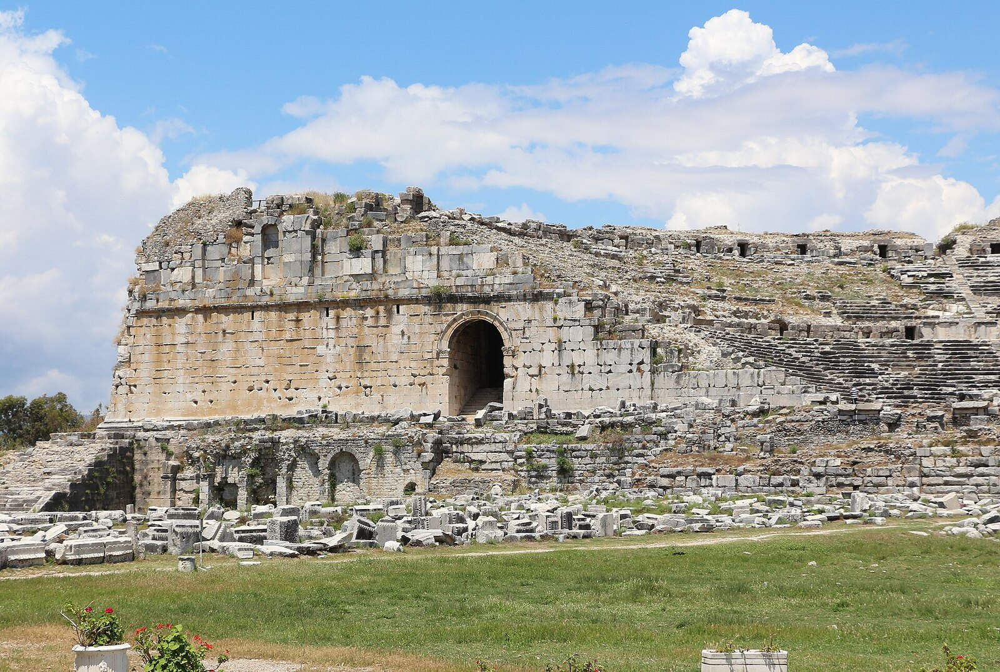
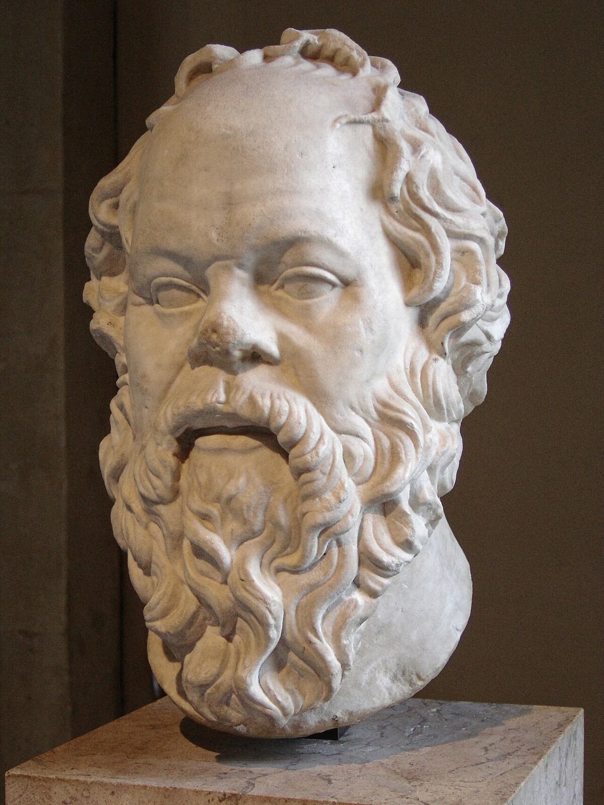

# 17. Why did so many great thinkers live at the same time?

*China, the north of India and Greece, from about 2,600 years ago to about 2,300 years ago*

Because in three parts of the world at once, the land was divided among many small states at war with each other, and a world like that has work for people who argue. Rulers needed advice, a thinker who was turned away by one ruler could walk to the next, and new ways of keeping words let the arguments outlive the people who made them.

In 1993, robbers twice dug into an old tomb beside the village of Guodian, in the middle of China. They broke through to the coffin, took what they could sell and left. Archaeologists from the local museum then went in to rescue what remained. In the mud at the bottom of the tomb, they found about eight hundred thin strips of bamboo.

Each strip was narrower than a pencil and no longer than a forearm. Down most of them ran a single column of small characters in black ink. These were books, and they had been buried with their owner about 2,300 years ago.

A Chinese book of that time was made in the following way. A stalk of bamboo was sawn into lengths and split into strips. The strips were scraped smooth and dried over a fire, so that they would not rot or be eaten by insects. A scribe then wrote on each strip with a brush dipped in ink made of soot, working from the top of the strip to the bottom. If he made a mistake, he shaved it off with a small knife and wrote again.

When the strips were finished, they were laid side by side in order and tied together with two or three cords, which ran across the strips and were knotted around each one. The result looked like the bamboo mat that is used today for rolling sushi. It was rolled up in the same way, and it was read by unrolling it from right to left. The Chinese character for a volume of a book, 冊, is still a drawing of strips with a cord through them.

Such a book was cheap, since bamboo grows like a weed in the warm parts of China. It was also bulky. One strip held two or three dozen characters at most, so that a slim paperback of today would have needed an armful of rolls. One scholar of the time was said to own enough writing to fill five carts.

In the tomb at Guodian the cords had long since rotted, and the strips lay loose and mixed together. It took scholars several years to sort them into more than a dozen short works, going by the length of each strip, the handwriting and the sense of the words. Three bundles held sayings about how to live and how to rule. They are the oldest copy yet found of parts of a book that is still read all over the world. Several of the other works were written by the followers of a teacher named Confucius.

*One bundle of the sayings from the tomb at Guodian, set out in order in a museum case. Each strip carries a single column of writing. Photo: Cangminzho, CC BY-SA 4.0.*

In the centuries when those books were composed, a wandering teacher in the north of India was founding one of the world's great religions, and men in the Greek cities were proposing that everything is made of atoms. As far as anyone can tell, the three sets of thinkers had never heard of each other.

## A teacher without a post

About three thousand years ago, a royal house called the Zhou conquered the Shang kings of northern China and took their place. The Zhou kings could not govern so large a country from one city, and so they handed out territories to their brothers, cousins and allies, who ruled as lords and owed the king their loyalty.

Loyalty between brothers is strong. Between the great-great-grandsons of brothers it is much weaker. Over the generations, the lords came to treat their lands as countries of their own. In time, the king was left with his title and very little else. There were by then more than a hundred states, large and small, and they began to swallow each other. By about 2,400 years ago, seven large ones were left, with a few small ones caught between them. Chinese historians call the two centuries that followed the age of the Warring States.

*The seven warring states about 2,300 years ago. Qin is in the west, Chu in the south and Qi in the east. Map: Philg88, CC BY-SA 3.0.*

As the states grew fewer and larger, war changed its nature. It had been an affair of noblemen in chariots. It became a matter of farmers, called up in their tens of thousands and marched off on foot. A state that wanted to survive now had to count its households, tax their grain and drill their sons. That is office work, and a lord's cousins, who held their posts by right of birth, were not always good at it.

As a result, rulers began to hire men for what they could do, and they hired them from anywhere. A new kind of person appeared in China: an educated man with no land, who travelled from state to state looking for a ruler who would employ him.

One of the earliest of these men was Kong Qiu. His students called him Master Kong, which European missionaries later turned into the Latin name Confucius. He was born about 2,550 years ago in Lu, a small state in the east of China that was squeezed between larger ones. His father died when he was a small child, and he grew up poor. He made himself an expert in the ceremonies, songs and records of the early Zhou kings, whose time he regarded as the last in which things had been done properly.

Confucius believed that the world had fallen into disorder because people, from rulers downwards, had stopped behaving as their positions required. His cure was not harsher laws. If a ruler governs by orders and punishments, he said, the people will keep out of trouble and feel no shame. If the ruler governs by his own good conduct, and by the ceremonies that teach people their duties to one another, they will feel shame and correct themselves.

When a student asked him for a single word to live by, he gave a rule that teachers in many countries have also reached: "Do not impose on others what you yourself do not desire."

The Chinese word for a gentleman meant, literally, the son of a lord. Confucius used it for any man who behaved nobly, whoever his father was. A gentleman, in other words, was made by study and self-discipline, and not by birth. On the Ganges, in the same years, the Brahmins held that a man's rank was settled by his birth.

In his fifties, Confucius left Lu and spent about fourteen years on the roads with a group of his students, in search of a ruler who would put his ideas into practice. None did. The rulers were polite, and what they wanted to know about was war. One duke asked him how troops should be drawn up for battle. Confucius answered that he knew something about ceremonies and had never studied the command of armies, and he left that state the next day.

He went home in his late sixties, taught for a few more years and died, leaving no book of his teachings. His students and their students collected his sayings on strips of bamboo, in a short work that later generations of Chinese students learned by heart.

*Confucius as later ages imagined him. The print is taken from a stone engraving after a painter who lived twelve centuries after him. Public domain.*

## Walls and heads

Confucius was hardly in his grave before others began to say that he was wrong.

The earliest was a man named Mozi, who was born about the time that Confucius died. Mozi had no patience with the fine funerals and court music that Confucians prized. His test of any custom was whether it fed the hungry, clothed the cold and gave rest to the weary, and by that test funerals and orchestras were a waste.

The real cause of the world's troubles, Mozi said, was that people care more for their own family and their own state than for other people's. The remedy was to care for everybody alike. From that followed a plain view of war. If a man kills one person, Mozi pointed out, everybody calls it a crime and he is put to death for it. If a ruler kills ten thousand by invading his neighbour, he is praised for it.

Mozi's followers did more than argue. They formed a disciplined brotherhood, expert in the defence of walled cities, and they put that craft at the service of small states under attack.

Their book tells how Mozi heard that the great southern state of Chu had built new siege ladders and meant to use them on a small neighbour. He walked for ten days and ten nights to the Chu capital. There, in front of the king, he took off his belt and laid it down as a city wall, and played out the siege against the engineer who had built the ladders. The engineer attacked nine times and lost nine times. Mozi then mentioned that three hundred of his students were already standing on the real wall. The king called off the war.

The opposite answer came from a man named Shang Yang. A little under 2,400 years ago he travelled west to Qin, a rough frontier state whose ruler had announced that he would reward able men from any country, and he became its chief minister.

Shang Yang did not think that people could be made good, or that it mattered. People want gain and fear pain, and a ruler has only to arrange rewards and punishments so that whatever is useful to the state is also profitable to the man who does it.

He made neighbours answerable for one another's crimes. Rank had come from a man's family. Now a soldier who brought back the head of an enemy was raised one step in rank, with land to go with it, and the laws applied to nobles as they did to farmers.

Qin grew strong on these methods. They made Shang Yang many enemies at court, and in the end they cost him his life. Qin kept his laws all the same.

## The tortoise in the mud

Some people looked at this contest for the ruler's ear and decided that the prize was not worth having.

The best of them was a writer named Zhuangzi, who lived about 2,300 years ago. A story in the book that bears his name tells how the king of Chu sent two officials to offer him the government of the kingdom. They found him fishing. Without turning round, Zhuangzi said he had heard that the king kept in his temple a sacred tortoise, three thousand years dead. Would that tortoise rather be dead and have its bones honoured, he asked, or be alive and dragging its tail in the mud? The officials agreed that it would rather be alive in the mud. "Go away!" said Zhuangzi. "I'll drag my tail in the mud!"

The sayings found in the tomb at Guodian belong to the same way of thinking. They are known by the name of Laozi, which means simply "the Old Master", and nothing certain is known about who composed them. They speak of the Way, the course that nature follows when nobody interferes with it, and their advice to rulers is to do less. The more laws and orders there are, they say, the more thieves there will be, and the best ruler is one whose subjects barely know that he is there. This tradition is called Daoism, from *dao*, the Chinese word for a way.

Rulers did not take that advice, but they liked to have thinkers about, since one of them might prove useful. The kings of Qi, in the east, housed scholars from every state beside a gate of their capital. By one ancient account, seventy-six of them were given fine houses, with no duties except to discuss.

The Chinese later called these the hundred schools of thought. The schools agreed about very little, but they were arguing over one question, which the wars had forced on them: how should a state be run, and how should a person live, when the old order had plainly failed?

## The man who walked away

Some three thousand kilometres to the south-west, on the far side of the highest mountains on earth, something similar was happening on the plain of the river Ganges.

About 2,500 years ago, farmers with iron tools were clearing that plain of its forests and planting rice, and towns were growing into walled cities. The land was divided among about sixteen states. Some were ruled by kings and others by councils of their leading families, and, as in China, the strong were swallowing the weak.

*The states of northern India about 2,500 years ago. The Buddha's home state is marked Śākya, at the foot of the mountains. Map: Avantiputra7, CC BY-SA 3.0.*

Religion on the plain was in the hands of the Brahmins, with their sacrifices and their four ranks fixed at birth. That picture did not suit the kings, who did not care to rank below their priests, or the merchants of the new cities, who had grown rich with no rank to speak of.

The roads, meanwhile, held another kind of person. These were wanderers who had left their homes and property to search for the truth, and who lived on the food that people gave them. Most of them shared the new belief that a being is born again and again, and they were looking for a way off the wheel. They gathered students, and they argued with each other in public. One of them, Mahavira, who is revered by the Jains to this day, taught that no living thing should be harmed.

The wanderer whose teaching travelled furthest was Siddhartha Gautama, who lived about 2,450 years ago. He was born in a small state ruled by a council, at the foot of the Himalayas in what is now Nepal, and his father was one of its leading men. He grew up in comfort, married and had a son. At twenty-nine, as his followers tell it, he was so shaken by the sight of old age, sickness and death, which no comfort can keep out, that he left home to find an answer to them.

For six years, the tradition says, he studied under other teachers and starved himself until he was close to death. He concluded that tormenting the body cleared the mind no better than pampering it had. He ate, recovered his strength and sat down under a fig tree, resolved to stay there until he understood. By morning, his followers say, he did. They have called him ever since the Buddha, which means the one who has woken up.

*The fig tree at Bodh Gaya in northern India, a descendant of the one under which the Buddha is said to have sat. Photo: Anandajoti, CC BY 2.0.*

What he taught afterwards was practical. Life as people ordinarily live it is unsatisfying and full of pain. The pain arises from craving, from wanting things to be other than they are and clinging to things that cannot last. Craving can be brought to an end, and there is a method for ending it: a path of honest conduct, discipline of the mind and clear understanding. He called this path the middle way, since it ran between the life of pleasure he had been born to and the self-torture he had tried.

*The monument at Sarnath, near the city of Varanasi, built about 1,500 years ago on the spot where the Buddha is said to have first taught. Photo: Hardy Explorer, CC0.*

This teaching had no use for the priests' sacrifices, since no priest could do for a person what that person had to do alone. It also took no notice of birth. The Buddha taught that what makes a person noble is conduct, and not the family that he or she was born to.

His community was built on that principle. Those who joined it shaved their heads, owned almost nothing and ate what they were given. Among the monks, precedence went by how long a man had been a member, whatever family he came from. According to the community's own records, a group of young nobles came to join together with their barber, and asked that he be admitted ahead of them, so that they would have to bow to him. Women were admitted as well, as nuns, in an order of their own that was placed under the monks'.

The Buddha walked the roads of the plain for forty-five years and died at eighty. Kings fed his followers, and a rich merchant bought them a park to shelter in during the rains.

Nothing of this was written down at the time. Instead, as their tradition records, his followers met after his death and recited together what they had heard him say. Monks then handed the teaching on by chanting it in groups, and some four centuries passed before the whole of it was put into writing. The Brahmins had kept their hymns in the same manner for a thousand years. In India, a trained memory did the work that bamboo did in China.

*Pieces of a scroll of birch bark about 1,900 years old, from the north-west of the Indian subcontinent. It is among the oldest Buddhist writings that survive. Photo: British Library, CC0.*

## Atoms and empty space

The third land was the most broken up of all.

After their palaces burned, the Greeks had lived for four centuries in villages, without writing. When they took up writing again, about 2,800 years ago, they borrowed the simple letters of the traders of the Lebanon coast and added signs for the vowels. The result had fewer than thirty letters, and a child could learn it. This time, reading did not belong to palace clerks.

In the centuries that followed, the Greeks came to live in about a thousand cities, most of them tiny, scattered along the shores of the Mediterranean and the Black Sea. Most of these cities had their own laws and their own army, and few had a king. They had no class of priests in charge of a holy book either. What the Greeks knew about their gods came from poets, and anybody may disagree with a poet.

One of the richest of these cities was Miletus, a port on the west coast of what is now Turkey, whose ships traded with Egypt and the Black Sea. About 2,600 years ago, a citizen of Miletus named Thales proposed that everything in the world is made, in the end, from water. The earth itself, he said, floats on water like a log, and this gave him an explanation for earthquakes. The Greeks put them down to the sea god, who struck the ground in his anger. Thales said that the earth shakes because the water under it moves, as a boat rocks on a swell.

He was wrong about the water. What mattered was the kind of answer he gave, since it was one that could be argued with. A younger man of the same city, said to have been his pupil, did so. He proposed that the earth rests on nothing at all. It hangs in the middle of everything, and it stays where it is because it has no reason to move one way rather than another.

*The theatre of Miletus, as rebuilt in Roman times, centuries after Thales. Photo: Bernard Gagnon, CC BY-SA 3.0.*

This was a new way of going about things. An explanation came with reasons that anybody could weigh, and the next man was free to offer a better one. The argument went on in that manner for two centuries, from city to city.

The boldest proposal came about 2,400 years ago from Democritus, who lived in a small city on the north coast of the Aegean Sea. Take any object, he reasoned, and cut it in half, and then cut the half in half. Democritus held that the cutting cannot go on for ever, because something solid must be left for things to be made of. In the end there must be pieces that cannot be divided at all. He called them atoms, from the Greek word for "uncuttable".

According to Democritus, atoms come in many shapes and sizes. They move for ever through empty space, collide, hook together and come apart, and everything that we see is made of their combinations. In his own words, what there is "in reality" is "atoms and void". He had no means of testing this. It was an argument, and more than two thousand years later it turned out to be very nearly right.

## The man who would not leave

Socrates, the most famous of the Greek thinkers, had little interest in what the world is made of.

He was a stonemason's son from Athens, a poor man with a snub nose who had fought for his city as a foot soldier. He spent his days in the marketplace, among the stalls where Athenians spent their small silver, asking people questions. He would ask a general what courage is. The man would answer with confidence, and Socrates would ask another question about the answer, and then another. Before long it would be plain to everybody that the general could not say what courage was. His own advantage, Socrates said, was that he did not think he knew what he did not know.

*Socrates, in a Roman copy of a Greek portrait, now in the Louvre in Paris. Photo: Eric Gaba, public domain.*

For him, this questioning was the proper business of a human being. "The unexamined life," he told his fellow citizens, "is not worth living."

The young men of Athens loved to watch him at work. The men he questioned did not. About 2,400 years ago, when Socrates was seventy and Athens had lately lost a long war, three citizens charged him with refusing to recognise the gods of the city and with corrupting the young. A jury of five hundred tried him in a single day and found him guilty by a narrow margin. Asked to propose his own punishment, he suggested that the city should give him free dinners for life, and only then offered a fine. The jury voted for death.

He spent some weeks in prison before the sentence was carried out, and his friends arranged for him to escape. Other cities would have taken him in. Socrates refused. He had lived for seventy years under the laws of Athens, he said, and he would not break them now because they had gone against him. He drank the cup of poison among his friends.

Like Confucius and the Buddha, Socrates left no book. One of the young men who had followed him, Plato, spent the next fifty years writing out conversations in which Socrates is the main speaker.

## Many courts, many roads

Set the three lands side by side, and the same conditions appear in each.

First, the rulers needed help. A state at war with its neighbours cannot afford to be badly run. The ruler of Qin gave a stranger his whole government to rearrange for that reason.

Second, there were many rulers, and so there was more than one place to go. Confucius was able to spend fourteen years failing at one court after another. Where a single court decides everything, one refusal can be final. It is hard for a ruler to silence an idea when its owner can cross a border in a week.

Third, there were cities, and cities contain people who do not farm. Thales lived in a port made rich by trade, and the Buddha's community ate because townspeople filled its bowls. A thinker is a person whom somebody else is willing to feed.

Finally, there was a way of keeping words. The Chinese had bamboo and the brush, the Greeks had an alphabet that a child could learn, and the Buddha's followers had a community that was organised to remember. The bronze palaces had also had rival kings and busy cities, but their writing had belonged to the palace clerks. Now words could be kept by people whom no palace paid. Without that, a teacher's ideas would have lasted as long as his students did. With it, a man who persuaded nobody in his own lifetime could persuade people who were born five hundred years after it.

In 1949, a German philosopher gave these centuries a name. He added the prophets of Judah, whose people were in the same centuries working out their belief in one God, and he called the whole stretch from 2,800 to 2,200 years ago the Axial Age: the axis on which history turned, when people in several lands at once began to question what they had been told.

The name has stuck, and many historians distrust it. Six centuries is a generous definition of "at once". A Greek asking what matter is made of and an Indian wanderer seeking release from rebirth were not answering the same question. In 2018, researchers who compared the records of ten regions over several thousand years found that the ideas said to mark the Axial Age appeared at different times in different places, some of them many centuries early.

The narrower pattern stands. Three divided lands each produced a few generations of fierce argument, and each found a way to keep it.

The states themselves did not last. Within about a century of the burial at Guodian, one of the warring states of China had conquered all the others, and most of the cities of Greece and the kingdoms of the Ganges had passed under empires too. The arguments did better. The kingdom in which a man was buried with his bamboo books has been gone for more than two thousand years. The books came out of the mud, and people are reading them still.
