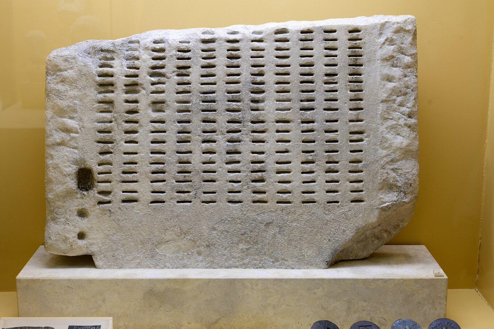
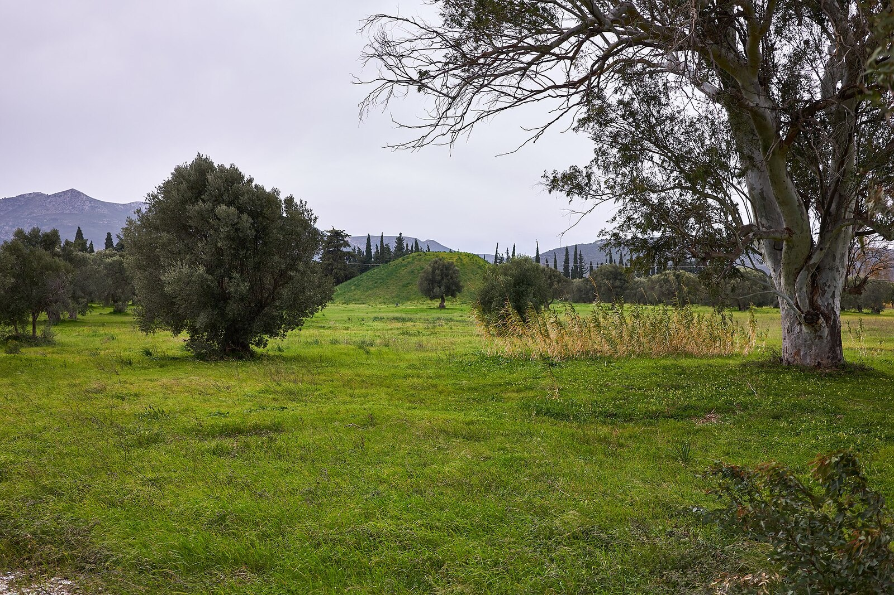
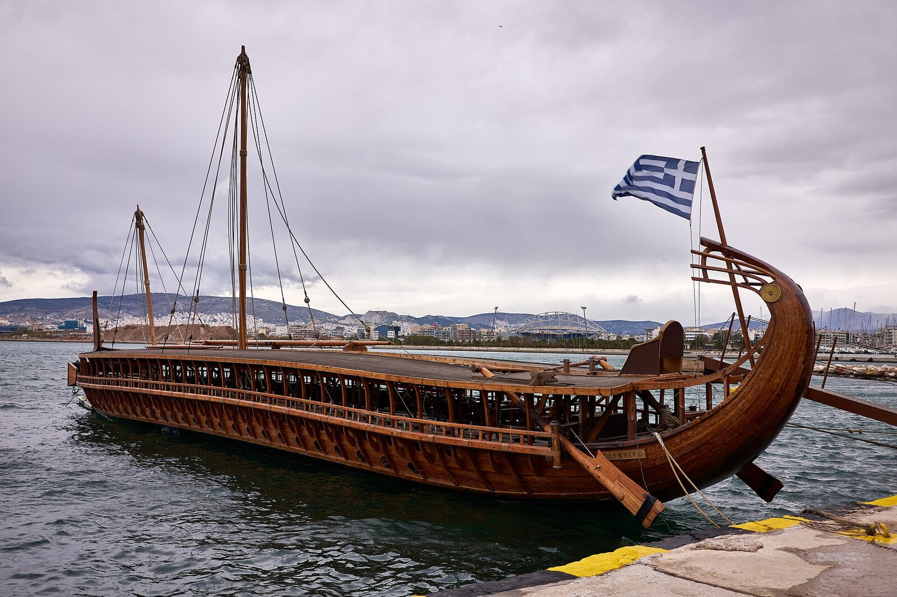
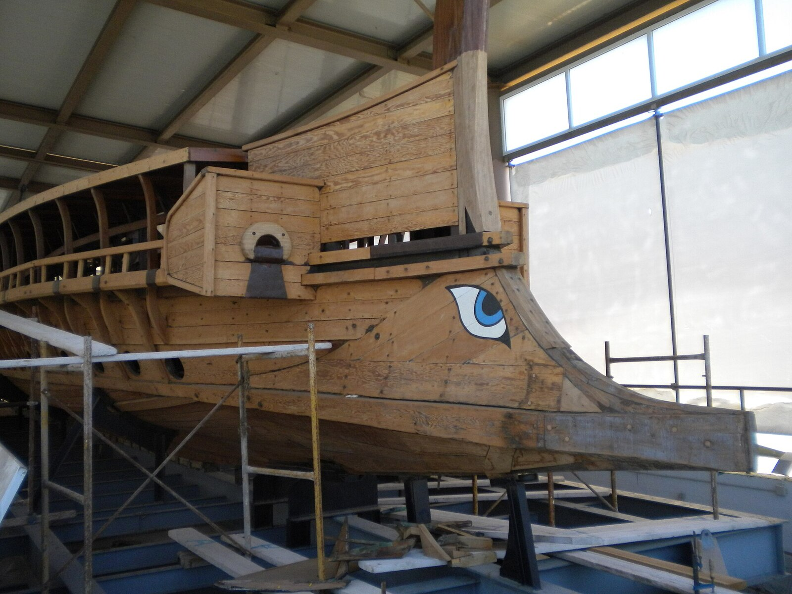
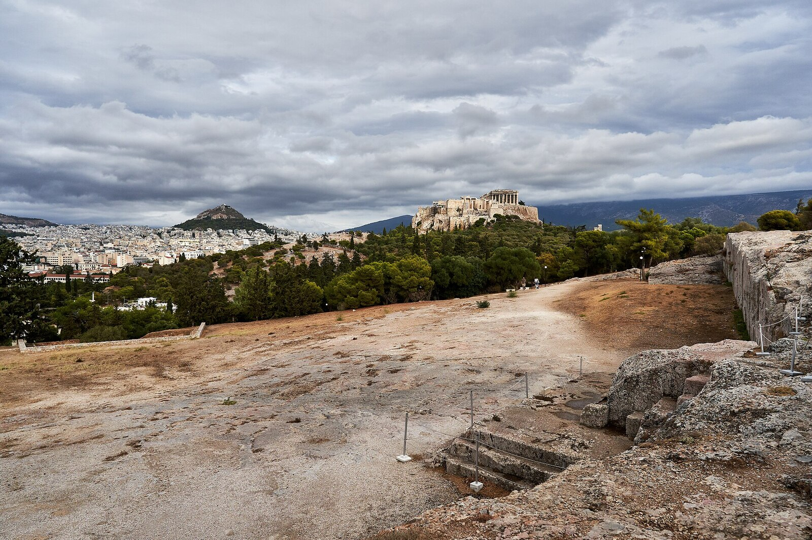
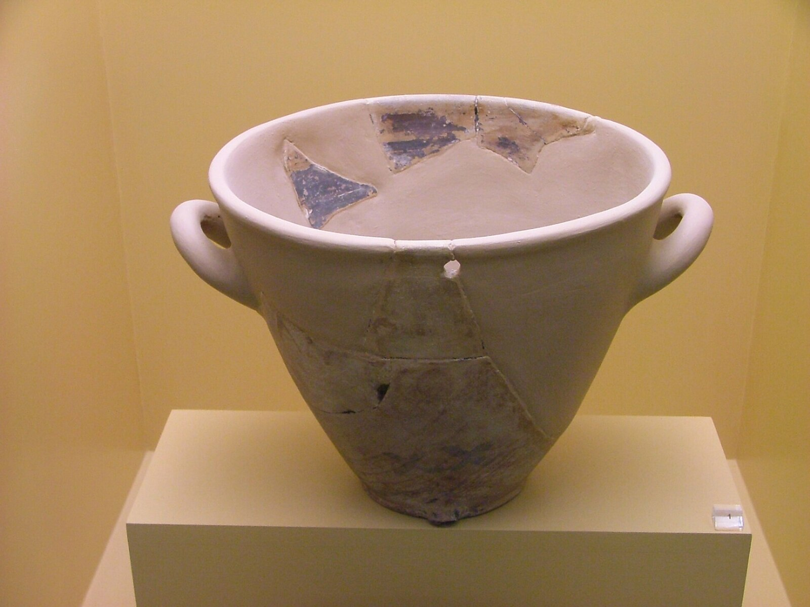
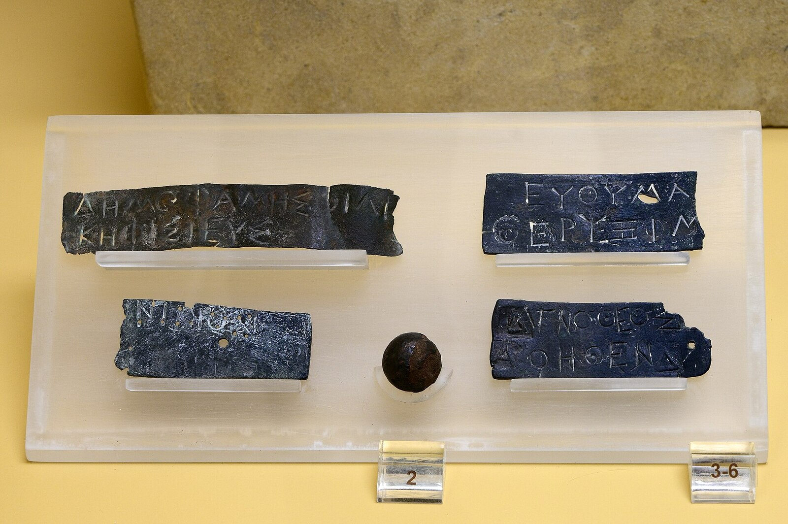
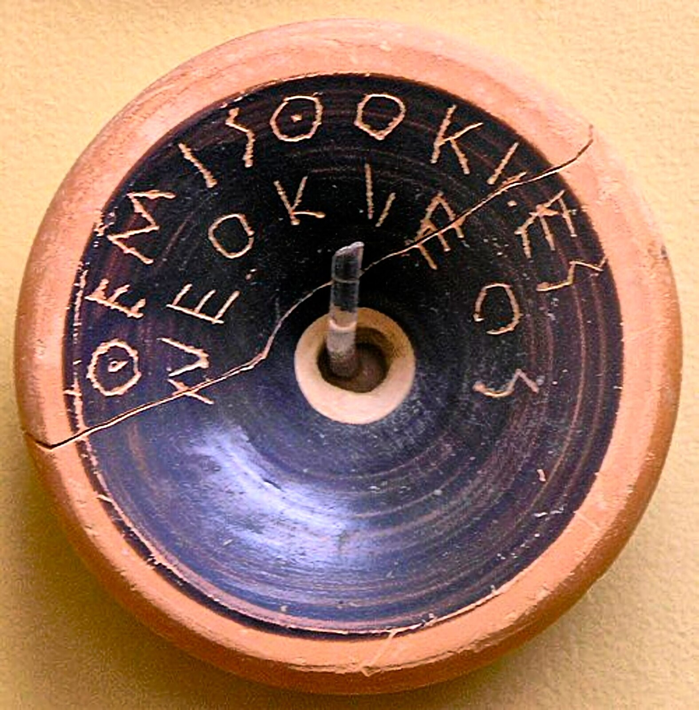
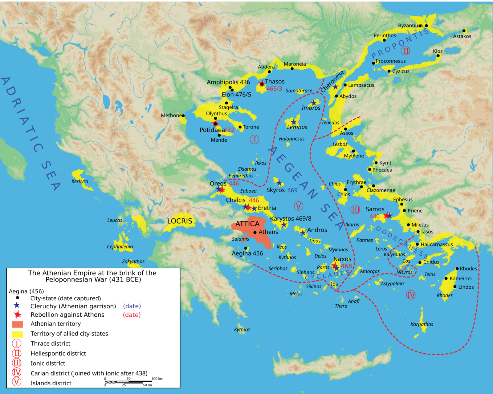
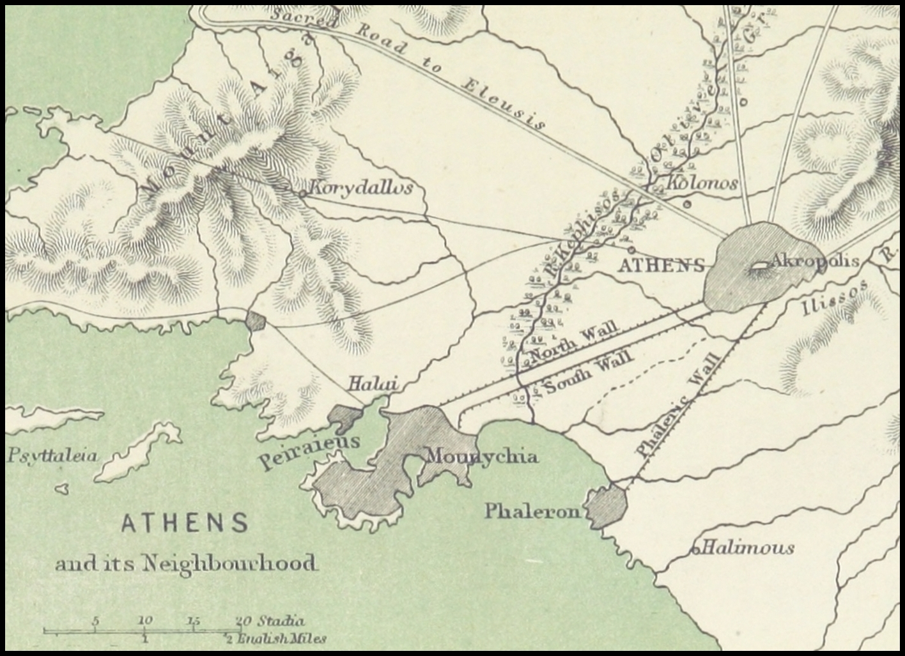

# 18. Who invented democracy?

*Athens and the Aegean Sea, from about 2,500 to about 2,400 years ago*

The Athenians did, if democracy means the word itself and a working system in which ordinary citizens ran a state with their own hands. They did not invent the much older habit of a city's people gathering to decide things, and they built their democracy at the same time as an empire, with the same men.

In a museum in the middle of Athens stands a broken slab of pale marble. Its face is cut with neat columns of narrow slots, row above row, like a rack made to hold cards.

It is a piece of a machine, and the machine had one job. It picked people at random.

*A piece of an allotment machine, in the Agora Museum in Athens. This one was cut about 2,200 years ago and has eleven columns of slots. Photo: Zde, CC BY-SA 4.0.*

The Athenians built these machines because they had reached a conclusion that still sounds odd. Elections, they thought, favoured the rich, the famous and the well-spoken. The fair way to choose the men who would judge a trial or sit on the city's council was to let chance decide, so that a potter had exactly the same hope of being chosen as a landowner.

No state that we know of had been run like that before. The system came out of a small city's quarrels, and then out of a war.

## Rule by the people

The Greek cities had grown up in a country that had lost its kings. After the palaces of the Bronze Age burned, Greece was a land of villages for about four hundred years, and when towns grew again, they grew without palaces. By about 2,700 years ago there were several hundred of these cities, scattered around the Aegean Sea and far beyond it. A typical one had a few thousand people and the farmland within a day's walk, and no city had a storehouse big enough to feed a standing army.

As a result, a city's army was its own farmers. Every man who could afford a bronze helmet, a round shield and a spear was expected to turn out and stand in line beside his neighbours. Men who do the fighting expect to be asked before a war is declared, and in most Greek cities they were. The citizens met in an assembly.

There was nothing new in that. In the old poem about Uruk, the king puts the question of war to the young men of his city, and that was two thousand years earlier. Among the Greeks, even Sparta had an assembly, and Sparta was nobody's idea of a free and easy place. Its citizens voted by shouting, and the side that shouted louder won.

In nearly all of these cities, however, the assembly only said yes or no to what a few old families put in front of it.

Athens was larger than most. Its territory, a rocky peninsula called Attica, is about the size of Luxembourg. For most of fifty years it had been ruled by one family of strongmen. About 2,535 years ago the last of them was driven out, and two noblemen began to fight over who would run the city next.

The one who was losing, a man named Cleisthenes, then did something that changed the contest. He turned to the mass of ordinary citizens, who had never had much say, and offered them the city. With them behind him, he won.

He then rebuilt Athens so that the offer would stick. He sorted every citizen into one of ten new groups, called tribes, and he drew each tribe from three different parts of the country: some villages from the coast, some from the hills, and some from the town. The old families, whose power lay in their own districts, found their followers scattered across groups that they could not control. Each tribe sent fifty men to a new council of five hundred.

Within a generation or two, the Athenians had a word for what they had made. They put together *demos*, the people, and *kratos*, power. The result, *demokratia*, means that the people hold the power.

Poor citizens could attend the assembly from the start. However, the men who counted in it were still the ones who owned land and armour. What gave the poor their full weight was a war, against the largest empire on earth.

## Earth and water

Across the Aegean, on the coast of what is now Turkey, stood a line of Greek cities, and in those years they were subjects of Persia. They paid their tribute to the satrap at Sardis, and through him to Darius, whom the Greeks simply called the Great King.

About 2,525 years ago, the Greek cities of the coast rose against the satrap. Athens sent twenty ships to help them, and the rebels burned Sardis. The revolt was crushed, and Darius did not forget who had helped it.

According to the Greeks, the king's envoys then toured the cities of Greece asking for earth and water. A little of each, handed over, meant that a city gave up its land and its springs to the king. Many cities did, which was the sensible thing to do. Athens and Sparta refused.

A few years later, in the late summer, a Persian fleet landed an army on the beach at Marathon, a day's walk from Athens. About ten thousand farmers in bronze marched out to meet it, nearly all of them Athenians. They were outnumbered, and the Persian army had a habit of winning.

The Athenians charged, broke the two ends of the Persian line and drove the invaders back to their ships. They counted one hundred and ninety-two dead of their own, and buried them on the battlefield under a mound of earth. The mound is still there.

*The mound raised over the Athenian dead on the plain of Marathon. Photo: George E. Koronaios, CC0.*

To the Great King, Marathon was a failed raid at the far edge of the world. To the Athenians, it was proof that free men who voted could beat the subjects of a king.

## A hundred and seventy oars

Seven years after Marathon, miners in the hills at the southern tip of Attica struck an unusually rich vein of silver. The mines belonged to the state, and the plan was to share the windfall out among the citizens, ten drachmas to each man.

A politician named Themistocles stood up in the assembly and argued for something else. Athens was then at war with Aegina, the island of the turtle coins, which lay within sight of its harbour. He asked the citizens to give up their share and to spend the whole sum on warships. They voted to do it. Thousands of men had turned down money in the hand. Three years later, Athens had about two hundred ships, the largest fleet in Greece, and by then a far greater enemy was on the way.

The ship they built is called a trireme, which means "three-oared". It was a long, narrow hull of light timber, about thirty-seven metres from end to end and less than six across. It had a sail for travelling, but in battle it was moved by muscle alone.

*The full-size trireme built in Greece in 1987 to the ancient measurements. A hundred and seventy volunteers rowed her, and in a sprint she passed nine knots. Photo: George E. Koronaios, CC BY-SA 4.0.*

Picture the rowers packed into it like eggs in a box. There were a hundred and seventy of them, sitting in three rows on each side, one row above another. The lowest row sat down in the hold, with their oars passing through holes only a forearm's length above the water. The top row sat highest, and their oars rested on a frame built out from the ship's side. Each man had one oar, about as long as a small car, and a cushion to sit on. A piper played to keep them in time, because most of them could not see the sea.

At the front, at the waterline, the hull ended in a heavy wooden beak sheathed in bronze. The ship itself was the weapon. Its crew rowed it at an enemy ship and drove the beak into the planks. In a sprint it could move at the pace of a good runner, provided that all hundred and seventy pulled as one, and that took months of practice.

*The bow of the same ship out of the water. The beak at the bottom is sheathed in bronze. Photo: Michael J. Taylor, CC BY-SA 3.0.*

Ten years after Marathon, the Persians returned. Darius had died, and his son came in person, with an army too large for any Greek force to meet in the open and a fleet rowed by his subjects from Lebanon, Egypt and the Greek cities of the Turkish coast. It brushed aside a small Greek force at a mountain pass in the north and marched on.

The Athenians then abandoned their city. They ferried their families to nearby islands, and every man fit to pull an oar went aboard the ships. The Persians took Athens and burned the temples on the Acropolis, the steep rock in the middle of the city where its gods were housed.

The fleets met in the narrow strait between the mainland and the island of Salamis, within sight of the smoke. The Greek cities together had fewer than four hundred ships, and about half of them were Athenian. The Persian fleet was larger, but in that tight water its ships crowded in, fouled each other's oars and could not turn, and the Greeks rammed them through a long day. The Great King watched from a throne set up on the shore.

He went home soon afterwards, and the following year the army that he left behind was beaten on land, by a Greek force under Spartan command. Persia did not try to conquer Greece again.

## The men on the benches

Salamis changed who mattered in Athens.

A man needed money to stand in the line at Marathon, since he had to buy his own armour. Fewer than half of Athenian citizens could afford it. The rest, the hired farmhands, the porters and the fishermen, had counted for little in war and therefore for little in politics.

A rower, by contrast, needed nothing except a strong back. The fleet required more than thirty thousand men to pull it, more than twice as many as the armoured soldiers it could put in the field. So the poor of Athens went to the benches. Foreigners were hired to row beside them, and at times slaves, but the heart of every crew was the citizen with no land.

From then on, the safety of the city rested on these men. One Athenian of the wealthy class wrote a sour little pamphlet about the democracy, and even he conceded the point. It is the common people who man the ships and give the city its strength, he wrote, and so it seems only fair that they should have more of the say.

They took it. Twenty years after Salamis, an old council of former office-holders from the richest families lost most of its powers to the assembly, the council of five hundred and the courts. Then the leading politician of the next generation, Pericles, proposed that citizens should be paid for serving on juries.

Pay was the change that made the rest real. A poor man cannot give up a day's work to sit in a court. If he is paid for the day, he can. The wage was small, about half of what a labourer earned, and it was enough. The juries filled with rowers, old men and craftsmen, and the rich found themselves being judged by them.

The rowers were paid as well, at up to one silver drachma a day. As a result, a poor Athenian had a direct interest in two things: that the people should keep the power, and that the fleet should keep going to sea.

## Who wishes to speak?

By about 2,460 years ago the system was fully grown, and it asked a great deal of its citizens. The assembly met on a hillside in the open air, at least once a month and often more. Every citizen could come, and several thousand usually did. A herald opened each debate with the same question: "Who wishes to speak?" Anyone could. Then the citizens voted by raising their hands, and what they decided was done. Athens had no president, no prime minister and no king.

*The hill in Athens where the assembly met, with the speaker's platform cut from the rock. The Acropolis is in the background. Photo: George E. Koronaios, CC BY-SA 4.0.*

The agenda was prepared by the council of five hundred, and here chance came in. The councillors were not elected. They were drawn by lot from the men who put their names forward, and each one served for a year. Nobody could serve more than twice in his life. The council's chairman was also picked by lot, and he held the post for a single night and day. For those twenty-four hours, a cobbler or a farmer kept the keys to the treasury and the city's seal, and he could never hold the post again.

Most of the other offices were filled in the same way, down to the market inspectors. The ten generals, however, were elected, because nobody wanted to be led into battle by a man chosen at random.

The courts worked on the same principle, and on a grand scale. Six thousand citizens over the age of thirty were enrolled as jurors each year. A trial had no judge and no lawyers. The two sides spoke for themselves, timed by water running out of a jar, and a jury of several hundred voted at once, without discussion.

*A water clock of the kind that timed speeches in court, rebuilt from the pieces of one about 2,400 years old. When the water had run out of the spout, the speaker stopped. Photo: Dorieo, CC BY-SA 4.0.*

A jury of that size is hard to bribe. The Athenians made it harder still, and the stone with the slots is how they did it. The machine came into use about fifty years after this, and the slab in the museum was cut later again. One Athenian writer described the routine step by step.

Each juror carried a small strip of bronze, or in later years of wood, about the size of a stick of chewing gum. It was marked with his name, his father's name, his village and one of ten letters. At dawn on a court day, he went to the entrance set aside for his tribe. There he dropped his ticket into one of ten boxes, the one marked with his letter.

*Jurors' bronze tickets from Athens, each with a man's name, his father's name and his village. The ball was used in drawing lots. Photo: Zde, CC BY-SA 4.0.*

Beside the boxes stood two of the machines. Each was an upright slab of stone with five columns of slots, and a letter at the head of each column. The tickets were drawn from each box one by one and pushed into the column under their letter, from the top down, in the order in which they came to hand. When that was done, the tickets formed rows across the face of each stone, five men to a row, with one man from each letter.

Down the side of the slab ran a narrow tube with a funnel at the top. Into the funnel the presiding official poured a handful of small bronze cubes, some white and some black, well mixed. The tube let them out at the bottom, one at a time.

The first cube out decided the fate of the first row. If it was white, all five men in that row were jurors for the day. If it was black, they took their tickets back and went home. The second cube settled the second row, and so on down the stone. The number of white cubes had been counted beforehand to give exactly the number of jurors needed.

A second draw then decided which court each chosen man would sit in. So, until a few minutes before a trial began, nobody on earth knew who would judge it. A rich defendant could not buy his jury, because his jury did not yet exist.

One more device guarded the system against its own leaders. Once a year, the assembly was asked whether it wished to send anyone away. If it said yes, a day was set. Each citizen then scratched a name on a piece of broken pot, which was the scrap paper of the time, and handed it in. Provided that six thousand votes were cast, the man whose name appeared most often had ten days to leave Attica, and he stayed away for ten years. He kept his property and his rights.

More than ten thousand of these potsherds have been dug up in Athens. In one well, archaeologists found a hundred and ninety sherds bearing the name of Themistocles, the man who built the fleet. They are written in only fourteen different hands. Somebody had prepared them in bulk, to be handed to voters. Themistocles was voted out in the end.

*A vote to send Themistocles away, scratched on the foot of a broken cup. It reads "Themistocles, son of Neocles". Photo: Marsyas, CC BY 4.0.*

All of this belonged to a minority. Athens at its height had about fifty thousand citizens, and a citizen was a grown man born of Athenian parents. His wife and daughters were Athenians and could not vote, speak in the assembly or sit on a jury. In court, a man spoke for them.

Thousands of foreigners had settled in Athens to work and trade. They paid a special tax and fought in its army, and they could not vote. Below them were slaves in their tens of thousands. They worked in houses, on farms and in workshops, and the unluckiest dug the silver that had paid for the ships, in tunnels too low to stand up in. All told, the people who ruled Athens were fewer than one in five of the people who lived there.

## Iron in the sea

Meanwhile, the fleet had found a new use. When the Persians were driven out of Greece, nobody knew that they would not be back. The Greek cities of the islands and of the Turkish coast, newly free, wanted protection, and the only power with enough ships to give it was Athens. So they formed an alliance to carry on the war, with its treasury on the small holy island of Delos, in the middle of the sea.

The founding members swore an oath, and to seal it they dropped lumps of iron into the sea. The alliance was to last until the iron floated up again.

Each member was to contribute either ships with crews, or silver. For a small island, building warships and sending its young men to row them for months was a heavy burden. It was far simpler to pay, and one by one most of the allies chose silver.

With the allies' silver, Athens built more ships and paid its own citizens to row them. Every year the Athenian fleet grew larger and better drilled, while the allies' men forgot how to fight at sea. The members had paid for a navy that only one of them controlled.

About ten years in, the island of Naxos announced that it was leaving, and the Athenian fleet forced it back in. A member that had joined as an ally now stayed as a subject.

After that, the pretence wore thin. About twenty-five years after the oath, the treasury was moved from Delos to Athens. One sixtieth of every payment was set aside for the goddess Athena, and the amounts were carved, city by city, on a marble slab taller than two men, which stood on the Acropolis for all to read. The fighting with Persia died away, and the payments did not stop.

In one respect Athens asked more of its subjects than the Great King usually asked of his. A city that paid its tribute to the satrap kept its own courts. Athens took its tribute and also required the allies to bring their most serious lawsuits to Athenian juries, and in several cities it replaced the government with one more to its liking.

*The Athenian empire at the start of the war with Sparta. Attica is red, and the cities that paid tribute are yellow. Map: Marsyas and Once in a Blue Moon, CC BY-SA 3.0.*

By the time the alliance was fifty years old, about six hundred talents of silver flowed into Athens every year. One talent would pay the whole crew of a warship for a month. That money paid the rowers and built the ships, and it filled the reserve from which the new temples on the Acropolis were paid for.

So the two things had become one machine. The empire paid for the fleet, the fleet gave the poor citizens their wages and their weight in the city, and those citizens, sitting in the assembly, voted to keep the empire. Democracy, as most Athenians understood it, was the freedom of Athenian citizens. It had never been a promise to anyone else.

Some years later, when Athens was already at war with Sparta, the city of Mytilene on the island of Lesbos tried to break away, and was starved into surrender. The assembly in Athens debated the punishment and voted to kill every grown man in Mytilene and to sell the women and children as slaves. A trireme was sent off with the order.

Overnight, many of the citizens were appalled at what they had done. The next morning the assembly met again and, by a narrow margin, changed its mind. A second trireme set out a day behind the first. Its crew rowed without stopping, eating barley meal mixed with wine and oil at their oars and sleeping in shifts. They reached the island just as the first order was being read out.

Mytilene was spared. The assembly had the men it held most to blame put to death all the same, and there were more than a thousand of them. A whole city's life had hung on one show of hands in Athens, and on the arms of a hundred and seventy rowers.

## Twenty-seven years

The city that had watched the empire grow with most alarm was Sparta.

Sparta was Athens turned inside out. It had two kings, a council of old men, and a body of citizens who did nothing except train for war, because others fed them. Long before, the Spartans had conquered their neighbours to the west and turned the whole population into helots: labourers tied to the land, who farmed it for Spartan masters and handed over a large share of every crop.

The helots outnumbered the Spartans several times over, and they had not forgotten that they had once been free. As a result, Sparta lived in fear of the people who fed it. Every year its magistrates formally declared war on the helots, so that a Spartan who killed one had committed no crime.

As Athens grew, the cities allied with Sparta pressed it to act before the whole Greek world was paying tribute. War came about 2,455 years ago, fifty years after Salamis, and it lasted for twenty-seven years.

For a long time neither side could force the other to give in. Sparta was unbeatable on land and Athens at sea. The Athenians had joined their city to its harbour with long parallel walls, six kilometres from end to end. When a Spartan army marched in each summer to burn the farms, the country people moved inside, and grain ships fed them. In the second year a plague broke out in the packed city and killed about a quarter of its people, Pericles included.

*Athens and its harbour, joined by the long walls, on a map printed in 1876. Map: George W. Cox, public domain.*

For the helots, the war was an opening. The Athenians built a fort on the coast of their country, and helots began to slip away to it.

Then the Athenian assembly made its worst decision. It voted to send a great fleet and army to conquer Syracuse, a rich Greek city on the island of Sicily, far to the west. Two years later that whole force had been destroyed, and the survivors were penned in a stone quarry, where many of them died.

At that point, the Great King's satraps on the Turkish coast took an interest. The king still counted the Greek cities of that coast as his, and he expected his satraps to send him their taxes. For nearly seventy years, the Athenian fleet had made those taxes impossible to collect. The king now demanded the arrears.

The satraps therefore made an offer to Sparta. Persia would pay for a Spartan fleet. In return, Sparta would agree that the Greek cities of Asia belonged to the king. The Spartans, who had gone to war proclaiming the freedom of the Greeks, accepted, and Persian silver hired rowers at better pay than Athens could now afford.

The end came in the narrow strait that leads to the Black Sea, through which the grain ships passed. A Spartan admiral caught the last Athenian fleet on a beach, with its crews ashore looking for food, and captured almost all of it.

Without ships Athens had no grain. It held out through a winter of famine and then surrendered. The victors ordered the long walls to be torn down, and they were pulled apart to the music of pipes, played by girls. The men who did it, wrote an Athenian who was alive at the time, thought that day was the beginning of freedom for Greece.

## What was left

It was not. Sparta ruled the Greek cities more harshly than Athens had. It fought Persia for some years over the cities of the Turkish coast, and in the end gave them up. Seventeen years after Athens fell, it was the Great King who dictated the terms of a general peace to all the Greeks. Persia had lost the battles at the start of the century and won the argument at the end of it, at the cost of some silver.

Victory did not save Sparta. War, poverty and its own strict rules of membership went on thinning its citizens, from about eight thousand at the time of the Persian invasion to fewer than a thousand a few generations later. Thirty-three years after its triumph, the army of another Greek city, Thebes, broke the Spartans in a single afternoon. The next year the Thebans marched into the helots' country in the west and set it free. Its people had been waiting for about three hundred years.

Athens lost its empire, and for some months it lost its democracy, when the Spartans installed a committee of thirty rich Athenians who ruled by murder. The citizens threw them out and restored the old system. It ran for another eighty years, without the tribute. The stone machines with their slots and their bronze cubes belong to this later period. So does one of its darkest verdicts, when a jury drawn by lot sentenced the philosopher Socrates to death.

Nearly all of this is known from Greeks. The Persian war was written up by Herodotus, a Greek who was born a subject of the Great King. The long war was told by an Athenian general, exiled by his city after losing a battle. Both were careful men, and both were Greeks writing for Greeks. No Persian account of Marathon or Salamis survives.

What the Persians did leave are the ration tablets of Persepolis, and among the workers they list are Greek stonemasons. In the king's own inscriptions, the Greeks are one name in a long list of nations that he rules. From his palace, the great war for freedom was trouble on a distant border.

The empire had lasted for about seventy years. The democracy that grew up with it lasted for nearly two hundred, and each morning that the courts sat, the stone machines went on sorting potters and landowners into the same row.
