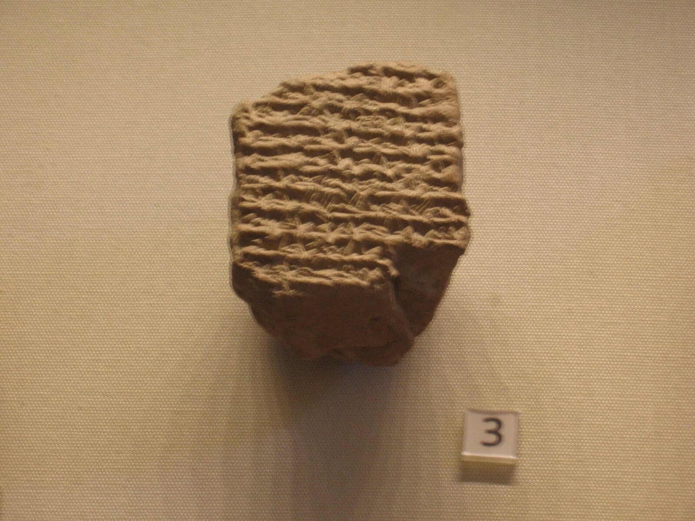
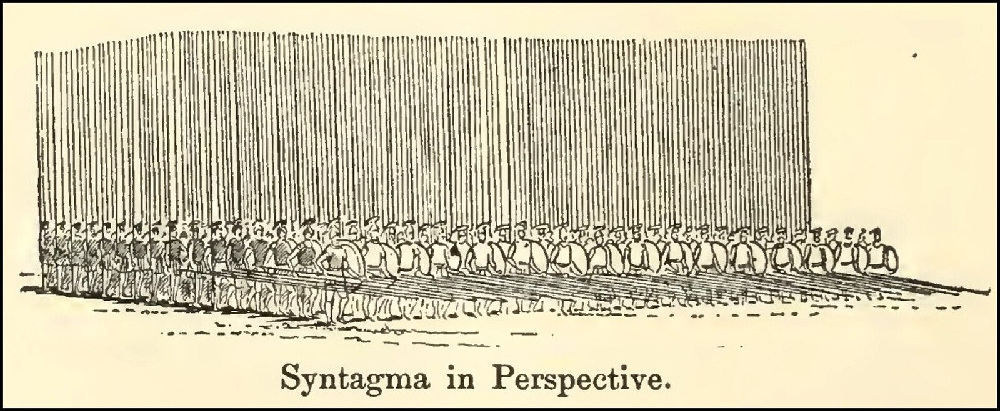
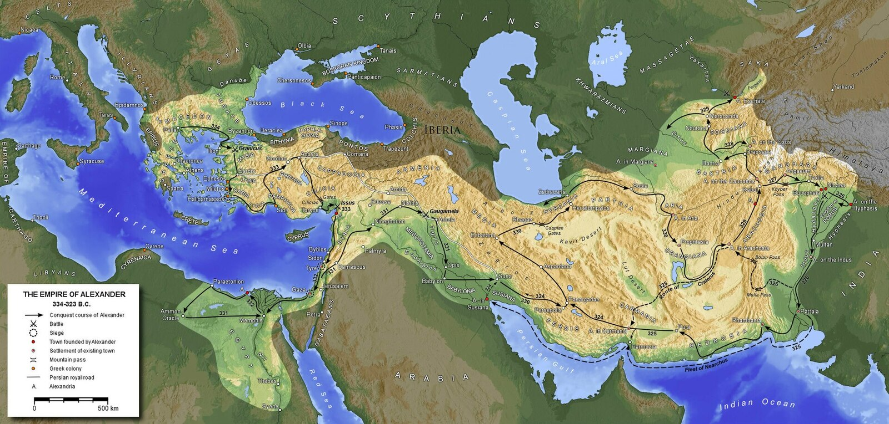
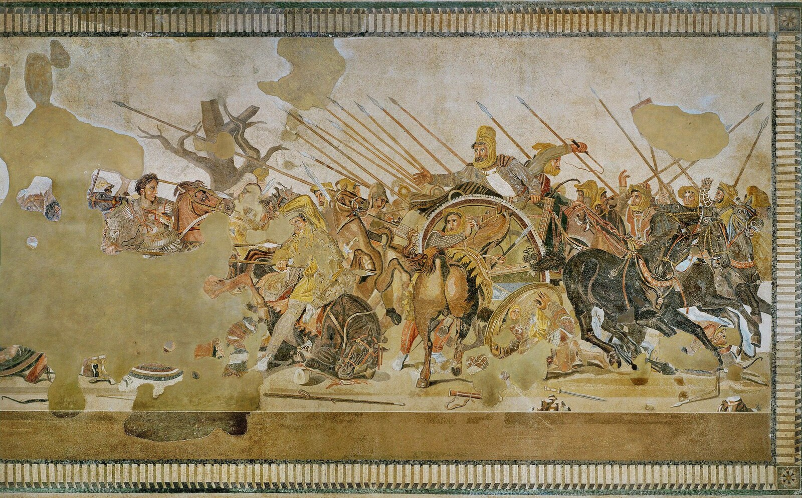
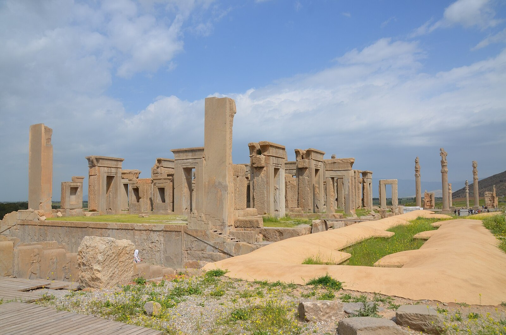
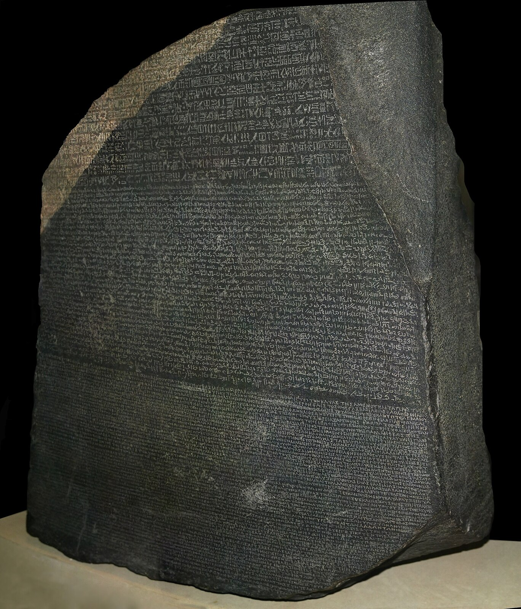
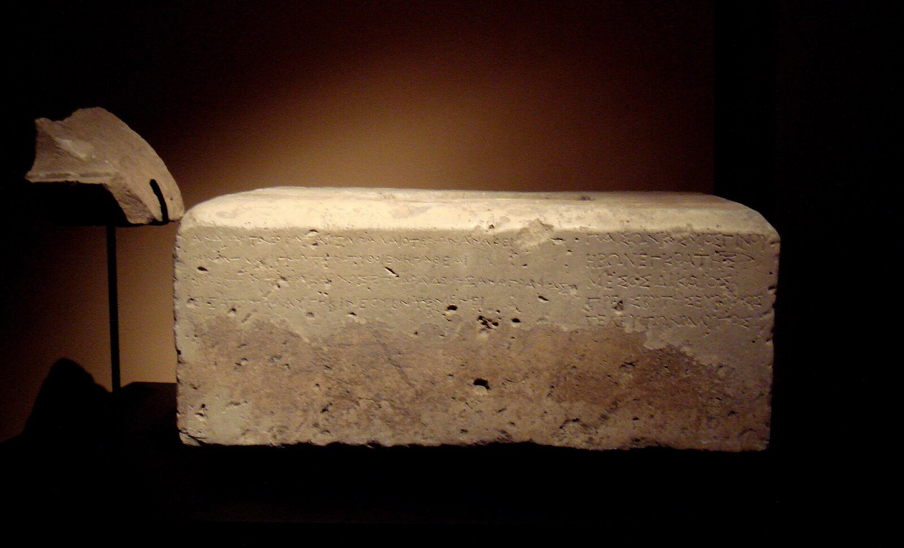
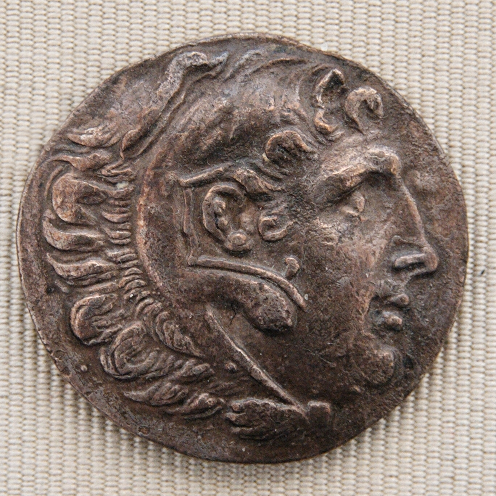
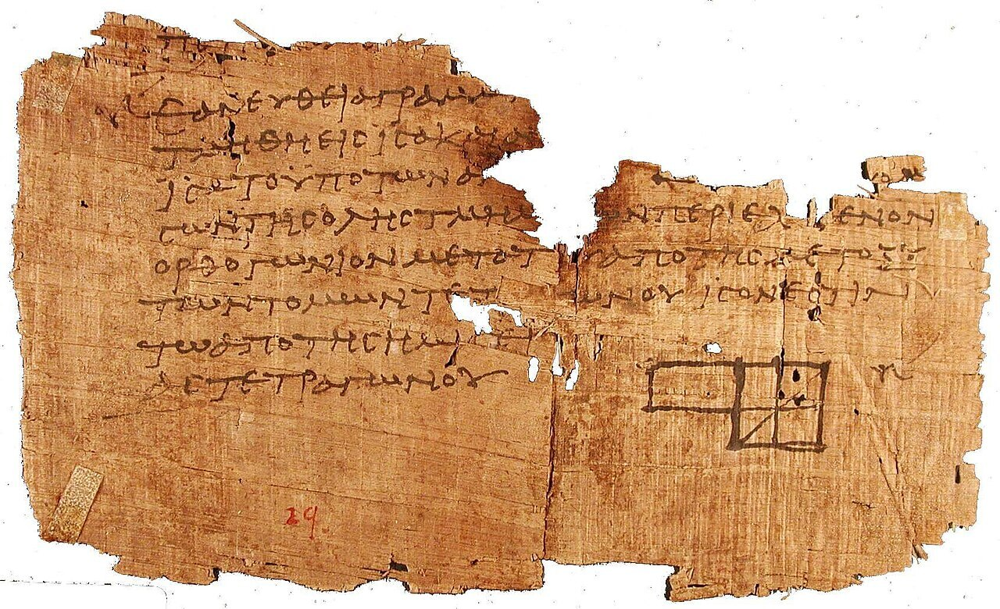
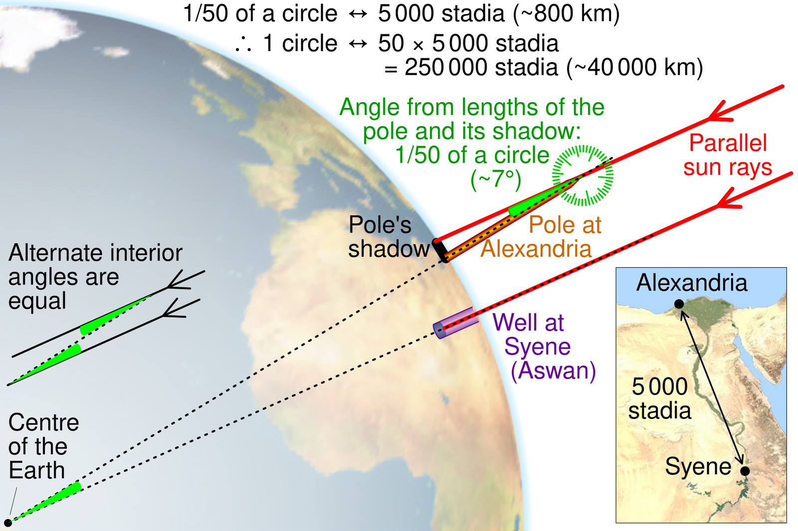

# 19. Why is Alexander called the Great?

*Greece, Egypt and western Asia as far as India, from about 2,360 to about 2,200 years ago*

Because in eleven years he made himself master of the largest empire the world had yet seen. He did not so much replace that empire as take it over, and what lasted was not his rule but a Greek-speaking world that reached from Egypt to Afghanistan.

A broken piece of a clay tablet in the British Museum, small enough to hold in one hand, was written in Babylon by one of the temple clerks whose job was to watch the sky. Night after night these men noted where the moon and the planets stood, and they added any news worth keeping. By the time this tablet was written, they had been doing it for more than three hundred years, and they still did their sums in sixties, as the clerks of that plain had done since the days of Uruk.

The entry for the twenty-ninth day of one early summer month is very short. It says: "The king died." Then it mentions clouds, because the clerk could not see the sky that night.

*The sky watchers' tablet that records the death of the king, in the British Museum. Photo: Shaunnol, public domain.*

The king was Alexander of Macedon. He was thirty-two years old, and he had been born more than two thousand kilometres away, in the north of Greece. When he died in Babylon, about 2,350 years ago, he ruled from Greece and Egypt to the edge of India.

The clerk's line matters because it has so little company. It was written within days of the event, by someone who was in the city. Almost nothing else about Alexander was. Several of his officers wrote books about him, and one of those officers later became a king. Every one of those books is lost. The oldest full account that survives was written about three hundred years after his death, and the one that historians trust most was written more than four hundred and fifty years after it. It is as if nothing about Napoleon survived except books that will be written in the next century and the one after.

Those later writers had the lost books in front of them, and so the outline of the story is firm. We know where Alexander marched, whom he fought and which cities he took. What he meant by it all is another matter. Each writer had his own Alexander: a hero, a drunk, a tyrant, a philosopher with a sword. The man himself left no explanation.

## The long pike

The army that conquered Asia was not Alexander's invention. It was built by his father, in a country that most Greeks looked down on.

Greece at that time was still a country of small independent cities, of which Athens, Sparta and Thebes were the strongest. They shared a language, their gods and their games, and they spent much of their time at war with each other. Their citizens fought as the men of Marathon had, on foot, shoulder to shoulder in a tight block, each man with a large round shield and a spear a little taller than himself.

Macedon lay to the north of them. It was a land of mountains, timber and horses, ruled by kings. Its people spoke a rough kind of Greek, and the southern cities thought them half foreign.

About 2,380 years ago, a new king named Philip came to the throne. As a teenager he had spent three years as a hostage in Thebes, which then had the best army in Greece, and he had watched closely. Within a few years he had rebuilt the Macedonian army into something the Greek cities had never faced.

First, he gave his foot soldiers a new weapon. It was a pike more than five metres long, longer than a family car, and it took both hands to hold. Because both hands were busy, the shield was small and hung from a strap over the shoulder. The men stood in a block sixteen rows deep. The points of the first five rows all stuck out beyond the front rank, so that an enemy with an ordinary spear had to get past five spearheads before he could touch anyone.

*A block of Macedonian pikemen, sixteen rows deep, in a drawing of 1890. Drawing: Theodore Ayrault Dodge, public domain.*

Second, he made his men professionals. Most Greek soldiers were farmers who went to war for a few weeks in summer. Philip's men were paid all year round, with gold from mines that he had seized, and they drilled all year round. He made them carry their own food and gear on long marches and cut down the trail of carts and servants, so that his army arrived sooner than its enemies expected.

Third, he joined the pike block to a heavy cavalry. Philip trained his horsemen to charge in a wedge, with long lances, at a single point in the enemy line. The pikes held the enemy in place, like an anvil, and the cavalry struck like a hammer.

With this army, Philip spent twenty years taking Greece apart. About 2,360 years ago he beat the combined armies of Athens and Thebes in a single afternoon. His son Alexander, who was eighteen, led the cavalry.

Philip then gathered the Greek cities into a league under his own command, and announced that it would invade Persia.

Two years later, at his daughter's wedding, one of his own bodyguards stabbed him to death at the entrance to the theatre. Alexander was twenty. He had been taught for a few years by the philosopher Aristotle, and he inherited the army, the league and the plan. When the city of Thebes rose against him, he destroyed it and sold its people as slaves.

## Five thousand camels

The empire he meant to attack was by far the largest state on earth. Two centuries after Cyrus, the King of Kings ruled as before from the coast of Turkey to the river Indus. His satraps collected the tribute and sent the silver on to him, and his couriers still changed horses along the royal road.

The Greeks had a grudge to offer as a reason for war. A hundred and fifty years earlier, a Persian army had invaded Greece and burned Athens. The real attraction was simpler. Persia was enormously rich, and Greek soldiers who had served there for pay said that its armies could be beaten.

Alexander crossed into Asia with about forty thousand men. In the next four years he fought the Persians in three great battles and won all three.

*Alexander's march, from Macedon at the top left to the Punjab at the right, and back to Babylon. Map: Generic Mapping Tools, CC BY-SA 3.0.*

In the two largest, the method was the same. The pike block held the middle. Alexander himself, at the head of the cavalry, looked for a gap and rode straight at the Persian commander. Both times that commander was the king of Persia himself, the third to bear the name of Darius, and both times he turned his chariot and fled.

*Alexander, on the left, rides at Darius, whose driver is already turning the chariot away. A floor mosaic from Pompeii in Italy, made about two centuries after the battle. Photo: Lucas, CC BY-SA 2.0.*

Between the battles, most cities opened their gates, and Egypt gave no trouble at all. The Persian governor handed it over without a fight. On the coast, at the western edge of the Nile's mouths, Alexander marked out the ground for a new city and named it after himself.

The third battle was fought on a plain in the north of Iraq. The sky watchers of Babylon recorded that one as well. Their diary says that the king's troops deserted him. Three weeks later it records that Alexander, whom it calls "king of the world", entered Babylon.

After Babylon, he took the Persian capitals one by one, and with them the treasuries in which Persian kings had been piling up silver and gold for two hundred years. The store at Persepolis, the grandest of the royal cities, was so large that one ancient writer says it took five thousand camels and twenty thousand mules to carry it away. Altogether he collected close to five thousand tonnes of silver, or its worth in gold. A few months later he burned the palace at Persepolis.

*The ruins of the palaces at Persepolis, in the south-west of Iran. Photo: Carole Raddato, CC BY-SA 2.0.*

Darius was by then running east. Before Alexander could catch him, his own governors stabbed him and left him in a cart by the road.

Alexander went on. He spent three hard years fighting in the mountains and plains of what are now Afghanistan and Uzbekistan. Then he crossed into the valley of the Indus and defeated an Indian king who brought a line of war elephants against him.

There, at a river in the Punjab, eight years and many thousands of kilometres from home, his soldiers refused to go any further. It had been raining for weeks, and they had heard that beyond the river lay greater kingdoms with more elephants. Alexander shut himself in his tent for three days and waited for them to change their minds. They did not. He turned back.

He had never lost a battle. He lost this argument, and he lost it to his own men.

## A Macedonian in Persian dress

A conqueror who takes a country has to decide what to do with its government. Alexander's decision was to keep it.

He kept the provinces as they were, with the same borders. He kept the satraps' offices, the tax system and the royal road. The taxes were collected as before and sent to the same treasuries. What changed was the man at the top, and the soldiers who guarded each province, who were now Macedonians.

In many provinces he even kept the men. The clearest case is a Persian noble named Mazaeus, who commanded one wing of Darius's army in the third great battle. Afterwards Mazaeus rode to Babylon and surrendered the city. Alexander made him its governor. A Macedonian officer was given command of the soldiers in Babylon and another collected the taxes, but the Persian kept the title, and went on issuing silver coins under his own name.

For several years afterwards, most of the governors Alexander appointed in the east were Persian nobles. Several of them robbed their provinces while he was away in India, and on his return he executed them and put Macedonians in their place.

He also took over the part of the Persian king. When Darius was murdered, Alexander sent the body home for a royal burial, and he hunted down the chief murderer and punished him as Persians punished a rebel against their king. In Babylon he made offerings to Marduk, and in Egypt to the gods of Egypt, as the Persian kings had done before him.

Then he began to dress the part. He put on the tunic, the sash and the headband of a Persian king, though he drew the line at trousers. He took Persian nobles into his court.

To his Macedonians this was hard to bear. They were used to a king whom they could argue with at dinner. They had won the war, and now they watched the losers standing beside the throne.

The anger came out one night at a banquet in Samarkand. An officer named Cleitus, one of the cavalry commanders, had saved Alexander's life in the first battle in Asia. Both men were drunk. Cleitus said that the victories belonged to the Macedonians and not to Alexander alone, and that Philip had been the greater man. Alexander snatched a spear from a guard and killed him.

It changed nothing. Back in Persia, he held a mass wedding in the Persian style, at which he and about eighty of his officers married the daughters of Persian and other Asian nobles. Soon afterwards, thirty thousand young Asians arrived in camp, whom he had ordered to be trained for three years with Macedonian weapons. He called them the Successors.

His veterans understood the name perfectly well. When he announced that ten thousand old and wounded men would be sent home, the army shouted that he might as well send them all. Alexander had thirteen of the loudest executed. He then shut himself away and began giving commands in the army to Persians. Within three days the Macedonians came to his door without their weapons and begged to be taken back.

## The soldier, the noble and the priest

A Macedonian foot soldier had done well out of the war. He had been paid, he had plundered some of the richest cities in the world, and he had acquired a family and a cart full of belongings along the way. However, he had also walked to India, and he had seen his king turn into something that looked like the enemy.

What such men cared about in the end was shown a few years after Alexander's death, when his generals were fighting each other for the pieces of his empire. Three thousand of his oldest infantry, known as the Silver Shields, were serving one of those generals in Iran. In their last battle they broke the enemy in front of them. Meanwhile the enemy's cavalry rode round behind and captured their camp, with their wives, their children and the loot of a lifetime's campaigning. The Silver Shields handed over their own general, in chains, in exchange for the baggage.

A Persian noble faced a different choice. The new king had kept the old offices and seemed willing to share them. Many nobles, like Mazaeus, made their peace and kept their estates.

Others did not forgive. The nobles of the far north-east fought for three years, and Alexander killed and enslaved a great many of their people. The Persians themselves left no account of him from that time. Centuries afterwards, however, the priests of Zoroaster's religion still had a name for him. They called him "the accursed Alexander".

Egypt saw him differently again. The Persians had conquered Egypt twice and were hated there, and the last conquest was only about ten years old when Alexander arrived. He went straight to the old capital and made offerings to the sacred bull that Egyptians honoured there. Within a few years, a shrine at the great temple of Luxor had been rebuilt in his name. Its walls show him as a pharaoh, in a pharaoh's crown and kilt, standing before the god.

This was a bargain, and it was not new. An Egyptian admiral had struck the same one with the first Persian conqueror, two centuries earlier. The priests of Egypt kept it going for three hundred years with the Greek kings who followed. The kings paid for the temples and left the priests their land. The priests, in turn, declared each king a true pharaoh. The Rosetta Stone, now in the British Museum, is a record of that bargain. It is a decree by a council of priests thanking a thirteen-year-old Greek king for his gifts and tax favours to the temples. They had it carved three times over on one slab, in the sacred picture writing, in the everyday Egyptian script and in Greek.

*The Rosetta Stone, about 2,220 years old, with Greek in the lowest band. Photo: Hans Hillewaert, CC BY-SA 4.0.*

## The stolen body

Alexander came back to Babylon in the spring. After a night of heavy drinking he fell ill with a fever. Eleven days later he was dead. The cause has been argued over ever since.

He left no heir who could rule. His wife, the daughter of a noble from the north-east, was pregnant. He also had a half-brother who was not capable of governing. The generals made the half-brother and the unborn child joint kings, and then began to fight over who would control them.

The fighting lasted forty years. In the course of it, Alexander's mother, his half-brother, his wives and his son were all murdered. The boy was about thirteen.

One of the generals saw sooner than the others that the empire could not be held together, and that the wise course was to take one good piece and keep it. His name was Ptolemy, and he had chosen Egypt. When the great funeral carriage set out from Babylon to carry Alexander's body home to Macedon, Ptolemy met it on the road in Syria with an army and took it to Egypt instead. Whoever held the body of Alexander had a claim to be his heir. Ptolemy's family ruled Egypt for nearly three centuries.

When the wars burned out, there were three large kingdoms and several small ones. The family of Ptolemy held Egypt. The family of another general, Seleucus, held most of Asia, from Syria to Afghanistan. Seleucus gave up the Indian provinces to the new empire in India, in exchange for five hundred war elephants. A third family held Macedon itself.

## Greek on the Oxus

The kingdoms were rivals, but they were built to one pattern. In Egypt and across Asia, a Macedonian king and a small minority of Greeks ruled a very large number of people who were not Greek. To hold such a country, the kings needed soldiers and officials whom they could trust, and so they did what Alexander had begun to do. They founded cities and filled them with Greeks.

Alexander had planted cities along his march, most of them named Alexandria. Seleucus and his son founded dozens more. Greeks came east in great numbers, as soldiers, clerks, doctors and builders, to take up land and salaries that their poor and crowded homeland could not offer. Wherever they settled, they built the same things. A Greek city had a market square, a council house, a theatre, and a gymnasium, which was both a sports ground and a school.

The most distant of these cities that has been dug up stands on the bank of the river Oxus, in the north of Afghanistan. In 1961 the king of Afghanistan was out hunting there when villagers showed him the carved top of a Greek column. French archaeologists then spent fourteen years uncovering a city with a theatre that seated five thousand people and a gymnasium a hundred metres across.

Near the palace stood a stone with a Greek inscription. It says that a man named Clearchus had carefully copied the sayings of the wise men at Delphi, the holiest shrine in Greece, and had set them up here, four thousand kilometres away. The last lines survive. They advise the reader to be well behaved as a child, self-controlled as a young man, just in middle age, a good adviser when old, and at the end of life to be without sorrow.

*The stone from the city on the Oxus, with the sayings from Delphi cut in Greek on its face. Photo: World Imaging, public domain.*

The language of all these cities was a simplified Greek that the settlers from different parts of Greece could share. They called it "the common tongue". It was written in the Greek alphabet of twenty-four letters. The kings governed in it, and their tax collectors wrote receipts in it. Alexander's money helped it along. He had turned the hoarded silver of the Persian kings into coin to pay his men, and coins of one design now passed from hand to hand from Greece to Afghanistan.

*A silver coin of Alexander's design, struck in a Greek city on the coast of Turkey more than a century after his death. Photo: Marie-Lan Nguyen, CC BY 2.5.*

Most people in these kingdoms never learned Greek. The farmers of Egypt went on speaking Egyptian, and the sky watchers of Babylon went on writing their diaries on clay. Nevertheless, Greek was now the way to a post at court, a place in the army or a contract from the king, and ambitious families in many provinces saw to it that their sons learned it.

## The king's scholars

The greatest of the new cities was the one that Alexander had marked out on the coast of Egypt. Within a century, Alexandria was the largest city in the Mediterranean and the capital of the richest of the kingdoms.

Ptolemy and his son wanted their capital to be the centre of the Greek world. So they did something no king had done on such a scale. They hired scholars.

Beside the palace they built an institution called the Museum, which means the shrine of the Muses, the goddesses of learning and the arts. The scholars who belonged to it were paid a salary by the king and ate at his expense. In return they were expected to study, write and argue.

Next to it the kings built up a library. Books in that age were rolls of papyrus, written by hand. The kings' agents bought rolls wherever they were for sale. According to one ancient doctor, every ship that docked at Alexandria was searched for books. Any that were found were taken away and copied, and it was the copy that went back to the owner. A king of Assyria had once gathered the clay tablets of Iraq into his palace at Nineveh. The kings of Egypt set out to gather the books of the whole world, and the result was by a wide margin the largest collection that had yet been made.

With the books in one place, scholars could do a new kind of work, which was to put a whole subject in order. The best example is a man named Euclid, who worked in Alexandria under the first Ptolemy. Greeks had been proving facts about triangles and circles for more than two centuries, in a scattered way. Euclid gathered what was known into a single work in thirteen parts. He began with a handful of statements so plain that nobody could doubt them, such as that a straight line can be drawn between any two points. From these he proved the rest, one step at a time, each step resting on the steps before it.

*A scrap of Euclid's book with one of its diagrams, copied on papyrus in Egypt about 1,900 years ago. Public domain.*

His book was used to teach geometry for more than two thousand years.

## A stick and its shadow

About 2,270 years ago, the third Ptolemy appointed a new head of the library. His name was Eratosthenes, and he came from a Greek city on the coast of Libya. He is remembered because he worked out the size of the Earth, using a stick.

He started from something that travellers reported about a town called Syene, at the southern edge of Egypt, where Aswan now stands. On the longest day of the year, at noon, the sun at Syene stood exactly overhead. A stick set upright in the ground cast no shadow at all.

At Alexandria, far to the north, an upright stick at that same noon still cast a short shadow.

The sun is so far away that its rays reach the Earth side by side, like the lines on ruled paper. If the Earth were flat, those rays would strike every upright stick at the same angle, and at any one moment all sticks of the same height would cast the same shadow.

However, educated Greeks had known for more than a century that the Earth is a ball. When the Earth's shadow crosses the face of the moon during an eclipse, the edge of that shadow is always curved. On a ball, upright sticks in different places do not point the same way. Each one points straight out from the centre, like pins stuck in an orange.

Now picture the two sticks at noon on the longest day. The one at Syene points straight at the sun, and so it has no shadow. The one at Alexandria stands further round the curve of the Earth, and so it leans a little away from the sun's rays. That lean is what makes its shadow.

The angle by which the stick at Alexandria leans away from the sunlight is exactly the angle by which the Earth's surface has curved between the two towns. Measure the first, which can be done in a courtyard, and the second is known as well.

*At Syene the sunlight falls straight down, here into a well. At Alexandria it meets the upright pole at a small angle, the same angle that separates the two towns at the centre of the Earth. Diagram: cmglee, David Monniaux and jimht, CC BY-SA 4.0.*

Eratosthenes measured it. He used the upright pointer of a sundial, which the Greeks called a gnomon, and he read the angle from its shadow at noon. The sun's rays met the pointer at an angle equal to one fiftieth of a full circle.

Syene lies almost due south of Alexandria, so the line between the two towns runs straight towards the pole, along a circle that goes right round the Earth. It followed that the distance between them was one fiftieth of that circle. The distance was known. The kings of Egypt kept surveyors who measured the country by counting their paces, and they reckoned it at five thousand stades. A stade was the length of a Greek running track.

Fifty times five thousand is two hundred and fifty thousand stades.

How good was the answer? That depends on the length of his stade, because running tracks differed from city to city, and nobody is sure which one he meant. On the shortest stade that scholars have proposed, his Earth measures about 39,000 kilometres around, and on the common Athenian stade about 46,000. The true figure is 40,000. Even on the less favourable reading, he was within one sixth of the truth.

His figures were a little off. Syene does not lie exactly south of Alexandria, and the midsummer sun was not quite overhead there. The reasoning was sound.

A Greek from Libya, paid by a Macedonian king of Egypt, used a distance paced out by that king's surveyors and the geometry of the Greeks, in a city that had not existed a hundred years before. None of those things would have been in one place without Alexander's war, and he planned none of them.

The kingdoms of his generals did not last. A little over two centuries after that noon in Alexandria, a city in Italy had swallowed every one of them west of the Euphrates, and it governed them in Greek.

Alexander himself had marched east until his soldiers would go no further, and he died without learning how much of the world was left. Eighty years later, a librarian in the city that bears his name found out, without leaving Egypt.
