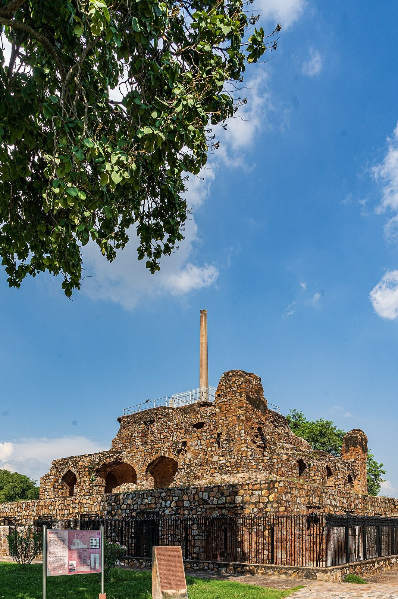
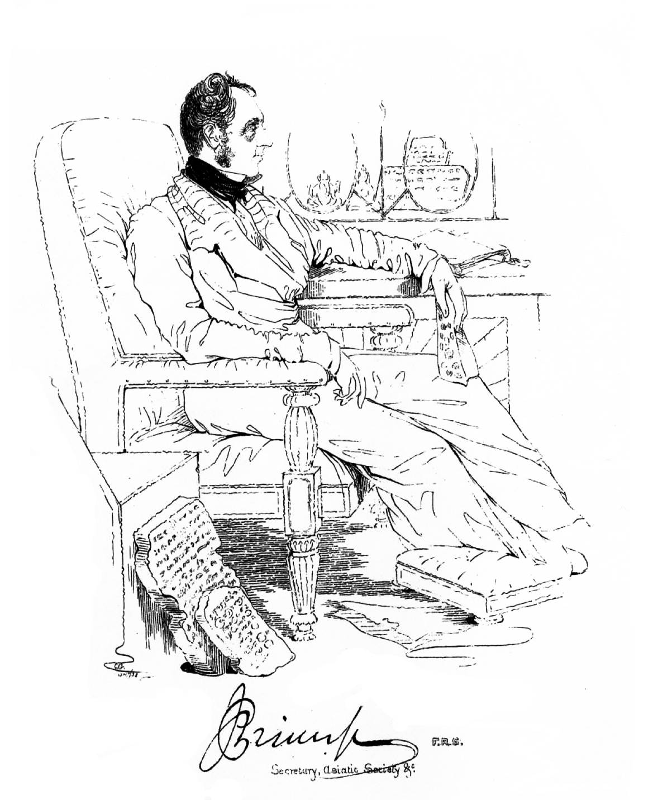
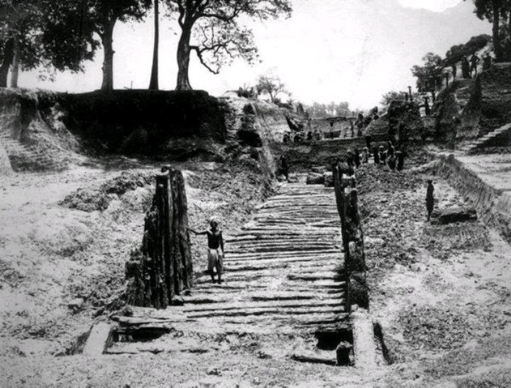
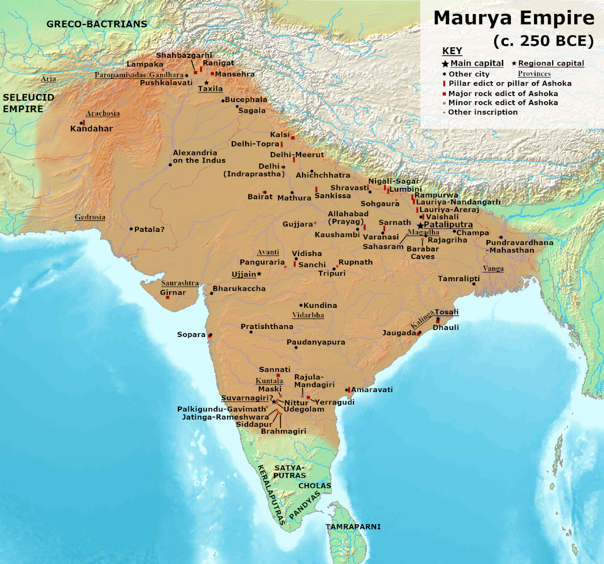
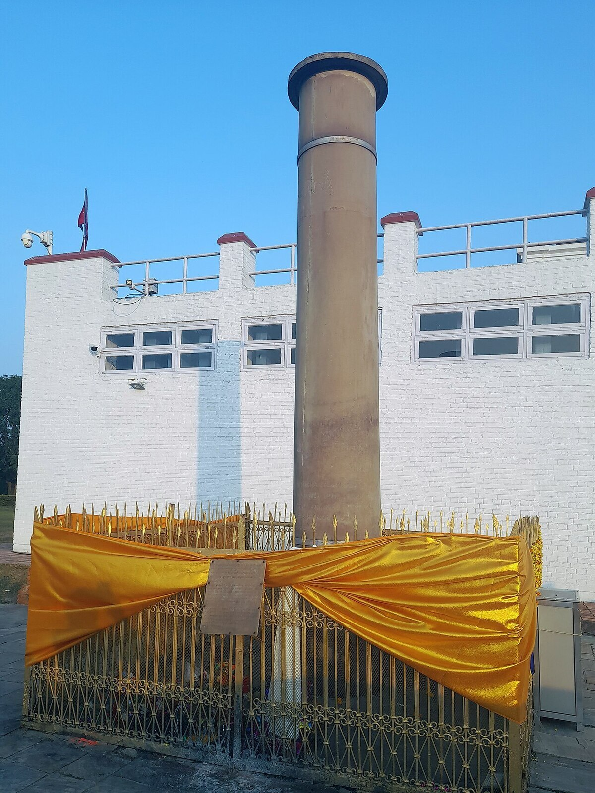
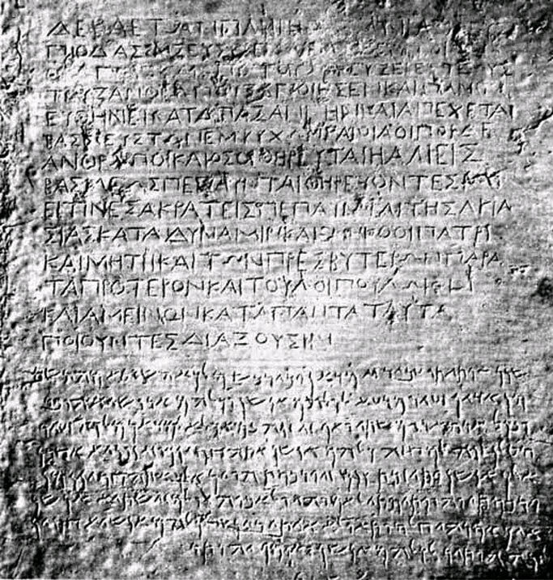
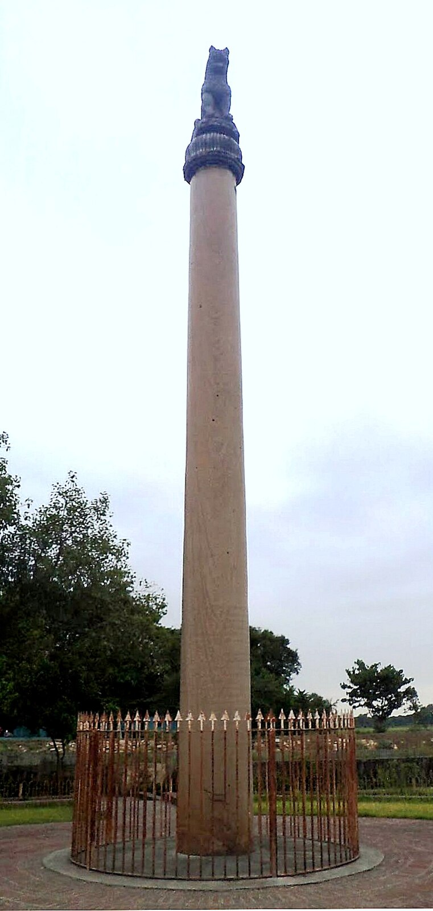
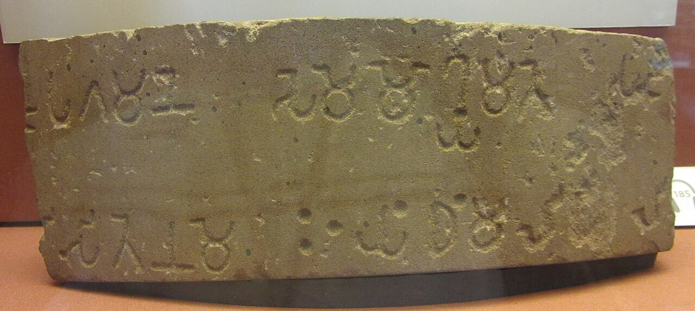
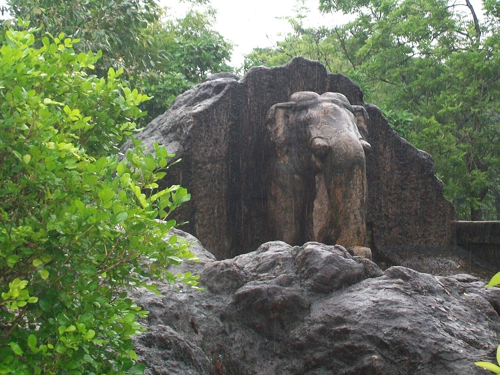
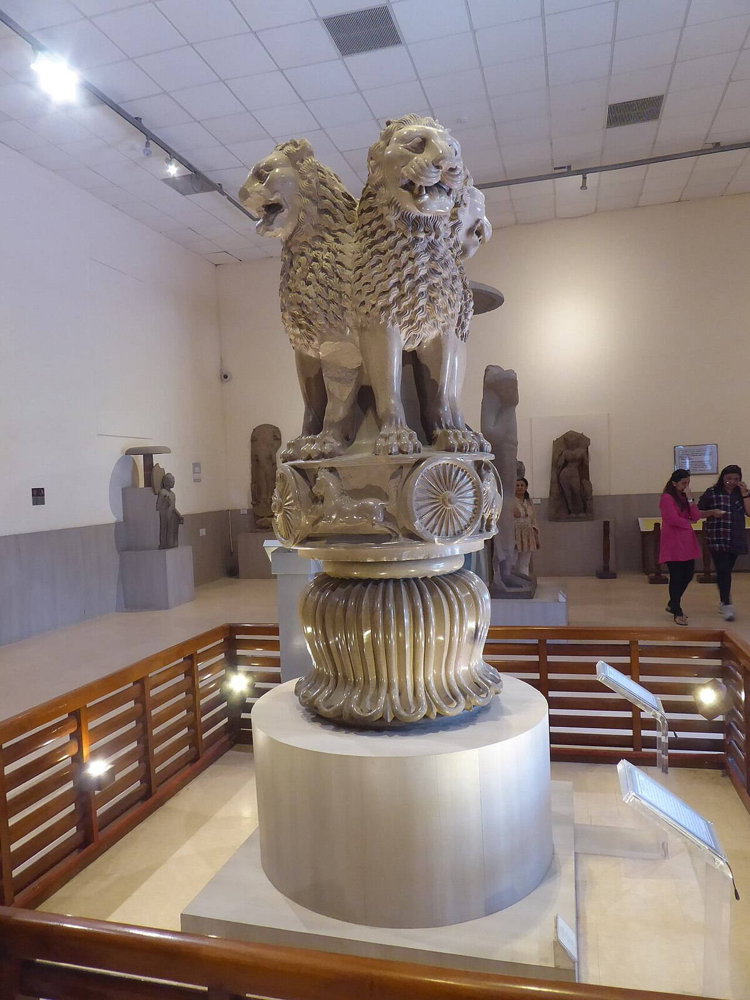

# 20. Has a conqueror ever been sorry?

*India, from about 2,350 years ago to about 2,200 years ago*

Yes. About 2,280 years ago an Indian emperor named Ashoka had his remorse for a war cut into rock, in public, together with his own count of the dead. He kept the country that the war had won him.

In the 1830s, one of the most puzzling objects in India stood on top of a ruined palace in Delhi. It was a pillar made from a single piece of pale sandstone, thirteen metres tall, and polished so smooth that it shone in the sun. Around its shaft ran neat rows of small letters, built out of circles, crosses, hooks and straight strokes. Nobody alive could read them.

*Ashoka's pillar on top of the sultan's ruined palace in Delhi. Photo: IshiSenpai, CC BY-SA 4.0.*

They had been unreadable for a very long time. The pillar had been brought to Delhi in the fourteenth century by a sultan who admired it, and he had called in learned men to tell him what it said. None of them could.

Moreover, the same letters turned up elsewhere, on another pillar far down the river plain and on great boulders near both coasts of India, well over a thousand kilometres apart. Whoever had written them had ruled most of a subcontinent, and had then been forgotten.

The man who solved it was James Prinsep, an Englishman who worked at the mint in Calcutta, where his job was to test the purity of the metal that went into coins. In his spare time he edited a learned journal, and copies of old inscriptions were sent to him from all over the country.

*James Prinsep, drawn in Calcutta about 1838, with copies of inscriptions around him. Drawing: Colesworthey Grant, public domain.*

In 1837, he received copies of some very short inscriptions from the stone railings of an ancient Buddhist monument in central India. Prinsep noticed that almost every one ended with the same two letters. He reasoned that pilgrims who pay for part of a railing like to have their names put on it, and that each line probably said "the gift of" somebody. The word for gift in the old languages of India is *danam*. If that guess was right, he knew the signs for *da* and *na*. A few other signs had already been worked out from old coins, and with these to start from, the rest of the alphabet followed within weeks.

He turned at once to the pillar in Delhi. Its text begins with the words "Thus speaks King Piyadasi, Beloved of the Gods."

No list of Indian kings contained a Piyadasi. The answer came within months from Sri Lanka, where a British official had been reading the island's old Buddhist chronicles. There, Piyadasi was another name for Ashoka, an emperor whom Buddhists remembered as the great patron of their faith. In India he had survived as little more than a name in a list.

Prinsep died three years later, at the age of forty. By then the rocks and pillars were being read one after another. They turned out to be the oldest writings from India that can be read today, and all of them were the voice of one man. On one of the rocks he said something that no earlier king is known to have said.

## Five hundred elephants

The empire that Ashoka ruled was built by his grandfather, and its story starts with a foreign army going home.

About 2,350 years ago, Alexander's soldiers reached a river in the Punjab and refused to go any further, and he turned back. Three years later he was dead.

He left behind garrisons in the valley of the Indus, and generals who soon fell to fighting each other. To the east lay something that Alexander never reached: the wide plain of the river Ganges, which was the richest farmland in India. The strongest kingdom on that plain was called Magadha. It had rice, iron and elephants. Its capital, Pataliputra, stood on the south bank of the Ganges where the city of Patna stands now.

Within a few years of Alexander's death, a young man named Chandragupta Maurya had seized the throne of Magadha. He then turned west and took the Indus valley from what was left of Alexander's garrisons.

About 2,330 years ago, Seleucus came to take it back. He was the general who had come out of the wars with most of Asia. No account of the fighting survives. The terms of the peace do. Seleucus gave up his easternmost provinces, which covered a large part of what is now Afghanistan and Pakistan. In return, Chandragupta gave him five hundred war elephants.

A king who can hand over five hundred elephants as the price of a treaty has a great many more at home. Chandragupta now ruled from the mountains of Afghanistan to the mouth of the Ganges, which was more of India than anyone had ruled before him.

Seleucus also sent an ambassador to live at the court in Pataliputra, a Greek named Megasthenes, who wrote a book about what he saw. The book itself is lost. Pieces of it survive, however, because later Greek and Roman authors quoted it.

According to those pieces, Pataliputra stretched along the river for about fifteen kilometres. It was surrounded by a moat and by a wall of timber, with slits for archers to shoot through and hundreds of towers. That sounds like a traveller's tale. Nevertheless, archaeologists digging under Patna found the wall: long rows of massive upright timbers, preserved in the wet ground.

*Timbers of the wall of Pataliputra, dug out of the ground at Patna in the 1920s. Photo: Archaeological Survey of India, public domain.*

Megasthenes also described how the place was run. The city, he says, was governed by committees of officials. One committee looked after foreigners, found them lodgings, had them nursed when they fell sick and buried them when they died. Another kept a register of births and deaths. Others supervised the markets and collected a tax of one tenth on everything sold.

He has to be read with care. The same Megasthenes reported that India had ants as big as foxes, which dug gold out of the ground, and that there were no slaves in India, which was false. He is best believed about what he saw with his own eyes, such as the wall.

A second famous source deserves less trust still. In 1905, a librarian in the south of India found, among a heap of old manuscripts, a Sanskrit work called the Arthashastra. It is a handbook for kings, covering taxes, spies, prisons and poisons. Tradition says that Chandragupta's own chief minister wrote it, and for much of the twentieth century historians treated it as a portrait of his government. Close study of its language has since shown that most of it was put together several centuries after him. It records how Indian thinkers believed a kingdom ought to be run, which is a different thing from how Chandragupta ran his.

Even so, the outline is firm. Magadha had an enormous capital, a standing army with a large force of elephants, and officials who measured, counted and taxed. Chandragupta ruled it for about twenty-four years, and his son after him. By the time the throne passed to his grandson, about 2,290 years ago, the empire also reached far down into the south of India.

## A hundred thousand killed

Very little is known about Ashoka's early life. Buddhist storytellers of later centuries made the young king a monster, who murdered his brothers and kept a torture chamber, so that his change of heart would shine all the brighter. None of it can be checked.

What can be checked is carved in rock. On the east coast of India, in the region now called Odisha, lay a country named Kalinga. It was the one large piece of that coast which the empire did not hold, and it sat across the roads and sea routes that led from Magadha to the south. In the eighth year after he was crowned, Ashoka conquered it.

*The empire in Ashoka's time, with the places where his edicts have been found. Pataliputra is in the east, Kalinga on the coast below it and Kandahar in the far north-west. Map: Avantiputra7, CC BY-SA 3.0.*

No description of the campaign survives. What survives is the statement that the victor issued some years later, cut into rock at several places in his empire. In it he speaks of himself by his titles, as kings did, and he begins with the numbers:

"One hundred and fifty thousand were deported, one hundred thousand were killed and many more died."

Then comes the sentence that makes the text unlike other royal inscriptions: "Now Beloved-of-the-Gods feels deep remorse for having conquered the Kalingas."

He goes on to say what troubles him. In a conquered country, he says, there live priests, holy men and ordinary householders, who obey their parents and are loyal to their friends. War kills them, wounds them or tears them away from the people they love. Even those who escape are hurt when they see what has happened to their friends and relatives. If a hundredth part of that suffering, or a thousandth, were to happen again, it would weigh heavily on him.

The numbers are round, they are the king's own, and nobody can test them. What matters is the use he makes of them. Kings had always counted the enemy dead, and they counted them in order to boast. Naram-Sin of Akkad had himself carved striding up a mountain over the bodies of his enemies. Sennacherib of Assyria lined a room of his palace with the fall of Lachish and the march of its people into exile. Ashoka gives his figure as the measure of a wrong.

The black stone of Hammurabi makes a useful comparison. Hammurabi listed the cities that he had taken, one after another, and for each he named the good that he had done there. Nowhere does his stone suggest that the taking itself needed an excuse. Ashoka's rock says that the taking was a cause for grief. Nothing quite like it survives from any other conqueror of the ancient world.

He ends by looking ahead. The best conquest, he says, is "conquest by Dhamma". He hopes that his sons and great-grandsons will not think of new wars, and that if they do fight, they will be merciful and punish lightly.

## What the king meant by dhamma

Everything in the inscriptions hangs on that one word, and Ashoka did not invent it.

About two centuries before his time, the Buddha had walked the roads of the same Ganges plain, teaching that suffering comes from craving and can be ended by a disciplined life. His monks and nuns were still there, fed by ordinary people who tried to follow a gentler version of the same rules. His followers called his teaching the dhamma.

Ashoka says in his inscriptions that he had become one of those ordinary followers. He visited the monks, and he travelled as a pilgrim to the places where the Buddha had been born and had found his answer. At the birthplace, in what is now Nepal, he set up a pillar which is still standing. Its inscription records that, because the Buddha was born there, the king cut the village's tax to one eighth of its crop.

*The pillar that Ashoka set up at Lumbini in Nepal, the Buddha's birthplace. Its inscription records the cut in the village's tax. Photo: Rangan Datta Wiki, CC BY-SA 4.0.*

However, the dhamma that he preached to his subjects was something broader and plainer than the Buddha's teaching. The word was the spoken form of the Sanskrit *dharma*, which the Brahmins used for the duty of each rank. It had an everyday meaning too, close to "right conduct", and every school of thought in India used it. The great series of rock edicts says nothing about the life of a monk or about escape from suffering. What it gives is a short list of good behaviour, repeated again and again. Obey your mother and father. Be generous to friends, relatives, priests and holy men. Treat servants properly. Do not kill living things. Spend little and hoard little. Tell the truth. The reward is happiness in this life and heaven in the next.

Almost anyone in India could have agreed with that list, and its breadth was deliberate. The empire held Brahmins, with their hymns and their sacrifices. It held Buddhists, several rival orders of wandering holy men, Greeks in the north-west, and peoples of the forest who followed none of these. One whole edict is given to the problem. The king honours all sects, it says. Nobody should praise his own and run down the others, because a man who does so damages his own sect most of all. People should listen to each other's teachings.

On the matter of killing, the king started at home. In the past, he says, a vast number of animals were slaughtered every day for the royal kitchen. Now the number is down to three, "two peacocks and a deer", and he adds "and the deer not always". Even these three, he promises, will be given up in time.

It is the most human sentence in the edicts. He did not forbid meat. He cut down by stages and reported his progress. Years later he published a list of protected creatures, which included parrots, bats, tortoises, porcupines and squirrels, and he forbade the burning of forests to drive out game.

His predecessors had toured the country to hunt. He toured it to preach.

## Wells, shade trees and five Greek kings

A king can do more than preach, and Ashoka says that he built.

Along the roads, he had banyan trees planted to give shade to people and animals, and groves of mango trees. He had wells dug at regular distances, and rest houses built, and watering places made. He arranged medical care for people and, separately, for animals. Where the herbs, roots and fruits used as medicine did not grow, he had them brought in and planted.

Earlier kings had done such things, he admits. His purpose in doing them was that people should follow dhamma.

To carry the message, he created a new kind of official, whose title meant "officer of dhamma". These men were sent among all the sects, and among soldiers, the poor and the old. They visited prisoners, and worked for the release of those who had families to support or who were aged. They worked even inside the households of the king's own brothers and sisters. The ordinary officials, meanwhile, were ordered to tour their districts every five years, to teach dhamma as well as to do their usual business.

Ashoka drove himself in the same way. He orders that the affairs of the people are to be reported to him at any time and in any place: when he is eating, in the women's quarters, in his bedroom, in his carriage or in his garden.

His ambitions did not stop at the border. In the same text that mourns Kalinga, he claims that dhamma has won victories abroad, in lands where his envoys have gone, and he names five Greek kings. They were the rulers of Syria, Egypt, Macedon, Libya and north-western Greece, most of them heirs of Alexander's generals, and their lands lay some five thousand kilometres from Pataliputra.

Nothing in Greek writing mentions these envoys, and the Greek kings went on fighting each other exactly as before. The names are correct, however, and all five of those kings were alive at the same moment. The Indian emperor knew who ruled on the Mediterranean.

He also had Greek subjects of his own, in the provinces that Seleucus had given up, and he addressed them in their language. In 1958, a rock inscription was found at Kandahar in Afghanistan, written in Greek and, below it, in Aramaic, which the clerks of western Asia had gone on writing since the days of the Persian kings. In the Greek version, dhamma has become *eusebeia*, the ordinary Greek word for piety. The text announces that the king abstains from killing living things, and that his hunters and fishermen have given up their trades.

*The inscription found at Kandahar in Afghanistan in 1958. Ashoka's message is given in Greek, above, and in Aramaic, below. Photo: Wikimedia Commons, public domain.*

## Fifty tonnes of polished stone

The earlier edicts were cut into living rock, on boulders and cliff faces beside roads, near towns and along the frontiers. A king speaking from a rock face had a precedent to the west. The north-western provinces of the empire had belonged to the Persian kings before Alexander, and Darius had told his own story on a cliff in Iran. The later ones were put on pillars, and the pillars are the most remarkable objects that his reign left behind.

Each pillar is a single piece of sandstone, round and slightly tapered, between twelve and fifteen metres long. The largest weigh about fifty tonnes, which is more than a fully loaded lorry. A pillar has no visible base. The bottom two or three metres were sunk into a pit, where the foot rested on a slab of stone, so that the shaft seems to grow straight out of the ground. Above ground, the stone was rubbed with grit and water until it had a gloss like glass. Later visitors often took it for metal, and the sultan in Delhi called his the golden pillar.

On top sat the capital, which was carved from a second block. It had three parts: a bell shaped like a lotus flower turned upside down, a round platform above that, and on the platform one or more animals, most often a lion. The capital was fixed to the shaft by a heavy copper bolt, which fitted into a socket in each stone. Copper does not rust, whereas rusting iron swells and splits stone.

*The pillar at Lauriya Nandangarh in northern India, still standing with its lion in place. Photo: M. Vidyut Prakash Maurya, CC BY 2.0.*

Making one began at a quarry. The quarries at Chunar, on the bank of the Ganges above the city of Varanasi, have long been named as the main source, and other shafts were cut further west, near the river Yamuna. The masons had to find a bed of rock without a crack in it, as long as a pillar. With iron tools they cut a trench around a block of that length, split it from the rock beneath, and dressed it into a cylinder.

Then it had to be moved, in some cases for hundreds of kilometres, and no record from Ashoka's time says how. The pillars and the quarries both lie close to the Ganges and the rivers that feed it, so most of the journey was surely made by water.

There is, however, a detailed account of moving one of these pillars, written sixteen centuries later by the chronicler of the sultan who brought his to Delhi. The pillar was wrapped in the fluffy fibre of the silk-cotton tree, then in reeds and raw hides, and lowered onto a bed of the same fibre. A cart was built for it with forty-two wheels. A rope was tied to each wheel, and two hundred men hauled on each rope, so that more than eight thousand men dragged the pillar to the river. There it was loaded onto large grain boats lashed together, floated down to Delhi, and raised to the top of the sultan's new building stage by stage, with ropes and windlasses.

All that effort was spent on moving one pillar over a couple of hundred kilometres, most of it by river. Ashoka's men set up at least twenty.

The writing came last. The king's text was composed at the capital, in the everyday speech of the Ganges plain, which was a simpler cousin of Sanskrit, the learned language of the priests. Copies were carried to the provinces, where local clerks adjusted the wording to the dialect of the region. A scribe then marked the letters out on the stone, and a mason cut them with a chisel.

*Ashoka's letters on a fragment of one of his pillars, now in the British Museum. Photo: BabelStone, CC BY-SA 3.0.*

The work was not always careful, and the king knew it. His last rock edict admits that some passages may be incomplete, and puts part of the blame on "the fault of the scribe".

He also knew that most of his subjects could not read. His orders provide for that. The edicts were to be read aloud on fixed holy days, and at other times as well, even if only a single person was there to listen.

The script itself was a good one. Each sign stands for a consonant followed by a short a, and a small stroke added to the sign changes the vowel, so that *ka* becomes *ki* or *ku*. Nearly every script in use today in India, Sri Lanka, Tibet and south-east Asia descends from the letters on Ashoka's pillars, including those of Hindi, Tamil, Thai and Burmese.

## All men are my children

Now stand in Kalinga, a few years after the war. A family there has lost a son in the fighting, and a cousin has been marched away among the hundred and fifty thousand. What can they expect to change, now that the emperor is sorry?

The emperor's sorrow was not published there. Two sets of his rock edicts have been found in Kalinga. Both of them leave out the edict that describes the war and gives the count of the dead. That statement was carved in the far north-west, in the west and in the south, up to a thousand kilometres and more from the people it concerned.

*The elephant carved out of the rock above Ashoka's edicts at Dhauli in Odisha, the ancient Kalinga. Photo: Duraionly, CC BY-SA 3.0.*

In its place, the Kalinga rocks carry two special edicts, addressed to the king's officers in the two chief towns of the conquered country.

"All men are my children," he tells them. What he wishes for his own children, which is their welfare and happiness in this world and the next, he wishes for all men. Then he turns on the officials themselves. "You do not understand to what extent I desire this," he says, and even those who do understand it do not understand it fully.

He is specific about the trouble. People are being thrown into prison and treated harshly without cause. A judge must rid himself of anger, cruelty, impatience and laziness. To make sure of it, the king will send out an inspector every five years to see whether his officers are doing as he has told them. The edict itself is to be read out in public on set days.

Those orders are what the family in Kalinga got. A good deal was missing from them.

They did not get their country back. Kalinga stayed in the empire, governed by imperial officers. The edicts do not say that the deported came home. The army that had done the killing was not disbanded. The death penalty stayed too. The most that Ashoka offers a condemned prisoner is a delay of three days, so that his relatives can appeal for his life and he can prepare for the next world.

Nor did the king pretend that he had laid down his power. In the very edict that mourns the war, he sends a message to the peoples of the forest, who lived inside his borders and outside his control. They are told that "despite his remorse Beloved-of-the-Gods has the power to punish them if necessary".

What the family did get was a standard, set in stone above the head of the local magistrate, which the magistrate was ordered to read out to them. Hammurabi's stone had done something similar when it placed the rule where the ruled could see it. What a man in Kalinga could do when his brother was jailed for nothing is not recorded. He did have the king's own public words to point to, and the promise that an inspector would arrive from the capital.

An inspector every five years, however, is a long wait for a man in prison. Kalinga lay several weeks' march from Pataliputra, and Kandahar lay several months away. Between one inspection and the next, the official on the spot was the government. The king's own words show how much this troubled him, since he tells his officers on a public rock that they do not understand him. Near the end of his reign he summed up what he had learned. Progress, he says, has come in two ways, by regulations and by persuasion, and the regulations have achieved little.

Beyond that, the evidence stops. Babylon left thousands of clay court records against which Hammurabi's stone can be tested. India wrote its everyday business on palm leaf, bark and cloth, which rot. Hardly a single lawsuit, tax receipt or private letter survives from Ashoka's reign, and no word at all from anyone in Kalinga. Almost everything known about the reign comes from the king himself.

His words can be read in two ways. On the harder reading, dhamma was a tool of government. An empire of many sects needed something that all of them could accept, and a code of good manners was cheaper than soldiers. The officers of dhamma, who worked among every sect and inside the households of the royal family, made a useful set of eyes. On the kinder reading, the king meant it, and the deer in the kitchen and the impatience with his officials are the marks of a real man at a real task. The two readings do not exclude each other. The inscriptions show a ruler who believed in what he preached and who also found it useful.

One part of the promise can be tested against events. After Kalinga, Ashoka reigned for nearly thirty more years, and there is no sign that he fought another war of conquest. The kingdoms of the far south, which he names in his edicts as his neighbours, were still independent when he died. He had the largest army in India on their border, and the army stayed where it was.

## Four lions

Ashoka died about 2,260 years ago. Under his descendants the outer provinces fell away one after another, and within fifty years the last king of his line was murdered by his own general.

In time Kalinga had a king of its own again. He left a long inscription on a hillside about ten kilometres from one of Ashoka's rocks, and in it he boasts of his campaigns in the old manner, including a raid on Magadha. The officers of dhamma are not heard of again.

The words on the pillars were lost more slowly. The script went on being used, and each generation of clerks changed the shapes of the letters a little. After some centuries the changes had added up, and nobody could read the original any longer. In the sultan's day they were said to be the walking sticks of a giant hero of legend.

The Buddha's teaching fared better than the empire. According to the chronicles of Sri Lanka, it was Ashoka's own son, a monk, who carried it to the island's king. Sri Lanka has been a mainly Buddhist country ever since. Over the following centuries the teaching also travelled north-west along the trade roads into Central Asia and China, and by sea to south-east Asia. In all those lands, monks told stories of Ashoka as the model of a righteous king. In India itself, meanwhile, his own words stood in the open, unread, until 1837.

One of his pillars stood at Sarnath, near the city of Varanasi, at the spot where the Buddha was said to have first taught. It broke and fell long ago. In 1905, an engineer digging there found the stump of the shaft and, lying near it, the capital, with its polish still bright. Four lions sit back to back, facing the four directions, on a round platform carved with a horse, a bull, an elephant, a lion and four wheels.

*The lion capital from Ashoka's pillar at Sarnath, a little over two metres tall, in the museum there. Photo: lisa bat, CC BY 2.0.*

When India became independent in 1947, its leaders put the wheel from Ashoka's capital at the centre of the flag. In 1950, they made the four lions the emblem of the republic.

The lions are now on every Indian coin, banknote and passport. They are the seal of a state that keeps more than a million soldiers, as Ashoka kept his. Of all the kings in India's long past, it chose the one who had counted his dead in public and said that the war was wrong.
