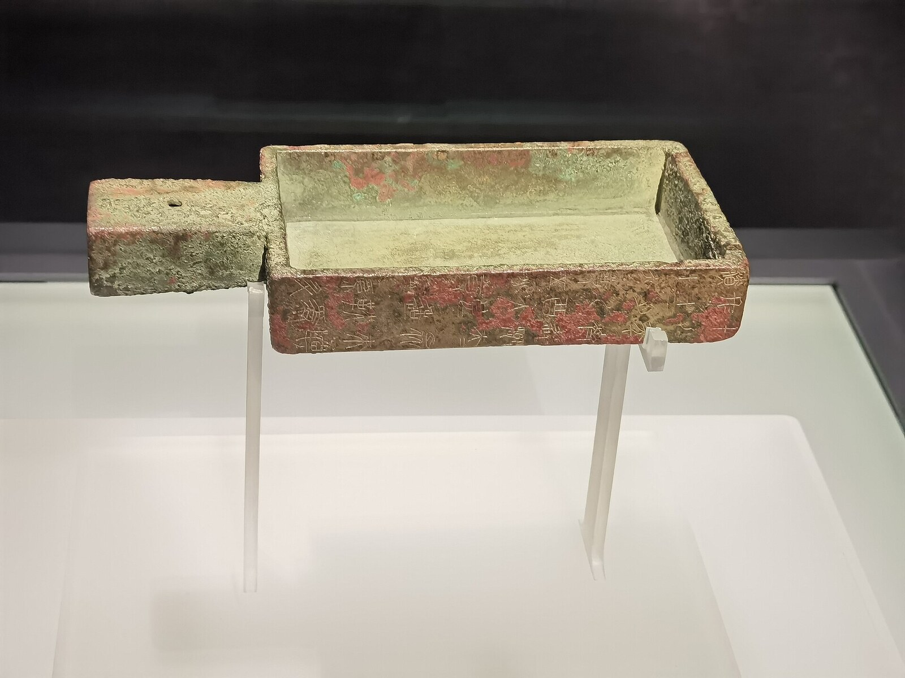
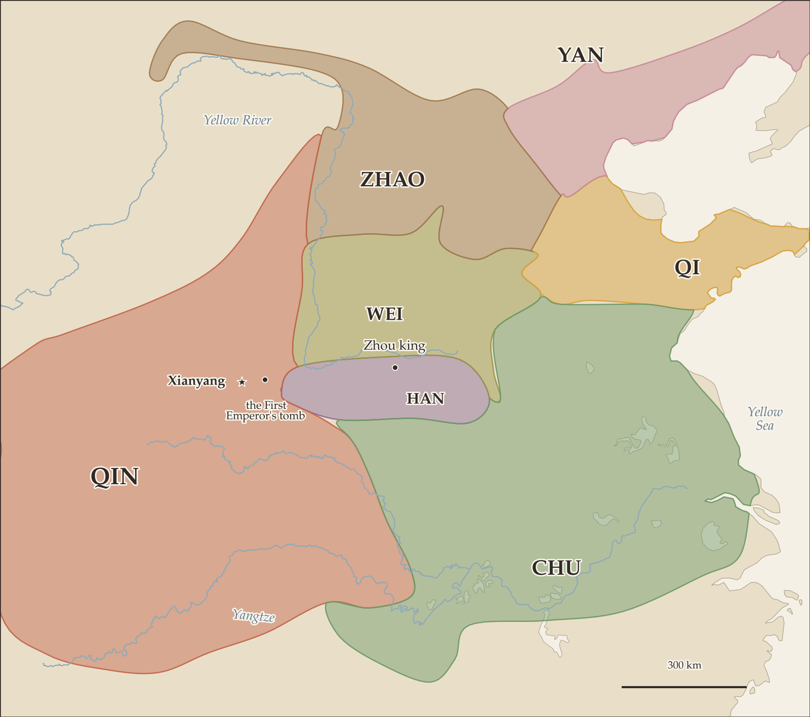
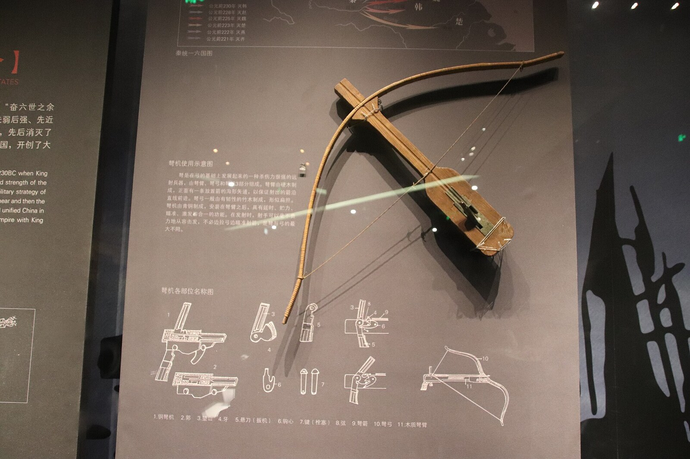
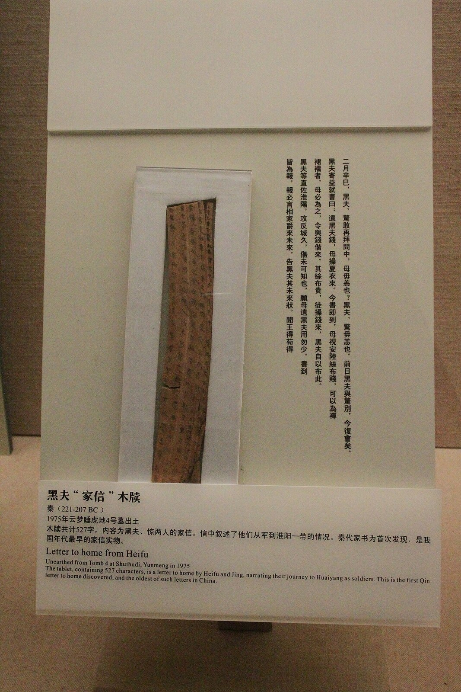
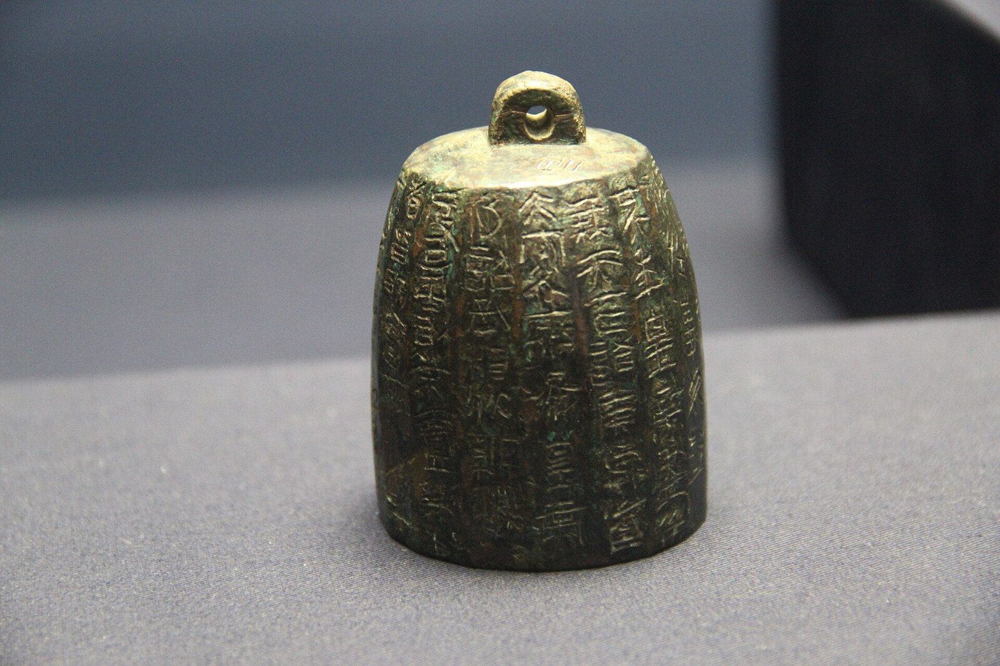
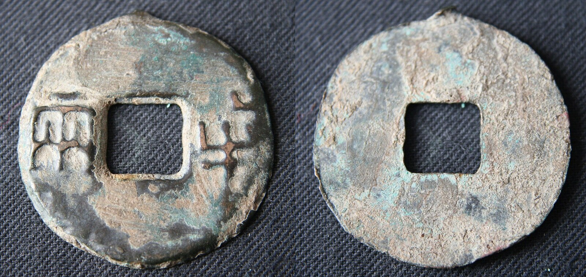
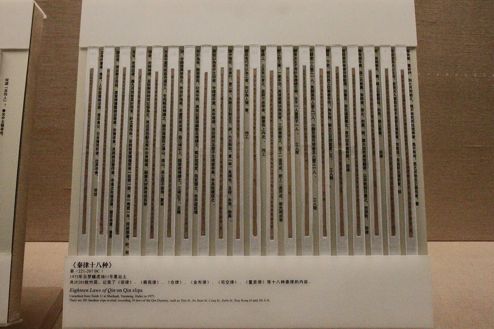
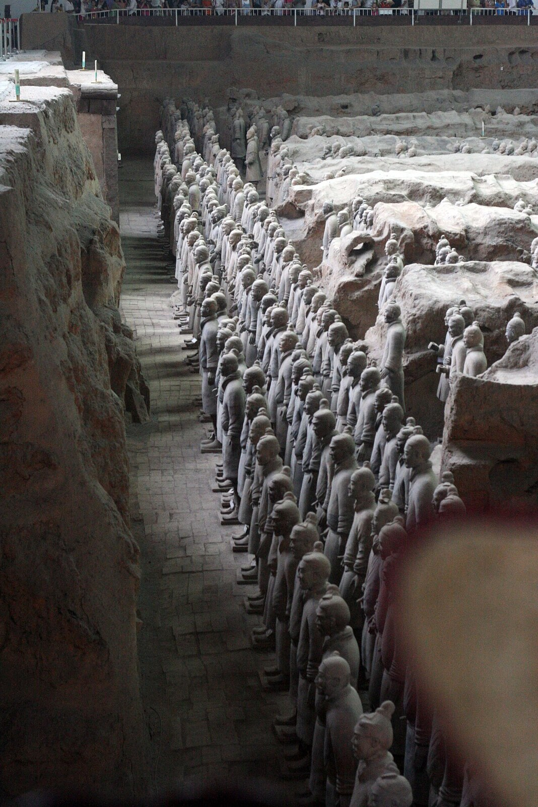
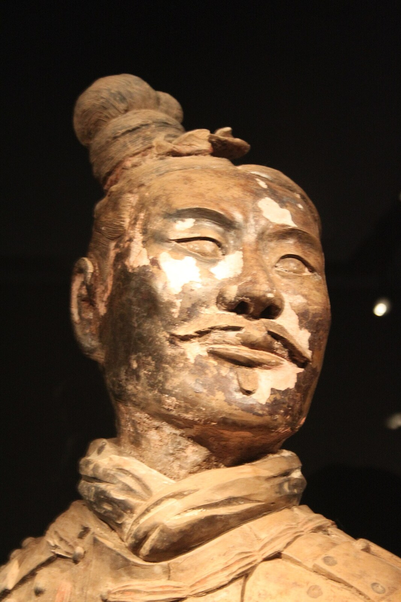
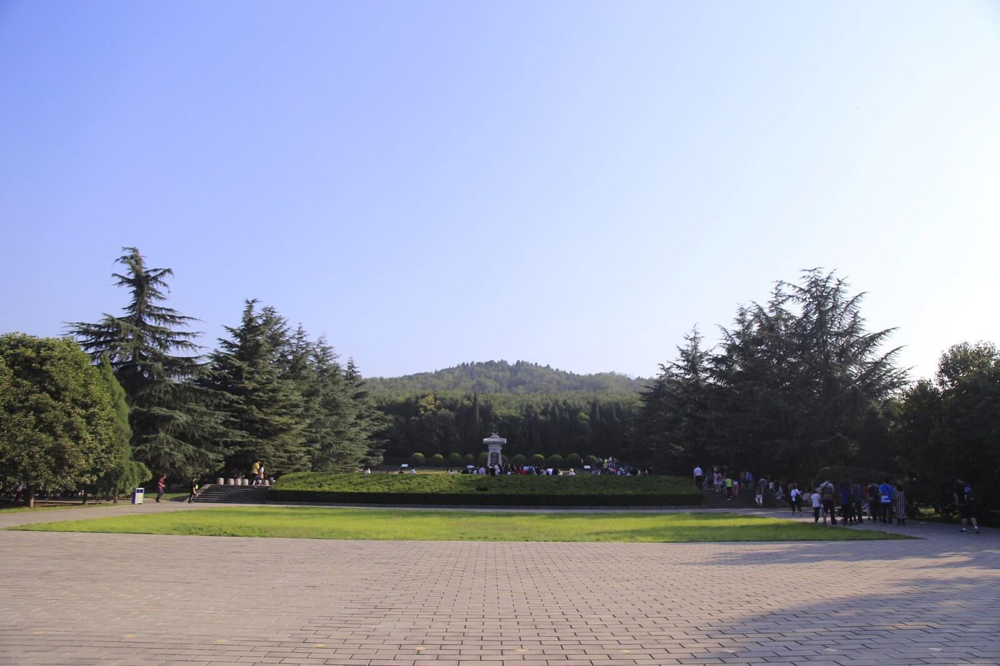

# 21. How did China become one country?

*China, from about 2,400 years ago to about 2,200 years ago*

By conquest, and by counting. One kingdom learned to measure, register and conscript everything that it had, used that knowledge to defeat its six rivals within ten years, and then forced its measures on all of them.

A shallow bronze box in the Shanghai Museum, about the size of a sardine tin, has a short handle at one end. It is open at the top, like a scoop. Filled level to the brim, it holds a fifth of a litre, which is a small teacup of grain.

There is writing cut into one side. It says that the scoop was made in the eighteenth year of a duke of Qin, which was about 2,370 years ago, on the order of his chief minister. It then states its own size. Sixteen and one fifth cubic inches, it says, make one measure. The inch in question is the Qin inch, which is a little over two centimetres.

*The bronze scoop, with the first inscription along its side. It is about 2,370 years old. Photo: Hpppp0527, CC BY-SA 4.0.*

The scoop is thus defined by its length, width and depth, and so anybody with a ruler could check it, or make another exactly like it a thousand kilometres away.

On the underside there is a second inscription, in a different hand. It was cut 123 years after the first. Its forty characters announce that the emperor has united all the lords under heaven, that the people are at peace, and that he has taken the title of emperor. It then gives an order to his two chief ministers. Wherever the measures are not uniform, or are in doubt, they are to be made clear and made the same.

Between the first inscription and the second, China became one country. When the scoop was made, Qin was one kingdom among seven. By the time its underside was cut, the other six were gone, and the same forty characters were being cut, cast and stamped onto scoops and weights from the edge of the desert to the sea.

A conqueror had good reason to care about a teacup. The kings of Akkad, two thousand years earlier, had tried to put the cities of Iraq onto one set of measures for the same reason. Grain was what his subjects paid their taxes in, and it was what his soldiers and labourers were fed with. A ruler who knows how much grain a field owes and how much a man eats can work out how many men he can keep in the field, and for how long. Qin won because it could do that sum better than anyone else.

## Millet, bones and a river of mud

The country that Qin conquered was already very old.

Its heart was the valley of the Yellow River, in the north. The river runs through hills of fine yellow soil, laid down by the wind, and carries so much of that soil along with it that the water is the colour of milky tea. This soil is soft enough to dig with a wooden spade, and it is rich. Farmers had been growing millet in it for thousands of years. Further south, along a second great river, the Yangtze, the land is warm and wet, and there the crop was rice.

About 3,200 years ago, a line of kings called the Shang ruled part of the Yellow River plain. We know what worried them, because they asked their dead ancestors about it in writing. A hot point was pressed against the shoulder blade of an ox or the under-shell of a turtle until the bone cracked, and the cracks were read as the answer. The question was then cut into the bone beside them: whether the harvest would be good, whether the queen's child would be born safely, whether the king should go to war.

The writing on them is the direct ancestor of the Chinese script of today. Each sign stands for a whole word or a piece of one, sound and meaning together, where a letter of an alphabet stands for a single sound, and a modern reader can still pick out the signs for sun, moon and rain.

A little over 3,000 years ago the Shang were overthrown by the Zhou, a people from the west. The Zhou kings explained their victory with an idea that the rulers of China went on using for three thousand years. Heaven, they said, gives the right to rule to a family that rules well, and takes it away from a family that rules badly.

These were the kings who had handed out their conquests to brothers, cousins and allies, and whose lords, by the time of Confucius, had become strangers with armies. The Zhou king lived on in a small territory of his own, honoured by everybody and obeyed by nobody, while the lords swallowed each other. By about 2,400 years ago, what had once been well over a hundred states were seven large ones. One after another, the rulers of the seven dropped the pretence and called themselves kings.

*The seven kingdoms about 2,285 years ago, with Qin in the west. The borders are rough. Map: drawn for this book; coastlines and rivers from Natural Earth, public domain.*

Their wars, as the wandering thinkers had found, were no longer an affair of noblemen in chariots. The states now filled their ranks with farmers on foot, by the tens of thousands. Many carried the crossbow, which is a bow fixed sideways on a wooden stock and released by a bronze trigger. A farmer could learn to aim one far sooner than he could master a bow.

*A bronze crossbow trigger from Qin, fitted into a modern copy of the wooden stock and bow, in the Shaanxi History Museum. Photo: Gary Todd, CC0.*

As a result, the advantage passed to whichever state could put the most farmers in the field and keep them fed. That depended on knowing how many farmers it had, where they lived, and how much grain they grew. Palace clerks had long counted what was in the king's storerooms. Now they had to count the whole country.

## A head for a rank

Qin, which is pronounced "chin", lay on the western edge of this world, in a river valley walled in by mountains.

About 2,385 years ago, a new duke of Qin let it be known that he would reward any man who could make his state strong. The man who travelled west to take up the offer was Shang Yang, the adviser who held that people want gain and fear pain, and that a ruler needs to know nothing more about them. He served the duke for some twenty years.

Shang Yang and those who thought like him were later called the Legalists. They held that a state does not grow strong through the goodness of its ruler, as Confucius had taught, or through the traditions of its noble families. It grows strong through written rules that everybody knows, with fixed rewards and harsh punishments, applied to every person whatever his birth. They also held that a state has use for only two kinds of work, which are farming and fighting.

One of the first things that Shang Yang did was to have the households of Qin written down. Every family was registered, and the families were grouped in fives and tens. The members of a group answered for each other. If one of them committed a crime and the others did not report it, they shared the punishment. In this way every neighbour was turned into a policeman, and it cost the state nothing.

Next he changed what made a man important. Qin was given a ladder of ranks, which in time had twenty steps. A soldier climbed one step by bringing in the head of an enemy. Each step brought him land, a plot for a house, and lighter treatment if he ever broke the law. On the other hand, a nobleman who had won nothing in war lost his privileges. A farmer's son could now rise and a duke's cousin could fall.

Land and families were rearranged to match. A household in which two grown sons went on living with their father paid double tax, and so sons moved out and started farms of their own, each of which was one more household to tax and one more to send soldiers. Land was laid out in plots of a standard size and held by the household that worked it, which in time could buy and sell it. The country was divided into counties, each run by an official whom the ruler appointed, paid and could dismiss.

Finally, there was one set of measures for all of it, checked against bronze standards like the scoop in Shanghai, which carries his name.

Shang Yang did not live to enjoy the result. He had once punished the tutors of the duke's heir for a crime that the heir had committed. When the old duke died and the heir became ruler, Shang Yang ran for the border. According to the historian who tells the story, he stopped at an inn and was turned away. The innkeeper explained that under the laws of Lord Shang, anyone who gave a bed to a traveller without papers would be punished along with him. Shang Yang was caught and killed, and his body was torn apart between chariots.

The new ruler kept the laws.

## Nine years

Over the next century Qin grew by bites. Then, about 2,270 years ago, a boy of thirteen named Zheng became its king, and when he was grown he finished the job.

He began with the nearest and weakest of the six rival kingdoms and took them one at a time. The largest kingdom, Chu in the south, beat one Qin army and was ground down by a second and bigger one. The last, Qi on the eastern coast, gave up without a battle. The whole conquest took nine years.

Two letters survive from inside that army. They were written in ink on slips of wood by two brothers, serving in the campaign against Chu, to their family at home, and they were found in a grave in their home town. One brother asks his mother for money and summer clothes. If cloth is cheap at home, he says, she should make the clothes and send them. If it is dear, she should send the money and he will buy cloth where he is.

*One of the two letters, written in ink on a slip of wood, in the Hubei Provincial Museum. Photo: Gary Todd, CC0.*

So the soldiers of an army famous for its organisation had to write home for their shirts.

With no rivals left, Zheng decided that the title of king was too small. His court composed a new title from two words that had been used for gods and for the wise rulers of legend. We translate it as "emperor". He was to be the First Emperor. His heirs would be the Second and the Third, and so on for ten thousand generations. He had inscriptions set up on mountains across the conquered kingdoms to say what he had done, which was to end the wars and put the world in order. Ashoka, forty years earlier and on the far side of the mountains, had cut his regret for a conquest into rock. The First Emperor's stones express none.

His advisers urged him to hand the distant parts of the conquest to his sons as kingdoms, as the Zhou had done. He refused, because he had seen how that ended. Instead, the whole country was cut into thirty-six districts, each containing a number of counties. Each district was run by officials sent from the capital, who were paid a salary, moved from post to post, and could not pass the job to their sons.

## One of everything

Seven kingdoms had left behind seven of everything, and the First Emperor wanted one. The Persian kings, who ruled a far greater variety of peoples, had for the most part left them their own laws and customs and asked for tribute. Qin chose the opposite course.

He began with the measures. Bronze scoops and bronze weights were sent out from the capital as masters, and the edict of forty characters went with them. On bronze it was cut straight into the metal. For a wooden measure it was cast on a thin bronze plate, to be nailed to the side. Clay measures had it pressed into them with a set of stamps before they were fired. One such clay measure was dug up near the east coast, in land that had belonged to another kingdom a few years before it was made.

*A bronze weight of the Qin empire, with the edict cut into its sides. Photo: Gary Todd, CC0.*

For a farming family, this was the point at which the empire arrived at the door. The grain tax was measured out with the scoop. So were the rations handed to a man doing his labour service. Because the measure was the same everywhere, the accounts of one county could be checked against the accounts of the next, and an official whose scoop was too large or too small could be caught.

Money was treated in the same way. The bronze knives and spades of the old kingdoms were now replaced by a single round coin with a square hole in the middle, marked with its weight. It was the shape that Chinese coins kept for the next two thousand years.

*The coin of the Qin empire, front and back. The two characters give its weight. It is three centimetres across. Photo: Gary Todd, CC0.*

Writing came next. Over the centuries the scripts of the different kingdoms had drifted apart, so that the same word was drawn in different ways in different places. The emperor's ministers issued lists of approved signs in the Qin style, and his clerks were trained to use them. The other styles faded away over the following generations.

This mattered more in China than it would have elsewhere. A Chinese sign carries a meaning as well as a sound, and a clerk learned the sign whatever the word sounded like in his own mouth. Over the centuries that followed, the speech of the north and the speech of the south drifted as far apart as Portuguese and Romanian. Two officials who could not have followed each other's conversation could still read the same written order.

Even the carts were made alike. On roads of soft yellow earth, wheels cut deep ruts, and a cart runs along them much as a tram runs on rails. Each kingdom had built its carts to its own width, and a cart that crossed a border no longer fitted the ruts. The emperor decreed one width between the wheels. He then built highways outward from his capital, so that armies and messengers could reach every district. In the north, the old kingdoms had raised walls of pounded earth along their borders with the herders of the grasslands, and his general joined these into one line.

Now picture what all this meant in a village that had belonged to Chu. The household is on a register, with the name and rank of its head and a list of everyone under his roof. It belongs to a group of five families and answers for the other four. It pays tax in grain and hay. Its men owe the state a month of work each year on roads, walls and canals, and service in the army besides. Nobody may travel without a written pass. Orders come down in writing, from the capital to the district, from the district to the county, and from the county to the village.

## The clerk's coffin

We can see this system from the inside, thanks to a man who took his office files to the grave.

In December 1975, workers digging a drainage ditch in central China, at a place called Shuihudi, broke into a group of old tombs. In one of them lay the skeleton of a man, and packed around him in the coffin were more than eleven hundred strips of bamboo. They were books of the kind that had held the sayings of the philosophers, each strip about as long as a forearm, with one column of writing in ink.

*Some of the law strips from the clerk's coffin, each mounted beside a printed copy of its text, in the Hubei Provincial Museum. Photo: Gary Todd, CC0.*

The man was called Xi. One set of his strips lists the wars of Qin year by year, and here and there he added a note about himself. He was born about 2,290 years ago. He became a county clerk, was later put in charge of hearing criminal cases, and served in the army. He died at about forty-five, four years after the conquest was complete. The district where he worked had been part of Chu until Qin took it, sixteen years before he was born.

Most of his strips are law. They do not read like the decrees of a tyrant. They read like the manual of an office that intends to know everything.

Local officials must report in writing how much rain has fallen and how much farmland it has reached, and report again after drought, flood or locusts. The oxen that plough the state's fields have their waists measured. If an ox has grown thinner, the man in charge of it is beaten, ten strokes for each inch lost.

The granaries are watched just as closely. One strip asks how many mouse holes in a granary deserve punishment. The answer is that three or more cost the man in charge a fine, and two or fewer earn him a reprimand. It adds that three holes of the small kind of mouse count as one hole of the large kind.

Fines are reckoned in shields and suits of armour, even when they were paid in coin. People are counted as children or adults by their height, which a clerk can check with a rod, and not by their age, which he would have to take on trust.

There are also model forms for a clerk to copy. One shows how to report on a man found hanged: the rope, the knot, the marks on the neck, the position of the tongue, how far the feet are from the ground. Another is for the case of two soldiers who arrive together with one severed head, each swearing that he was the one who cut it off.

The punishments in these strips are harsh. A thief could be tattooed across the face and sent to build walls as a convict. They are nevertheless carefully graded, by the value of what was stolen and by the rank of the offender.

One rule deals with men who are called up for labour service and arrive late. For a delay of three to five days, the penalty is a reprimand. For six to ten days, it is a fine of one shield. If the work is stopped by rain, the call-up is cancelled.

Among the laws is a circular letter sent by the governor of Xi's district to his counties, half a century after the district was conquered. The laws are complete and have been announced, he writes, and still the people follow their own local customs, and the officials know it and do nothing.

## An army of clay

In March 1974, farmers digging a well near the city of Xi'an, in the old heartland of Qin, struck a head made of fired clay.

It belonged to a soldier. He was life-size. In three great pits stood an army of about eight thousand clay men, with clay horses and wooden chariots, drawn up in ranks and facing east, toward the kingdoms that Qin had conquered.

*Clay soldiers in the largest of the three pits. Photo: Joe Hart, CC BY 2.0.*

The figures were built from the feet up, out of coils and slabs of clay, with solid legs and hollow bodies. The heads were made separately and finished by hand, which is why the faces differ. They were then painted in bright colours, most of which have flaked away. In their hands they carried real weapons: swords, spears, and crossbows with bronze triggers. Chinese ploughs and spades were by this time made of iron, but weapons were still mostly bronze.

*The head of one of the clay archers, with some of its paint still in place. Photo: Gary Todd, CC0.*

The clay army was made in the same spirit as the bronze scoop. Many of the figures carry a name, stamped or scratched in a place where it does not show. These are the names of the foremen whose teams made them, and more than eighty have been found. It was a rule in Qin workshops that a maker put his name on his work, so that a fault could be traced to the man responsible.

The army guards a tomb. A kilometre and a half to the west stands a mound the size of a hill, which has not been opened. Work on it began when Zheng became king. The historian of the next dynasty says that seven hundred thousand men were sent to work on the tomb and on his new palace.

*The mound over the First Emperor's tomb, now covered in trees. Photo: Legolas1024, CC BY-SA 4.0.*

Some of them never left. Near the mound, archaeologists found a burial ground of labourers. With a few of the bodies lay pieces of broken roof tile, on each of which somebody had scratched a dead man's name, his home town and his rank. Several add that he was working off a debt to the state. Most of the home towns are in the east, in the conquered kingdoms.

## What his enemies wrote

Nearly everything that is told about the First Emperor as a man comes from one book. It was written more than a century after his death by Sima Qian, the court historian of the Han, the dynasty that replaced the Qin.

Sima Qian was a careful writer, and the finds have borne out a great deal of what he says. The Han, however, had come to power by overthrowing the Qin, and they justified their rule by saying that the Qin had been monsters. The stories about the First Emperor reached Sima Qian through people who had every reason to darken them.

The two most famous are about books and scholars. In the first, eight years after the conquest, the chief minister complained that learned men were using the past to find fault with the present. On his advice, the emperor ordered the histories of the other kingdoms to be burned, along with all copies in private hands of the old poems, the old records and the works of the philosophers. Books on medicine, farming and fortune-telling were spared.

That order was probably given much as described, and its last clause matters most. The scholars of the emperor's own court were allowed to keep their copies. The aim was to make the past a property of the state, as grain measures were. The greater loss came seven years later, when rebels set fire to the capital and the court's libraries burned with it.

In the second story, a year after the burning, the emperor had more than four hundred and sixty scholars buried alive. Sima Qian's own account is messier. It begins with men who had promised to find the emperor a drug that would stop him dying, had taken his money, and had then run away and mocked him. The emperor ordered an inquiry among the experts at his court, and more than four hundred and sixty of them were put to death. The word used for their deaths can mean that they were buried alive, and it can also mean that they were killed and thrown into a pit. Later writers under the Han turned the victims into a company of blameless students of the old books.

Other evidence points the same way. The stone inscriptions that the emperor set up on mountains across his new territories are composed in the language of the old poems and records, and experts in those books held posts at his court until the end. Most historians now think that he controlled learning tightly and killed people who crossed him, and that the picture of an emperor at war with scholarship was painted afterwards.

## Delayed by rain

The First Emperor died about 2,235 years ago, while travelling in the east of his empire. He was forty-nine. A younger son took the throne as the Second Emperor.

The next summer, nine hundred conscripts were marching north to serve on the frontier. On the eastern plain, heavy rain flooded the road and held them up until they could no longer arrive by the appointed day. According to Sima Qian, the law was that men who arrived late were beheaded.

Two of the conscripts, one of them a former hired farmhand named Chen Sheng, talked it over. If they marched on, they would die. If they ran away, they would be caught and die. If they rebelled, they would probably die too, but they might win a kingdom first. They killed their officers, cut poles for weapons, and called on the country to rise.

Xi's bamboo strips give a different rule for lateness, with a reprimand, a fine, and no penalty at all when it rains. Those strips concern labour gangs, and soldiers bound for the frontier may have been under harsher orders. It is also possible that the Han sharpened this story as they sharpened others. Either way, the story was believed, because it sounded like Qin. Within weeks, people across the conquered kingdoms were killing their Qin officials and joining the revolt, which they would not have done had the laws felt light.

Chen Sheng himself lasted six months before his own driver murdered him. The government grew so short of soldiers that it handed weapons to the convicts working on the emperor's tomb. A little over three years after the First Emperor's death, the last ruler of Qin surrendered. The dynasty that was to last ten thousand generations had lasted fifteen years.

Shang Yang had built a machine for winning wars, and during the wars its demands came with a prize. A man risked his neck, and he might come home with a rank and a farm. Once the six kingdoms had fallen, the fighting moved to distant frontiers, and for most men the prize was gone. The call-ups went on regardless, for the garrisons, the tomb, the palaces, the roads and the walls. Moreover, they now fell on the people of six kingdoms who had never chosen Qin's laws, and whose old noble families were still alive to lead them.

The man who came out on top of the wars that followed was Liu Bang. He was a farmer's son from the old lands of Chu, and he had been a minor officer in Qin's service. About 2,230 years ago he became the first emperor of the Han, a dynasty that lasted four centuries.

When his army entered the Qin capital, his officers ran for the treasure houses. One of his officials, the story goes, went instead to the government offices and carried away the maps, the household registers and the books of law.

The Han kept most of it. They kept the counties and the appointed officials, the registers, the ranks, the labour service, the round coin, the script and the measures. A Han official was buried about thirty years after Xi with his own bamboo law books, and many of the rules in them are Qin rules. The one thing that the Han gave up, for a time, was the First Emperor's refusal to share. They handed the eastern half of the country to kings, and then spent several generations taking it back.

What the Han changed was the weight of the system and the story that was told about it. First, they made it lighter, and cut the grain tax to a thirtieth of the crop. Second, and above all, they changed the reason given for obeying. The First Emperor's inscriptions praise his own achievement: he had ended the wars and put the world in order. The Han claimed something older. Heaven, they said, had taken its approval from the cruel house of Qin and given it to them, just as it had once passed from the Shang to the Zhou. In time they filled their offices with men schooled in the old books that Confucius had loved, which teach that a ruler owes his people kindness.

The clerks under them went on registering households and measuring grain.

Most of the people of China today call themselves Han, after the dynasty that inherited the empire. The name that the rest of the world uses, China, most likely comes from Qin, the kingdom that built it. Under both dynasties, the grain was measured with a scoop of the same size.
