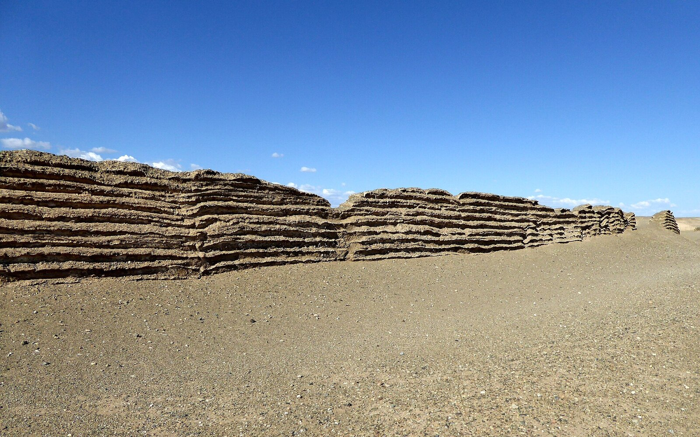
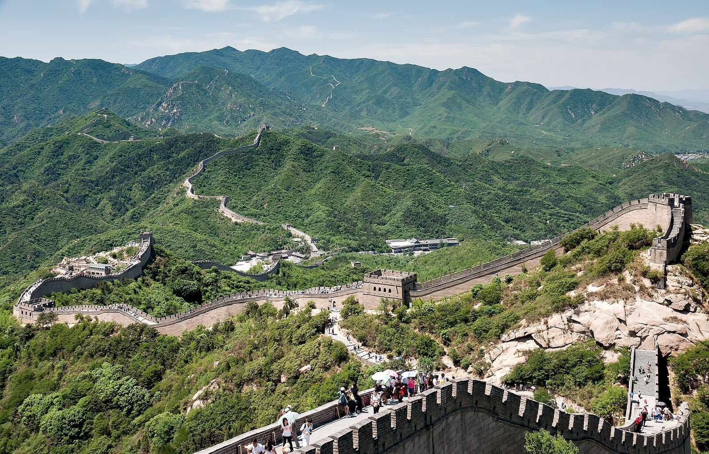
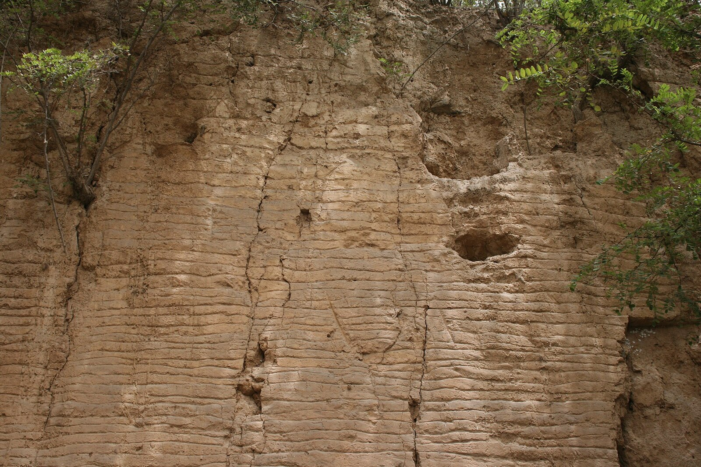
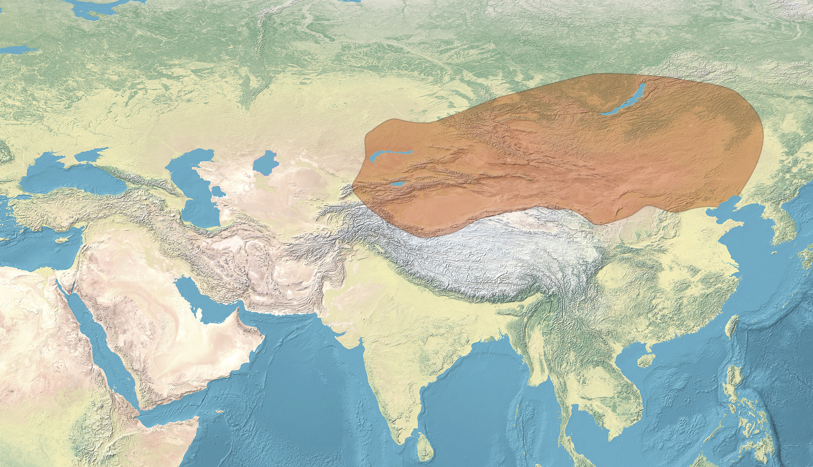
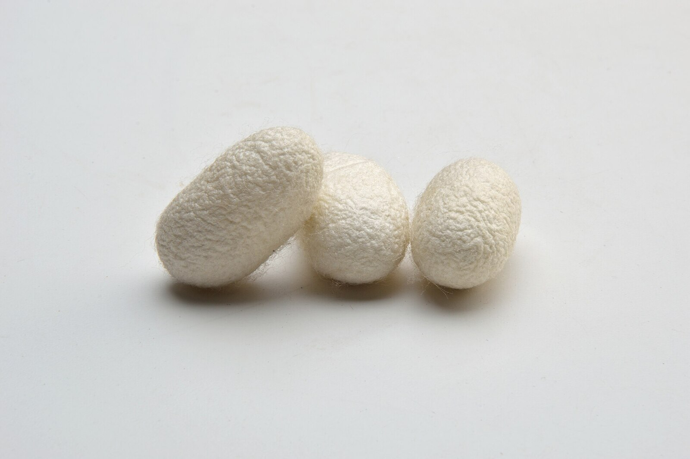
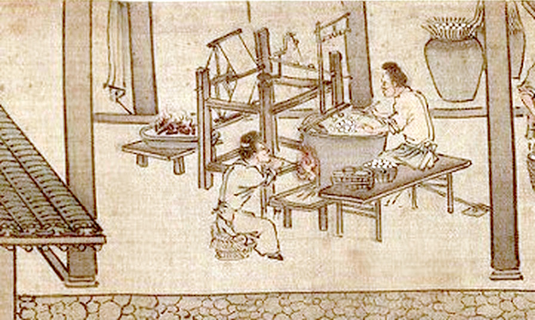
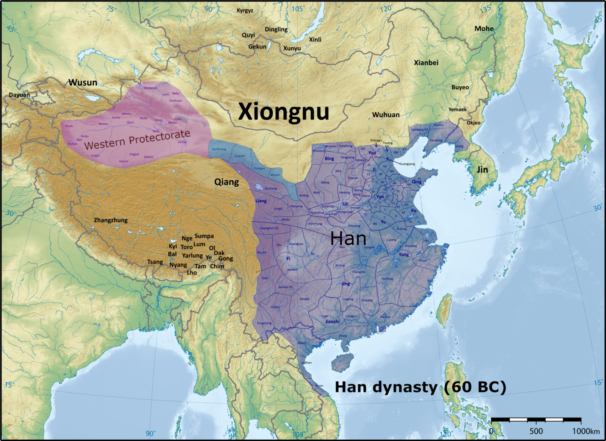
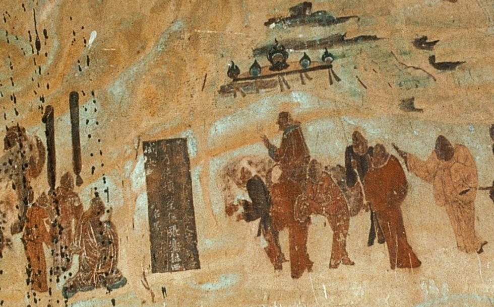
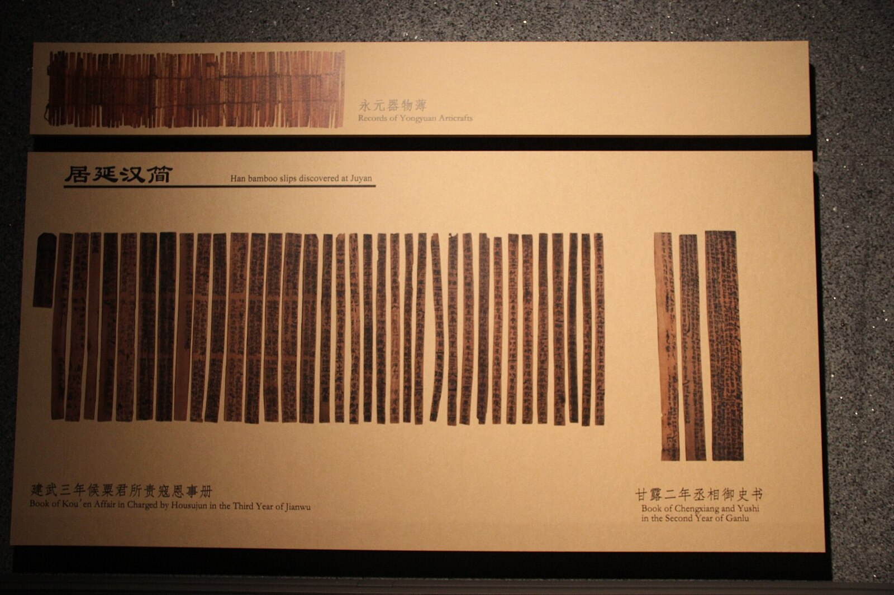
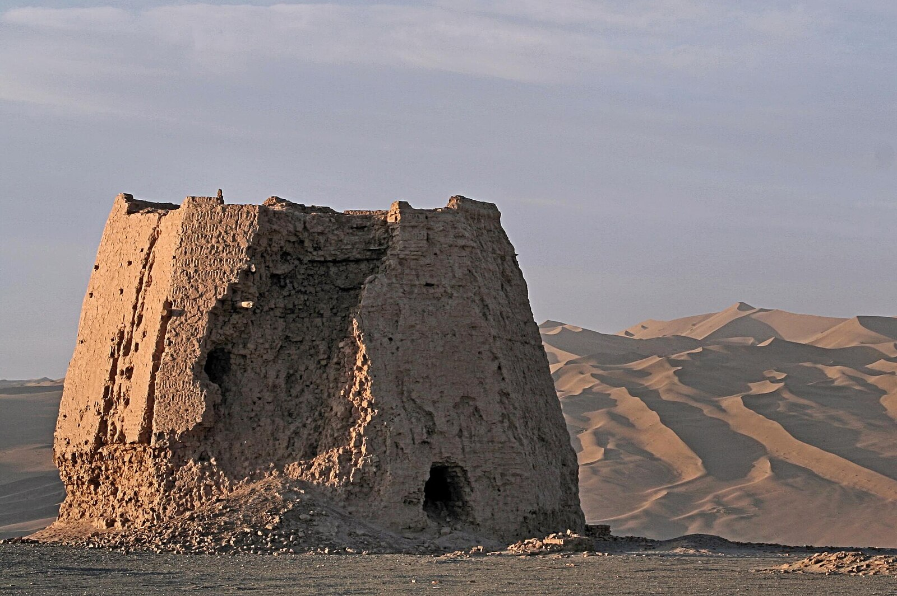

# 22. Why was the Great Wall of China built?

*The northern frontier of China, from about 2,200 to about 2,000 years ago*

The first long walls were built less to keep raiders out than to hold pasture that had been taken from them, and to decide who crossed the frontier and where trade took place.

In the spring of 1907, a British archaeologist named Aurel Stein was crossing the gravel desert west of Dunhuang, an oasis town in the far north-west of China. Out on the bare plain he came upon a low, straight ridge that ran on towards the horizon. When he looked at it closely, he saw that somebody had built it. It was made of bundles of reeds and brushwood laid flat, with a layer of gravel and clay on top of them, then more reeds, then more gravel, like a cake of many layers. In places it still stood higher than a man.

*The wall in the desert near Dunhuang, about 2,100 years old. The dark stripes are layers of reeds and brushwood. Photo: Hiroki Ogawa, CC BY 3.0.*

Every few kilometres along the ridge stood the stump of a tower. Beside the towers lay heaps of ancient rubbish, and Stein's workmen dug into them. Out came thin strips of wood, each about as long as a chopstick and a little wider, covered in Chinese writing in black ink. Some of them carried dates. The oldest had been written about 2,100 years ago.

Stein had found the western end of the Great Wall of China. It was not the wall on the postcards. That one, a grey battlement of cut stone and brick riding the mountain ridges north of Beijing, is about 500 years old. The wall in the desert is sixteen centuries older, and there is not a brick or a cut stone in it.

*The wall on the postcards, north of Beijing. It is about 500 years old. Photo: CEphoto, Uwe Aranas, CC BY-SA 3.0.*

The usual material for a long wall in those days was earth. Builders set up two lines of planks on edge, as far apart as the wall was to be thick, and shovelled a layer of damp soil between them. Then gangs of men pounded the soil with heavy wooden rammers until it was little more than half as deep and nearly as hard as soft rock. They added another layer and pounded again. When the earth reached the top of the planks, the planks were moved up, and the work went on. A wall built in this way shows its layers for ever afterwards, like the pages of a closed book. All that it needs is soil, timber and a very large number of people.

*A cut through the rammed-earth wall of an ancient city in central China, more than 2,200 years old. Each stripe is one layer of pounded soil. Photo: Gary Todd, CC0.*

In the desert there was no proper soil, and so the builders used what lay to hand. Gravel took the place of earth. Reeds from the marshes, tied in bundles, held each layer together, and the salt in the desert water set the whole thing hard.

A wall in that place is a puzzle. The old farmland of China lay more than a thousand kilometres away to the east. The people who built it were not fencing in their fields.

## Boys on sheep

North of the Chinese farmland the rain thins out, and the fields give way to the eastern end of the steppe, the sea of grass that runs from Mongolia to Hungary. The people who lived there were herders. They kept sheep, horses, cattle and camels, lived in tents of felt, and moved with the seasons from one pasture to the next. It was the way of life that the wagon herders had begun at the far western end of the grass three thousand years earlier, and by this time the people of the steppe had been riding horses for many centuries.

The Chinese called them the Xiongnu, said roughly as "shyong-noo". We do not know what they called themselves, because they left no writing. Almost everything that was ever written about them was written by the people they fought. Even the name is a Chinese spelling, and the second of its two characters means "slave".

The fullest account comes from Sima Qian, the Han court historian who also passed on the dark stories about the First Emperor. He wrote about 2,100 years ago. The graves that archaeologists have opened in Mongolia bear out much of what he says. All the same, the reader of his pages is looking at the herders through the eyes of their enemy.

Sima Qian begins with the children. The little boys of the Xiongnu, he says, learn to ride on the backs of sheep, and shoot at birds and rats with a bow. When they are older they shoot foxes and hares for the pot. As a result, every grown man can handle a bow from the saddle, and in time of war every one of them is a horseman.

The bow in question was the same kind that the chariot crews of the old palaces had used, built up from wood, horn and sinew, and there was a reason for each layer. When a bow is drawn, the side that faces the target is stretched, and the side that faces the archer is squeezed. Sinew, the tough cord that ties an animal's muscle to its bone, can be stretched a long way and will spring back. Horn can be squeezed hard without crushing. A bowyer therefore took a thin strip of wood, glued horn to the inner face and shredded sinew to the outer face, and let the whole thing cure for months.

The result stored far more energy for its length than a bow of plain wood. It could therefore be a good deal shorter and still hit as hard, which matters to a rider who has to swing his weapon from one side of a horse's neck to the other.

Now put that bow into the hands of a man who has ridden since before he could remember. He comes within range, shoots, and wheels away before anyone on foot can reach him. He can turn in the saddle and shoot backwards as he goes. Sima Qian noted, with some disgust, that the Xiongnu saw no shame in running away.

For a farming state, such an enemy posed three problems.

First, he was very hard to catch, since the heart of a Chinese army was men on foot.

Second, he had little that could be captured. An army that invades a kingdom of farmers can seize its towns and empty its granaries. The herders had hardly any towns. Their wealth walked on four legs, and when an army came they drove it away over the horizon. The first tax collectors of the plain of Iraq had succeeded because a heap of grain cannot be hidden, and a farmer cannot take his irrigated field with him. A herd can be driven out of sight, and a herder takes everything he owns. Meanwhile the invaders ate through the food they had carried with them, and then they had to go home.

Third, he came ready-made. A farming state has to take a man away from his field, feed him, arm him and train him, and it must find him a horse and grain for the horse. Among the herders, every man already owned horses and a bow, and the skills of his daily work, riding and shooting and moving camp, were the skills of war.

For that reason a people of a million or so herders could hold its own against an empire of tens of millions.

## The whistling arrow

It would be natural to suppose that the herders raided first, and the farmers built walls to stop them. The order of events was closer to the reverse.

For generations, the kingdoms of northern China had been pushing outwards into the grass. When one of them took a stretch of pasture, it built a long wall of rammed earth to mark and hold what it had taken. Archaeologists have traced those early walls, and many of them stand well out in the steppe, beyond the land where grain grows easily.

Then, about 2,250 years ago, Qin conquered all the others. A few years later, the First Emperor sent a general north with a huge army into the great loop of the Yellow River, a wide grassland where the Xiongnu pastured their herds. The general drove the herders out, joined the older walls into one long line, and planted settlers behind it.

The Xiongnu at that time were one herding people among several, and they had now lost their best pasture. Their ruler had a son named Modu, and Sima Qian tells how the son took power. Modu was given command of a body of horsemen. He made arrows that whistled as they flew, and he gave his men one rule: whatever he shot at with a whistling arrow, they must all shoot at once, or die. First he shot at his own best horse. Some of his men hesitated, and he had them killed. Next he shot at his favourite wife. Again some held back, and they died too. Then he shot at his father's finest horse, and every man loosed. Finally, out hunting, he sent a whistling arrow at his father. Every arrow followed.

Over the next thirty years, Modu beat the herding peoples to his east and west and joined their horsemen to his own. He came to rule the steppe from Manchuria to the mountains of Central Asia, along with the oasis towns on its southern edge. His commanders held ranks counted in thousands and tens of thousands of horsemen, and each autumn the people gathered to have their numbers and their animals counted. The Xiongnu had become an empire in their own right.

*The Xiongnu empire, in orange, after the conquests of Modu. China lies to its south-east. Map: Wikimedia Commons, CC0.*

Meanwhile, Qin had fallen, and Liu Bang, the farmer's son from Chu, had made himself the first emperor of the Han. Along with the registers and the measures, he inherited the northern frontier, where Modu had already taken back the loop of the Yellow River.

About 2,225 years ago, two years after he took the throne, the Han founder marched north in person to settle the matter. It was a bitter winter. Modu pretended to retreat and kept his best men out of sight. The emperor hurried ahead of his infantry and was surrounded on a hillside, where he was held for seven days.

He got out alive, and two years later he agreed to a treaty. Every year the Han would send the Xiongnu fixed amounts of silk, grain and wine. A Han princess would be given to the Xiongnu ruler in marriage. The two rulers would count as brothers, as the kings of Egypt and Hatti had once done.

The Chinese called this arrangement "peace through kinship". In plain terms the larger empire was paying tribute to the smaller one. The treaty was renewed again and again over the next sixty years, usually on richer terms.

## Cocoons

Modu had trapped the emperor of China, let him go home, and then settled for cloth and wine. He did so because cloth and wine were what the grassland lacked.

A herd provides meat, milk, wool, felt and leather. It does not provide grain, woven cloth, lacquered cups or bronze mirrors. The Xiongnu grew a little millet and forged some iron of their own, but never enough. They did not want to rule the farmland, which cannot be done from a saddle. They wanted its products, and they could trade for them, be given them or take them. The Xiongnu did all three.

For the ruler there was a further reason. An empire of herders is held together by generosity. Every chief under him had his own herds and his own riders, and could simply ride away. A ruler who handed out silk and wine at the great gatherings gave those chiefs a reason to stay.

Silk deserved the trouble. It is light, strong and brilliant when dyed, and for a very long time nobody outside China could make cloth like it.

It starts with a moth. The silk moth lays several hundred eggs, each the size of a pinhead. The caterpillars that hatch from them are fed on the leaves of the mulberry tree, and they eat day and night. In Chinese farmhouses they were kept indoors on trays, and the women of the house brought them fresh leaves many times a day. In about a month a caterpillar grows to ten thousand times the weight it had when it hatched.

Then it stops eating and spins. From an opening below its mouth it squeezes out a single fine thread, coated in a natural gum, and winds it around itself in figures of eight. After two or three days it is sealed inside a cocoon about the size of a peanut shell. The thread that makes up that cocoon is unbroken and about a kilometre long.

*Cocoons of the silk moth. Photo: Biswarup Ganguly, CC BY 3.0.*

The whole art lies in getting that thread off again in one piece. If the moth is allowed to hatch, it makes a hole in the cocoon and breaks the thread into short lengths. So the cocoons are heated to kill the insect inside. Next they are dropped into a pan of hot water, which softens the gum. The woman at the pan stirs them with a small brush until a loose end catches from each cocoon. She gathers the ends from several cocoons, passes them together through a small ring, and fixes them to a wooden frame that turns like a wheel. This frame is the reel. As it turns, it pulls, and the cocoons bob and spin in the water as they unwind. A single strand is too fine to use. However, as the strands leave the water the gum hardens again and sticks them together into one smooth thread, far longer and more even than any spun from wool or flax.

*Reeling silk, from a Chinese painting about 800 years old. The cocoons float in the pan of hot water, and the thread is wound onto the wooden frame behind it. Painting attributed to Liang Kai, public domain.*

It takes several thousand cocoons to make one robe. In Han China, a great many farm households raised the worms, and the government collected part of its taxes in bolts of finished cloth.

Some of that cloth went north. In the hills of northern Mongolia, the Xiongnu nobles lie in timber chambers at the bottom of deep pits. When Russian archaeologists opened a group of these tombs in the 1920s, they found Chinese silks, some of them embroidered, and Chinese lacquer cups. One cup is marked as the property of the emperor's own park.

## Salt and iron

The treaty did not stop the raids. The Xiongnu ruler could not hold back every chief, and did not always wish to. In one bad year, a great force of riders burned one of the emperor's palaces, and their scouts came within a few days' ride of the capital.

For sixty years, the Han court argued over what to do.

One side said that peace was cheap. The yearly gifts cost far less than an army, and there was nothing in the north worth winning. A general who wins a battle on the steppe has won only the steppe.

The other side said that the arrangement was a disgrace and did not even work. One official wrote that the empire was like a man hanging upside down, with the feet on top and the head at the bottom. The emperor was paying tribute to barbarians, and the barbarians were raiding him anyway.

The peace party won those arguments because the early Han was poor. Sima Qian records that after the civil war, the emperor himself could not find four horses of the same colour to draw his carriage.

Sixty years without a great war changed that. By the time a young emperor known as Wu came to the throne, the granaries were overflowing. He was fifteen years old, he would rule for fifty-four years, and he chose war.

Year after year, Han armies of cavalry rode into the steppe. They took back the loop of the Yellow River. They took a corridor of oases, a thousand kilometres long, that runs north-west from the Yellow River to Dunhuang, with the mountains of Tibet on one side and the Gobi desert on the other. In the largest campaign, two Han armies crossed the Gobi and broke the Xiongnu on their own ground. The Xiongnu ruler moved his camp far to the north.

*The Han empire about 2,080 years ago, a generation after the conquest of the corridor. The blue strip is the corridor of oases, ending at Dunhuang. The pink area beyond it holds the oasis kingdoms. Map: Qiushufang, CC BY-SA 4.0.*

These were real victories, and they came close to ruining the victor. On that one campaign across the Gobi, the Han took a hundred and forty thousand horses into the desert, and fewer than thirty thousand came back. Farmland is poor country for breeding horses, and for years afterwards the Han could not mount another such expedition. Later, one general was surrounded with his men deep in the steppe and surrendered. Sima Qian spoke up for him at court, and the emperor had the historian castrated for it. Sima Qian finished his book all the same. Our best source for the war with the Xiongnu is a man whom it maimed.

Within twenty years the savings of sixty were gone, and the government went looking for money. It found it by taking the making and selling of salt and iron into its own hands.

Every person must eat salt, and every farmer needs an iron ploughshare, a hoe and a sickle. If the state is the only seller, it can set the price, and part of that price is a tax that is very hard to dodge. The cavalry on the steppe was paid for at the salt seller's stall.

People complained, and their complaints survive. Six years after Emperor Wu died, the government called some sixty scholars from the provinces to the capital to say what was wrong with the country, and a record of the debate was written up. The scholars said that the state's iron tools were badly made and dear, so that poor farmers had gone back to ploughing with wood, weeding by hand and eating their food without salt. They wanted the monopolies ended and the garrisons brought home. A good ruler, they said, wins over distant peoples by his virtue.

The minister who had designed the monopolies gave them a short answer. The frontier has to be held, he said, and the soldiers who hold it must not be left cold and hungry. If the money does not come from salt and iron, how are they to be supplied?

The monopolies stayed. Salt remained a business of the Chinese state, with interruptions, into the twenty-first century.

## The envoy

A few years before the fighting began, the young emperor had tried something else.

Xiongnu prisoners had told his officers about a people called the Yuezhi, who had once lived at the western end of the corridor of oases. The Xiongnu had defeated them, killed their king and made his skull into a drinking cup, and the survivors had fled west. The emperor decided to find them and propose an alliance. He chose a court attendant named Zhang Qian and gave him a hundred men.

The way west led straight across Xiongnu country, and Zhang Qian was caught almost at once. The Xiongnu ruler asked him a fair question. If he sent envoys through China to the kingdoms on its far side, would the Han let them pass? He then kept Zhang Qian for ten years, and gave him a Xiongnu wife.

When the watch on him slackened, Zhang Qian escaped and went on westward, over the mountains, into lands that no Chinese official had seen. In time he found the Yuezhi, north of the river Oxus on the edge of what is now Afghanistan. They had conquered a rich country, they were living well, and they had no wish to fight anybody. He turned for home. On the way the Xiongnu caught him again. He escaped again, and reached the Chinese capital thirteen years after leaving it, to find the war already under way. Of the hundred men who had set out, one came back with him.

*The mission of Zhang Qian, as painted about 1,300 years ago on the wall of a cave temple near Dunhuang. Painter unknown, public domain.*

His mission had failed. His report, on the other hand, changed the court's picture of the world. He described a country called Ferghana, in a high valley beyond the mountains, with walled towns, wine made from grapes, and horses far finer than any in China. South of the Oxus lay Bactria, a land of walled cities and busy markets, where Alexander's Greeks had settled two centuries earlier.

In other words, beyond the herders there were more farmers and more cities, with horses to sell and a taste for Chinese goods.

The corridor of oases was the road to those countries, and the Han armies seized it about five years after Zhang Qian came home. From then on the emperor sent missions west, several in a year, each with hundreds of men and loads of silk.

## Raked sand

To keep that road open, the Han had to hold the corridor. They moved in settlers and soldiers by the tens of thousands, dug canals, and set up four new provinces along it, of which the furthest west was Dunhuang. Along the northern edge of the corridor they built a wall. Beyond its end, a line of towers ran on alone into the desert.

This was the ridge of reeds and gravel that Stein found. It did not surround the old farmland of China. It surrounded pasture that had belonged to the Xiongnu a few years earlier, together with the new farms planted on it and the road that led to the horses.

The wooden strips show how the line worked. Han clerks wrote as the clerks of Qin had, on narrow strips of wood or bamboo tied side by side with string. In the dry desert air, the strips thrown away by the garrisons have lasted. Tens of thousands have been dug out of the towers and forts, and they are the daily paperwork of an army.

*Strips from the frontier forts at Juyan, on the northern edge of the corridor, in the National Museum of Chinese Writing at Anyang. Photo: Gary Todd, CC0.*

A tower was held by an officer and a handful of men. The men were conscripts, since every Han farmer owed the state a term of service, and many had walked for weeks from villages in the east. The strips list them by name, home district and age. They record what each man was issued: a monthly measure of grain that came to about two litres a day, a ration of salt, and clothing.

*A Han watchtower near Dunhuang. Photo: The Real Bear, CC BY 2.0.*

The men kept watch, and they kept a signal code. A flag or a column of smoke by day, or a torch by night, told the next tower that riders had been seen, and the number of signals told how many. A warning passed along the line much faster than a horse could gallop.

Each day, men walked along a strip of sand beside the wall that had been raked smooth, looking for footprints. Prints in the sand showed that someone had crossed in the night, and which way they were going.

The direction mattered, because people crossed both ways. Many years later, a Xiongnu ruler who had made his peace with the Han offered to guard the frontier himself, so that the garrisons could go home. A Han official wrote out ten reasons for refusing. Several of them concerned people getting out, among them criminals on the run and slaves, who had heard that life among the herders was pleasant.

Finally, there were the gates. Peaceful travellers had to pass through them, carrying a wooden pass. The clerks wrote down each person's name, age, height and complexion, and the cart and animals that came with them. At certain points on the frontier there were markets, where herders could bring horses and furs and take away grain and cloth. Sima Qian says that the Xiongnu loved these markets, and went on coming to them even after the war began.

The wall, then, was an obstacle to an army and no more than that. A large force of riders could go round it or break through it, and several did. What the line did every day was to hold conquered ground, give a few hours' warning, and make everyone who crossed in peace do so at a place where they could be counted, taxed or turned back.

The conscript who patrolled the sand wanted very little out of all this. He wanted his grain to be issued on time, and he wanted to go home.

## White camels

The merchants wanted a great deal more.

West of Dunhuang lies a second desert, a sea of dunes the size of Germany. The road passed round its rim, from one oasis kingdom to the next, and then climbed over the mountains to Ferghana, Bactria and beyond. Once the Han held the corridor, embassies came down that road to the Chinese court. They brought gifts for the emperor, and they were sent home with gifts of silk.

Near Dunhuang, archaeologists have dug up a government rest house that fed and lodged these travellers, along with its files. One set of strips, about 2,060 years old, preserves a complaint. Envoys from two kingdoms in the region of Tashkent and Samarkand had brought camels to present at court. They protested that the Chinese officials had valued the animals without letting them watch, had written down their white camels as yellow, and had recorded fat camels as thin.

Men who argue like that over the price of a camel are not really diplomats. One Han official said so outright. The so-called envoys of a certain kingdom, he told the court, included no nobles at all. They were merchants who wished to trade, and presenting gifts was their excuse.

The Han let them come anyway. As in the age of bronze, a good deal of trade travelled in the dress of friendship.

Silk also left China by a humbler route. Bolts of it were sent to the frontier, along with coin, to pay and supply the garrisons. In the rubbish beside one tower, Stein found the end of a bolt, about 1,900 years old, with a note in ink. It gives the district where the cloth was woven, some two thousand kilometres to the east, along with its width, its length, its weight and its price, which was six hundred and eighteen coins. On the frontier, silk served as money. The garrisons spent it in the oasis markets, and from there it moved westward from hand to hand.

Hardly any merchant made the whole journey. Goods crossed Asia in short stages, sold on at a profit in each market. Within a century or so, Chinese silk was being worn in Rome by people who believed that it was combed from the leaves of a tree. In the nineteenth century, a German geographer gave these caravan tracks the name by which they are known, the Silk Roads.

The Xiongnu, for their part, never recovered the corridor. Hard winters and quarrels over the succession split them, and about 2,075 years ago one of their rival rulers rode south to the Han capital and bowed to the emperor. The court was overjoyed. It then gave him gold, coins, and eight thousand bolts of silk. Each time he or his heirs came back, the presents grew, until a single visit was worth thirty thousand bolts.

The words had changed, and the Xiongnu ruler was now the one who brought tribute. The silk still travelled north.

In a tomb in the mountains of Mongolia, a Xiongnu lord lies among cloth that was reeled, strand by strand, by a woman in a Chinese farmhouse whom he never saw. In a rubbish heap in the desert lies the tally of the grain issued to a conscript who was sent to stand guard against him. The wall ran between the two of them for the better part of three hundred years, and it had gates in it.
