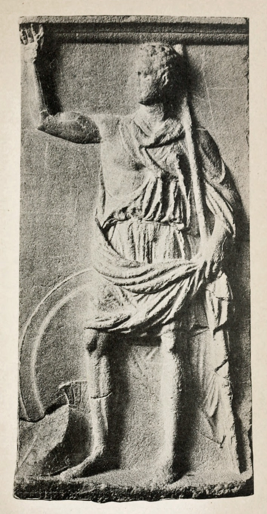
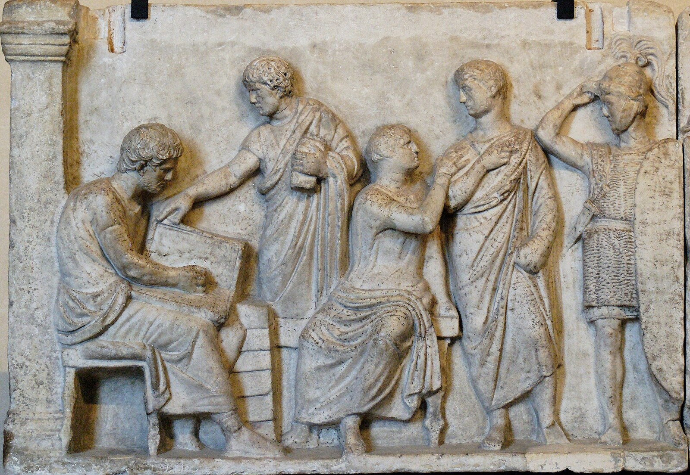
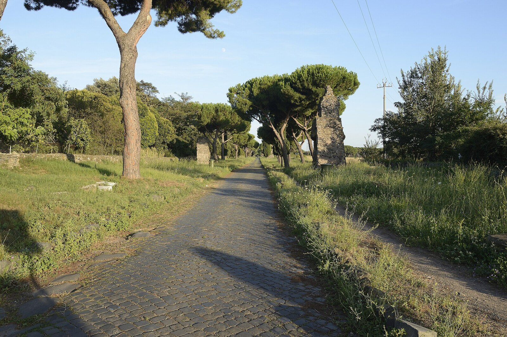
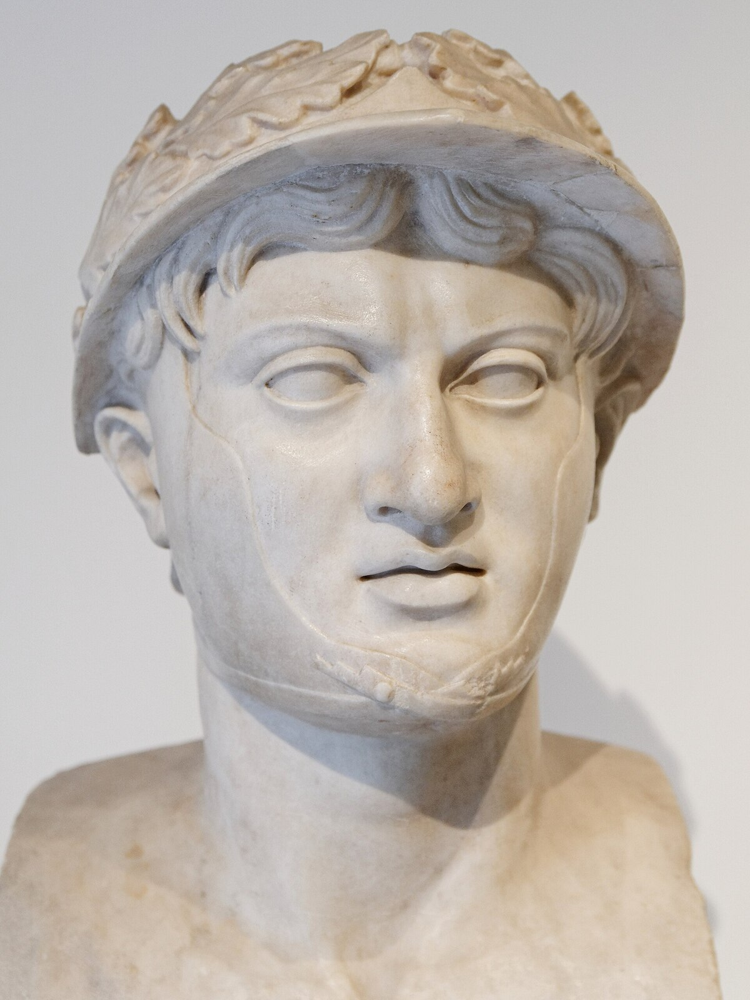
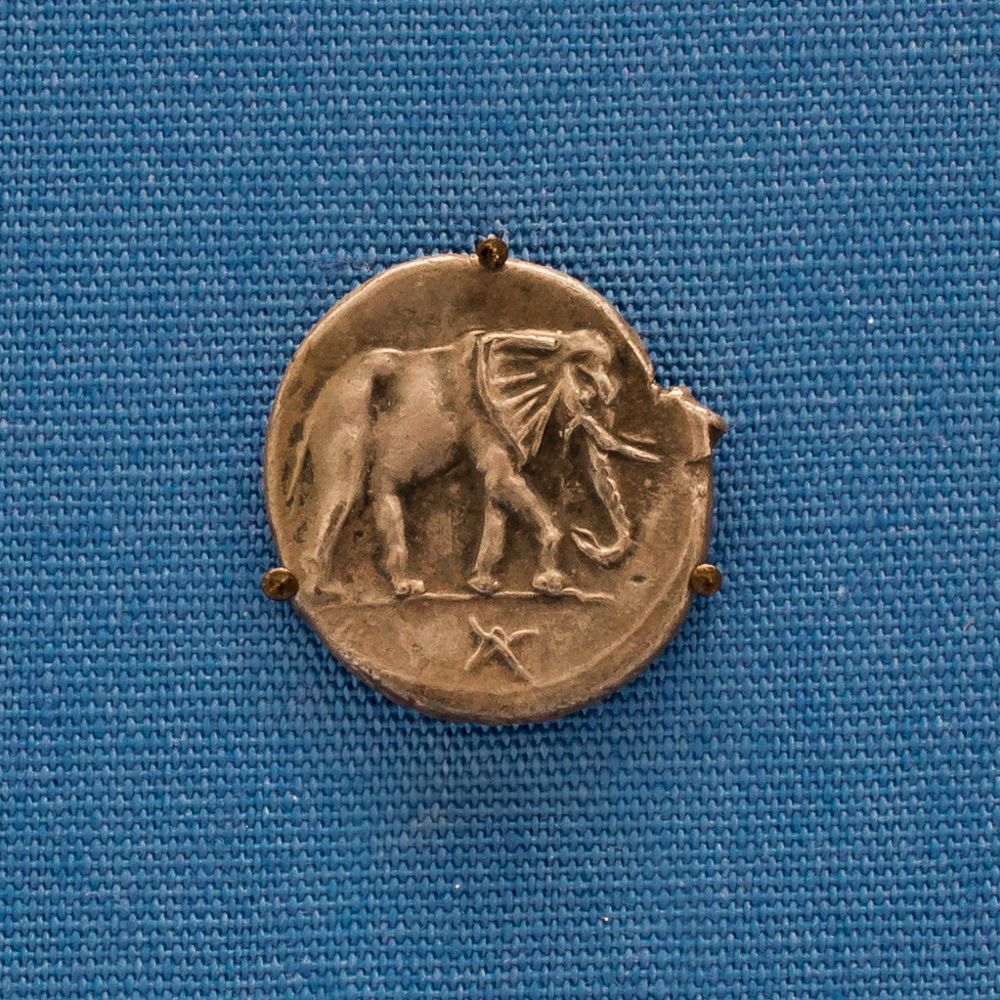
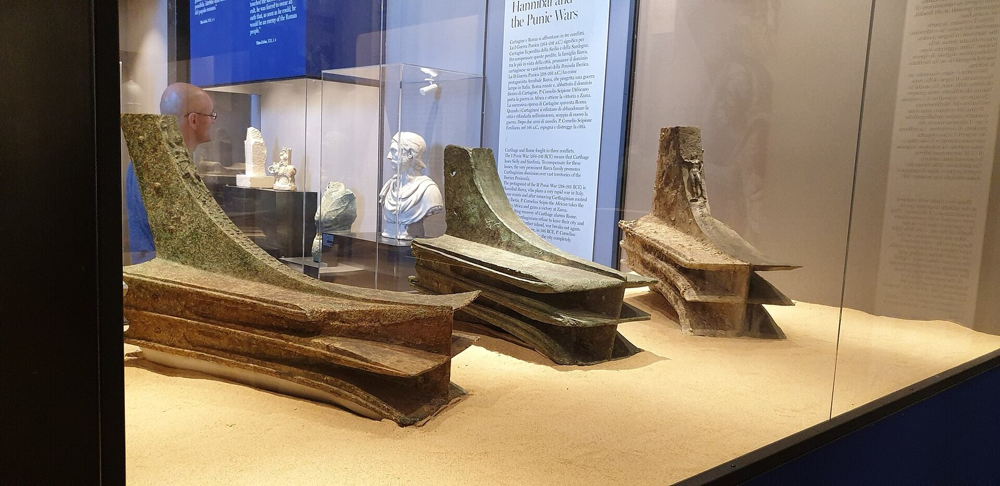
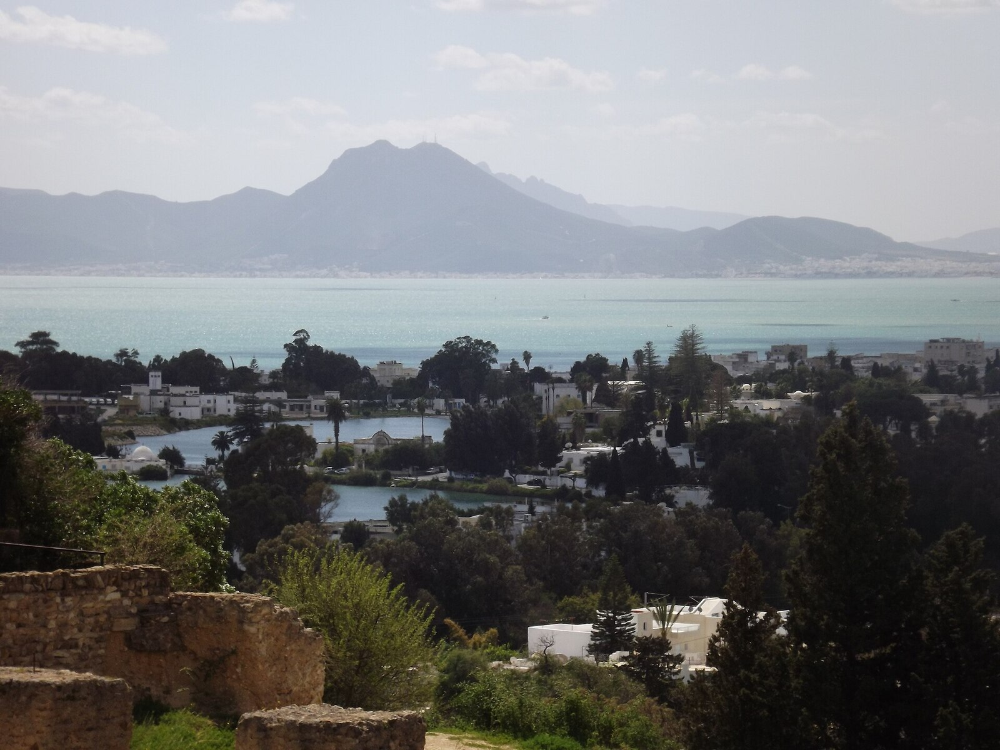

# 23. How did Rome become so powerful?

*Italy, Sicily, Spain and North Africa, from about 2,360 to about 2,170 years ago*

By asking the peoples it defeated for soldiers instead of silver, and by letting outsiders become Romans. That gave one city a larger supply of fighting men than any of its rivals, and it could lose battle after battle and still win the war.

On a summer afternoon about 2,240 years ago, on a dusty plain near a village called Cannae in the south of Italy, a general from North Africa named Hannibal destroyed the largest army that Rome had ever put into the field. The Romans had marched out some eighty thousand men against his fifty thousand. By sunset about fifty thousand of them lay dead in a space not much bigger than a few farms. It was one of the worst days any army has suffered, before or since.

Hannibal did not march on Rome. He did what a sensible commander of his time would do, and waited for the Romans to send envoys.

His reasoning was sound. Since the death of Alexander, the kings who had divided his empire had fought one another constantly, and their wars usually ended in the same way. Two armies met. One lost. The loser then asked for terms, gave up a province or a sum of money, and lived to fight another year. Rome had now lost three battles in three years, each worse than the one before. By the custom of the age it was time to talk.

The Romans did not talk. When Hannibal sent an officer to open the subject, a Roman official met him on the road and ordered him to be out of Roman territory by nightfall. Hannibal was holding thousands of Roman prisoners, and he offered to sell them back. The Senate, the council of elders that directed the city's affairs, refused to buy them. It was short of men, and so it did something that Roman pride had never allowed before. It bought eight thousand slaves from their owners, at public expense, and enlisted them. Then it took down the captured enemy weapons that hung as trophies in the temples and handed them out.

The war went on for another fourteen years, and Rome won it.

Half a century later, a Greek named Polybius sat down to explain how that could have happened. He was well placed to ask. He was a cavalry officer and politician who had been shipped to Rome as a hostage, one of a thousand leading Greeks taken to guarantee the good behaviour of their cities. He stayed for seventeen years, made friends in the great Roman families, and watched the city at work. As he put it, the Romans had brought almost the whole of the known world under their rule in less than fifty-three years. He thought that nothing like it had happened before, and he wanted to know how they had done it.

*A cast of a stone relief found at Kleitor in Greece, thought to show the historian Polybius. It is about 2,100 years old. Photo: German Archaeological Institute at Athens, public domain.*

Part of his answer is a list. A few years before Hannibal arrived, the Romans had taken a count of all the men in Italy who could be called up to fight, their own citizens and those of the peoples bound to them. Polybius copied down the totals. They came to seven hundred thousand men on foot and seventy thousand on horseback.

Hannibal had crossed into Italy with twenty-six thousand.

## Soldiers instead of tribute

Nothing about early Rome suggested numbers like those. It was a town of farmers on the river Tiber, in the middle of Italy, at a point where the river could be crossed. For its first centuries it was one of dozens of such towns, and it spent them in small wars with neighbours a day's walk away.

Its government, on the other hand, was unusual. About 2,500 years ago, according to the Romans' own tradition, they drove out their last king and swore never to have another. In his place they put two officials called consuls, who commanded the army and who held office for one year only. The citizens elected them, and the citizens also voted on whether to go to war. Behind the consuls stood the Senate, some three hundred former officials who sat for life and whose advice was very seldom ignored. The Romans called this arrangement the *res publica*, the "public thing", and it is the origin of the word republic.

The decision that made Rome different was taken about 2,360 years ago. Rome had just won a hard war against its nearest neighbours, the Latins, a group of towns that shared its language and its gods. The victor now had to decide what to do with the defeated.

Earlier empires had an answer ready. The kings of Assyria took silver and deported the troublesome. The kings of Persia took silver and left people alone. Athens, at the head of its league, took silver and decided alone how to spend it, and it guarded its own citizenship so jealously that a man needed two Athenian parents to hold it. In every case the defeated paid, and the wealth flowed to the centre.

Rome did not make the defeated pay tribute.

Instead it dealt with each defeated town separately. A few of the nearest were simply absorbed, and their people became Roman citizens with the vote. Others were given a halfway form of citizenship, with the rights of a Roman in trade, marriage and law, and a Roman's duties, but no vote in Roman elections. The rest became allies. An ally kept its own government, its own laws and its own gods, and paid Rome no tax. It was bound by a treaty to one obligation: when Rome went to war, the ally would send soldiers, armed and paid at its own cost, to serve under Roman command.

There was one more condition. Each town had its treaty with Rome and with nobody else. The towns were forbidden to hold councils together, and each dealt with Rome alone. As a result, every road in the alliance led to Rome, in the figurative sense long before the literal one.

Over the following century the Romans applied the same method to people after people, down the length of Italy. Each defeat produced another treaty and another list of men owed.

The difference from tribute was larger than it looks.

A subject who pays tribute hands over part of his harvest every year and has no share in what it buys. He has every reason to wait for the day his master stumbles. An ally who sends soldiers is in a different position. His men march beside the Romans, and when the campaign is won they share in the plunder. When land is taken from the next defeated people, allied settlers often receive plots of it alongside Roman ones. War, for an Italian ally, was a duty, but it was also the best business available.

The arrangement also had a curious effect on Rome itself. Silver can be collected in peacetime and stored in a treasury. Soldiers cannot be stored. Rome drew the full benefit of its allies only when it led them to war, and so it did, in nearly every year for which a record survives. The alliance was a machine that ran on campaigns.

The Romans had plenty of other reasons to keep it running. Their leading families competed fiercely for the consulship, and a consul had twelve months in which to make his name. The surest way was to win a victory large enough for the Senate to grant him a triumph, a parade through the city with his soldiers, his prisoners and his loot. A year of peace was, for an ambitious consul, a year wasted. The ordinary citizens who voted for war were mostly farmers, and they voted for it in the hope of plunder and of land.

*A Roman soldier and citizens at a census, from a marble relief on the altar of Domitius Ahenobarbus, made about 2,100 years ago and now in the Louvre, Paris. Photo: unknown photographer, public domain.*

Rome was also generous, by the standards of the age, with its own citizenship. The most striking case was the slave. In a Greek city, a freed slave became a resident foreigner. In Rome, a slave who was formally freed by a citizen became a citizen, and his children could vote and serve in the legions, the citizen regiments of the Roman army.

The Greeks found this astonishing, and one of them said so in a letter that survives. About the time of Cannae, the king of Macedon wrote to a city in northern Greece that had lost many men in war, urging it to enrol more citizens. He pointed to the Romans. They admit even their slaves to citizenship when they free them, he wrote, and in this way they have not only made their own city greater but have sent out colonies to nearly seventy places. The city had the letter carved in stone. Some years later, that same king went to war with Rome and lost.

The colonies he mentioned were the other half of the system. On land taken from the defeated, Rome planted new towns of soldier-farmers, a few thousand families at a time, at river crossings and mountain passes. Each was a fortress that fed itself. Most of these colonies were given the same standing as the old Latin towns, which meant self-government and a fixed quota of soldiers for Rome. The Romans then joined them to the city with roads, built straight and paved with stone so that an army could march along them in any weather.

*A surviving stretch of the Appian Way, a paved Roman road begun about 2,300 years ago, near Casal Rotondo south of Rome. Photo: Livioandronico2013, CC BY-SA 4.0.*

The people who paid for all this were the ones whose land was taken, and the men, Roman and allied, who were called from their farms each spring. An ally had no say in where he was sent. He did not vote for the consul who commanded him or for the war he fought in.

## A king who won

The first outsider to test the machine was a Greek king named Pyrrhus. About 2,300 years ago a Greek city in the heel of Italy, alarmed at Rome's advance, invited him across the sea to defend it. Pyrrhus was a distant cousin of Alexander and one of the best generals alive. He brought twenty-five thousand professional soldiers and twenty war elephants, animals that no Roman had ever seen.

*A marble bust in the National Archaeological Museum in Naples, traditionally identified as King Pyrrhus. Photo: Marie-Lan Nguyen, CC BY 2.5.*

He met the Romans twice in his first two years and beat them both times. Each victory, however, cost him thousands of trained men whom he could not replace, and each time the Romans simply raised another army. After the first battle he offered peace, and the Senate would not hear of it while he stood on Italian soil. After the second, a friend congratulated him, and Pyrrhus is said to have replied that one more victory like that would ruin him. He went off to fight in Sicily instead, came back, was fought to a standstill in a third battle, and sailed home.

His name survives in the phrase "a Pyrrhic victory", a win that costs more than it is worth. He was the first of Rome's enemies to discover that beating a Roman army settled very little.

## The raven

By now Rome controlled Italy as far as the toe. Across a strait three kilometres wide lay Sicily, and on the far side of Sicily, a day's sail from its western tip, lay Carthage.

Carthage stood on the coast of what is now Tunisia. Settlers from the trading cities of Lebanon had founded it some five hundred years earlier, and it had grown into the richest port in the western Mediterranean. Its ships carried silver from Spain, tin from the Atlantic and grain from its own African fields. Its war fleet was the largest in the western sea.

In almost every respect it was Rome's opposite. Rome was a land power of farmers, and Carthage was a sea power of merchants. More importantly, the two cities found their soldiers in opposite ways. Carthaginian citizens rowed in the fleet, but they were too few to fill an army, and so the city found its soldiers elsewhere. Its officers were Carthaginian. Its infantry included farmers called up from the African peoples it ruled, and its best horsemen were sent by allied African kings. The rest were foreigners who served for wages: infantry from Spain, slingers from the islands and swordsmen from Gaul, the country that is now France.

An army of that kind has real advantages. Much of it is made up of professionals, and it does not take the city's own people from their work. It also has two weaknesses. It lasts only as long as the money, and its losses are slow and costly to replace.

*A silver shekel of Carthage showing an elephant, struck about 2,200 years ago and now in the British Museum, London. Photo: ArchaiOptix, CC BY-SA 4.0.*

The two cities went to war over Sicily about 2,290 years ago, and the Romans soon saw their difficulty. They could beat Carthaginian armies on the island. They could not stop Carthaginian fleets from supplying its ports, or from raiding the coast of Italy. Rome had hardly any warships, and its people had no tradition of the sea.

What followed is one of the more improbable stories in Polybius, and he tells it with open admiration. The standard warship of the day was a long galley driven by about three hundred oarsmen, with a bronze ram at the bow for smashing holes in enemy hulls. The Romans did not know how to build one. However, a Carthaginian warship had run aground early in the war and fallen into their hands. They took it apart, used it as a pattern, and built a hundred copies in two months.

Meanwhile the crews, who had never rowed, were taught on dry land. Benches were set up on the beach in the same order as in a ship, and the men sat on them and practised swinging in time to the calls of an officer.

Ships and crews made in such a hurry could not hope to outmanoeuvre the best sailors in the world. Ramming is a matter of skill, of turning faster than the enemy and striking him in the side. The Romans therefore changed the kind of battle. At the bow of each ship they mounted a wooden gangway about eleven metres long, held upright against a pole by a rope and pulley. Under its far end was a heavy iron spike. When an enemy ship came close, the crew let the rope go. The gangway crashed down onto the enemy's deck, the spike bit into the planks, and the two ships were locked together. Roman soldiers then ran across, two abreast, and fought as they would have on land. The sailors called the device the raven, after its beak.

In the first great sea battle of the war, the Carthaginians rowed up to this strange fleet with confidence and lost fifty ships.

The sea was harder to beat than the Carthaginians. Roman admirals knew little about weather, and they overruled the pilots who did. In one storm off the south coast of Sicily, a Roman fleet of more than three hundred and fifty ships was driven onto the rocks, and fewer than a hundred survived. Tens of thousands of men drowned in a single day. Two more fleets were lost to storms in the years after it.

The Romans built another fleet, and then another. After the third disaster they kept off the sea for some years, and then they came back to it. This is the same fact that Pyrrhus had run into, seen from the deck of a ship. The crews were found among Rome's poorer citizens and among the allies of the coast, and there were always more of them. By the twenty-third year of the war the treasury was empty, and so the richest citizens lent the state the money for two hundred more ships, to be repaid if they won.

That fleet met the Carthaginians off the western tip of Sicily and sank or captured more than a hundred of their ships. The site of the battle was found on the seabed about fifteen years ago. Divers have since raised more than two dozen bronze rams from it. Several carry Latin inscriptions naming the Roman officials who had inspected and approved them. One carries a prayer in the language of Carthage, asking the god Baal that this ram should go into the enemy ship.

*Bronze warship rams raised from the seabed off the Egadi Islands, where the battle was fought, shown in an exhibition on Carthage. Photo: Jamie Heath, CC BY-SA 2.0.*

Carthage sued for peace. It gave up Sicily and agreed to pay Rome a large sum in silver over ten years.

Two things followed that mattered more than the treaty. First, Rome now ruled land outside Italy, and it did not extend the Italian bargain to it. Most Sicilian towns were in time made to hand over a tenth of their grain harvest each year. For the first time Rome had subjects who paid instead of serving, and it found the grain very useful.

Second, Carthage could not pay its soldiers. The men who had fought for it in Sicily were shipped home to Africa and told that their back wages would have to be reduced. They mutinied, the African farmers who were taxed to support the city joined them, and for more than three years Carthage fought for its life against its own army. While it was busy, Rome helped itself to the island of Sardinia.

## Thirty-seven elephants

The Carthaginian general who finally crushed the mutiny had a son, who was about nine years old when the war with the mutineers ended. The boy was Hannibal. Many years later he told the story that before his father took him abroad, he led him to an altar and had him swear that he would never be a friend to the Romans.

The father went to Spain, and there he and his family carved out a new territory for Carthage, rich in silver mines and in tough soldiers for hire. When Hannibal took command of it he was in his twenties, and he had spent most of his life in army camps. About 2,245 years ago, he besieged and captured a Spanish town that had put itself under Rome's protection. Rome demanded that Carthage hand him over. Carthage refused, and both cities had the war they expected.

*Rome and Carthage when Hannibal set out, about 2,240 years ago, and his route from Spain over the Alps and down Italy, with the battles marked by crosses. The dashed line is his voyage home to Africa, years later. Syracuse, hatched, was Rome's ally. Map: drawn for this book; coastlines and rivers from Natural Earth, public domain.*

Hannibal had studied his enemy, and he understood where Rome's strength came from. He knew that he could not match its numbers. His plan was therefore aimed at the alliance. If he could march into Italy and beat the Romans in front of their allies, the allies might decide that their treaties were no longer worth honouring. Each town that changed sides would take its soldiers out of Rome's column and add them to his. Rome without Italy would be one city among many.

Rome controlled the sea by now, and so he went by land. He led his army out of Spain, across the south of Gaul, and over the Alps in late autumn, through snow and along tracks cut into cliffs, with thirty-seven elephants. About half of his men died or deserted on the way. He came down into the plain of northern Italy with twenty thousand infantry and six thousand cavalry. We have those figures because Hannibal later had them inscribed on a bronze tablet, which Polybius went and read.

The Gauls of northern Italy, whom Rome had lately conquered, joined him by the thousand. In the first winter he smashed one Roman army on the banks of an icy river. The next spring he hid his men in the hills above a lake, on a morning of thick mist, and fell upon a second army as it marched along the shore. Fifteen thousand Romans died there, many of them driven into the water.

Rome now put its affairs in the hands of an elderly senator, who drew the obvious lesson and refused to fight Hannibal at all. He followed him at a distance, kept to the hills where the cavalry could not get at him, and picked off his foraging parties. The Romans nicknamed him "the Delayer", and they did not mean it kindly. Hannibal was burning Italian farms under the eyes of a Roman army, and after six months the voters had had enough of watching.

After each battle Hannibal sorted his prisoners. The Roman citizens he kept in chains. The men from the allied towns he set free without ransom and sent home, with a message. He had not come to fight Italians, he told them. He had come to fight Rome on their behalf, and to give them back their freedom.

Then came Cannae. The new consuls had been elected to fight, and they sent out an army twice the normal size, packed into a deep block that was meant to burst through Hannibal's centre.

He let it. He placed his weakest infantry in the middle of his line, pushed forward in a bulge, and his best African foot soldiers on either side, held back. As the Roman mass drove in, the bulge gave way and bent backwards, as he had intended, and the Romans pressed after it into a pocket. The Africans then turned inwards against both sides of the column. Meanwhile Hannibal's cavalry, which outnumbered the Roman horse, had chased it from the field and now rode back to close the open end.

The Roman infantry had been squeezed into a crowd so tight that many of the men could not lift their weapons. The killing took the rest of the day.

This time the plan worked. Within months, much of southern Italy went over to Hannibal. The greatest prize was Capua, the second city of Italy, whose people held the halfway form of Roman citizenship. Hannibal promised that when the war was won, Capua would be the leading city of the peninsula in Rome's place.

## Eighteen colonies

Everything now depended on what the remaining allies did. If the towns of central Italy followed Capua, the list that Polybius copied would be worth nothing.

They did not follow. The Latin towns stayed loyal, and so did nearly all the colonies, and so did most of the allies between Rome and the mountains. Hannibal marched past their walls for years, and they kept their gates shut.

They had several reasons, and affection for Rome was not the first of them. To begin with, there was fear. Roman memory was long and Roman punishments were thorough. In addition, the leading families of the allied towns had done well out of the alliance, and they had ties of marriage and friendship with the great houses of Rome. Hannibal's own army also worked against him. To an Italian farmer it looked like a horde of foreigners, and its largest part was made up of Gauls, who had been raiding Italy for two centuries.

Finally, and above all, Hannibal could not protect his friends. He had one army. Each town that joined him had to be defended, and he could not be in two places. Rome, by contrast, had enough men to keep an army in front of him and other armies everywhere else.

After Cannae, the Romans went back to the Delayer's method and kept to it. One army shadowed Hannibal and refused battle. Meanwhile other Roman armies went after the towns that had changed sides, one at a time. At the height of the war Rome had more than twenty legions in the field at once, in Italy, Sicily and Spain.

Capua was the example. The Romans surrounded it with a double ring of ditches and starved it. Hannibal tried to draw them off by marching to the walls of Rome itself, and the besiegers did not move. When Capua surrendered, its leading men were flogged and beheaded, its government was abolished, and its land became the property of the Roman people. Every town in Italy took note of what Hannibal's friendship was worth.

The cost of all this to the loyal allies was terrible, and one episode shows how close the system came to breaking. In the tenth year of the war, envoys from twelve of Rome's thirty Latin colonies came before the consuls and said that they had nothing left. They had no more men to send and no money to pay them with. The Senate was appalled. If the rest said the same, the war was lost. The other eighteen colonies were called in, and they declared that they had soldiers ready and would find more if more were needed.

On that answer the war turned. Well over a hundred thousand Romans and allies had been killed by then. A kingdom of the Greek kind would have made peace years earlier, because it would have run out of soldiers. Rome and its eighteen colonies went on.

In the end the war was settled away from Italy. A young Roman general named Scipio conquered Carthage's territory in Spain, which cut off Hannibal's silver and his recruits. He then took an army across to Africa. Carthage called Hannibal home after fifteen years in Italy, during which he had never lost a major battle. Near a town called Zama, the two generals met. An African king, whose horsemen were the best in the world and had fought for Carthage in Spain, had been persuaded to change sides, and this time it was Hannibal who was outflanked.

Carthage kept its city and its African fields. It gave up Spain, handed over all but ten of its warships, promised to pay Rome a yearly sum for fifty years, and agreed to make war on nobody without Rome's permission.

## The historian at the fire

Rome came out of the war with Hannibal as the strongest power in the Mediterranean, and it took the Greek kings very little time to find that out. Within fifteen years, Roman armies had beaten Macedon and then the kingdom that ruled Syria. These were the heirs of Alexander, and they lost for the reason Hannibal had lost. A king whose trained army was destroyed could not quickly raise another like it.

Outside Italy, however, Rome did not repeat its Italian method. It made allies across the sea when that suited it, but it offered nobody there the Italian bargain of soldiers in exchange for a share of the winnings and a road to citizenship. From Spain it took tribute, as it had from Sicily, and from everywhere it took people. After one campaign in north-western Greece, the Senate ordered a hundred and fifty thousand inhabitants to be sold as slaves in a single operation. The arrangement that had built Rome's power in Italy stopped at the water's edge.

Carthage, meanwhile, recovered. It had lost its empire but not its trade, and it paid off its fifty-year debt on time. That prosperity alarmed some Romans more than its armies had. One old senator, who had fought against Hannibal as a young man, took to ending every speech he made, whatever its subject, with the opinion that Carthage must be destroyed.

About 2,170 years ago he got his way. Rome found a pretext and sent an army. The Carthaginians handed over their weapons when ordered to, and then were told to abandon their city and move inland. At that they chose to fight. They held out behind their walls for three years. When the Romans finally broke in, the fighting went from house to house for six days. The fifty thousand people who were left alive were sold as slaves, and the city was burned to the ground.

*The harbour basins of Carthage, seen from Byrsa hill in Tunisia. The Romans burned the city about 2,170 years ago. Photo: Youssefbensaad, CC BY-SA 4.0.*

Polybius was there. The Roman commander was a grandson, by adoption, of the Scipio who had beaten Hannibal, and Polybius had been his tutor and was now his friend. The two men stood together and watched the fire. Polybius records that the Roman wept, and recited a line of Homer about the day when Troy would fall. When the Greek asked him what he meant, he said that he was thinking of his own city, and that the same thing would one day be said of Rome.

In that same year, another Roman army sacked and burned Corinth, one of the richest cities of Greece.

Hardly a word survives of what the Carthaginians thought about any of this. The Romans gave away the city's libraries to the kings of the African interior, and kept one book, a manual on farming, which the Senate had translated into Latin because it was useful. Hannibal's war is known to us from the men who fought him, and from a Greek who admired them.

The loot of two burned cities came home to Italy, along with silver from the Spanish mines and slaves by the tens of thousands. A good share of it had been won by soldiers who were not Romans. In the Roman armies of those years, as in the army that died at Cannae, about half the men came from the allied towns of Italy. They had kept faith with Rome through the worst years it ever knew. They still paid for their own service, they still had no say in where they were sent, and they could not vote on the next war.
