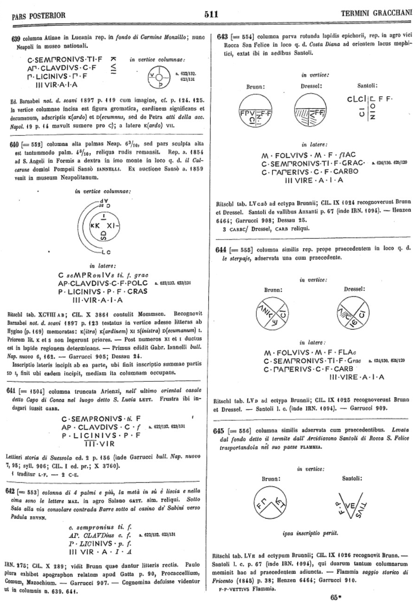
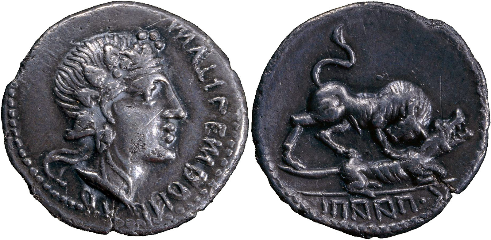
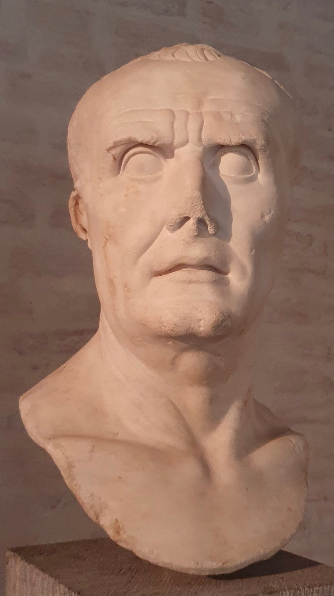
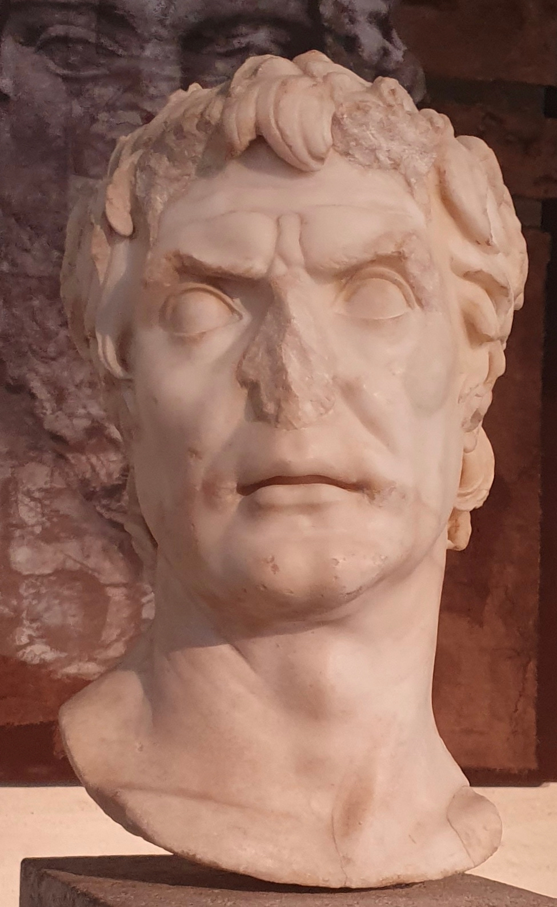
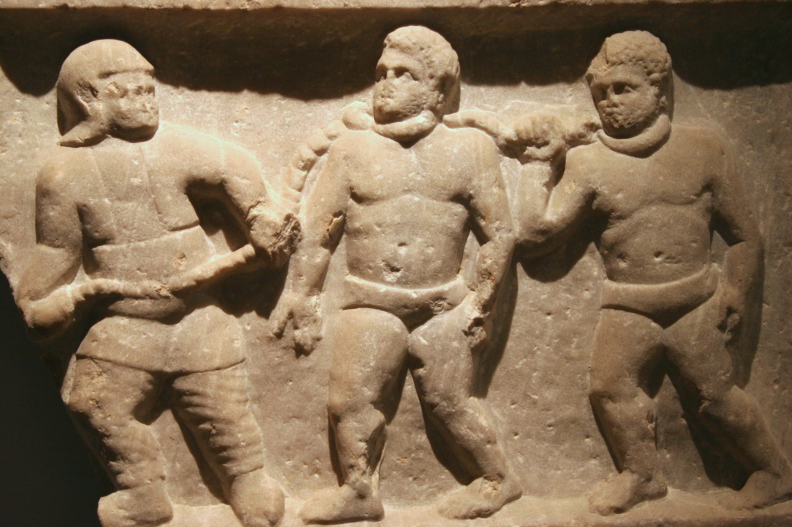
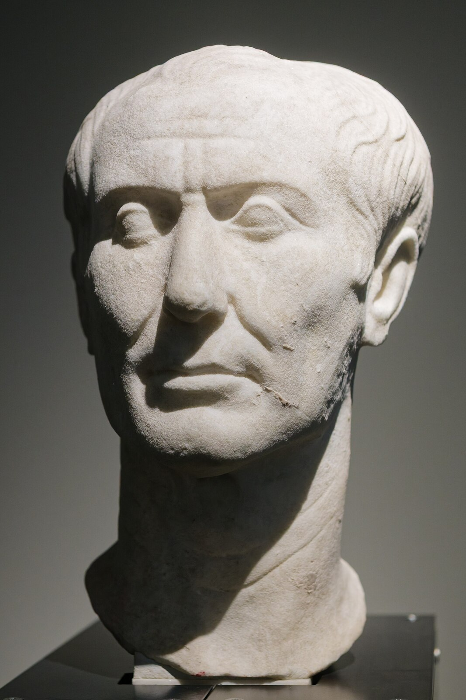
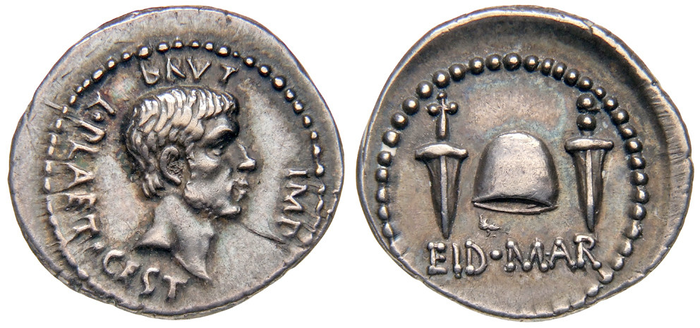
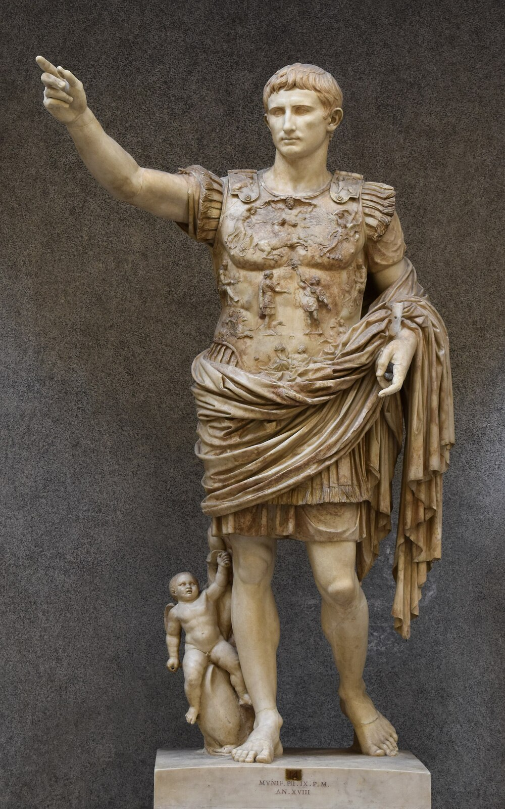
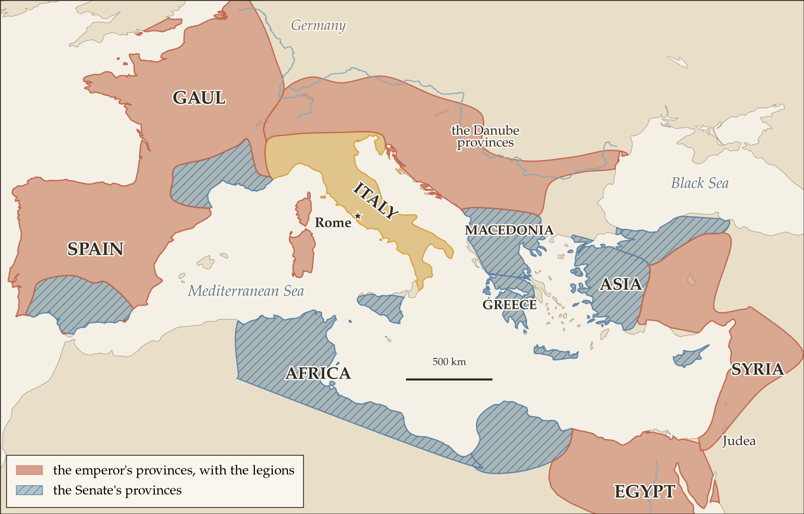
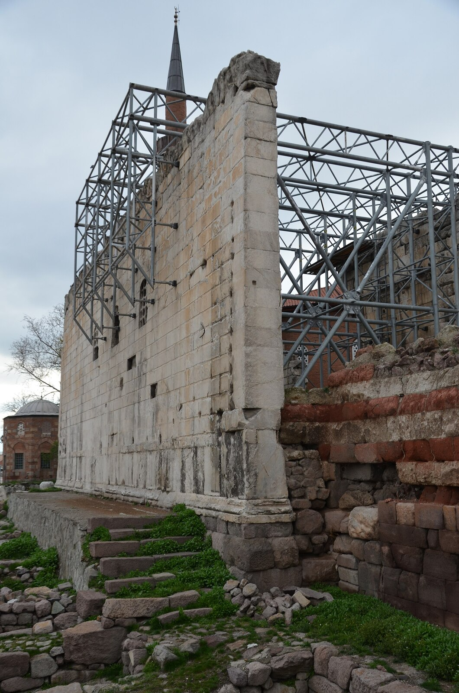

# 24. Why did the Roman Republic fall?

*Italy and the Mediterranean, from about 2,160 to about 2,010 years ago*

Because its soldiers came to depend on their generals, and not on the state, for the land and money they would live on when their service ended. An army in that position belongs to its commander, and from then on Rome was ruled by whoever could count on the best army.

About 2,160 years ago, a young Roman noble named Tiberius Gracchus stood up in front of a crowd in the middle of Rome and described the lives of the men who had conquered the Mediterranean. A Greek biographer preserved the speech. The wild animals that roam over Italy, he said, each have a cave or a den to lie in. The men who fight and die for Italy have nothing but air and light. They wander without houses, with their wives and children. Their generals urge them into battle to defend the tombs of their ancestors, and not one of them owns a family tomb. They are called the masters of the world, and they do not have a single clod of earth to call their own.

He was speaking a dozen years after the burning of Carthage, at a time when Rome had no rival left. The treasury was full, and the great families were richer than any Romans had ever been. It ought to have been the Republic's best hour, and a member of one of those families was telling the citizens that they had been robbed.

To see what he meant, follow one of the farmers who filled the legions. In the old days of wars inside Italy, such a man was called up in spring, fought through the summer, and was home in time to plough. A few hectares, worked by his family, fed them all. Now the wars were in Spain, Greece and Africa, and a soldier sent overseas could be kept there for years at a stretch. Meanwhile the farm went unploughed. His wife and children ran up debts, and when the debts could not be paid, the farm was sold.

There was always a buyer, because the same wars had made the buyers rich. Senators and army contractors came home with fortunes and put them into land. They also took over huge stretches of what the Romans called public land. This was ground that Rome had confiscated from defeated Italian towns over the centuries, and it belonged to the state. In law, no citizen was allowed to hold more than about a hundred and twenty-five hectares of it. In practice the rich had been fencing it in for generations, and no one had stopped them.

They did not need the farmer as a labourer either. The conquests had flooded Italy with slaves, the captives of Carthage, Corinth and a hundred smaller places, and a slave cost little and could not be called up for the army. On the big estates, gangs of them herded sheep and tended vines and olives where free families had once grown wheat.

The squeeze reached the army in the end. A Roman had to own a certain amount of property to serve in the legions, since the theory was that a man with a farm would fight to defend it. A man who lost his farm dropped off the list. To Gracchus and to many others, it looked as though Rome was using up the class of people it depended on for soldiers. The officials who counted the citizens every five years were reporting smaller totals than their predecessors had.

## Benches for clubs

Tiberius Gracchus had a remedy, and he had an office from which to apply it. He had been elected a tribune. The ten tribunes were officials chosen each year by the common people alone, to protect them against the powerful. A tribune could put a law directly to the people's vote, and he could stop any act of any official with a single word, *veto*, "I forbid".

His law said that the old limit on public land would now be enforced. Whatever a man held above it would be taken back by the state and handed out to landless citizens in small farms, which they would not be allowed to sell. The landless would become farmers again, and the farmers would become soldiers.

*A page of the Corpus of Latin Inscriptions listing boundary stones of the Gracchan land commission, found in southern Italy. Each names the three commissioners, C. Sempronius (Gaius Gracchus), Ap. Claudius and P. Licinius, as the "III VIR A I A", the three men for dividing public land. The stones date from about 2,150 years ago. Page: Corpus Inscriptionum Latinarum, 1918, public domain.*

Most of the Senate hated it. The senators were the people holding the land, and many of them had held it so long that they had built their family tombs on it. They persuaded another tribune to forbid the vote. Gracchus then did something without precedent, and had the people vote his fellow tribune out of office. The law passed. A commission of three men began surveying the land, and a few of the boundary stones it set up, carved with the commissioners' names, survive.

Then Gracchus announced that he would stand for a second year as tribune, which nobody had done in living memory. To his enemies it looked like the first step towards making himself king. On the day of the vote, a crowd of senators marched out of their meeting, led by the chief priest of Rome with his toga pulled over his head. They broke up the wooden benches of the assembly, and with the legs of the benches they beat Tiberius Gracchus to death, along with about three hundred of his supporters. The bodies were thrown into the Tiber.

His Greek biographer says that it was the first time since the days of the kings that a political quarrel in Rome had been settled by killing.

Ten years later his younger brother Gaius was elected tribune and went further. He had the state buy grain and sell it to every citizen in Rome at a fixed low price. He also proposed something that his brother had not: to give Roman citizenship to the Latin towns, and new rights to the rest of the Italian allies. The proposal failed, and when Gaius was out of office the Senate declared an emergency. His followers were attacked in the streets, he was hunted down and died, and three thousand of his supporters were put to death afterwards without trial.

The Gracchi had shown two things. A politician who offered the poor land or bread could raise a following large enough to frighten the Senate. The Senate, for its part, had shown that it would kill to keep things as they were. Neither side had yet solved the problem of the landless soldier.

## The men's baths

The proposal that sank Gaius Gracchus concerned half the Roman army.

The Italian allies had supplied soldiers to Rome for two centuries under their old treaties. They had stood at Cannae and stormed Carthage. In that time, the gap between an ally and a citizen had grown from a matter of status into a matter of money and safety.

A citizen could vote, and by now his vote decided who governed the Mediterranean. A citizen in the city could buy the cheap grain. A citizen paid no direct tax at all, because the treasure captured from the king of Macedon had been so vast that the Senate had simply stopped collecting it. The allies went on paying for their own soldiers. When the land commission began taking back public land, moreover, a good deal of it turned out to be land that allied farmers had been using, and they were given nothing in return.

Above all, a citizen had rights over his own body. An old law said that no Roman official could execute or flog a citizen who called for the judgment of the people. An official's attendants carried bundles of rods as a sign of his power to punish, and against a citizen's back those rods could not legally be used.

An ally had no such protection, and Gaius Gracchus told the Romans what that meant in a speech of which a fragment survives. A consul was travelling through an allied town in the hills south of Rome. His wife announced that she wished to bathe in the men's baths. The town's chief official had the bathers turned out. The lady complained to her husband that the baths had not been cleared quickly enough and were not properly clean. The consul had a stake set up in the town square, and one of the town's elected officials was stripped, tied to it and beaten with rods.

How seriously the Romans took that protection is shown by what happened, half a century later, when a governor ignored it. A corrupt Roman governor of the island had a man flogged in a public square and then crucified. All through the beating, the victim made no sound except to repeat one sentence: "I am a Roman citizen." The lawyer who prosecuted the governor afterwards, a rising speaker named Cicero, wrote in the speech he prepared for the jury that those words had protected men at the ends of the earth, among barbarians. The governor went into exile before the verdict.

This was something new. In Rome's world, a person's safety usually depended on his family, his patron or his city walls. The Romans had made it depend on a legal status, which a man carried with him wherever he went and which could, at least in principle, be claimed against the most powerful official in the land. The allies could see exactly what it was worth, since they stood in the same battle line as the people who had it.

## A bull and a wolf

For thirty years after the death of Gaius Gracchus, the allies asked for citizenship and were refused. Ordinary Roman voters did not want to share their cheap grain and their seats at the games. The senators did not want hundreds of thousands of new voters whom they had no means of controlling.

Then, about 2,115 years ago, another tribune took up the allies' cause, and Italian leaders travelled to Rome to back him. He was stabbed in his own house by a killer who was never found.

The allies gave up asking. Within months, most of the peoples of central and southern Italy were in arms. They founded a state of their own in a town in the mountains east of Rome and renamed the town Italia. They gave their state a senate of five hundred members and two consuls, in exact imitation of the city they were fighting. They also struck silver coins. Some of them carry the name ITALIA, the first coins ever to do so. On others, a bull, the animal of Italy, tramples and gores a wolf, the animal of Rome.

*A silver denarius struck by the Italian rebels, about 2,100 years old. On the back, a bull gores the wolf of Rome; the legend is in Oscan, the language of the rebels. British Museum. Photo: The Trustees of the British Museum, CC BY-SA 4.0.*

It was the most dangerous war Rome had fought since Hannibal. The men on the other side had been trained in the Roman way, carried Roman equipment and knew every Roman habit of command, because they had been half of the Roman army.

What the rebels were fighting for is a puzzle with two pieces of evidence that point in different directions. They had demanded citizenship for a generation, which suggests that they wanted to be let in. Their coins and their rival capital, however, look like the work of men who wanted to get out. The likeliest reading is that both were true of different people at different times. A war that began as a demand for a place in the Roman state grew, for the Samnites, a hill people of the southern mountains, and for some others, into a war to destroy it.

Rome won, and it won by giving way. In the first winter of the war, the Romans passed a law granting citizenship to every allied town that had stayed loyal. Further laws offered it to any rebel who laid down his arms. The rebellion lost its purpose and came apart, apart from the Samnites, who fought on for years.

The method that Rome had applied to its Latin neighbours two and a half centuries earlier had now been forced on it for the whole peninsula. Before the war, the count had found about four hundred thousand adult male citizens. A count taken twenty years after it found about nine hundred thousand. An Italian from the far south was now as much a Roman as a senator, at least in law, and for the first time a state the size of a country had a single citizenship. The allies had failed to beat Rome, and had become Rome instead.

## The general's men

While the allies were pressing their case, the problem of the landless soldier had found a solution of a kind, and it proved far more dangerous than land reform would have been.

About 2,130 years ago, a consul named Marius needed troops for a war in Africa, and he needed them quickly. He therefore ignored the property rule. He took volunteers from among the citizens who owned nothing, and the state supplied their weapons.

*A Roman marble portrait traditionally identified as Gaius Marius, in the Glyptothek in Munich. Photo: Yair-haklai, CC BY-SA 4.0.*

It worked very well in the short run. The poor made excellent soldiers, and they were glad to stay in the army for years, since they had no farms to go back to. Other generals followed his example, and over the next two generations the legions filled with men who owned nothing.

It also changed what a soldier was. The farmer of the old legions wanted to win and go home. The new man had no home. The army was his living, and what worried him was the day it would end. He needed a piece of land to retire on, and the Senate, which had killed two tribunes to avoid handing out land, would not promise him one. The only person with both the wish and the standing to get it for him was his general. A soldier who is owed his future by one man will follow that man a long way.

It took twenty years for a general to find out how far. Just after the war with the allies, a consul named Sulla was given command of a campaign in the east, against a king who had overrun Rome's richest province. The war promised enormous plunder. Then Sulla's enemies in Rome had the people vote to take the command away from him and give it to the elderly Marius.

Sulla was with his army, six legions strong, south of Rome. He called the soldiers together and told them what had been done. They saw at once that Marius would take other legions east and that the plunder would go to other men. They urged Sulla to lead them to Rome.

*A Roman marble portrait identified as Sulla, in the Glyptothek in Munich. Photo: Yair-haklai, CC BY-SA 4.0.*

His officers understood what that meant. No Roman army had ever marched against the city, and all but one of them resigned and left the camp. The soldiers stayed. Sulla marched, took Rome by force, drove out his enemies, and went east to fight his war.

When he came back, he fought a civil war against the followers of Marius, won it, and had himself named dictator, an old emergency office that put all power in one man's hands. He then cleared out his opponents by a method of his own. Lists of names were posted in the middle of the city. Anybody on a list could be killed by anyone, the killer was paid a reward on producing the head, and the dead man's property went to the state. Several thousand people died, a good number of them because someone wanted their houses.

Sulla used the confiscated land to do what the Senate had refused to do. He settled more than a hundred thousand of his veterans on farms across Italy. Then, to general astonishment, he resigned and went home, and died in his bed a year later.

He believed that he had repaired the Republic. In reality he had shown every ambitious man in Rome how it could be taken.

## Six thousand crosses

The people who gained least from all of this were the slaves on whose work the new Italy rested. By now there were well over a million of them in the peninsula, perhaps one person in every four or five.

About 2,100 years ago a group of them broke out of a training school for gladiators, the slaves who were made to fight to the death for the entertainment of crowds. Their leader was a man from the Balkans named Spartacus. Field hands and herdsmen ran to join him by the tens of thousands, and for two years his army beat the legions sent against it and marched up and down Italy.

*Slaves roped together by iron collars and rope, led by a guard. A marble relief from Smyrna, in what is now Turkey, about 1,800 years old, a later work than the revolt. Ashmolean Museum, Oxford. Photo: Jun, CC BY-SA 2.0.*

Nothing suggests that Spartacus meant to abolish slavery, which nobody in the ancient world proposed to do. His people wanted to get out of Italy and go home. In the end they were cornered and destroyed in the south. The Roman general in command, who was the richest man in Rome, had six thousand of the captured slaves crucified along the main road from Capua to the city, a line of crosses nearly two hundred kilometres long. They were left there as a notice to the rest.

## The river

The generation after Sulla was dominated by three or four generals, each with soldiers who looked to him. The most gifted of them was a noble with large debts and larger ambitions named Julius Caesar.

Caesar obtained command of the Roman province in the south of Gaul and, in eight years, conquered the whole country as far as the Rhine and the Atlantic, without ever being ordered to. He wrote his own account of it, in clear plain Latin, and sent it back to Rome in instalments. By the figures that an ancient biographer gives, a million Gauls were killed and another million taken as slaves. The sale of the captives made Caesar one of the richest men alive, and the campaigns gave him the best army in the world, devoted to him personally.

*A marble head of Julius Caesar from Tusculum, a portrait made in his lifetime, in the Turin museum. Photo: Marie-Lan Tay Pamart, public domain.*

His enemies in the Senate meant to prosecute him as soon as he became a private citizen again. They ordered him to give up his command. Caesar had to choose between obeying, which would end his career and possibly his life, and doing what Sulla had done.

Caesar also governed the north of Italy, which in those days was counted as a province outside Italy proper. The boundary between the two was a small river called the Rubicon. A general who crossed it with troops was at war with the state. On a January night about 2,075 years ago, Caesar crossed it with a single legion, and by one account he quoted a gambler's saying as he went: let the die be cast.

The Senate's army was commanded by Pompey, the most famous general of the day, who had once been Caesar's partner and son-in-law. The civil war lasted four years and was fought from Spain to Egypt. Caesar won it. He was a merciful victor, who pardoned his enemies and posted no lists. He also made no secret of where power lay. He had himself named dictator, first for ten years and then for life, and his head appeared on the coins of Rome, where no living Roman's had been before.

A dictator for life is a king under another name. On the fifteenth of March, about sixty senators surrounded him at a meeting of the Senate and stabbed him twenty-three times. They called themselves the liberators. Their leader, Brutus, issued a coin showing two daggers and the kind of cap that was given to a freed slave.

*The coin of Brutus, about 2,060 years old. On the front, his head. On the back, two daggers and the cap of a freed slave, above EID MAR, the Ides of March. Berlin Coin Cabinet. Photo: Reinhard Saczewski, public domain.*

The liberators supposed that with the tyrant dead, the Republic would simply start up again. They had misread the problem. Caesar had not been the cause of one-man rule. He had been the winner of a contest that the Republic's armies now forced on its politicians, and when he died the contest merely reopened. In the days after the murder, the question that mattered in Rome was who would pay Caesar's soldiers what he had promised them.

## First citizen

The man who answered it was eighteen years old. Caesar had no legitimate son, and in his will he adopted his sister's grandson, a slight and sickly student named Octavian, who thereby inherited the most valuable name in the world.

Octavian went to the districts where Caesar's veterans had been settled and offered each man who would join him a bonus worth more than two years of a soldier's pay. He sold the property he had inherited to raise the money. Within months a teenager with no office and no legal right to command anything had a private army, and the Senate found itself asking for his help.

What followed was the Republic's last and bloodiest round. Octavian joined forces with Caesar's chief lieutenant, Mark Antony, and the two revived Sulla's lists to raise money and settle scores. Cicero, who had spoken out against Antony, was among the first to die. His head and hands were nailed up on the speakers' platform in the middle of Rome, where he had made his name. The partners hunted down Caesar's killers, divided the Roman world, and then turned on one another. Antony took the east and allied himself with Cleopatra, the queen of Egypt and the last ruler of the line founded by one of Alexander's generals. Octavian defeated their fleet off the coast of Greece. The two killed themselves, and Egypt, the richest country of the Mediterranean, became a Roman province that Octavian kept under his own hand.

He was now thirty-two, and he had won the same contest that Sulla and Caesar had won. Sulla had gone home, and the wars had begun again. Caesar had taken a king's power openly and been murdered for it. Octavian found a third course.

He announced that he was handing the state back to the Senate and people. The consuls would be elected as before, the Senate would meet, the courts would sit. The grateful Senate voted him a new name, Augustus, "the revered one". For himself he chose a modest title, *princeps*, which means something like "first citizen". Later he summed up the arrangement in his own words. From then on, he wrote, he had stood above everyone in standing, but he had held no more official power than the other men who held office with him.

*Augustus in armour, a marble statue found at Prima Porta near Rome, about 2,000 years old. Vatican Museums. Photo: Joel Bellviure, CC BY-SA 4.0.*

Meanwhile he kept the provinces where the legions were stationed, and so kept the army. And to the army he applied the remedy that the Senate had refused for a century, because he understood better than anyone what had destroyed the Republic.

He made soldiering a profession with fixed terms. A legionary signed on for twenty years. He received a set wage, and when his time was up he received a discharge payment equal to about thirteen years' pay, enough to buy a farm or set up in a trade. To pay for it, Augustus in time created a separate military treasury and gave it two new taxes of its own, a twentieth of inheritances left outside the close family and a hundredth of every sale at auction.

The landless soldier now looked to the state for his future, and he no longer needed an ambitious general to win it for him. The state was Augustus. The legions swore their oath to him by name.

The method that had made Rome was also extended, quietly, beyond Italy. Alongside the legions of citizens, Augustus kept about as many soldiers again recruited from the conquered peoples of the provinces. The arrangement that grew out of this, and that a later emperor made regular, was simple. A provincial who served for twenty-five years was made a Roman citizen on his discharge, and his children with him.

*The Roman provinces in the year Augustus died, about 2,010 years ago, roughly. Italy was not a province. Of the provinces, Augustus kept the plain ones in his own hands, with their legions, and left the hatched ones to the Senate. Map: drawn for this book; coastlines and rivers from Natural Earth, public domain.*

Augustus ruled for more than forty years, long enough that hardly anyone was left alive who had seen the Republic at work. Near the end he composed an account of his achievements and ordered it to be cut in bronze in front of his tomb. The bronze is lost, but copies were carved on temples in the provinces, and the best of them still covers the walls of a temple in Ankara, the capital of Turkey. Much of it is a list of payments. He records how many hundreds of millions he spent on land for his veterans, and that he settled three hundred thousand of them in colonies or sent them back to their home towns with their reward.

*The Temple of Augustus and Rome in Ankara. The account Augustus wrote of his reign is carved on its walls. Photo: Carole Raddato, CC BY-SA 2.0.*

A Roman biographer describes his last day. He asked for a mirror and had his hair combed. Then he asked the friends at his bedside whether they thought he had played his part in the comedy of life well enough, and added a line that Greek actors spoke at the end of a play, asking the audience for its applause.
