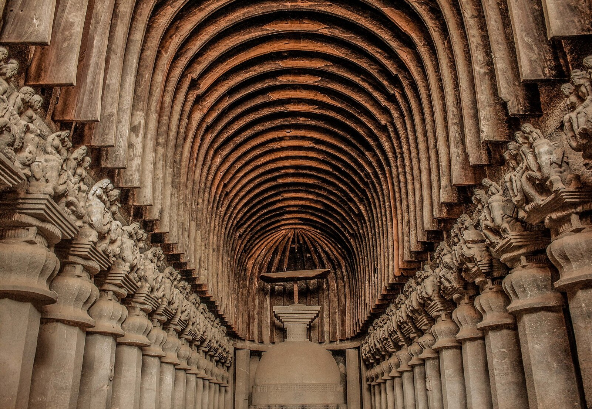
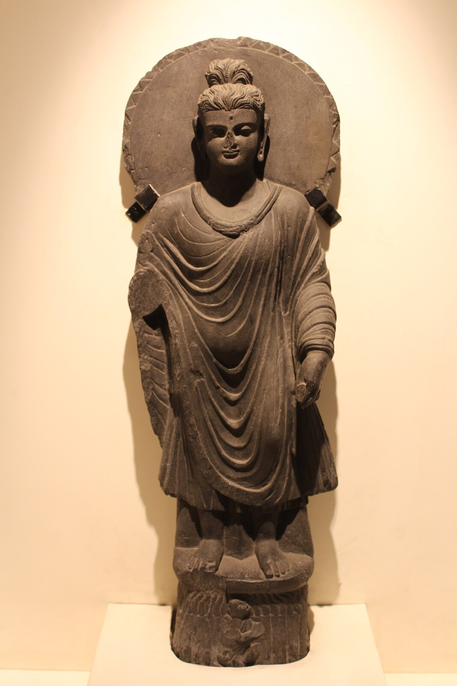
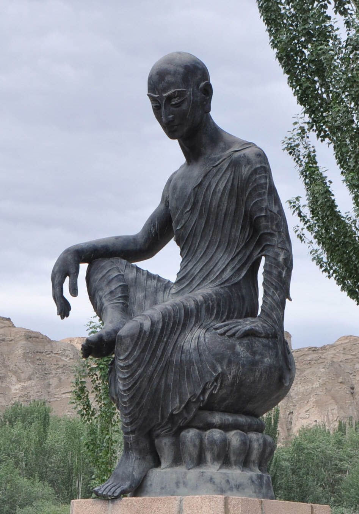
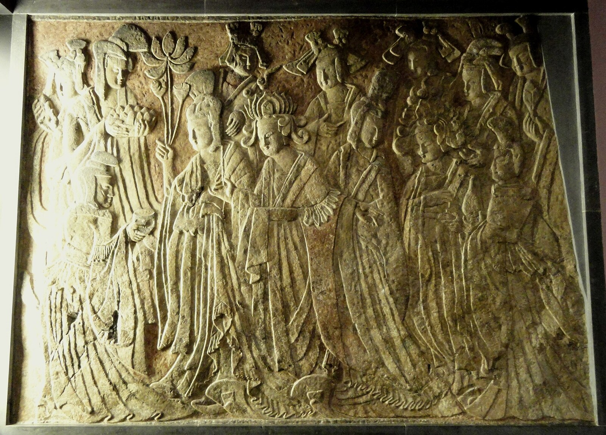
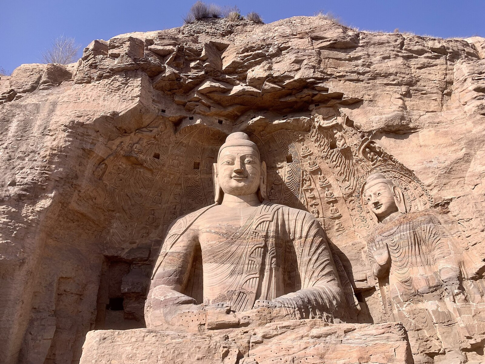
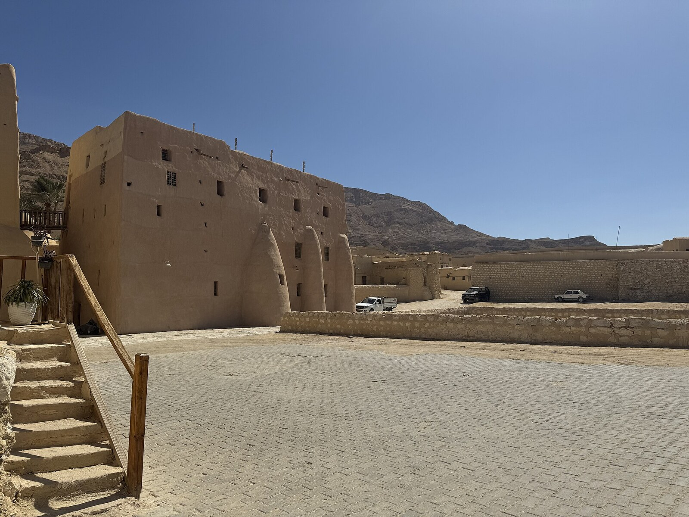
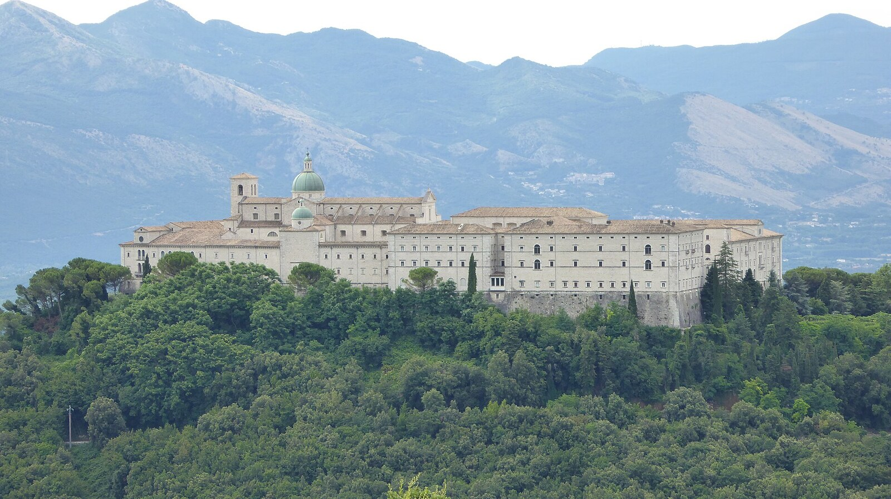
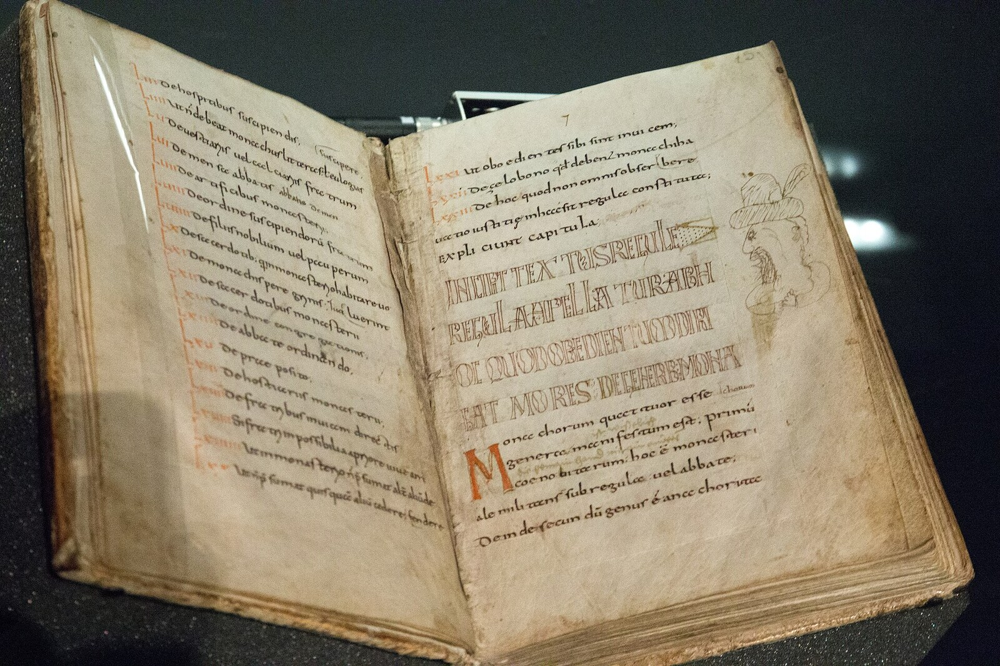

# 26. Why did people become monks?

*India, Central Asia, China, Egypt and Italy, from about the year 100 to about 575*

Because a monastery offered what the world outside it could not promise: food, safety, learning and a purpose, in a community that did not die when its members did. People joined to save their souls, and a good many also joined to escape marriage, taxes and the army.

In the year 399, a Chinese monk named Faxian set out from the old Han capital to walk to India. He was about sixty years old. He had spent his life in Buddhist monasteries in China, and what troubled him was that the religion had reached his country in pieces. In particular, nobody in China had a complete copy of the rules by which monks were supposed to live. Faxian decided to go to the Buddha's homeland and fetch one.

The journey took him along the corridor of oases that the Han had fortified five centuries earlier, and then out into the desert of dunes beyond Dunhuang. He wrote afterwards that there was not a bird in the sky above it or an animal on the ground below, and that the only signs marking the way were the dried bones of the dead. He crossed it in seventeen days. He then climbed through the highest mountains on earth by paths where, as he tells it, the way led down seven hundred ladders cut into a cliff and across a river on a bridge of ropes, and came down at last into the plains of India.

He was away for about fifteen years. He came home by sea, with a trunk full of books, and wrote a short account of what he had seen. What stands out in it is how seldom this old man slept among strangers. In the oasis kingdom of Khotan, on the southern edge of the desert, he found tens of thousands of monks, and he lodged in a monastery where three thousand of them ate together in silence at the sound of a bell. He notes that the monasteries along the way kept rooms ready for travelling monks. From the western gate of China to the mouth of the Ganges, Faxian moved through a chain of houses where the residents wore the same robe that he wore, kept more or less the same rules, and gave him a bed.

Nothing like that chain had existed when the Buddha died, some nine hundred years before. It had been built by beggars, and paid for by merchants and kings.

## The begging bowl

The Buddha's first followers owned nothing. A man or woman who joined his order shaved off their hair, put on a plain robe, and gave up family, property and sex. Each morning the monks walked through the nearest village with a bowl, in silence, and ate whatever was put into it. They were not allowed to handle money or to store food for the next day.

It sounds like the least promising foundation for a lasting institution, and yet it lasted.

The first reason was the weather. In India, for three months of each year the monsoon turns the roads to mud, and the Buddha had told his followers to stop wandering during the rains and stay in one place. Rich supporters gave them parks and shelters to stay in. Over the generations the shelters became permanent buildings with cells, a meeting hall and a storeroom, and many monks stopped wandering altogether. The gift belonged to the order as a whole. No monk could sell it or leave it to a relative, since it had never been his.

The second reason was a bargain between the monks and everyone else. Buddhists believed, as most Indians did, that a person's deeds in this life decide what he or she will be born as in the next. Hardly anybody could give up the world as the monks had. However, an ordinary farmer or shopkeeper could earn merit, a kind of credit towards a better rebirth, by supporting those who did. The monk received his dinner. The giver received something that he valued more, and that the monk could supply simply by being a good monk.

No class took to this bargain as eagerly as the merchants. In the old order of the priests, a trader ranked below the priest and the warrior however rich he became. The Buddha's order took no notice of birth, and it could put his money to use.

The proof is cut into the mountains of western India. There, on the steep roads that lead up from the seaports to the high plateau, stand hundreds of halls and cells carved straight into the cliffs for communities of monks, beginning a little over two thousand years ago. Many carry short inscriptions that name the people who paid for a pillar, a water tank or a doorway. The donors include traders, a perfume seller, a carpenter and the wives of merchants. Several call themselves by the Indian word for Greeks.

*The great hall at Karla, in the hills of western India, one of the cave monasteries cut for monks beginning a little over 2,000 years ago. Photo: Mriganka Das, CC BY-SA 4.0.*

The monasteries sat on the trade routes for good reason, and they were useful to the people who used the roads. A walled house of sober men, a day's march from the last one, is a safe place to sleep and to leave goods. It also became a place to keep money. An inscription in one of the caves, about 1,900 years old, records the gift of a nobleman who wished to provide the resident monks with new robes every year. He did not hand over cloth. He deposited two thousand silver coins with a guild of weavers in the nearby town, at an interest of one per cent a month, and directed that the interest should pay for the robes for ever, while the capital was never to be repaid.

The order had found a way to be rich while each of its members stayed poor. A monk was meant to own nothing but his robe and his bowl. The monastery, by contrast, had an endowment, a lender's income and a legal standing, and unlike a merchant's family it was never divided among heirs.

## A Buddha in a Greek robe

In Ashoka's day the teaching had spread across India and over the water to Sri Lanka. What carried it north, over the mountains and into the middle of Asia, was a later empire.

The Yuezhi were the herders whom the Xiongnu had driven west, and whom the Han envoy had found living comfortably north of Afghanistan. Their descendants, known as the Kushans, went on to build an empire that reached from the Ganges plain over the mountain passes into Central Asia. For about two centuries they held the stretch of country where the roads from India, Persia and China met, and they grew rich on the tolls.

The Kushan kings supported every religion they found, as the Persians had, and the Buddhists did especially well. The greatest of the kings built a tower over relics of the Buddha that pilgrims described, centuries later, as the finest building they had ever seen.

Under the Kushans, the Buddha acquired a face. For several hundred years his followers had not shown him in human form. Sculptors marked his presence with an empty seat, a footprint or a wheel. In the Kushan lands, workshops began to carve him as a man. Many of those workshops stood in the country where Alexander's Greeks had settled, and they worked in the tradition that those settlers had left behind. The Buddhas from that region have wavy hair, straight noses, and robes that fall in heavy folds like the cloak of a Greek philosopher.

*A standing Buddha from Gandhara, carved in the 200s, in a robe that falls like a Greek cloak. Now in the Indian Museum, Kolkata. Photo: SuvadipSanyal, CC BY-SA 3.0.*

In the same centuries the teaching itself was widening. A new school held that the highest goal was to become a being of perfect compassion, who puts off his own release in order to help all others reach theirs. These beings could be prayed to. A merchant setting out across a desert could call on one of them for protection, which is a more practical comfort than a method for extinguishing desire.

From the Kushan lands, the road ran east through the oasis kingdoms around the desert of dunes. Each of them, in turn, acquired monasteries. Merchants from Central Asia carried silk westward along that road, and the monks went eastward against the flow, from house to house. By about the year 150, a few of them had reached the capital of the Han.

*Faxian's journey, out by land through the oasis kingdoms and over the mountains, and home by sea. The course at sea is roughly drawn. Map: drawn for this book; coastlines and rivers from Natural Earth, public domain.*

## A religion against the family

China should have been stony ground for them.

The teaching that China's rulers and educated families lived by began with the family. A man's first duty was to serve his parents while they lived, to make offerings to them after their deaths, and to father sons who would do the same for him. The Buddhist monk shaved his head, took a new name, left his parents, and promised never to have children. By Chinese standards he was guilty of the worst offence a son could commit. He also did no farm work, paid no taxes, and claimed that he need not bow to the emperor, since he had left the world in which emperors ruled.

For as long as the Han dynasty stood, the new religion remained a curiosity, practised by foreign merchants and a few Chinese nobles. Then the Han fell. From about the year 220, China was divided for three and a half centuries, and for most of that time the north was ruled by one group of mounted invaders after another. The old teaching about harmony under a virtuous ruler had little to say to people whose towns were burned every generation. The Buddhists offered them an explanation of suffering, and a way out of it.

The books still had to be put into Chinese, which was a harder job than it sounds. They were written in the languages of India, which are built quite differently from Chinese, and Chinese had no words for many of the ideas. The greatest of the translators was a monk named Kumarajiva, born in one of the oasis kingdoms to an Indian father and a local princess. A Chinese general carried him off as a prize of war. He spent years as a captive learning Chinese, and in 401 a ruler in the north installed him in the capital with hundreds of assistants. He would recite a text and explain it aloud, the assistants would argue over the wording, and scribes took down the result. His versions are still the ones chanted in China, Korea and Japan.

*A modern statue of Kumarajiva at the Kizil caves, near Kucha in the oasis country where he was born. Photo: Yoshi Canopus, CC BY-SA 3.0.*

In time the religion also made its peace with the family. Chinese Buddhists taught that merit could be passed on, and that a son who became a monk, or paid for a statue, could earn a better rebirth for his dead parents. In the cave temples cut into the cliffs of the north, thousands of carved inscriptions say the same thing: this image was made by such a person, for the benefit of his father and mother.

*Donors in stone: the empress and her court in procession, carved for the Binyang cave at Longmen about the year 522. The relief is now in a museum in Kansas City. Photo: Daderot, CC0.*

The rulers of the north found their own uses for it. Many of them were foreigners in Chinese eyes, and a foreign religion suited them well. One dynasty of former herders, the Northern Wei, solved the problem of the bow in a single stroke when its chief monk announced that the emperor was himself a living Buddha. Monks could therefore bow to him with a clear conscience. Around 460 the same dynasty had five colossal Buddhas carved into a sandstone cliff near its capital, each taller than a four-storey house, and it is thought that each stood for one of its emperors.

*Cave 20 at Yungang, near the Northern Wei capital: one of the five colossal Buddhas carved from about the year 460. Photo: Dudva, CC0.*

In the south, one emperor went further than any king before him. Four times he entered a monastery and declared that he was giving himself to it as a servant. Each time his ministers had to buy him back, and on one occasion the price was a hundred million coins.

By the 530s there were more than a thousand monasteries in the dynasty's new capital alone. At that point, the government began to count what they were costing it.

A monastery's land paid no tax. A monk paid no tax, built no roads and served in no army, and the Chinese state lived by registering every household for all three. For a farmer who was crushed by taxes or faced with conscription, a shaved head was a way out. Officials complained that whole villages were putting themselves under the monasteries, and that many of the monks in the country had never read a line of scripture.

Twice, in 446 and again in the 570s, a northern emperor lost patience, ordered the monasteries closed and sent the monks back to their fields. On the first occasion many monks were killed. Both times the next emperor reversed the order. The state settled, in the end, for control. It decided how many monks there could be, who might become one, and which monasteries were allowed to exist. The order that had left the world was entered in the registers like everybody else.

## The desert a city

Meanwhile, six thousand kilometres to the west, people who had never heard of the Buddha were inventing the same institution.

About the year 270, in a village in Egypt, a young farmer named Antony heard a passage from the gospels read aloud in church. If you would be perfect, Jesus says in it, go and sell all that you have and give to the poor. Antony had inherited a good farm from his parents. He gave the land to his neighbours, sold everything else, gave away the money, and went to live alone at the edge of the desert, and later deep inside it, eating bread and salt and fighting off the demons that he believed came to tempt him. He lived to be over a hundred.

*The Monastery of Saint Antony in the Egyptian desert, with the Galala mountains behind. It is named for Antony, who took to the desert about the year 270; the buildings seen here are much later. Photo: Alena Belova for Exhibo, CC BY-SA 4.0.*

Others followed him by the thousand. The Greek word for someone who lives alone is *monachos*, and it gives us the word monk. A bishop who wrote Antony's life said that the desert had become a city.

The rush to the desert became a flood in the years after Constantine made the church safe and well funded. Inside the empire, being a Christian no longer carried any risk. It could even be a good career. For believers who wanted their faith to demand everything of them, as it had demanded of the martyrs, the desert was where such a life could still be found.

There were also plainer reasons to go. Egyptian farmers had a long-standing way of dealing with a tax bill they could not pay, which was to walk away from the village and disappear into the wasteland. The Greek word for that kind of flight is the root of the word "anchorite", an old name for a hermit. Before the century was out, an emperor issued a law against men who, as he put it, took up the company of the monks out of laziness, in order to dodge their public duties. He ordered them to be dragged from their hiding places.

Living alone in a desert is dangerous to the body and worse for the mind. About 320, a former army conscript named Pachomius began to organise the hermits of southern Egypt in another way. He put them inside a wall. His monks slept in houses of twenty or more men, each under a housemaster, as soldiers slept in barracks. They ate together, prayed at fixed hours, wore the same clothes, and worked at trades such as weaving mats and baskets, which were shipped down the Nile and sold. Above all, they lived by a written rule that told them what to do with every hour. When he died, Pachomius was the head of nine such monasteries holding several thousand men, and of two for women.

## Guests at the gate

The rule was the invention that travelled. In the next two centuries, communities under written rules spread from Egypt to Syria, Turkey, Gaul and Ireland, and each generation of founders rewrote the rules of the last.

In the 370s, a bishop in central Turkey named Basil brought the monks out of the wilderness and put them to work for the city. Outside the walls of his town he built a complex so large that people called it a new city. It had a hostel for travellers, a house for the poor, and wards where the sick were tended by monks and by trained physicians. It is one of the earliest institutions that can properly be called a hospital.

The rule that mattered most in the western half of the Roman world was written about 530 by an Italian abbot named Benedict, for his monastery on a hilltop between Rome and Naples. It is a short and sensible book. Benedict divides the monk's day among prayer, reading and manual work, because, as he says, idleness is the enemy of the soul. He has the monks elect their abbot, and tells the abbot to call the whole community together before deciding anything important, since the best advice often comes from the youngest. A monk promises to stay in the one house until he dies.

*Monte Cassino, the hilltop monastery between Rome and Naples where Benedict wrote his rule. The present buildings are much later than his. Photo: DonGatley, CC0.*

One chapter concerns strangers. All guests who arrive, the rule says, are to be received as if they were Christ himself, and the greatest care is to be taken with the poor and with pilgrims. Another chapter puts a sensible old man at the gate, with a room beside it, so that somebody is always there to answer when a traveller knocks.

*The Rule of Benedict in a copy made at Reichenau between the years 800 and 833, about three centuries after Benedict wrote it. Photo: Zde, CC BY-SA 4.0.*

Women had their own houses from the beginning, in both religions, and for many of them the attraction is easy to see. A girl in the Roman world or in China was married in her teens to a husband chosen by her family, and she could expect to bear children until she died, quite possibly in childbirth. A house of nuns was a respectable way to refuse. Inside it a woman could learn to read, manage property and hold authority. Some of the largest fortunes given to the early churches came from rich Roman widows who founded such houses and then moved in.

Set side by side, the two traditions had arrived at the same design. Each gathered unmarried people under a rule and a head, with property held in common, and each grew rich on gifts from laypeople who wanted prayers or merit in return. Both kept an open door for the traveller, and both copied books because their members were required to read. The design also shared one great strength. A noble family dies out or divides its estate, and a dynasty falls. A monastery, on the other hand, replaces its members one at a time and never has to divide what it owns.

## The emperor's doctrine

Royal patrons paid well, but their support brought obligations of a kind that the merchants' had never done.

A merchant who gave a pillar to a cave wanted merit, and he had no power to tell the monks what to teach. An emperor who gave a religion his backing wanted it to hold his realm together, and a religion that is split into quarrelling parties cannot do that. Constantine had learned as much at Nicaea. His successors drew the conclusion.

In 380 the emperor Theodosius announced that all his subjects should hold the faith as the bishops of Rome and Alexandria taught it, which was the faith of Nicaea. Those who held it would be called Catholic Christians. Everyone else, the law said, was to be judged demented and insane. Over the next twelve years he forbade the old sacrifices and closed the temples. In 385, in the western half of the empire, a Spanish bishop whose teachings had been condemned was tried before a rival emperor and beheaded. He was the first Christian put to death by a Christian government for his beliefs.

The monks themselves took part in this turn. They were numerous, fearless and answerable to nobody but their bishop, and in the great cities they became his street army. In Alexandria, crowds of Christians led by the bishop, with monks among them, tore down the city's most famous temple. A generation later, during a quarrel between the bishop and the governor, a Christian mob dragged a woman named Hypatia from her carriage and killed her. She was the leading mathematician and philosopher of the city, a pagan, and a friend of the governor.

Doctrine had become a question of loyalty, and that had consequences far beyond the cities. In 451 a council backed by the emperor laid down a formula about how Christ could be both God and man. Most Christians in Egypt, and many in Syria, rejected it. From then on they were dissenters in the eyes of their own government, harassed by its officials and attached to bishops of their own.

Something similar happened across the eastern frontier. Persia had a sizeable Christian minority, and its kings had mostly left them alone while Rome was persecuting them. Once the Roman emperor became the protector of Christians everywhere, the king of Persia began to look on his own Christians as the agents of a foreign power, and thousands were killed.

On his way to India and back, in one country after another, Faxian was given a bed by men he had never met, because he wore the robe. A hundred and thirty years later and eight thousand kilometres to the west, Benedict wrote down what the old man at the gate should say when a stranger knocks. He is to answer at once, and the rule gives him his words: "Thanks be to God."
