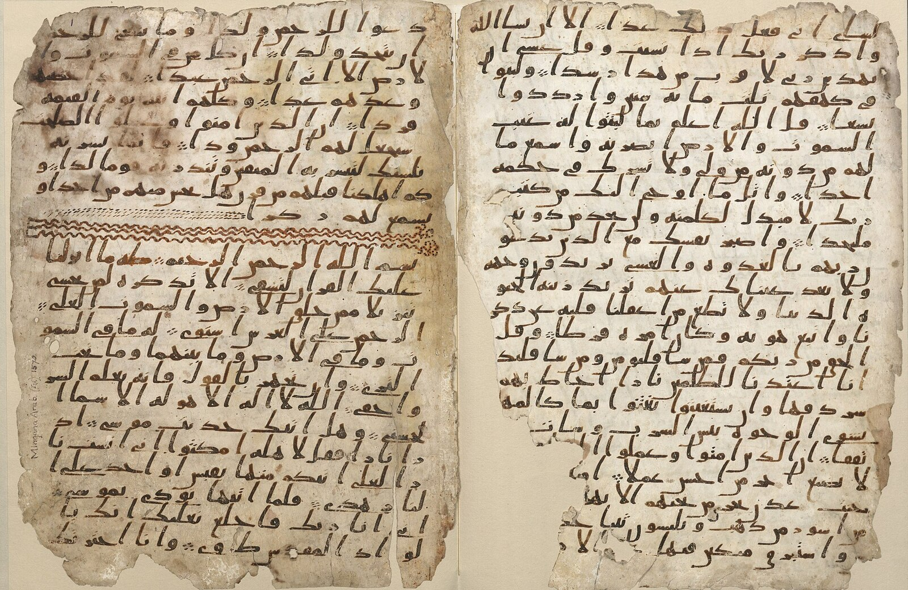
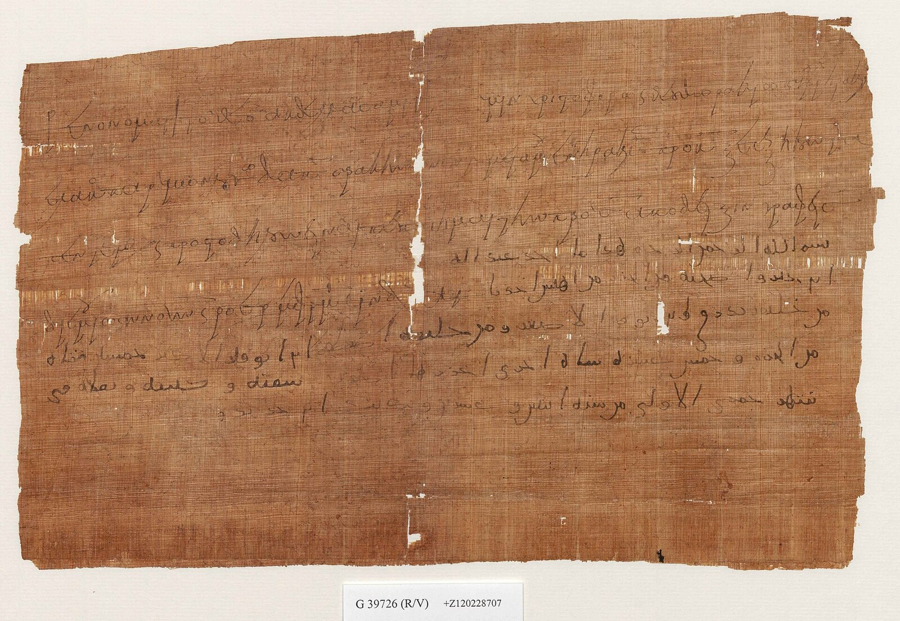
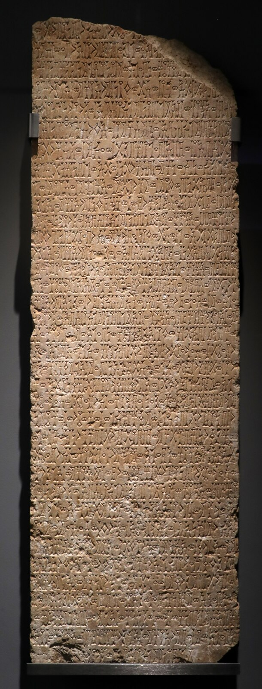
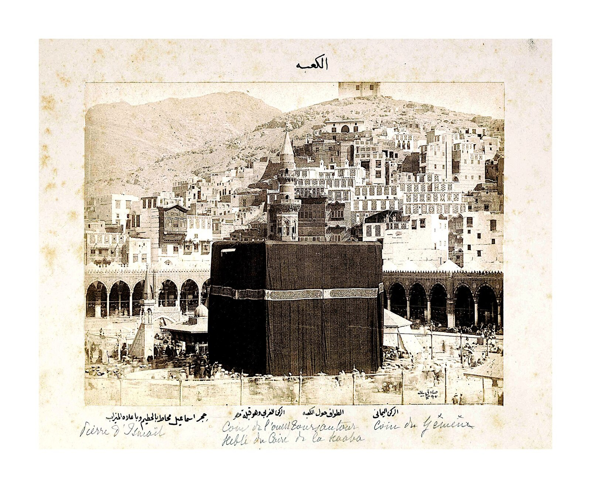
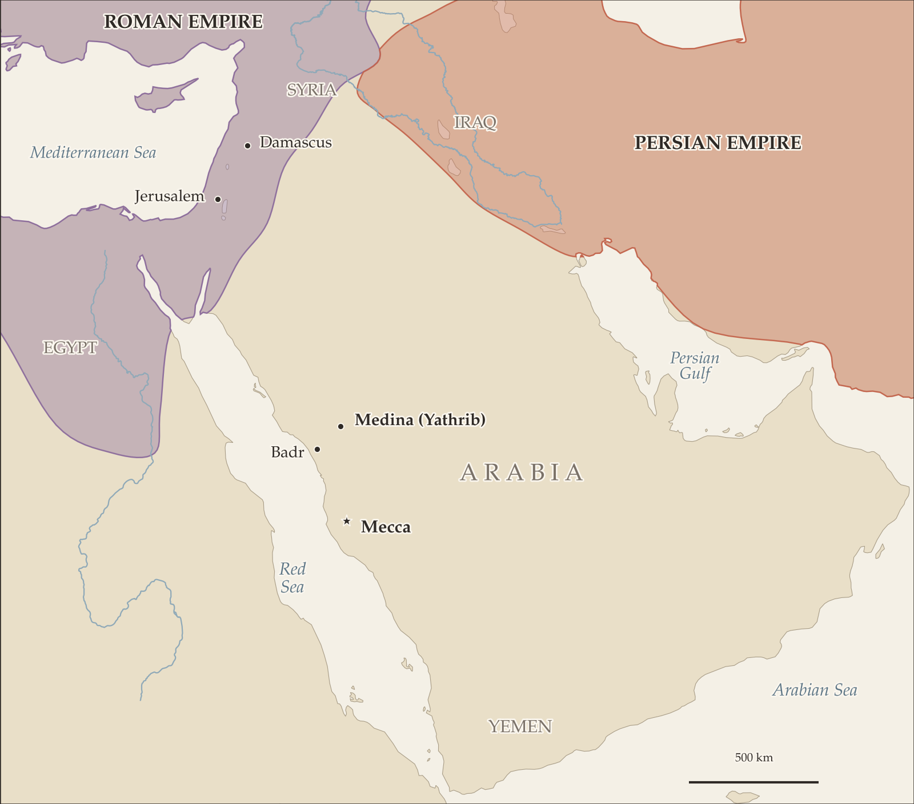
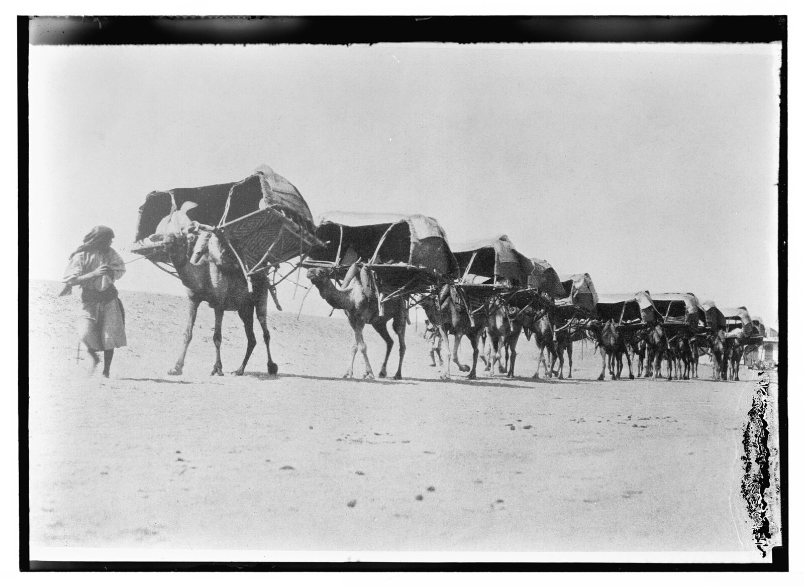
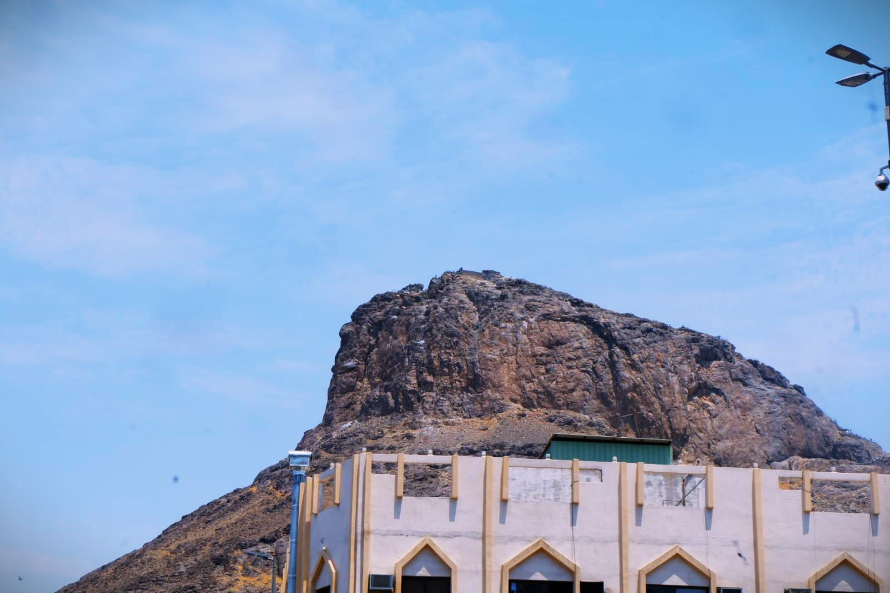
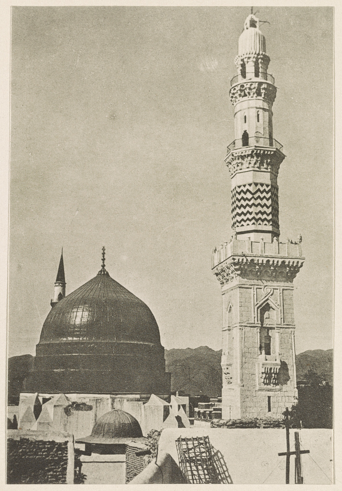

# 28. How did Islam begin?

*Western Arabia, from about 570 to 632*

It began with a merchant in a trading town in the west of Arabia, who at about the age of forty started to recite what he said were the words of the one God. The community that formed around him was held together by belief instead of blood, and in a land of feuding clans that made it stronger than any clan.

In 2013, a doctoral student at the University of Birmingham, in England, was examining a manuscript of the Qur'an, the holy book of Islam, in the university's collection. Bound into it were two leaves of parchment that did not match the rest. The handwriting was of a different and older style, a slanting script with hardly any of the dots that later Arabic uses to tell one letter from another. The leaves had been in the library for nearly a century, filed with the wrong book.

The university sent a sample of the parchment to a laboratory in Oxford for radiocarbon dating, which measures how long ago a plant or animal died. The answer came back that the sheep or goat whose skin made those pages had almost certainly died between the years 568 and 645.

Muhammad, the founder of Islam, is believed to have lived from about 570 to 632. The parchment therefore dates from his own lifetime or from the dozen years after it, and the writing on it is probably not much younger than the skin. Apart from small differences of spelling, the words on the two leaves are those of the Qur'an as it is printed today.

*Two leaves of the Birmingham Qur'an, written in the slanting early script of western Arabia. The parchment was dated by radiocarbon to between 568 and 645. University of Birmingham. Public domain.*

That result matters because of a difficulty that any honest account of Islam's beginnings has to face. The detailed story of Muhammad's life comes from biographies composed by Muslim scholars more than a century after he died, out of reports, a few written and most spoken, that had been handed down for four or five generations. The oldest of them survives only in an edition made later still. Believers accept this tradition, and it may well be accurate in the main. A historian would nevertheless like something closer to the events.

There are three such things, and together they hold up the outline. The first is the Qur'an itself, which pages like those in Birmingham show to have been fixed in writing very early. It says little about events, but a great deal about what was preached. The second is a handful of notes by startled outsiders. A Christian text written within a few years of Muhammad's death mentions a prophet who has appeared among the Arabs, armed with a sword, and an Armenian chronicler a generation later knows that he was a merchant named Muhammad who taught his people about the God of Abraham. The third is a scrap of papyrus from Egypt, a receipt for sixty-five sheep handed over to an Arab commander. It is written in Greek and Arabic, it opens with the words "In the name of God", and it is dated to the year twenty-two. Something had happened twenty-two years earlier that Arabs already counted their years from.

*A receipt on papyrus written in Greek and Arabic, dated to the year 643 (the year twenty-two). It comes from Egypt and is now in the Austrian National Library. Public domain.*

The detailed story exists only as Muslim tradition tells it. Its main lines are secure, and many of its details cannot be checked.

## The clan

Arabia is a block of desert about the size of India, with mountains and a little rain along its western and southern edges. In the sixth century most of its people were herders of camels, sheep and goats, who moved with the grazing. Others farmed dates and grain in oases, or lived in the few small towns. The camel made the country habitable. It can go a week or more without water, carry a load of well over a hundred kilograms, and turn thorn bushes into milk.

Outside the old kingdoms of Yemen, in the far south, no government ruled there. The desert and its towns had no king, no tax collector, no police and no courts, and the question of what kept anyone safe had one answer, which was kinship.

*A stone inscription in the script of Saba, one of the old kingdoms of southern Arabia. National Museum of Oman. Photo: Francesco Bini, CC BY-SA 4.0.*

Every person belonged to a clan, a group of families descended from one ancestor, and several clans made up a tribe. If a man was robbed or killed, his clan was bound to take revenge on the clan of the man who did it, and the killer's whole clan was held responsible. Everybody knew this, and the knowledge was the nearest thing to law. A man thought twice before harming a member of a strong clan, since he would be exposing his own brothers and cousins to the feud that followed.

The system protected exactly those who had kin behind them. A widow or an orphan without a protector, a slave, or a stranger had nobody who would pick up a sword on their account, and could be cheated or beaten at no risk. Feuds, moreover, ran on for generations, each killing calling for another. Raiding other tribes for camels was an accepted way of making a living, and the old Arabic poems celebrate it.

Mecca, in a barren valley about seventy kilometres from the Red Sea, had found a way to live in such a world. At its centre stood a small cube-shaped building called the Kaaba, which housed the images of many gods. The ground around it was sacred, and no blood could be shed there. For certain months of the year a truce held across the region, and people of every tribe came to Mecca on pilgrimage, and to trade at the fairs nearby. The tribe that controlled the town, the Quraysh, looked after the shrine, supplied the pilgrims, and sent camel caravans north to Syria and south to Yemen.

*The Kaaba in Mecca, photographed in 1880 by Muhammad Sadiq Bey. Photo: Muhammad Sadiq Bey, Khalili Collections, CC BY-SA 3.0.*

The Arabs were not cut off from the wider world. To the north lay the two great empires, Rome and Persia, which by the time Muhammad began to preach were fighting the longest and most destructive of all their wars, and which paid Arab chiefs on the desert's edge to guard their frontiers. Both the faiths of the book had reached Arabia as well. Jewish clans farmed several of the oases. There were Christians in Yemen and along the Syrian border, and Christian monks in the desert. Most Arabs had heard of the one God of Abraham, and many already thought of a high god, called simply *Allah*, "the God", who stood above the gods of the shrine. The Jews and the Christians each had a scripture in their own tongue. The Arabs had none.

*Arabia about the year 600, between the Roman Empire to the north-west and the Persian Empire to the north-east, with Mecca, Medina and the wells of Badr in the west and Yemen in the south. The empires' edges in the desert are drawn roughly. Map: drawn for this book; coastlines and rivers from Natural Earth, public domain.*

## Recite

Muhammad was born into the Quraysh, in a respectable clan that had come down in the world. He never knew his father, who died before he was born. His mother died when he was about six. He was passed to his grandfather, who died two years later, and then to an uncle, a merchant of modest means. He grew up, in other words, as an orphan under the protection of a clan, and he knew from the inside what that protection was worth and what it was like to have no claim on anybody.

As a young man he worked on the caravans and gained a reputation for honesty. A wealthy widow named Khadija, who ran a trading business of her own, hired him to take her goods to Syria. She was pleased with the results and proposed marriage to him. He was about twenty-five, and she was, by tradition, about forty. The marriage was a happy one and lasted until her death, and as long as she lived he took no other wife.

*A camel caravan carrying pilgrims to Mecca, about 1910. Photo: Matson Collection, Library of Congress, public domain.*

He had a habit of withdrawing for days at a time to a cave on a mountain outside the town, to think and pray. On one such night, when he was about forty, something happened there that terrified him. As he told it afterwards, a presence seized him and commanded: "Recite!" He answered that he could not recite. Twice more he was gripped and commanded, and then the words came, the first of many. He ran home shaking and asked Khadija to cover him with a cloak. She listened, and told him that God would not disgrace a man who was kind to his relatives, who spoke the truth and who helped the poor. She was the first person to believe him.

*Jabal al-Nour, the mountain outside Mecca where the cave of Hira lies. Muslims believe the first words of the Qur'an came to Muhammad there. Photo: Sadath i, CC BY-SA 4.0.*

Muslims believe that the presence was the angel Gabriel, and that the words Muhammad recited then and over the next twenty-three years were the speech of God himself, passed on without alteration. Those recitations, gathered into a book, are the Qur'an. The word means "the recitation".

The earliest of them are short, rhythmic and urgent. There is one God, who made the world and everything in it, and the gods of the shrine are nothing. A day is coming when the earth will be shaken, the dead will be raised, and each person will be judged on what he or she has done. On that day, the recitations insist, nobody will be able to help anybody else. A man will flee from his brother, his mother and father, his wife and his sons. Each soul will answer alone.

To an Arab that was a shocking idea. All his life a man had faced the world as a member of a clan, and now he was told that before the only judge who mattered he would stand as an individual.

The recitations said just as clearly what the judge would ask. Did you feed the poor? Did you treat the orphan harshly? Did you give honest weight and measure? They condemn those who pile up wealth and count it. They also condemn the killing of unwanted baby girls, which Arabs practised as Romans did. On the day of judgment, one passage says, the baby girl who was buried alive will be asked for what crime she was killed.

Muhammad did not think he was founding a new religion. As he understood it, the one God had sent messengers to many peoples, among them Abraham, Moses and Jesus, and each had brought the same truth, which their followers had then quarrelled over or distorted. He had been sent to the Arabs with that truth in clear Arabic, as the last of the line. The right response to it was to surrender oneself to God. The Arabic for that surrender is *islam*, and one who makes it is a *muslim*.

## The uncle's protection

For three years he spoke only to family and friends. Then he began to preach in public, and the leading men of Mecca turned against him.

Their objections were practical as much as religious. The town lived by its shrine. A man who announced that the gods in the Kaaba were lumps of wood and stone was attacking the pilgrimage, and with it the truce and the fairs that fed everybody. He was also telling the Quraysh that their revered ancestors, who had worshipped those gods, were in hell. In addition, the people who gathered round him were mostly young, and many were poor, or slaves, or outsiders living under the protection of a clan that was not their own, and the message they were hearing was that the rich would answer for their riches.

What the Meccan leaders could do about it shows how the clan system worked. They could not safely kill Muhammad himself. His uncle, the head of his clan, refused to withdraw his protection from his nephew, and to harm Muhammad would therefore have meant a feud with the whole clan. The believers who had no such shield paid instead. The best remembered is an African slave named Bilal, whose owner laid him on his back on the burning ground at midday with a rock on his chest and told him to deny his God. Bilal kept repeating one word, "One, one." A wealthy believer finally bought him and set him free.

For some years the stalemate lasted. Then, in a single year, both Khadija and the uncle died. The new head of the clan was an enemy, and the protection was gone. Muhammad was now what he had preached on behalf of, a man in Arabia without a clan to stand behind him.

## The oasis

About three hundred and forty kilometres north of Mecca lay Yathrib, an oasis of date groves and scattered farmsteads. Its people had a problem of their own. The two main Arab tribes of the oasis had been locked in a blood feud for years, with the local Jewish clans allied to one side or the other, and it had lately ended in a battle that settled nothing and left everyone afraid to walk through a neighbour's palm grove.

The feud had resisted every attempt to settle it, since each side felt that it was owed a death. What the oasis needed was a judge who belonged to neither party and whose authority both could accept. Some men of Yathrib had heard Muhammad preach at the pilgrim fairs. In the year 622, a delegation of seventy-three men and two women met him secretly by night and pledged to protect him as they would their own kin if he came to live among them.

The believers slipped out of Mecca in small groups over the following weeks. Muhammad left among the last, with a single companion, and hid for three days in a cave while the Meccans hunted for him. This move is known as the *hijra*, "the emigration". When Muslims later needed a calendar, they did not count from Muhammad's birth or from the first recitation. They counted from the emigration, because that was the year the community began. It is the year that the receipt for the sheep was counting from. Yathrib came to be called simply "the city", in Arabic *Medina*.

A document survives from the first years there, copied into the oldest biography, and most historians accept it as genuine because its language is archaic and its contents did not suit the views of later ages. It is an agreement among the emigrants from Mecca, the clans of the oasis, and the Jews allied to them. Its opening clause says that the believers are one community, apart from all other people.

The Arabic word for that community is *umma*, and the clauses that follow spell out what it meant. Believers are to stand together against anyone who wrongs one of them, even if the wrongdoer is the son of one of their own. No believer may kill another believer for the sake of an unbeliever. The Jewish clans keep their own religion and share in the common defence. Any dispute that threatens trouble is to be referred to God and to Muhammad.

That agreement took the one institution Arabia had, the clan with its duty of mutual protection, and stretched it over people who shared no ancestor. Among the believers, the tie no longer depended on who one's grandfather was. It depended on a declaration that there is no god but God and that Muhammad is his messenger, and anyone at all could make it. The slave Bilal was a full member. He was given the task of calling the community to prayer, in a voice that carried across the oasis.

In Medina the duties of membership became the public rhythm of a whole town, and they were few. A Muslim prayed five times a day, at fixed hours, in rows with the others, facing in a set direction. At first that direction was Jerusalem, and after about a year and a half it became the Kaaba at Mecca. A Muslim fasted from dawn to dusk for one month of the year, and paid a fixed share of his wealth each year for the support of the poor, the orphan and the traveller. What the first recitations had urged as charity became an obligation, and the community had a treasury. No priests were needed for any of it.

*The Prophet's Mosque in Medina, with its minaret and the dome over the tomb of the Prophet, photographed in 1910. Photo: Bernhard Moritz, public domain.*

The recitations of the Medina years are longer and deal with the business of a society. They lay down rules for inheritance, marriage, debts and the treatment of orphans' property. They gave a daughter a fixed share of her parents' estate, half the share of a son, in a country where women had often inherited nothing and had sometimes been inherited themselves. They limited a man to four wives and told him to take only one if he feared that he could not treat several fairly.

## Caravans and a trench

The emigrants had left their property behind in Mecca and had no land in the oasis. In the second year they began to do what any Arabian group would have done in their place, and raided the caravans of their enemies.

For the Quraysh, this was a threat to their living. Their caravans to Syria had to pass within reach of Medina. For the Muslims, it was a war against people who had driven them from their homes for their faith, and a recitation of this period gives permission to fight to those who have been wronged.

In 624 some three hundred Muslims went out to intercept a large caravan and ran instead into a Meccan relief force three times their size, at a group of wells called Badr. They won. To the believers the victory was a proof that God fought on their side. The following year the Meccans came north for revenge and got the better of a battle outside the oasis, in which Muhammad was wounded. Two years after that they returned with a coalition of tribes, about ten thousand men, to finish the matter. On the advice of a Persian convert, the Muslims dug a ditch across the open side of the oasis. The Meccan horsemen had never seen such a thing and could find no way over it. After a few weeks of cold wind and short rations, the coalition broke up and went home.

The Jewish clans of the oasis were caught in the middle of this war, and it destroyed them. Most of the Jews of Medina had not accepted Muhammad as a prophet, and their leaders were suspected of dealing with Mecca. Two of the three main clans were expelled in turn and their date groves were taken. The third was accused of negotiating with the besiegers during the weeks of the ditch. When the siege ended, according to the tradition, its men were put to death, several hundred of them, and its women and children were enslaved. Muslim historians recorded the event without embarrassment as the punishment for treason in wartime. It is the darkest episode in the story, and it was told by the victors.

By now Muhammad was the strongest figure in western Arabia, and he used the position in a way that puzzled his followers. In 628 he led about fourteen hundred of them, unarmed except for travellers' swords, towards Mecca to perform the pilgrimage. The Quraysh stopped them outside the sacred ground. Instead of fighting, Muhammad signed a truce for ten years, on terms that looked humiliating. The Muslims were to turn back that year and come the next. His companions were dismayed. However, the truce treated Medina as Mecca's equal, and it left him free to win over the desert tribes one by one.

## The key of the shrine

Two years later, allies of the Quraysh broke the truce. Muhammad marched on Mecca with ten thousand men, and the town put up almost no resistance.

What he did there settled the future of the movement. He rode to the Kaaba and had the images inside and around it destroyed. The building itself he kept. The tradition held that Abraham had built it for the worship of the one God, and that the idols had come later. The pilgrimage would go on, to the same place, in the same months, with many of the same rites, now in honour of God alone. The guardian of the shrine came forward expecting to lose his office, and Muhammad handed him back the key.

He also announced an amnesty. The men who had mocked him, hunted him and fought him for twenty years were left their lives and their property, with a handful of exceptions. Their leaders were soon given gifts and commands. Some of the early believers grumbled that those who had held out longest were being rewarded best. The policy worked, all the same. The Quraysh had feared that the new religion would ruin their town, and instead it had made Mecca the centre of the faith and the Quraysh its leading family.

In the two years that remained to him, delegations came to Medina from tribes all over Arabia to make their terms. The terms were usually the same. The tribe acknowledged God and his messenger, agreed to pay the yearly alms, and promised to stop raiding other Muslims.

That last condition explains how the community grew so quickly. Each tribe that joined could no longer be raided by the others and could no longer raid them. The area of peace grew with every agreement, and the tribes still outside it found themselves facing a larger and larger alliance whose members were pledged not to fight one another. For a chief weighing his choices, the argument for joining became stronger every month. By 632, for the first time in its history, most of Arabia belonged to a single alliance, and its fighting men, who had spent their lives raiding one another, were forbidden to go on doing so.

In the spring of that year, Muhammad led the pilgrimage to Mecca himself, and spoke to the crowds from the back of his camel. About two months after returning to Medina he fell ill with a fever, and in early June he died in the room of his wife Aisha, beside the courtyard where the community prayed. He left no son, and the community had no agreed successor.

The news caused panic. One of his closest companions, a fierce man named Umar, stood in the courtyard shouting that the Prophet was not dead and that he would cut down anyone who said so. Then Muhammad's oldest friend, Abu Bakr, arrived. He went in and looked at the body, came out, and spoke to the crowd.

If anyone here worships Muhammad, he said, then know that Muhammad is dead. If anyone worships God, God is alive and does not die.
