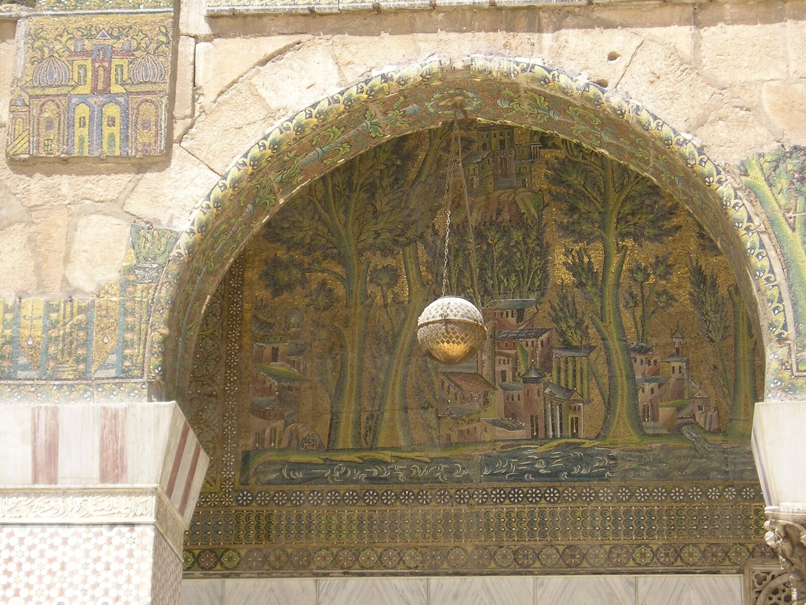
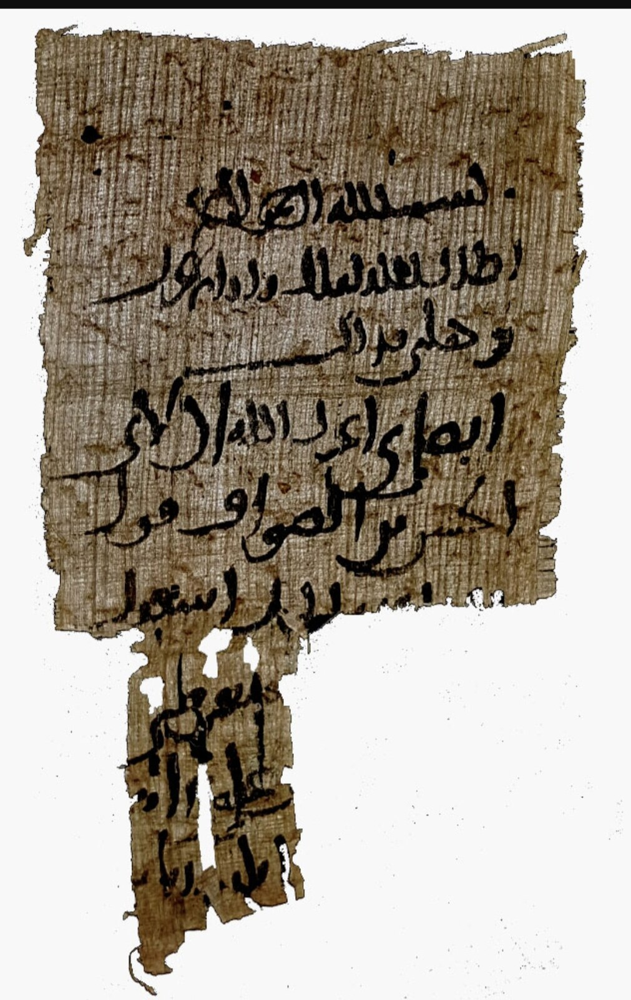
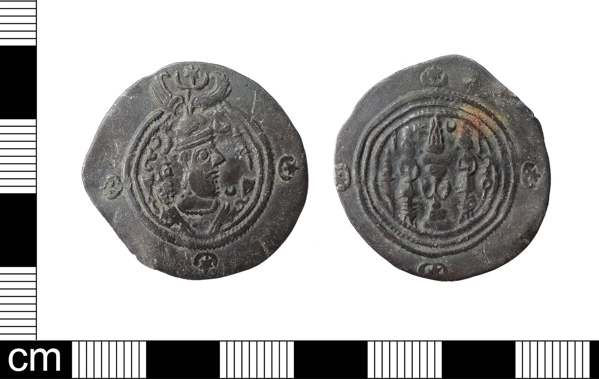
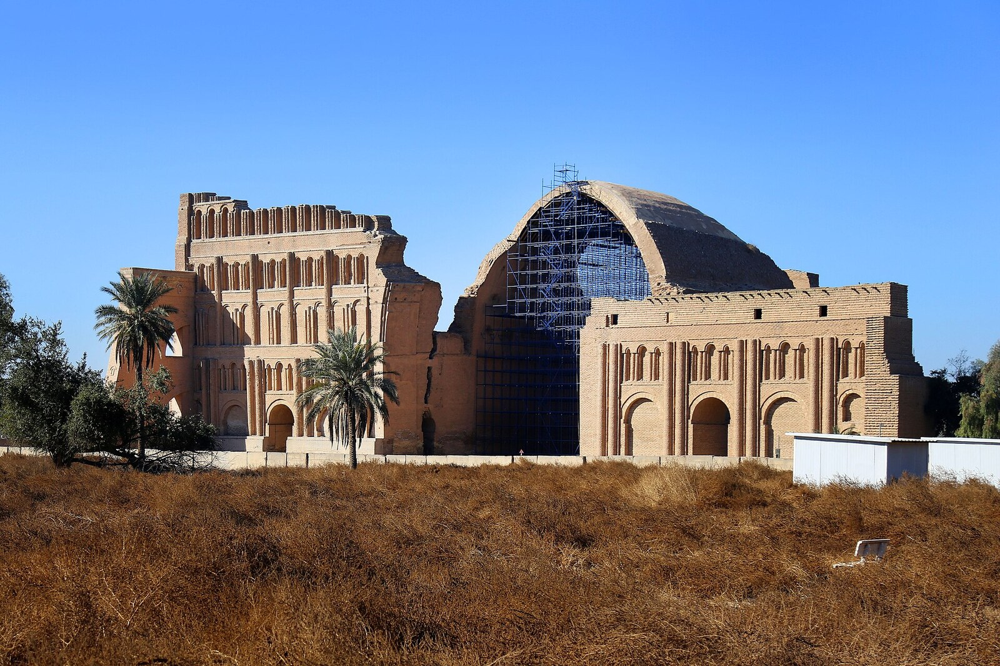
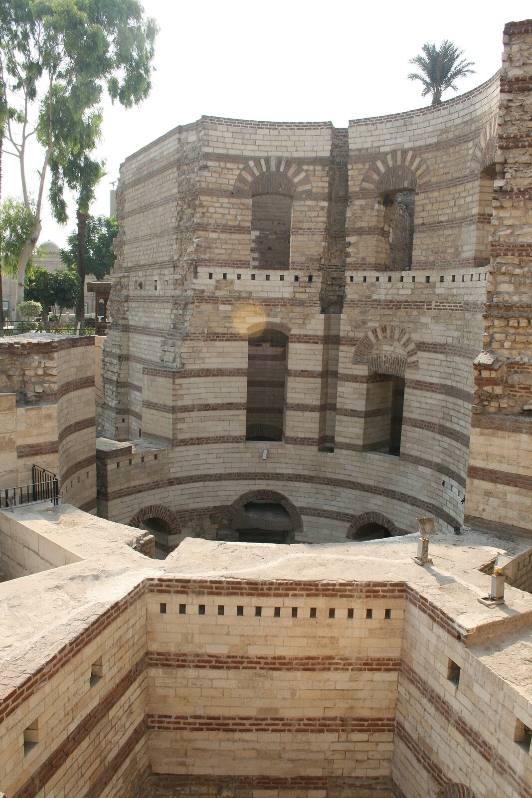
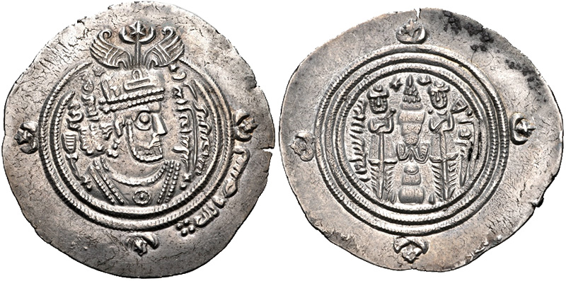
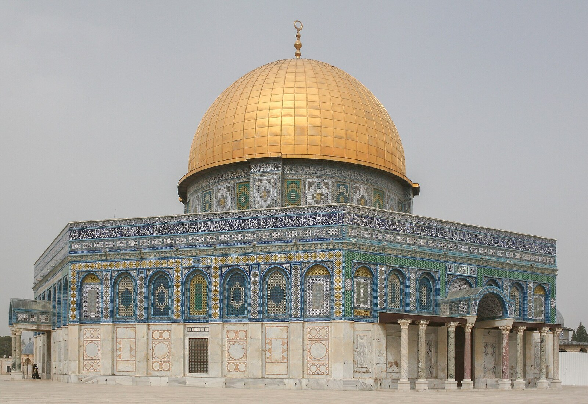
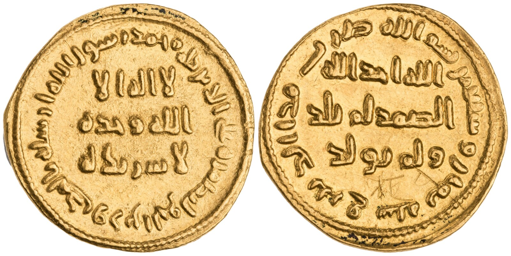
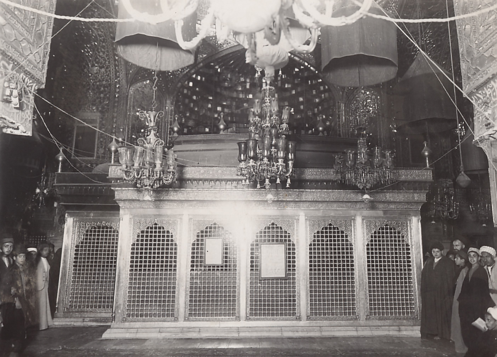

# 29. How did the Arabs conquer an empire so quickly?

*From Spain to Central Asia, from 602 to about 750*

They attacked two great empires that had just fought each other to exhaustion, and they changed very little for the people they conquered. A town that opened its gates kept its religion, its laws and its officials, and paid its taxes to new masters who otherwise left it alone.

About the year 710, in a large village on the Nile called Aphrodito, a local official named Basilios was having a difficult time with his superior. Basilios was a Christian, and he was responsible for delivering the district's taxes. The governor of Egypt wrote to him constantly. Dozens of the letters survive, because the village archive was thrown out and the dry sand kept it.

The governor wants the gold tax, which is late. He wants sailors for the fleet, carpenters for the shipyards, and workmen and timber for a great building far away in Damascus. He wants to know why men who fled their villages have not been sent back. His tone is that of every tax office in history. If the money does not arrive, he writes, Basilios will answer for it with his property and his person.

*Mosaic in the courtyard of the Great Mosque of Damascus, the building the governor of Egypt sent workmen and timber for. It is about 1,300 years old. Photo: Heretiq, CC BY-SA 3.0.*

The governor's name was Qurra, son of Sharik. He was an Arab and a Muslim, and he served a ruler in Syria who claimed to be the successor of the Prophet of God. Egypt had been conquered by Arab armies almost seventy years before.

Very little else in the letters would have surprised Basilios's great-grandfather, who had paid his taxes to a Roman emperor in Constantinople. The districts are the old Roman districts. The offices have their old titles. The tax is assessed in the same way and written up in the same registers, and the letters to Basilios are in Greek, as government letters in Egypt had been for a thousand years. Some of them carry a short summary in Arabic as well.

*An Arabic letter on papyrus from Egypt, 8th century. It is not from the Aphrodito archive, but it is the same kind of writing material and the same age as the governor's letters. Photo: Yazid al-Oreiji, CC BY-SA 4.0.*

The Arab conquests were among the fastest in history. Within twenty years of Muhammad's death, Arab armies had taken Syria, Egypt, Iraq and Iran. Within a hundred, they held everything from Spain to the borders of India and China, an empire larger than Rome's at its height. The archive from Aphrodito helps to explain the speed. The conquerors had removed the top layer of government, and they had left the rest where it was.

## The last great war of antiquity

The story begins thirty years before the first Arab army crossed a frontier, with a murder in Constantinople.

In 602 a mutiny on the Danube put a junior officer on the Roman throne, and he had the emperor and five of his sons killed. The murdered emperor had been a friend to the young king of Persia and had once helped him win back his crown. The king of kings announced that he would avenge his benefactor. He then set about doing what no Persian ruler had managed in three centuries of trying, which was to take the Roman east for good.

For a time he succeeded. Persian armies took the fortress towns of the northern frontier, then Syria. In 614 they stormed Jerusalem and carried off the most sacred relic in the Christian world, the wood believed to be the cross of Jesus. In 619 they took Egypt, and Constantinople's grain supply with it. In 626 a Persian army camped on the Asian shore opposite Constantinople itself, while its allies from the steppe attacked the walls from the European side. For a moment Persia ruled from the Nile to Central Asia, as it had a thousand years before.

*Silver drachm of Khusro II, king of Persia from 590 to 628. The king wears a winged crown; the other side shows a fire altar. Photo: Stuart Wyatt, The Portable Antiquities Scheme, CC BY 2.0.*

The Roman emperor of these years, Heraclius, answered with a gamble. He melted down the treasures of the churches to pay his soldiers, left the capital to defend itself, and took his army by sea and through the mountains of Armenia into the Persian heartland from the north. In the winter of 627 he destroyed a Persian army near the ruins of Nineveh and marched on the royal palaces. The Persian nobles had had enough. They overthrew the king of kings, his own son had him shot to death with arrows, and Persia sued for peace. Every province went back to its former owner.

After twenty-six years, the frontier lay exactly where it had been at the start. Both empires had spent everything they had. Syria and Egypt had been under Persian occupation for half a generation, long enough for people to learn that the emperor in Constantinople could be done without. A new outbreak of plague was killing people in Iraq. Persia, moreover, could not find a ruler. In the four years after the old king's death, about ten men and women sat on the throne, most of them briefly.

For centuries, moreover, both empires had guarded their desert flank by paying Arab chiefs to do it. The Persians had abolished their Arab client kingdom shortly before the war began. The Romans, after the war, were looking for expenses to cut. A Greek chronicler records that when the desert Arabs who watched the approaches to Palestine came for their usual payment, an official of the treasury drove them away. The emperor can hardly pay his soldiers, he told them, let alone you dogs. The men he insulted went and showed their kinsmen the way in.

## An outlet

When Muhammad died in 632, the alliance he had built came close to dying with him. Many of the desert tribes considered that they had made an agreement with a man, and that it had ended with his death. They stopped sending the yearly alms to Medina.

At a hasty meeting, held while the Prophet's family were preparing his body for burial, the companions chose Abu Bakr, the Prophet's old friend, to lead the community, with the title of *caliph*, which means successor or deputy. He treated the refusal to pay as a rebellion against God, and within two years his commanders had forced the tribes back into line. For the first time, all of Arabia answered to one authority.

That left the caliph with a problem that his own religion had created. The tribes of Arabia had always lived partly by raiding one another, and they were now forbidden to. Many thousands of armed men, skilled at fast movement across open country, had lost a large part of their living. If it was not to tear itself apart, the community had to find them another, and the answer was to send them north. The first expeditions into Syria and Iraq looked much like raids of the traditional kind, for livestock and captives. They went outwards, where raiding was still allowed, and they went in the name of God.

The raiders found that there was very little to stop them. Encouraged, the caliphs sent larger forces, and the larger forces met the field armies of the two empires. In 636, on the river Yarmuk, south of Damascus, an Arab army destroyed the main Roman army of the east in a battle that lasted six days. In the same year or the next, in Iraq, another Arab army broke the Persians and killed their commander. Persia's capital, a great city on the Tigris, fell a few months later.

The Arab soldiers who entered the palace there had grown up in tents. They found a carpet in the audience hall, nearly thirty metres square, that showed a garden in spring, with paths of gold thread, streams of crystal and trees with fruit of precious stones. The rules for plunder were clear. A fifth went to the caliph for the community, and the rest was shared among the men who had fought. Nobody could think of a way to share a carpet. It was sent to Medina, where the caliph had it cut into pieces and handed out.

*The Taq Kasra at Ctesiphon, the great vaulted hall of the Persian kings on the Tigris, in the capital that the Arabs took. Scaffolding supports the arch. Photo: Safa Daneshvar, CC BY-SA 4.0.*

The armies were not large, and they had no weapon that their enemies lacked. They did have several advantages. They had been hardened by a lifetime of desert warfare, and their morale was that of men who believed that God had given them the victory. Their camels let them cross country in which no other army could survive, so that they could appear where they were not expected and withdraw into the desert when a battle went badly. Above all, their timing was fortunate. The two empires had each lost a generation of soldiers, and most of the Arabs, for the first time in their history, were on the same side.

## Four thousand men

Egypt was the richest province of the Roman Empire, and it had several million inhabitants. At the end of 639 an Arab general named Amr crossed its border with about four thousand men. He was later reinforced, but his army never numbered more than about fifteen thousand. In less than three years he had the whole country, including Alexandria, one of the largest and best fortified cities in the world.

*A tower of the Roman fortress of Babylon in Old Cairo, a stronghold of the province that Amr invaded. Photo: Diego Delso, CC BY-SA 3.0.*

Most Egyptians neither helped him nor fought him. They had no reason to do either. Nearly all of them were Christians of the Egyptian church, which had rejected the formula about Christ that the emperor's council had laid down two centuries earlier. The council had said that Christ had two natures, one divine and one human. The Egyptians held that the two were joined in a single nature. To Constantinople they were heretics. In the ten years before the Arabs came, the emperor had sent a bishop to Egypt with orders to bring them into line and with control of the tax system to help him do it. He used flogging, prison and confiscation. The head of the Egyptian church spent those ten years in hiding, moving from one desert monastery to another.

When Amr had won, he sent out a safe conduct for the fugitive, who came out of the desert and was given back his churches. An Egyptian bishop who wrote a history of the conquest a few decades later had no love for the Arabs, whose rule he calls a heavy yoke. He records all the same that Amr took nothing from the property of the churches and did them no harm.

The terms offered to Egypt were much like those offered elsewhere, and they were simple. A city that surrendered was guaranteed the lives and property of its people, its churches or temples, and the practice of its religion. In return its people paid a yearly tax and acknowledged Muslim rule. A city that resisted and was taken by force could be plundered and its people enslaved. Most places saw where their interest lay. The Qur'an itself named Jews and Christians as "people of the book", who had received true scriptures from God, and it provided that they could keep their religion under Muslim rule so long as they submitted and paid tribute.

For a farmer on the Nile, the change was a new name at the top of the tax demand. For a Christian dissenter or a Jew, it was an improvement, since the new rulers did not care which kind of Christian a man was, and they had no church of their own to impose. A Christian monk in northern Iraq, writing in the 680s, said of the conquerors that they required only tribute from each man and left him free to hold whatever belief he wished.

## Camp cities

The second caliph, Umar, a stern and frugal man who ruled for ten years, made the decision that kept the conquests from dissolving.

Earlier conquerors had rewarded their warriors with estates. Had the Arabs done so, the army would have scattered across three countries as a class of landlords, and each general would have become a local prince. Umar forbade it. The conquered land stayed with the people who farmed it, and they went on paying the land tax as before. The soldiers were kept together in new camp cities built on the edge of the desert, two in Iraq and one in Egypt, on the site that later became Cairo. Each man's name was entered in a register, and he drew a yearly salary from the tax revenue, graded by how early he or his family had joined the faith.

In effect, the Arabs had become a salaried army living in its own towns on the taxes of the conquered. The arrangement suited everyone well enough to last. The soldiers were paid without having to farm. The peasants were left on their land. The treasury, meanwhile, went on receiving the revenues of the two richest tax systems in the world, and those systems went on working because nobody had dismissed the staff.

For half a century the new empire ran on borrowed machinery. In Syria and Egypt the registers were kept in Greek by Christian clerks, and in Iraq and Iran they were kept in Persian. The chief finance official of the caliphs at Damascus was a Christian whose family had served the Roman governor. The coins went on being struck to the old designs. In the former Roman provinces they showed an emperor holding a cross, and in the former Persian ones the head of the king of kings and a Zoroastrian fire altar, sometimes with a short Arabic phrase added at the edge.

*An Arab-Sasanian drachm struck at Basra in 681, in the style of Khusro II, with a short inscription in Arabic. Photo: Classical Numismatic Group, CC BY-SA 2.5.*

The break came in the 690s, under a caliph named Abd al-Malik. He and his son after him ordered the registers, province by province, to be translated and kept from then on in Arabic. He issued a new gold coin that carried no image of anyone at all, only words, the declaration that there is no god but God alone and that Muhammad is his messenger. In Jerusalem, on the platform where the Jewish Temple had stood, he built a domed shrine sheathed in mosaic, the oldest Islamic building that survives. Running round the inside is an inscription about two hundred and forty metres long, and much of it is addressed to Christians. It tells them that God is one, that Jesus was his messenger, and that they should not say "three".

*The Dome of the Rock in Jerusalem, built in the 690s and the oldest Islamic building that survives. The tiles on the outer walls were added much later. Photo: Diego Delso, CC BY-SA 3.0.*

The change took a generation to reach the provinces, where men like Basilios were still getting their orders in Greek. From then on, however, an ambitious clerk learned Arabic. Sixty years after the conquest, the empire had its own language of government and its own money.

*A gold dinar of Abd al-Malik, struck at Damascus in 697. It carries words and no image. Photo: public domain.*

## The party of Ali

The Arabs had mastered two empires far more easily than they managed to agree among themselves. The quarrel that divided them began on the day Muhammad died, and it has never been settled.

The question was who should lead. One answer was that the community should be led by the best qualified of the Prophet's companions, chosen by agreement among its senior men. That was the way Abu Bakr had been chosen. The other answer was that leadership belonged in the Prophet's own house. Muhammad had left no son, but he had a cousin, Ali, whom he had raised as a boy, who was among the very first believers, and who had married his daughter Fatima. Their sons were the only grandsons of the Prophet who lived to grow up. Ali's supporters held that Muhammad had named him as his heir.

Ali was passed over three times. After Abu Bakr came Umar, who was stabbed by a Persian slave. After Umar came Uthman, an early believer from one of the wealthiest clans of the Quraysh, the family that had led Mecca's opposition to the Prophet. Uthman gave the governorships to his relatives. In 656, soldiers from the camp cities who were angry about pay and favouritism marched to Medina, broke into his house and killed him.

Ali was then acclaimed caliph, in the middle of a mutiny, and never held the whole empire. Uthman's kinsman Muawiya, who governed Syria, demanded vengeance for the murder and refused to recognise him. The armies of Iraq and Syria fought, and then Ali agreed to let arbitrators decide between them. Some of his own soldiers were outraged. Judgment, they said, belonged to God, who had already given it in battle, and a caliph who bargained it away was no caliph. They left his camp, and the war dragged on. In 661 one of them struck Ali down with a poisoned sword as he came to prayer in a mosque. Of the first four successors of Muhammad, three had been murdered.

Muawiya took the caliphate, ruled it from Damascus, and arranged for his son to follow him. The leadership of the community had become the property of a dynasty, the Umayyads, drawn from the very family that had fought the Prophet longest.

In 680, when that son came to the throne, Ali's younger son Husayn set out from Arabia for Iraq, where supporters had promised to rise for him. They did not rise. A government army intercepted his small party in the desert at a place called Karbala, and cut it off from the river. After several days without water, Husayn and some seventy of his companions and relatives were killed, and his head was sent to Damascus.

*The grille around the tomb of Husayn at Karbala, in a photograph from the 1920s. Photo: Media Department of the Holy Husayni Shrine, public domain.*

The killing of the Prophet's grandson by the caliph's soldiers turned a political faction into something deeper. Those who held to the claim of Ali's house were known as the *shi'a* of Ali, his "party". For them the rightful leaders of the community were Ali and his descendants, wronged in each generation by rulers who had seized what was not theirs. Every year, on the anniversary of Karbala, they still mourn Husayn's death. The majority, who made no such claim for any one family, came in time to be called Sunnis, after the *sunna*, the established practice of the Prophet and the community.

The two groups share the Qur'an, the prayers, the fast and the pilgrimage. About one Muslim in every eight or nine today is Shia, and they form the majority in Iran and Iraq.

## Not as a tax collector

For a long time, the conquerors showed little interest in turning their subjects into Muslims.

They had a strong reason not to. The salaries of the Arab soldiers were paid from the taxes of the conquered, and the heaviest of those taxes fell on non-Muslims. A Christian, Jew or Zoroastrian who converted was supposed to stop paying it, and the treasury lost by every one. Islam was at first, in practice, the religion of the Arab ruling class. A Persian or an Egyptian who wished to convert had to attach himself to an Arab tribe as a kind of junior client, and he often found that he went on paying the old taxes anyway. Around the year 700, when Iraqi peasants began converting and moving to the camp cities in large numbers, a governor had them rounded up and sent back to their villages, with the name of each man's village branded on his hand.

One pious caliph objected. When one of his governors complained that conversions were ruining the revenue, he wrote back that God had sent Muhammad to call people to the faith, and had not sent him as a tax collector. He reigned for less than three years, and the treasury's view survived him.

Conversion came slowly, over many generations. People converted to marry, to rise in government service or to escape the tax, and others did so because they lived in a Muslim town and the faith of the rulers had come to seem the natural one. Family trees of prominent townsmen suggest that a century after the conquest, fewer than one in ten of the people of Iran were Muslims, and that Muslims became the majority there only after about two hundred and fifty years. In Egypt it took longer still.

Language moved at a similar pace and gave different results in different lands. In Egypt, Syria and Iraq, Arabic slowly replaced the older tongues in daily life, and the descendants of Basilios came in time to speak it at home. In Iran it did not. The Persians took the religion and the alphabet and kept their language.

The military conquests, for their part, ran on for a century and then slowed almost to a halt. In 711 an army crossed from Africa into Spain and overran it in a few years. In the same year another reached the valley of the Indus. However, Constantinople, behind its triple walls, beat off two great sieges, with the help of a liquid fire that its ships pumped through tubes and that burned on water. A raiding army was turned back by the Franks in central Gaul. In 751, beside a river in Central Asia, an Arab army met and defeated a Chinese one, and neither empire pushed any further.

*The growth of the caliphate: Arabia by 632, the lands from Egypt to Iran won by 661, and those from Spain to Central Asia and the Indus added by 750. The areas are drawn roughly. Map: drawn for this book; coastlines and rivers from Natural Earth, public domain.*

By then the dynasty at Damascus had been overthrown, and a new line of caliphs was planning a capital on the Tigris. Their subjects, from the Atlantic to the Indus, were still mostly Christians, Zoroastrians and Jews. They paid their taxes in coins that carried no king's face.
