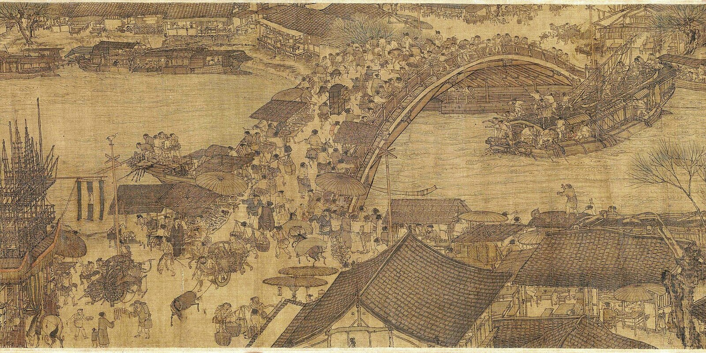
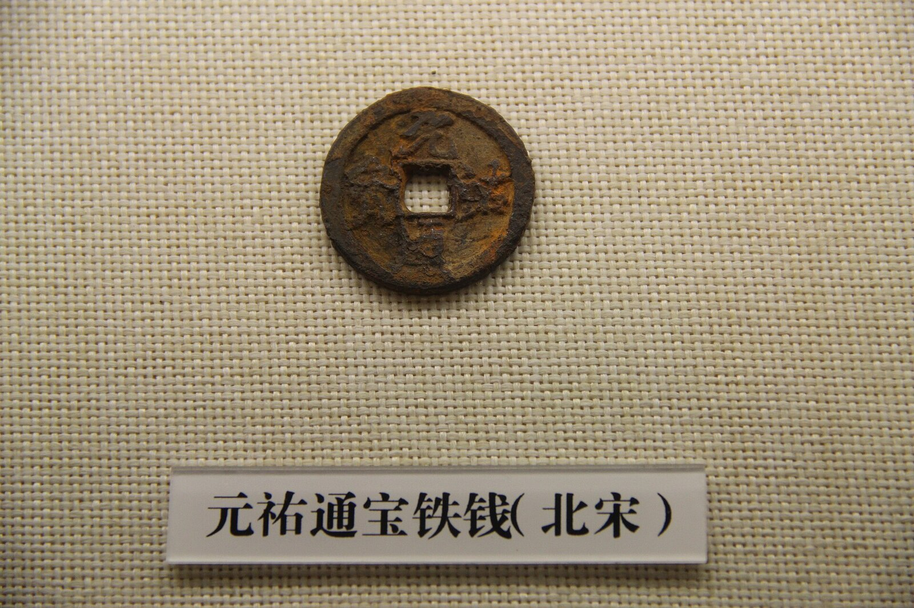
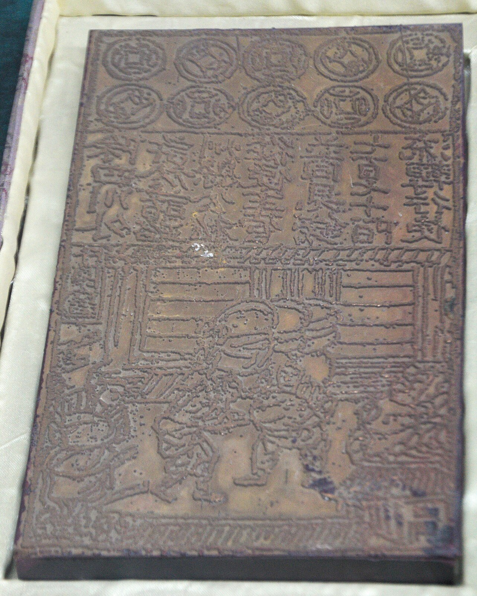
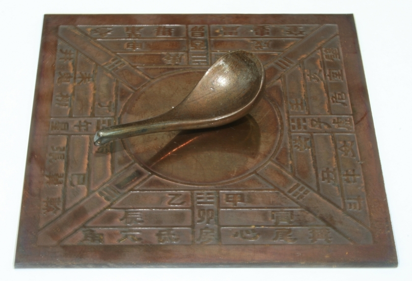
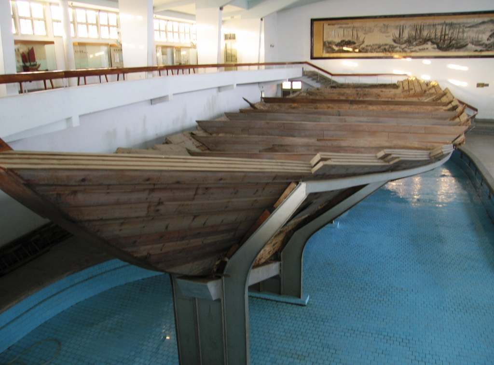
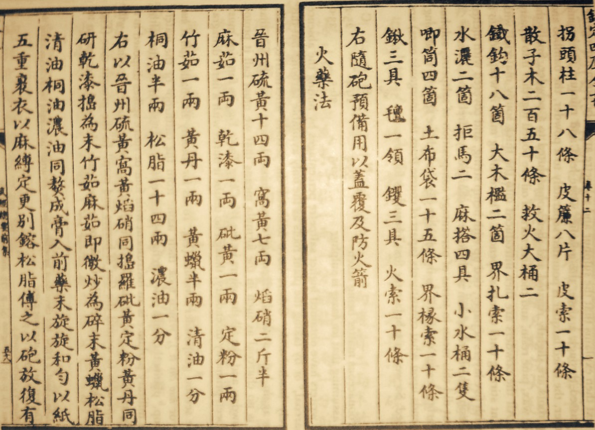
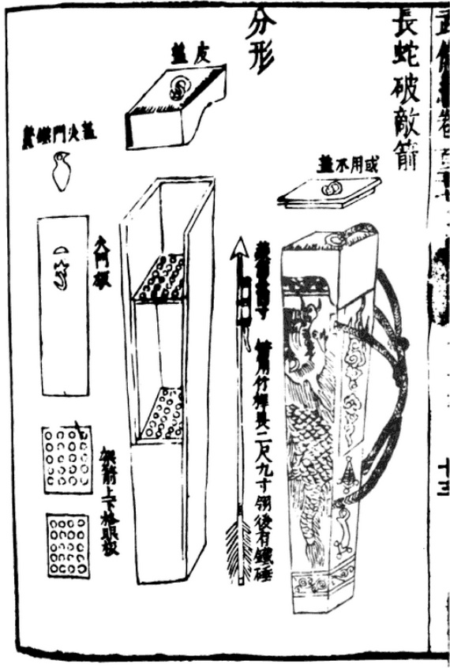
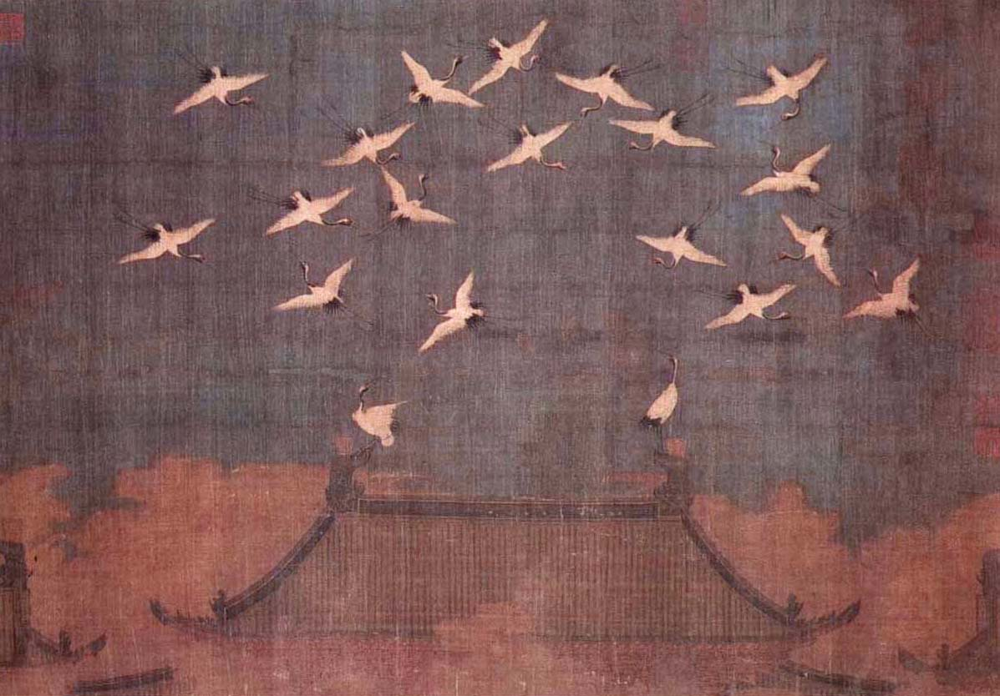
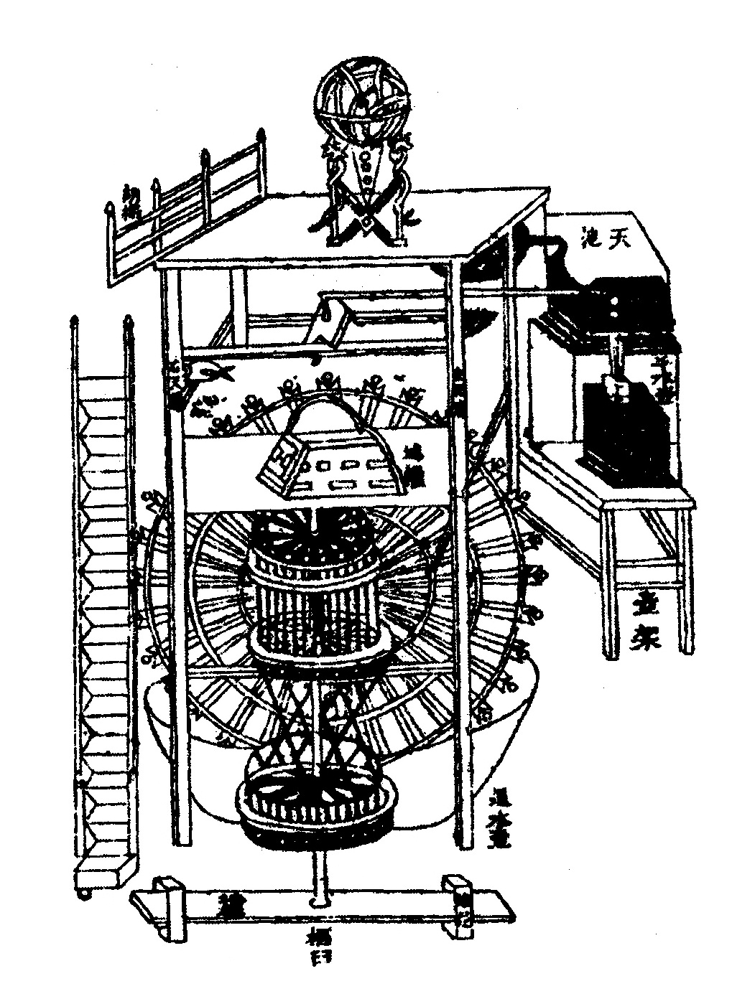

# 32. Who invented gunpowder?

*China under the Song dynasty, from about 850 to 1232*

Chinese alchemists did, about 1,200 years ago, while they were looking for a medicine that would let them live for ever. The society that turned their discovery into weapons was the richest and most inventive on Earth, and it was conquered anyway.

Some time in the ninth century, an unknown writer in China compiled a list of warnings for people who experimented with minerals. Such people were common. For centuries, followers of the Daoist teaching had believed that the right combination of substances, properly heated, would yield a drug that made the body immortal, and they had worked their way through almost everything that could be dug up, ground down and cooked. Several emperors died of the results.

The writer's list sets out some thirty recipes that should on no account be tried. One of them concerns a mixture that some experimenters had heated together: sulphur, a mineral containing arsenic, and saltpetre, with honey. Smoke and flames burst out, the writer says, so that their hands and faces were burned, and even the whole house where they were working burned down.

That passage is the earliest known description of gunpowder. The Chinese name for it preserves the story. It is still called *huoyao*, which means "the fire drug".

The secret was the saltpetre. It is a white salt that forms in soil where dung and urine have soaked in and rotted, and the alchemists scraped it from the floors of stables and the walls of old latrines. Arab chemists, who learned of it from China, called it "Chinese snow". Its peculiarity is that it carries a store of oxygen locked inside it.

An ordinary fire needs air. Charcoal smouldering in a brazier burns slowly because it can take in oxygen only at its surface, as fast as the air brings it. The fuel in the alchemists' pot was the honey, and later makers used charcoal in its place. Mix powdered charcoal intimately with powdered saltpetre, and each grain of fuel has its oxygen lying right beside it. Set the mixture alight, and the whole of it burns in an instant, with no need of air, and releases a volume of hot gas hundreds of times larger than the powder was. Sulphur makes it catch more easily. If the powder lies loose, the result is a fierce flash. If it is packed into a closed container, the gas has nowhere to go, and the container bursts.

The alchemists had been looking for a way to preserve life, and they wrote the discovery down as something to avoid. It took a century or more for anyone to find a use for it.

## Night markets

The Song dynasty took power in 960, and the country over which it presided grew faster than any before it.

The growth began in the fields. In 1012 the emperor had thirty thousand bushels of a new kind of rice seed brought up from the south-east coast, where it had arrived from Vietnam, and handed out to farmers along the Yangzi. This rice ripened many weeks sooner than the old kinds. A farmer could therefore harvest it and plant a second crop on the same land in the same year. Terraces were cut into hillsides to make more paddies, and officials printed and distributed illustrated handbooks on how to do it. In the two centuries before 1100, the population of China doubled, to about a hundred million. A third or more of all the people in the world were subjects of the Song.

More food meant that more people could do something other than farm. They moved to the towns, and the towns changed. The Tang capital had been a grid of walled districts whose gates were locked at dusk, with trade confined to two official markets. The Song capital, Kaifeng, on the Grand Canal near the Yellow River, did away with all that. Shops opened straight onto the streets. There were restaurants with several storeys, teahouses, theatres, pawnshops and a market that stayed open all night. A million people lived there.

A painted scroll survives that shows the city at about its height. It is more than five metres long and is meant to be unrolled an arm's length at a time. It follows the river from the fields into the town, through eight hundred tiny figures, among them boatmen straining to lower a mast before their barge strikes a bridge, a crowd leaning over the rail to shout advice, porters, fortune tellers, a man selling something from a tray, and camels coming in through the city gate.

*The bridge in "Along the River During the Qingming Festival", the Song painted scroll of the capital by Zhang Zeduan. Boatmen at the right are lowering the mast of a barge as it nears the arch. Painting: Zhang Zeduan, public domain.*

Kaifeng had also run out of wood. The hills of northern China had been stripped of forest to feed the city's stoves and the furnaces of its workshops. The north, however, sits on top of enormous beds of coal, and in the eleventh century the capital switched over to it. A writer who had known the city recalled that all of its households depended on coal, and that not one burned firewood.

Coal also went into iron. The Chinese had been melting iron and pouring it into moulds since about the time of Confucius, a skill that Europe would not acquire for another eighteen hundred years. Under the Song, ironmasters in the north learned to fire their tall furnaces with coal, and to drive the bellows that blew air into them with waterwheels. The largest ironworks employed hundreds of men each. One much-quoted estimate, worked out from the tax records, puts the country's output of iron in the year 1078 at more than a hundred thousand tonnes, and the lowest estimates still run to several tens of thousands. No other country came near either figure for centuries.

The iron became ploughshares and hoes for the new rice fields, nails for ships, chains for suspension bridges, and arrowheads by the million. A large amount of it also went into the making of money, with consequences that nobody had planned.

## Fifteen kilograms of small change

Chinese coins were small bronze discs with a square hole, strung in bundles of a thousand, and the booming economy needed more of them than the mints could cast. The country was short of copper. In the south-western province of Sichuan, the government dealt with the shortage by issuing coins of iron.

Iron is worth far less than bronze, and so an iron coin had to be large to be worth anything. A string of a thousand of them weighed about fifteen kilograms. A woman going to market to buy a bolt of silk would have needed a porter, or a cart, to carry her money.

*An iron coin of the Northern Song, of the Yuanyou type, issued between 1086 and 1094. Handan City Museum, Hebei. Photo: Gary Todd, CC0.*

The merchants of the provincial capital found the obvious way out. A customer left his iron coins with a trusted shop for safe keeping, and the shop gave him a paper receipt. In time, people saw that there was no need to go back and collect the coins before paying someone. They could simply hand over the receipt. Around the year 1000, sixteen of the city's richest merchant houses were issuing printed receipts in a common design, with pictures of houses and trees, secret marks, and seals in red and black.

*A printing plate for a Northern Song banknote, with its rows of coins, text and picture. China Printing Museum, Beijing. Photo: Popolon, CC BY-SA 4.0.*

Some of the houses could not resist printing more receipts than they had coins, and when their customers came to cash them the houses failed. After a round of lawsuits and riots, the government stepped in. In 1024 it closed the private issuers and opened an office of its own that printed notes in fixed values, backed by a reserve of coin. These were the first banknotes issued by a government anywhere in the world.

For a century the system was run with care. The amount in circulation was capped, and each issue was called in and replaced after two years, before the paper wore out. Officials also understood from the start what a tempting thing they had made. A government that pays its bills with paper it prints itself can always pay them. Later in the dynasty, when wars had to be financed, the cap was lifted, and the notes lost most of their value. The Song thus discovered inflation, as the Roman emperors had with their silver, and by an easier road.

## The south-pointing needle

A second invention of these years was taken up in a similar way, with a practical trade adopting it from people who had developed it for another purpose.

The Chinese had known for more than a thousand years that a certain black stone, the lodestone, attracts iron, and that a piece of it left free to turn will settle in a north and south line. They used the fact for fortune telling. Specialists in the siting of graves and houses, who held that a family's luck depended on how its buildings lay in relation to the currents of the earth, worked with a spoon carved from lodestone that swivelled on a polished bronze plate.

*A modern model of the south-pointing spoon, carved in imitation of the lodestone spoons that Chinese specialists in the siting of graves and houses used. Photo: Hohum, CC BY-SA 3.0.*

By the eleventh century, the spoon had been replaced by a steel needle. The clearest account comes from an official named Shen Kuo, who in his retirement wrote down everything curious that he had learned in a long career. People who work with such things, he says, rub the point of a needle on a lodestone, and it then points south. It can be floated on water, balanced on a fingernail or on the rim of a cup, or, best of all, hung from a single fibre of new silk fixed to its middle with a speck of wax. He adds an observation that shows how carefully he had looked. The needle does not point exactly south. It always leans a little to the east. No European recorded that fact until the fifteenth century.

Shen Kuo wrote in 1088. A generation later, another writer described the port of Guangzhou, where his father had been governor. The ships' pilots there, he says, steer by the stars at night and by the sun in the day, and when the sky is overcast they look at the south-pointing needle.

That is the first mention anywhere of a compass at sea, and it mattered to the Song a great deal. With the overland road to the west in hostile hands, the dynasty turned to the ocean for its foreign trade and taxed it heavily. Chinese shipyards were building the best seagoing vessels of the age. They had rudders hung on the stern in place of steering oars, and their hulls were divided by solid walls into a dozen or more sealed compartments, so that a hole in one flooded only that one. A large ship carried several hundred people and had cabins for merchants. With a needle in a bowl of water, its pilot could hold a course out of sight of land, under cloud, for days.

*A Song seagoing ship recovered at Quanzhou, on the south-east coast, kept in a museum pavilion. It dates from the Song. Photo: meckleychina, CC BY 2.0.*

## Arrows by the hundred thousand

The fire drug, meanwhile, had found its way to the army.

In 1044 the Song court had a handbook of military knowledge compiled, covering everything from the layout of camps to the building of siege engines. It contains three recipes for gunpowder, the first ever written down, each a list of ingredients by weight. They are still low in saltpetre by later standards, and the mixtures they describe would burn furiously without exploding. They were weapons for setting things on fire. One was packed into a ball with a fuse and hurled over a city wall by a catapult. Another was wrapped round the shaft of an arrow, just behind the head, lit, and shot from a bow.

*A page of the Wujing Zongyao, the military handbook compiled by 1044, headed "method for making the fire drug". Printed page: Zeng Gongliang, Ding Du and Yang Weide, public domain.*

Song officials saw the value of the new weapons and organised their manufacture on the scale of everything else in the country. A government arsenal in the capital had separate workshops for gunpowder, for fire arrows and for bombs. In a single order in 1083, the court sent a hundred thousand gunpowder arrows to one frontier garrison and a quarter of a million to another. The export of saltpetre and sulphur to foreigners was forbidden by law.

*A "long serpent" fire-arrow launcher: a box that held a bundle of arrows, as drawn in the Wujing Zongyao, compiled by 1044. Illustration: Zeng Gongliang, Ding Du and Yang Weide, public domain.*

In the following decades the makers raised the share of saltpetre, and the powder grew fiercer. Soldiers defending city walls took up a device called the fire lance, a bamboo tube packed with powder and tied to the end of a spear. When lit, it threw a jet of flame and sparks several metres long, which was enough to clear a ladder. Before long, somebody thought of adding bits of broken pottery or iron to the powder, so that the tube spat them out along with the flame. A tube that throws objects out of its mouth by the force of burning powder is, in principle, a gun.

The Song were not short of inventions or of iron or money. Their weakness lay in the kind of army they had chosen to have, and in what they lacked on their northern border.

## Elder brother, younger brother

When the Song reunited China, one piece was missing. During the wars that followed the fall of the Tang, a strip of territory in the far north, around the site of modern Beijing, had been handed over to a people from the steppe called the Khitan, who ruled a large empire of their own. The strip was small, but it contained the mountain passes that close the north China plain against the grasslands. With the passes in Khitan hands, nothing but flat farmland lay between their cavalry and the Song capital.

*China about the year 1100: the Song, with Kaifeng, Hangzhou and the Grand Canal between them; the Khitan empire to the north, holding the strip of passes around modern Beijing; the kingdom in the north-west, the Western Xia; and the homeland of the Jurchen in Manchuria. The frontiers are drawn roughly. Map: drawn for this book; coastlines and rivers from Natural Earth, public domain.*

The lost territory was also horse country. The Song could not breed good horses on rice fields. They bought what they could from the peoples of the western mountains, paying in tea, and never had enough. Their armies were made up overwhelmingly of men on foot.

The second Song emperor twice tried to take the passes by force and was badly beaten. In 1004 the Khitan invaded in turn and reached the Yellow River. The treaty that ended the war would have been familiar to any Han minister. The Song would send the Khitan a hundred thousand ounces of silver and two hundred thousand bolts of silk every year. The two rulers would address each other as brothers, with the Song emperor as the elder.

The court called the payments gifts, and the arrangement was a bargain. The cost came to a small fraction of what a single campaign would have consumed, and much of the silver flowed back when the Khitan spent it on Chinese goods. A similar deal was later made with another kingdom in the north-west. The peace with the Khitan lasted for more than a hundred years.

Nevertheless, the Song did not feel safe enough to disarm. By the 1040s they kept an army of a million and a quarter men, almost all foot soldiers, and it swallowed about three quarters of the government's income. It was an army built for holding walls and river lines. Its officers were kept on a short rein by civilian ministers, who had not forgotten how the dynasty began, and a general who grew too popular was a general in danger. In the Song scheme of values, as a Chinese proverb has it, good iron is not used for nails, and good men are not used for soldiers.

## The emperor who painted birds

In the early 1100s a new power appeared behind the Khitan. The Jurchen were hunters, fishermen and farmers from the forests of Manchuria, and they had been Khitan subjects. In 1115 their chief declared himself an emperor and began to pull the Khitan empire apart.

To the Song court, this looked like the chance of a century. The emperor at the time, Huizong, was one of the most gifted men ever to sit on the Chinese throne. He painted birds and flowers with a delicacy that has rarely been equalled, invented a style of handwriting that is still copied, and catalogued a collection of more than six thousand paintings. He had less judgment in the matter of alliances. His envoys went by sea to the Jurchen and proposed that the two should attack the Khitan together, after which the Song would at last recover the passes.

*"Auspicious Cranes", a painting attributed to Emperor Huizong: cranes wheel in the sky above a palace roof. Painting: Emperor Huizong, public domain.*

The Jurchen did nearly all of the fighting. A Song army marched north to take its share and was routed by the already beaten Khitan. The Jurchen commanders drew the conclusion that the richest state in the world could not defend itself. In the winter of 1125 they crossed the frontier.

Kaifeng was besieged twice. Its defenders shot gunpowder arrows from the walls and dropped bombs on the men at the foot of them, and for a time they held. The court, meanwhile, could not decide whether to fight or to pay, dismissed its most capable commander, recalled him, and dismissed him again. At the beginning of 1127 the city fell.

The Jurchen stripped the capital of its treasures. They took the books and the paintings, the palace musicians, and the astronomers' instruments. They also took a wonder that had stood in the palace for thirty-five years, a clock tower twelve metres high, driven by a waterwheel, in which wooden figures came out of doors to strike the hours and a great bronze globe of the stars turned in time with the sky. It was carted north in pieces. Nobody there could make it work. When the Song later tried to build another, the son of the man who had designed it was put in charge, with his father's papers, and he could not do it either.

*Su Song's clock tower, as drawn in his book of 1092. The armillary sphere stands on the roof, and the waterwheel that drove the works is inside the frame. Drawing: Su Song, public domain.*

Huizong had handed the throne to his eldest son when the invasion began. Father and son, with thousands of members of the court and household, including the palace women, were marched to Manchuria as prisoners. The old emperor lived another eight years in captivity and did not see China again.

One of Huizong's younger sons had been away from the capital and escaped. He fled south across the Yangzi with the Jurchen cavalry behind him, at one point taking to the sea in a ship, and after years of flight set up a new court at Hangzhou, a city of canals near the southern coast. The dynasty lasted there for another century and a half, with the north lost. Under the peace that it eventually signed, it paid a yearly tribute to the Jurchen and addressed their ruler as a superior. The south was the richer half of the country, and it prospered. One Song general fought his way back to within reach of the old capital. He was recalled by a chief minister who wanted peace, and who feared a victorious general, and he was put to death in prison.

## The thunder-crash bomb

The conquerors of the north had no wish to remain forest hunters. Their rulers had already taken a Chinese dynastic name, which means "gold". They now employed Chinese officials, held examinations, and in time moved their capital down onto the Chinese plain. They also took over the arsenals of Kaifeng, with the workmen.

Within a few years, Jurchen armies were using fire arrows and bombs against the people who had invented them. The Song, for their part, went on improving the weapons, and each side learned from what the other threw at it. By the early 1200s the powder was rich enough in saltpetre to explode. Both sides were casting hollow shells of iron, as big as a large gourd, which were filled with it and lit by a fuse.

In 1232, a century after it had fallen to them, the Jurchen were themselves besieged in Kaifeng by a new enemy from the grasslands. An official who was inside the city recorded how they defended it. Their best weapon, he says, was an iron bomb which they lowered on chains from the walls into the trenches where the attackers sheltered under screens of cowhide. When it went off, the noise could be heard fifty kilometres away, and the men and the cowhides were blown to pieces, leaving no trace.

The attackers were Mongols. They took the city the following year, and when they did, they were careful to spare the craftsmen, and took them into their own service.
