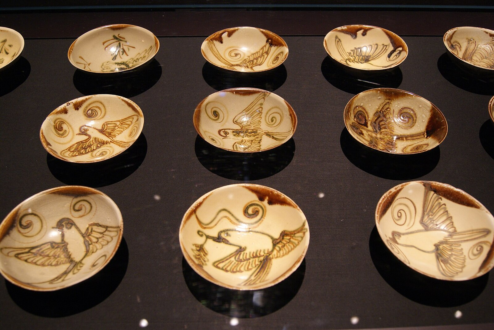
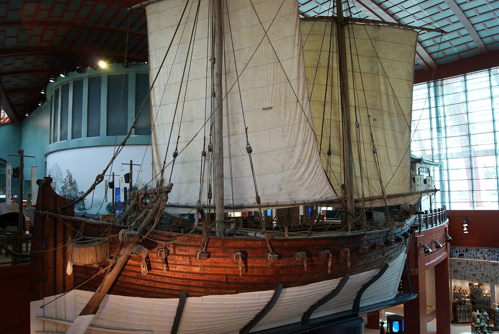
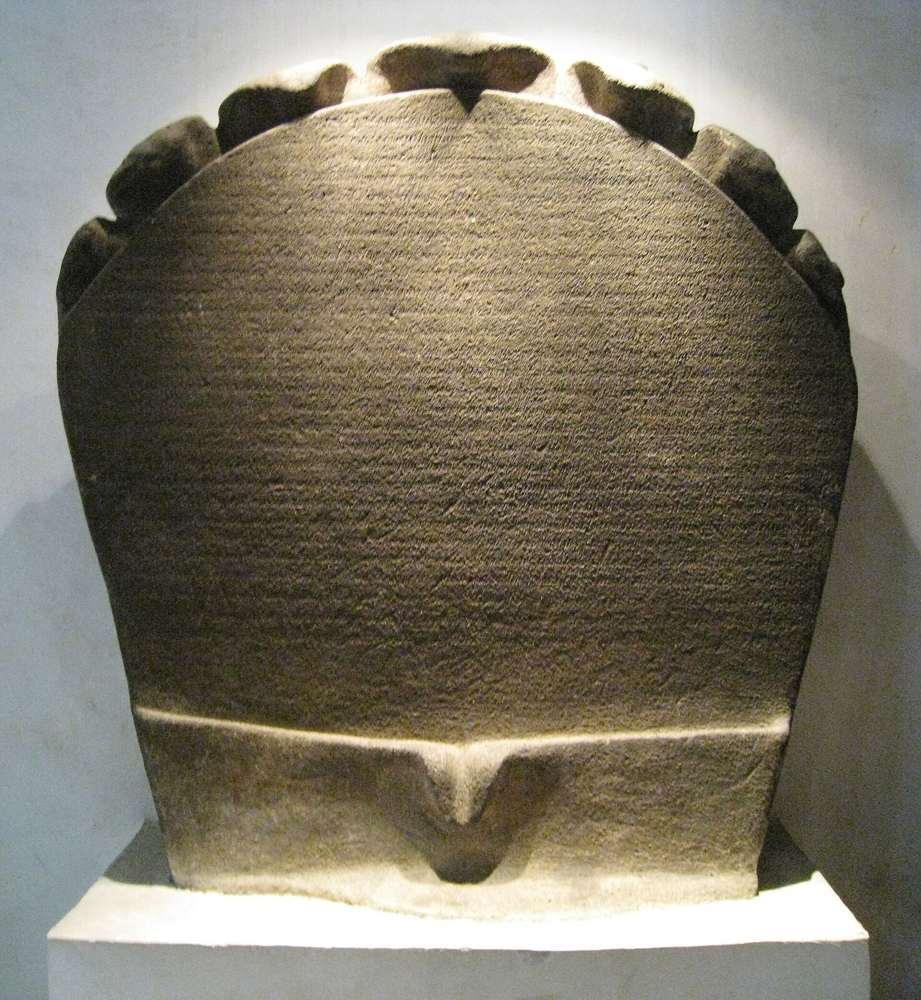
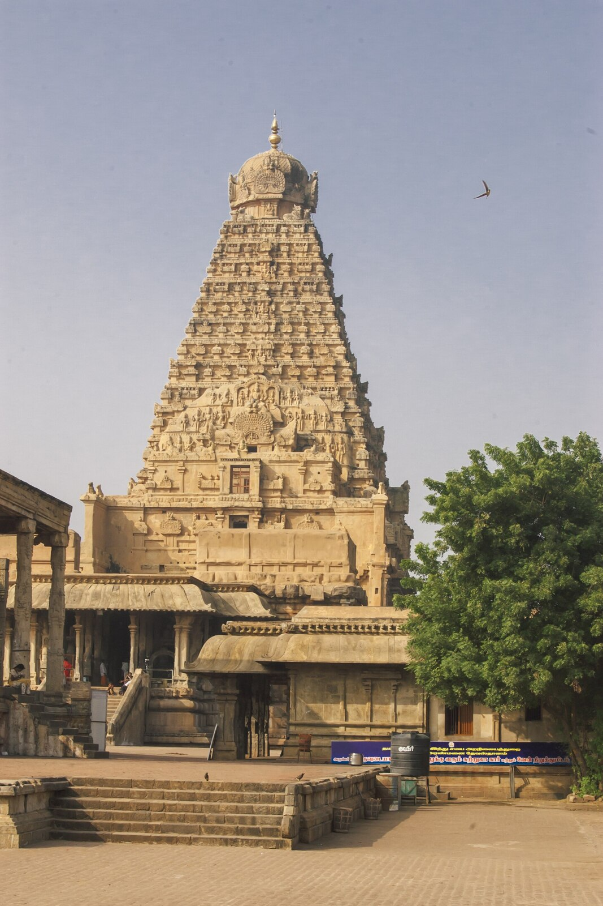
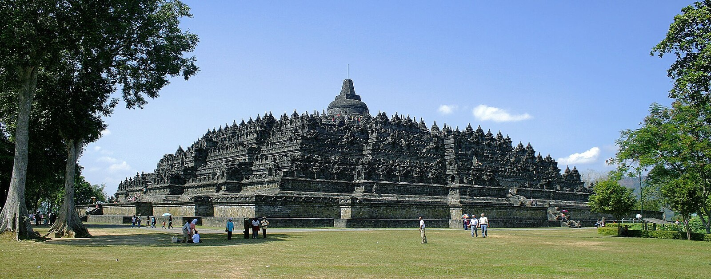
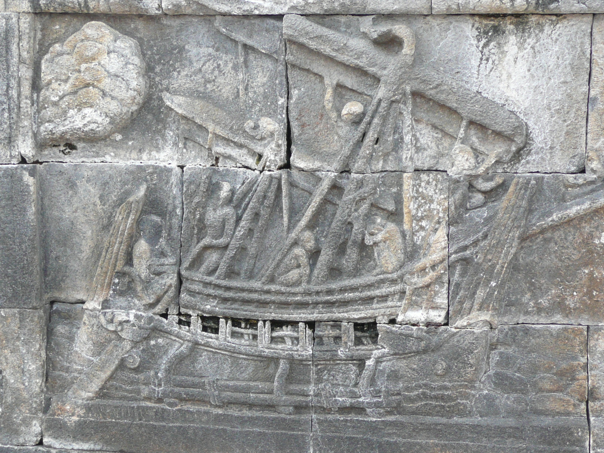
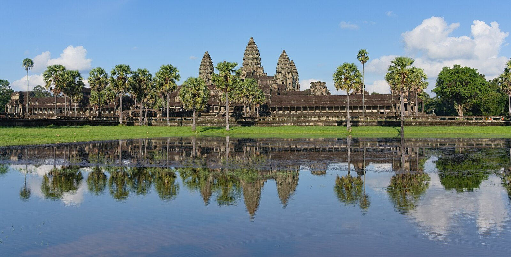
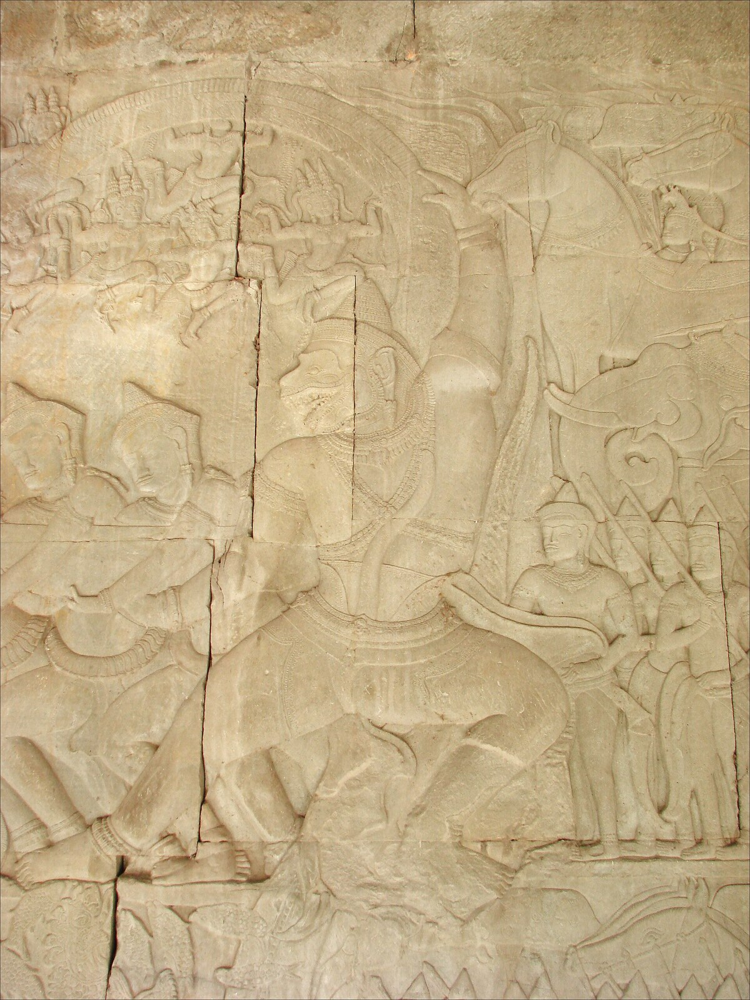
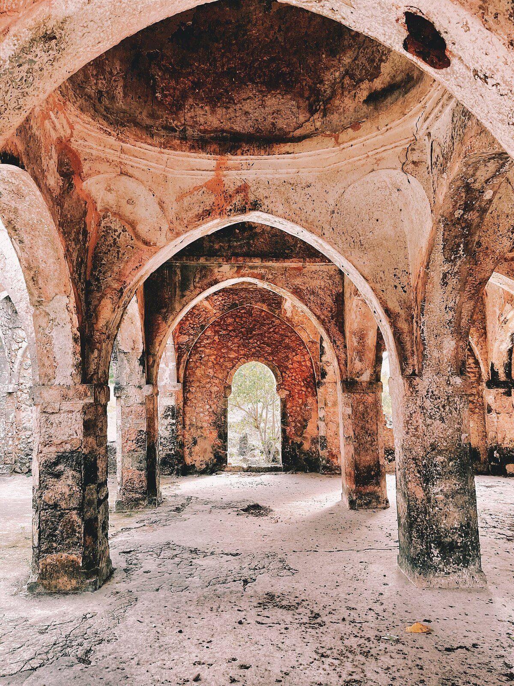
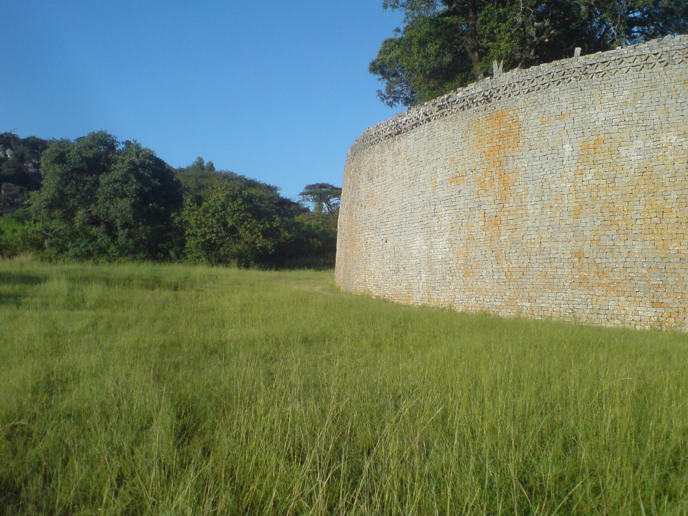

# 33. Who ruled the Indian Ocean?

*From East Africa to the South China Sea, from about 650 to about 1450*

Nobody did. The winds decided when ships could sail, the sea was open to anyone with a boat, and the nearest thing to power belonged to the ports that sat beside narrow passages and charged for the use of them.

In 1998, fishermen diving for sea cucumbers off the island of Belitung, between Sumatra and Borneo, found a mound of pottery on the seabed, seventeen metres down. Under the mound were the timbers of a ship.

The cargo was Chinese. It came to about sixty thousand pieces, most of them glazed bowls from a single group of kilns in the middle of China, painted with quick brown and green designs and packed in coils inside big storage jars, as tightly as eggs in a box. One bowl had a date scratched into it before it was fired, which works out as the year 826. There were also jars of star anise, lumps of lead for ballast, and a small collection of gold cups and silver boxes of a quality fit for a king.

*Changsha bowls from the Belitung wreck, painted in brown and green, of the kind that made up most of the cargo. ArtScience Museum, Singapore. Photo: Jacklee, CC BY-SA 3.0.*

The ship itself had not been built in China. Its planks were not nailed together. They were sewn, edge to edge, with cord twisted from coconut husk, and the seams were stuffed with wadding. This was the way ships were built on the coasts of Arabia and India, and the timbers turned out to be woods from India and Africa. A ship built on the western side of the Indian Ocean had been sailed some eight thousand kilometres to China, loaded with enough crockery to stock every kitchen in a fair-sized city, and had got as far as the islands of Indonesia on the way back when it sank.

*The Jewel of Muscat, a ship built in Oman between 2008 and 2010 and modelled on the Belitung wreck, a ninth-century Arabian ship. It sailed from Oman to Singapore in 2010. Photo: Jacklee, CC BY-SA 3.0.*

The bowls were ordinary ware, made by the thousand for people of modest means. Somebody in ninth-century China was running potteries that turned out goods in bulk for customers on the far side of Asia, and somebody in Iraq thought it worth a two-year round trip to fetch them. By the time that ship went down, the Indian Ocean carried more long-distance trade than any other sea, and it went on doing so for the next seven hundred years. No empire controlled it.

## The wind's timetable

The trade ran on a pattern of weather that has no equal anywhere else.

Land heats up and cools down faster than water. In summer the great mass of Asia grows hot, the air above it rises, and moist air is drawn in from the ocean to replace it. From about June to September, therefore, a steady wind blows from the south-west, off the sea and onto the land, bringing the rains on which the farms of India depend. In winter the land grows colder than the sea, and the whole system goes into reverse. From about November to February, a dry wind blows from the north-east, out of Asia and across the water.

Sailors called this the season, which in Arabic is *mawsim*, and from that word comes "monsoon". For a ship under sail it was as good as a moving road. A captain leaving Arabia or East Africa in the early summer could run before the wind to India in a few weeks. He could not come back until the wind turned. When it did, some months later, it would carry him home just as easily.

*The two monsoons. From about June to September the wind blows from the south-west (solid arrows), and from about November to February from the north-east (dashed arrows). The places named in this chapter are marked, from Kilwa and Great Zimbabwe in Africa to Guangzhou in China. Map: drawn for this book; coastlines and rivers from Natural Earth, public domain.*

The same held on the far side of India. A ship bound from India to China rode the south-west wind across the Bay of Bengal, and whether it went on or turned back, it had to wait somewhere along the way for a wind that suited. Nobody could make the whole journey from the Gulf to China and home again in less than about two years, and it made more sense to do it in stages, each crew working the stretch of water it knew.

One consequence was that sailing dates were fixed. Everyone knew in which month the ships from the west would arrive, and when they would have to leave, so that markets, loans and contracts could be arranged around the calendar of the wind.

The other was that the merchants had to wait. A trader who reached a foreign port could not simply sell his cargo and go. He was stuck there for months, until the wind changed. He rented a house, and often he took a local wife. He needed somewhere to pray and someone to settle his disputes. Every large port on the ocean therefore had its quarters of resident foreigners, including Arabs and Persians in the cities of southern China, Tamils from southern India in Sumatra, and Gujaratis from western India in East Africa. Each group lived under its own headman and by its own law. The monsoon moved people as well as goods, and it kept them where it had set them down for long enough to change the place.

## The kingdom that was forgotten

Look at a map of the sea route between India and China, and one feature stands out. The Malay Peninsula hangs down from the mainland of Asia like a long finger, and the island of Sumatra lies alongside it. Between the two runs a channel about nine hundred kilometres long, the Strait of Malacca. At its southern end it is choked with islands, and the navigable passage is in places only a few kilometres wide.

A ship sailing between the Indian Ocean and the South China Sea had to use this channel or a second, smaller one at the far end of Sumatra. The straits are also the place where the two wind systems meet, so that ships coming from either direction commonly stopped there to wait for the season to turn. It was the stretch of the whole route where shipping passed most slowly and closest to land.

In the year 671 a Chinese Buddhist monk named Yijing, on his way to India by sea, stopped for six months at a port in the south-east of Sumatra to study Sanskrit grammar. He returned there later and stayed for years. The town, he wrote, had more than a thousand monks, whose learning and discipline were equal to anything in India, and he advised any Chinese monk bound for India to spend a year or two there first. He gives the name of the kingdom in Chinese characters.

Arab geographers of the following centuries described what must be the same place. They wrote of a ruler in the islands whom they called the Maharaja, whose realm produced camphor, sandalwood, cloves and nutmeg, and who was so rich that each morning his steward threw a brick of gold into a pool beside the palace.

After the kingdom faded, it was forgotten completely. Nothing recalled it in the memory of the people who lived there, and the few brick ruins raised no questions. It was put back into history in 1918, when a French scholar in Hanoi matched the Chinese name and the Arab reports to a handful of stone inscriptions found in Sumatra and on the islands and peninsula nearby, most of them written in an old form of Malay. The kingdom's name was Srivijaya, and it had dominated the strait for the better part of five hundred years.

It left so little behind because it was not a state of the usual kind. Its capital, on a river some way up from the sea, was a town of timber houses built on stilts and on rafts moored to the bank. It governed hardly any farmland. What it controlled was a string of harbours on both shores of the strait, and the means by which it controlled them can be made out from the inscriptions.

The coasts and islands of the region were home to boat-dwelling peoples who knew every reef and creek, and who were as ready to rob a passing ship as to pilot it. The rulers of Srivijaya made these people their navy. The sea people were paid from the profits of the port, and in exchange they brought shipping in to the king's harbours and plundered anyone who tried to slip past to a rival. A captain who called at Srivijaya paid his dues, found warehouses, water, repairs and cargoes from all over the islands, and sailed on in safety. One who tried to avoid it was treated as a pirate's prey. It was a protection business, and it was also a real service.

Holding it together was the difficult part, since a harbour chief who could collect tolls for the king could also collect them for himself. One of the inscriptions, on a stone carved with seven snake heads above a spout, shows how the king dealt with that. It is a curse. It lists the people who must swear loyalty, from princes and army commanders down to ship captains, merchants, clerks and the king's washermen, and calls down death on any of them who rebel or conspire. Water was poured over the stone, so that it ran across the words and out of the spout, and the oath-taker drank it.

*The Telaga Batu stone of Srivijaya, with its curse on oath-breakers, carved with snake heads above a spout. National Museum of Indonesia, Jakarta. Photo: Gunawan Kartapranata, CC BY-SA 3.0.*

## A fleet across the bay

Wealth that depends on a narrow passage has a weakness, which is that a rival with ships can come and take it.

Across the Bay of Bengal, in the far south of India, lay the kingdom of the Cholas. Around the year 1000 it was the strongest state in India, ruled by a line of Tamil-speaking kings who had conquered the whole southern end of the subcontinent and the north of Sri Lanka. One of them celebrated by building a temple to the god Shiva in his capital, with a tower more than sixty metres high, capped by a block of granite weighing about eighty tonnes.

*The Brihadisvara Temple at Thanjavur in south India, built by a Chola king to Shiva around the year 1000. Its tower is more than sixty metres high. Photo: Matthew T Rader, CC BY-SA 4.0.*

The inscriptions that cover the base of that temple are a ledger. They record how the king endowed it with the revenues of villages as far away as Sri Lanka, and they list its staff of several hundred, including dancers, musicians, goldsmiths, accountants and a superintendent of lamps. They also record that the temple lent its funds to village councils at twelve and a half per cent a year. Like the Buddhist monasteries before it, a great Hindu temple was a bank.

Tamil merchants, meanwhile, were organised in powerful associations that operated wherever the monsoon reached. The largest called itself "the Five Hundred", hired its own armed guards, and left inscriptions as far away as Sumatra. These merchants wanted to trade directly with the Chinese market, and Srivijaya stood in the way, insisting that the traffic stop at its harbours and pay.

In 1025 the temple builder's son, who had succeeded him, sent a fleet across the bay. An inscription at his father's temple gives his own account of the result. His many ships, it says, crossed the rolling sea, captured the king of Srivijaya together with his elephants and his heaped-up treasure, and took more than a dozen places on both sides of the strait, which it names one by one.

It was a raid on a scale never seen before in those waters, and the king did not try to keep what he had taken. He left no garrisons and annexed nothing, and the captured ports were soon back in local hands. The monopoly, however, was broken. Srivijaya survived, with its centre moved to another river, but it never recovered its old grip. In the centuries that followed, the trade of the strait was shared among many harbours, and Chinese ships began sailing to India themselves.

The episode shows the nature of power on this ocean. A choke point could be squeezed for profit, as long as the squeezing stayed within what merchants would bear. Nobody could hold the sea itself. The Chola fleet could cross two thousand kilometres of open water and sack a dozen towns, and still had no way of staying.

## Gods by invitation

The monk Yijing stopped in Sumatra to learn Sanskrit, the sacred language of India, from teachers who were not Indians. That detail points to one of the largest cultural shifts in history, and one of the quietest.

Between about 2,000 and 1,000 years ago, the rulers of nearly every state in South-East Asia took up the religions of India. In what are now Burma, Thailand, Cambodia, southern Vietnam, Malaysia and Indonesia, kings gave themselves Sanskrit names, built temples to Shiva and Vishnu or monasteries for the Buddha's monks, and had their deeds carved in stone in scripts copied from those of southern India. Almost every writing system used in the region today, from Thai to Javanese, descends from those scripts. The national airline of Indonesia is named after the eagle that the god Vishnu rides, and the kings of Thailand still take the name of Rama, the hero of an Indian epic.

Indian armies had no part in this. The Chola raids were the exception, and they came after the Indian religions were long established. For a long time historians assumed that Indian settlers must have colonised the region, and they found no trace of such colonies. The better explanation runs the other way. The initiative came from the local rulers.

*Borobudur in central Java, the stepped Buddhist monument built about the year 800. Photo: Gunawan Kartapranata, public domain.*

A chief in Java or Cambodia who dealt with Indian merchants saw what an Indian king had and he lacked. The Indian king had priests, the Brahmins, who could perform rituals declaring him the earthly partner of a great god. He had a script for recording grants of land and the names of taxpayers. Beyond those, he had a body of ideas about kingship, law and statecraft that had been refined over a thousand years. A chief who invited a few Brahmins or monks to his court acquired all of that. He ceased to be merely the strongest of several local strongmen and became a king whose authority came from the gods. For their part, the Brahmins and monks were glad of a generous patron.

The grandest result stands in the middle of Java, and is called Borobudur. About the year 800, a dynasty there built a monument to the Buddha in the form of a stepped hill of stone, a hundred and twenty metres along each side. A pilgrim climbs it by walking round each terrace in turn, past almost fifteen hundred carved panels that tell stories from the Buddha's lives and teaching. Several of the panels show ships, with outriggers and tripod masts, of the kind that carried the pilgrims and the spices.

*One of the ships carved on the walls of Borobudur, with masts and outrigger floats, built about the year 800. Photo: Andreas Sihono, CC BY-SA 3.0.*

## A city of water

The largest state to grow out of this borrowing lay inland, in Cambodia, several days up the Mekong river from the sea. It sold the products of its forests to the ships and took its gods from them, and it lived on rice.

In the middle of the country is a great lake with an odd habit. For most of the year a river drains it south-east into the Mekong. In the summer, however, when the monsoon rains and the melting snows of Tibet swell the Mekong, the river cannot take the flood and backs up. The current reverses, the water pours into the lake, and the lake grows to five or six times its dry-season size. When it shrinks again it leaves behind a wide belt of wet, fertile mud, and so many fish that they can be scooped up in baskets.

On the plain north of that lake, the Khmer people built a kingdom on rice. In the year 802 one of their rulers had a Brahmin perform a ceremony on a mountain top that declared him a universal king. His successors made their capital at a place now called Angkor and ruled from it for six centuries, over an empire that at its height covered most of mainland South-East Asia.

Each king built a temple to house the god with whom he was identified, and each tried to outdo the last. The most famous, Angkor Wat, was built in the first half of the twelfth century for a king devoted to Vishnu. It is the largest religious building in the world. A moat nearly two hundred metres wide encloses a rectangle of about a square and a half kilometres, and at the centre five towers shaped like lotus buds stand for the peaks of the mountain where the gods live. The walls of its galleries carry some eight hundred metres of carving, on which gods and demons haul on a giant serpent to churn the ocean, and the king's army marches past with its elephants.

*Angkor Wat in Cambodia, built in the first half of the 1100s, seen across the water with its reflection. Photo: Satdeep Gill, CC BY-SA 4.0.*

The temples were the smaller part of the engineering. The Khmer kings reshaped the whole plain to manage water. The rains come in a few months and then stop, and a rice farmer has to deal with too much water in one season and too little in the next. The builders of Angkor dug canals, raised embankments, and constructed reservoirs by piling up earth walls on the flat ground. The largest of them is eight kilometres long and two wide, and it still holds water.

*Part of the relief of the churning of the sea of milk, in the east gallery of Angkor Wat, in which gods and demons pull on a serpent. Photo: Jean-Pierre Dalbéra, CC BY 2.0.*

Visitors see stone temples standing in forest. Archaeologists working from the ground and from the air mapped what lay between them, and since 2012 aircraft carrying lasers that can measure the ground through the tree canopy have filled in the detail. Angkor was a vast, low city of wooden houses on mounds, ponds, rice fields, roads and canals, spread over about a thousand square kilometres, ten times the area of modern Paris. Between seven and nine hundred thousand people probably lived in it. No other city of its time covered so much ground.

One king, at the end of the twelfth century, was a Buddhist who interpreted his duty broadly. His inscriptions record that he built a hundred and two hospitals across the kingdom and rest houses at intervals along the main roads. They add the reason: the suffering of the people, he said, was the suffering of the king.

Angkor did not fall in a day. Tree rings from the region show that the fourteenth and early fifteenth centuries brought decades of drought broken by years of violent rain. The water system had grown so large and intricate that it could not be repaired fast enough. Canals silted up or were torn open by floods. Meanwhile a rival kingdom to the west, in what is now Thailand, raided the capital more than once, and trade by sea was drawing people towards the coast. In the fifteenth century the kings moved south, to the site of the present capital. The farmers stayed where they were, and Buddhist monks never left Angkor Wat.

## Houses of stone

The same winds blew along the opposite shore of the ocean.

Down the coast of East Africa, from Somalia to Mozambique, a chain of towns grew up on islands and inlets from about the eighth century. The people who built them were Africans, who spoke a Bantu language related to those of the interior. They traded with Arabs and Persians who came on the winter wind and left on the summer one. Over time they took a great many Arabic words into their language, along with the religion of Islam. The Arabs called them the people of the coasts, *sawahil*, and their language is known as Swahili.

The richest of the towns, in the fourteenth century, was Kilwa, on a small island off the south of what is now Tanzania. A traveller from Morocco who called there in 1331 thought it one of the most beautiful towns he had seen. Its great mosque had a roof of small domes held up on coral-stone columns. On a cliff above the sea its sultan built a palace of more than a hundred rooms, with an eight-sided bathing pool. He also minted his own copper coins. The tombs of Kilwa's merchants had bowls of Chinese porcelain set into the plaster as ornaments.

*Inside the ruined Great Mosque of Kilwa in Tanzania, with small domes carried on stone columns and arches. Photo: Halidtz, CC BY-SA 4.0.*

Kilwa's wealth came from its position, like Srivijaya's. It was about as far south as a ship from Arabia could go and still be sure of getting home on the next monsoon, and it controlled the trade of the coast beyond. From there came ivory, which Indian and Chinese carvers preferred to the ivory of their own elephants, and above all gold.

The gold came from far inland, from the high plateau between the Zambezi and Limpopo rivers. There, between about 1100 and 1450, the ancestors of the Shona people built a capital that is now called Great Zimbabwe. At its centre is an oval enclosure whose outer wall stands eleven metres high. It is built of granite blocks laid without any mortar, in courses so even that the wall seems to have been drawn with a ruler. Perhaps eighteen thousand people lived around it. Its rulers were rich in cattle, and they taxed the gold that passed through on its way to the coast. In the ruins, archaeologists have found glass beads from India, a glazed bowl from Persia, pieces of Chinese porcelain, and a coin of the sultan of Kilwa.

*The outer wall of the Great Enclosure at Great Zimbabwe, built of granite blocks laid without mortar between about 1100 and 1450. Photo: Jens Klinzing, CC BY 3.0.*

When Europeans came upon the site in the nineteenth century, they refused to believe that Africans had built it. They credited it to Phoenicians, to Arabs, or to the Queen of Sheba. Professional archaeologists who excavated there from 1905 onwards showed, beyond any doubt, that the builders were local and the dates medieval. Even so, the white government that ruled the country in the 1960s and 1970s pressed its museums and guidebooks to keep the question open. When that government fell in 1980, the new state named itself after the ruins. *Zimbabwe* means "houses of stone".

## A gravestone in Sumatra

By about 1200, the ships that sailed these routes were more and more often owned by Muslims. The Arabs and Persians had been joined by converts along the coasts of India, and above all by the merchants of Gujarat, in the north-west.

They brought their religion to South-East Asia by the road that the Indian religions had taken a thousand years earlier, and it was adopted for much the same reasons. A harbour prince who became a Muslim gained a place in a network of trust that stretched from Morocco to China. Muslim merchants preferred to deal with him. He acquired a law of contract, teachers who could read and write, and the title of sultan.

At the northern tip of Sumatra, where ships from India first sight land, there is a gravestone carved with Arabic verses. It marks the burial of a local ruler who took the name of Malik al-Salih, "the righteous king", and it is dated to the year 1297. He is among the first Muslim rulers known in the islands. Within three centuries, most of the princes of the Malay Peninsula and the Indonesian islands had followed him.

Indonesia today has more Muslims than any other country in the world, and no army from the Muslim heartlands ever went there. The faith arrived in the holds of merchant ships, in the season when the wind allowed it.
