# 34. Who built the statues on Easter Island?

*The Pacific Ocean, from about 1000 to the 1860s*

The islanders built them. The statues were carved by Polynesians, the ancestors of the people who live on the island today, in the three centuries after their canoes landed there about the year 1200. They cut nearly a thousand of them out of the side of one volcano with tools of stone, and they moved hundreds across the island without wheels, animals or metal.

On Easter Sunday in 1722, three Dutch ships came upon an island that was on none of their charts. It lay in the emptiest part of the Pacific, more than three thousand kilometres from the coast of South America and two thousand from the nearest island with people on it. The captain, Jacob Roggeveen, named it for the day.

When his men went ashore they found a few thousand people living on an island with hardly a tree on it. Along the coast stood rows of enormous stone figures, each with a long face, a heavy brow and a body that stopped at the waist. Many were as tall as a house, and some wore a cylinder of red stone on their heads. The islanders lit fires in front of them and squatted before them with bowed heads.

Roggeveen was baffled. He could not understand, he wrote, how people with no heavy timber for making machines, and no strong rope, had been able to raise such figures. He settled the question to his own satisfaction by deciding that the statues were moulded out of clay.

They were solid rock, and for the next two hundred and fifty years outsiders kept solving the puzzle in the same spirit, by deciding that the islanders could not have done it. Some gave the credit to a continent that had sunk beneath the sea. A Norwegian adventurer sailed a raft of balsa logs from Peru into the Pacific in 1947 to show that the builders had come from South America. A best-selling book of 1968 proposed visitors from space.

The islanders had always said that their own ancestors made the statues. They were right, and the evidence of how it was done is still lying on the ground.

## One to ten

The island's people call it Rapa Nui, and they are Polynesians.

Polynesia is a triangle of ocean with Hawaii at the top, New Zealand at the bottom left and Rapa Nui at the bottom right. Each side of the triangle is about seven thousand kilometres long. Inside it are several hundred islands, most of them small, and in the year 1000 almost all of them were empty. By 1300 people were living on nearly every one that could support them.

They were a single people. In 1769 the English captain James Cook, on his first voyage to the Pacific, took aboard at Tahiti a priest and navigator named Tupaia. Tupaia drew the Englishmen a chart of the seas he knew, and it showed more than seventy islands. Three months later the ship reached New Zealand, which was not on the chart and lay four thousand kilometres from Tupaia's home. When the Māori came down to the beach, Tupaia spoke to them in his own language, and they understood him.

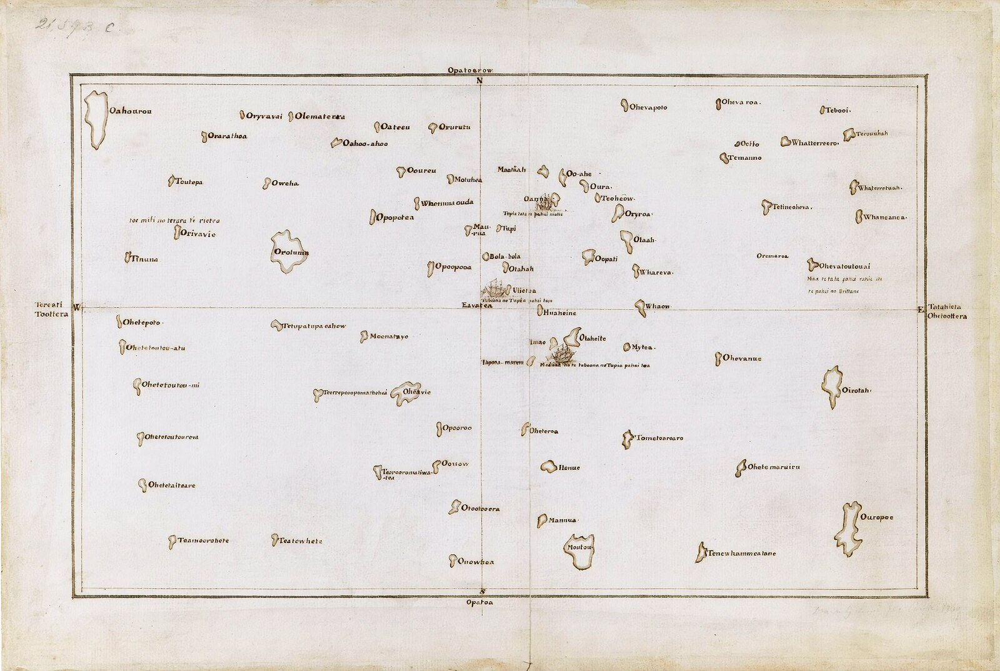
*Tupaia's chart of the islands around Tahiti, drawn for Cook's men in 1769. It shows more than seventy islands. British Library. Public domain.*

Five years after that, Cook reached Rapa Nui with another man from the Tahitian islands aboard. This time the two sides understood each other only in part, but the islanders counted from one to ten in words that any Tahitian knew. Cook marvelled that a single nation had spread itself over every island in that vast ocean, from New Zealand to this one.

The ancestors of the Polynesians were farmers and sailors who left the island of Taiwan about five thousand years ago and worked their way south and east through the islands of south-east Asia. By about three thousand years ago they had reached Tonga and Samoa, on the western edge of the triangle. There they stopped for a very long time. Then, soon after the year 1000, their descendants set out again and found everything else in about three centuries.

## The star that rises over home

Finding a small island in an ocean that covers a third of the planet looks impossible, and for a long time many scholars thought it had been done by accident. In the 1950s an influential book argued that the islands had been settled by canoes blown off course in storms.

The book was wrong, and the settlers' own cargo shows why. They arrived with women, pigs, seedlings and breeding pairs of chickens, which nobody takes on a fishing trip. The voyages were planned, and they depended on a method of navigation that used no instruments at all.

It began with the stars. Seen from any one place, a star comes up at the same point on the eastern horizon night after night, and goes down at the same point in the west. A navigator learned by heart the rising and setting points of well over a hundred stars. To hold a course, he pointed the canoe at a star that was just coming up in the right direction. When that star had climbed too high to steer by, he switched to the next one that rose in the same place, and so on through the night. A voyage from one island to another was remembered as a list of stars.

By day he had the sun, and when the sky was covered he had the swells. In the open Pacific the big waves roll steadily from the same direction for days, driven by distant winds. A navigator could tell which way the canoe was heading from the way it pitched and rolled as it crossed them, and he could do so in the dark, by feel.

None of this would bring a canoe to a speck of land a few kilometres wide. However, a navigator did not need to hit the island. He needed to come within fifty kilometres or so of it, because an island announces itself far out to sea. Clouds pile up over land and stay there while the others drift past. Certain seabirds fish at sea by day and sleep ashore, so that at dusk they fly in a straight line towards home. A canoe that sighted them in the evening had only to follow.

The explorers also had a rule that kept them alive. The winds in the tropical Pacific blow from the east for most of the year. A canoe that went looking for new land sailed eastward, against the usual wind, often waiting for one of the spells when it swings round and blows from the west. If the crew found nothing, and the food ran low, they had only to wait for the ordinary wind to return, and it carried them quickly home. That is the main reason Polynesia was settled from west to east, against the weather.

In 1976 a group of Hawaiians put all this to the test. They built a double canoe in the old pattern, named it *Hōkūle'a* and asked a navigator to take it to Tahiti without instruments. By then nobody in Polynesia still practised the art. They found their man in the islands of Micronesia, far to the west, where a fisherman named Mau Piailug had been trained in it by his grandfather. He had not sailed this route before. He brought the canoe to Tahiti in about a month, and seventeen thousand people came down to the harbour to meet it.

## What came in the canoe

A canoe setting out to settle a new island was packed like an ark. The settlers could not know what they would find, so they brought a whole farm with them: taro and yams for the starch, bananas, sugar cane, coconuts, breadfruit, and three animals, the pig, the dog and the chicken. A fourth animal came along in the hull, either as a stowaway or as a snack. This was the small Pacific rat.

The islands did not all keep what arrived. Rapa Nui was among the hardest. It is small enough to walk across in a day. It lies outside the tropics, so it is cool and windy, and coconuts and breadfruit will not grow there. It has no permanent streams and no coral reef with a quiet lagoon full of fish. For drinking water the islanders relied on the lakes in the volcanic craters and on places along the shore where rainwater that has soaked through the rock seeps out at the tide line. The island never had pigs or dogs. What the settlers had was chickens, rats and a handful of root crops.

One of those crops had come from the other direction. The sweet potato is an American plant, and Polynesians were growing it before any European reached the Pacific, because their sailors and the people of that continent had met. It grows in poor, dry soil, and on Rapa Nui it became the main food.

The island did offer two things. The first was a forest of giant palms, close relatives of one of the largest palms in the world, which covered most of the land when the canoes arrived. The second was rock. Rapa Nui is made of three dead volcanoes, and one small crater near the eastern end, called Rano Raraku, is built of a stone unlike the rest. It is volcanic ash that has been pressed into rock, and it is soft enough to cut with a harder stone.

![A map of the triangular island of Rapa Nui, with the volcanoes Terevaka in the north, Poike in the east and the crater of Rano Kau in the south-west, the statue quarry of Rano Raraku near the eastern end with dashed statue roads leading west from it, the red-stone quarry of Puna Pau near Hanga Roa, and Tahai, Anakena and Ahu Tongariki on the coast; an inset shows the Polynesian triangle of Hawaii, New Zealand and Rapa Nui, with Tahiti, Tonga and Samoa inside it and South America at the right edge](images/map_rapanui.png)
*Rapa Nui, with its three volcanoes, the statue quarry of Rano Raraku, the red-stone quarry of Puna Pau and, roughly, the main roads on which statues left the quarry. The inset shows the island at the far corner of the Polynesian triangle. Map: drawn for this book; inset coastlines from Natural Earth, public domain.*

## The quarry

Rano Raraku is where nearly every statue on the island was made, and it looks as though the carvers went home yesterday. About four hundred statues are still there. Some stand buried to the shoulders in the rubble on the slope below. Others lie in the cliff itself at every stage of the work, with one a mere outline on the rock face and the next complete except for a strip of stone along its back.

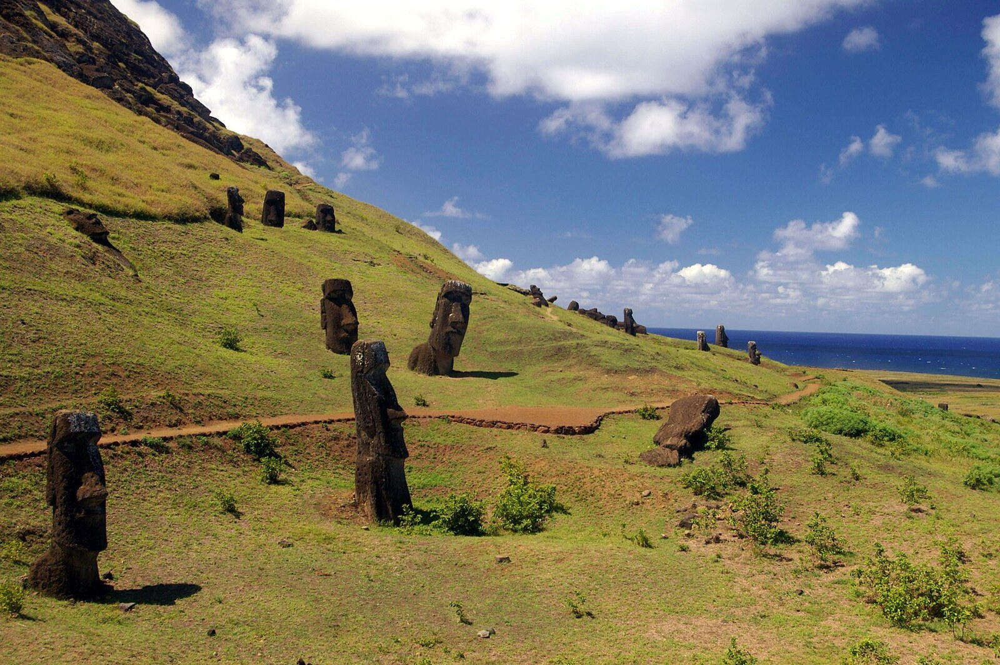
*The outer slope of Rano Raraku, where nearly every statue on the island was carved. Many stand buried in the rubble below the quarry. Photo: Rivi, CC BY-SA 3.0.*

The method can be read from what was left behind. A team of carvers chose a stretch of cliff and cut a statue out of it lying on its back, working down from the face and chest. Their tools were hand-held picks of basalt, a much harder rock, and thousands of blunted picks still litter the ground. When the figure was finished except for its spine, they cut it free, slid it down the slope into a pit so that it stood upright, and finished carving the back.

An ordinary statue was about four metres tall and weighed as much as two large elephants. The largest one ever set up was nearly ten metres tall and weighed about as much as a loaded passenger jet. Still lying in the quarry is one twice that height, as long as a six-storey building is tall, that was never cut loose.

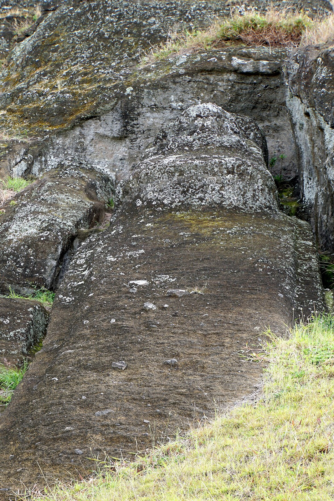
*Te Tokanga, the giant statue that was never cut loose, still lying in the rock of the quarry. It is almost twenty-two metres long. Photo: Dennis G. Jarvis, CC BY-SA 2.0.*

The statues are called *moai*, and they were portraits of the dead. Each one stood for an important ancestor of a particular family group, a chief who was believed to have become something close to a god. The island was divided among about a dozen such groups, each with a strip of land that ran from the coast inland. Each group built a long stone platform on its own shore and stood its ancestors on top.

Almost all of them faced inland, with their backs to the sea. They were not looking out for ships. They were watching over the village and the fields of their own descendants, and their power was supposed to make the crops grow and the chickens multiply. When a statue reached its platform, the carvers cut eye sockets into the face and fitted them with eyes of white coral with pupils of red or black stone. The largest received a hat, or perhaps a topknot of hair, made from a red rock that came from a different quarry on the other side of the island.

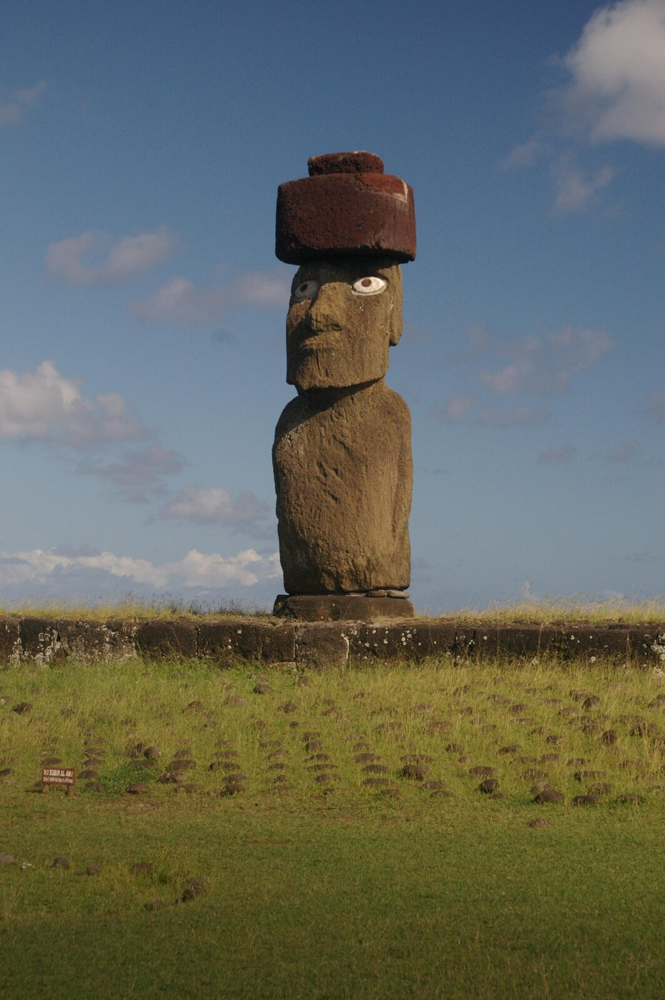
*Ko te Riku at Tahai, a statue with eyes and a red topknot. The eyes here are painted, a modern restoration, but the island's carvers fitted them with coral and stone. Photo: Rivi, CC BY-SA 3.0.*

A statue was also a boast. A family that could feed a team of carvers for a year, and then move ten tonnes of rock across the island, had shown its neighbours exactly how strong it was. As the centuries passed the statues grew larger, in the way that church towers and office blocks do when neighbours compete.

## They walked

The quarry is at one end of the island, and some platforms are eighteen kilometres away. Getting a statue from one to the other was the part that had defeated Roggeveen.

For most of the twentieth century, researchers assumed that the statues had been laid flat on wooden sledges and dragged over log rollers by hundreds of people. The islanders told a different story. Whenever visitors asked how the statues had travelled, they were told that the statues had walked.

The evidence is on their side. The statues found abandoned along the old roads have a different shape from the ones on platforms. They are wider at the base, they have a rounded bottom edge, and they lean forward. A statue of that shape cannot stand on its own for long, but it rocks very well.

In 2012 two American archaeologists made a concrete copy of a road statue, weighing more than four tonnes, and tied three ropes around its head. One team stood on the left, one on the right and one behind. The teams on each side pulled in turn, so that the statue tipped onto one edge of its base and swung the other edge forward, the way a person shuffles a heavy refrigerator across a kitchen. The team behind kept it from falling on its face. Eighteen people walked it down a road at a steady pace.

When a statue arrived, its base was trimmed flat so that it would stand upright, which is why the finished ones look different. The roads bear this out. They are slightly hollow in cross-section, which would have helped to keep a rocking statue upright, and about half of the statues that fell on the way lie within two kilometres of the quarry, on the first and steepest stretch of the journey.

## The trees

When the canoes arrived, the island was a forest. When Roggeveen arrived, it was a grassland.

In the most famous story ever told about Rapa Nui, the islanders cut down their palms to make rollers and sledges for the statues. Without trees the soil washed away and the crops failed. Without timber they could not build canoes to fish or to leave. As a result the population, which had reached fifteen thousand or more, fell into famine and war, and the survivors pulled down each other's statues. The island became a warning: a people who destroyed their own world to feed their pride.

It is a powerful story, and the evidence does not support it.

The trees did go, but the islanders had help. The seeds of the giant palm were nuts the size of a walnut, and nearly every old nut that has been dug up on the island has been gnawed open by rats. The rats that came in the canoes had no enemies on Rapa Nui, and they bred until there were millions of them. People burned and cleared the forest for gardens over about four centuries, and the rats ate the seeds from which it might have grown back.

Losing the forest did not starve the islanders either, because they changed the way they farmed. They covered their fields with broken rock. A layer of stones shelters the soil from the wind, holds in the moisture, and slowly releases minerals as it weathers, and sweet potatoes grow well among them. In 2024 a survey of these rock gardens from satellite images found enough of them, together with fishing and the island's other crops, to feed about three thousand people, which is roughly the number Roggeveen saw. The crowded island of fifteen thousand probably never existed.

The dead tell the same story. In 2024 a team read the DNA from the bones of fifteen islanders who had lived between the late 1600s and the 1900s. A population that has crashed leaves a mark in the genes of the survivors, because they all descend from the same few people. The islanders' genes carried no such mark. Their numbers had grown slowly and steadily from the first settlement until the Europeans came.

The same bones settled an older argument. About a tenth of the islanders' ancestry was Native American, and it had entered the family tree around the year 1300, long before Europeans crossed the Pacific. The sweet potato had not arrived alone.

## Kings in feathers

Rapa Nui was one outcome among many. The same people, carrying the same crops and the same tools, landed on hundreds of islands, and what they built depended on what they found. The Pacific ran the experiment over and over.

Hawaii was the jackpot. Its islands are large, warm and wet, with deep soil, and by the 1700s they held several hundred thousand people. Farmers there walled off the shallows to make ponds where fish were fattened like cattle, and laid out fields of sweet potato that ran for kilometres between low stone walls.

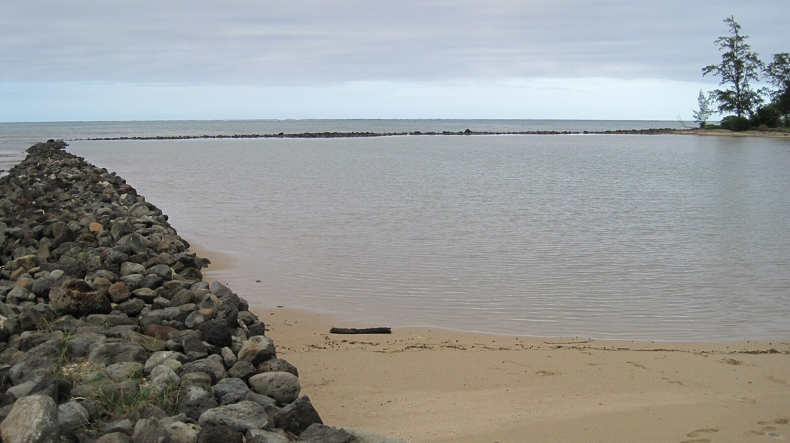
*The stone wall of Huilua Fishpond on Oʻahu, one of the sea ponds that Hawaiians built to raise fish. Photo: Joel Bradshaw, public domain.*

All that food supported rulers of a kind that Rapa Nui never had. In Hawaii the chiefs had become kings. They claimed descent from the gods, they owned all the land, and they took a share of every harvest. A commoner whose shadow fell on the highest of them could be put to death. On great occasions a king wore a cloak made of tiny yellow and red feathers tied to a net, and a single great cloak held hundreds of thousands of feathers.

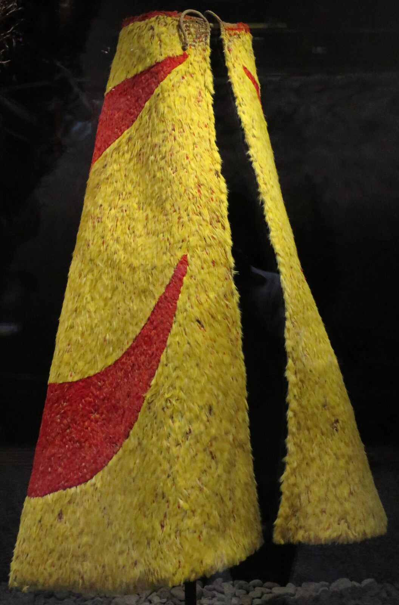
*A Hawaiian feather cloak, 'ahu'ula, of yellow feathers with red crescents, in the Bishop Museum in Honolulu. Photo: Hiart, CC0.*

Tonga, at the other end of the scale, was small and had been settled for two thousand years longer. It turned to the sea. From about 1200 a line of sacred kings ruled the whole Tongan group from a capital of stone tombs, and their canoes collected tribute from islands hundreds of kilometres away. Two thirds of the stone tools found around those tombs were made of rock from other islands, mostly Fiji and Samoa, and one had come from Tahiti, which is as far from Tonga as London is from Moscow.

New Zealand was the hardest test. It was larger than all the rest of Polynesia put together, and it was cold. Most of the tropical crops died there, and the sweet potato would grow only in the north. For the first century the settlers lived well by hunting giant flightless birds. When the birds were gone, good garden land became worth fighting for, and the Māori began to fortify their hilltops with ditches, banks and fences of sharpened posts. They built several thousand of these forts.

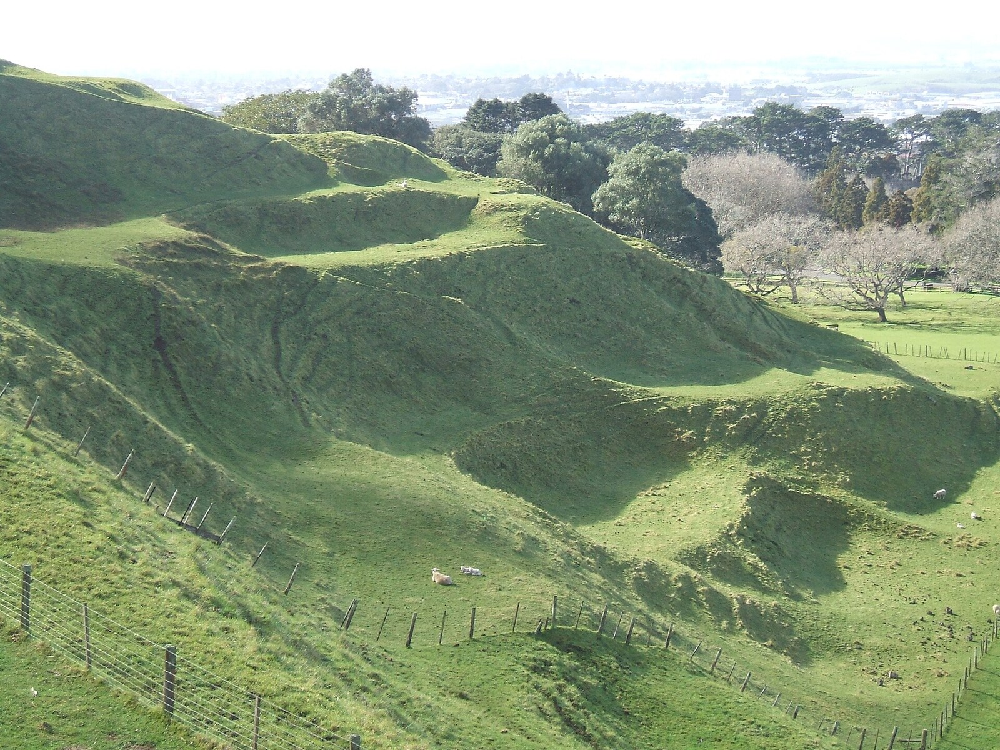
*Terraces and banks on the slope of One Tree Hill, in Auckland, a hill that the Māori fortified. Photo: German302, public domain.*

On the farthest islands the long voyages did not last. Canoes went back and forth for some generations after the first landings, and then, one by one, Hawaii, New Zealand and Rapa Nui lost touch with the rest. On Rapa Nui, where the big trees were gone, the loss was final. Cook saw three or four canoes on the whole island, each about six metres long and sewn together from small pieces of wood. The descendants of the greatest sailors on Earth could no longer leave.

## The ships come back

The disaster that the famous story describes did happen to Rapa Nui. It came later, and it came from outside.

Roggeveen's visit lasted a single day ashore, and during it his men shot about a dozen islanders in a panic. Other ships followed in the century after his, and they brought the diseases of the crowded continents to people who had never met them. In those same years the statues began to come down. Cook found many of them fallen in 1774. By the 1860s not one was standing.

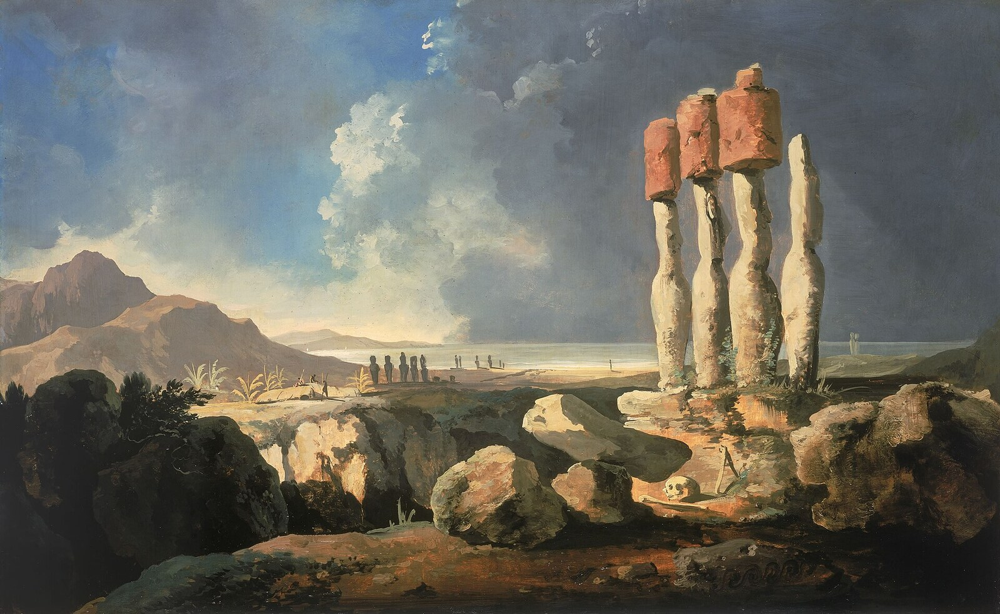
*Statues and fallen stones on Rapa Nui, painted by William Hodges, the artist who sailed with Cook, after the visit of 1774. Public domain.*

Why the islanders toppled them has never been explained for certain. The ancestors had been raised to protect the living, and they had not done so.

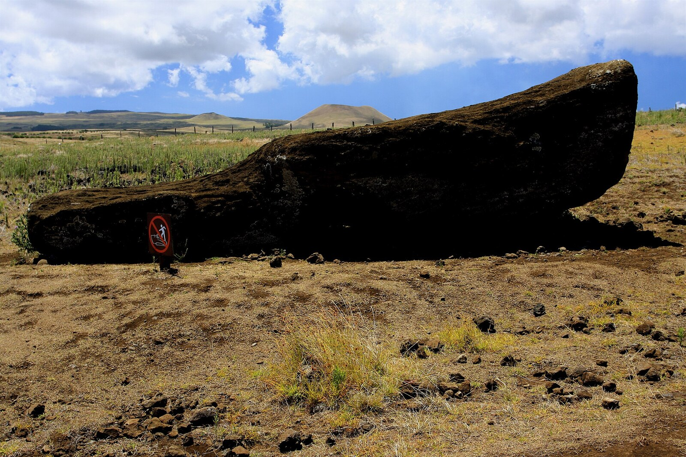
*A statue lying where it was brought down. Photo: TravelingOtter, CC BY 2.0.*

Then, in 1862, ships from Peru arrived looking for labourers. Over a few months they carried off more than fourteen hundred people, at least a third of the island, to be sold into work on farms and in households. Among them were the island's chief, his son and most of the men who held its learning. So many died in Peru that the scandal forced the government to send the survivors home. Smallpox broke out on the ship. About fifteen people reached the island alive, and they brought the disease with them.

More trouble followed. A French sea captain made himself master of the island and turned it into a sheep farm, and several hundred islanders left for Tahiti with the missionaries. In 1877 a visitor counted the people still living on Rapa Nui. There were 111.

Their descendants number several thousand today. The statues have been set back on their platforms, and at one place on the south coast fifteen of them stand in a row with the surf behind them.

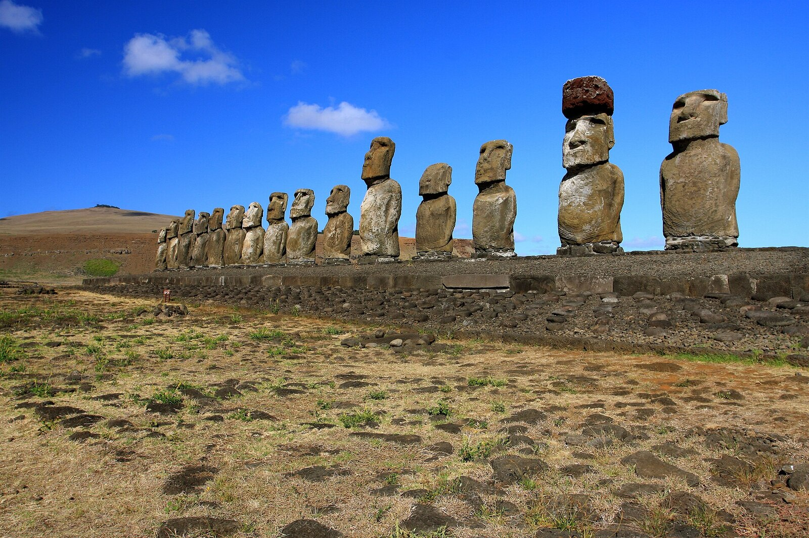
*The fifteen statues of Ahu Tongariki on the south coast of Rapa Nui. Photo: TravelingOtter, CC BY 2.0.*

One loss could not be repaired. The islanders had a script. It survives on about two dozen wooden boards, covered edge to edge with rows of tiny figures of birds, fish, plants and men. A reader worked along a row, then turned the board upside down to read the next. One of the boards is cut from a tree that grew in the 1400s, more than two centuries before the first ship. If the islanders invented the script themselves, as that suggests, it is one of the very few times that writing has been invented from nothing.

Most of the men who could read the boards were taken in 1862, and the few old people who were questioned about them afterwards could not explain them. The boards are in museums now, in Rome, Santiago, London and elsewhere, and nobody can read a line of them.

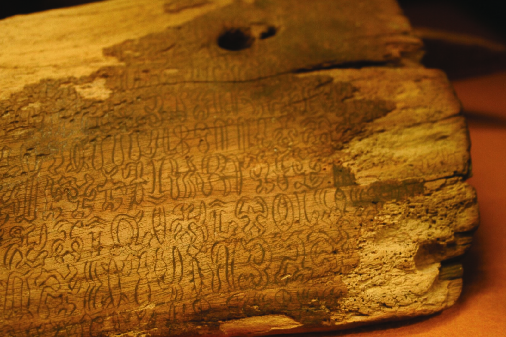
*A rongorongo board in the Bishop Museum in Honolulu, covered with the island's script. Photo: christopherhu, CC BY 2.0.*