# 35. Who were the Vikings?

*Scandinavia, and from Newfoundland to Baghdad, from 793 to 1066*

The Vikings were farmers and fishermen from Denmark, Norway and Sweden who went to sea to get rich. For about two hundred and fifty years they robbed, traded and settled along every coast and river their ships could reach, from Canada to the Caspian Sea. "Viking" was the name of the work and not of a people. To go viking meant to go raiding, and most Scandinavians never did.

Off the north-east coast of England there is a small, flat island called Lindisfarne, which is joined to the mainland twice a day when the tide goes out. In the year 793 it held one of the most famous monasteries in Britain. Monks had lived there for a century and a half. They owned the bones of a saint, and pilgrims and kings had given them gold and silver cups, embroidered cloth and books bound in jewelled covers.

The monks had chosen an island because they wanted to be left alone. In northern Europe danger had always come by land. Armies marched along roads, and the grey sea to the east was too wide for anyone to cross in force.

In June of that year, ships came out of the open sea and ran up onto the beach. The men who jumped out killed some of the monks and dragged others away to be sold. They took the treasures off the altars, loaded their ships and left.

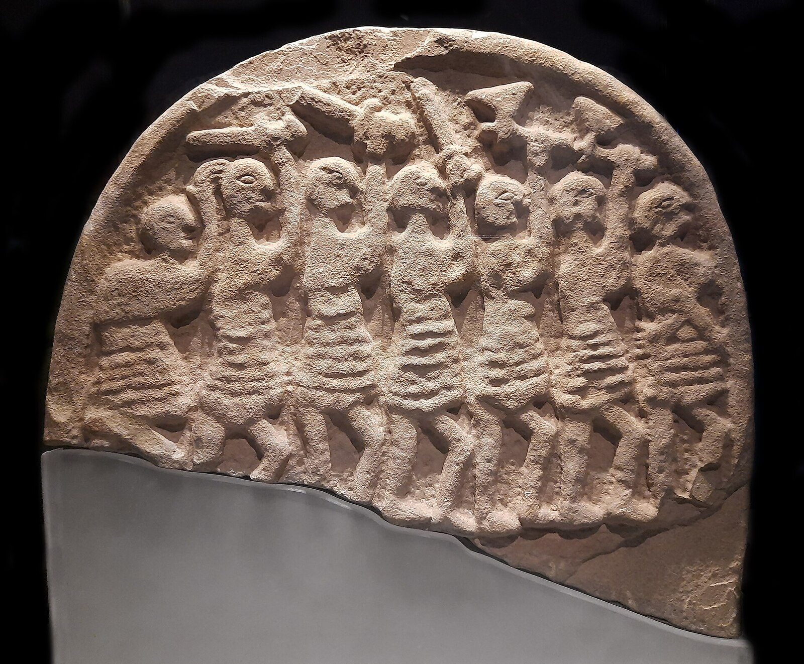
*A grave marker from Lindisfarne, carved in the early 800s, showing a line of men with raised weapons. Many believe it shows Viking raiders. Photo: Schillerwein, CC0.*

The news went all over Christian Europe. An English scholar living at the court of the king of the Franks wrote home in horror. In three hundred and fifty years, he said, Britain had never suffered anything like this, and nobody had thought that such a voyage across the sea was possible.

## A ship that could land anywhere

He was right to be astonished by the voyage. The raid on Lindisfarne was made possible by a machine, and the machine was new.

The peoples of the north had built long, open rowing boats for centuries. They made them in a particular way. Instead of fitting planks edge to edge, as shipwrights did in the Mediterranean, they overlapped them like the slates on a roof, and fastened each plank to the one below with a row of iron rivets. The planks themselves were not sawn. They were split out of an oak log with axes and wedges, so that each one followed the natural grain of the tree from end to end. A plank made that way can be shaved as thin as a thumb and remain very hard to break.

The result was a hull that was light and that flexed. In a heavy sea it did not fight the waves. It bent with them, a little, like a basket.

In the 700s the northern builders added two things. They gave the boat a proper keel, a long timber along the bottom that kept it steady, and on the keel they stepped a mast with one large square sail of wool. The sail was as much work as the hull. Spinning and weaving the cloth for one ship kept five people busy for a year.

A fine Viking ship dug out of a burial mound in Norway is about as long as two buses parked end to end. Ships of its kind carried between thirty and seventy men, who sat on their sea chests to row. With the wind behind it, it crossed the North Sea in a few days. In 1893 a copy of that ship sailed from Norway to North America in four weeks.

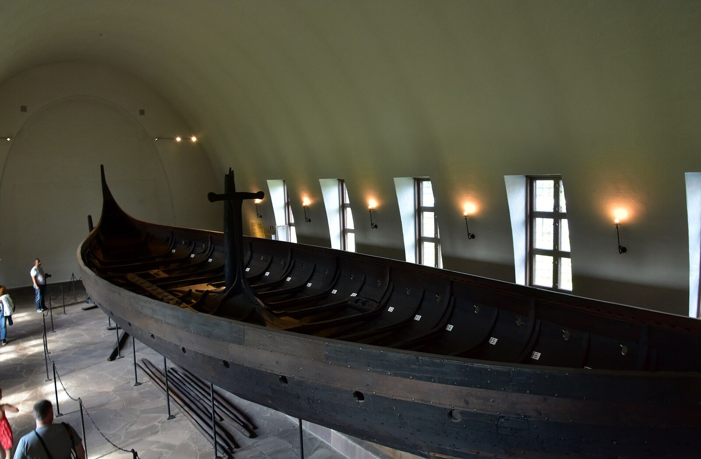
*The Gokstad ship in the Viking Ship Museum in Oslo. It was dug out of a burial mound in Norway and is about 1,100 years old. The overlapping planks and rows of rivets can be seen along the hull. Photo: Richard Mortel, CC BY 2.0.*

Its most useful quality was underneath. Even fully loaded, such a ship needed only about a metre of water to float. As a result it did not need a harbour. It could be run straight onto a sloping beach and pushed off again, and it was the same at both ends, so it could leave without turning round. It could also be rowed far up a river, past the coast and into the middle of a country. When the river ran out, the crew could drag it overland to the next one.

Europe was badly placed to meet such a thing. Its richest unguarded buildings were monasteries, and monks seeking quiet had put many of them on islands, headlands and river banks. Its towns stood on rivers because rivers carried trade. Its armies took weeks to gather. A few ships could arrive without warning, take what they wanted, and be over the horizon before the nearest lord had saddled his horse.

## Silver

Many of the men in the ships came from a hard country. Denmark is good farmland, but Norway and most of Sweden are mountain, forest and long winter. In Norway only about three parts in every hundred of the land can be farmed. A family there lived on a farm, grew barley, kept cattle and fished, and had little to spare.

Power in such a place belonged to chiefs, and a chief was only as strong as the band of fighting men who followed him. He kept them by generosity. He fed them through the winter in his hall and gave them arm rings of silver, good swords and fine cloaks, and a chief who stopped giving soon had no followers. Poets called a great lord a "breaker of rings", because he snapped his silver into pieces and handed it out.

Scandinavia in those centuries had no silver mines. Whatever silver a chief gave away had come from somewhere else, and there were two ways to get it. One was to sell things that the rich south wanted. The other was to take it.

The early raids were small summer affairs. A chief and a few dozen neighbours planted their crops in the spring, sailed off for a couple of months, and came home for the harvest with whatever they had picked up. Within a generation or two the business had grown. Fleets of a hundred ships wintered at the mouths of the French rivers and went upstream in spring.

In 845 one such fleet rowed up the river Seine to Paris. The king of the Franks, grandson of the great Charlemagne, had an army and did not trust it to win. He paid the raiders seven thousand pounds of silver to go away.

This solved his problem for that year. It also told every chief in the north what the Franks would do when frightened. For the next century and a half, kings in France and England bought off one fleet after another, and each payment brought the next fleet sooner. The English paid so much in the years around 1000 that more English coins of that period have been dug up in Scandinavia than in England.

## The river road

The raids on the west are the famous part of the story, because the victims were monks and monks could write. Meanwhile the Swedes had gone east, where the profits were larger.

Across the Baltic Sea lay the forests of what is now Russia, and through those forests ran great rivers flowing south. A ship could be rowed up a northern river to the place where it grew too shallow, and dragged on log rollers across a few kilometres of land to the headwaters of a river flowing the other way. One such river, the Dnieper, ran down to the Black Sea, and across the Black Sea lay Constantinople. Another, the Volga, ran down to the Caspian Sea, where merchants from the lands of the caliph in Baghdad came to buy. The people who lived along the rivers called these Swedish traders the Rus. The country is still named after them.

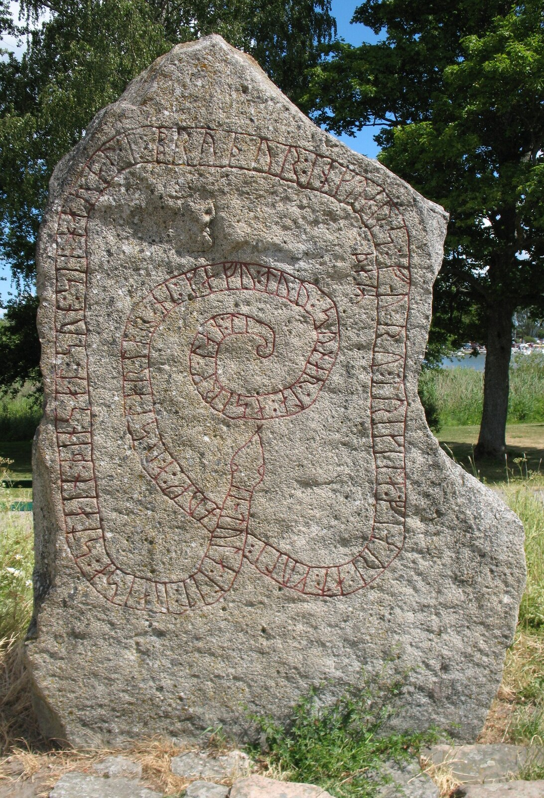
*A runestone at Gripsholm in Sweden, about 1,000 years old. Its runes tell of a family whose men travelled far after gold with the expedition of a man named Ingvar. Photo: Berig, CC BY-SA 3.0.*

The Rus carried two goods south. The first was fur, from the foxes, beavers and sables of the northern forest. The second was people. They raided the villages of the Slavs who lived along the rivers, and sold the captives in the markets of the south. So many Slavs were sold this way that their name became the word for the condition, and it is the origin of the English word "slave".

What came back was silver. The caliphs of Baghdad struck fine silver coins by the million, and the Rus took their payment in them. More than eighty thousand of these Arab coins have been found buried in the soil of Sweden.

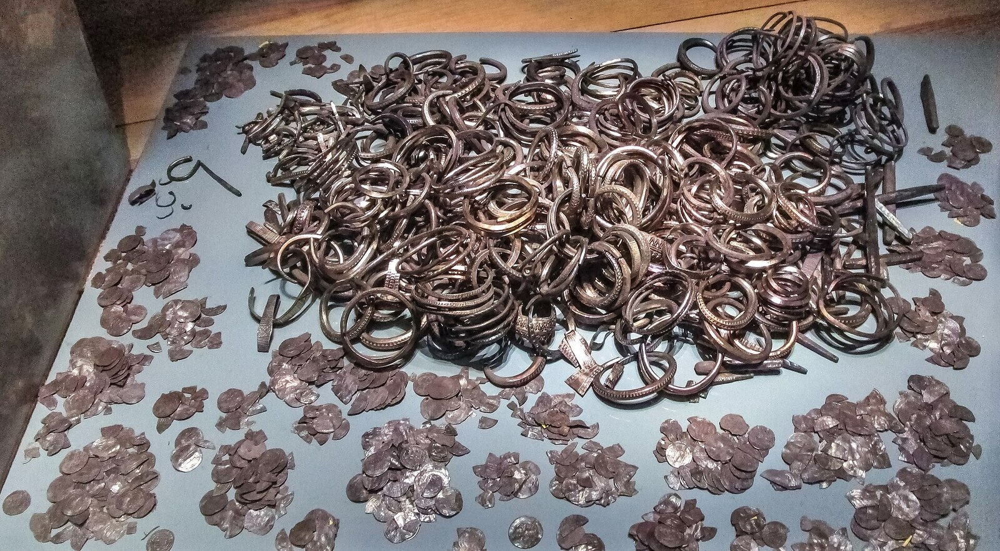
*Part of the Spillings hoard from the island of Gotland, Sweden: silver arm rings and hundreds of coins, many of them Arab, buried about 1,150 years ago. Photo: W.carter, CC BY-SA 4.0.*

In 922 an envoy from Baghdad, travelling north on the caliph's business, met a party of Rus camped beside the Volga and wrote down what he saw. He thought them the most perfectly built men he had ever seen, tall as palm trees and fair-skinned, each one marked from his toes to his neck with dark green designs and carrying an axe, a sword and a knife that he never put down. He also thought them the filthiest creatures God had made, because the whole party washed in the morning from one shared bowl. He watched them bury a chief. They hauled the dead man's ship onto the shore, laid him in it dressed in silk, killed a slave girl who had agreed to go with him, and set the whole ship on fire.

The trade reached further than any of them knew. In the 1950s archaeologists digging at a Viking-age trading post on an island in a Swedish lake found a small bronze Buddha, seated on a lotus. It had been cast in the far north of India about two hundred years before the first raids. In the same spot lay the head of a bishop's staff from Ireland and a bronze ladle from Egypt.

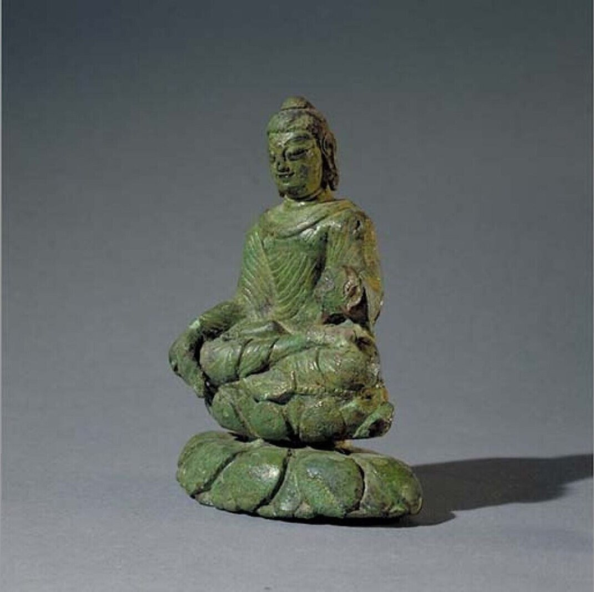
*The small bronze Buddha found at Helgö in Sweden, now in the Swedish History Museum. Photo: Gabriel Hildebrand, Swedish History Museum, CC BY 2.5.*

The road also led to steady work. The emperors in Constantinople admired northerners as fighters and trusted them because they were outsiders, bound to the emperor by oath and to nobody else in the city. From about 988 the emperor's personal guard was made up of Scandinavians, several thousand of them, armed with long axes. They stood on duty through the long services in Hagia Sophia, the great church of Holy Wisdom. On a marble railing in the upper gallery, somebody scratched a line of runes, the angular letters of the north. Most of it has worn away. The letters that can still be read are the end of a name, Halfdan.

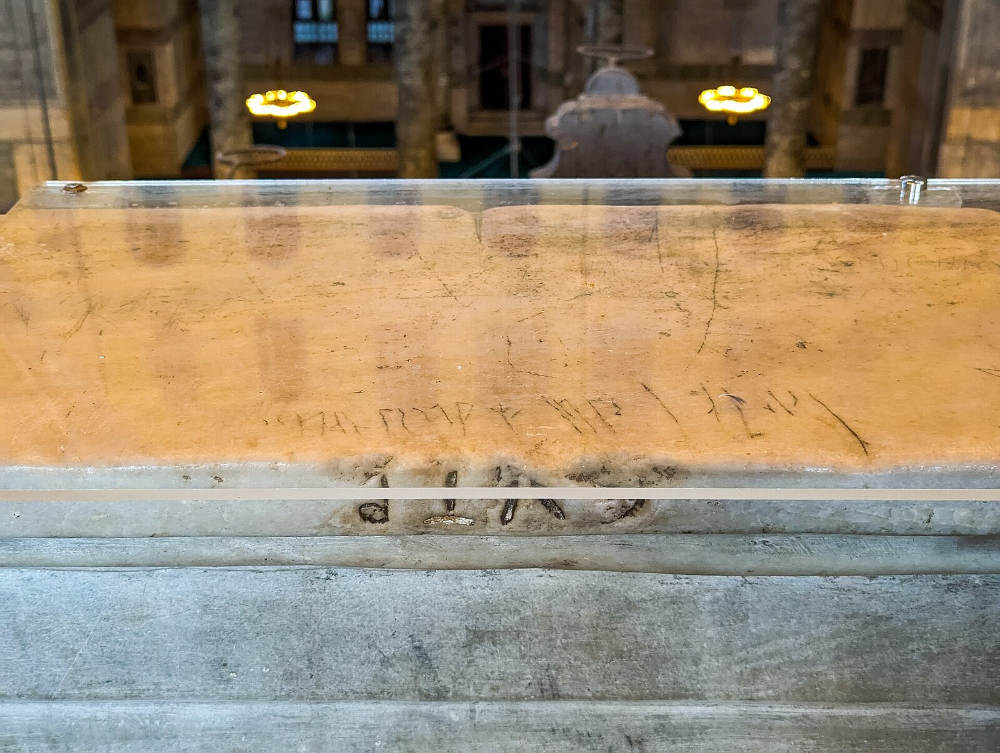
*The Halfdan inscription: runes scratched into a marble railing in the upper gallery of Hagia Sophia in Istanbul, now under a protective cover. Photo: Sourabh Biswas, CC BY-SA 4.0.*

## Staying

A man who has crossed the sea to rob a country every summer for ten years knows that country well. He knows where the good land is. Sooner or later, many Vikings decided that the land was the real prize.

In 865 a large army of Danes landed in eastern England. It did not go home in the autumn. England at that time was divided into four kingdoms, and in ten years the army overran three of them. The fourth, Wessex in the south-west, survived under a stubborn king named Alfred, who beat the Danes in battle and then made a treaty with them. He kept the south and west. They kept the north and east, shared out the farmland among themselves, and settled down.

They left their mark in the language. English speakers today use the Danes' words for some of the most ordinary things there are, among them *egg*, *sky*, *knife*, *window*, *husband* and *law*. Even *they* and *them* came from the settlers. People borrow the names of spices and machines from foreigners they trade with. They borrow words like *they* from people who have moved in next door and married into the family.

Something similar happened across the Channel. By the early 900s the king of the Franks had despaired of keeping Vikings out of the Seine. In 911 he tried a new idea. He offered the land around the river's mouth to a Viking chief named Rollo, on two conditions: Rollo was to be baptised, and he was to keep all the other Vikings out.

The arrangement worked. Rollo's people married local women and within a few generations they had forgotten their language and spoke French. Their territory was called the land of the Northmen, or Normandy.

![Two maps of the Viking world. Above, the North Atlantic, with solid arrows by sea from Norway to Iceland about 870, on to the Eastern Settlement in Greenland about 985, with the Western Settlement further north, and on to L'Anse aux Meadows in Newfoundland about 1000. Below, Europe from Ireland to the Caspian: the homelands of Norway, Sweden and Denmark shaded, solid arrows by sea to Lindisfarne, to the Danish-settled part of England with York, to Dublin and up the Seine to Paris, with Normandy shaded; and dashed arrows by river from Sweden to Novgorod, down the Dnieper by Kiev across the Black Sea to Constantinople, and down the Volga to the Caspian Sea, with Baghdad to the south](images/map_vikings.png)
*The Viking world from 793 to about 1000: the voyages west by sea, to the British Isles, France, Iceland, Greenland and Newfoundland, and the river roads of the Rus to Constantinople and the Caspian. The Danish part of England and Normandy are drawn roughly. Map: drawn for this book; coastlines and rivers from Natural Earth, public domain.*

## A country without a king

Some of the emigrants wanted empty land, and the Norwegians found it. About 870, ships sailing west into the Atlantic came upon a large island of volcanoes, glaciers and green valleys with nobody living on it, except perhaps a few Irish hermits. Within sixty years, settlers had taken up every farm site in Iceland that was worth having.

Many of them had left Norway because a king there was gathering the whole country under his own rule, and they did not care to be ruled. They brought no king with them and did not appoint one. In 930 they founded something else instead.

Each summer, the free men of Iceland rode to a plain beside a long cliff in the south-west of the island and camped there for two weeks. This was the assembly. Its chairman was called the law-speaker, and his main duty was to know the law by heart. Iceland had no written law at that time. Every year he stood on a rock in front of the crowd and recited a third of it from memory, so that over three years everybody heard it all. At the assembly, disputes were judged and new laws were agreed.

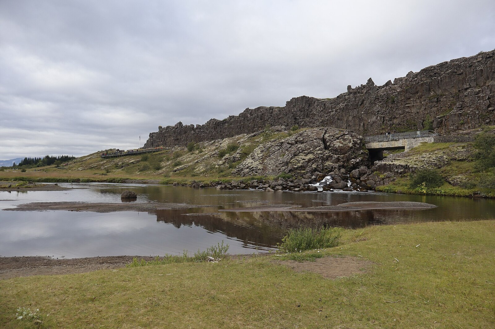
*The cliff at Thingvellir in south-west Iceland, where the free men of Iceland met each summer for their assembly. Photo: Syrio, CC BY-SA 4.0.*

There was no government apart from this. Iceland had no army, no officials and no police. If a court found in your favour, collecting what you were owed was your own business, and as a result the island's history is a long tale of family feuds. Nevertheless the system held together for more than three centuries. Iceland's parliament still carries the assembly's name.

## The far shore

Iceland was not the end of the road. About 982 an Icelander called Erik the Red was banished for three years for killing two of his neighbours. He spent his exile exploring a coast that sailors had glimpsed further west. When he came back, he told everyone that he had found a fine country and that it was called Greenland. He chose the name, according to the Icelanders who wrote the story down, because people would be more willing to go to a place that sounded pleasant.

Enough of them believed him to fill twenty-five ships, of which fourteen arrived. They found a land that was nearly all ice, with a few sheltered inlets in the south-west where cattle could be kept. They stayed for more than four hundred years, living partly on seals and paying for their imports with the tusks of walruses, which the carvers of Europe used as ivory.

From Greenland it is only a few days' sail to Canada. About the year 1000, Erik's son Leif and others after him explored a coast to the south-west, where there was timber, which Greenland lacked, and where wild grapes grew. For centuries almost the only evidence that it had happened was the stories that Icelanders told.

In 1960 a Norwegian couple, one an explorer and the other an archaeologist, found the proof at the northern tip of Newfoundland. Under low grassy mounds lay the remains of eight buildings with turf walls, built in the Icelandic manner, along with a forge, iron rivets and a bronze cloak pin.

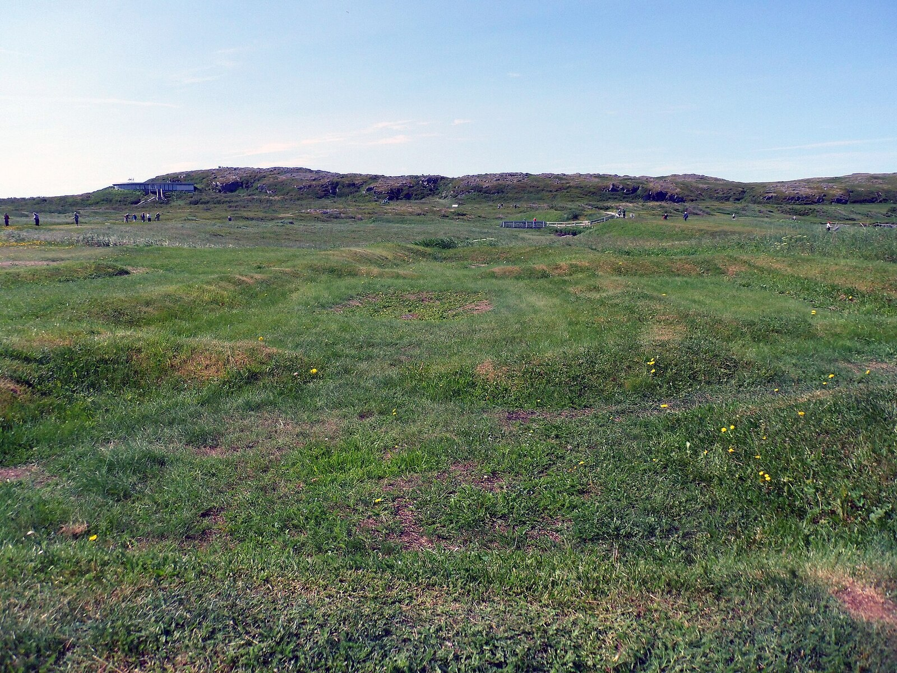
*The low grassy mounds at L'Anse aux Meadows in Newfoundland, which cover the remains of the Norse buildings. Photo: Mo Laidlaw, CC BY-SA 3.0.*

The date is known to the year. In 993 a storm on the Sun bathed the Earth in radiation, and every tree alive that year recorded it as a spike of a rare kind of carbon in that year's growth ring. Three pieces of wood from the site had been cut with metal blades, which the native people of the region did not have. In each of them, scientists found the ring with the spike and counted outwards to the bark. All three trees were felled in 1021.

The Icelanders' stories say that the explorers met people on that coast. If so, it was the earliest known meeting between people from Europe and people of the Americas, whose ancestors had parted on the far side of the world tens of thousands of years before. By the same account it did not go well. The newcomers traded with the local people and then fought them, and they were a few dozen at the end of a supply line that ran through Greenland and Iceland to Norway. After a few years they went home. A German churchman heard about the new land from the king of Denmark and mentioned it in a book, and nothing more came of it.

## Bluetooth

By the time that tree was cut, the world the Vikings came from was disappearing.

The raids had begun under small chiefs. Two centuries of foreign silver made some chiefs much greater than others, and the greatest made themselves kings. About 965 a king of Denmark named Harald, known as Bluetooth, set up a great carved stone at his family's burial place. The runes on it say that he won all of Denmark for himself, and Norway, and made the Danes Christian.

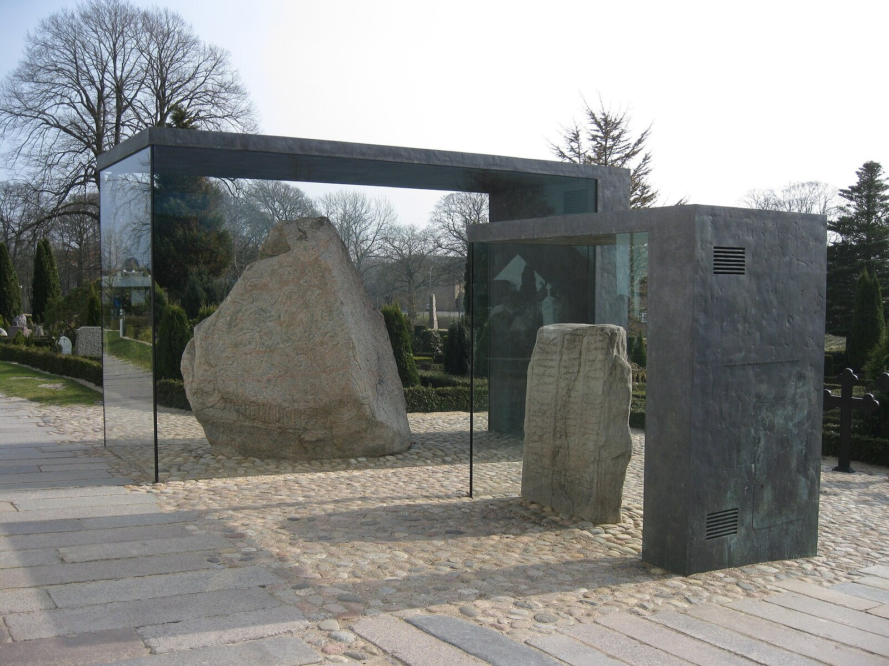
*The Jelling stones in Denmark. The large stone on the left was raised about 965 by King Harald Bluetooth. Photo: Alicudi, CC BY-SA 3.0.*

The two boasts go together. The old religion had many gods and no church. Each chief led the sacrifices for his own district, and that suited a world of independent chiefs. Christianity came with bishops who could read and write, who could keep a king's records and who taught that kings were chosen by God. It also turned a northern king from a pagan pirate into a ruler whom other kings would deal with. One by one the kings of the north were baptised, and they saw to it that their subjects followed.

Iceland, having no king, settled the question in its own way. In the year 1000 the assembly was close to splitting into two peoples with two laws. Both sides agreed to let the law-speaker, who was a pagan, decide. He lay down under his cloak for a day and a night. Then he stood on the rock and announced that everyone in Iceland would be Christian, and that anyone who wished to go on sacrificing to the old gods could do so at home, as long as nobody saw.

A king with bishops and a treasury had no use for freelance pirates. When such a king went to war, he went to conquer. In 1016 a Danish king took the whole of England and ruled it, as a Christian, together with Denmark and Norway. Meanwhile, the easy targets had gone. The English had fortified their towns and built a fleet. The Franks had blocked their rivers with fortified bridges and covered their country with strongholds. For a chief with a few ships, raiding had stopped paying.

The helmets, incidentally, had no horns. Hardly any Viking helmets have been found, and the best preserved is a plain round cap of iron with a guard for the eyes. The horns were put there by painters of the 1800s, and fixed in everyone's mind in 1876 by the costumes for a German opera.

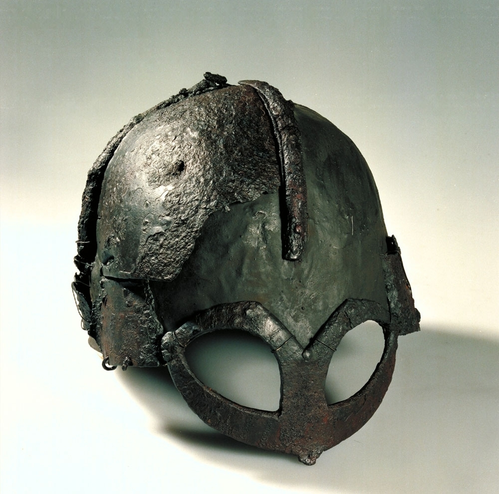
*The Gjermundbu helmet, found in a grave in Norway and about 1,000 years old. It is the best preserved Viking helmet, a plain iron cap with a guard for the eyes and no horns. Photo: NTNU Vitenskapsmuseet, CC BY 2.0.*

Harald Bluetooth is remembered in another way. In the 1990s, engineers looking for a name for a new way of linking telephones and computers without wires borrowed the nickname of the king who had joined Denmark and Norway together. The symbol on every telephone today is made of his two initials, written in runes.

In 2020 a study of the DNA of more than four hundred skeletons from Viking-age graves showed how loosely the name fitted any one people. The dead were a mixed company. Many had dark hair. Some who had been buried in Scotland with Viking swords and in the full Viking manner had no Scandinavian ancestors at all. They were local men who had taken up the newcomers' way of life.

The last act came in 1066, when England was invaded twice in three weeks. The first invader was the king of Norway, Harald Hardrada, a giant of a man who had served for years in the emperor's guard at Constantinople. He landed in the north with three hundred ships. The English king, Harold, caught him by surprise and killed him, and the survivors needed only twenty-four ships to go home.

The second invader landed on the south coast a few days later. He was William, duke of Normandy, and he was descended from Rollo, five generations on. He spoke French. His men fought on horseback in coats of mail, and wherever they conquered they built castles. Harold marched the length of the country to meet him, and lost.

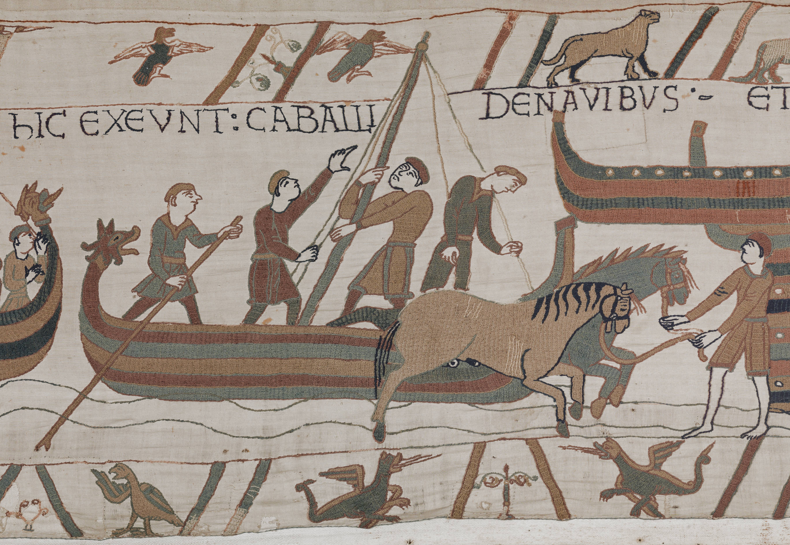
*Norman ships unloading horses, from the Bayeux Tapestry, embroidered in the years after 1066. The ships have the same shape as the Viking ships of the north. Photo: Universite de Caen Normandie, CNRS, ENSICAEN, public domain.*

England had fallen to the Northmen for the second time in fifty years. This time they had stopped off in France for a century and a half on the way.
