# 36. Why are there so many castles in Europe?

*Western Europe, from about 900 to 1300*

Europe is full of castles because, for about three hundred years, its kings were too weak to protect their people or to control their own great men. Across much of the west, power fell to anyone who owned a fortified house and a band of armed horsemen. A castle was that house. The men who held castles ruled the country around them, and tens of thousands of castles were built.

Within days of landing in England, Duke William of Normandy had put his soldiers to work with shovels. A long strip of embroidery made a few years afterwards shows the scene. Men dig and heave earth into a pile, while a foreman stands over them and two of the workers hit each other with their spades. On top of the pile rises a wooden stockade. The Latin caption says that he ordered a castle to be dug at Hastings.

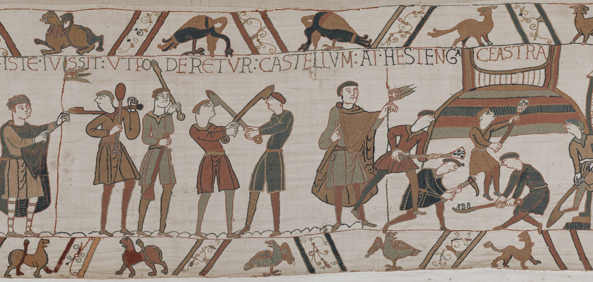
*Men digging and heaping up earth for William's castle at Hastings, from the Bayeux Tapestry, made a few years after 1066. The Latin caption above them mentions Hastings and the castle. Photo: Université de Caen Normandie, CNRS, ENSICAEN, public domain.*

It was standing before the battle, which came a little more than two weeks after the landing. William won, and over the next twenty years he and his followers repeated the trick across the whole of England. Wherever the Normans took a town or a river crossing, they rounded up the local people, made them pile up a mound, and put a tower on it. Within a generation there were five hundred castles or more in a country that had contained almost none.

A Norman monk writing a lifetime later thought this explained the whole conquest. The English, he said, were brave and loved to fight, but they had hardly any castles, and so they could put up only a feeble resistance.

## Nobody is coming

The castle had been invented on the other side of the Channel about a century and a half before, in a time of disaster.

In the year 800 most of western Europe was one empire, ruled by Charlemagne, king of the Franks. It did not outlast his grandsons. In 843 three of them divided it among themselves, and their heirs divided it further and fought over the pieces.

While they fought, raiders came from three directions at once. Viking ships rowed up the rivers from the north and west. From the south, pirates from Muslim North Africa and Spain raided the Mediterranean coast and for most of a century held a base in the south of France, from which they robbed travellers in the passes of the Alps. From the east came the Magyars, horse archers off the steppe who had settled on the plain of Hungary and rode out in most years as far as Burgundy and Italy.

Against enemies like these, the Frankish kings were of little use. A royal army was made up of landowners who had to be summoned from their homes, and by the time it had gathered the raiders were three valleys away. In England a determined king organised a defence of walled towns that belonged to the whole kingdom. On the continent, people learned that nobody was coming to save them. If a district was to be defended, it would be by someone who lived there and had fighting men on the spot.

Such men appeared. Some were the old king's officials, the counts, who stopped taking orders and began treating their districts as family property. Others were simply landowners with a strong arm. What they had in common, from about the 900s onwards, was a new kind of building.

Forts were as old as cities, but nearly all earlier forts had been public. A Roman fort housed a unit of the army, and a walled town sheltered its citizens. A castle was private. It was one man's house, made so strong that a small household could hold it against an army.

The early ones were built of earth and timber. The builders dug a circular ditch and threw the soil into the middle to make a steep, flat-topped mound as high as a two-storey house or higher. On the top they built a wooden tower with a fence around it. At the foot they fenced in a yard for the stables, the smithy, the storehouses and the hall. A few dozen men behind those fences could keep out several hundred, because the attackers had to climb a slippery slope with nothing over their heads.

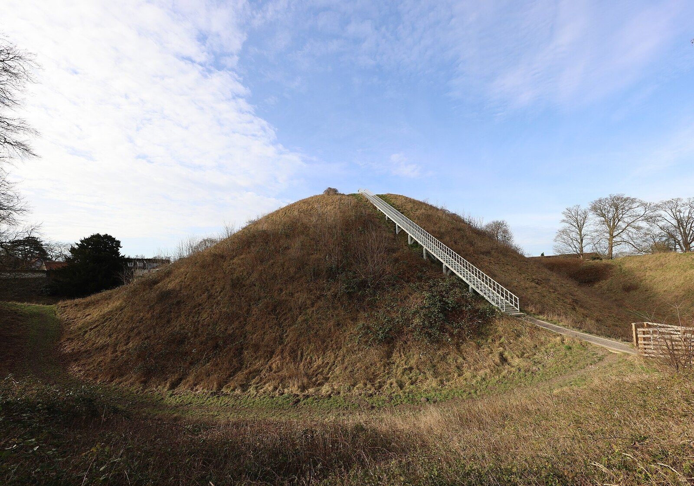
*The grassed-over castle mound at Thetford in Norfolk, England. Mounds like this one, built of heaped earth, carried the wooden towers of the first castles. Photo: Geni, CC BY-SA 4.0.*

A castle did not need to block anything in order to control it. Its garrison was mounted. From the gate, horsemen could reach any farm or road within a morning's ride and be home by dark. Everything inside that circle belonged, in practice, to the man in the tower. He could protect it from raiders, and nobody could protect it from him.

## A man on a horse

The men who rode out of the gate were knights, and the knight was the most expensive soldier in the world.

His main protection was a knee-length coat of mail, made of about thirty thousand small iron rings, each one linked through four others and closed with a tiny rivet. In addition he needed a helmet, a shield, a sword, a lance, and above all a horse that was strong enough to carry an armoured man and had been trained not to bolt from noise and blood. The whole outfit cost about as much as twenty oxen, at a time when a peasant family was lucky to own two.

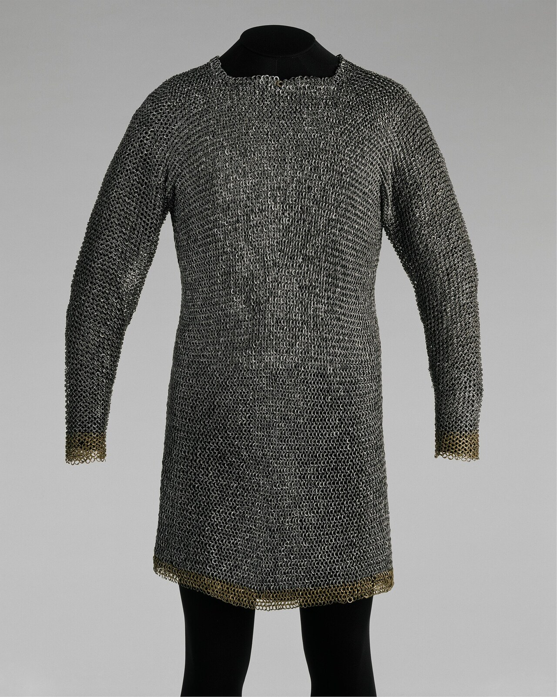
*A mail shirt made in Germany in the 1400s, now in the Metropolitan Museum of Art in New York. It is later than the knights of the 1000s and 1100s, but it is made the same way, from thousands of small linked metal rings. Photo: Metropolitan Museum of Art, CC0.*

He also needed years. A knight fought from the saddle with a lance tucked under his arm, and learning to do that began in boyhood. A man who spent his youth practising with horse and sword could not also plough.

Somebody else therefore had to feed him. Some lords kept their knights in the household, at their own table, and a few paid wages. Coin was scarce in the countryside, however, and the usual answer was to pay in land. A lord granted a knight a village or two, with the peasants who farmed it, and the knight lived on what they produced. In exchange he owed his lord service in arms, usually about forty days a year, and a turn of guard duty at the castle.

The bargain was sealed with a ceremony. The knight knelt, bareheaded and unarmed, and placed his joined hands between the hands of his lord. He declared that he became the lord's man. Then he swore on a Bible or a box of holy bones to be faithful. The lord, for his part, promised to protect him.

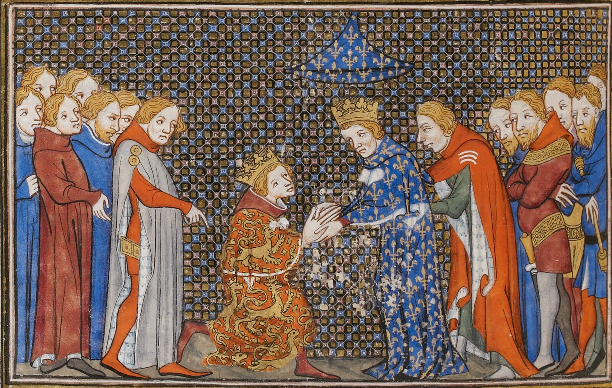
*A king doing homage: Edward III of England kneels and places his hands between those of Philip VI of France, who held the overlordship of Edward's lands in France. The scene took place in 1329 and was painted in the late 1300s in a French chronicle. Image: Bibliothèque nationale de France, public domain.*

The lord had usually done the same thing to someone greater, a count or a duke, from whom he held his own lands. The count had knelt to the king. On parchment this made a tidy pyramid with the king at the top. In life it was a web of private promises between individuals, and a man's loyalty was to the person whose hands had held his, and not to a country. A duke of Normandy could be the sworn man of the king of France and spend most of his life at war with him.

The English word for these warriors keeps a memory of where they started. "Knight" comes from an old word for a boy or a servant. The first knights were a rich man's hired toughs. Over two centuries they turned themselves into a hereditary upper class with its own code of manners, and their word for a servant became a title that kings were proud to hold.

## Three days a week

At the bottom of the arrangement were the people who grew the food, and they were nine tenths of the population.

A typical village belonged to a lord. Its land was divided in two. One part the lord kept for himself. The rest was shared among the villagers, each family holding scattered strips in the big open fields. A large share of the villagers of western Europe, in many regions about half, were serfs, which meant that they were legally tied to the place. A serf could not move away, and could not marry off a daughter outside the village, unless the lord agreed and was paid.

A serf paid for his strips in work. Two or three days in every week he laboured on the lord's part of the land, and at harvest time, when his own crops were also waiting, he owed extra days. He was obliged to grind his grain at the lord's mill and to give the miller a share of the flour. When he died, the lord took his best animal.

In return he got two things. The first was the land itself, which the lord could not easily take from him and which his son would hold after him. A serf was not a slave: he went with the land and was rarely sold apart from it, and custom fixed what he owed. The second was protection. When raiders came, the villagers drove their cattle into the castle yard. It was a bad bargain made under pressure, in a world where a farmer with no lord was at the mercy of everyone else's.

Twenty years after his conquest, William wanted to know exactly what he had won, and he sent teams of officials through almost every county of England. They asked the same questions in each village. Who held it before the conquest, and who holds it now? How many ploughs are there? How many serfs, how many slaves, how many mills and fishponds? What was it worth then, and what is it worth now?

The answers were copied into a great book, which survives. It lists more than thirteen thousand places. An English monk complained that the king's men had been so thorough that not one ox, nor one cow, nor one pig had been left out. The book shows what the conquest had done. In twenty years the several thousand English landowners had almost all been removed, and about half the country now belonged to fewer than two hundred Norman lords. The king and the church held the rest. The English began to call it Domesday Book, the book of the Day of Judgement, because there was no arguing with what it said.

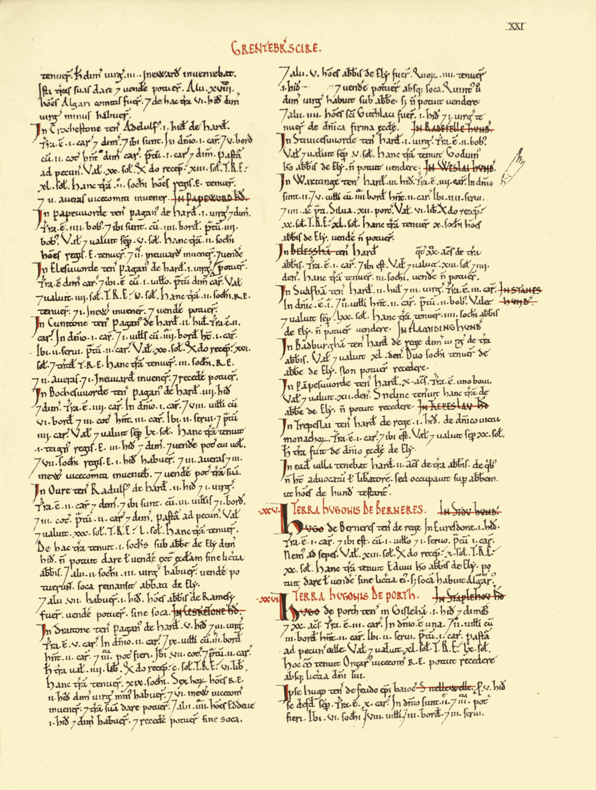
*A page of Domesday Book, from the survey of 1086, listing land and its holders in Cambridgeshire. Each entry gives the same facts: the owner, the ploughs, the people and the value. Image: Open Domesday, public domain.*

## The eight-ox plough

Lords and knights took a great deal out of the villages. Nevertheless, in these same centuries, the villages were producing more food every generation, because the farmers of northern Europe had found a better way to work their land.

The best soil of the north is heavy, wet clay. It is far richer than the thin, dry soil around the Mediterranean, and for thousands of years much of it had been left as forest because the old plough could not deal with it. That plough was little more than a pointed stick dragged through the ground, which scratched a groove and left the earth where it was.

The new plough was a machine of three parts. A vertical iron knife in front sliced the turf. An iron blade behind it cut underneath, horizontally. Then a curved wooden board caught the loosened slab and turned it right over, burying the weeds and leaving a deep furrow that carried the water away. It usually ran on wheels.

It was so heavy that a full team was eight oxen, which was far more than an ordinary peasant owned. Villagers pooled their animals to make up a team, and that is one reason they farmed their fields in common. Eight oxen in a line are also very awkward to turn round. Farmers therefore ploughed in strips as long as the animals could manage before they needed a rest. That distance was called a furrow-long, or furlong, and the amount of land one team could plough in a day was called an acre. Both measures are still in use.

Two other improvements came with it. The first was a padded collar that sat on a horse's shoulders and let it pull with its whole weight. A horse works half as fast again as an ox and for more hours in the day, and once it could be harnessed properly it began to replace the ox in front of the plough and the cart.

The second was a new timetable. In much of Europe, farmers rested half their land each year so that the soil could recover. Many villages of the north now divided their land into three great fields. In any one year, the first was sown in autumn with wheat or rye, the second in spring with oats, peas or beans, and the third lay idle. The next year each field moved on to the next task. Two thirds of the land was now in crop every year instead of one half.

![A bird's-eye plan of a manor: in the middle a village street lined with houses and a church; beside it the castle, a round mound with a tower inside a ditch, and a fenced yard; next to the castle the lord's own land; around the village three great open fields divided into blocks of long narrow strips, labelled sown in autumn with wheat or rye, sown in spring with oats, peas and beans, and resting this year, with one family's strips picked out in each field; a stream with a watermill and a meadow on the east side, common pasture beyond it, and woodland along the edges](images/plan_manor.png)
*A typical manor of about 1100, seen from above: the castle and the lord's own land, the village and its church, the three great fields divided into strips, and the mill, meadow, pasture and woods. The strips of one family lay scattered through all three fields. Plan: drawn for this book.*

Meanwhile the grinding was being done by water. William's survey counted more than five and a half thousand watermills in England, roughly one for every fifty households. In the 1180s the first windmills appeared, for places that had no stream.

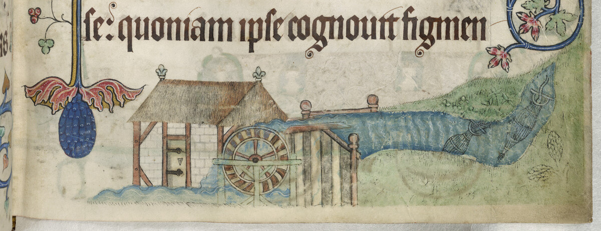
*A watermill with its wheel and millpond, painted in the margin of the Luttrell Psalter, an English prayer book made between 1325 and 1335. Image: British Library, CC0.*

The result was the longest boom that Europe had known. Between the years 1000 and 1300 its population roughly doubled. Forests were cut down, marshes were drained, and thousands of new villages were founded on land that had been wild.

## Town air

Extra food meant that some people could stop farming, and extra people meant that some had to. They went to the towns.

Towns had nearly vanished from the north after Rome fell. Now they grew again, at river crossings, at harbours and often under the wall of a castle or a monastery, where there were customers. The people in them were weavers, tanners, bakers, smiths and merchants, and they did not fit into a world built for those who fought, those who prayed and those who ploughed.

What townspeople wanted was to be left out of the system, and they had money to pay for the privilege. A lord or a king would sell a town a charter, a written grant that let its citizens run their own courts, appoint their own officers and pay their dues as one fixed sum. In many places the custom grew up that a serf who escaped to a town and lived there for a year and a day could not be reclaimed by his lord. The Germans had a saying for it: town air makes you free.

Inside the town, each trade governed itself through a guild, a club of masters who set prices and standards and decided who could join. The Latin word for such a body was *universitas*.

From about 1100, students came from all over Europe to the Italian city of Bologna to hear lectures on law. In the course of that century they formed guilds of their own, to bargain with their teachers and landlords. In Paris it was the teachers who formed one. These were the first universities, and Oxford followed soon after. They gave Europe the degree, the examination, the gown and the lecture, a word that means "reading", because books were so costly that a teacher read his copy aloud while the students wrote it down.

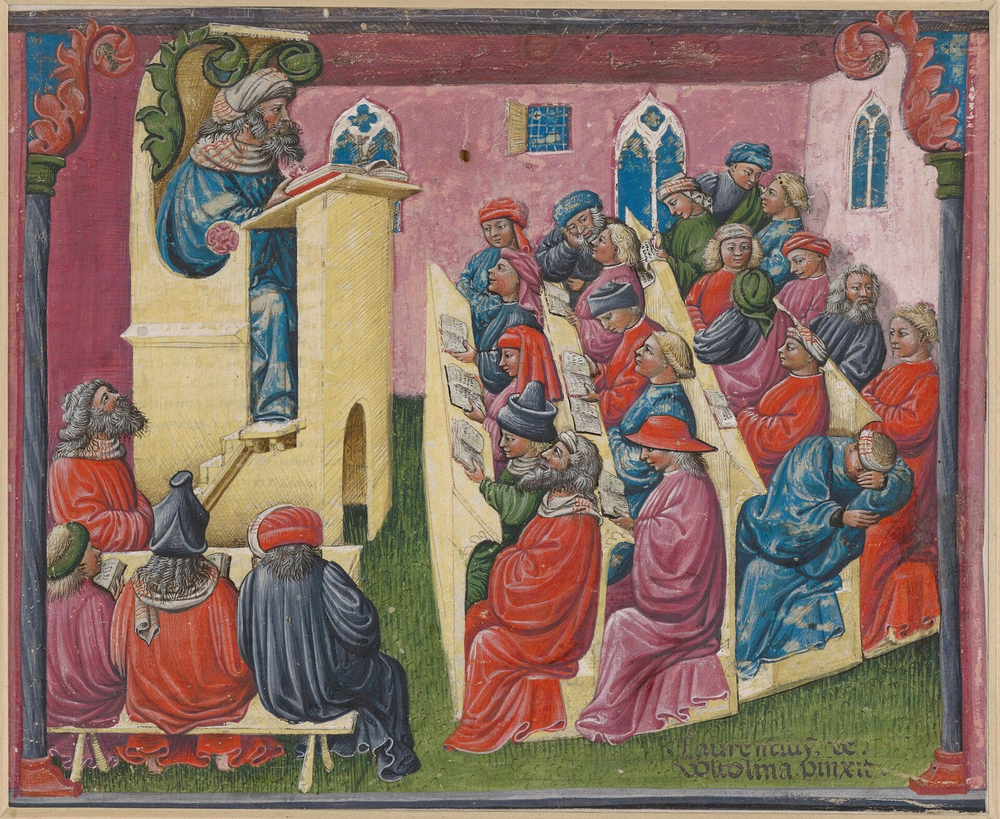
*A lecture at the university of Bologna, painted in the second half of the 1300s by Laurentius de Voltolina. The teacher reads from a raised desk, and the students follow in their own copies of the book. Image: Laurentius de Voltolina, Staatliche Museen zu Berlin, public domain.*

Much of what they read was new to them. In Spanish cities lately taken from Muslim rulers, scholars were turning the Arabic libraries into Latin, and through them the works of Aristotle, with centuries of Arabic commentary, reached the lecture rooms of Paris.

## Walls of glass

The new wealth went, above all, into stone.

Lords rebuilt their wooden towers as square stone keeps with walls four metres thick, and then surrounded the keeps with rings of stone wall and round towers. A great castle of the 1200s took years to build and cost more than most lords would see in a lifetime.

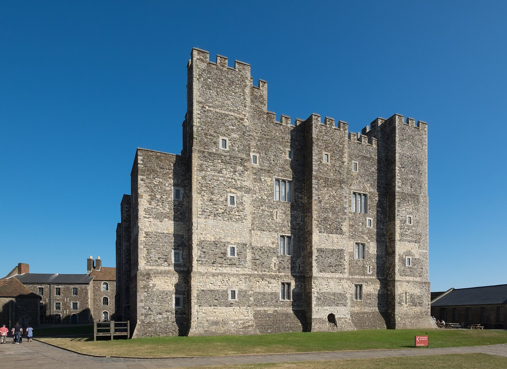
*The great stone keep of Dover Castle in Kent, England, built for Henry II in the 1100s. Photo: DeFacto, CC BY-SA 4.0.*

The towns built churches. In the 1140s the abbot of a monastery outside Paris rebuilt his church in a new manner, and for the next two centuries the cities of northern France, and then of all western Europe, tried to outdo him and one another.

The older churches had been dark. Their stone ceilings were rounded like the inside of a barrel, and a round arch pushes outwards as well as down, so the walls had to be massive and the windows small. The new builders made three changes. They pointed the arch, which sends more of the weight straight down. They carried the ceiling on a skeleton of thin stone ribs that gathered the load onto separate pillars. Finally they propped each pillar from the outside with a slanting stone arm, called a flying buttress, which took the remaining sideways push and carried it to the ground.

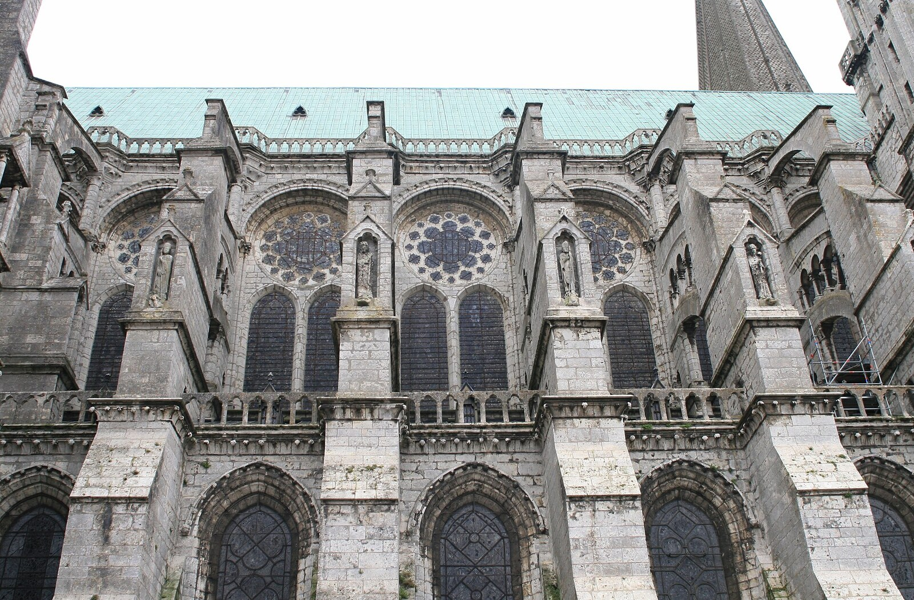
*Buttresses along the side of Chartres Cathedral, whose slanting stone arms carry the sideways push of the high ceiling down to the ground. They were built in the years after 1194. Photo: Andreas F. Borchert, CC BY-SA 4.0.*

After that the walls between the pillars had very little to hold up. The builders opened them and filled the gaps with coloured glass.

The cathedral of Chartres burned down in 1194, and the town rebuilt it in about twenty-five years with a ceiling as high as a twelve-storey building and more than a hundred and fifty windows. Each city wanted to go higher than the last. The people of Beauvais raised their ceiling to forty-eight metres, the highest ever attempted, and in 1284 part of it fell down.

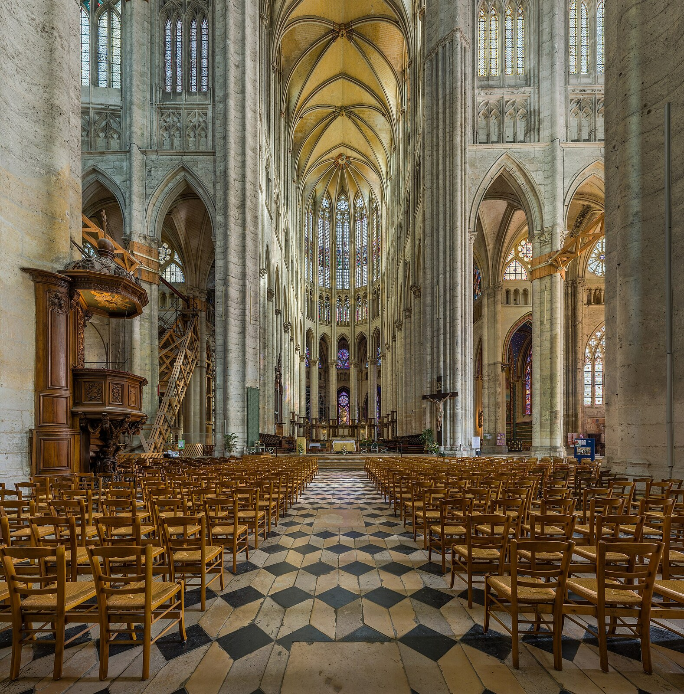
*The choir of Beauvais Cathedral in France, the tallest ceiling ever attempted in stone at the time. Part of it fell down in 1284. Photo: Diliff, CC BY-SA 3.0.*

## The meadow by the river

The kings had not gone away. As the countryside grew richer they grew stronger, and they began to take back what the castle owners had taken from them. They sent out judges, hired soldiers for pay and knocked down castles built without their leave.

The lords, however, still had castles and knights of their own. A king who pushed them too hard could find himself facing a great many of them together, and in 1215 that happened to King John of England.

John had lost Normandy to the king of France, and he had spent ten years squeezing his barons, the great lords who held their lands directly from him, for money to win it back. He charged them huge sums to inherit their fathers' lands, sold their widows in marriage to the highest bidder, and seized the property of those who annoyed him. In 1214 his great campaign in France failed. The following spring a large party of barons renounced their oaths to him and took London.

In June the two sides met in a meadow beside the Thames, and the king put his seal to a list of promises that the barons had drawn up. It became known as the Great Charter, Magna Carta.

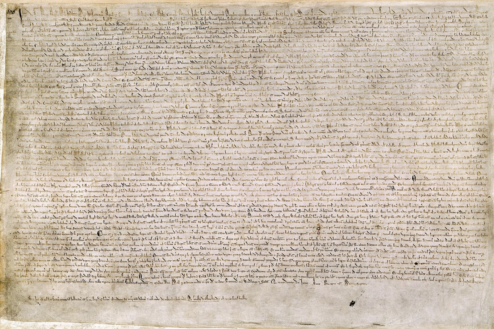
*One of the surviving copies of Magna Carta from 1215, a single sheet of parchment, now in the British Library. Image: British Library, public domain.*

Most of it is a list of the barons' own complaints. It fixes the fee for inheriting an estate. It says that a widow shall not be forced to remarry, and that the fish traps are to be taken out of the Thames and the Medway. In the middle, however, are two sentences that reach further. One says that no free man shall be imprisoned, or stripped of his property, or outlawed, "except by the lawful judgment of his equals or by the law of the land". The other is a promise by the king: "To no one will we sell, to no one deny or delay right or justice."

The barons were not thinking much about the serfs, who were not free men and were a large part of the country. The charter gave them one line, which stopped the king from fining a serf so heavily that he lost the tools he farmed with. Nor did the charter work. The pope declared it void within ten weeks, and the war resumed. John died the next year in the middle of it, leaving a son of nine. The boy's guardians reissued the charter to win the barons back, and later kings confirmed it dozens of times, usually when they wanted money.

What lasted was the idea that the document stood for. The king was bound by the law like anyone else, and there were things he could not do to his subjects without their consent.

The most important of those things was to tax them. The charter said that the king could not demand certain payments from his barons without calling them together and asking, and over the following century that grew into a general rule. Other kingdoms were moving the same way. In the Spanish kingdom of León, a young king with enemies on both borders had summoned men from the towns to his council as early as 1188, because the towns were where the wealth was. In England, in 1265, a baron who had taken the king prisoner and needed support for his government called two knights from every county and two citizens from each of the main towns. The kings who followed kept the habit. These meetings came to be called parliaments, from the French word for talking.

The rulers of the great empires of Asia taxed without holding such conversations. The emperor of China appointed his governors after an examination and moved them every few years, and none of them owned a fortress. The kings of Europe were dealing with subjects who had stone walls, and they had to ask.

The walls are still there. In the German lands alone, well over ten thousand castles were built. The grandest are museums and hotels now. Most are roofless shells on hilltops, and the oldest of all are harder to spot. They are steep, round, grassy mounds at the edges of villages, each with a ditch around it and usually a few sheep on top.
