# 37. Why did the Crusades happen?

*Western Europe, Constantinople and Syria, from 800 to 1204*

Because a pope offered the knights of western Europe a way to save their souls by doing the one thing they were trained to do, and they took him at his word, with tens of thousands of humbler people behind them. They marched east to help an emperor who had asked for something much smaller, against enemies who were slow to see what kind of war it was.

In the summer of 1096, a duke named Godfrey, who held lands in what is now Belgium, went to see the bishop of the nearest large town. He owned a castle on a rock above a river, called Bouillon, which was the seat of his family. He handed it over to the bishop as security for a loan of about three hundred kilograms of silver and a little gold. He sold other estates outright. If he did not come back to repay the loan, the castle would belong to the church for good.

Godfrey was raising money for a journey of about four thousand kilometres, on horseback and on foot, to a city he had never seen, in order to capture it from people he knew nothing about. He would have to feed and equip himself and his followers for at least two years. All over France, the Low Countries and Germany that summer, men of his class were doing the same. Their agreements with monasteries and bishops survive by the hundred. One knight pawns his mill, another sells his vineyards, and a third gives up his claim to a disputed field in return for a horse and a little cash.

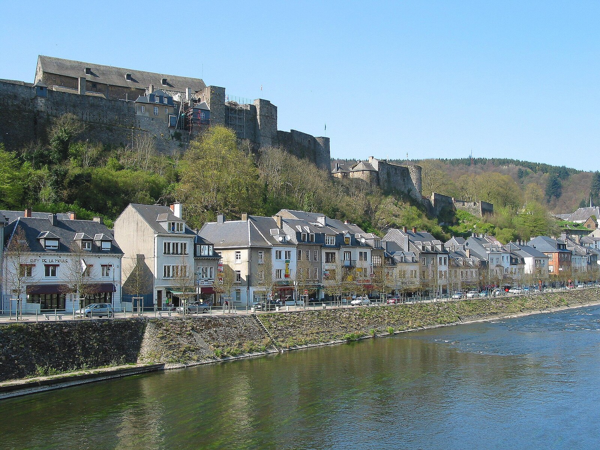
*The castle of Bouillon above the river Semois in Belgium, the Godfrey family seat that was pledged in 1096. Most of the stonework seen today was built later. Photo: Jean-Pol Grandmont, CC BY 3.0.*

The cost to each of them came to something like four or five times his yearly income. Most could expect to gain nothing by it, and they knew that many would not come home. The old explanation, that these were landless younger sons out to grab estates in the east, does not survive a reading of those documents. The men who went were mostly heads of families, with property to lose, and they said in writing why they were going. They were afraid for their souls.

## Barefoot in the snow

The Europe that Godfrey lived in had been taking shape for six hundred years, since the western half of the Roman Empire dissolved into kingdoms.

The most successful of those kingdoms belonged to the Franks, who ruled what is now France and western Germany. On Christmas Day in the year 800, their king Charlemagne was at prayer in the church of Saint Peter in Rome when the pope, the bishop of that city, set a crown on his head, and the congregation hailed him as emperor of the Romans. There had been no emperor in the west for more than three centuries. The pope had made one.

That ceremony planted a question that western Europe argued over for the rest of the Middle Ages. If the pope crowned the emperor, was the emperor the pope's man? Or was the pope, like every other bishop in the emperor's lands, the emperor's servant? Charlemagne's empire broke up among his grandsons, but the title lived on among the kings of Germany, and so did the dispute.

It came to a head over the appointing of bishops. A bishop in those centuries was a great landowner, with castles and knights of his own, and kings had always chosen bishops as they chose their other lords. In the 1070s a reforming pope declared that no layman, whether king or emperor, could appoint a bishop, and that a pope could remove an emperor from his throne. The German king replied by declaring the pope deposed. The pope then cast the king out of the church and released his subjects from their oaths of loyalty. The German nobles, who had their own reasons, began to desert him.

In January 1077, the king crossed the Alps in midwinter to a castle in northern Italy where the pope was staying. For three days he stood at the gate, barefoot in the snow, in the rough woollen shirt of a penitent, until the pope let him in and lifted the sentence. A few years later, when the king's position had recovered, he marched on Rome and drove the same pope into exile. Each side had learned that it was able to wound the other, and that it lacked the means to finish the matter.

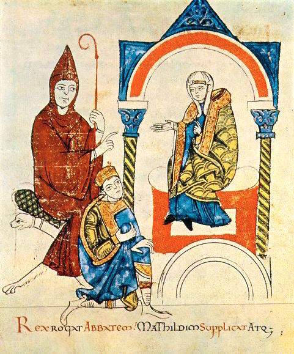
*King Henry kneels and begs for help from Abbot Hugh of Cluny, at left, and Countess Matilda of Tuscany, at Canossa in January 1077. Painted about 1115, a generation after the event, for a life of Matilda. Public domain.*

The pope who launched the crusade, Urban, came to office in the middle of this struggle, with a rival pope appointed by the German king holding much of Rome. He badly needed to show that the bishop of Rome was the true leader of the Christian world.

He also had a second problem, which concerned the knights. The armoured horsemen whom the lords of Europe kept in their castles had been trained since boyhood for one thing. A warrior in a mail coat, braced in his saddle by stirrups and carrying a heavy lance, could ride down most things on foot, and there were now tens of thousands of such men.

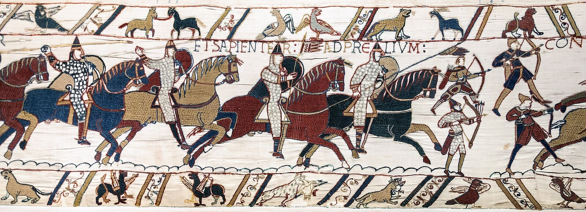
*Armoured horsemen in mail coats with spears and kite-shaped shields, from the Bayeux Tapestry, embroidered in the 1070s to show the Norman victory at Hastings in 1066. Photo: Myrabella, public domain.*

With no strong king to restrain them, these men fought one another constantly, over inheritances, boundaries and insults, and the peasants and churches in between were plundered by both sides. The church taught that killing a Christian was a grave sin, for which a man owed years of penance, in fasting, prayer or pilgrimage. A knight could not do his job without sinning, and he could not complete his penance without ceasing to be a knight. Many of them worried about this a great deal, and gave land to monasteries so that monks would pray for them.

## The emperor's request

Far to the east, the other Roman Empire was in trouble.

The emperors in Constantinople had survived the Arab conquests, shorn of Egypt and Syria, and by the year 1000 they were again the strongest Christian power in the world. Then a new people arrived from the steppe. The Turks were mounted herders from Central Asia, kin in their way of life to the Xiongnu and the Huns. As they moved south they became Muslims, and in 1055 one of their clans took control of Baghdad and made its chief the protector of the caliph, with the title of sultan.

In 1071 a Turkish army met the main Roman army in the far east of what is now Turkey, defeated it, and captured the emperor. In the civil wars that followed, bands of Turkish herders rode onto the high plateau of the country with their flocks and stayed. That plateau had supplied most of the empire's soldiers and much of its food. Within twenty years the Turks held towns within a few days' march of Constantinople.

The emperor who inherited this disaster, Alexios, was a capable soldier with a shrunken army. For years he had been hiring heavy cavalry from the west, where such men were plentiful, and they had served him well. In the spring of 1095 his envoys attended a church council in Italy, at which Pope Urban presided, and asked for help against the Turks. Relations between the eastern and western churches were poor, since each had condemned the other's leaders forty years earlier, but Alexios was a practical man. What he had in mind, as far as can be told, was a body of knights who would take his pay, swear him an oath, and serve under his generals.

## God wills it

Urban saw a much larger possibility. That autumn he travelled through France, his own homeland, and summoned a council at the town of Clermont. On 27 November 1095, when the church business was finished, he had a platform set up in a field outside the walls, because no building would hold the crowd, and preached.

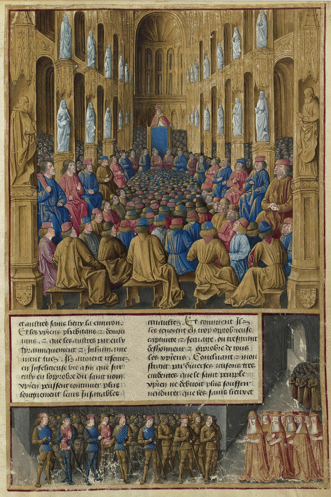
*Pope Urban preaching at Clermont, as a French painter imagined it about 1474, nearly four hundred years afterwards. The council actually met in a field, and the church and the clothes are those of the painter's own day. Public domain.*

Nobody took down his words. Several men who were present wrote accounts years later, and they differ. The main points are nevertheless clear. He told the knights that their fellow Christians in the east were being conquered and abused. He told them that Jerusalem, the city where Christ had died and risen, was in the hands of unbelievers. He reproached them with their own wars, in which Christians butchered Christians for scraps of land. Then he offered them a different war. One account says that the crowd interrupted him with a shout of "God wills it!"

What made the offer irresistible was a promise, and its wording has survived in the council's own records. Whoever goes to Jerusalem to free the church of God, out of devotion alone and not for honour or money, may count that journey in place of all penance.

The knight's dilemma was solved in a sentence. The violence that had been endangering his soul would now save it, provided he aimed it at the enemies of Christ. He did not have to enter a monastery or lay down his sword. He could go on being exactly what he was. People had long gone on pilgrimage to Jerusalem to atone for their sins. Urban had turned the pilgrimage into a war, and the war into a penance.

Those who vowed to go sewed a cross of cloth on the shoulder of their clothes. The word "crusade" comes from that cross, though it was not coined until much later. At the time they called it the journey, or the pilgrimage.

Urban had expected a force of knights under the great lords, to leave the following August after the harvest. The response went far beyond that. Wandering preachers carried the message to people he had never intended to call. The most famous was a small, barefoot man named Peter, who rode a donkey and said that Christ had appeared to him and told him to preach. In the spring of 1096, months ahead of the knights, tens of thousands of peasants and townspeople with their wives and children set off behind him towards the east.

## The enemy nearer home

Some of those early bands never left Germany before finding someone to attack.

Along the river Rhine stood some of the oldest and richest towns of the German kingdom, and several of them had communities of Jews, who had lived there for generations as merchants, moneylenders and physicians under the protection of the bishops. In May 1096, a count from the region led an army of crusaders against them.

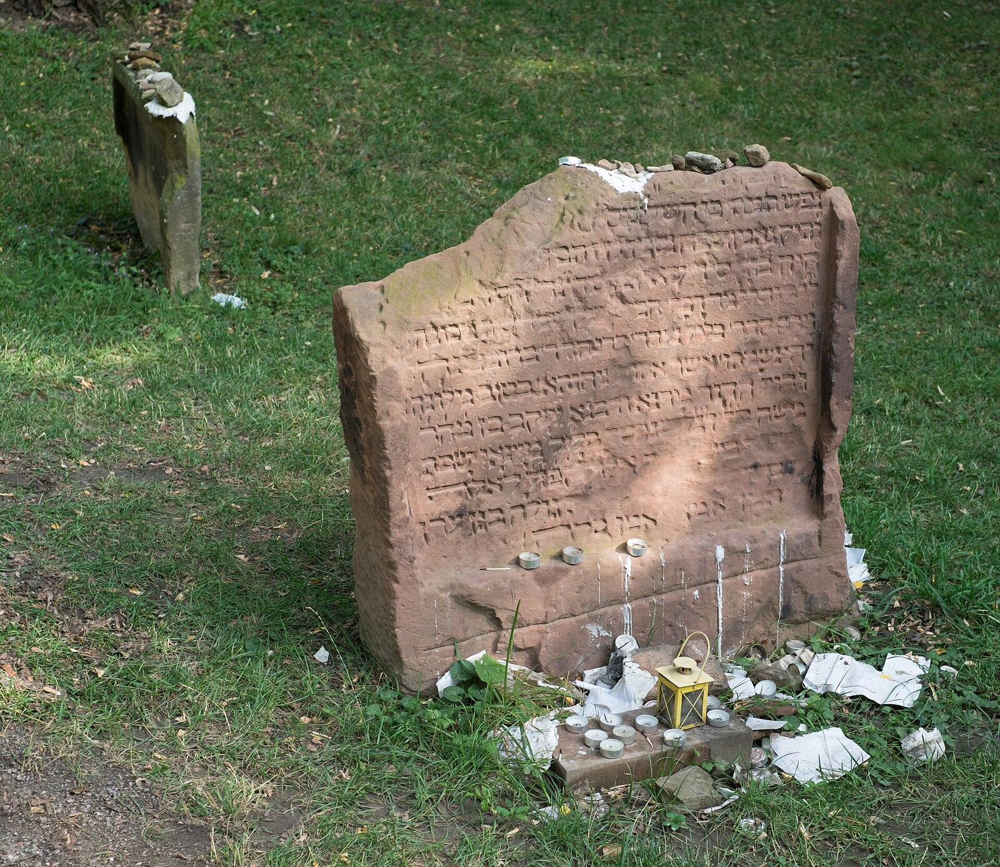
*A Hebrew gravestone in the old Jewish cemetery at Worms on the Rhine, where the community was attacked in 1096. This is the grave of Rabbi Yaakov Moelin, who died in 1427; visitors leave stones and candles. Photo: Dietrich Krieger, CC BY-SA 3.0.*

A Jewish writer of the next generation set down what the attackers said to one another. We are setting out on a long road to take vengeance on the Muslims, they said, and here among us are the Jews, whose ancestors killed and crucified him. Let us take vengeance on them first.

At the first town, the bishop sheltered the Jews in his palace and most survived. At the second, about eight hundred were killed. At the third, Mainz, the largest community on the Rhine took refuge in the archbishop's hall. He fled. The crusaders broke in. The Jews were offered the choice of baptism or death, and the Hebrew accounts describe how many of them chose a third way, and killed their own children and then themselves so as not to be forced to deny their faith. More than a thousand died in that one town in two days.

The pope had asked for none of this, and the church's own law forbade forcing anyone to be baptised. Several bishops tried to protect the victims and failed. Nevertheless, the logic of the massacres came straight out of the preaching. Men had been told to go and kill the enemies of Christ in a land they could barely imagine, and some of them concluded that there was no need to travel so far. The gospel story of the crowd that called down Christ's blood on itself and its children was by then a thousand years old, and in 1096 Christians acted on it with swords on a scale never seen before.

## Barbarians at dinner

The peasant armies reached Constantinople in the late summer. The emperor shipped them across the strait as fast as he could, and the Turks slaughtered them within three months.

The armies of the lords arrived over the following winter and spring, by several roads. There were four main forces, under Godfrey and other great nobles of France and of the Normans who had conquered southern Italy. Together they came to perhaps sixty thousand people, of whom about seven thousand were knights.

*The road to Jerusalem, 1096 to 1099: the main land route of the crusade, from the Rhineland down the Danube to Constantinople, across the lands of the Turks to Antioch, and down the coast to Jerusalem. The Roman Empire of Constantinople is often called the Byzantine Empire. Other armies came by Italy and the sea. Clermont, where Urban preached in 1095, is marked with a star. Map: drawn for this book; coastlines and rivers from Natural Earth, public domain.*

The emperor's daughter, Anna, was thirteen at the time, and half a century later she wrote a history of her father's reign in which the westerners appear as a natural disaster. They came, she says, in numbers beyond the stars of heaven or the sand of the seashore. She found them brave, greedy, talkative and unable to keep their word. One of their leaders, a Norman named Bohemond, had spent years trying to conquer her father's empire and now presented himself as its ally. Another knight, at an audience in the palace, sat down on the emperor's own throne.

Alexios dealt with them as well as anyone could have. He received each leader separately, gave him presents, and required him to swear that any city he captured that had once belonged to the empire would be handed back. Then he ferried them over to Asia before the next contingent arrived. He had asked for hired soldiers under his own command. What had come was an independent army, larger than his own, that believed it took its orders from God.

## Up to the bridles

The crossing of Turkey took the crusaders four months, through a summer in which horses died of thirst and knights rode oxen. In October 1097 they reached Antioch, the great walled city of northern Syria, and sat down outside it for the winter. Food ran out. A Frankish writer who was there says that the poor ate the hides of animals and the seeds they found in dung. Men deserted, including some of the leaders. In June a guard inside the city was bribed to open a tower, and the crusaders took Antioch, only to be shut up in it three days later by a Turkish relief army.

They were starving and trapped. A poor pilgrim announced that Saint Andrew had appeared to him and revealed that the lance which pierced Christ's side lay buried under the floor of a church in the city. They dug, and towards evening a piece of iron was found. Not all the leaders believed in it. The army did. Two weeks later they marched out of the gates behind the relic, half of them on foot because their horses were dead, and broke the Turkish army in a morning.

The emperor, meanwhile, had set out to join them, met some of the deserters on the road, was told that all was lost, and turned back. The crusaders considered that this released them from their oath, and Bohemond kept Antioch for himself.

A year later, in June 1099, what was left of the expedition came in sight of Jerusalem. About twelve hundred knights and twelve thousand foot soldiers remained. The city was held by a garrison from Egypt. The crusaders built two siege towers out of timber hauled in from many kilometres away, and on 15 July they got a tower against the wall and broke in.

Then they killed nearly everyone they found. The Muslims of the city were cut down in the streets and in the great mosque on the platform where the Jewish Temple had once stood, where many had fled. The Jews were burned in their synagogue. A priest who was with the army wrote that in that mosque, which the crusaders called the Temple, men rode in blood up to their knees and the bridles of their horses. He was borrowing a phrase from the Bible, and he was boasting. The victors then went, weeping with joy, to give thanks at the church built over the tomb of Christ.

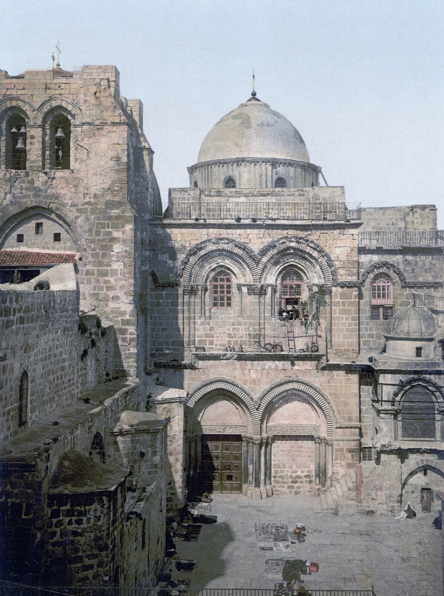
*The front of the Church of the Holy Sepulchre in Jerusalem, in a colour print made from a photograph between 1890 and 1905. The carved doorways were built by the crusaders in the 1100s. Public domain.*

Godfrey was chosen to rule the city. Most of the survivors, having fulfilled their vow, went home. Those who stayed held a few hundred knights among them. Over the next ten years they and later arrivals pieced together four small states, strung from the upper Euphrates down to the edge of Egypt.

## One more invader

The Muslim rulers of the region, had they acted together, had the men and money to crush those states several times over. They did not act together for half a century.

Syria in the 1090s was divided among Turkish princes who were mostly at war with their own brothers and cousins. To the south lay Egypt, ruled by a rival line of caliphs who were Shia and regarded the Turks, who were Sunni, as a worse enemy than any Christian. Egypt had in fact been negotiating with the crusaders for a joint campaign against the Turks, and had seized Jerusalem from the Turks itself only a year before it fell.

*The four crusader states about 1135, roughly: Edessa, Antioch, Tripoli and the Kingdom of Jerusalem, with the Muslim cities of Aleppo and Damascus beyond them and Egypt to the south. The cross marks Hattin, where the crusader army was destroyed in 1187. Map: drawn for this book; coastlines and rivers from Natural Earth, public domain.*

To the rulers of this region, the Franks, as they called all westerners, were one more band of armed adventurers in a country full of them. It was assumed that they were mercenaries of the emperor, as others had been. That tens of thousands of people had walked across a continent for the sake of a tomb was slow to sink in. Some of the Turkish princes made alliances with the newcomers against their Muslim neighbours. When refugees from Jerusalem reached Baghdad and wept in the great mosque, the caliph's court expressed its sympathy and did nothing. A preacher in Damascus who called for a holy war in reply drew few listeners.

A Syrian nobleman named Usama, who grew up in those years and wrote his memoirs as an old man, shows how the two peoples came to rub along. He fought the Franks many times and had Frankish friends. He thought them courageous and otherwise little better than animals, and tells of a Frankish doctor who treated an infected leg by having it chopped off with an axe, killing the patient. He also tells how, when he visited Jerusalem, the knights who guarded the platform of the old Temple cleared a small chapel so that he could say his Muslim prayers in it. They were, he says, his friends.

Those knights were Templars, members of a new kind of organisation that the crusade had produced. They were monks who took vows of poverty, chastity and obedience and lived under a rule, and their work was fighting. The Templars and a second brotherhood like them, with estates all over Europe sending them money and recruits, became the standing army of the crusader states and the builders of their enormous castles.

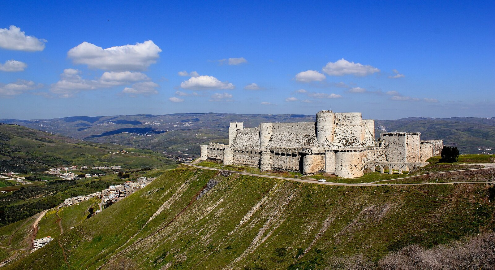
*Krak des Chevaliers in Syria, a castle of the Hospitallers, the other great fighting brotherhood beside the Templars. It was rebuilt on this scale in the 1100s and 1200s. Photo: Ergo, CC BY 2.0.*

The other people who made the conquest last were merchants. The fleets of the Italian trading cities, Venice, Genoa and Pisa, had supplied the armies from the sea, and they took their reward in the form of quarters in every captured port, free of tax. Through those ports, the pepper and silk of the Indian Ocean now reached Europe in Italian ships.

## Ten dinars a man

The Muslim answer, when it came, was the work of three rulers in succession, each of whom understood that the Franks would stay as long as their neighbours were divided. The third was a Kurdish officer named Saladin, who made himself master of Egypt, abolished its Shia caliphate, and then spent twelve patient years bringing the Muslim cities of Syria under his control one by one, by siege, marriage and treaty. By 1186 the crusader states were surrounded by a single power for the first time.

In July 1187 the king of Jerusalem marched his whole army, some twenty thousand men, across a waterless plateau in the heat to relieve a castle. Saladin's horse archers harassed the column until it halted, short of the lake, on a hill with two peaks. His men set fire to the dry grass upwind. The next day the crusader army, mad with thirst, was destroyed. The soldier monks among the prisoners were beheaded. The king was given a cup of iced water and held for ransom.

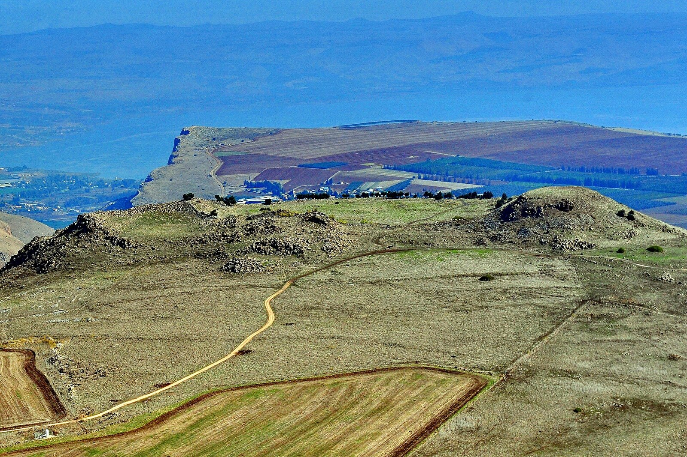
*The Horns of Hattin, the two-peaked hill above the Sea of Galilee where the crusader army was destroyed in July 1187. Photo: AVRAMGR, CC BY-SA 4.0.*

Jerusalem had almost no defenders left, and it surrendered three months later. The people inside remembered 1099 and expected the same. Saladin gave them terms instead. Every man could buy his freedom for ten gold coins, every woman for five, and every child for one, and those who paid were escorted to the coast. Thousands who could not pay were let go without payment by Saladin and his brother. Several thousand others were sold as slaves. There was no massacre, and the church of the tomb was left open to Christian pilgrims for a fee.

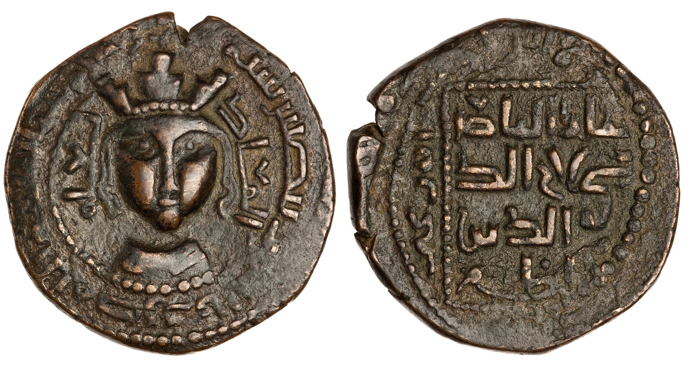
*A copper coin struck in Saladin's name at Nisibin, now in Turkey, in 1182 or 1183, with Arabic inscriptions. Photo: American Numismatic Society, CC0.*

An earlier expedition led by two kings, forty years before, had achieved nothing. The loss of the city now brought the kings of western Europe east again. The king of England, Richard, proved a better general than any Saladin had faced, and retook the coast. He never managed to take Jerusalem, and after more than a year of fighting, the two men, who had not once met, agreed to a truce. The Christians would keep the ports, the Muslims would keep the city, and unarmed pilgrims would be allowed to visit it. Saladin died a few months later. One of his officials recorded that the treasury of the man who had ruled from the Nile to the Tigris held one piece of gold and forty-seven of silver, since he had given the rest away.

## Four bronze horses

The crusade that followed did the most lasting damage of all, and it never reached a Muslim country.

In 1201 a group of French lords planned a new expedition and decided to go by sea. They signed a contract with Venice to build a fleet to carry thirty-three thousand men, for about twenty tonnes of silver. The Venetians suspended their ordinary trade for a year and built it. When the day came, barely a third of the expected crusaders turned up, and they could not pay.

The ruler of Venice, the doge, was a man in his nineties and blind, and he was the shrewdest person involved. He offered to postpone the debt if the crusaders would do Venice a service on the way. A port on the opposite coast of the Adriatic had thrown off Venetian control. It was a Christian town, and its people hung crosses from the walls. The crusaders stormed it anyway. The pope cast the whole army out of the church.

Then a young prince of Constantinople arrived in the camp. His father, the emperor, had been overthrown and blinded by a rival. He promised that if the crusaders put his father back on the throne, he would pay them more than twice the sum they owed, enough to clear the debt and finance the whole war. The fleet sailed to Constantinople and did as he asked. The prince then found that the treasury was empty and that his subjects hated him for bringing the westerners. He was murdered in a palace coup.

The crusaders were camped outside the richest city in Christendom, owed a fortune by a dead man. In April 1204 they attacked. They got over the sea walls from the masts of the Venetian ships, and for three days they sacked the city that Urban's crusade had been called to defend. A senator of Constantinople who lived through it wrote that even the Muslims had been merciful by comparison with these men who carried the cross of Christ on their shoulders. Churches were stripped of their gold, and their relics were shared out like any other plunder.

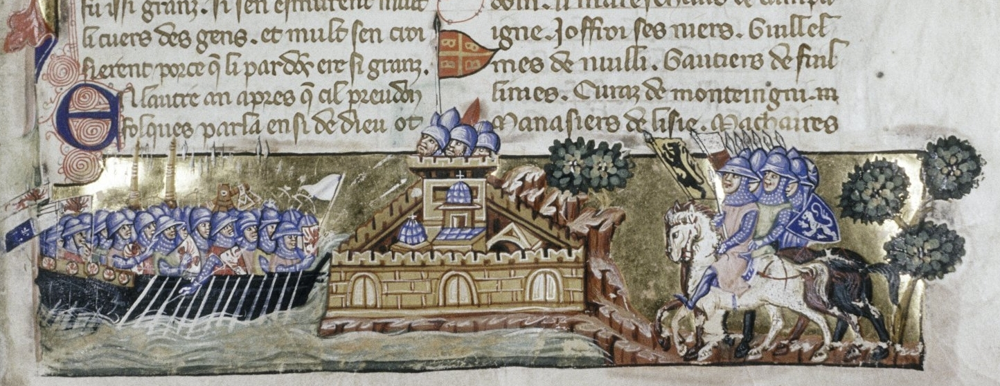
*The crusaders attack Constantinople in 1204, painted about 1330 in a manuscript of Villehardouin, a leader of the crusade who wrote its history. It is a later imagining: the walled town is a generic picture. Public domain.*

The victors divided the empire among themselves. It was restored in a reduced form nearly sixty years later, and it never recovered its strength. The barrier that had stood between Europe and the powers of the east for eight hundred years had been broken by Christians.

The Venetians took their share in the form of trading ports, islands and works of art. Among the last were four life-sized horses of gilded bronze, already ancient, that had stood over the starting gates of the city's racecourse. They were shipped home and set up above the main door of the church of Saint Mark, where copies of them stand today.

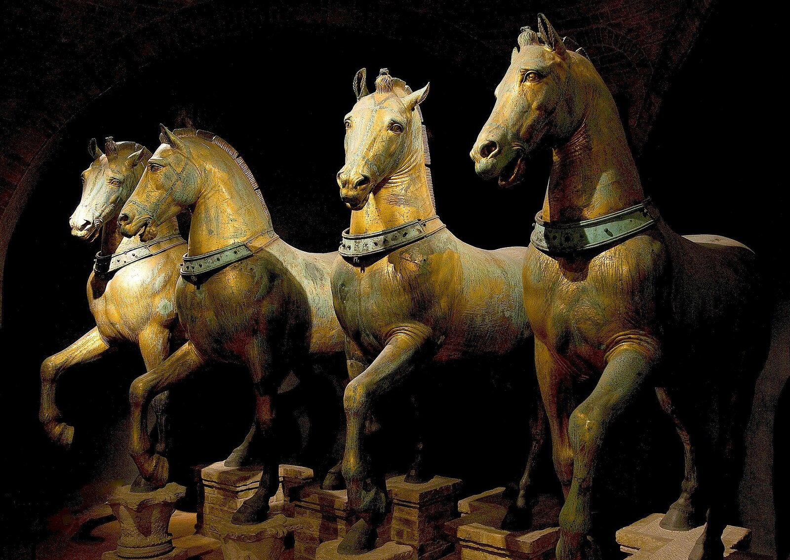
*The four gilded bronze horses brought from Constantinople to Venice, ancient even in 1204. These are the originals, now kept indoors in the basilica of Saint Mark; copies stand outside. Photo: Tteske, public domain.*