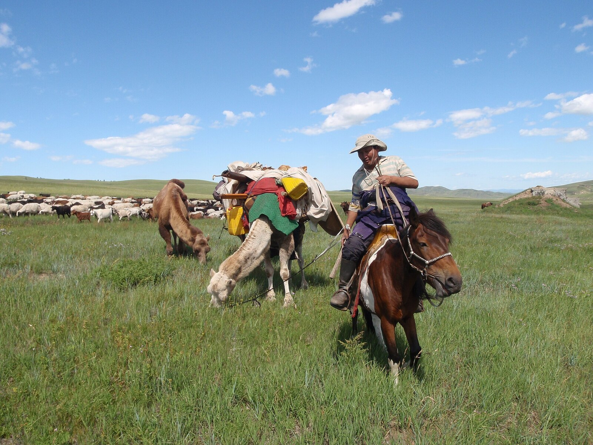
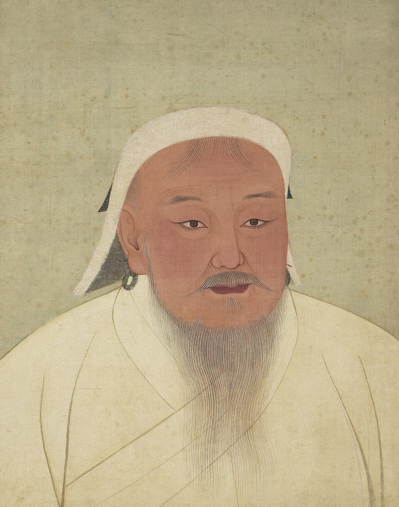
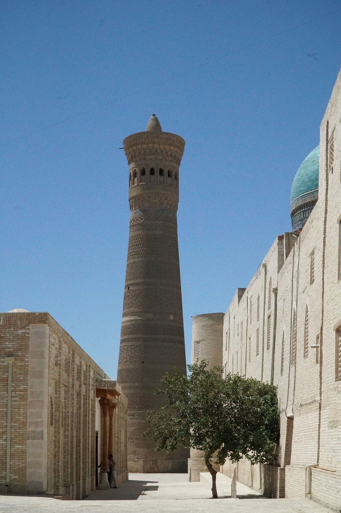
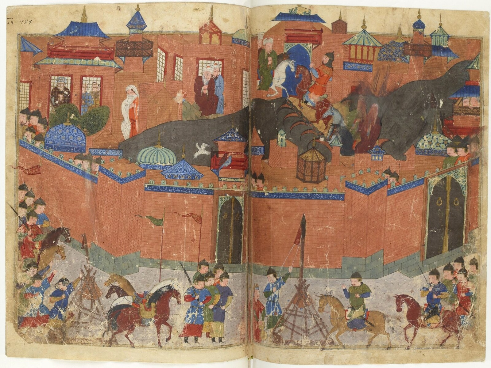
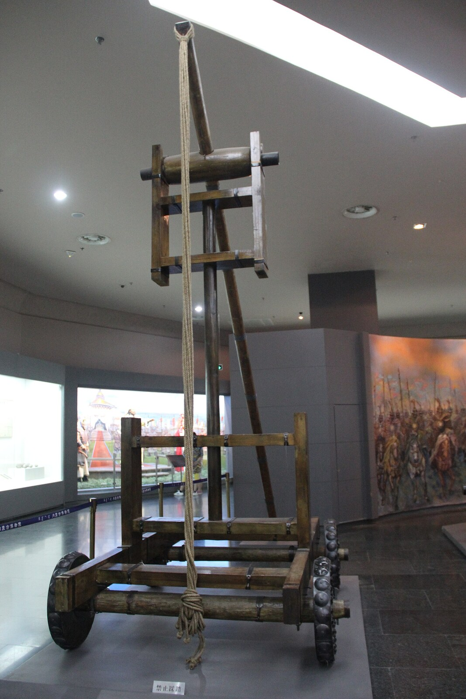
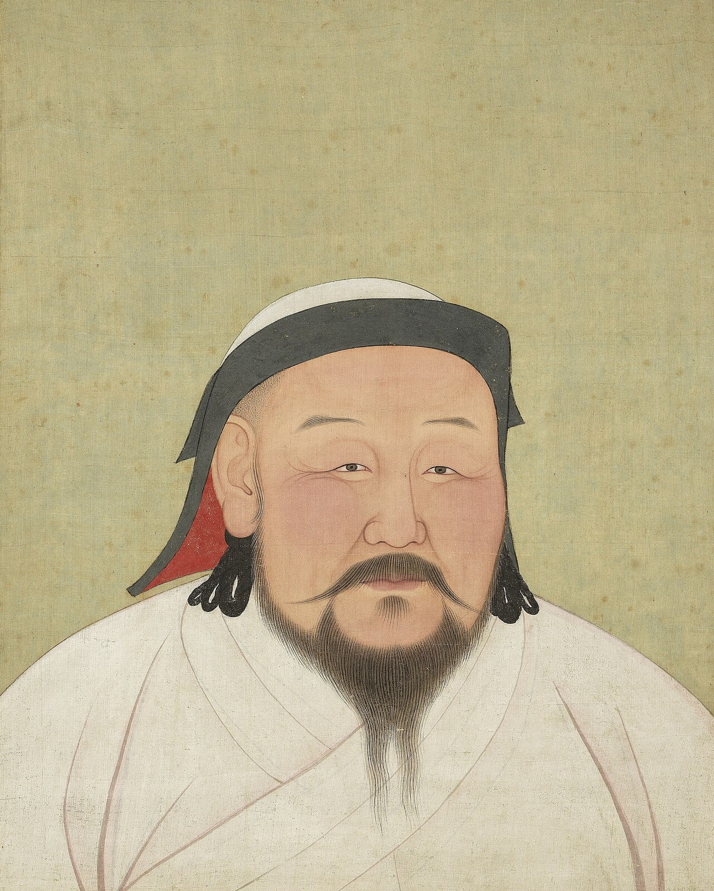
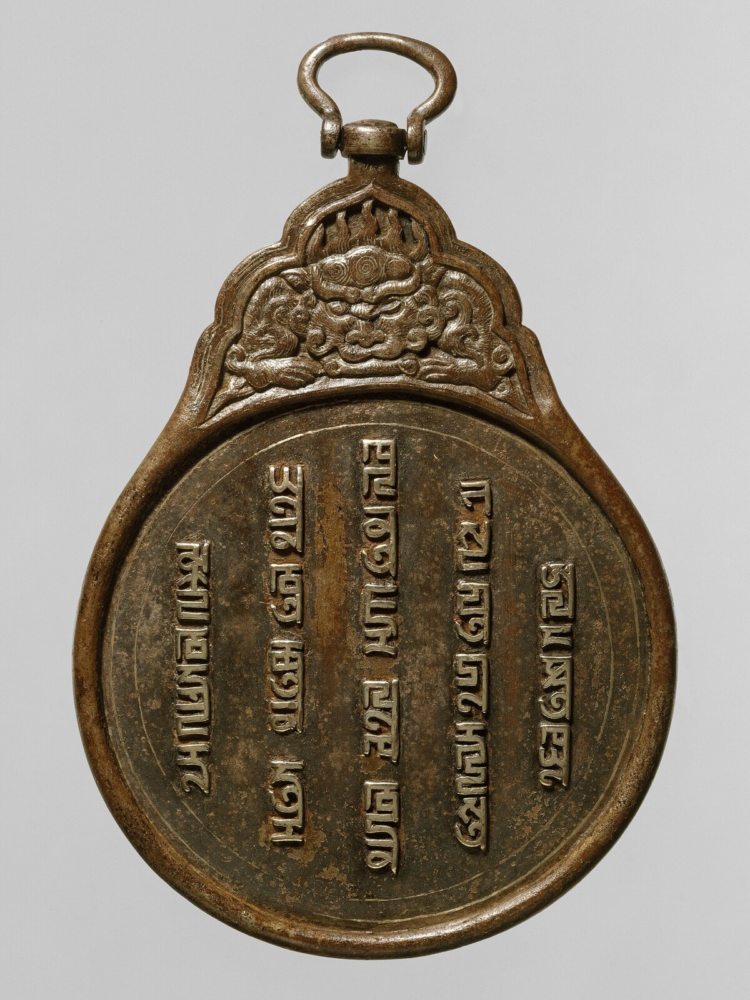
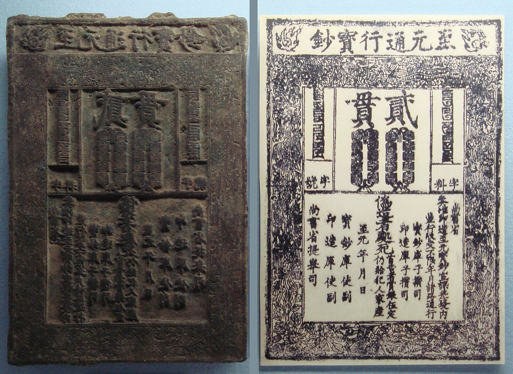
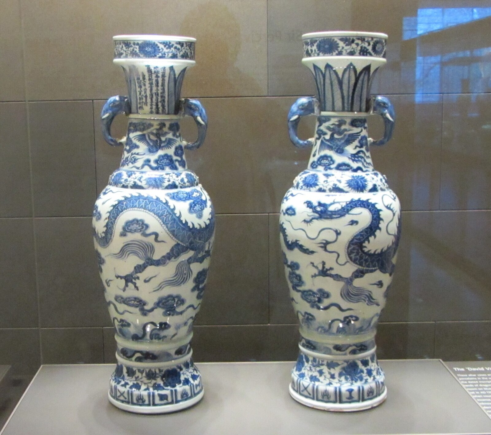

# 37. How did the Mongols conquer so much?

*Mongolia, China, Persia and Europe, from 1162 to 1294*

Because every Mongol man was a soldier on horseback who carried his food with him, a Mongol army could travel farther and faster than any army that depended on wagons and farms. One leader joined these horsemen into a single force, and that force collected engineers from each people it defeated and used them to break the walls of the next.

In the spring of 1254, a friar named William arrived at the capital of the Mongol empire. He came from Flanders, and he had been travelling for nearly a year, first by ox-cart and then on horseback, across the grasslands north of the Black Sea and the Caspian and then over the mountains of Central Asia. He had come to preach, and he carried a letter from the king of France.

The capital was called Karakorum, and it stood on a river plain in the middle of Mongolia. William was not impressed by its size. He judged it smaller than the village of Saint-Denis outside Paris. What astonished him was what he found just inside the door of the palace.

There stood a great tree made of silver, with silver branches, leaves and fruit. Four silver lions crouched at its foot, and four gilded serpents wound around its trunk. When the khan called for drink, a silver angel at the top of the tree lifted a trumpet and blew, and servants outside began to pour. A different drink then ran from the mouth of each serpent into a silver basin: wine from grapes, mare's milk, a drink made from honey, and a wine made from rice.

The man who had built the tree was a goldsmith from Paris named Guillaume. A Mongol army had captured him in Hungary more than ten years earlier and carried him more than six thousand kilometres to the east. He now had a wife, a workshop of fifty men, and a patron who ruled more of the earth than anyone before him. He told William that the angel had been meant to work by bellows, but the bellows had not given enough wind, so he had left a hollow under the tree where a man could hide and blow down a pipe.

William met other people who had arrived the same way. There was a woman from the French city of Metz who cooked him a dinner, and a bishop's nephew who had been taken prisoner at Belgrade. He heard of a whole colony of Germans farther west who had been set to digging gold and making weapons. One quarter of the town was filled with craftsmen from China, and the other with Muslim merchants.

All of these people had been collected, in the way a museum collects objects. The Mongols had gathered them from the two ends of Asia in under fifty years.

## A country of grass

Mongolia is high, dry and cold. Rain is scarce and the summer is short, so that wheat and rice will not ripen across most of it. What does grow is grass, in a belt that runs for thousands of kilometres from Manchuria to Hungary. People cannot eat grass. Their animals can, however, and so the people of this belt lived by keeping sheep, goats, cattle, camels and horses, and by moving with them from pasture to pasture through the year.

Everything about this life happened on a horse. Children rode before they could walk far. The Mongol horse is small, hardly more than a pony, with a thick neck and a shaggy coat. It lives outdoors all winter, and it digs through the snow with its hooves to reach the grass beneath. It needs no stable, no oats and no hay.

*A Mongolian herder on a small horse, with a pack camel and a flock, on the grassland of Mongolia today.. Photo: Brücke-Osteuropa, public domain.*

The herder's food came from the same animals. Mares were milked, and the milk was drunk fresh or fermented into a mildly alcoholic drink. Cows' milk was dried into hard curds that kept all winter. Meat was dried in strips that would keep for months. A family could therefore pack its house, which was a round tent of felt on a wooden frame, load it on a cart, and move its entire life in a morning.

The second skill was the bow. Herders hunted from the saddle and guarded their flocks against wolves and thieves, and every boy learned to shoot while riding at speed. The bow was short enough to swing across a horse's neck and was built up in layers of wood, horn and sinew, which made it far more powerful than its size suggested. A rider could turn in the saddle and shoot backwards while his horse galloped away.

In a farming country, a soldier is a specialist. Someone else has to grow his food and haul it to him, and a large army on campaign usually drags behind it a long tail of carts. On the steppe hardly anybody was a soldier by trade, because everybody was one. Every grown man already had a horse, a bow and the skill to use both. An army was simply the men of the camp riding out together, with spare horses running alongside and dried milk in their saddlebags.

Farming empires had feared such people since the first riders appeared. The steppe had one great weakness, and it had saved its neighbours many times. The herders were divided into clans and tribes that raided each other's animals, stole each other's wives and nursed feuds for generations. The Chinese court understood this well. For centuries it had paid one tribe to fight another, and had switched sides whenever any of them grew too strong.

## The boy who was left behind

Around 1162, a boy named Temüjin was born into a minor chiefly family on the Onon River, in the north-east of Mongolia. When he was about nine, his father was poisoned by men of an enemy tribe. The father's followers saw no reason to stay with a widow and her small children, and they rode away with the herds.

*Genghis Khan as a Chinese court painter showed him, in a portrait made long after his death. No picture made in his lifetime survives. Portrait from an album of Yuan emperors, unknown artist, public domain.*

The family survived on what a steppe has to offer people with no animals. They dug up roots, picked wild fruit and caught fish. The Mongols later wrote down their own account of these years, in a book made for the ruling family, and it does not flatter him. It records that he was afraid of dogs. It also records that he and a brother killed their half-brother with arrows in a quarrel over a fish.

Temüjin spent the next thirty years climbing out of that beginning. He attached himself to a stronger chief, gathered followers, fought the neighbouring tribes one at a time, and at last turned on his own patron. By 1206 there was nobody left on the Mongolian steppe to oppose him. A great assembly of the tribes gave him the title by which he is remembered, Genghis Khan.

Other men had united the steppe before, and their unions had fallen apart when they died. Genghis therefore set out to destroy the thing that had always pulled such unions apart, which was the tribe itself.

He sorted every fighting man into a unit of ten. Ten of these made a hundred, ten hundreds made a thousand, and ten thousands made a division of ten thousand. Men from defeated tribes were scattered among the units, so that a soldier rode beside strangers and took his orders from an officer and not from a kinsman. Nobody was allowed to leave his unit for another. If one man of a ten ran from a battle, the other nine paid for it.

The officers were chosen for what they could do. During one of the early wars, an enemy archer shot the horse from under Genghis. After the battle the man was brought in as a prisoner and admitted that the arrow had been his. Genghis took him into his own service and gave him a new name, Jebe, which means an arrow. Jebe became one of the best generals the Mongols ever had, and rode as far as Russia. Shepherds and blacksmiths' sons rose in the same way, while the old chiefly families were pushed aside.

The result was an army of about a hundred thousand riders that behaved like a single body. It could split into columns that travelled hundreds of kilometres apart and met again on an agreed day. It practised by hunting. Each winter the soldiers formed a ring many kilometres across and spent weeks closing it, driving the deer, boar and wolves of a whole district into the centre, and a man who let an animal slip past him was punished. The same manoeuvre worked on armies.

## Fifteen wet years

A united steppe needed somewhere to go, and at that moment it also had the means. Scientists have read the rainfall of old Mongolia from the growth rings of ancient pine trees, which are wide in wet years and narrow in dry ones. The rings show that the fifteen years after 1211 were the longest run of wet years that central Mongolia had seen in more than a thousand. They were also mild.

Rain on the steppe means grass, and grass means horses. In those years the pastures could carry more animals than anyone living had seen. Each Mongol soldier rode to war with a string of three or four spare horses and changed mounts through the day, so that none was worn out. This is the reason Mongol armies could cover distances that their enemies thought impossible.

The first target was north China, which lay just across the Gobi desert and was the richest country any Mongol had heard of. It was ruled at the time by the Jin, a dynasty founded by forest people from Manchuria who had themselves conquered it a century before. In the open field the Mongols beat the Jin armies again and again.

The cities were another matter. North China was full of walled towns, and the capital, on the site of modern Beijing, had walls of packed earth some twelve metres high. A horse cannot climb a wall, and arrows do nothing to it. The Mongols' first attempt at a siege, made a few years earlier against a smaller kingdom to the west, shows how little they knew. They tried to flood the city by building a dam across a river. The dam broke, and the water washed away their own camp.

They learned quickly, because they were willing to be taught by the people they were fighting. Chinese officers and engineers who surrendered were given rank and pay. These men knew how to build catapults that threw stones and firebombs, how to dig under a wall, and how to shelter men at the foot of it. Within a few years the Mongol army included whole regiments of Chinese siege troops. The Jin capital fell in 1215, after a blockade that starved it. The Jin court had already fled south to Kaifeng, where it held out for another eighteen years.

From then on the army had two parts. The horsemen destroyed the enemy's field armies and cut a city off from help, and the engineers then opened it. The engineers were always foreigners, taken from the last war to serve in the next.

## The caravan at Otrar

Genghis may not have meant to go west at all. West of Mongolia, across the mountains, lay the kingdom of Khwarazm, which covered what are now Uzbekistan, Turkmenistan, Iran and Afghanistan. Its cities, such as Bukhara and Samarkand, were among the largest in the world, and they lived by trade. Genghis sent its ruler, the shah, a message proposing that merchants should pass freely between them.

In 1218 a caravan of about four hundred and fifty merchants, travelling under Mongol protection, reached the shah's frontier town of Otrar. The governor there declared that they were spies. He had them killed and kept their goods. Genghis sent envoys to demand that the governor be handed over. The shah had the chief envoy put to death and sent the others home with their beards shaved off.

It was one of the most expensive mistakes a ruler has ever made. The following year Genghis crossed the mountains with his whole army, together with its Chinese engineers.

The shah had more soldiers than the Mongols did. He did not trust his generals, however, and so he did not gather his men into one army. He spread them out as garrisons in his cities, and waited behind the walls. The Mongols took the cities one at a time.

While part of the army besieged Otrar, Genghis himself disappeared. He led a column into the Kyzylkum, a desert of red sand that the shah's officers considered impassable, and crossed nearly five hundred kilometres of it. In February 1220 he came out in front of Bukhara, far behind the shah's lines, from a direction in which nobody was looking.

Consider what the people of Bukhara knew at that moment. Their own army was somewhere else. Most of the garrison tried to break out and was cut down. They had heard what the Mongols did, because the Mongols made sure of it. The rule was simple and was announced in advance. A city that opened its gates at once would be plundered and taxed, and most of its people would live. A city that fought would be destroyed.

The leading men of Bukhara opened the gates. The fortress inside the city held out for twelve more days, and in the fighting most of the town, which was built of wood, burned to the ground. A Persian historian who grew up in the region later recorded what a man who escaped said of it: "They came, they sapped, they burnt, they slew, they plundered and they departed."

*The Kalyan minaret in Bukhara, Uzbekistan, a brick tower built in 1127, before the Mongols came. Photo: Adam Harangozó, CC BY-SA 4.0.*

Other cities chose to fight, and the rule was applied. At Merv and Nishapur, in the rich province east of the Caspian Sea, the people were led out onto the plain and killed, and the walls were pulled down. Persian writers put the dead at more than a million in each city, which is more people than either had ever held. The numbers are best read as a measure of horror. Travellers who passed through the region decades afterwards found the ruins still empty.

The terror was a method. The Mongols were few, and they could not afford to besiege every town from Korea to Iraq. A massacre at one city was meant to open the gates of the next ten, and it often did.

One group of people was treated differently, even in a city marked for destruction. Before the killing began, the Mongols asked who was a craftsman. Weavers, smiths, potters, physicians and engineers were pulled out of the crowd and marched away to work for the khan and his family. From Samarkand alone, tens of thousands were taken. This is how a goldsmith from Paris came to be building a fountain in Mongolia.

## Where the grass ran out

Genghis Khan died in 1227, and his empire was still growing. His sons and grandsons spent the next fifty years pushing it outward in every direction at once.

*The Mongol empire at its widest, about 1280, divided among four branches of Genghis Khan's family: the lands of the Great Khan in Mongolia and China, the Chagatai lands in Central Asia, the Ilkhans in Persia, and the Golden Horde on the Russian steppe, to which the Russian princes paid tribute. The areas are shown roughly. The dashed ring marks the Mongol homeland, and the crosses the two battles of 1241. Map: drawn for this book; coastlines and rivers from Natural Earth, public domain.*

One army rode west. It destroyed the cities of Russia, including Kiev, and in the spring of 1241 it entered central Europe in two columns. Within three days of each other, one column crushed an army of Polish and German knights and the other annihilated the army of the king of Hungary. In both battles the knights charged, and the Mongols gave way in front of them. The retreat was a pretence. When the knights' heavy horses were blown and their line had come apart, the Mongols turned and closed in from the sides. Nothing now stood between them and Vienna.

The following spring they turned around and rode home. Historians still argue about the reason. The great khan had died in Mongolia, and each of the princes with the army had a stake in who came next. The Hungarian plain is also the last and smallest patch of steppe on the way west, too small to feed such herds for long, and that spring it was waterlogged. The stone castles of Hungary, moreover, had held out. Whatever weighed most, the Mongols came back to Hungary only once, forty years later, and were driven off. Western Europe lay beyond the end of the grass, and it was spared.

A second army rode south-west under a grandson of Genghis. In 1258 it reached Baghdad, which for five hundred years had been the seat of the caliph, the leader of the Muslim world. The caliph refused to submit. Chinese engineers set up their catapults, the walls were breached within two weeks, and the city was sacked. The caliph was put to death, and the long line of his family's rule in Baghdad ended with him.

*Mongols besieging Baghdad in 1258, painted in Persia in a copy of Rashid al-Din's history made about 1430, nearly two hundred years after the event. Painting: Sayf al-Vahidi and others, public domain.*

Two years later, a Mongol army was beaten in a great battle and did not come back to avenge it. This happened at a place in Palestine called Ain Jalut. The victors were the soldiers who ruled Egypt. The sultans of Egypt had long bought boys from the steppe and raised them as cavalry, and ten years before this battle the slave soldiers had taken the throne for themselves. They knew the Mongol tricks because they had grown up with them. The Mongols, for their part, had only a small force there. Syria was too dry to pasture the hundreds of thousands of horses a full army needed.

Something of the kind happened at most of the empire's edges. The Mongols were strongest where there was grass, and they stalled in forests, in deserts, and in the wet rice lands of the south.

The rice lands were the hardest. South China, under the Song dynasty, was a country of rivers, canals and flooded fields, where a cavalry charge sank to its knees. Another grandson of Genghis, Kublai, took on this war, and it took him twenty years. He built a navy of river boats. He recruited Chinese infantry by the hundred thousand. For five years his army sat in front of the twin fortress cities of Xiangyang, which guarded the route south, and could not get in.

In the end Kublai wrote to his nephew, who ruled Persia, and asked for help. Two engineers were sent from the Middle East. They built a kind of catapult that was new to China, worked by a heavy weight in a box, which dropped and whipped a long arm over. It threw stones as heavy as a large man, much farther than the Chinese machines, which were pulled by teams of men on ropes. The first stone struck a tower with a noise like thunder, and the whole city shook. Xiangyang surrendered in 1273, and the Song dynasty was finished six years later.

*A model of a weight-driven catapult, the kind of machine the Persian engineers built, in the Inner Mongolia Museum in Hohhot. Photo: Gary Todd, CC0.*

A generation earlier, Chinese engineers had broken the walls of Persia for the Mongols. Now Persian engineers had broken the walls of China.

## Safe by day and by night

By the time Kublai ruled in China, the Mongols held the largest connected empire in history. It ran from Korea to Hungary and covered about a sixth of the land on earth. Very soon it was not really one state. The descendants of Genghis quarrelled, and after 1260 the empire settled into four, centred on China, Central Asia, Persia and Russia. The four were ruled by cousins, however, and they kept one thing in common, which was the road.

*Kublai Khan, in a portrait painted after his death in 1294 by the artist Araniko, who made him look about thirty years younger. Portrait: Araniko, public domain.*

The Mongols had built a relay system to carry the khan's orders. Stations were set a day's ride apart along the main routes, and each kept fresh horses, food and beds. A messenger rode hard to the next station, jumped onto a new horse and rode on, or handed his bag to a fresh rider. Urgent news could travel more than two hundred kilometres in a day, a speed that no traveller on land would beat until the railway.

Officials and envoys who used the system carried a tablet of silver or gold on a cord, about the size of a hand, engraved with a warning in the khan's name. Whoever showed it was to be given horses and food. Merchants were soon allowed to use the roads as well, since the Mongol lords wanted everything that trade could bring.

*A safe-conduct tablet, called a paiza, of the kind carried along the relay roads, with a warning in the khan's name written in the Phags-pa script. It was made in the late 1200s. Photo: Metropolitan Museum of Art, CC0.*

The effect was that, for about a century, a person could cross Asia from one Mongol kingdom to the next, under rulers who were cousins and who all wanted the roads kept open. A Florentine businessman wrote, around 1340, a handbook for merchants going to China. He advised them to grow a beard, to hire a good interpreter, and to take along a woman, since they would be more comfortable. The journey from the Black Sea would take the better part of a year. As for danger, he wrote, the road was "perfectly safe, whether by day or by night".

Marco Polo, a merchant's son from Venice, went that way as a teenager and spent seventeen years in Kublai's service. He came home in 1295 with stories of a city of a million people, of money made of paper and of black stones that burned. Many Venetians took them for tall tales. A less famous traveller went the other way. He was a Christian monk, born near Beijing, who set out on a pilgrimage to Jerusalem and ended as an ambassador. He travelled on to Paris, where the king of France showed him the churches, and then Bordeaux, where he gave communion to the king of England.

*A paper banknote of the Yuan dynasty and the printing plate used to make it, dated 1287. Photo: PHGCOM, CC BY-SA 3.0.*

Goods and skills moved with the people. Gunpowder, which had been known only in China, was being written about in Europe and the Middle East before 1300. Chinese potters, meanwhile, began to receive shipments of a blue mineral from the mines of Persia. They painted with it on white porcelain, and Persian customers bought the result by the shipload. The blue-and-white china that later filled the cupboards of the world became an industry in the Mongol century, from a Persian colour and a Chinese clay.

*The David Vases, a pair of blue-and-white porcelain vases made at Jingdezhen in China, dated 1351. Photo: BabelStone, CC BY-SA 3.0.*

At the Mongol court in Persia, a chief minister who had trained as a doctor was ordered to write the history of the Mongols. He went on to add the histories of the Chinese, the Indians, the Jews and the Franks, and he questioned visitors from each of those peoples to do it. No earlier history had taken in so much of the world, and it could have been written in few other places.

## The road stays open

The Mongols did not have a faith to spread, a script the world adopted, or a style of building. Their capital was a small town, and William thought little of it. Within about a century of Kublai's death in 1294, they had been driven out of China, absorbed in Persia, and reduced in Russia to collecting tribute from princes who were growing stronger than they were.

What they left behind was the map they had redrawn. Baghdad never recovered its place. Northern China and eastern Iran had lost millions of people. A small town called Moscow had begun to grow rich as the khan's tax collector. Above all, the two ends of Asia now knew far more about each other, and wanted each other's goods.

In the 1340s, the road that had carried the goldsmith east and the monk west was still open. Riders changed horses at the stations, caravans moved between the wells, and in the grasslands along the way lived the marmots and gerbils of the steppe, with their fleas.
