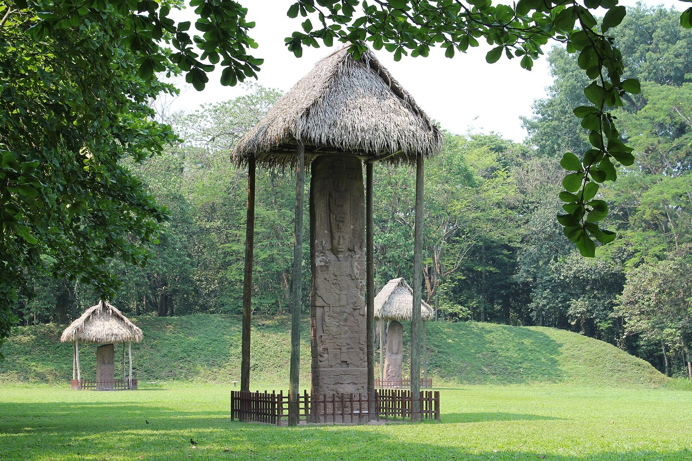
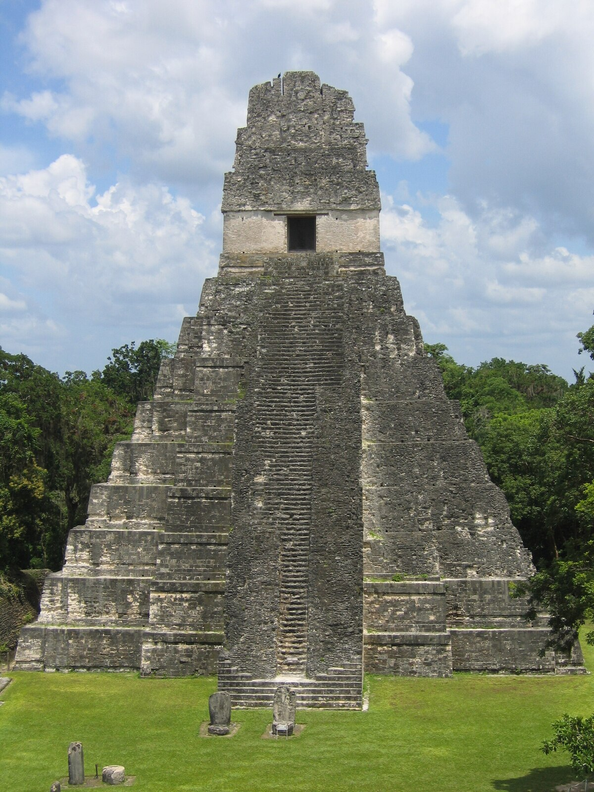
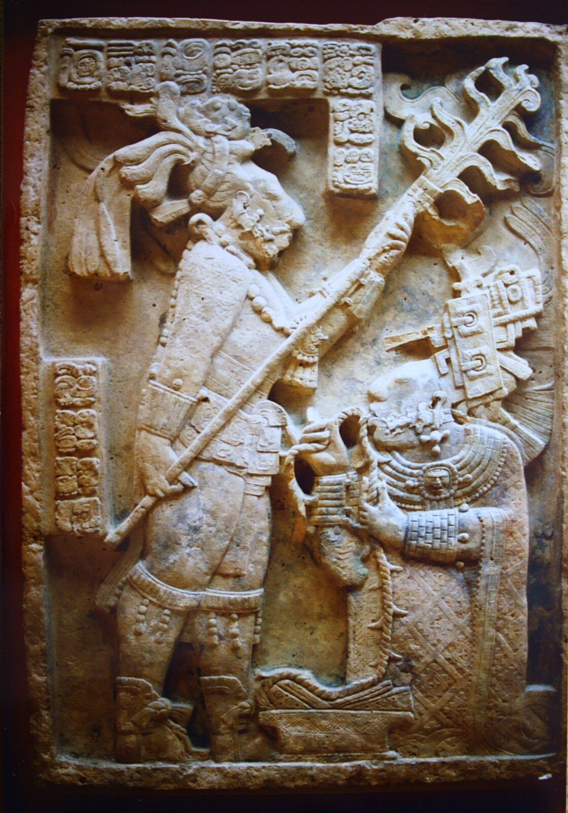
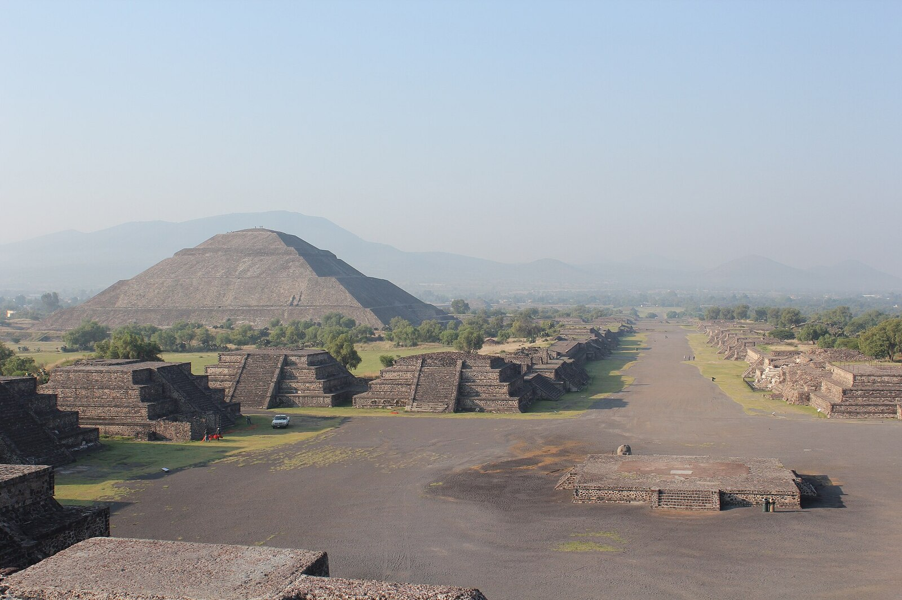
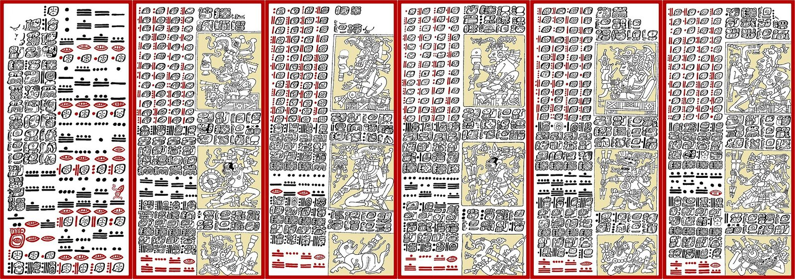
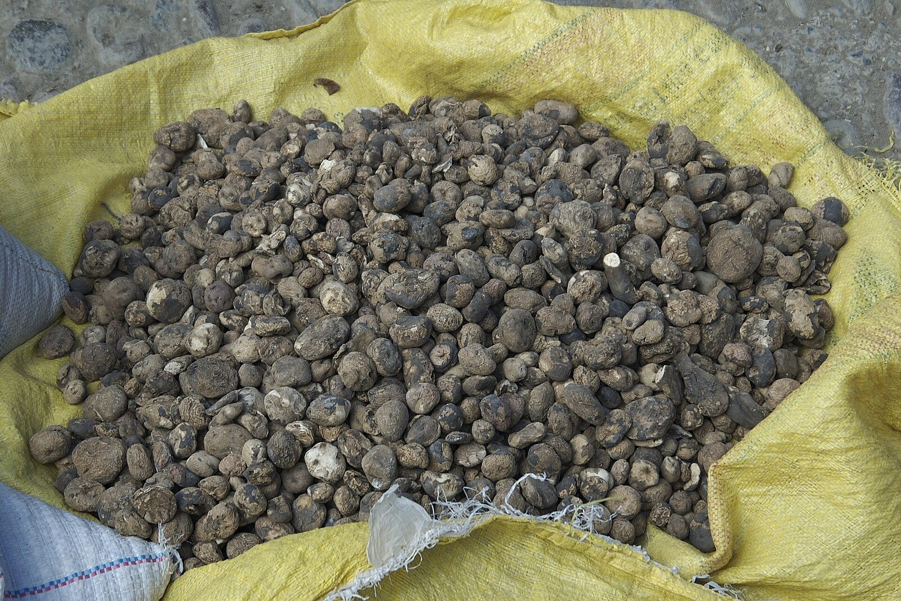
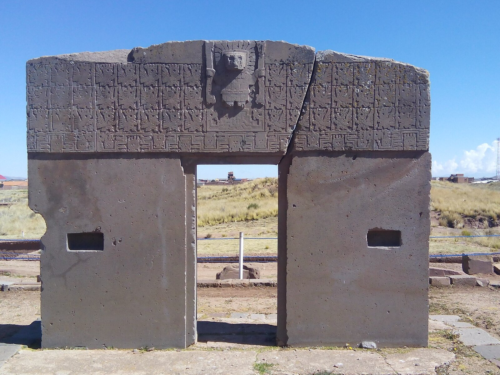
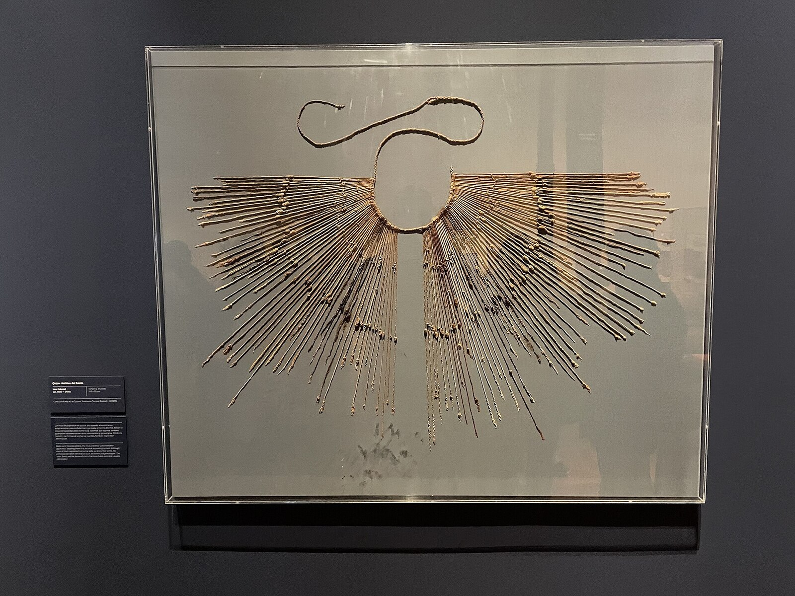
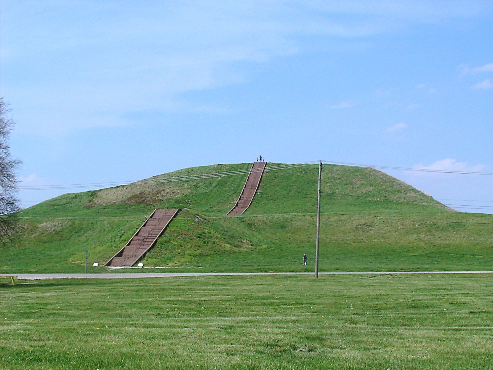
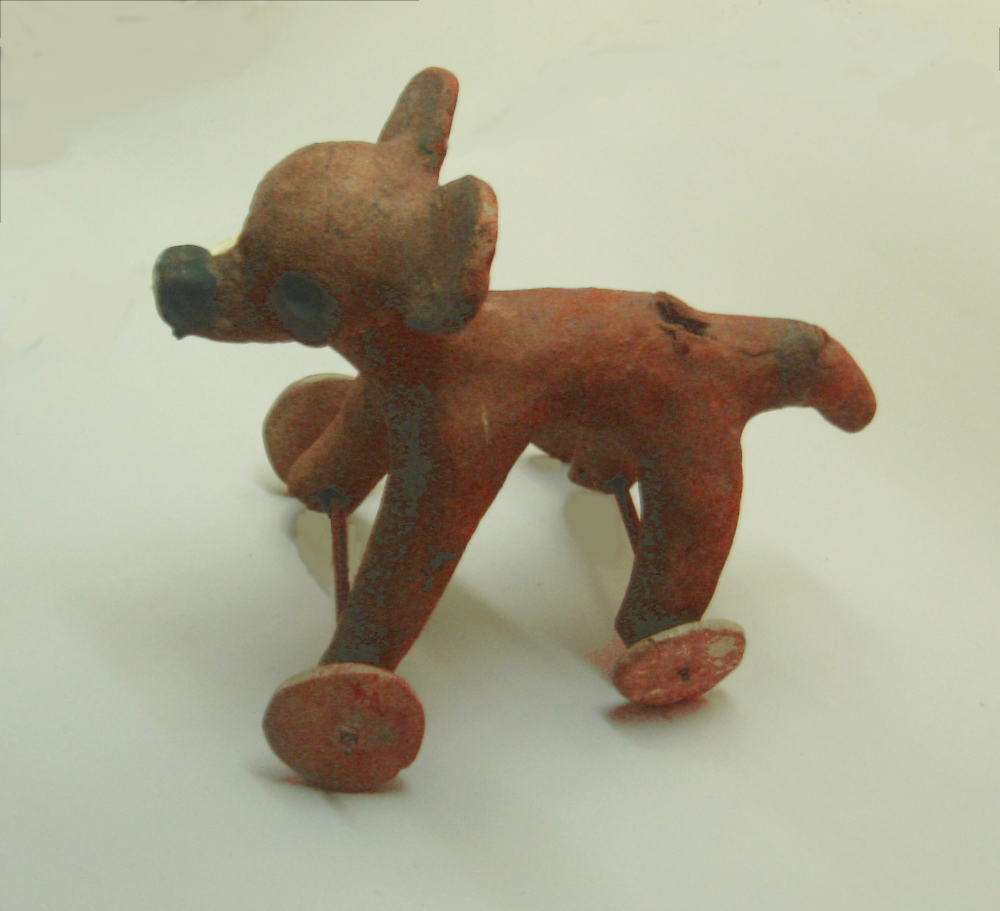

# 39. What was America like before Columbus?

*Central America, the Andes and the Mississippi valley, from about the year 250 to about 1400*

It was full of people. Tens of millions of them lived there, with cities, kings, wars, writing and mathematics of their own, and they had worked all of it out on their own, without horses, cattle, carts or iron.

In a river valley in the east of Guatemala, among banana plantations, stand the ruins of a small city called Quiriguá. Its main square is lined with tall slabs of red sandstone. Each is carved on the front with the figure of a king in an enormous feathered headdress, and down the sides with columns of square signs, each sign a tight knot of faces, hands, animal heads, bars and dots.

For a long time nobody could read the signs. Today they can be read almost as easily as Latin, and on several of the stones they tell the same story. Quiriguá had been a minor town, subject to a much greater city called Copán, fifty kilometres to the south. Its ruler had been installed by the king of Copán and owed him obedience. Then, on a day that the text gives exactly, the ruler of Quiriguá captured his overlord. Six days later he had him beheaded.

The day works out, in our calendar, as the third of May in the year 738. The victorious ruler lived for another forty-seven years. He celebrated by setting up larger and larger monuments, and the tallest of them measures more than ten metres from its top to its buried foot, weighs about sixty tonnes, and is the biggest stone the Maya ever raised.

*Stela E at Quiriguá, Guatemala, the largest stone the Maya ever raised, set up in 771 and now sheltered by a thatched roof. Its carved king and columns of signs face outward. Photo: Arian Zwegers, CC BY 2.0.*

In 738, Charlemagne's grandfather was ruling the Franks, the caliphs of Damascus held an empire from Spain to the Indus, and the Tang court was at the height of its splendour. None of those people knew that the continent where Quiriguá stands existed, and nobody at Quiriguá knew of them. People had first walked into the Americas more than fifteen thousand years earlier, and the sea had then risen behind them. From that time on, the two halves of humanity had gone their separate ways.

*The three regions of this chapter: the Maya lowlands, with Teotihuacan to the west, between about 250 and 900; the Andes, where Wari and Tiwanaku ruled, roughly over the areas shown, between about 500 and 1000; and Cahokia on the Mississippi, built about 1050. Map: drawn for this book; coastlines and rivers from Natural Earth, public domain.*

The reading of the stones is a recent achievement, and it overturned what had been believed about their makers. Until the 1950s, the leading scholars held that the Maya inscriptions concerned nothing but the calendar and the stars. The Maya, in this view, were a peaceful people ruled by priests who spent their nights watching the heavens. A Soviet linguist who had never seen a Maya ruin then showed that many of the signs stood for syllables and spelled out words in a language that was still spoken. A few years later, a Russian-born American researcher noticed that the dates on the stones of one city fell into groups, each of which fitted inside a single human lifetime. The stones recorded births, accessions to the throne, and deaths, and the Maya had been writing history.

When the texts could finally be read through, in the 1980s, the peaceful stargazers disappeared. In their place stood kings with names such as Fire-Burning Sky Lightning God, who made alliances, went to war, and counted their captives.

## Three sisters

The people of the Americas had begun, like everyone else, as hunters and gatherers, and like people in several other parts of the world they had turned wild plants into crops on their own. The most important was maize. Its wild ancestor is a scrubby Mexican grass with a seed head the size of a finger, holding a dozen kernels as hard as gravel. Some nine thousand years of selection by farmers turned that into the cob.

Maize was grown with two companions, in the same field and often in the same hole. The maize stalk gave the bean vine something to climb. The beans, for their part, restored to the soil the nourishment that maize takes out of it. Squash plants spread their broad leaves across the ground between, keeping in the moisture and smothering weeds. Farmers in North America called them the three sisters. A family that ate maize and beans together got nearly everything a body needs.

Maize eaten as the main food, day after day, with little else, leads to a wasting disease, because the body cannot get at one of the vitamins locked in the grain. The cooks of Mexico and Central America soaked their dried maize overnight in water mixed with lime, the white powder made by burning limestone, before grinding it into dough. The lime sets the vitamin free. They knew nothing of vitamins, and they knew that it made the maize taste better and the dough hold together. When Europeans later took maize home and grew it as a poor man's food without the soaking, the disease followed it across southern Europe.

The crops of the Americas were as good as any in the world. Its animals were the weak point, and the difference shaped everything that came after.

When the first people arrived in the Americas, the continents had been home to wild horses, camels and giant ground sloths. All of them died out soon afterwards. What remained offered farmers very little to work with. In the whole of the Americas, people tamed the dog, the turkey, a duck, the guinea pig, and, in the Andes mountains alone, the llama and its smaller cousin the alpaca. None of these could pull a plough, be ridden or be milked.

The consequences ran through daily life. A farmer in Mexico broke the ground with a pointed stick, since without an ox a plough is useless. The Americas had no carts, though people there understood the wheel perfectly well. As the first wagon builders of the Old World had found, a cart is little use without a strong animal in front of it. In Mexico and Central America, every sack of maize, every block of building stone and every load of firewood went on somebody's back, held by a strap across the forehead, or else in a canoe. Armies marched on foot and carried their own food, which kept most campaigns short.

Metal was also put to different uses. The peoples of the Andes and Mexico were fine goldsmiths, and they worked silver and copper. They made ornaments with them, and in the Andes some tools of copper and bronze. Across most of the hemisphere, tools and weapons were of stone, above all of obsidian, a black volcanic glass that can be chipped to an edge sharper than a steel razor. No people of the Americas smelted iron.

## Holy lords

On that foundation, the Maya built one of the most elaborate civilisations of the ancient world, in a setting that looks unpromising. Their heartland was the lowland forest of what is now northern Guatemala, Belize and southern Mexico. It has thin soil over limestone and hardly any rivers, with a dry season several months long.

*The Maya lowlands, roughly, with the cities named in this chapter: Tikal, Yaxchilán on the Usumacinta, Copán and its one-time subject Quiriguá, fifty kilometres apart, and Teotihuacan, a thousand kilometres to the west. Map: drawn for this book; coastlines and rivers from Natural Earth, public domain.*

Between about 250 and 900, that forest held dozens of cities. Each had at its centre a group of plazas, surrounded by steep pyramids of limestone rubble faced with cut stone and white plaster, with a small temple at the top. Beside them stood the palaces of the royal family, and a long narrow court with sloping sides for a ritual game played with a heavy rubber ball.

*Temple I at Tikal in Guatemala, a steep stone pyramid with a small temple on top, built in the 700s. Photo: Raymond Ostertag, CC BY-SA 2.5.*

For generations, archaeologists mapped those city centres and assumed that the forest around them had been thinly peopled. In 2018 an aircraft survey with lasers, of the kind that revealed the outskirts of Angkor, covered two thousand square kilometres of northern Guatemala. Under the trees it found more than sixty thousand buildings that had not been known, together with raised roads, defensive walls, terraced fields and drained swamps. The whole landscape had been built on and farmed. The Maya lowlands at their height probably held between seven and eleven million people.

The Maya had no empire. Every large city was a kingdom of its own, ruled by a dynasty whose king carried the title "holy lord". The stronger kings made vassals of the weaker, as Copán had of Quiriguá, and two great cities in particular built rival networks of client kingdoms that fought each other for centuries. Wars were fought for tribute and for mastery over weaker neighbours, and the greatest prize was to capture the enemy's king or his nobles, to bring them home in triumph, and in the end to sacrifice them.

The holy lord's first duty was to keep the world in order through ritual, and the most important offering was his own blood. A carved stone panel from a city on the western rivers shows how it was done. A king stands holding a flaming torch. In front of him kneels his queen, in a magnificent woven robe, pulling a rope studded with thorns through a hole in her tongue. The blood falls onto strips of bark paper in a basket, which will be burned so that the smoke can carry it to the gods.

*Lintel 24 from Yaxchilán, Mexico, carved about 725 and now in the British Museum. The king holds the torch while his queen pulls the thorned rope through her tongue. Photo: Gary Todd, CC0.*

The Maya were not the largest power of their time in the region. A thousand kilometres to the west, in the high valley where Mexico City now stands, lay a city of a hundred thousand people, laid out on a grid along an avenue about two kilometres long, with a pyramid as broad at its base as the largest in Egypt. Its people lived in walled apartment blocks of stone. Its soldiers or its merchants reached far into the Maya country, and in 378, as inscriptions there record, strangers from the west arrived at the greatest Maya city on the very day that its king died, and put a new dynasty on the throne. That western city left no writing that can be read. Nobody knows what language its people spoke or what they called it. The name by which it is known, Teotihuacan, was given to its ruins by people who came there centuries after it had burned.

*The Pyramid of the Sun and the Avenue of the Dead at Teotihuacan, Mexico, seen from the top of the Pyramid of the Moon. Photo: Arian Zwegers, CC BY 2.0.*

## A shell for nothing

The Maya were obsessed with time. Every day belonged to two cycles at once, one of two hundred and sixty days, which governed ritual and fortune, and one of three hundred and sixty-five, which followed the sun. In addition, for dating the deeds of kings, they kept a running count of every day that had passed since a fixed starting point far in the past, which corresponds to a day in August in the year 3114 before our era. The death of the king of Copán is dated by that count. It took place 1,406,446 days after the beginning.

To write such figures the Maya used a method that will sound familiar. They had three signs. A dot meant one, a bar meant five, and combinations of the two gave every number up to nineteen. For anything larger, they used position. Counting on fingers and toes, they worked in twenties where we work in tens, and each place in a number was worth twenty times the place below it. In the count of days they bent the rule once, making the third place worth eighteen times the second, so that it came to three hundred and sixty days, close to a year. A system of positions needs a sign for an empty place. The Maya had one, a drawing of a shell.

They were using it by the fourth century at the latest, and the count of days it served goes back nearly four hundred years before that. This zero owed nothing to India, of which the Maya had never heard. Two peoples on opposite sides of the world, faced with the same problem, had found the same solution.

With these tools, Maya astronomers followed the sun, the moon and the planet Venus over centuries. One of their tables predicts the appearances of Venus as morning and evening star, and with the corrections that its makers built in, it keeps step with the planet for centuries.

That table survives in a book, a long strip of bark paper coated with plaster and folded like a screen. The Maya had libraries of such books. In 1562 a Spanish friar, who had come to convert them, collected all that he could find in one province, judged them to contain nothing but superstition and the lies of the devil, and burned them in the public square. He recorded that the Maya grieved over it to an astonishing degree. Four of their books are known to exist today.

*The Venus pages of the Dresden Codex, a Maya book made about 1200, in a modern redrawing. Numbers are written with bars and dots, and the shell-shaped sign is the zero. Drawing: Lacambalam, CC BY-SA 4.0.*

## The last date

In the ninth century, the cities of the southern forest fell silent one after another.

The evidence is the dates. A Maya king marked the turning points of his reign with a carved and dated stone. In city after city, the stones stop. At Copán, a monument begun in 822 was left unfinished, with one side carved and the rest barely begun. The last dated inscription from the old heartland was carved in 909. Building work ceased, and the palaces were taken over by squatters who cooked on the floors of the throne rooms. Within about a century and a half, the southern lowlands lost most of their people.

What caused it has been argued over for a century.

One part of the answer is drought. Mud from the bottoms of lakes in the region and stone from the floors of caves preserve a record of rainfall, year by year. They show that between about 800 and 1000 the region suffered the worst series of dry spells in two thousand years. The Maya of the forest had no great rivers and depended on rain collected in reservoirs. A few failed rainy seasons in a row left a city of fifty thousand without drinking water.

Another is war. In the last century of the inscriptions, the fighting grows more frequent and more destructive. At one city, the inhabitants pulled the facing stones off their own temples and palaces to throw up a wall across the main plaza, and were overrun all the same.

A third is the land. Millions of people had cleared the forest for fields and for fuel. Making the lime plaster that coated every building and plaza took enormous quantities of firewood. Bare slopes lose their soil, and cleared land holds less moisture.

These explanations support one another. A crowded country with worn-out soil had little to spare when the rains failed. Hunger led to war over what remained. Belief played its part as well. The holy lords had claimed that their rituals kept the rain falling and the maize growing. When the rain stopped, and neither their blood nor that of their captives brought it back, people ceased to feed them, and walked away.

The word "collapse" hides the most important point. The cities of the south were abandoned. The Maya were not. Many moved north, where other Maya cities flourished for centuries longer, and when the Spanish arrived they found Maya kingdoms that fought them hard. The last of them held out until 1697. More than six million people speak Maya languages today, and many of them farm maize, beans and squash in the country of their ancestors.

## Potatoes left out in the frost

Five thousand kilometres to the south, a completely separate group of civilisations had grown up in a setting unlike any other on earth.

The western edge of South America rises from one of the world's driest deserts on the Pacific shore to peaks more than six thousand metres high, and falls on the far side into the Amazon rainforest. In a hundred and fifty kilometres a traveller passes through a dozen climates, stacked one above another. The peoples of the Andes used all of them. A single community would keep fields at several heights, with maize in the warm valleys, potatoes on the cold slopes above, and herds of llamas on the high grassland where nothing grows but grass.

They had bred the potato from a bitter wild root into thousands of varieties, and they invented a way of preserving it that uses the mountain climate as a machine. In the high country in winter, nights freeze hard and days are sunny and dry. Farmers spread small potatoes on the ground and left them out. They froze at night and thawed in the morning, and the families then trampled them with bare feet to squeeze out the water. After several days of this, the potatoes had shrunk into light, hard lumps like pebbles of chalk, which would keep for ten years in a storehouse.

*Chuño, the freeze-dried potatoes of the Andes, for sale at a small market in Paucartambo, Peru. Photo: Eric in SF, CC BY-SA 3.0.*

Freeze-dried potatoes, with strips of dried llama meat, were the stored wealth of the Andes, as grain was the wealth of Iraq. They could feed an army, a gang of labourers, or a whole district in a bad year. The llama carried them. It is a small relative of the camel that can bear thirty kilograms or so along a mountain path, and it cannot be ridden or harnessed to anything. Caravans of several hundred, with a few herders, linked the coast, the mountains and the forest.

Large states arose on this basis long before the famous empire of the Incas. Between about 500 and 1000, one of them, Tiwanaku, was centred on a city of stone temples beside Lake Titicaca, nearly four thousand metres above the sea. Another, Wari, built roads and provincial centres across the mountains of Peru, with rows of storehouses at each.

*The Gate of the Sun at Tiwanaku in Bolivia, from the city beside Lake Titicaca at its height, between about 500 and 1000. The carved figure above the doorway is flanked by rows of smaller figures. Photo: Sasha India, CC BY 2.0.*

Those states were administered without writing. No Andean people is known to have written down its language. They kept their records on strings.

The device is best known from the last and largest of the Andean empires, though older examples survive. It consisted of a main cord, from which hung dozens or hundreds of thinner cords of spun cotton or wool, dyed in different colours. Knots were tied along each hanging cord, and the knots recorded numbers by position, in tens. A cluster of knots near the bottom of the cord gave the units, a cluster higher up the tens, and a third the hundreds. A gap where a cluster ought to be meant nothing. The colour of the cord, and its place in the row, showed what was being counted, whether llamas, loads of potatoes or men owing labour.

*A khipu in the Museo de Arte de Lima, Peru: a main cord with many hanging cords, each tied with knots that stand for numbers. Photo: TaphonomyMan, CC BY-SA 4.0.*

Scholars worked out the numbers a century ago, and they can read the totals on the fourteen hundred or so examples that survive. Some of the cords record things other than numbers, possibly names and places, and nobody has yet read those. The officials who made them could keep the accounts of a state of several million people with a bundle of string.

## Fifteen million baskets

Maize spread slowly northward from Mexico, and by about the year 900 the farmers of the Mississippi valley were growing it as their main crop. A century and a half later, a city appeared there.

It stood on the rich flood plain of the river, across from the site of the modern city of St Louis. About the year 1050, within a single generation, a scattering of villages was levelled and rebuilt to a plan. At the centre was a rectangular plaza the size of thirty-five football fields, made perfectly flat. At its northern end rose a platform of earth with four terraces, thirty metres high. Its base covers more ground than the Great Pyramid of Egypt. Around it stood more than a hundred smaller mounds. Some carried the wooden houses of chiefs and temples on their flat tops, and others covered burials. Ten or twenty thousand people lived in the city and its suburbs, which was about as many as London held at the time.

*Monks Mound at Cahokia, Illinois, the great earth platform built about 1050 and after. The wooden stairs are modern, on the line of the old ones. Photo: Skubasteve834, CC BY-SA 3.0.*

All of that earth was dug with hoes of stone and shell and carried in baskets on people's backs. The great mound alone took something like fifteen million basketloads.

The builders left no writing, and even their name for their city is lost. It is called Cahokia, after a people who were living nearby six hundred years later. What they believed has to be read from what they buried. In one small mound, archaeologists found a man and a woman laid among twenty thousand shell beads. Around them lay the offerings that went with them. They included heaps of finely made arrowheads, sheets of copper and mica brought from a thousand kilometres away, and, in a pit nearby, the bodies of more than fifty young women who had been killed and buried in neat rows at the same moment.

Cahokia lasted about three centuries. In its later years it was surrounded by a wall of some twenty thousand logs, which was rebuilt several times. By 1350 the place was empty. Why it emptied is still argued over. Floods, dry years, quarrels within the city and the pull of better land elsewhere have all been proposed. No town north of Mexico grew as large again for more than four hundred years.

## A toy on wheels

The Americas are the nearest thing that history offers to a second run of an experiment. People there started from the same beginnings as people everywhere else, with stone tools, fire and a few wild plants, and for fifteen thousand years they had almost nothing to do with the rest of humanity. They went on to farm and to build cities, and they came to obey kings who claimed the favour of the gods. They taxed one another in maize and labour, kept accounts, raised monuments, and worked out a calendar and a sign for nothing. They also cut down their forests and fought wars over the consequences. All of it had been done in Iraq, Egypt and China, by people they had never heard of.

Most of the differences between the two worlds came down to animals. The people of the Americas had never lived among herds of cattle, pigs and sheep. Many of the worst infections of the Old World had first passed to humans from such herds, and had then circulated in its crowded towns for thousands of years. None of them had reached the Americas, and nobody there had ever been exposed to them. They had never seen an animal carry a man into battle.

In museums in Mexico there are small figures of baked clay, between twelve and fifteen hundred years old, that were found in graves on the coast of the Gulf. They are dogs and jaguars, the size of a child's hand. Each stands on four clay discs, fixed to wooden axles that have long since rotted away, so that it could be pulled along the ground on a string.

*A clay dog on wheels, probably from Veracruz, Mexico, with black tar on its nose and eyes. The makers knew the wheel but had no animal to pull a cart. Photo: Madman, CC BY 2.5.*