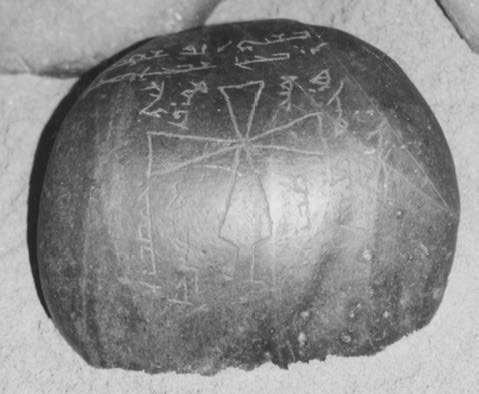
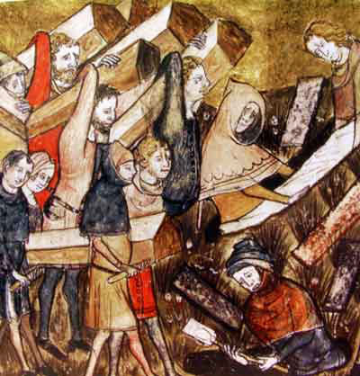
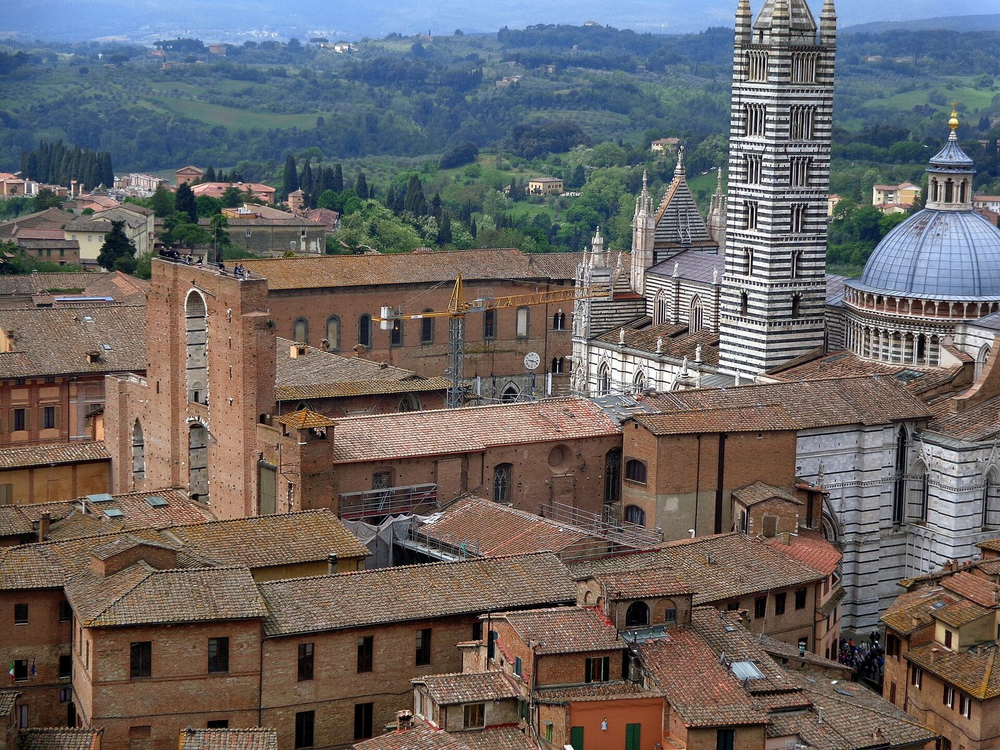
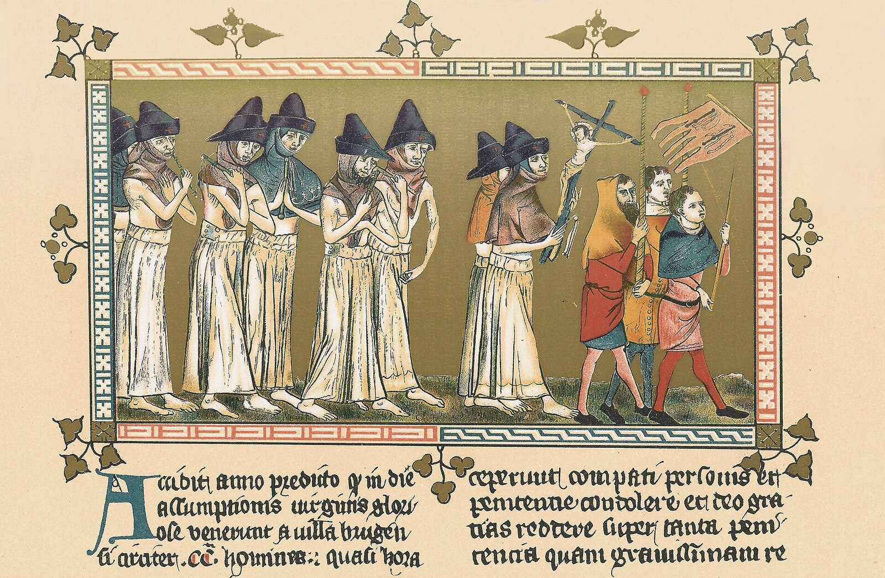
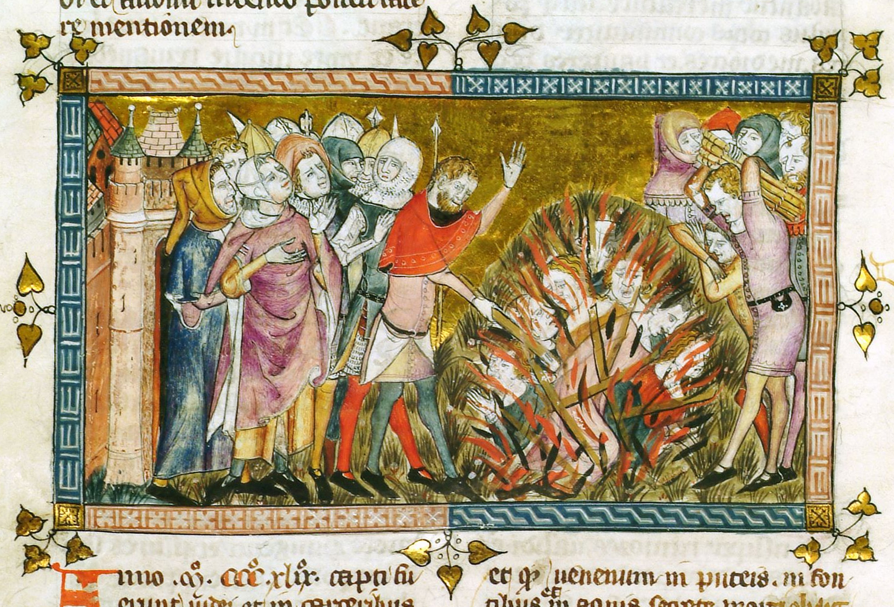
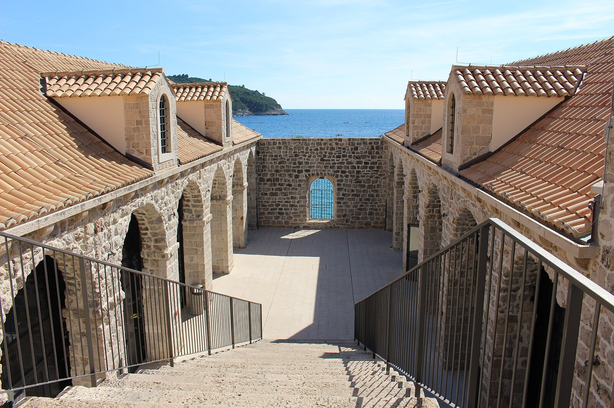
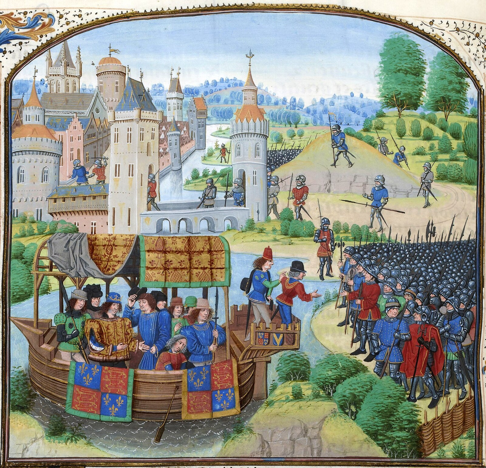
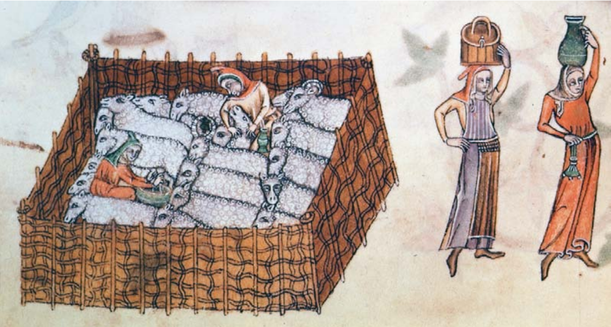

# 41. What did the Black Death change?

*Central Asia, Europe and Egypt, from 1338 to about 1500*

It killed between a third and a half of the people of Europe and the Middle East in about five years, and that made the survivors scarce. Where landlords had to compete for working people, as in England, scarcity made those people richer and freer. Where the landlords could close ranks, as in Egypt, it made the whole country poorer.

In the 1880s, Russian archaeologists dug up two old cemeteries near Lake Issyk-Kul, a large mountain lake in what is now Kyrgyzstan. The graves belonged to a community of Christians who had lived there under Mongol rule, beside one of the roads that crossed Asia. Each grave was marked with a stone, scratched with a cross and a few lines in Syriac, the church language of eastern Christians.

Most of the stones gave a name and a year. The archaeologists noticed that the years were not spread evenly. Of the stones that carried a date, about a quarter came from just two years, 1338 and 1339. Ten of those stones also gave a cause. One of them reads: "This is the tomb of the believer Sanmaq. He died of pestilence."

*A gravestone from Kyrgyzstan with a cross and Syriac writing, from the 1200s or 1300s. Photo: unknown author, public domain.*

For more than a century nobody could say which pestilence it was. Then, in 2022, a team of scientists took teeth from seven of the skeletons, which had been kept in a museum in St Petersburg, and searched them for traces of the microbes that had been in the blood when these people died. In three they found the plague bacterium. It was a particular form of it, and that form turned out to be the direct ancestor of the strain that broke out on the Black Sea eight years later and went on to Europe.

The villagers by the lake were among the first victims of the greatest disaster in recorded history. Their killer was about to travel the length of the roads that the Mongols had made safe.

## Twelve galleys

Plague is at home in wild rodents, such as the marmots of the Central Asian mountains, and it is carried between them by fleas. A flea that bites an infected animal takes in the bacteria with the blood. Now and then the disease spills over into rats, which live in houses, barns and ships. When the rats die, their fleas go looking for the nearest warm body.

In a human being, the bacteria travel from the bite to the nearest gland, in the groin, the armpit or the neck. The gland swells into a hard, agonising lump the size of an egg. Fever and vomiting follow. In those years, more than half of those who caught the disease were dead within a week. If the infection reached the lungs, the victim began to cough, and the people nursing him caught the disease from the cough. In that form almost nobody survived.

The disease moved slowly while it travelled by land. By 1346 it had reached the Mongol lands north of the Black Sea, where Italian merchants kept trading posts. From there it took to the water, and everything changed, because a ship is a warm wooden box full of grain, rats and men, and it moves faster than news.

In October 1347, twelve galleys from the east put in at Messina in Sicily. A friar who recorded their arrival wrote that the sailors carried the sickness "in their bones". The people of Messina drove the ships out of the harbour within days, and it made no difference. By that autumn the plague was already in Constantinople and in Alexandria, the great port of Egypt. In the first months of 1348 it was in Marseille, Venice and Pisa, and it then moved inland along the roads and rivers.

It reached Florence in the spring of 1348, Paris in the summer, and a small harbour on the south coast of England around midsummer. In 1349 a ship carried it across the North Sea to Norway. By 1353 it had come round in a great circle to Moscow, and there, for the moment, it burned out.

*The spread of the plague, with the year it reached each place, from Lake Issyk-Kul, far to the east, in 1338 to Moscow in 1353. The solid arrows show it travelling by sea from the Black Sea ports, and the dashed arrow its arrival overland from Central Asia. Siena, Strasbourg and Ragusa are marked without a year. Map: drawn for this book; coastlines and rivers from Natural Earth, public domain.*

In those five or six years, somewhere between a third and a half of the people of Europe and the Middle East died. It is hard to hold a number of that kind in the mind. A modern equivalent would be a disease that killed a hundred and fifty million Americans, or four billion people worldwide, before the end of the decade.

## Like lasagne

Florence was one of the largest cities in Europe, and it lost more than half its people between March and September. A citizen who lived through it described what was done with the dead once the churchyards were full. Great pits were dug down to the water. Each morning the bodies collected in the night were laid in a row at the bottom, and a little earth was shovelled on top. The next day another row was added, and more earth. He compared it to the way lasagne is made, with layers of pasta and cheese.

*Burying plague victims at Tournai, in what is now Belgium, in a miniature from the chronicle of the abbot Gilles Li Muisis, who lived through the plague and died in 1352. Illuminator: unknown, public domain.*

In the nearby city of Siena, a man who kept a chronicle wrote that he had buried his five children with his own hands. Siena had been building an enormous new cathedral, so large that the existing one was to become just one of its arms. The plague killed the masons and the money. Within a few years the project was given up, with the tall front wall and a few arches standing.

*The unfinished nave of the new cathedral of Siena. Its tall wall, on the left, still stands beside the striped cathedral that was built instead. Photo: Superchilum, CC BY-SA 4.0.*

People had no means of knowing what was killing them. Nobody connected the disease with rats or fleas, and nobody would for another five hundred and fifty years. The king of France asked the professors of medicine at Paris for an explanation. They reported that Saturn, Jupiter and Mars had come together in the sky three years before, and that this had drawn up poisoned vapours from the earth. Most doctors agreed that the cause was bad air, and they advised people to burn sweet-smelling wood and carry flowers.

Others looked for a cause closer to hand. Many believed that God was punishing the world for its sins. In Germany and the Low Countries, companies of men walked from town to town for thirty-three days at a time, one day for each year of Christ's life, and whipped their own backs bloody in the market squares, in the hope of turning the anger aside.

*Flagellants walking in procession at Tournai in 1349, from a chronicle miniature as reproduced in a printed book of 1902. Artist: Pierart dou Tielt, public domain.*

Still others decided that the disease was a crime, and that somebody had poisoned the wells. They accused the Jews. Under torture, Jews in the lands around the Alps confessed to whatever was put to them, and the confessions were sent ahead from town to town. In February 1349, before the plague had even reached the city, the people of Strasbourg burned their Jewish neighbours on a wooden platform in the cemetery. A local chronicler put the number at about two thousand. The pope pointed out that Jews were dying of the plague like everyone else, and that it raged in places where no Jews lived. It did little good. Hundreds of Jewish communities along the Rhine were destroyed, and the survivors moved east, into Poland.

*The burning of Jews during the plague, in a miniature from the chronicle of Gilles Li Muisis, made at Tournai about 1352. Artist: Pierart dou Tielt, public domain.*

A few towns stumbled on something that helped. The port of Ragusa, now Dubrovnik, on the coast of Croatia, lived by its shipping and could not afford to close its harbour. In 1377 its council ordered that anyone arriving from an infected place must first wait for thirty days on an island offshore. Venice adopted the rule and lengthened the wait to forty days. The Venetian word for forty days, *quarantena*, has been in use ever since.

*The Lazareti, the quarantine buildings of Dubrovnik, on the Adriatic coast. They came long after the first rule of 1377, which sent arrivals to wait on an island. Photo: Marko Jukic, CC BY-SA 4.0.*

The plague did not go away. It came back in 1361, when it killed so many children that people called it the children's plague, and after that most regions of Europe and the Middle East were struck again every decade or two, for more than three centuries. As a result, the number of people did not recover. In 1450 there were still far fewer Europeans than there had been in 1340.

## Eight pence and his dinner

When the dying stopped, the survivors walked out into a different world, and in England the difference showed first in the harvest of 1349.

England before the plague was crowded. About five million people lived on what the land could grow, and there were more hands than work. Most of them were peasants who held a small farm from a lord, and roughly half of those peasants were serfs. A serf could not leave the village without his lord's permission. He owed the lord several days of unpaid work every week on the lord's own fields, and more at harvest. He paid a fee to marry off a daughter, and when he died his best animal went to the lord.

The lords were able to demand all this because land was scarce and people were plentiful. A serf who ran away had little to gain, since most villages already had more labourers than they needed.

Within eighteen months, half of those five million people were dead. The land, however, was all still there, and so were the animals, the ploughs and the mills. A chronicler in the Midlands described sheep and cattle wandering through the standing corn with nobody to drive them off. The crops that year rotted in the fields for want of people to cut them. Reapers now refused to stir, he complained, for less than eight pence a day and their dinner, which was about three times what the law would soon lay down as a proper wage.

The lords were horrified, and the king's council acted with remarkable speed. In June 1349, with the plague still raging, it issued a law. Every able-bodied man and woman under sixty who had no land or trade of their own had to accept work when it was offered. They had to accept it at the wages that had been usual before the plague, and a later version of the law listed those wages trade by trade. Any employer who paid more was to be fined as well. Special judges were sent round the counties to enforce it, and in some years they fined thousands of people.

For a generation the law held wages back a little. In the long run it failed, and the reason is that the people breaking it included the lords themselves. A lord with a ripe field and nobody to cut it had a simple choice. He could obey the law and lose the crop, or he could quietly offer a little more than his neighbour, in cash, or in food and clothing. Labourers soon learned that if one lord would not pay, the lord in the next valley would, and would ask no questions about where they came from.

The serfs learned the same lesson. Farms stood empty in every village. A serf who slipped away at night could walk twenty kilometres and be welcomed by another lord as a free tenant, at a low rent, on good land. His old lord could take him to court if he could find him. In practice a lord who wanted to keep his tenants had to offer them something, and so, one village at a time, the days of unpaid work were dropped in return for a money rent.

## When Adam delved

The rulers of England kept trying to push things back to the way they had been. Parliament passed the labour law again and again. In 1363 it even passed a law about clothes, which laid down that ploughmen and herdsmen were to wear only coarse cloth, because servants had begun to dress like their betters.

The breaking point came over a tax. In 1380, to pay for a war with France, the government demanded a tax that worked out at a shilling for every adult in the country, servants and ploughmen included. The rich of each village were supposed to help the poor to pay, and often did not. For a labouring family it could mean a week's wages. Many villages simply hid their people from the collectors, and when officers were sent to find them, the south-east of England rose.

In June 1381, tens of thousands of country people marched on London from Kent and Essex. A priest who marched with them preached on a rhyme that every one of them knew: "When Adam delved and Eve span, who was then the gentleman?" In the Garden of Eden, he meant, there had been a man digging and a woman spinning and no lords at all.

The rebels were let into the city by sympathisers. They burned the palace of the king's uncle and broke open the prisons, and they found the archbishop of Canterbury, who was the head of the government, and cut off his head. They also burned records. In village after village that summer, people broke into the manor house and destroyed the rolls of parchment on which their duties as serfs were written down.

The king, Richard II, was fourteen years old. He rode out to meet the rebels and promised them what they asked: that there should be no more serfs in England, and that land should be rented at a low fixed price. The next day, at a second meeting, the mayor of London stabbed the rebels' leader. The crowd was talked into going home. Within weeks the promises were withdrawn and the leaders were hanged.

*Richard II meeting the rebels of 1381, in a miniature made in the 1400s for Jean Froissart's chronicle. Illuminator: unknown, public domain.*

The rising had failed, and the serfs were freed all the same. The force that was freeing the serfs was not a rebellion that could be put down. It was the plain fact that there were too few of them, and that fact did not change. Over the next two or three generations, the lords of England gave up trying to farm with forced labour. They rented their fields out for cash instead, or turned them over to sheep, which need only a shepherd and a dog. No law ever abolished serfdom in England. By 1500 it had simply almost disappeared.

*A sheep pen in the Luttrell Psalter, a prayer book made in Lincolnshire between 1325 and 1335. Illuminator: unknown, public domain.*

Meanwhile, the ordinary English family ate and lived better than ever before. A poet of the time grumbled that labourers now turned up their noses at yesterday's vegetables and cheap beer, and insisted on fresh meat or fried fish, served hot. He was right about the meat. It took a generation, because at first prices rose as fast as pay. By the middle of the 1400s, however, a building labourer's daily pay bought about twice as much food as it had before the plague. Working people in England would not be so well paid again for four hundred years.

## The dikes of the Nile

The plague came to Egypt in the same autumn it came to Sicily, and it killed on the same scale. Cairo was the largest city around the Mediterranean, and one of its historians wrote that the streets fell silent and the dead were carried out on planks, ladders and shop shutters when the coffins ran out. If scarcity alone made workers rich, the peasants of Egypt should have done as well as the peasants of England. Instead they did worse, and so did everyone else.

The reason begins with water. Almost no rain falls on Egypt. Everything depends on the Nile, which rose every summer and flooded the valley. To use the flood, the Egyptians had divided the whole valley into great basins with walls of earth. As the river rose, canals let the water into each basin, where the dikes held it standing over the fields for about forty days while the mud settled. It was then let out again, and the crop was sown in the wet ground.

It was some of the richest farmland on earth, and it needed constant work. Every year the canals filled with silt and had to be dug out, and the dikes were washed thin and had to be built up again. The work had to be finished across the whole country before the next flood. Tens of thousands of villagers were called out to do it every winter, without pay. The survivors of a plague could not simply farm half as much. A dike was just as long whether ten families lived behind it or a hundred, and the canal that fed one basin also fed every basin farther along. If a dike failed, the water ran away, and all the fields behind it stayed dry.

Egypt's landlords were also of an unusual kind. The country was ruled by the Mamluks, the caste of soldiers, bought as boys from the steppe, who had stopped the Mongols in Palestine. Each officer was paid by being given the taxes of certain villages. He did not own those villages, however, and he could not pass them to his son. He lived in Cairo with his regiment, he might be moved to different villages after a few years, and he usually never saw the places that fed him. His agents collected a fixed amount, and that was the end of his interest.

When the plague emptied the villages, an English lord faced his tenants across his own fields, and competed with the lord next door. A Mamluk officer faced nobody. He sent his agent to collect the usual sum from a village with half its people, and the officers acted together, as a single ruling class, to see that it was paid. The survivors could not pay it, and they could not keep up the dikes either. Many fled to Cairo, which made matters worse for those who stayed.

So the system began to come apart. Year by year, dikes went unrepaired and canals silted up. Land that had grown wheat and flax turned to marsh in one place and to dust in another, and herders moved their flocks onto it. A century and a half after the plague, the land tax of Egypt brought in a fraction of what it had before. Historians still argue over how the ordinary Egyptian worker fared in between, and some find that wages in Cairo rose for a time, as they did in England. They agree that the country as a whole grew poorer. Less land was farmed, less sugar and cloth were made, and Egypt, which had been the richest country of the Mediterranean, never regained that place.

## Who could walk away

The disease was the same in both countries, and both lost a great part of their people. What differed was who held power over the survivors, and what the land needed.

English farming was done on fields watered by rain. Half the people could farm half the land and leave the rest for sheep, and nothing broke. English lords were many and they were rivals, and each of them lived on his own estates and wanted them full. A peasant could therefore play one against another. The king's law stood against him, and it could not be enforced against a whole class of employers who were quietly breaking it.

Egyptian farming was a single machine, and it needed a full crew. The men who lived off it were a small, united group with an army, who had no stake in any one village and nowhere else to turn for their income. Faced with fewer workers, they squeezed, and the machine ran down. An Egyptian villager could run away, and many did. What he could not do was find a rival landlord in the next valley who would offer him better terms, because all the landlords belonged to the same army.

England and Egypt were the two ends of a range. In eastern Europe, in the lands that are now Poland and eastern Germany, the lords were strong and the towns were weak, and there the nobles answered the shortage by tying the peasants to the soil more tightly than before. Serfdom in Russia was only beginning in these centuries, and it lasted until 1861. The plague did not decide who would be free. It made labour precious, and left each society to settle who would collect the value.

In Siena, the front wall of the cathedral that was never finished is still standing. It rises on one side of an open square where the body of the church was meant to be, with tall empty windows that frame the sky, and tourists climb it for the view.
