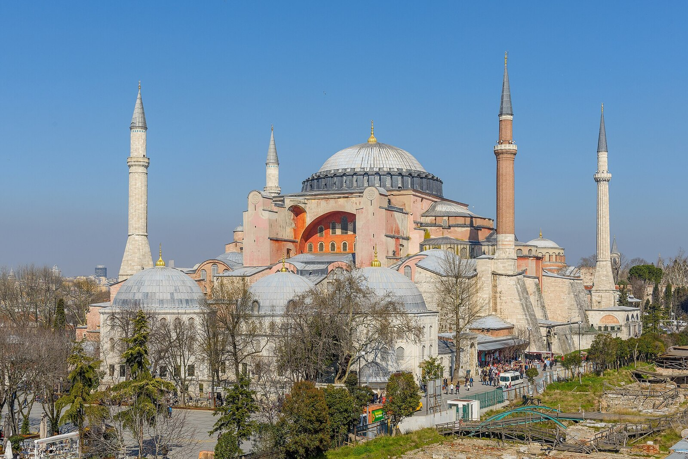
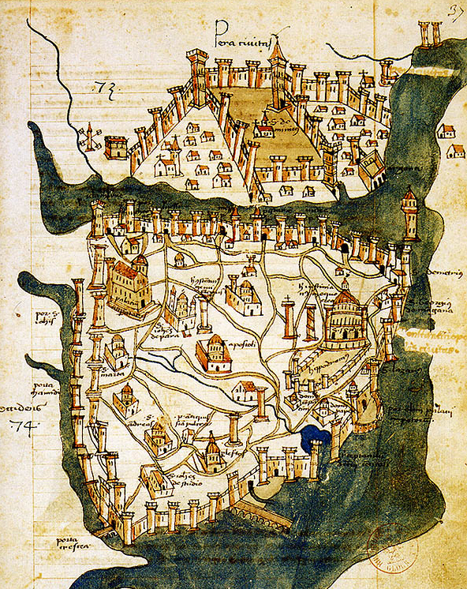
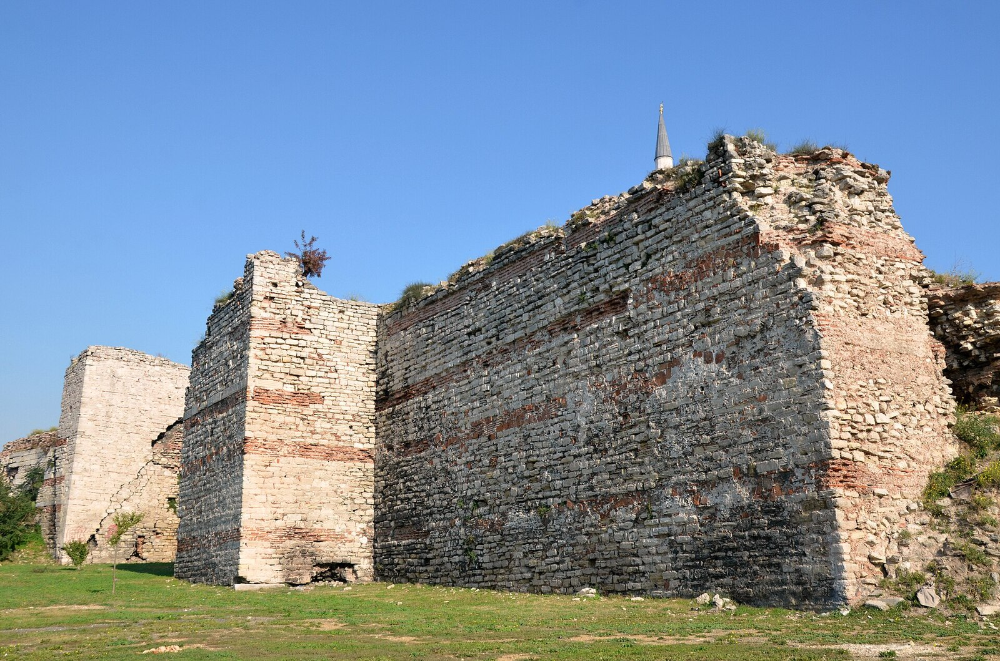
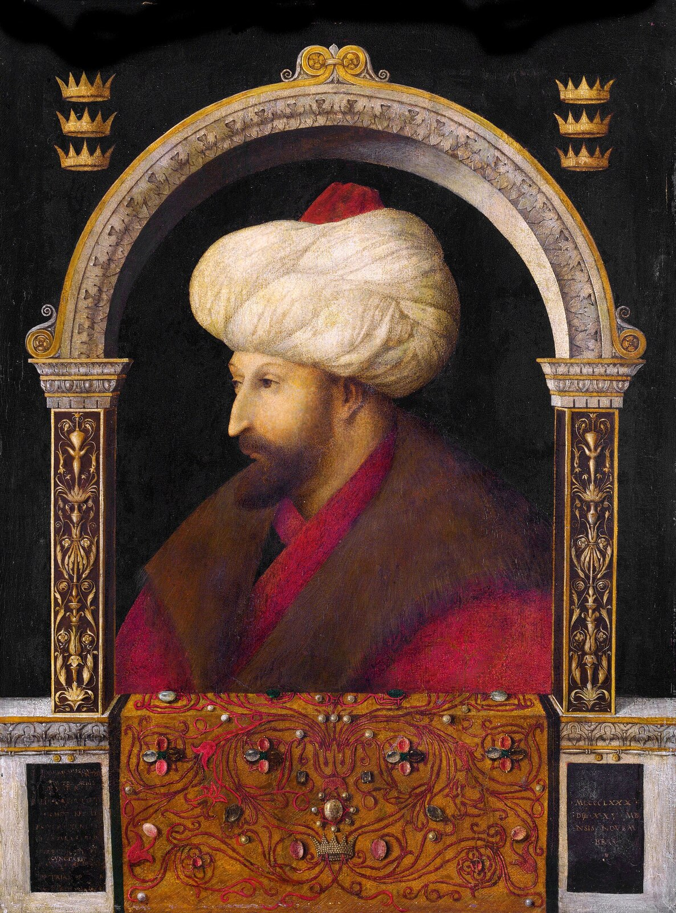
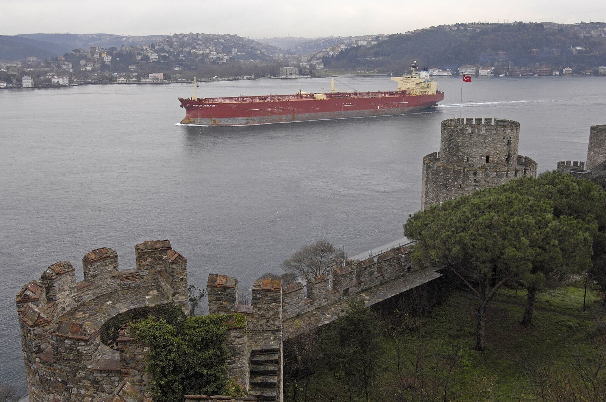
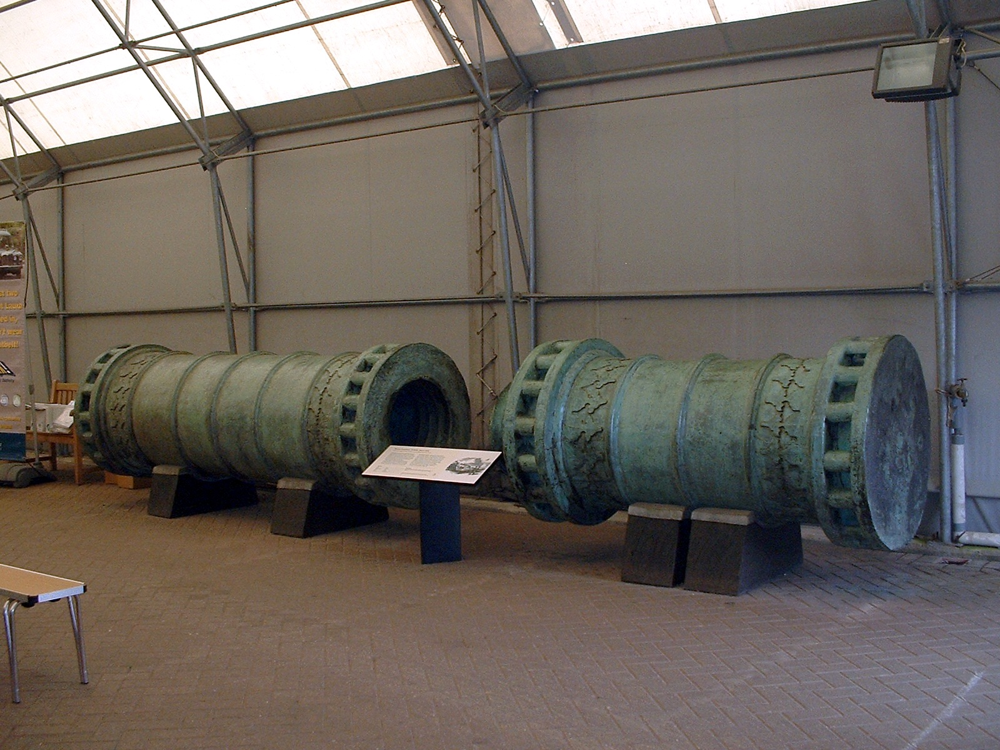
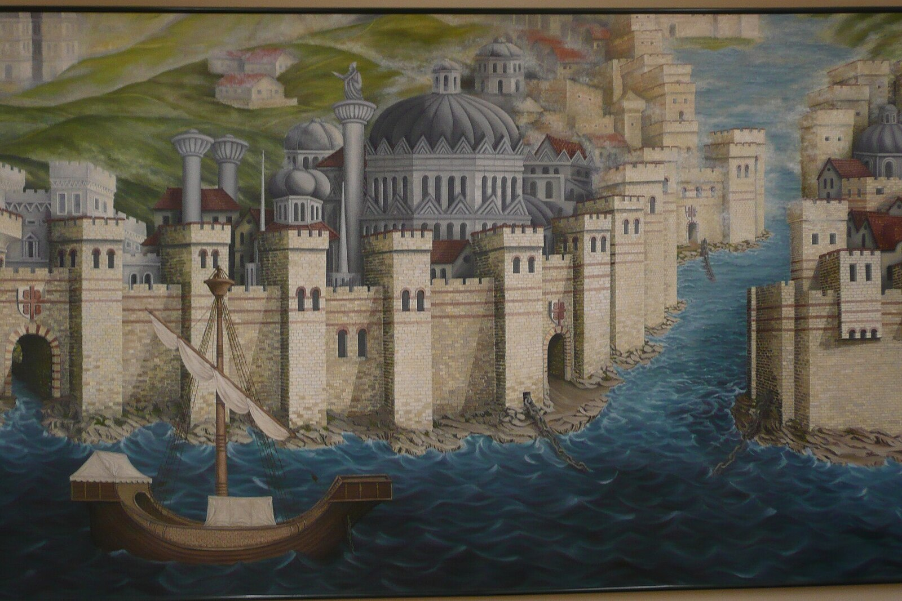
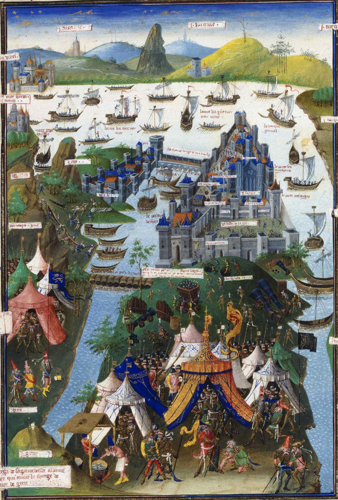

# 42. Why is Constantinople called Istanbul?

*Constantinople and the Ottoman lands, from about 1300 to 1481*

Istanbul was the city's everyday name long before it was the official one. The word is Greek, from a phrase meaning "to the city", and the people of the region had used it for centuries. It became the name the whole world uses because in 1453 a Turkish sultan broke the city's walls with cannon, filled it with his own subjects and made it the capital of a Muslim empire.

Some time before 1452 a man named Orban came to Constantinople looking for work. He was a Hungarian, and his trade was casting cannon out of bronze. He offered his services to the emperor, Constantine XI, who was glad to have him and promised him a salary.

The salary was small, and it was not paid. The emperor of the Romans, heir to Augustus and to the first Constantine, did not have the money. In 1452 Orban left the city and went to the court of the Ottoman sultan, a young man of twenty named Mehmed.

Mehmed questioned him closely. He wanted to know whether Orban could cast a gun that would throw a stone large enough to bring down the walls of Constantinople. Orban replied that he could make one to shatter the walls of Babylon itself. The sultan gave him four times what the emperor had promised, along with a supply of bronze, and told him to start.

Guns had been firing in Europe and the Middle East for more than a century by then, and they had already knocked down a good many castles. Nobody had yet brought guns of real power against the great wall of Constantinople.

## A head without a body

The city that Orban left was the capital of what remained of the Roman empire. It had been the capital of the eastern half for eleven hundred years, and for most of that time it had been the largest and richest city in the Christian world, with perhaps half a million people. Its church of Holy Wisdom, Hagia Sophia, was the largest church in the world.

*Hagia Sophia in Istanbul today, a church for about 900 years before 1453 and a mosque afterwards. Photo: Arild Vågen, CC BY-SA 3.0.*

By 1450 very little of that was left. The empire had been shrinking for four hundred years, pressed by Turkish horsemen in the east and by rivals in the Balkans. The worst blow had come from fellow Christians. In 1204 an army of crusaders from western Europe had stormed the city, robbed it and held it for almost sixty years, and it never recovered.

The emperor now ruled the city itself, a few nearby towns and a distant corner of southern Greece. About fifty thousand people lived inside walls made for ten times as many. Whole districts had fallen into ruin, and between the surviving neighbourhoods lay orchards, wheat fields and vineyards. A visitor described it as a city of villages. Almost everything around it for hundreds of kilometres belonged to the sultan.

*Constantinople in 1422, drawn about thirty years before the siege by the Florentine Cristoforo Buondelmonti. Galata is at the top. Map: Cristoforo Buondelmonti, public domain.*

What the city still had was its position and its walls. It stood on a triangle of land with water on two sides. To the south was the Sea of Marmara. To the north was a long, narrow inlet called the Golden Horn, which was its harbour. Walls ran along both shores.

The third side, the one facing the land, was closed by the wall that had kept the city safe for a thousand years. An attacker came first to a ditch twenty metres wide. Behind it stood a low wall, behind that a higher one, and behind that a third, twelve metres high and five metres thick, with ninety-six towers. Each line overlooked the one in front, so that archers on all three could shoot at the same enemy. More than twenty armies had camped before it over the centuries, among them Avars, Persians, Arabs, Bulgars and Russians, and none had broken through. Even the crusaders had got in from the harbour side.

*A stretch of the land wall of Constantinople, built about 1,600 years ago and still standing in Istanbul. Photo: Carole Raddato, CC BY-SA 2.0.*

## The throat-cutter

The Ottomans took their name from a man called Osman, who around 1300 led a small band of Turkish warriors in the hills of north-west Anatolia, a few days' ride from Constantinople. There were a dozen such bands. Osman's happened to sit closest to the weak Roman frontier, which made it the best place for an ambitious fighter to win land and loot, and so recruits came to him.

His descendants were capable and lucky. Within fifty years they had crossed the narrow straits into Europe. Within a hundred they held most of the Balkans and most of Anatolia, and they ruled millions of Christians as well as Muslims. They had also built something very rare in the Europe of that time, a permanent infantry paid by the treasury. These were the janissaries, raised from boys taken from Christian villages, converted to Islam and trained from childhood to serve the sultan alone.

This empire had an awkward shape. Half of it lay in Europe and half in Asia, and the two halves were joined at the straits. In the middle, exactly at the crossing, sat Constantinople. An Ottoman army moving from one half to the other had to be ferried over the water, and a Christian fleet based at the city could cut the crossing. Several sultans had tried to take the city and failed. Each time, the walls had held and ships had brought food.

Mehmed had been set on the throne once as a boy of twelve, and removed again. He became sultan for good in 1451, at eighteen. He was clever and secretive, and he read history, including the life of Alexander. His father's old advisers thought an attack on the city would unite the Christian kings against them, and told him so. He seems to have decided on it at once.

*Mehmed II, painted in 1480 by the Venetian artist Gentile Bellini, who was invited to his court. Painting: Gentile Bellini, public domain.*

He began with the water. North of the city, the strait called the Bosphorus leads up to the Black Sea, and through it came the grain that fed Constantinople. At its narrowest point it is about seven hundred metres across. There was already an Ottoman castle on the Asian bank. In the spring of 1452 Mehmed brought some six thousand workmen to the European bank, directly opposite, and built a second in just over four months.

*Rumeli Hisari, the Throat-Cutter, on the Bosphorus, built in 1452. The far bank is Asia. Photo: Dosseman, CC BY-SA 4.0.*

He put cannon on the shore below it and announced that every ship would stop and pay a toll. In November a large Venetian ship tried to run past. A single stone ball sank it. The sailors who reached the shore were beheaded, and the captain was impaled on a stake. The Turks called the new castle the Throat-Cutter.

## Sixty oxen

Meanwhile, at the Ottoman capital of Edirne, Orban was making his gun.

A large cannon of that age was cast in one piece, in the way a church bell was cast, and Orban's was the largest anyone had attempted. First his men built a core of clay, shaped like the inside of the barrel, and stood it on end. Around it they built an outer shell of clay, braced with iron and timber, leaving a gap between the two as thick as the barrel's wall was to be. They heaped earth and stones against the outside to hold everything still.

Beside the mould stood two furnaces. Into them went copper and tin, the old recipe for bronze, and charcoal was piled around them. Teams of men worked the bellows for three days and nights. When the metal ran like water, the furnaces were opened and it ran along clay channels into the mould until it was full. After it had cooled, the clay was broken away, and the barrel was scraped and polished.

The finished gun was about eight metres long. A man could crawl into its mouth. It fired a ball of stone that weighed about half a tonne, as much as a large horse.

*The Dardanelles Gun, a bronze siege gun cast soon after 1453, about five metres long and made in two parts that screw together. It is in England, at Fort Nelson. Photo: Gaius Cornelius, public domain.*

Mehmed had it tested outside his palace, after warning the town so that pregnant women would not be frightened into miscarriage. The ball flew more than a kilometre and buried itself in the ground. The gun then had to be moved to Constantinople, which was about two hundred and twenty kilometres away. It was laid on a train of wagons drawn by sixty oxen. Two hundred men walked on each side of it to keep it from tipping over, and a gang of carpenters went ahead to level the road and strengthen the bridges. The journey took two months.

Orban's monster was one of about seventy guns. Mehmed set them up in batteries along the land wall in April 1453, behind an army of some eighty thousand men. Inside the city, the emperor had counted the men able to fight. There were fewer than eight thousand, including two thousand foreigners, most of them Italians, and they had twenty kilometres of wall to cover. He ordered the number to be kept secret. The command of the land wall went to one of the Italians, a soldier from Genoa named Giustiniani, who had arrived with seven hundred men of his own and was an expert in the defence of walled towns.

Firing the great gun was slow work. The powder was rammed down the barrel, followed by a wooden plug and then the stone ball, which masons had chipped round to fit. The crew packed timber behind the gun to take the recoil, and one of them put a burning match to a small hole at the back. After each shot the bronze was so hot that it had to be left to cool, and it was soaked in oil to keep it from cracking. It could be fired only a few times in a day.

A few times was enough. The wall had been built to stand against ladders, rams and catapults. A catapult stone arrives in a high arc at no great speed, and the wall had been built thick enough to take it. A cannonball travels almost flat, and all its force goes into a patch of masonry the size of a table. Within a week, long stretches of the outer wall and several towers were heaps of rubble in the ditch.

The defenders had an answer, and for six weeks it worked. Every night, as soon as the guns fell silent, men, women and children came out with baskets. They built a new barrier across each gap out of rubble, timber, barrels filled with earth and bales of wool. This rough barricade turned out to be better against cannon than stone was, because earth swallows a ball without shattering. Every morning the Turks found the breach closed again. Every assault was beaten back from the top of the barricade.

## Ships over the hill

A city under siege can hold out for as long as food and reinforcements can reach it, and Constantinople had always been supplied by sea. Mehmed had therefore built a fleet of more than a hundred vessels, the largest the Ottomans had ever put to sea.

The defenders had prepared for this. A great iron chain, floating on wooden barrels, was stretched across the mouth of the Golden Horn from the city to the Genoese trading town of Galata on the other side. Behind the chain lay the Christian ships. As long as it held, the harbour was safe, and the long wall along the harbour needed only a few watchmen.

*A modern mural in the Istanbul Archaeology Museums showing the sea walls, the Golden Horn with its chain, and Galata. Photo: Argos'Dad, CC BY-SA 3.0.*

On 20 April, four big sailing ships appeared from the south with soldiers and grain. The whole Ottoman fleet rowed out to stop them. The battle lasted all afternoon, in full view of both armies. The Christian ships stood high out of the water, and their crews threw stones and spears down into the low Turkish galleys. Mehmed watched from the beach. He grew so angry that he rode his horse out into the sea, shouting orders that nobody could hear. Towards evening the wind rose, the four ships broke free, and the chain was lowered to let them in.

Two days later the sultan gave his reply. Behind Galata the ground rises to a ridge and falls again to the upper end of the Golden Horn, beyond the chain. Mehmed's engineers had laid a track of greased logs over this ridge, from the Bosphorus to the harbour. At dawn on 22 April, teams of oxen and men began to drag the Turkish ships up it, one behind another, with their sails set and their oarsmen rowing in the air. By evening about seventy of them were floating inside the Golden Horn.

*The siege of Constantinople, painted in France after 1455. It shows the city, the tents and cannon of the Turkish camp, and boats being hauled overland. Miniature: Jean Le Tavernier, public domain.*

The harbour wall now had to be manned, and there were no spare men to do it. The line of defenders, already thin, was stretched thinner.

*Constantinople in 1453. The city filled the triangle between the Sea of Marmara and the Golden Horn, closed on the land side by the walls. A chain across the mouth of the Golden Horn kept out the Ottoman fleet until the ships were dragged over the hill behind Galata (dashed arrow). Up the Bosphorus stand the Throat-Cutter, built in 1452, and the older Ottoman fort facing it in Asia. Map: drawn for this book.*

Everything depended on help from the west. The emperor had begged for it for years, and to get it he had agreed that his church would accept the authority of the pope. Most of his own people hated the bargain, having not forgotten 1204, and one of his chief ministers is said to have declared that he would rather see the Turkish turban in the city than the hat of a Latin bishop. In the end the price was paid for nothing. Venice did assemble a fleet. It was still several days' sail away when the siege ended.

## The twenty-ninth of May

By late May both sides were close to giving up. The sultan's army had been in the field for seven weeks, it was eating the countryside bare, and rumours of a Christian relief force were running through the camp. His old advisers urged him to go home. Mehmed chose to stake everything on one more attack.

It began about three hours before sunrise on 29 May, at the place where the great gun had done the most damage. Mehmed sent his army in three waves, with the weakest first. The idea was to give the defenders no rest. Irregular troops went in and were thrown back. Trained soldiers from Anatolia followed, and they were thrown back as well. Then, as the sky was turning grey, he sent in the janissaries.

The defenders had been fighting for hours without relief. At this moment Giustiniani, who had been the heart of the defence, was hit by a bullet that pierced his armour. His men carried him back through a gate in the inner wall towards the ships. Others saw the gate open and their leader going through it, and began to follow. The janissaries reached the top of the barricade and found it thinly held.

The emperor was last seen near that spot. According to those who escaped, he tore off the badges of his rank and ran into the fighting with his sword. His body was never surely identified.

Mehmed had promised his soldiers the customary reward for a city taken by storm, which was the right to plunder it. Houses and churches were stripped. Several thousand people were killed, and about thirty thousand, more than half the population, were roped together and led away to be sold. The sultan rode in that afternoon and went straight to Hagia Sophia. He ordered a man to climb to the pulpit and proclaim that there was no god but God, and the largest church in the world became a mosque. He was twenty-one.

## Filling an empty city

Mehmed had won a ruin. The city had been half empty before the siege, and now most of the remaining people were dead, enslaved or gone. He had no intention of leaving it that way. He regarded himself as the new Roman emperor, and he added "Caesar of Rome" to his titles. A Caesar needed a capital.

His method was direct. He sent orders to the governors of his provinces, in Europe and in Asia, that each was to pick out a certain number of households and send them to Constantinople. The order covered Muslims, Christians and Jews alike. The governors were told to choose people with trades or money, such as merchants, weavers, masons and shopkeepers. On arrival each family was given an empty house.

There was no choice in the matter. A family in a town on the Black Sea or in the hills of Serbia might be told one morning to pack what they could carry and leave the place where their grandparents were buried, under guard, for a wrecked city far away. They were forbidden to go back. Many tried to, and the sultan had to repeat his orders year after year. The Ottomans had a word for this kind of removal, and they used it throughout their history to fill the places they wanted filled and to empty the places that gave them trouble.

Mehmed also had some of the Greek captives set free and settled them along the harbour. He then turned to the question of how to rule a city of several faiths. Seven months after the conquest, he sent for a Greek monk who had been the loudest opponent of the bargain with the pope, and who had been sold as a slave during the sack. Mehmed made him patriarch, the head of the Orthodox church, and handed him a staff of office as the emperors had done. The patriarch would answer to the sultan for the good behaviour of his flock. In return, the Orthodox would keep their churches, their marriages and their own courts for family matters. In later years the Armenians and the Jews of the city were given leaders of their own on the same pattern.

To give all these people a living, he built a market. Near the middle of the city his workmen raised a strong stone hall with domes and iron gates, where the most valuable goods could be locked up at night, and streets of shops grew up around it under wooden roofs. It is still there, at the centre of what is now called the Grand Bazaar. The rents went to pay for the upkeep of the great mosque that Hagia Sophia had become.

It worked. A count made twenty-four years after the conquest found about sixteen thousand households in the city, of which a little more than half were Muslim, about a quarter were Greek, and one in ten was Jewish. A century after the conquest it was once again the largest city in Europe.

The name changed more slowly than the people. In the Greek of the streets, anyone going into town had long said that he was going *eis tin polin*, "to the city", since for people living near it there was no other city worth the name. Turkish speakers heard this as Istanbul, and that is what ordinary people called the place. The sultans' officials, however, went on writing "Constantine's city" on documents for nearly five hundred years.

## What the guns said

The news reached Venice a month later and spread across Europe as a shock. Scholars mourned the loss of the Greek empire, and popes called for a crusade that came to nothing. The Venetians, who were practical people, signed a trade treaty with the sultan the following spring.

The lesson was clearest to anyone who owned a wall. In the same summer of 1453, at the other end of Europe, the king of France brought some three hundred guns to a field near Bordeaux and blew apart the last English field army in France, which ended a war that had lasted more than a century. Tall stone walls had kept barons and cities safe from kings for a thousand years, and now a gun could open one in a week. Guns were very expensive, however. A big one took tonnes of bronze, and it needed founders, powder mills and trains of oxen. To keep them in numbers took far more money than any baron or town had. From this point on, the future belonged to large states with deep treasuries, and in Europe and the Middle East the Ottoman empire was the largest of them.

As for the name, the city's own government finally settled the matter in 1930. Turkey made Istanbul the one name that its post office would accept, and asked the rest of the world to stop writing Constantinople on the envelope.
