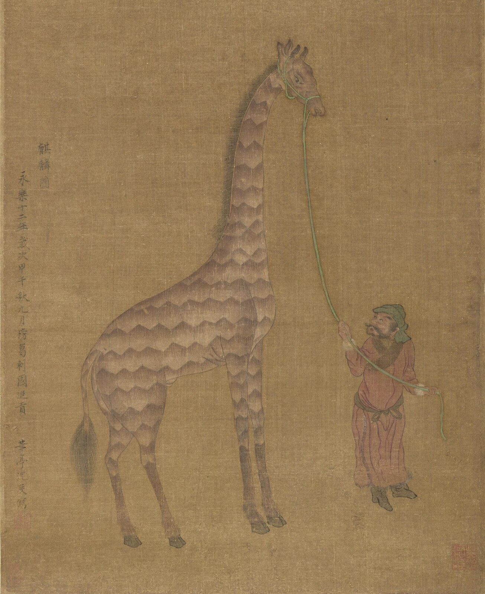
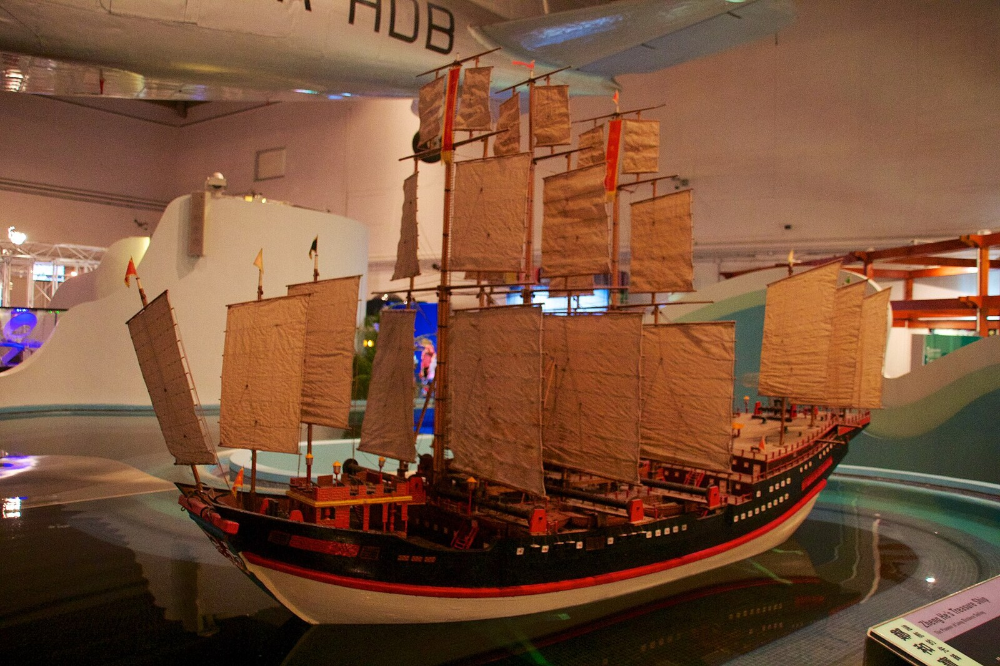
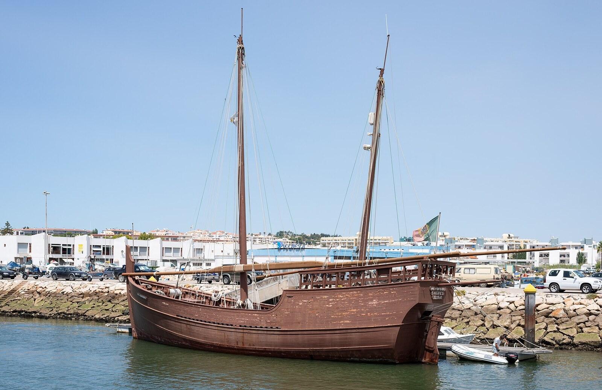
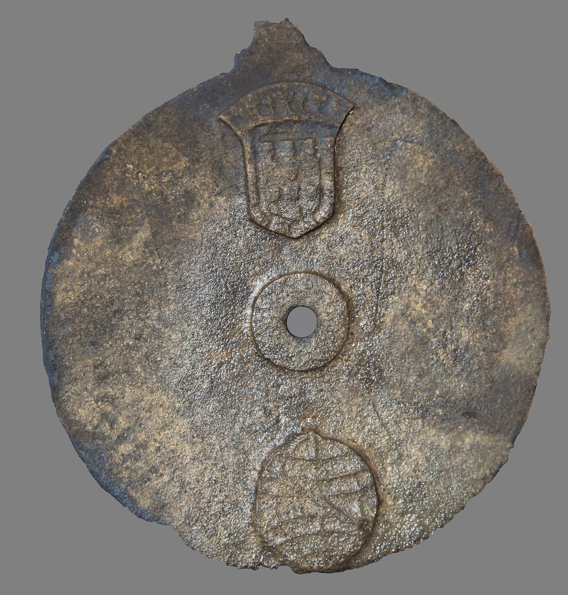
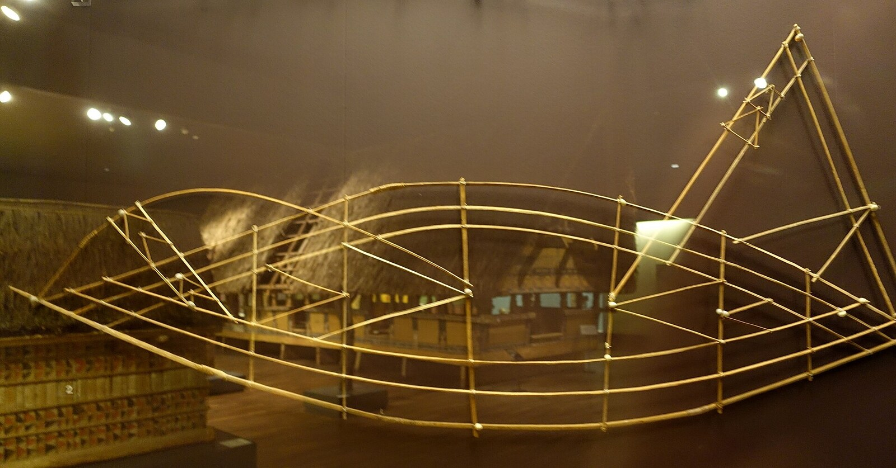
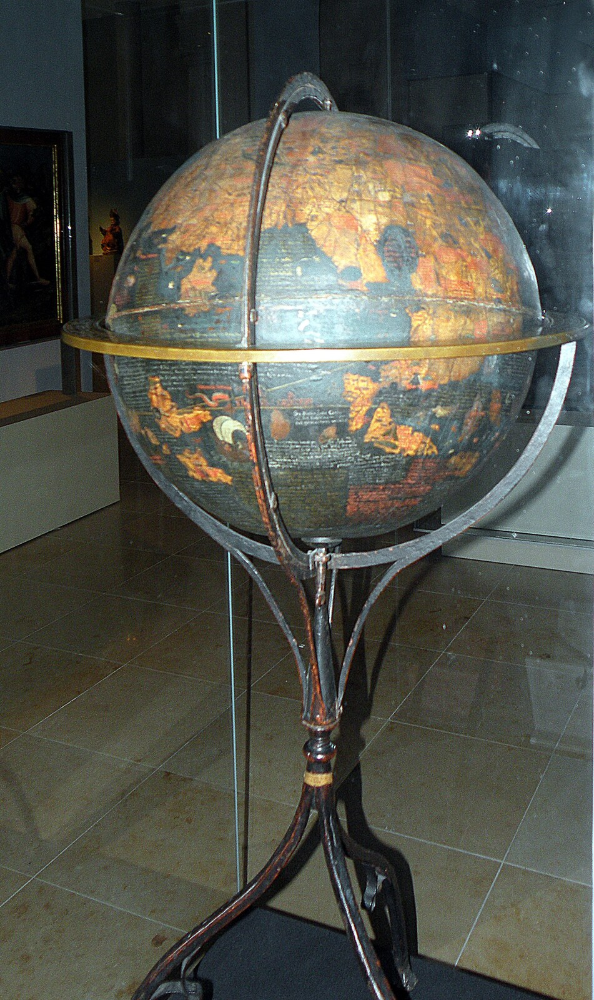
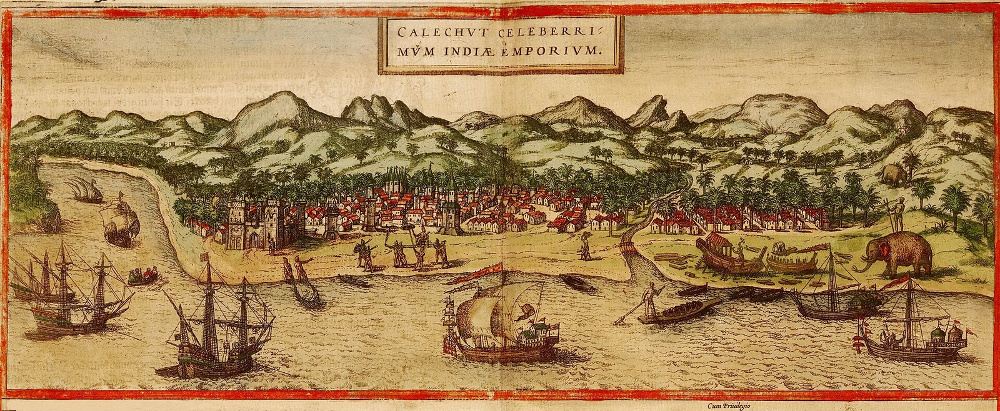
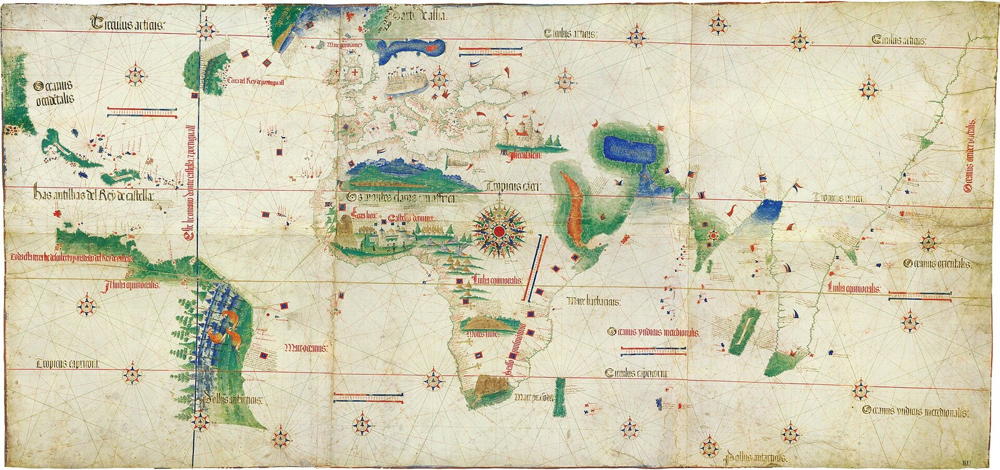

# 44. Why did Columbus sail west?

*China, Portugal, Spain and the oceans, from 1405 to 1502*

Because the spices and gold that Europeans wanted reached them through a long chain of foreign merchants, and a sailor from Genoa persuaded the queen of Castile, the largest kingdom of Spain, that Asia lay a few weeks to the west. He had the size of the world wrong by a wide margin. The experts who had turned him down were right.

In the autumn of 1414, a giraffe was led into the court of the emperor of China. It had been born in East Africa, shipped across the Indian Ocean to Bengal, and shipped again around Southeast Asia to China, a journey of more than ten thousand kilometres by sea. Nobody at court had seen such an animal. The officials decided that it must be the *qilin*, a gentle hoofed creature of legend that was said to appear when a perfect ruler sat on the throne. A court official painted its portrait, and copies of the picture survive.

*The tribute giraffe of 1414, painted for the Yongle Emperor by the court artist Shen Du. Painting: Shen Du, public domain.*

The giraffe had travelled in the wake of the grandest ocean fleets the world had yet seen. Between 1405 and 1433, the Ming emperors of China sent seven great expeditions into the Indian Ocean under an admiral named Zheng He. He was a Muslim from the far south-west of China, captured as a boy and made a servant of the palace. His first fleet carried about twenty-seven thousand men in more than two hundred ships. The largest of these were probably sixty or seventy metres long, with watertight compartments in the hull.

*A model of one of Zheng He's treasure ships, in the Hong Kong Science Museum. It is a modern reconstruction, not a surviving ship. Photo: Mike Peel, CC BY-SA 4.0.*

The fleets called at Vietnam, Java, Sri Lanka, India, the Persian Gulf, Arabia and the coast of Africa as far south as Kenya. They did not come to plant colonies. They traded, and when a king in Sri Lanka was rash enough to attack them, they carried him back to China as a prisoner. Their main purpose, however, was display. Zheng He handed out silk and porcelain, and local rulers were invited to send gifts and ambassadors back to China to acknowledge the emperor as the greatest lord on earth. Rare animals made the best gifts of all, and that is how a giraffe came to be walking into a Chinese palace.

Nearly ninety years after the first of those fleets, an Italian captain set out across a different ocean with three ships and ninety men. His flagship could have been carried on the deck of one of Zheng He's largest. Zheng He's fleets had sailed to be admired. The three small ships sailed to find a road to the spices, and that difference in purpose is why the small expedition changed the world and the great one did not.

## The price of pepper

Europe in the 1400s was a rather poor and out-of-the-way part of the world, and the things its richer people wanted most grew somewhere else. Chief among them were spices. Pepper came from the south-west coast of India. Cinnamon came from Sri Lanka. Cloves and nutmeg came from a handful of small islands in the far east of Indonesia and grew nowhere else on earth. Europeans used them in cooking and in medicine, and a nobleman showed his rank by the quantity he served.

*Black pepper growing on the vine, in Kerala on the south-west coast of India, where Europe's pepper came from. The green berries are dried until they turn black. Photo: K Hari Krishnan, CC BY-SA 3.0.*

None of these places was anywhere near Europe. As a result, a sack of pepper passed through many hands on its way to a kitchen in Paris or London. Indian growers sold it to merchants on the coast. Arab and Indian ships carried it across the ocean to the Red Sea on the monsoon winds, the seasonal winds of the Indian Ocean. Camels carried it to the Nile, and boats took it down to Alexandria, where the sultan of Egypt collected a heavy tax. There, merchants from Venice bought it and shipped it to Italy. Each of these people took a profit, and each profit was added to the price. By the time the pepper reached a European market it cost many times what it had cost in India.

The second thing Europeans wanted was gold. They had to pay for the spices with something, and their own mines could not supply enough. Most of their gold came from West Africa, from the lands of the kings of Mali, and it came across the Sahara on camels to the ports of North Africa. Here, too, Europeans stood at the far end of somebody else's road. Muslim merchants controlled the route and took their share.

It was plain to anyone who thought about it that whoever found another way to the sources of the gold and the spices, a way that went around the middlemen, would become extremely rich.

The Venetians had no reason to look. They were one of the links in the chain, and the existing arrangement suited them very well. The people who went looking were their rivals, and the first of them lived at the far western edge of Europe, facing the open Atlantic.

## The turn of the sea

Portugal was a small kingdom of about a million people, mostly farmers and fishermen. In 1415 a Portuguese army crossed the strait to Morocco and captured the port of Ceuta, one of the towns where the gold caravans ended. The caravans promptly went elsewhere, and the Portuguese were left holding a town that the gold no longer came to. One of the king's sons, Prince Henry, who had fought at Ceuta, drew the conclusion that the gold would have to be reached by sea. Ships would have to sail down the coast of Africa until they came to the land it came from.

For the next forty years Henry paid for ship after ship to try. The difficulty was not that the coast was unknown, although it was. The difficulty was the wind.

Off north-west Africa, the wind blows from the north-east almost every day of the year, and a strong current runs the same way. Sailing south was easy, since the wind and the current did the work. Getting home again was close to impossible, because a ship would then have to fight the wind and the current together for a thousand kilometres. Sailors knew of a headland called Cape Bojador, on the coast of the Sahara, and they believed that nobody who passed it could return. They were not being superstitious. They had the wind exactly right.

The Portuguese solved the problem in two ways. The first was a ship. The usual cargo ship of Europe had square sails, which work well with the wind behind them and badly otherwise. That is the wrong kind of ship for a coast where the wind blows against the way home. Portuguese shipbuilders therefore took the triangular sail long used in the Mediterranean and the Arab seas, which is hung from a long slanting pole and can be swung along the length of the ship. A vessel rigged this way can sail at a much sharper angle towards the wind.

They put two or three of these sails on a light hull about twenty metres long, which drew so little water that it could nose into river mouths. This was the caravel, and it needed a crew of only twenty.

*A modern replica of a Portuguese caravel, the Boa Esperança, moored at Lagos in southern Portugal. The caravel's triangular sails let it sail closer to the wind. Photo: Norbert Nagel, CC BY-SA 4.0.*

The second solution was an idea, and it was the more important of the two. Captains whose names are lost gave up trying to beat back along the coast. Instead, they turned their ships away from Africa and away from home, and steered north-west, out into the empty ocean, with the wind on their side. They kept going for weeks. Far out, at about the latitude of Portugal, they found a steady wind blowing from the west. They turned east and rode it home.

The Portuguese called this loop the *volta do mar*, the turn of the sea. What they had discovered is that the winds of the North Atlantic blow in an enormous circle, clockwise, like water going round a basin. Near the tropics they blow towards the west, and farther north they blow back towards the east. A ship leaving West Africa can therefore be carried out to sea by one wind and brought home by another. A sailor who understands this can go almost anywhere, provided he is willing to sail in the wrong direction for a month out of sight of land.

With this knowledge the ships moved steadily south. The headland that sailors had feared was the first barrier to go. A Portuguese ship passed Cape Bojador in 1434 and came back. Out in the ocean the Portuguese had already found the uninhabited islands of Madeira and the Azores, and they planted Madeira with sugar cane. By the 1440s the captains had reached the green country south of the Sahara, where they bought gold dust, pepper of a local kind and ivory.

Gold and ivory were not the only cargo. They also took people. In 1444 a Portuguese expedition landed two hundred and thirty-five captured Africans at the port of Lagos, in southern Portugal, and sold them in a field outside the town gate. The prince watched from his horse, and his chronicler described mothers clinging to their children as the families were divided into lots. Raiding soon gave way to buying from African rulers and merchants, which was safer. Within a few decades, enslaved Africans were cutting the sugar cane on Madeira. A pattern had been set that would last for four hundred years.

## The height of the sun

A captain who sails out of sight of land for a month needs some way of knowing where he is. The turn of the sea had made that an urgent matter. The compass told him his direction. He could estimate his speed by watching the water go past, and work out roughly how far he had come. The errors in such guesses pile up day by day, however, and after a few weeks they could amount to hundreds of kilometres.

The sky offered a check, at least for half the problem. It could tell a sailor how far north or south he was. In the northern half of the world there is a star that stays close to the point directly above the North Pole. The farther north an observer stands, the higher this star appears in the sky. In Lisbon it stands about thirty-nine degrees above the horizon, and at the equator it sits on the horizon itself. A sailor could therefore find how far north he was by measuring the star's height, with a small correction for the hour of the night. The instrument he used was a simple one. It was a quarter-circle of wood or brass with a weighted string hanging from its corner.

As the Portuguese pushed south, however, the Pole Star sank into the sea behind them and was gone. In the 1480s the king of Portugal put a committee of astronomers to work on the difficulty. Their solution was to use the sun at midday.

The sun is a harder guide than the star. Its height at noon changes with the seasons as well as with the observer's position, so that a single measurement mixes the place and the date together. To separate them, the astronomers supplied tables, drawn from the work of a Jewish astronomer in Spain, which gave a correction for every day of the year.

The measuring itself was done with an instrument made for a moving deck. The pilot hung a heavy brass disc from his thumb, so that it stayed upright as the ship rolled. He turned a pointer on its face until the sunlight passed through two small holes, one behind the other, and read the sun's angle from a scale around the rim. The tables turned that angle into a latitude. As a result, a pilot anywhere on earth could now find his distance north or south to within a hundred kilometres or two.

*The oldest mariner's astrolabe known, made before 1503, with the arms of Portugal on its face. Pilots used it to read the sun's height at noon. Photo: Lodsworth, public domain.*

His distance east or west, his longitude, was another matter. The sky gives no simple sign of it, because the earth turns and every place along the same latitude sees the same stars in the course of a night. To find longitude a sailor would have needed to know the exact time at home while he measured the time where he was, and no clock of the age could keep time on a rolling ship. This problem was not solved for another three hundred years. Until then, captains made do with half an answer. They sailed to the latitude of the place they wanted and then turned along it, east or west, until they hit land.

None of this equipment was the only way to cross an ocean. On the other side of the world, the Polynesians had been doing it for well over a thousand years with no compass, no charts and no writing. What they used in place of instruments was memory and close attention. Their navigators memorised the points on the horizon where hundreds of stars rise and set. They read the direction of the ocean swells from the motion of the canoe, and they watched the flight of birds that sleep on land, because such birds show where land is. With those skills, and in double-hulled canoes about as long as a caravel, they found and settled the islands of Polynesia, scattered across a triangle of ocean with Hawaii, New Zealand and Easter Island at its corners. The last large one, New Zealand, was reached around 1300. They reached South America as well, and the sweet potato, an American plant, was growing in their gardens long before Columbus.

*A stick chart from the Marshall Islands, north-west of Polynesia, in the Ethnological Museum in Berlin. Marshallese navigators made these models of ocean swells to learn the patterns on land, and left them behind when they sailed. Photo: Daderot, CC0.*

European sailors of the 1400s were therefore not the world's finest seamen, and their ships were not the largest. What marked them out was what they were looking for, and who was paying.

## A man with the wrong number

In 1488 a Portuguese captain rounded the southern tip of Africa and saw the coast turning north-east ahead of him. The way to India was open, and it was Portugal that had opened it. A few years earlier, however, a foreigner had come to the Portuguese court to ask the king for ships to try a different route.

Christopher Columbus was a weaver's son from Genoa who had gone to sea as a boy. He had sailed on Portuguese ships to West Africa, and he had lived on an island near Madeira, where he had married the governor's daughter. He knew the Atlantic wind circle as well as anyone alive. His idea was simple. The Portuguese were working their way to Asia by going around Africa. Since the world is round, a ship that sailed west would come in the end to the eastern shore of Asia. He proposed to do it.

Every educated person in Europe knew that the world was round. The Greeks had proved it and measured it eighteen centuries before. The shape was not in dispute. The question was how far a ship would have to go. Columbus had made his own estimate, and it was a triumph of wishful thinking. He took the smallest figure he could find for the size of the globe and the largest figure he could find for the width of Asia. A small globe with a wide Asia on it leaves very little room for ocean. He then added Marco Polo's report that Japan lay far out to sea beyond China, which brought the nearest Asian land closer still. The result was that Japan should be about four and a half thousand kilometres west of the Canary Islands.

*The Erdapfel, a globe made by Martin Behaim in Nuremberg in 1492, the year Columbus sailed. It shows only open ocean between Europe and Asia. Photo: Vitold Muratov, CC BY-SA 3.0.*

The true distance is about nineteen thousand kilometres. The king of Portugal put the proposal to his committee of astronomers, and they told him that the Genoese was badly wrong, and that the distance was several times what he claimed. They were right. If the ocean between Europe and Asia had been empty, as everyone supposed, Columbus and his crews would have died of thirst somewhere in the middle of it.

In China, a refusal of this kind from the court would have been the end of the matter. Europe, however, was divided into a dozen competing kingdoms, and a man who was turned away by one king could try the next. That is exactly what Columbus did. He went to Spain. He sent his brother to make the same offer in England and in France. The Spanish experts gave the same opinion as the Portuguese ones, and for six years the queen of Castile, Isabella, kept him waiting.

In January 1492 Isabella and her husband Ferdinand, the king of neighbouring Aragon, captured Granada, the last Muslim kingdom in Spain, after ten years of war. With the war over, she looked again at the Genoese. What made the difference was how little he was asking for, set against what might be won. Portugal, the rival next door, was about to reach India. Columbus was asking for three small ships and the pay of ninety men, which was a sum the treasury would hardly notice. If he vanished, little was lost. If by some chance he was right, Castile would reach the spices first.

Columbus sailed in August 1492. He did not head straight out from Spain. Here his knowledge of the Atlantic winds served him well. He went south to the Canary Islands, into the belt of winds that blow to the west, and from there he ran before them. The crossing took thirty-six days. In the last weeks the crew grew frightened and angry. The steady wind that carried them along so easily was the cause. They could see that it blew the same way day after day, and they did not believe it would ever carry them home.

Before dawn on 12 October a lookout saw white sand in the moonlight. It was a small island in the Bahamas. Columbus was sure that it lay off the coast of Asia, and he called the people who came down to the beach Indians. He spent three months among the islands asking the way to Japan. Then he sailed north until he found the west wind, exactly as the Portuguese did, and rode it home.

He crossed three more times, and he maintained to the end of his life that he had been to Asia.

## Washbasins for a king

The Portuguese were not deceived for long. They knew the size of the globe, and they knew that whatever Columbus had found, it was not India. India still lay where they had always looked for it, at the far end of the route around Africa. In 1497 they sent their own expedition, four ships and about a hundred and seventy men under a nobleman named Vasco da Gama.

Da Gama applied the turn of the sea to the southern ocean, where the winds go round the other way. The principle was the same one: leave the coast and go looking for a wind that blows the right way. Instead of creeping down the African coast, he swung far out to the south-west, into the middle of the Atlantic, and then curved back towards the tip of Africa. His ships were out of sight of land for ninety-three days, nearly three times as long as Columbus had been. They rounded the cape, worked up the east coast, and at a port in Kenya took on a pilot who knew the monsoon. He brought them across to India in twenty-three days.

![A map of the Atlantic and the western Indian Ocean with curved arrows for the winds, turning clockwise in the North Atlantic and anticlockwise in the South, a dotted loop for the Portuguese turn of the sea from West Africa by the Azores to Lisbon, Columbus's route out from the Canaries to the Bahamas in 1492 and home by the north in 1493, and da Gama's arc through the South Atlantic round the Cape of Good Hope to Malindi and Calicut in 1497-98, with Lisbon, Ceuta, Madeira, the Canaries, Cape Bojador and the Cape Verde Islands marked](images/map_atlantic.png)
*The winds of the Atlantic and three ways of using them. The Portuguese turn of the sea (dotted line) brought ships home from West Africa by way of the Azores. Columbus sailed out from the Canaries in 1492 (solid line) and came home by the north in 1493 (dashed line). Da Gama (dash-and-dot line) swung far out into the South Atlantic in 1497 and rounded the Cape of Good Hope to reach Calicut in 1498. Map: drawn for this book; coastlines and rivers from Natural Earth, public domain.*

They anchored off the city of Calicut in May 1498. It was the centre of the pepper trade, and merchants from Arabia, Persia, Gujarat and China had been doing business there for centuries. Da Gama asked to see the king and sent ahead the presents he had brought. There were some pieces of striped cloth, a few hats and strings of coral, six washbasins, and a little sugar, oil and honey.

*Calicut on the Malabar coast, in a panorama printed in 1572, seventy years after da Gama, in Braun and Hogenberg's atlas. It is a European picture of the city. Engraving: Georg Braun and Franz Hogenberg, public domain.*

The king's officials laughed when they saw them. They told the Portuguese that the poorest merchant from Mecca gave more, and that if he wished to make a gift it should be of gold. The plain fact was that Europe made almost nothing that Asia wanted. The Portuguese had found their way around the middlemen and had arrived with very little to sell. Da Gama managed to buy a modest cargo of pepper and cinnamon. Even so, when two of his ships and about a third of his men got home in 1499, the spices paid for the expedition many times over.

When da Gama returned to India in 1502, he brought twenty ships, and what he brought to trade with was cannon. Europe did make something that carried weight in those waters. For a hundred years Europeans had been fitting their ships with guns, and their hulls, nailed together from heavy oak, could take the shock of firing them. The trading ships of the Indian Ocean were built differently. They were lighter, many of them sewn together with cord, and they carried no heavy guns, because nothing like a floating battery had ever been seen in those waters.

Off the Indian coast da Gama captured a ship full of pilgrims returning from Mecca, among them women and children. He took its cargo and burned it with several hundred people on board. He then bombarded Calicut from the water for two days.

Over the next ten years the Portuguese seized a chain of harbours from East Africa to Malaysia and built forts in them. They announced that every ship in the Indian Ocean must buy a pass from them or be sunk. They were too few to enforce this everywhere, and most of the old trade went on. A new kind of power had arrived in Asia all the same. It was small, it came from very far away, and it travelled with its guns.

## Why the great fleet stayed home

The Chinese fleets could have done all of this, and done it sooner. In the 1420s a Chinese admiral could have sailed around Africa and into the harbour of Lisbon, and nothing in Europe could have stopped him.

The voyages ended in 1433 instead, and the reasons lay inside the Chinese court. They had been the passion of one emperor, and his grandson sent out the last of them. They had also made enemies. The fleets were run by the servants of the palace, whom the regular officials detested. To those officials, who had risen through the examinations and saw farming as the true source of wealth, the fleets were a huge expense that brought back giraffes.

The officials had a practical argument as well. The real danger to China lay in the north, where the Mongols were raiding again, and the money was needed for walls and soldiers. When the court lost interest, the ships were left to rot at their moorings. Chinese merchants went on trading across the southern seas in their own vessels, often against the law, but the state's great fleets never sailed again. Later it was made a crime to build a seagoing ship with more than two masts.

China could afford to turn away. It was the richest country in the world, it made the silk and porcelain that everyone else wanted, and it had little need of anything from across the sea. Its government was also a single court, so that when that court lost interest there was nobody else to carry on.

Europe had neither advantage. It was hungry for goods it could not make, and it had no single court. Columbus had already shown what that meant. When Portugal's experts said no to him, Castile said yes. Once Castile had found land, moreover, the others could not afford to stay at home. Portugal, England, France and in time the Netherlands all sent ships of their own. No one of them could have called a halt even if it had wished to.

In 1494, Spain and Portugal met to divide what they had found. They drew a line down the middle of the Atlantic, from pole to pole, a little more than two thousand kilometres west of the Cape Verde Islands. All newly found lands to the west of it would belong to Spain, and all those to the east to Portugal. Nobody asked the people who lived there. The treaty said how many leagues west of the islands the line lay. No ship could measure a distance east or west across open water, however, and so for the next two and a half centuries neither kingdom was able to say exactly where it ran.

*The Cantino planisphere, a world map drawn by an unknown Portuguese mapmaker in 1502, with the line dividing the Atlantic between Spain and Portugal. Map: anonymous Portuguese, public domain.*