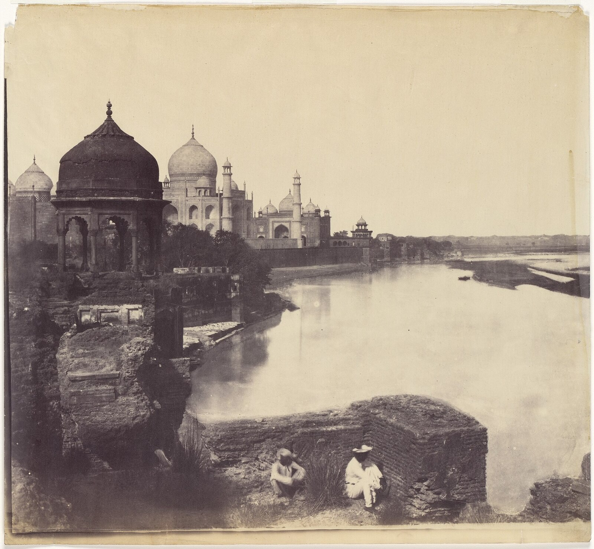
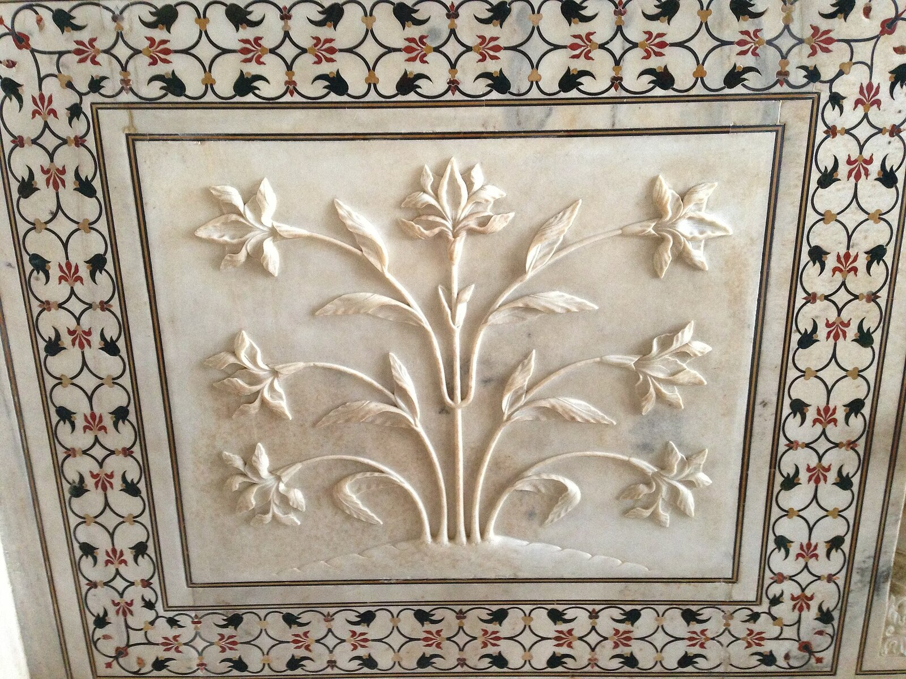
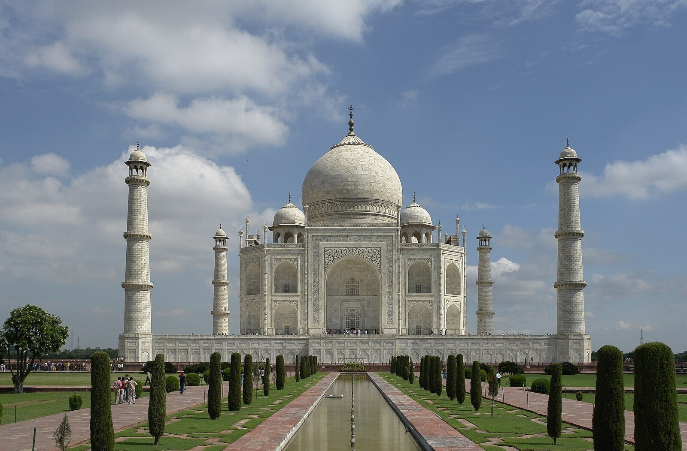
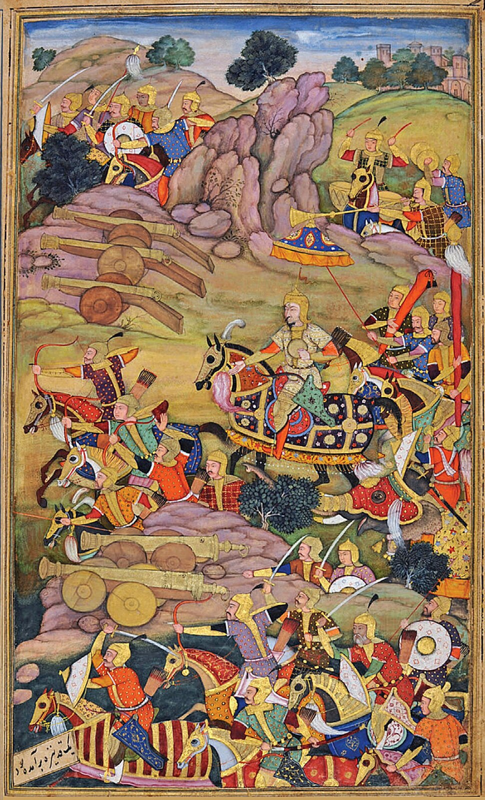
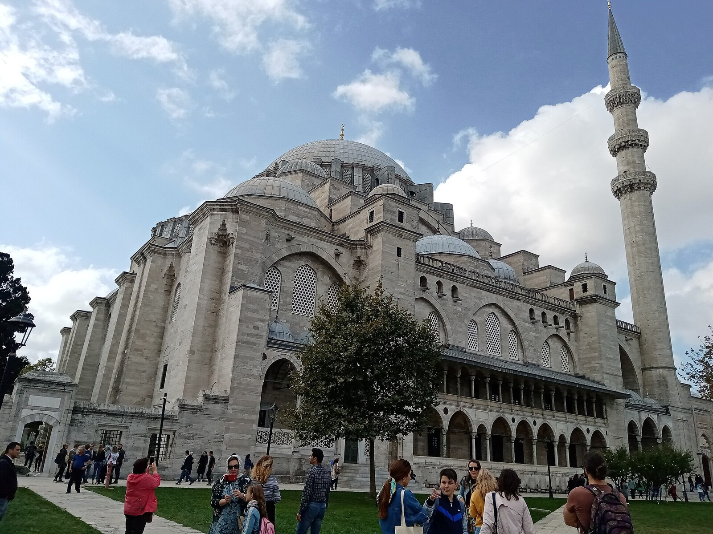
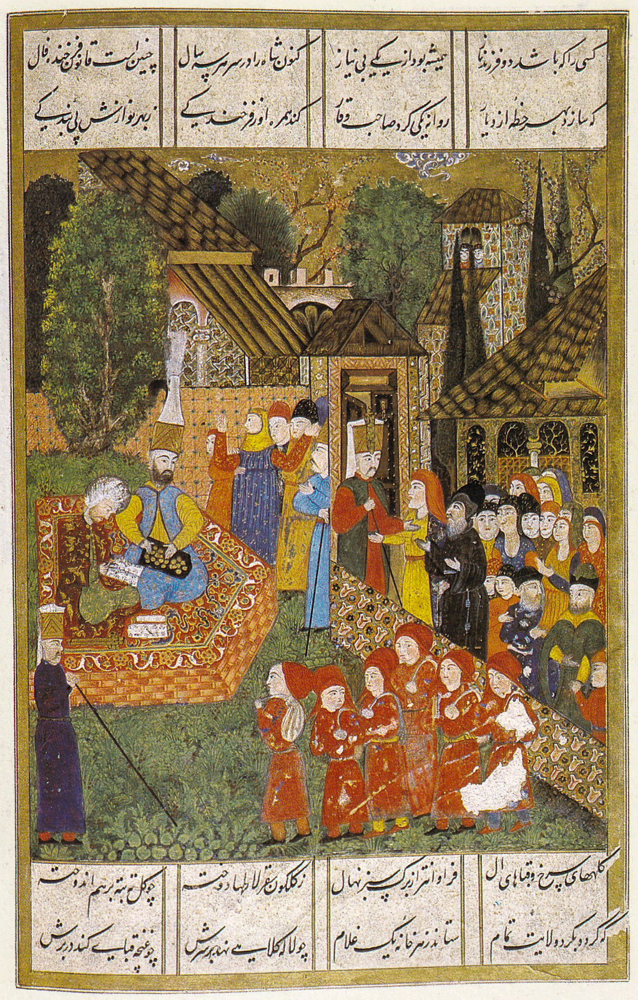
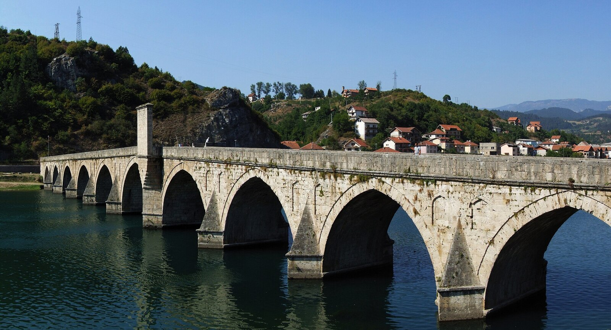
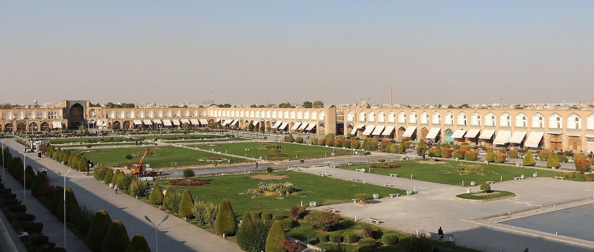
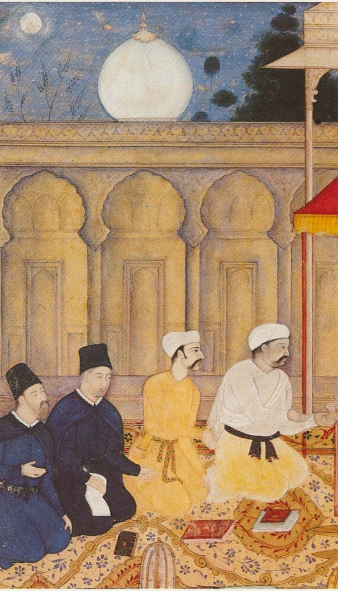

# 44. Who built the Taj Mahal?

*Turkey, Iran and India, from 1501 to 1707*

A Muslim emperor of India built it as a tomb for his wife, and he paid for it with the taxes of about a hundred million subjects, most of whom were Hindus. His family, the Mughals, ran one of three great Muslim empires of that age, and each of the three had to work out how to rule people who did not share its faith.

In June 1631, in the town of Burhanpur in central India, a woman named Mumtaz Mahal died giving birth to her fourteenth child. She was thirty-eight. Her husband was Shah Jahan, the emperor of India, who was there on campaign and had brought her with him as he always did. The court historians recorded that he went into mourning for a year, and that within a few months his hair and beard had turned white.

Six months later her body was carried to the city of Agra, the capital, and buried in a garden on the bank of the river Yamuna. Over the grave the emperor ordered a tomb. It took twenty thousand workers about twelve years to build the main structure and several more to finish the gardens and gates around it.

*The Taj Mahal seen across the river Yamuna at Agra, in a photograph made between 1858 and 1862. Photo: John Murray, CC0.*

Almost nothing in the building came from Agra. The white marble that covers it was quarried three hundred kilometres to the west and hauled to the site on wagons pulled by teams of oxen and buffalo. Jade came from China, turquoise from Tibet, and blue lapis lazuli from Afghanistan. These stones were cut into slivers and set into the marble to make flowers. The verses from the Koran that frame the great arches were designed by a calligrapher from the city of Shiraz, in Iran, who signed his work. The dome follows a style that began in Central Asia, and the little pavilions on the roof are borrowed from the palaces of Hindu princes.

*A marble panel in the Taj Mahal with a carved flower and a border of flowers inlaid in coloured stone. Photo: Rajesnewdelhi, CC BY-SA 3.0.*

The land itself had belonged to one of those princes. He was a Hindu raja and also one of the emperor's leading generals, and the emperor gave him four mansions in exchange for the plot. The same raja was ordered to supply stonecutters and carts for the marble.

The Taj Mahal is a Muslim tomb in a mostly Hindu country, built with Arabic verses in a Persian hand and Indian stonework, on land sold by a Hindu general to a Muslim king. Every part of that sentence was the result of a decision about how to govern.

*The Taj Mahal at Agra, India, from the south, built for Mumtaz Mahal in the years after 1631. Photo: Yann, CC BY-SA 4.0.*

## The Tiger's guns

A hundred years before the Taj, no such empire existed. Northern India was ruled by a sultan in Delhi, and to the north-west, in Kabul, sat a restless prince named Babur.

Babur was a descendant of both Genghis Khan and the later conqueror Timur, and he had spent his youth losing his family's small kingdom in Central Asia. His name meant "tiger". He kept a diary, which is one of the frankest books a ruler has ever written, and in it he explains that Kabul was too poor to keep an army, and that India was rich.

In April 1526 he met the sultan of Delhi on the plain of Panipat, north of the city. By his own account he had about twelve thousand men, and the sultan had eight times as many, with a great line of war elephants. Babur also had something that no army in northern India had faced before. He had cannon and several thousand soldiers with muskets, and he had hired two master gunners from the Ottoman empire to manage them.

*The battle of Panipat in 1526, painted about 1598 for a copy of Babur's memoirs. It shows cannon, horsemen and elephants. Painting: Painters of Babur, public domain.*

On the gunners' advice he tied seven hundred carts together with ropes of rawhide to make a wall, with gaps for his cavalry, and set the guns and musketeers behind it. The sultan's army charged the carts and piled up in front of them, where the guns and Babur's horsemen on the flanks cut it down. By noon the sultan was dead and India had a new ruler. The Persian word for Mongol was *Mughal*, and that is the name the dynasty carried.

The same thing was happening across the Muslim world in those years. The Ottomans, having taken Constantinople with their guns, used them to conquer Syria and Egypt in a single campaign and then to break the kingdom of Hungary. In Iran a new dynasty, the Safavids, learned the lesson by being on the wrong end of it. By the middle of the 1500s, three empires covered the whole stretch of country from the Danube to the Bay of Bengal.

*The three Muslim empires in the middle of the 1600s: the Ottomans, the Safavids in Iran and the Mughals in India. The areas are shown roughly. The crosses mark the battles of Chaldiran in 1514 and Panipat in 1526. Goa was Portuguese. Map: drawn for this book; coastlines and rivers from Natural Earth, public domain.*

Guns had a political effect as well as a military one. A cannon needed a foundry, tonnes of bronze, a powder works and trained crews, and musketeers had to be drilled and paid all year round. Tribal chiefs and local lords, who had been the backbone of earlier Muslim states, could not afford any of this. A ruler who controlled the taxes of a large territory could. Some historians have called these states the gunpowder empires for that reason, and others object that the label credits a weapon with what was done by tax collectors. Both have a point. The guns won the battles, and the ability to pay for them year after year built the states.

Having won, each of the three faced the same difficulty. Each ruled millions of people who believed that the ruler's religion was mistaken.

## The boy from Bosnia

The Ottoman empire reached its height under Suleiman, who reigned from 1520 to 1566. His lands ran from Hungary to Yemen and from Algeria to Iraq. In the European half, most of his subjects were Christians, and in the cities there were large communities of Jews, many of whom had arrived after being expelled from Spain.

*The Süleymaniye Mosque in Istanbul, built during the reign of Sultan Suleiman, 1520 to 1566. Photo: MilenaBal, CC BY-SA 4.0.*

The Ottoman answer to religious difference was to leave it alone and tax it. Islamic law had long held that Christians and Jews, as people who possessed a scripture, could keep their religion under a Muslim ruler if they paid a special tax and accepted a lower rank. By the rules, they could not ride horses or carry weapons, their churches could not be taller than the mosques, and their word counted for less in a Muslim court. The rules were enforced strictly in some places and hardly at all in others. Within those limits each community ran its own affairs. A Greek peasant was married, taxed and judged in family matters by his own priests under his own bishops, and the bishops answered to the sultan. A Jew or an Armenian lived the same way under his own leaders. For a Jewish family arriving from Spain, where the choice had been baptism or exile, this was a good bargain.

There was one demand that fell on Christians alone. Every few years, Ottoman officers went through the villages of the Balkans and took away boys. They chose the healthiest and brightest, between about eight and eighteen years old, at a rate of roughly one boy from every forty households, and marched them to the capital. There they were converted to Islam and taught Turkish. Most were trained as soldiers and became janissaries, the sultan's own infantry. The most promising were sent to the palace school and educated to govern.

*Ottoman officials registering Christian boys for the devshirme, the levy of boys, in a miniature painted in 1558. Painting: unknown Ottoman artist, public domain.*

Legally these boys were the sultan's slaves, and they owed everything to him. That was the purpose. A Turkish nobleman had a family, estates and ambitions of his own. A man taken from a Christian village at twelve arrived at court with no relatives and no party of his own. The sultans therefore gave the highest offices in the state to these men, and for two centuries many of the chief ministers of the largest Muslim empire in the world had been born Christians.

One of them was a boy from a village in the hills of Bosnia, the son of Serbian Orthodox farmers, who was taken as a boy. He was renamed Mehmed. He rose through the palace to command the fleet and then the army, married the sultan's granddaughter, and for the last fourteen years of his life he was chief minister under three sultans, the most powerful man in the empire after his master. He did not forget where he came from. He built a great stone bridge over the river near his birthplace, which still stands, and he used his influence to restore the independent church of the Serbs and to have a close relative of his made its head.

*The stone bridge over the river Drina at Višegrad, Bosnia, built in the 1570s for Mehmed Paša Sokolović, who was born nearby. Photo: Pudelek (Marcin Szala), CC BY-SA 3.0.*

For the villages, the levy of boys was a grief, and there are records of parents who hid their sons or married them off as children to make them ineligible. There are also records of families who offered bribes to have a son taken. Both make sense. A boy who was chosen was lost to his parents and his faith, and he might end up ruling the empire.

## The shah who was fourteen

East of the Ottomans, in Iran, a completely different choice was made, and it was made by a teenager.

Muslims had been divided since the first century of Islam over who should have succeeded the Prophet. The majority, the Sunnis, accepted the line of caliphs chosen by the community. The Shia held that leadership belonged by right to the Prophet's son-in-law Ali and his descendants. In 1500 the Shia were a scattered minority, and Iran was a mainly Sunni country.

In 1501 a boy of fourteen named Ismail rode into the city of Tabriz at the head of an army of Turkish tribesmen. He was the hereditary leader of a religious brotherhood, and his followers, who wore red caps, believed him to be something close to divine and went into battle without armour. Ismail had himself crowned shah, and he announced that from then on the religion of his kingdom would be Shia Islam.

His advisers told him that most of the people of Tabriz were Sunnis and would not stand for it. He replied that if they said a word, he would draw his sword and leave not one of them alive. Preachers were ordered to curse the first three caliphs, whom Sunnis revere, from every pulpit. Sunni scholars who refused were killed or driven out, and because Iran had few Shia scholars of its own, the shah imported them from Lebanon and Iraq to staff the mosques and schools. Within a few generations Iran was a Shia country, as it has been ever since.

The Ottoman sultan, who regarded himself as the protector of Sunni Islam, now had a hostile Shia power on his eastern border, with admirers among his own tribesmen. In 1514 he marched into Iran. The two armies met at Chaldiran, in the mountains near the modern border of Turkey and Iran. Ismail had the finest cavalry in western Asia and no guns, which he is said to have thought unmanly. The Ottomans chained their cannon together and lined up their janissaries with muskets behind them. The red-capped horsemen charged, and were shot to pieces.

Ismail escaped, and never led an army again. The border between the two empires moved back and forth for another century and then settled. It runs today, with small changes, between Turkey and Iraq on one side and Iran on the other.

A century after Ismail, his descendant Shah Abbas built a new capital at Isfahan, with a square large enough to hold twelve football pitches, on which the court played polo. Abbas wanted to make Iran rich through its silk, and he judged that the best merchants within his reach were the Armenians, a Christian people living on his north-western frontier. In 1604 he had their chief town emptied and burned, and marched its people several hundred kilometres to Isfahan. Many died on the road. The survivors were given a suburb of their own across the river. There they were allowed to build churches, ring bells and make wine, and the shah gave them a privileged place in the export of silk. Within a generation Armenian trading houses based in that suburb had agents from Amsterdam to Manila.

*Naqsh-e Jahan Square in Isfahan, Iran, the great square laid out by Shah Abbas after he made the city his capital. Photo: Bernard Gagnon, CC BY-SA 4.0.*

The Safavids forced their Muslim subjects into one sect and gave a Christian minority privileges. The rule that explains both is that the shah did whatever made his throne stronger.

## Peace with all

Babur's grandson Akbar came to the throne of India in 1556, at thirteen, and reigned for forty-nine years. He could not read, and he had books read to him every evening and remembered them. He inherited a small and shaky conquest and turned it into an empire that covered all of northern and central India.

His problem was arithmetic. The Mughals and their followers were a few tens of thousands of Muslim soldiers from Central Asia and Iran. Their subjects numbered about a hundred million, and at least three in four of them were Hindus. Among those Hindus was a class of hereditary warriors, the Rajputs, who ruled dozens of small kingdoms from hilltop forts in the dry country south-west of Delhi. Many of them had fought the Muslim rulers of Delhi for three hundred years.

Akbar decided to make them partners. In 1562 he married the daughter of a Rajput raja, and he did not ask her to convert. She kept a Hindu shrine inside the palace, and her son became the next emperor. Her father, brother and nephew were given high command in the Mughal army. Other Rajput houses followed, and they found the terms generous. A raja who submitted kept his kingdom and his religion, and gained a rank at court, a salary and a share in the conquests. The family that later sold the land for the Taj Mahal was this one.

Akbar then removed the standing insults. In 1563 he abolished a tax that Hindus paid for visiting their own holy places, and the next year he abolished the special tax on non-Muslims, which Muslim rulers in India had collected for centuries. The religious scholars at court protested that he was breaking holy law. He broke it anyway, and the treasury lost a large income.

He was also simply curious. At his new palace city he built a hall for debate, and on Thursday evenings he sat there while scholars argued in front of him. At first they were all Muslims. Later he invited Hindu priests, Jain monks, Zoroastrians from Iran and, in 1580, three Jesuit priests from the Portuguese colony at Goa, who arrived hoping to convert him and left after three years of courteous disappointment. He had the great Hindu epics translated into Persian, the language of his court. The policy came to be called by a Persian phrase meaning "peace with all".

*Jesuit priests sitting in Akbar's House of Worship, in a detail of a Mughal miniature painted about 1605. Painting: unknown Mughal artist, public domain.*

Akbar had not invented the meeting of faiths in India. For centuries before him, Muslim holy men known as Sufis had travelled the country, teaching that God was reached through love and devotion more than through law. They sang their poetry in the local languages, and their tombs became shrines where Hindus as well as Muslims came to pray for a child or a cure. Many of the Indians who became Muslims did so around such shrines, and teachers of the same kind travelled with the merchants who carried Islam to Bengal and across the sea to Java. Akbar himself walked on foot to one of these tombs to give thanks for the birth of his son.

## A third of the harvest

Tolerance was affordable because India was rich, and because the emperor had an efficient way of collecting a share of its riches.

Akbar's finance minister was a Hindu named Todar Mal, and in the 1570s he reorganised the way the land was taxed. His surveyors measured the fields, village by village. They had formerly used a rope, which stretched when wet, and they replaced it with a chain of bamboo rods joined by iron rings. Each field was classed by the quality of its soil. The officials collected ten years of records of what each kind of land produced, crop by crop, and what the crops had sold for in the nearest market. From these they worked out an average, and the state claimed a third of it.

In the heart of the empire the tax was due in money. The farmer therefore sold part of his grain or cotton to a merchant for silver coins called rupees, and paid the village headman. The headman passed the money to a local landholder, who kept about a tenth for his trouble. The rest went to whichever imperial officer had been assigned the revenue of that district as his salary, and out of it he had to maintain a fixed number of cavalrymen for the emperor. These officers were moved every few years, so that none could put down roots. Districts kept back for the emperor paid straight into his treasury.

The system took a great deal, and a peasant in a bad year could be ruined by it. It was predictable, however, and it pushed farmers to grow crops for sale. India's weavers, meanwhile, made the best cotton cloth in the world, and merchants from every country came to buy it. They had to pay in silver, since India wanted little that they made. A large part of the silver dug from the mountain at Potosí thus came to rest in India, was minted into rupees, and paid the land tax.

By 1600 India produced something like a quarter of everything made in the world. The Mughal emperor's income was many times that of any king in Europe, which is why his grandson could keep twenty thousand men at work on a tomb for twelve years.

## The emperor who copied the Koran

Shah Jahan's son Aurangzeb seized the throne in 1658 after a war against his brothers, and reigned for forty-nine years, exactly as long as Akbar. He was a different kind of man. He was austere and devout, he banned music at court, and he is said to have earned his personal spending money by copying out the Koran by hand and sewing prayer caps.

Aurangzeb believed that a Muslim king should rule as a Muslim. In 1679 he brought back the tax on non-Muslims that Akbar had abolished a hundred and fifteen years earlier. He ordered the destruction of several famous Hindu temples, among them the great temple at the holy city of Varanasi, and put a mosque in its place. He continued to employ Hindu generals and officials, and in fact had more of them than Akbar had. The partnership, however, had lost its warmth.

The reaction was sharpest in two places. In the Punjab, in the north-west, a new faith had been growing for two centuries. Its founder, Nanak, born a Hindu in 1469, had taught that there was one God, that the divisions of Hindu and Muslim meant nothing to him, and that all people were equal, and his followers were called Sikhs, which means disciples. Nine teachers led them after him. The Mughals came to see this organised community as a threat. One Sikh leader had been put to death in 1606, and his son had answered by arming his followers. In 1675 Aurangzeb had another beheaded in Delhi for refusing to convert. In 1699 the dead man's son turned the Sikhs into a sworn brotherhood of soldiers. He told them to take the surname Singh, "lion", to leave their hair uncut and to carry a sword at all times.

In the hill country of the south-west, meanwhile, a Hindu people called the Marathas had risen in revolt, fighting from mountain forts with small, fast raiding parties. Aurangzeb moved south in 1681 to crush them and to conquer the rest of the peninsula. He never came back. He spent the last twenty-six years of his life in a vast moving camp, taking forts that were lost again as soon as he left, while the treasury that Akbar's tax had filled was emptied.

He died in 1707, at eighty-eight, ruling more of India than any king before him. Within a few decades the empire had broken into pieces, and a company of English merchants on the coast had begun to take an interest in who would collect the land tax.

Aurangzeb had also dealt with his father. When he took the throne he shut Shah Jahan in the fort at Agra, and kept him there for the eight years that remained of the old man's life. From his rooms the prisoner could look down the river to the white dome about two kilometres away. When he died he was buried in it, next to his wife. Her tomb lies at the exact centre of the building, on the line around which everything else is balanced. His was fitted in beside hers, and it is the one thing in the Taj Mahal that is out of place.
